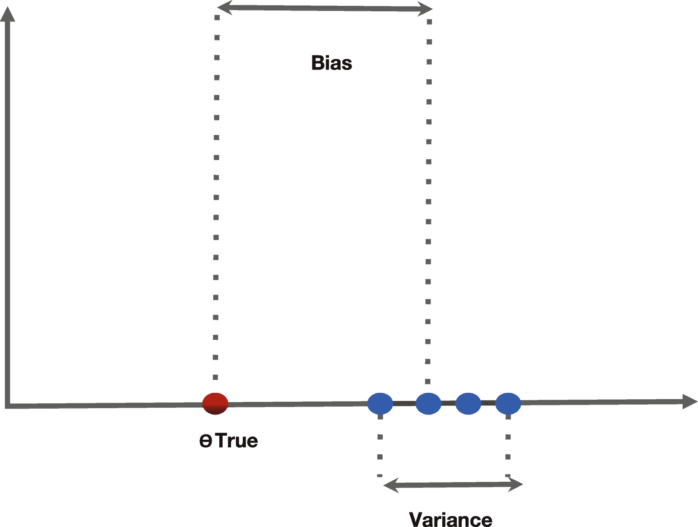
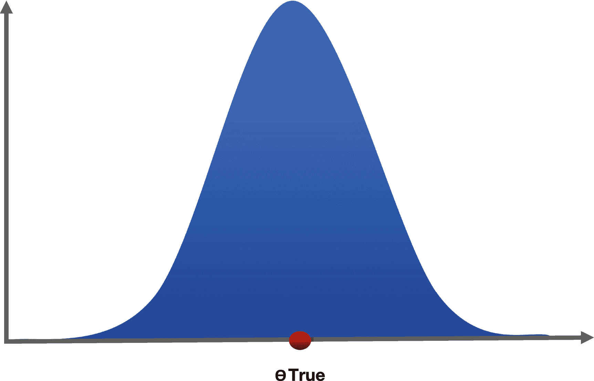
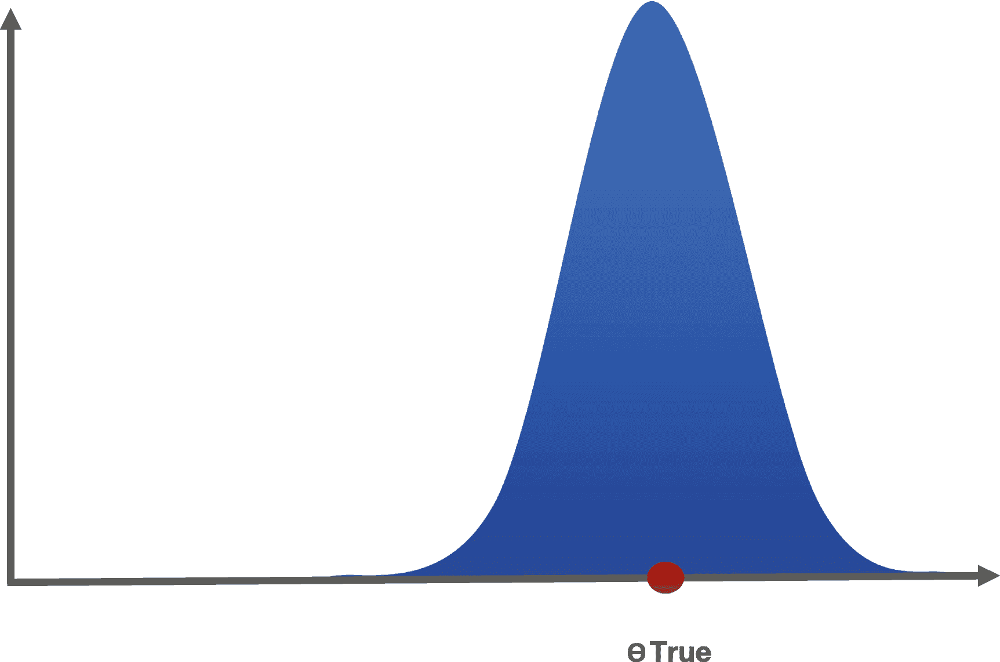
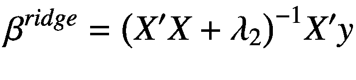
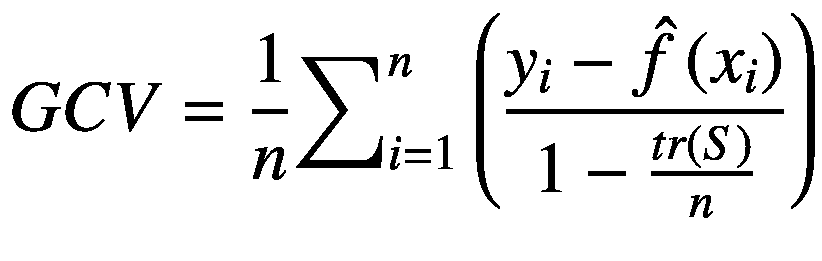
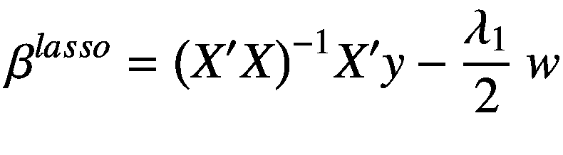

# 2. 高级参数方法

前一章介绍的方法违反了某些回归假设。它无法捕捉噪声，因此在预测未来实例时会出错。解决此问题最便捷的方法是在方程中添加一个惩罚项。

本章介绍了偏差-方差权衡这一新颖概念，然后涵盖了正则化模型，如岭回归、内置交叉验证的岭回归以及套索回归。最后，将这些模型的性能与最小二乘模型的性能进行比较。要深入理解正则化模型，首先必须理解偏差-方差权衡的概念。在下一节中，我们将正式介绍这一概念。

## 偏差与方差的概念

偏差表示估计值接近实际值的程度，而方差表示数据点在模型每次实现中的变化程度。当模型类别无法拟合数据时，就会产生由偏差引起的误差。开发更具表达力的模型类别可以解决此问题。另一方面，由方差引起的误差表示模型对某个数据点预测的可变性。当模型类别能够拟合数据但实际未能拟合时，就会发生这种情况。开发表达力较弱的模型类别可以解决此问题。


图 2-1 偏差与方差的图形定义

图 2-1 展示了偏差和方差。

## 偏差-方差权衡的实际应用

偏差-方差权衡涉及以牺牲另一方为代价来降低偏差或方差。当数据中变量较少、模型高度正则化、决策树模型经过极度剪枝、或 K 近邻模型的 `k` 值较大时，我们会降低方差以增加偏差。图 2-2 展示了一个低偏差（或高方差）的示例。


图 2-2 低偏差/高方差

当数据中变量较多、模型未正则化、决策树模型未剪枝、或 K 近邻模型的 `k` 值较小时，我们会降低偏差以增加方差。图 2-3 展示了一个高偏差（或低方差）的示例。


图 2-3 高偏差/低方差

偏差-方差权衡旨在解决欠拟合（当存在低偏差误差项时）和过拟合（当存在高方差时）的问题。我们根据模型的复杂度来降低偏差和方差。模型中的多个参数会增加模型的复杂度和方差，并降低偏差。

## 岭回归

我们也称岭回归为 Tikhonov 或 L2 正则化。该模型通过沿每个特征向量以一个小 `k` 值最小化变量，确保坐标轴上的分布范围狭窄，从而解决多重共线性问题。与最小二乘回归器类似，它假设数据具有线性和正态性。这两个模型的主要区别在于，岭回归器假设在数据归一化后，系数很小。它还假设随着 `k` 值增加，具有多重共线性的系数会改变其行为。基于此假设，该模型会将系数急剧减小到零。岭回归器的 `k` 值最多小于最小二乘模型的 `k` 值。

它通过增加偏差（引入惩罚项并控制对最小二乘函数的收缩）来收缩估计值，以稳定变异性。它防止自变量值膨胀，减少标准误差，并提供更可靠的估计。此过程最小化残差的惩罚平方和，并仔细控制回归模型中大量的收缩。它通过添加一个惩罚项（与系数平方和相关的项）来改变成本函数。一个恒定的惩罚项取值范围为 0 到 1。它控制估计值 `β`，因此更有可能出现高方差。最小二乘模型不控制岭模型的损失函数。公式 2-1 表达了标准的岭回归公式。

```

```

（公式 2-1）

这里，`λ[2]` 表示负责惩罚回归系数平方的岭惩罚项。该惩罚项控制系数的大小和正则化的程度。

### RidgeCV

`RidgeCV` 代表“带内置交叉验证的岭回归”（它通过权衡模型的预测误差，将每个数据点作为样本外预测进行验证）。交叉验证方法包括 K 折、留一法和广义交叉验证（GCV）。默认情况下，SciKit-Learn 中的 `ridgeCV` 回归器使用 GCV。参见公式 2-2。

```

```

（公式 2-2）

回想一下，`tr(S)` 是有效参数数量。

它通过划分数据、寻找最优惩罚项以及训练和验证互补回归器来改变模型行为。

## Lasso 回归

`Lasso` 代表“最小绝对收缩和选择算子”（也称为 L1 正则化）。它应用了收缩技术（将数据居中到其中心点，例如将数据居中到均值）。这个过程会产生稀疏模型（参数数量减少的模型）。我们将其用于变量选择和正则化。与岭回归一样，lasso 回归通过包含惩罚项来提升回归器的预测能力。它们的区别在于惩罚项：lasso 回归使用 L1 来惩罚残差之和，而岭回归使用 L2 惩罚项。它假设随着惩罚项的增加，更多的系数被设置为零，从而导致选择的变量更少。L1 正则化使用非零系数，并强制系数绝对值之和（将系数设为 0 并增加可解释性）。参见公式 2-3。

```

```

（公式 2-3）

`λ1` 代表 lasso 惩罚项，用于惩罚回归系数绝对值之和。

### 可调超参数

如果你不想使用默认参数来完成模型，你可以相应地更改超参数。表 2-1 列出了可调超参数。

表 2-1 可调超参数

| 参数 | 描述 |
| --- | --- |
| `alpha` | 决定正则化强度。它是一个乘以该项的常数。选择 `alpha` 时必须谨慎。`alpha` 值小表示正则化弱，值大表示正则化强。随着 `alpha` 增加，参数会变小。如果 `alpha` 增加，系数趋近于 0，导致数据欠拟合。默认值为 1。 |
| `fit_intercept` | 决定模型是否必须估计截距。 |
| `normalize` | 决定是否必须对自变量进行归一化。 |
| `copy_X` | 决定是否必须复制自变量。 |
| `tol` | 决定精度。默认值为 0.003。 |
| `max_iter` | 决定最大迭代次数。 |
| `tol` | 决定优化的容差。 |
| `warm_state` | 决定是初始化一个解还是擦除之前的解。 |

### 开发模型

示例数据来自 GitHub。它包含一些分类自变量。清单 2-1 使用 `LabelEncoder()` 方法将分类变量转换为数值。例如，我们将 `['VS2' 'VS1' 'VVS1' 'VVS2' 'IF']` 转换为 `[0,1,2,34]`。清单 2-2 创建了 `x` 和 `y` 数组，然后对数据进行分割和归一化。

```python
from sklearn.preprocessing import LabelEncoder
categorical_features = ['colour', 'clarity']
le = LabelEncoder()
for i in range(2):
new = le.fit_transform(df[categorical_features[i]])
df[categorical_features[i]] = new
df["certification"] = pd.get_dummies(df["certification"])
print(df.clarity.unique())
print(df.colour.unique())
print(df.certification.unique())
```

清单 2-1 将变量转换为数值

最后，清单 2-3 训练了所有模型。

```python
from sklearn.linear_model import LinearRegression, Ridge, RidgeCV, RidgeCV
lm = LinearRegression()
lm.fit(x_train,y_train)
ridge = Ridge()
ridge.fit(x_train, y_train)
ridgecv = RidgeCV()
ridgecv.fit(x_train, y_train)
lasso = RidgeCV()
lasso.fit(x_train,y_train)
```

清单 2-3 开发模型

## 数据预处理

```
from sklearn.preprocessing import StandardScaler
from sklearn.model_selection import train_test_split
x = df.iloc[::,0:4]
y = df.iloc[::,-1]
x_train, x_test, y_train, y_test = train_test_split(x,y,test_size=0.2, random_state=0)
scaler = StandardScaler()
x_train = scaler.fit_transform(x_train)
x_test = scaler.transform(x_test)
```

清单 2-2

## 评估模型

表 2-2 使用主要评估指标总结了所有回归器的性能。

**表 2-2 所有模型的模型评估结果**

|  | MAE | MSE | RMSE | R² | 解释方差得分 |
|---|---|---|---|---|---|
| OLS | 550.512799 | 528211.610638 | 726.781680 | 0.942619 | 0.944409 |
| Ridge | 548.303122 | 526871.168399 | 725.858918 | 0.942764 | 0.944672 |
| Ridge CV | 550.291000 | 528056.270472 | 726.674804 | 0.942636 | 0.944437 |
| Lasso | 550.291000 | 528056.270472 | 726.674804 | 0.942636 | 0.944437 |

表 2-2 突出显示，所有回归器都解释了数据中超过 94% 的变异性。然而，最小二乘回归器是最弱的竞争者，其 R 平方得分最低且存在差异。此外，岭回归器在预测值与实际值之间的差异最大。

## 结论

本章探讨了用于正则化最小二乘模型估计的不同模型，例如岭回归、带内置交叉验证的岭回归和 `lasso` 回归。这些模型充分处理了由偏差引起的误差和由方差引起的误差。在测试它们的性能后，我们发现正则化或收缩模型估计可以提高整体性能。岭回归模型是一个微妙的竞争者。如果两种正则化模型都不能提高最小二乘模型的预测能力，请使用 `ElasticNet` 模型，它是岭回归和 `lasso` 回归的可行混合体。

脚注 1