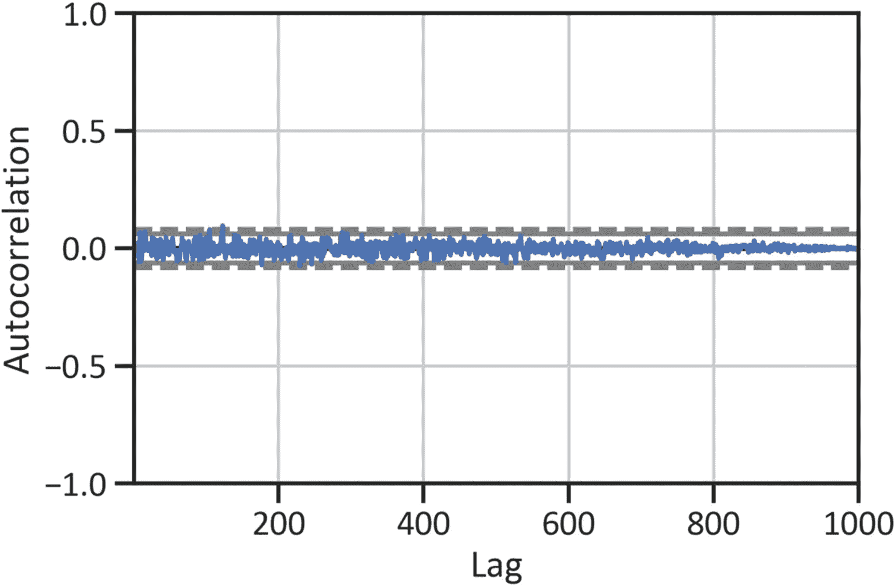
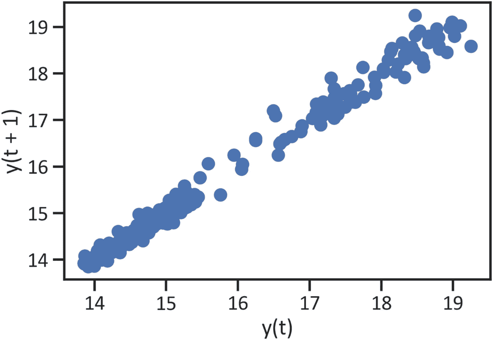
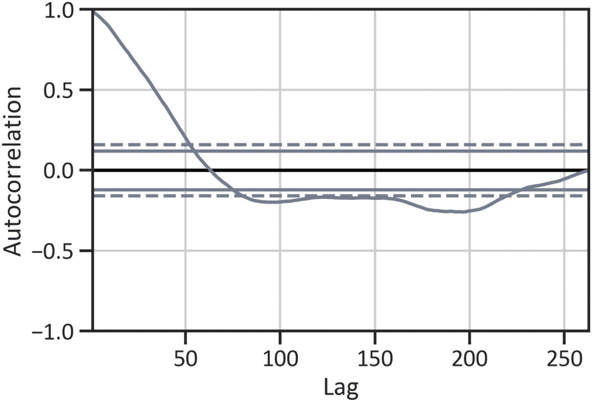
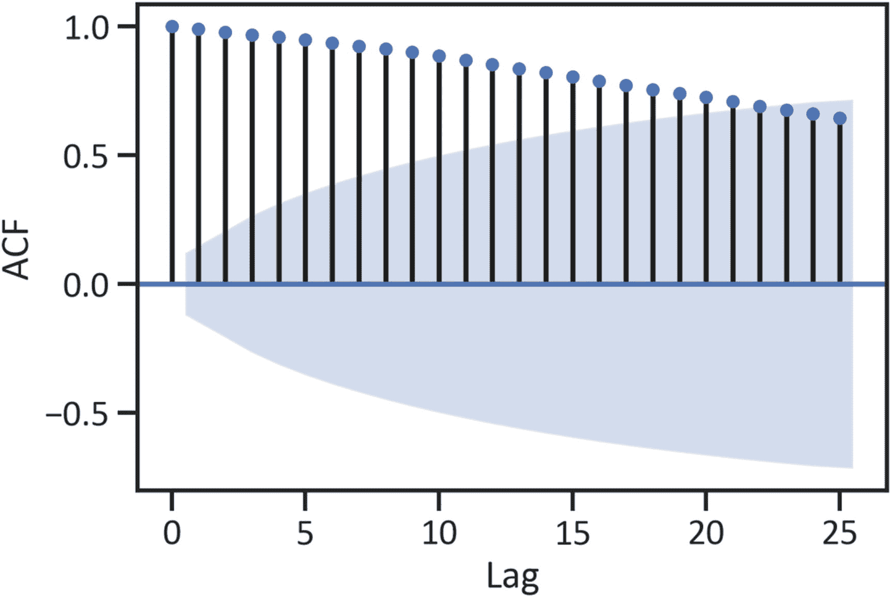

# 3. 时间序列分析

本章介绍一种复杂的回归方法，称为*时间序列分析*。与回归方法类似，时间序列对数据的底层结构做出了强有力的假设。我们将时间序列分析视为一种参数方法，因为它处理的是连续变量。请记住，我们并不将序列分析局限于连续变量；我们也可以分析与时间相关的分类变量。

本章介绍了用于检验假设的实证检验，然后介绍了分析时间序列的标准技术，如季节性分解和平滑。之后，它展示了如何估计收益率以及如何计算最小值和最大值。最后，涵盖了`SARIMAX`模型的开发和评估。

## 什么是时间序列分析？

时间序列分析使我们能够识别序列中明显的趋势和一致的模式。它捕捉变量随时间的变化。在连续时间序列分析中，我们持续检查一个变量。我们在特定时间点定义序列，而不是在每个时间点。例如，我们将使用外汇的收盘价（每个交易日有一个收盘价）。我们从`雅虎`获取了示例数据（这是关于2010年7月3日至2020年7月4日期间美元/南非兰特货币对价格的时间序列数据）。

### 时间序列假设

时间序列分析模型必须满足以下假设：

-   超过50个独立数据点
-   无缺失值
-   序列中无异常值
-   非平稳性
-   无白噪声
-   变量与自身之间存在相关性

### 时间序列模型类型

我们通常通过平滑或移动平均（`MA`）来分析序列，使用`Box-Jenkins`自回归（`AR`）和`MA`模型，这两种方法的组合称为`ARMA`模型。当一个序列令人信服地显示出某种模式时，我们使用该模型的宽松版本，即自回归积分滑动平均（`ARIMA`）模型。我们可以通过季节性`ARIMA`或`SARIMAX`模型来包含季节性成分。这些方法根据序列的线性结构来描述它。有时，也存在非线性结构。处理非线性模型时，请使用自回归条件异方差（`ARCH`）模型。处理多个时间序列时，请使用`VARMA`模型。

### ARIMA 模型

`ARIMA(p, d, q)`能够找到关键趋势并合理预测序列的未来值，其中`p`表示自回归模型的阶数，`d`表示差分次数，`q`表示移动平均模型的阶数。`ARIMA`这个术语包含三层含义：`AR`（自回归）表示先前值影响的线性组合，`I`（积分）表示随机游走，`MA`（移动平均）表示先前误差的线性组合。

## 平稳性检验

当存在随机趋势（随机游走或单位根）时，序列是平稳的。当数据中存在不确定性时，就会出现这种情况。当序列具有随机性元素时，我们就能识别出这些趋势。它们的可见存在会影响结论。在训练时间序列模型之前，需要检验序列是否平稳。我们提出假设如下：

-   *原假设：* 序列是平稳的。
-   *备择假设：* 序列不是平稳的。

### 增广迪基-富勒检验

检验序列是否平稳最可靠的方法是增广迪基-富勒（`ADF`）检验。它是一种单位根检验。查看结果时，要密切关注`ADF` `F`统计量。如果`F`统计量为负值，则有充分证据表明存在单位根。我们提出假设如下：

-   *原假设：* 存在单位根。
-   *备择假设：* 不存在单位根。

如果`p`值超过0.05，那么我们坚决拒绝原假设，接受备择假设。有充分证据表明不存在单位根。

### 执行 ADF 富勒检验

清单3-1执行了`ADF`富勒检验（见表3-1）。

**表 3-1** `ADF`检验统计量

| | 值 |
| --- | --- |
| **ADF F% 统计量** | -1.031626 |
| **P 值** | 0.741555 |
| **使用的滞后阶数** | 0.000000 |
| **观测数** | 262.000000 |

```
from statsmodels.tsa.stattools import adfuller
adfullerreport = adfuller(new_df["Close"])
adfullerreportdata = pd.DataFrame(adfullerreport[0:4],
columns = ["Values"],
index=["ADF F% statistics",
"P-value",
"No. of lags used",
"No. of observations"])
Adfullerreportdata
```

**Listing 3-1** `ADF` Fuller Test

正如预期，`F`统计量为负值。`p`值超过0.05。我们拒绝原假设，接受备择假设。有充分证据表明不存在单位根——该序列是非平稳的。

## 白噪声检验

当序列存在随机性元素时，就存在白噪声。随机性的明显存在表明序列的数据点之间没有相关性——自相关为零。白噪声是平稳性的一个例子。我们提出假设如下：

-   *原假设：* 存在白噪声。
-   *备择假设：* 不存在白噪声。

要检查序列是否存在白噪声，请查看均值。如果均值为零，则序列存在白噪声。如果序列的均值不为零，则不存在白噪声。参见清单3-2和图3-1。



**图 3-1** 随机白噪声

```
randval = np.random.randn(1000)
autocorrelation_plot(randval)
plt.show()
```

**Listing 3-2** Random White Noise

在95%和99%置信区间上方存在显著的尖峰。

### 相关性检验

相关性估计变量之间线性关系的强度。在时间序列分析中，我们关注序列中数据点之间的相关性。如果你还记得，我们是在假设数据底层结构是线性的前提下进行的。要检查序列中是否存在相关性，我们不使用皮尔逊相关方法。我们使用自相关来验证该假设。

清单3-3和图3-2展示了滞后变量。滞后是最近数据点与先前数据点之间的时间差。它验证序列是否具有随机性元素。当我们绘制滞后图时，我们期望找到一种模式。如果滞后图显示线性模式，则两个滞后变量之间存在相关性。它还能检测时间序列中的异常值。如你所见，没有检测到异常值。



**图 3-2** 滞后图

```
lag_plot(df["Close"])
plt.show()
```

**Listing 3-3** Lag

图3-2显示了序列中的线性模式（数据点紧密对齐在一条假想的直线上）。清单3-4生成了一个自相关图（见图3-3）。



**图 3-3** 自相关图

```
autocorrelation_plot(df["Close"])
plt.show()
```

**Listing 3-4** Autocorrelation

图3-3显示了美元/南非兰特每日收益率，其中大部分尖峰在统计上不显著。

## 自相关函数

清单3-5展示了自相关函数（`ACF`）图。图3-4考虑了趋势、季节性、周期性和残差成分。



**图 3-4** `ACF`图

```
plot_acf(df["Close"])
plt.xlabel("Lag")
plt.ylabel("ACF")
plt.show
```

**Listing 3-5** `ACF` Plot