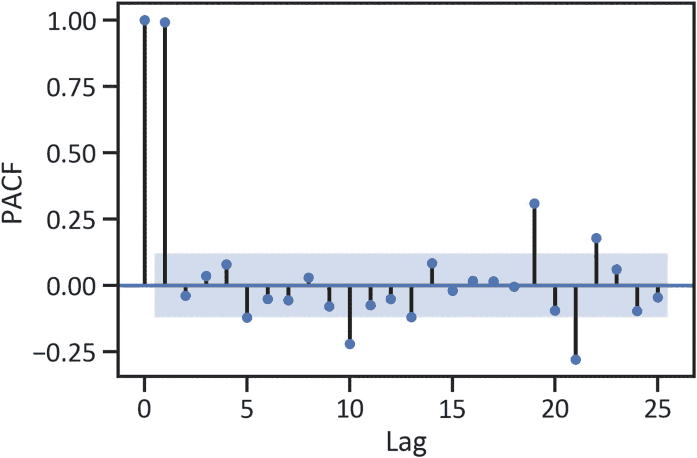
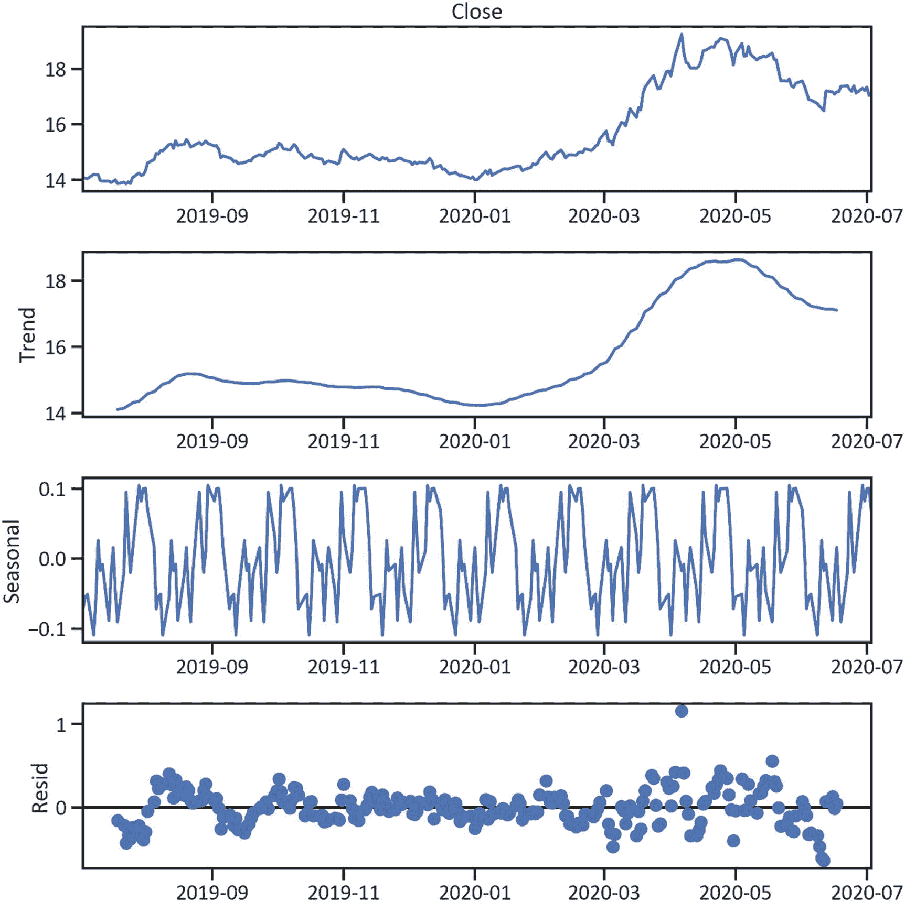
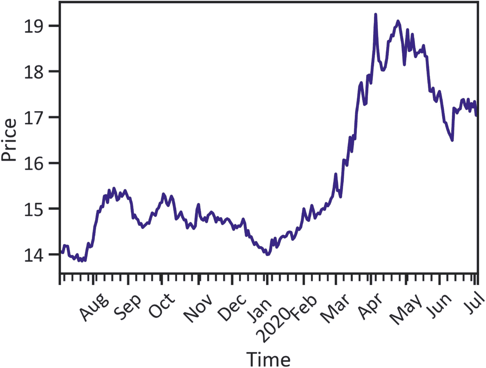
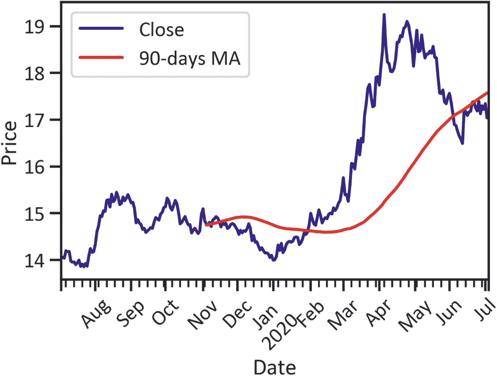
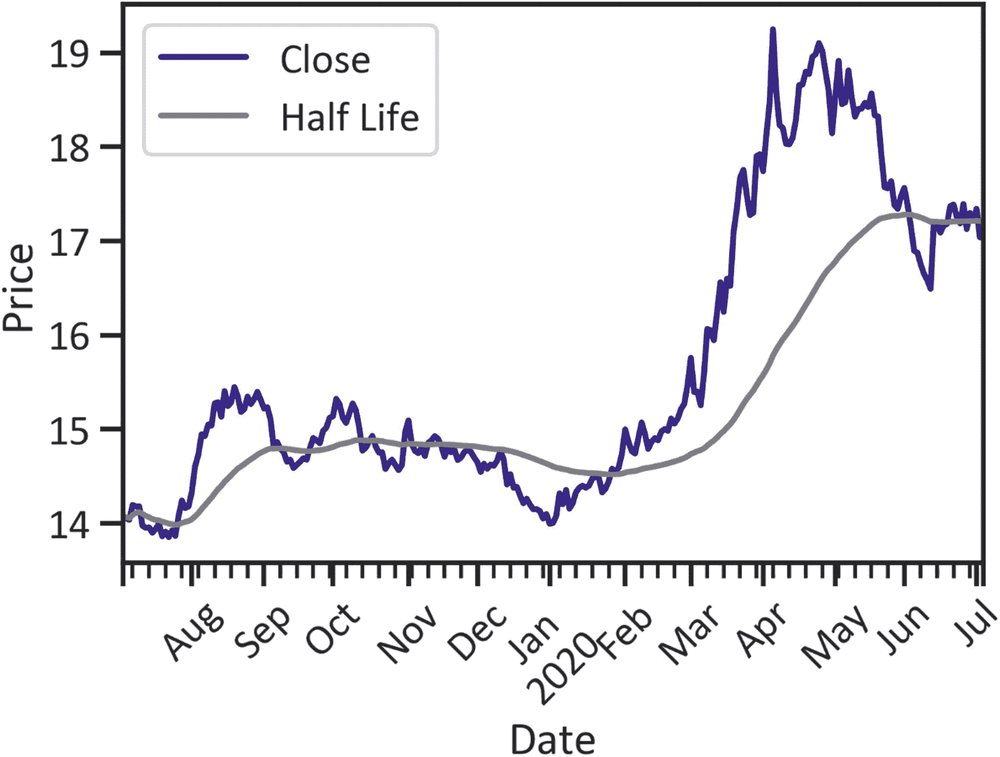
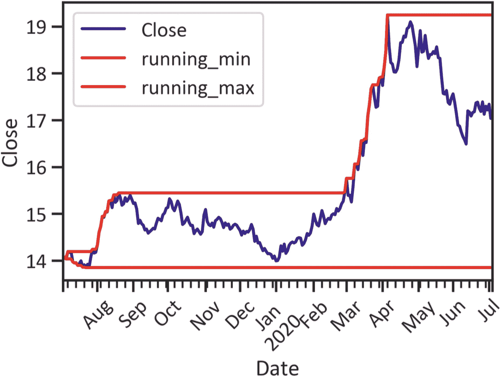
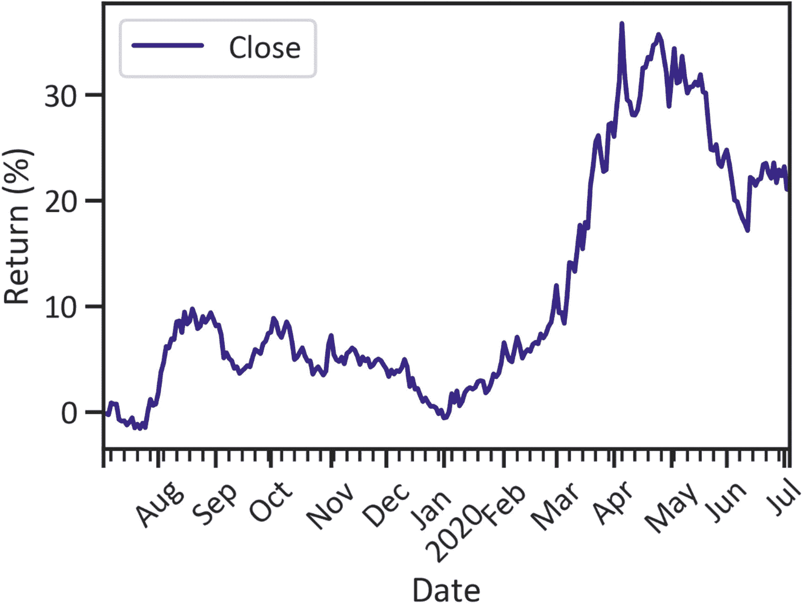
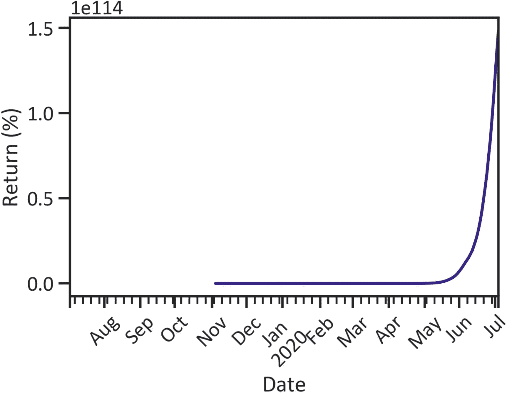
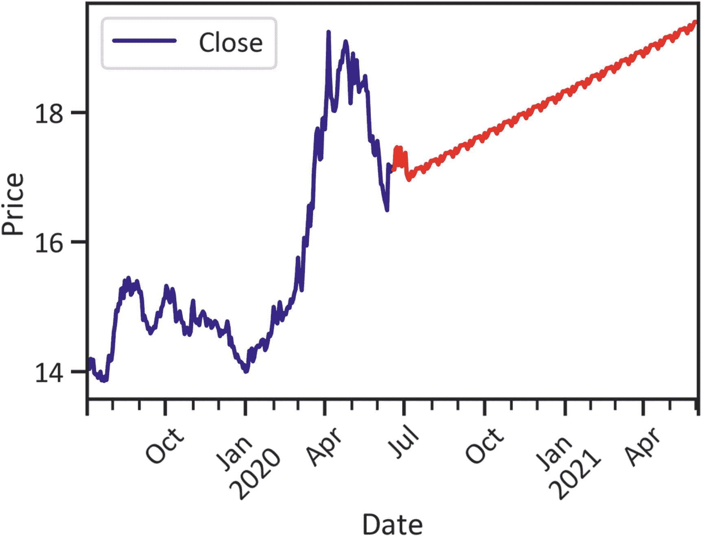

# 偏自相关

清单 3-6 展示了偏自相关（PACF）。图 3-5 显示了在低阶滞后中未解释的偏相关系数。在滞后 1 处有一个显著的尖峰。第一个滞后解释了所有高阶自相关。



**图 3-5** PACF 图

```python
plot_pacf(df["Close"])
plt.xlabel("Lag")
plt.ylabel("PACF")
plt.show()
```
**清单 3-6** PACF

## 理解趋势、季节性与不规则成分

将趋势与周期分离颇具挑战性。理解时间序列数据最简单的方法是将数据分解为不同成分。季节性分解涉及将一个序列分解为三个成分，即趋势、周期、季节性和不规则成分。我们通常使用加法模型，如公式 3-1 所示。

`Y(t) = T(t)+C(t)+S(t) x I(t)` (公式 3-1)

这里，`T(t)` 表示时期 `t` 的趋势值，`S(t)` 表示时期 `t` 的季节性值，`C(t)` 表示时期 `t` 的周期值，`I(t)` 表示时期 `t` 的不规则（随机）值。季节性分解要求数值为正。当序列中存在零值时，需对整个序列加上 0.5 或 1。清单 3-7 对该序列进行了分解（见图 3-6）。



**图 3-6** 季节性成分

```python
decompose = seasonal_decompose(df["Close"].interpolate(),freq=30)
decompose.plot()
plt.show()
```
**清单 3-7** 季节性分解

## 使用移动平均和指数技术平滑时间序列

分析序列最直接的方法是使用平滑技术。主要有两种平滑技术，即移动平均平滑和指数平滑。

### 原始时间序列

清单 3-8 以图形方式展示了变量随时间的变化。图 3-7 有两个轴：x 轴（水平）和 y 轴（垂直），图形上表示为 `(x,y)`。时间（自变量）位于 x 轴上，因变量位于 y 轴上。



**图 3-7** 原始时间序列

```python
Original = new_df["Close"]
fig, ax = plt.subplots()
Original.plot(kind="line", color="navy")
plt.xlabel("Time")
plt.ylabel("Close")
plt.xticks(rotation=45)
plt.show()
```
**清单 3-8** 时间序列

#### 移动平均平滑技术

`MA` 应用了先前和近期数据点的加权平均均值。当序列中没有季节性，但我们希望预测未来实例时，此方法非常有用。权重取决于序列的稳定性。如果序列稳定，则近期数据点权重高，先前数据点权重低。相反，如果序列不稳定，则近期数据点权重低，先前数据点权重高。清单 3-9 返回了 90 天的移动平均值（见图 3-8）。



**图 3-8** 时间序列（90 天移动平均值）

```python
MA90 = df["Close"].rolling(window=90).mean()
df.plot(kind="line",color="navy")
MA90.plot(kind="line",color="black",label="Rolling MA 90 days")
plt.xlabel("Date")
plt.xticks(rotation=45)
plt.ylabel("Price")
plt.legend()
plt.show()
```
**清单 3-9** 时间序列（90 天移动平均值）

图 3-8 未考虑季节性。收盘价大多高于移动平均线。然而，它难以跟上趋势。

#### 指数平滑技术

`MA` 方法的一种替代方案是指数平滑。它将窗口外的值权重设为零。使用此方法，大权重值会迅速衰减，小权重值则缓慢衰减。清单 3-10 将半衰期（指数权重衰减一半的时间滞后）指定为 30（见图 3-9）。



**图 3-9** 时间序列（指数）

```python
Exp = df["Close"].ewm(halflife=30).mean()
fig, ax = plt.subplots()
Original.plot(kind="line", color="navy")
Exp.plot(kind="line", color="gray", label="Half Life")
plt.xlabel("Time")
plt.ylabel("Close")
plt.xticks(rotation=45)
plt.legend()
plt.show()
```
**清单 3-10** 时间序列（指数）

平滑方法不会为预测或模型是否合理的检验生成置信区间。

## 运行最小值和最大值

运行最小值是序列进展过程中的最低值，运行最大值是序列进展过程中的最高值。序列的极值能告诉我们很多关于序列边界的信息。清单 3-11 使用 `expanding()` 方法估计了运行最小值和最大值（见图 3-10）。



**图 3-10** 价格运行最小值和最大值

```python
expanding_df = df
expanding_df["running_min"] = expanding_df["Close"].expanding().min()
expanding_df["running_max"] = expanding_df["Close"].expanding().max()
fig, ax = plt.subplots()
Original.plot(kind="line", color="navy")
expanding_df["running_min"].plot(kind="line", color="red")
expanding_df["running_max"].plot(kind="line", color="red")
plt.xlabel("Date")
plt.ylabel("Close")
plt.legend()
plt.xticks(rotation=45)
plt.show()
```
**清单 3-11** 运行最小值和最大值

图 3-10 显示，美元/南非兰特收盘价在 2019 年 7 月 24 日跌至 13.8531 的低点。此后，它接近一个心理价位。在 2019 年最后一个季度，南非兰特兑美元汇率适度企稳。然而，这些涨幅在年初迅速被抹去。美元小幅走高，于 2020 年 4 月 6 日达到 19.2486 的新高。

## 查找收益率和滚动收益率

收益指投资利润。它显示了投资价值的变化。清单 3-12 展示了删除扩展。

```python
del df_expanding["Running_min"]
del df_expanding["Running_max"]
```
**清单 3-12** 删除扩展

清单 3-13 和图 3-11 展示了投资组合的收益率。



**图 3-11** 收益率

```python
pr = df.pct_change()
pr_plus_one = pr.add(1)
cumulative_return = pr_plus_one.cumprod().sub(1)
fig, ax = plt.subplots()
cumulative_return.mul(100).plot(ax=ax, color="navy")
plt.xlabel("Date")
plt.ylabel("Return (%)")
plt.xticks(rotation=45)
plt.show()
```
**清单 3-13** 收益率

### 查找滚动收益率

滚动收益率展示了滚动窗口的收益率。它反映了收益率的稳定性。清单 3-14 查找了先前平均收益率的线性组合，清单 3-15 绘制了 90 天的滚动收益率（见图 3-12）。



图 3-12 滚动收益率

```python
rolling_90_days_rate_of_return = df["Close"].rolling(window=90).apply(get_period_return)
fig, ax = plt.subplots()
rolling_90_days_rate_of_return.plot(color="navy")
plt.xlabel("Date")
plt.ylabel("Return (%)")
plt.xticks(rotation=45)
plt.show()
```

**清单 3-15** 滚动收益率

```python
def get_period_return(period_return):
    return np.prod(period_return + 1) – 1
```

**清单 3-14** 滚动收益率函数

## SARIMAX 超参数优化

清单 3-16 将数据拆分为训练数据和测试数据。

```python
train = df.iloc[:len(df) -12]
test = df.iloc[:len(df) -12]
start = len(train)
end = len(train) + len(train) – 1
```

**清单 3-16** Split Data

清单 3-17 应用 `itertools` 包，使用赤池信息准则（AIC）来确定季节性 ARIMA 模型的最优参数。

```python
import itertools
p = d = q = range(0, 2)
pdq = list(itertools.product(p, d, q))
seasonal_pdq = [(x[0], x[1], x[2], 12) for x in list(itertools.product(p, d, q))]
for param in pdq:
    for param in pdq:
        for param_seasonal in seasonal_pdq:
            try:
                mod = sm.tsa.statespace.SARIMAX(train["Close"],
                                                order=param, seasonal_order=param_seasonal,
                                                enforce_stationarity=False,
                                                enforce_invertibility=False)
                results = mod.fit()
                print('SARIMAX{}x{}12 - AIC:{}'.format(param, param_seasonal, results.aic))
            except:
                continue
```

**清单 3-17** Hyperparameter Optimization

AIC 定义为 `AIC = -2 lnL + 2k`，其中 `lnL` 是模型的最大化对数似然值，`k` 是估计的参数数量。我们确定季节性 ARIMA 模型的最优参数如下：– ARIMA `(1, 1, 1) x(1, 1, 1, 12)12`。

## 开发 SARIMAX 模型

清单 3-18 配置了阶数为 `(1, 1, 1)`、季节性阶数为 `(1, 1, 1, 12)` 的 ARIMA 模型。

```python
timeseriesmodel1 = sm.tsa.statespace.SARIMAX(new_df["Close"], order=(1, 1, 1),
                                            seasonal_order=(1, 1, 1, 12),
                                            enforce_stationarity=False,
                                            enforce_invertibility=False)
timeseriesmodel_fit1 = timeseriesmodel1.fit()
```

**清单 3-18** Finalize the SARIMAX Model

### 模型摘要

清单 3-19 和表 3-2 展示了 SARIMAX 模型的概况。

**表 3-2** SARIMAX 概况

| **因变量：** | 收盘价 | **观测数：** | 263 |
| :--- | :--- | :--- | :--- |
| **模型：** | `SARIMAX(1, 1, 1)x(1, 1, 1, 12)` | **对数似然值** | 53.382 |
| **日期：** | 2020 年 10 月 16 日，周五 | **AIC** | -96.765 |
| **时间：** | 16:07:34 | **BIC** | -79.446 |
| **样本：** | 2019-07-03 | **HQIC** | -89.783 |
| | - 2020-07-03 | | |
| **协方差类型：** | Opg | | |
| | **系数** | **标准误** | **Z** | **P>&#124;z&#124;** | **[0.025** | **0.975]** |
| --- | --- | --- | --- | --- | --- | --- |
| **ar.L1** | 0.4856 | 1.971 | 0.246 | 0.805 | -3.377 | 4.348 |
| **ma.L1** | -0.5019 | 1.952 | -0.257 | 0.797 | -4.327 | 3.324 |
| **ar.S.L12** | -4.739e-06 | 0.008 | -0.001 | 1.000 | -0.015 | 0.015 |
| **ma.S.L12** | -0.9322 | 0.046 | -20.178 | 0.000 | -1.023 | -0.842 |
| **sigma2** | 0.0348 | 0.002 | 15.107 | 0.000 | 0.030 | 0.039 |
| **Ljung-Box (Q)：** | 66.32 | **Jarque-Bera (JB)：** | 91.15 |
| **Prob(Q)：** | 0.01 | **Prob(JB)：** | 0.00 |
| **异方差性 (H)：** | 5.28 | **偏度：** | 0.53 |
| **Prob(H) (双侧)：** | 0.00 | **峰度：** | 5.86 |

```python
timeseriesmodel_fit1.summary()
```

**清单 3-19** SARIMAX Profile

表 3-2 显示 AIC 得分为 -96.765，该得分低于其他阶数，并且 `ar.L1`、`ma.L1` 和 `ar.S.L12` 在统计上不显著。p 值均大于 0.005。这表明 SARIMAX `(1, 1, 1, 12)` 模型并非合适的模型。建议尝试所有阶数和季节性阶数，以找到能够生成具有显著准确预测能力模型的最优超参数。

## 预测 SARIMAX

清单 3-20 生成序列的未来实例，并将其与实际值一起绘制（见图 3-13）。



图 3-13 SARMIAX (1, 1, 1, 12) 预测

```python
predictions1 = timeseriesmodel_fit1.predict(start,end,typ="levels").rename("Prediction")
test.plot(color="navy")
predictions1.plot(color="red")
plt.ylabel("Price")
plt.xlabel("Date")
plt.xticks(rotation=45)
plt.show()
```

**清单 3-20** Forecast

## 结论

本章涵盖了时间序列分析。我们训练了一个阶数为 `(1, 1, 1)`、季节性阶数为 `(1, 1, 1, 12)` 的 SARIMAX 模型。它预测了上升趋势；然而，由于序列中存在有影响力的数据点，该预测并不可靠。该模型在预测序列时会出现显著错误。下一章将介绍加法模型。