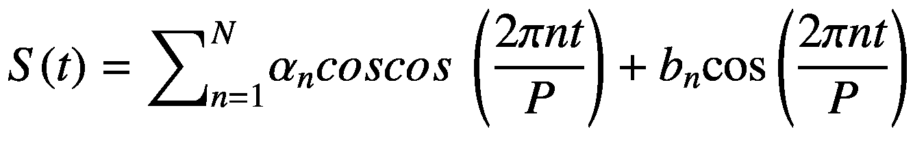
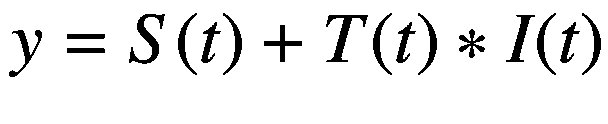
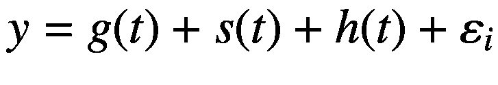
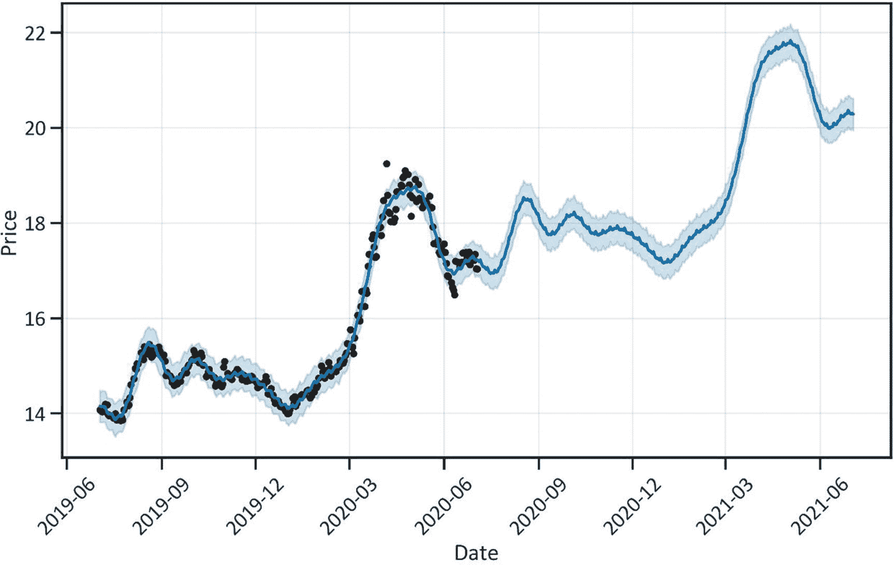
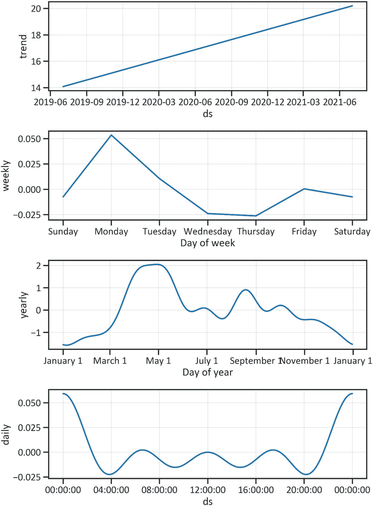

# 4. 高质量时间序列分析

前一章介绍了季节性 ARIMA。在数据预处理和超参数优化方面付出了大量努力之后，该模型在预测序列的未来实例时仍会产生相当大的误差。为了进行快速自动化的预测流程，请使用 Facebook 的 Prophet；它基于包含季节性和假日效应的非线性趋势来预测时间序列数据。本章介绍 Prophet，并展示开发和测试加法模型的方法。首先，讨论 Statsmodels 包和 Prophet 包之间的关键区别。

## Statsmodels 与 Prophet 的区别

时间序列分析通常需要诊断和处理缺失值与异常值、使用多种检验统计量验证关键假设、进行超参数优化以及控制季节性效应。如果工作流程中出现一点小错误，模型在预测未来实例时就会产生重大错误。因此，使用 Statsmodels 构建模型需要一定程度的精通。

请牢记，机器学习的目标是用最少的代码赋予计算机智能。Statsmodels 并未提供这一点。Prophet 填补了这一空白。它由 Facebook 的核心数据科学团队开发。它可以执行缺失值和异常值检测、超参数优化以及季节性和假日效应控制等任务。要在 Python 环境中安装 FB Prophet，请使用 `pip install fbprophet`。要在 Conda 环境中安装，请使用 `conda install -c conda-forge fbprophet`。

## 理解 Prophet 的组成部分

在上一章中，我们费尽心力构建了一个包含三个组成部分的时间序列模型，即趋势、季节性和不规则成分。


### Prophet 组件

Prophet 包充分考虑了趋势、季节性和节假日及事件。在本节中，我们将简要讨论该包的关键组件。

#### 趋势

趋势是单一且一致的方向性运动（向上或向下）。我们通过拟合时间序列模型来发现趋势。表 4-1 突出显示了可调优的趋势参数。

**表 4-1** 可调优的趋势参数

| 参数 | 描述 |
| --- | --- |
| `growth` | 指定分段线性或逻辑斯蒂趋势 |
| `n_changepoints` | 如果未指定变点，则自动包含的变点数量 |
| `change_prior_scale` | 自动变点选择的变更 |

#### 变点

变点是一个惩罚项。它会改变时间序列模型的行为。如果你不指定变点，则默认变点值会自动设置。

#### 季节性

季节性表示逐年一致的上行或下行运动。公式 4-1 对此进行了近似。



（公式 4-1）

此处，`P` 是周期（周数据为 7，月数据为 30，季度数据为 90，年数据为 365）。

#### 节假日和事件参数

节假日和事件会影响时间序列的条件均值。表 4-2 概述了关键的可调优节假日和事件参数。

**表 4-2** 节假日和事件参数

| 参数 | 描述 |
| --- | --- |
| `daily_seasonality` | 拟合日季节性 |
| `weekly_seasonality` | 拟合周季节性 |
| `year_seasonality` | 拟合年季节性 |
| `holidays` | 包含节假日名称和日期 |
| `yeasonality_prior_scale` | 确定季节性或节假日组件所需的强度 |

### 加法模型

加法模型假设趋势和周期被视为一个项。其组件类似于 Holt-Winters 技术。我们将该方程表示为公式 4-2。



（公式 4-2）

该公式的数学表达式如公式 4-3 所示。



（公式 4-3）

此处，`g(t)` 表示用于建模非周期性变化的线性或逻辑斯蒂增长曲线，`s(t)` 表示周期性变化（日、周、年季节性），`h(t)` 表示节假日的影响，`+ ε[i]` 表示考虑异常变化的误差项。

### 数据预处理

我们从雅虎财经获取了示例数据。^(³) 在训练模型之前，按如下方式重新调整数据用途：

*   `df["ds"]`，重新调整时间用途
*   `df["y"]`，重新调整自变量用途
*   `df.set_index("")`，将日期和时间设置为索引列

清单 4-1 将列名设置为正确的格式。

```
df["ds"] = df["Date"]
df["y"] = df["Close"]
df.set_index("Date")
清单 4-1
处理数据
```

表 4-3 展示了在使用 Prophet 开发时间序列模型之前，数据框应有的样子。

**表 4-3** 数据集

|   | 收盘价 | ds | y |
| --- | --- | --- | --- |
| **日期** |   |   |   |
| **2019-07-03** | 14.074300 | 2019-07-03 | 14.074300 |
| **2019-07-04** | 14.052900 | 2019-07-04 | 14.052900 |
| **2019-07-05** | 14.038500 | 2019-07-05 | 14.038500 |
| **2019-07-08** | 14.195200 | 2019-07-08 | 14.195200 |
| **2019-07-09** | 14.179500 | 2019-07-09 | 14.179500 |
| **...** | ... | ... | ... |
| **2020-06-29** | 17.298901 | 2020-06-29 | 17.298901 |
| **2020-06-30** | 17.219200 | 2020-06-30 | 17.219200 |
| **2020-07-01** | 17.341900 | 2020-07-01 | 17.341900 |
| **2020-07-02** | 17.039301 | 2020-07-02 | 17.039301 |
| **2020-07-03** | 17.037100 | 2020-07-03 | 17.037100 |

## 开发 Prophet 模型

清单 4-2 指定了官方节假日。清单 4-3 将模型的置信区间配置为 95%，并考虑了年季节性、周季节性和日季节性。

```
holidays = pd.DataFrame({
'holiday': 'playoff',
'ds': pd.to_datetime(["2020-12-25", "2020-12-24", "2020-12-23", "2019-12-25", "2021-01-01", "2021-01-20"]),
"lower_window": 0,
"upper_window": 1,
})
清单 4-2
指定节假日
```

清单 4-3 完成了模型构建。

```
m = Prophet(holidays=holidays,
interval_width=0.95,
yearly_seasonality=True,
weekly_seasonality=True,
daily_seasonality=True,
changepoint_prior_scale=0.095)
m.add_country_holidays(country_name='US')
m.fit(df)
清单 4-3
开发 Prophet 模型
```

### 创建未来数据框

清单 4-4 应用 `make_future_dataframe()` 方法来创建未来数据框。

```
future = m.make_future_dataframe(periods=365)
清单 4-4
创建限制为 365 天的未来数据框
```

### 预测

清单 4-5 应用 `predict()` 方法来预测未来实例。

```
forecast = m.predict(future)
清单 4-5
预测时间序列
```

清单 4-6 绘制了历史值和预测值（见图 4-1）。



**图 4-1** 预测

```
m.plot(forecast)
plt.xlabel("Date")
plt.ylabel("Price")
plt.xticks(rotation=45)
plt.show()
清单 4-6
预测
```

图 4-1 与上一章中的 SARIMAX 结果基本一致；但它提供了更多细节。它预测 2021 年第一季度将出现长期看涨趋势。

### 季节性组件

清单 4-7 对序列进行了分解（见图 4-2）。



**图 4-2** 季节性组件

```
model.plot_components(forecast)
plt.show()
清单 4-7
季节性组件
```


## 交叉验证模型

交叉验证用于测试模型性能。在后台，Prophet 会计算历史数据的预测误差。它会设定一个截止点，并仅使用该截止点之前的数据。清单 4-8 应用了 `cross_validation()` 方法，并指定了训练数据的初始起点（`initial`）、预测周期（`horizon`）以及截止点之间的间隔（`period`）。详见表 4-4。

表 4-4

交叉验证表

|   | ds | yhat | yhat_lower | yhat_upper | y | cutoff |
| --- | --- | --- | --- | --- | --- | --- |
| **0** | 2020-02-10 | 14.706377 | 14.527866 | 14.862567 | 15.071000 | 2020-02-09 |
| **1** | 2020-02-11 | 14.594084 | 14.429592 | 14.753000 | 14.953500 | 2020-02-09 |
| **2** | 2020-02-12 | 14.448900 | 14.283988 | 14.625561 | 14.791600 | 2020-02-09 |
| **3** | 2020-02-13 | 14.258331 | 14.094124 | 14.428341 | 14.865500 | 2020-02-09 |
| **4** | 2020-02-14 | 14.028495 | 13.858400 | 14.204660 | 14.905000 | 2020-02-09 |
| **...** | ... | ... | ... | ... | ... | ... |
| **295** | 2020-06-29 | 19.919252 | 19.620802 | 20.193089 | 17.298901 | 2020-04-24 |
| **296** | 2020-06-30 | 19.951939 | 19.660207 | 20.233733 | 17.219200 | 2020-04-24 |
| **297** | 2020-07-01 | 19.966822 | 19.665303 | 20.250541 | 17.341900 | 2020-04-24 |
| **298** | 2020-07-02 | 20.012227 | 19.725297 | 20.301380 | 17.039301 | 2020-04-24 |
| **299** | 2020-07-03 | 20.049481 | 19.752089 | 20.347799 | 17.037100 | 2020-04-24 |

```
from fbprophet.diagnostics import cross_validation
df_cv = cross_validation(model, initial="210 days",period="15 days", horizon="70 days") df_cv
清单 4-8
交叉验证
```

## 评估模型

清单 4-9 应用了 `performance_metrics()` 方法来返回关键的评估指标（见表 4-5）。

表 4-5

性能指标

|   | horizon | mse | Rmse | mae | mape | mdape | coverage |
| --- | --- | --- | --- | --- | --- | --- | --- |
| **0** | 7 days | 0.682286 | 0.826006 | 0.672591 | 0.038865 | 0.033701 | 0.166667 |
| **1** | 8 days | 1.145452 | 1.070258 | 0.888658 | 0.051701 | 0.047487 | 0.100000 |
| **2** | 9 days | 1.557723 | 1.248088 | 1.077183 | 0.063369 | 0.056721 | 0.033333 |
| **3** | 10 days | 2.141915 | 1.463528 | 1.299301 | 0.077282 | 0.066508 | 0.033333 |
| **4** | 11 days | 3.547450 | 1.883468 | 1.648495 | 0.097855 | 0.086243 | 0.000000 |
| **...** | ... | ... | ... | ... | ... | ... | ... |
| **59** | 66 days | 187.260756 | 13.684325 | 9.480800 | 0.549271 | 0.244816 | 0.000000 |
| **60** | 67 days | 157.856975 | 12.564115 | 8.915581 | 0.515198 | 0.244816 | 0.000000 |
| **61** | 68 days | 137.029889 | 11.705977 | 8.692623 | 0.499211 | 0.253436 | 0.000000 |
| **62** | 69 days | 116.105651 | 10.775233 | 8.146737 | 0.466255 | 0.252308 | 0.000000 |
| **63** | 70 days | 96.738282 | 9.835562 | 7.483452 | 0.427025 | 0.227503 | 0.000000 |

```
from fbprophet.diagnostics import performance_metrics
df_p = performance_metrics(df_cv)
df_p
清单 4-9
性能
```

## 结论

本章介绍了广义加性模型。该模型考虑了季节性，并将时间作为回归变量。其性能优于季节性 ARIMA 模型。该模型在预测序列未来实例时误差较小。我们可以依赖 Prophet 模型来预测时间序列。

本书前四章恰当地介绍了参数化方法。该方法对数据的底层结构做出了大胆的假设。它假设数据的底层结构是线性的。

后续章节将介绍非参数化方法。该方法支持对数据底层结构进行灵活的假设。它假设数据的底层结构是非线性的。

脚注 1

