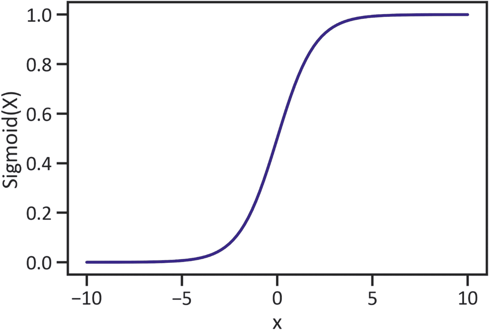
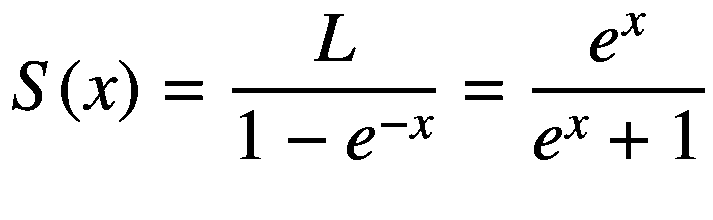
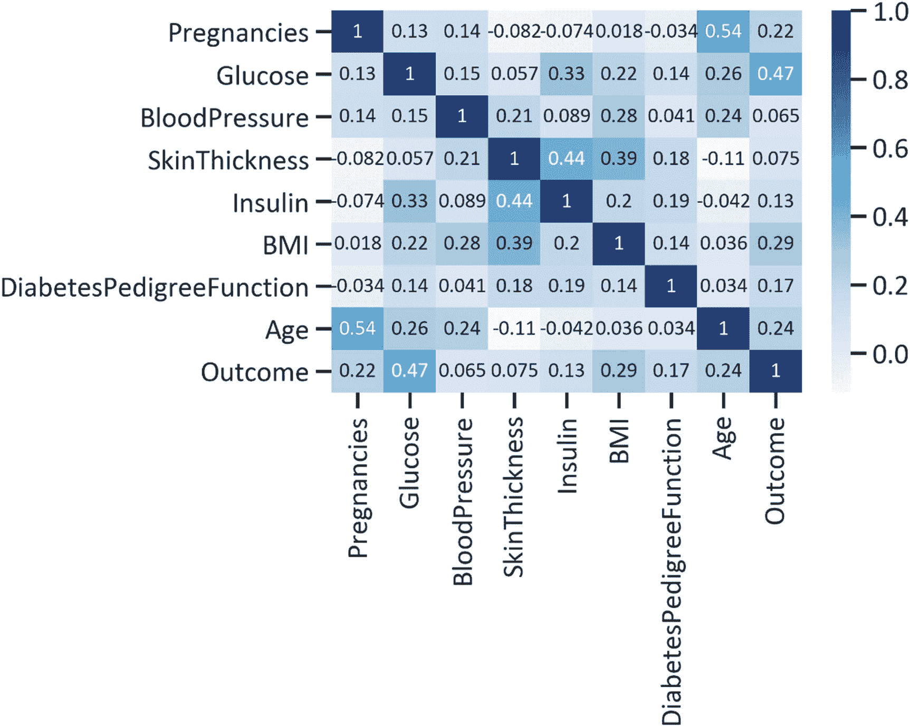
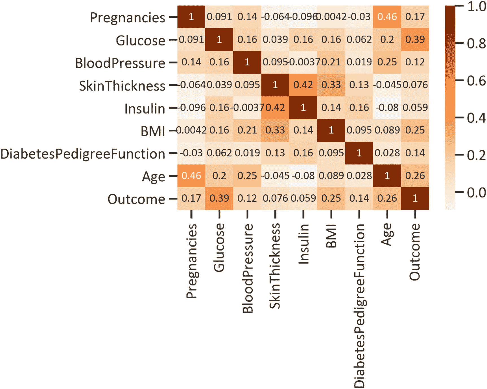
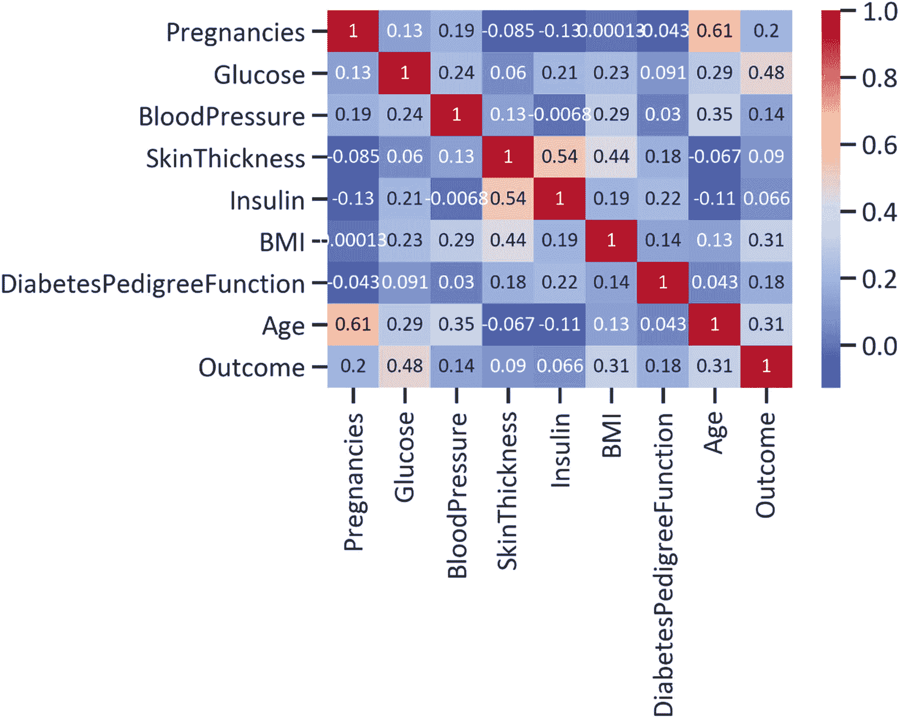
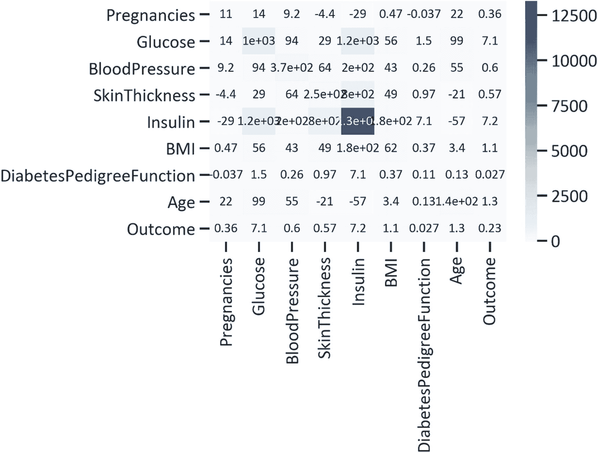
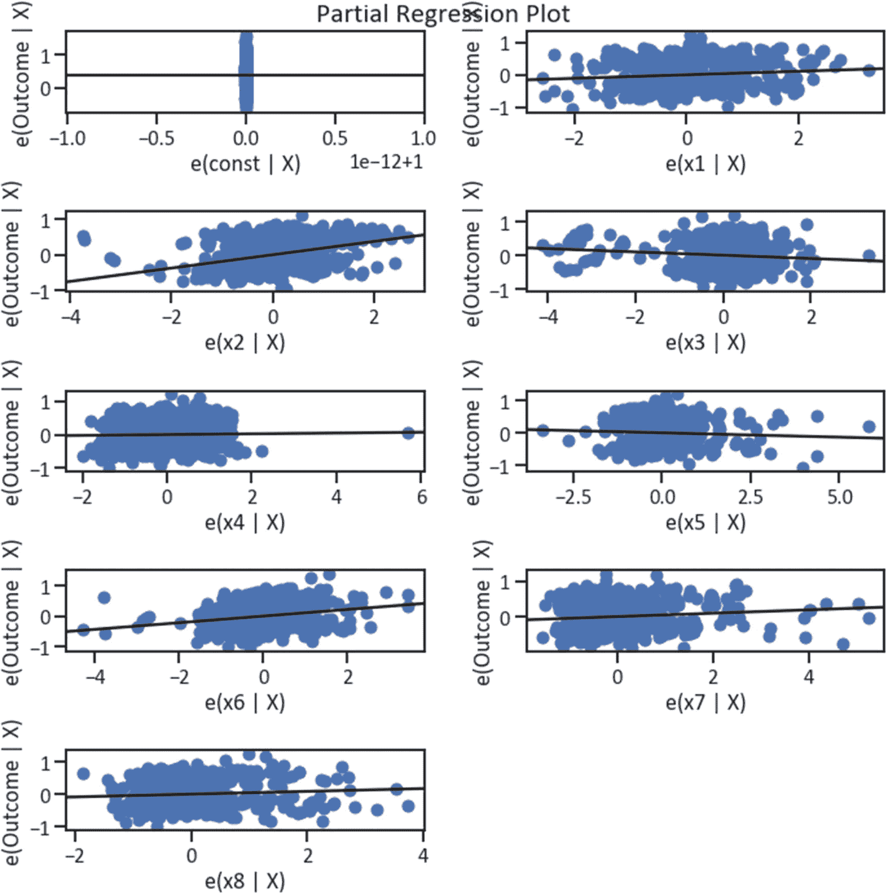
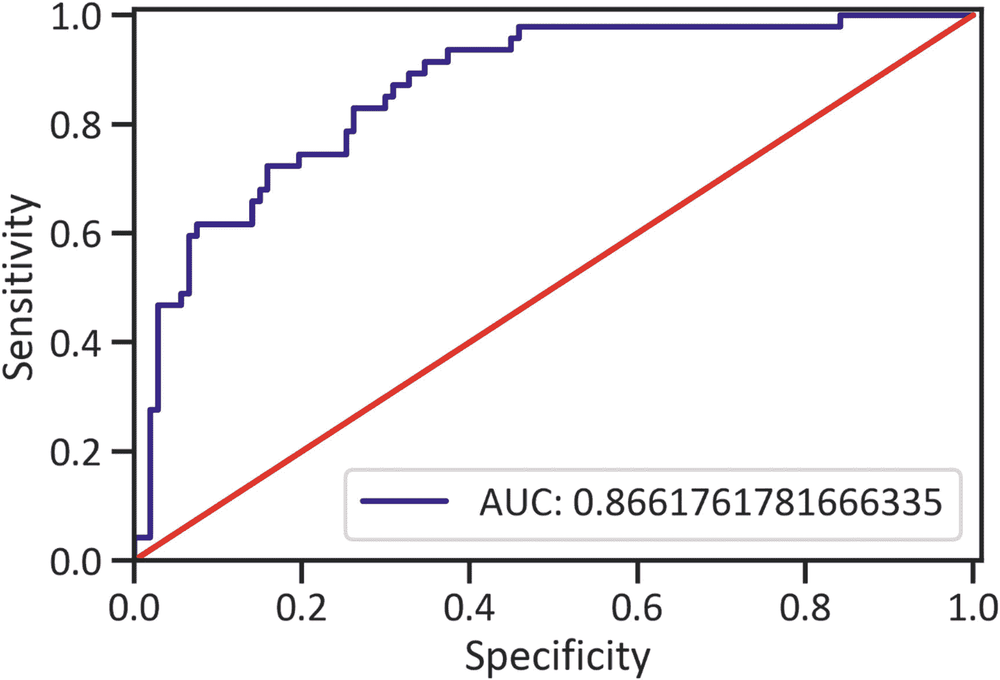
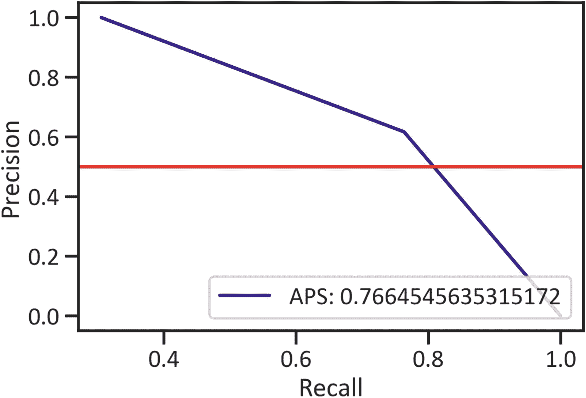
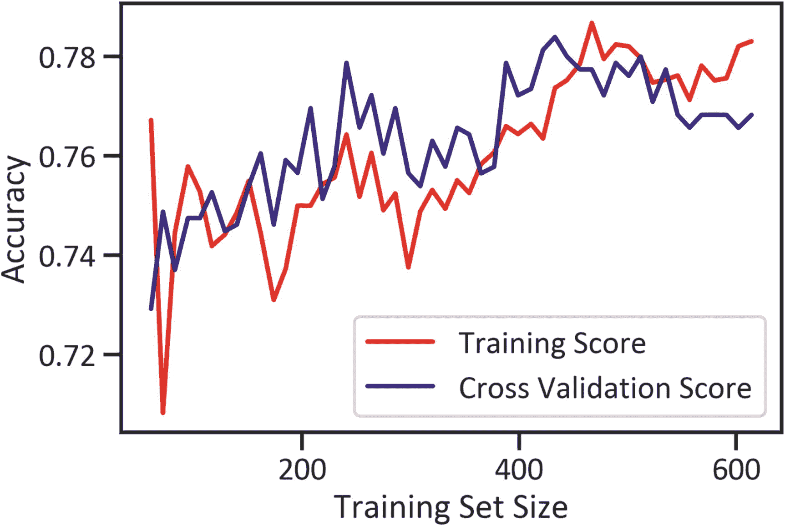

# 5. 逻辑回归分析

本章以结构化的方式介绍逻辑回归的概念及其实现。前面的章节介绍了监督学习，并重点讨论了参数化方法。在监督学习中，我们向模型提供一组正确答案，然后让模型预测未见过的数据。我们使用参数化方法来解决回归问题（当因变量是连续变量时）。

本章介绍一种被称为非参数化方法（或分类方法）的监督学习方法。与线性回归方法不同，它对数据的结构有灵活的假设。它没有线性和正态性假设。分类方法有两个完整的类别。它们是二元分类（当因变量有两个结果时使用，例如：是/否、通过/失败）和多类分类（当因变量有两个以上结果时使用，例如：负面/中性/正面）。

## 什么是逻辑回归？

`逻辑回归`是一种用于估计自变量对因变量影响程度的模型。自变量可以是连续变量或分类变量，而因变量则始终是只有两个结果的分类变量。尽管逻辑回归被称为“回归”，但它并非回归模型，而是一种分类模型。与线性回归一样，我们使用该模型来寻找截距和斜率。

## 逻辑回归的假设

分类方法不包含对数据结构的严格假设。它假设因变量是分类变量，并且数据中至少有 50 个数据点。理想情况下，我们需要大样本。

## 逻辑回归实践

我们从 Kaggle 获取了示例数据。^(⁴) 表 5-1 显示了数据的前几行。

表 5-1 数据集

| | Pregnancies | Glucose | BloodPressure | SkinThickness | Insulin | BMI | DiabetesPedigreeFunction | Age | Outcome |
| --- | --- | --- | --- | --- | --- | --- | --- | --- | --- |
| **0** | 6 | 148 | 72 | 35 | 0 | 33.6 | 0.627 | 50 | 1 |
| **1** | 1 | 85 | 66 | 29 | 0 | 26.6 | 0.351 | 31 | 0 |
| **2** | 8 | 183 | 64 | 0 | 0 | 23.3 | 0.672 | 32 | 1 |
| **3** | 1 | 89 | 66 | 23 | 94 | 28.1 | 0.167 | 21 | 0 |
| **4** | 0 | 137 | 40 | 35 | 168 | 43.1 | 2.288 | 33 | 1 |

## Sigmoid 函数

`逻辑回归`使用 `sigmoid` 函数对输出进行转换，使其能够直接返回一个分配给两个分类类别的概率值。其标准公式呈 S 形或 sigmoid 形状。图 5-1 展示了一个标准的逻辑函数。



图 5-1 `Sigmoid` 函数

公式 5-1 表达了 `sigmoid` 函数。



（公式 5-1）

标准的 `sigmoid` 函数接受任何输入，并输出一个介于 0 和 1 之间的值。

### 描述性分析

清单 5-1 生成了描述性统计量（见表 5-2）。

表 5-2 描述性统计量

| | 计数 | 均值 | 标准差 | 最小值 | 25% | 50% | 75% | 最大值 |
| --- | --- | --- | --- | --- | --- | --- | --- | --- |
| **怀孕次数** | 768.0 | 3.845052 | 3.369578 | 0.000 | 1.00000 | 3.0000 | 6.00000 | 17.00 |
| **血糖** | 768.0 | 120.894531 | 31.972618 | 0.000 | 99.00000 | 117.0000 | 140.25000 | 199.00 |
| **血压** | 768.0 | 69.105469 | 19.355807 | 0.000 | 62.00000 | 72.0000 | 80.00000 | 122.00 |
| **皮肤厚度** | 768.0 | 20.536458 | 15.952218 | 0.000 | 0.00000 | 23.0000 | 32.00000 | 99.00 |
| **胰岛素** | 768.0 | 79.799479 | 115.244002 | 0.000 | 0.00000 | 30.5000 | 127.25000 | 846.00 |
| **身体质量指数** | 768.0 | 31.992578 | 7.884160 | 0.000 | 27.30000 | 32.0000 | 36.60000 | 67.10 |
| **糖尿病遗传函数** | 768.0 | 0.471876 | 0.331329 | 0.078 | 0.24375 | 0.3725 | 0.62625 | 2.42 |
| **年龄** | 768.0 | 33.240885 | 11.760232 | 21.000 | 24.00000 | 29.0000 | 41.00000 | 81.00 |
| **结果** | 768.0 | 0.348958 | 0.476951 | 0.000 | 0.00000 | 0.0000 | 1.00000 | 1.00 |

清单 5-1 描述性统计量

```
df.describe().transpose()
```

### 皮尔逊相关方法

清单 5-2 展示了线性关系的强度（见图 5-2）。



图 5-2 皮尔逊相关矩阵

清单 5-2 皮尔逊相关矩阵

```
dfcorr = df.corr(method="pearson")
sns.heatmap(dfcorr, annot=True,annot_kws={"size":12}, cmap="Blues")
plt.show()
```

图 5-2 显示数据中大多数变量之间存在微弱的正相关关系。

### 其他相关方法

还有其他用于衡量变量间相关性的方法，例如肯德尔方法和斯皮尔曼方法。它们的使用取决于具体应用场景。

#### 肯德尔相关方法

`肯德尔相关方法`用于估计有序变量中排名之间的关联性。有序变量由距离未知的分类变量组成。有序数据的一个例子是李克特量表。`肯德尔相关方法`的值范围从 -1 到 1，其中 -1 表示排名不一致，0 表示排名相互独立，1 表示两个排名完全一致。清单 5-3 生成了肯德尔相关矩阵（见图 5-3）。



图 5-3 肯德尔相关矩阵

清单 5-3 肯德尔相关矩阵

```
dfcorr_kendall = df.corr(method="kendall")
sns.heatmap(dfcorr_kendall, annot=True,annot_kws={"size":12}, cmap="Oranges")
plt.show()
```

图 5-3 显示大多数排名非常接近一致。`肯德尔相关方法`与`皮尔逊相关方法`产生的值略有差异。

#### 斯皮尔曼相关方法

`斯皮尔曼相关方法`是另一种基于排名的相关方法。它衡量两个变量排名之间的统计依赖性。该方法有助于识别变量是否呈线性关系。其值范围也在 -1 到 1 之间，其中 -1 表示弱关联，0 表示无关联，1 表示强关联。清单 5-4 返回了一个斯皮尔曼相关矩阵（见图 5-4）。



图 5-4 斯皮尔曼相关矩阵

清单 5-4 斯皮尔曼相关矩阵

```
-
```

图 5-4 也证实了数据的底层结构是线性的。

## 协方差矩阵

`协方差`提供了关于自变量和因变量之间联合变异性的详细信息。大多数情况下，我们对协方差本身不感兴趣，而是对变量之间的相关性感兴趣。清单 5-5 生成了协方差矩阵（见图 5-5）。



图 5-5 协方差矩阵

清单 5-5 协方差矩阵

```
dfcov = df.cov()
sns.heatmap(dfcov, annot=True,annot_kws={"size":12}, cmap="Blues")
plt.show()
```

图 5-5 描绘了变量之间的变异性。

### 创建 X 和 Y 数组

在执行描述性分析和降维之后，下一步是将数据分解为两组一维数组（`x`, `y`），其中`x`代表自变量，`y`代表因变量。清单 5-6 以如下方式对数据进行切片：数据的前八列属于`x`数组，最后一列属于`y`数组。

```
x = df.iloc[::,0:8]
y = df.iloc[::,-1]
清单 5-6
创建 X 和 Y 数组
```

### 将数据拆分为训练数据和测试数据

在监督学习模型中，我们将数据拆分为训练数据和测试数据。清单 5-7 将数据拆分为训练数据和测试数据。

```
from sklearn.model_selection import train_test_split
x_train, x_test, y_train, y_test = train_test_split(x,y, test_size=0.2, random_state=0)
清单 5-7
拆分数据
```

### 特征值矩阵

最常见的多重共线性检测方法是容忍度和方差膨胀因子（VIF）。容忍度衡量的是独特的总体标准方差，而 VIF 则是包含单个自变量在内的模型总体方差。一种更可靠的严重程度判断方法是使用特征值。特征值小于 0 表示存在多重共线性。特征值在 10 到 100 之间表示存在轻微的多重共线性。最后，特征值大于 100 表示存在严重的多重共线性。代码清单 5-8 使用`NumPy`包生成特征向量和特征值，并使用`Pandas`将其转换为数据框，以便您能清晰地查看该矩阵（见表 5-3）。

**表 5-3**  

特征值矩阵

| | 特征值 | 怀孕次数 | 血糖 | 血压 | 皮褶厚度 | 胰岛素 | BMI | 糖尿病遗传函数 | 年龄 | 结果 |
|---|---|---|---|---|---|---|---|---|---|---|
| **怀孕次数** | 13456.577591 | -0.002022 | 0.022650 | -0.022465 | -0.049041 | -0.151620 | -0.005077 | -0.986468 | 0.018049 | 0.010692 |
| **血糖** | 932.805966 | 0.097812 | 0.972186 | 0.143425 | 0.119804 | 0.087995 | 0.050824 | -0.000769 | 0.006061 | 0.000643 |
| **血压** | 390.577869 | 0.016093 | 0.141901 | -0.922468 | -0.262749 | 0.232160 | 0.075596 | 0.001177 | -0.002469 | -0.000071 |
| **皮褶厚度** | 198.184055 | 0.060757 | -0.057856 | -0.307012 | 0.884371 | -0.259927 | 0.221412 | 0.000379 | 0.001118 | -0.002349 |
| **胰岛素** | 112.693345 | 0.993111 | -0.094629 | 0.020977 | -0.065549 | 0.000169 | -0.006137 | -0.001426 | -0.000072 | -0.000295 |
| **BMI** | 45.837383 | 0.014011 | 0.046977 | -0.132444 | 0.192811 | -0.021518 | -0.970677 | 0.003045 | 0.013921 | 0.000672 |
| **糖尿病遗传函数** | 7.763548 | 0.000537 | 0.000817 | -0.000640 | 0.002699 | -0.001642 | -0.002032 | 0.006306 | -0.239281 | 0.970922 |
| **年龄** | 0.164361 | -0.003565 | 0.140168 | -0.125454 | -0.301007 | -0.920492 | -0.014979 | 0.162649 | 0.003234 | -0.001209 |
| **结果** | 0.099139 | 0.000585 | 0.007010 | 0.000309 | 0.002625 | -0.006131 | -0.013184 | -0.019319 | -0.970655 | -0.239141 |

```
eigenvalues, eigenvectors = np.linalg.eig(dfcov)
eigenvalues = pd.DataFrame(eigenvalues)
eigenvectors = pd.DataFrame(eigenvectors)
eigens = pd.concat([eigenvalues,eigenvectors],axis=1)
eigens.index = df.columns
eigens.columns = ("Eigen values","Pregnancies","Glucose","BloodPressure","SkinThickness","Insulin","BMI","DiabetesPedigreeFunction","Age","Outcome")
eigens
代码清单 5-8
创建特征值矩阵
```

## 数据归一化

代码清单 5-9 对数据进行转换，使得均值为 0，标准差为 1。

```
from sklearn.preprocessing import StandardScaler
scaler = StandardScaler()
x_train = scaler.fit_transform(x_train)
x_test = scaler.transform(x_test)
代码清单 5-9
数据归一化
```

## 数据建模

我们开发了两个模型来解决当前的分类问题；第一个模型使用`Statsmodels`，第二个模型使用`SciKit-Learn`。

## 使用 Statsmodels 开发逻辑分类器

在过去的两个章节（涵盖时间序列分析）中，我们批评了使用`Statsmodels`开发可靠时间序列模型的难度。但这并不意味着这个包整体上不好。它仍然具有相关性；实际上，很少有包能像`Statsmodels`那样提供深入的分析。

### 添加常数项

默认情况下，`Statsmodels`不包含常数项。代码清单 5-10 手动添加了一个常数项。

```
from statsmodels.api import sm
x_constant = sm.add_constant(x_train)
x_test = sm.add_constant(x_test)
代码清单 5-10
添加常数项
```

### 开发逻辑分类器

`Statsmodels`的默认分类器使用逻辑模型和最大似然法（MLE）。我们如公式 5-2 所示表达该公式。

![$$ {F}_{ML}=\mathit{\log}\left|\sum \left(\varTheta \right)\right|-\mathit{\log}\left|S\right|+ tr\left[S\sum {\left(\varTheta \right)}^{-1}\right]-p $$](images/506148_1_En_5_Chapter/506148_1_En_5_Chapter_TeX_Equ2.png)

（公式 5-2）

这里，`log`表示自然对数，`S`表示经验协方差矩阵，`ϴ`表示参数向量，`∑(ϴ)`和`|∑(ϴ)|`表示协方差。参见代码清单 5-11。

```
model = sm.Logit(y_train,x_constant).fit()
代码清单 5-11
开发逻辑分类器
```

#### 偏回归

描述变量间关系的一种宽松方式是使用偏回归图。代码清单 5-12 绘制了所研究变量之间的关联（见图 5-6）。



**图 5-6**  

偏回归网格图

```
fig = sm.graphics.plot_partregress_grid(model)
plt.show()
代码清单 5-12
偏回归
```

### 模型摘要

代码清单 5-13 和表 5-4 总结了该模型。

**表 5-4**  

概况

| **因变量:** | 结果 | **观测数:** | 614 |
|---|---|---|---|
| **模型:** | Logit | **残差自由度:** | 605 |
| **方法:** | MLE | **模型自由度:** | 8 |
| **日期:** | 2020 年 10 月 15 日，周四 | **伪 R 方:** | 0.2607 |
| **时间:** | 19:15:31 | **对数似然值:** | -296.59 |

| **收敛:** | 是 | **零模型对数似然值:** | -401.18 |
| **协方差类型:** | 非稳健 | **LLR p 值:** | 7.418e-41 |
| | **系数** | **标准误** | **z** | **P>&#124;z&#124;** | **[0.025** | **0.975]** |
|---|---|---|---|---|---|---|
| **常数项** | -0.7920 | 0.106 | -7.484 | 0.000 | -0.999 | -0.585 |
| **x1** | 0.3147 | 0.118 | 2.664 | 0.008 | 0.083 | 0.546 |
| **x2** | 1.0788 | 0.131 | 8.224 | 0.000 | 0.822 | 1.336 |
| **x3** | -0.2685 | 0.113 | -2.369 | 0.018 | -0.491 | -0.046 |
| **x4** | 0.0710 | 0.125 | 0.569 | 0.569 | -0.174 | 0.316 |
| **x5** | -0.1664 | 0.115 | -1.443 | 0.149 | -0.393 | 0.060 |
| **x6** | 0.6955 | 0.131 | 5.313 | 0.000 | 0.439 | 0.952 |
| **x7** | 0.2983 | 0.110 | 2.700 | 0.007 | 0.082 | 0.515 |
| **x8** | 0.2394 | 0.124 | 1.931 | 0.054 | -0.004 | 0.483 |

```python
summary = model.summary()
summary
```
代码清单 5-13 概况

表 5-4 显示了关于逻辑回归模型的信息。它概述了估计的截距和斜率。此外，它还包含对假设检验有用的检验统计量结果以及关于模型性能的信息。在分类分析中，我们不使用`R²`来衡量变异性。相反，我们使用伪`R²`。表 5-4 表明我们具有统计上显著的关系。少数已建立的关系在统计上不显著。

## 使用 SciKit-Learn 开发逻辑分类器

在下一节中，我们将使用`Scikit-Learn`包。我们遵循与其他章节相同的步骤。代码清单 5-14 使用默认超参数训练模型。

```python
from sklearn.linear_model import LogisticRegression
logreg = LogisticRegression()
logreg.fit(x_train,y_train)
```
代码清单 5-14 使用默认超参数开发逻辑分类器

### 逻辑回归超参数优化

回顾前几章的内容，你可能已经注意到超参数对模型性能起着重要作用。在最终确定机器学习模型之前，请确保模型具有最优的超参数。清单 5-15 返回了最优超参数。

```python
from sklearn.model_selection import GridSearchCV
param_grid = {"dual":[False,True],
"fit_intercept":[False,True],
"max_iter":[1,10,100,1000],
"penalty":("l1","l2"),
"tol":[0.0001,0.001,0.01,1.0],
"warm_start":[False,True]}
grid_model = GridSearchCV(estimator=logreg, param_grid=param_grid)
grid_model.fit(x_train,y_train)
print("Best score: ", grid_model.best_score_, "Best parameters: ", grid_model.best_params_)
```
清单 5-15 超参数优化

最佳得分：`0.7960609991158407` 最佳参数：`{'dual': False, 'fit_intercept': True, 'max_iter': 100, 'penalty': 'l2', 'tol': 0.0001, 'warm_start': False}`

清单 5-16 完成了模型的构建。

```python
logreg = LogisticRegression(dual= False,
fit_intercept= True,
max_iter= 10,
n_jobs= -5,
penalty= 'l2',
tol=0.0001,
warm_start= False)
logreg.fit(x_train,y_train)
```
清单 5-16 最终确定逻辑分类器

### 预测

清单 5-17 获取预测值，然后创建一个显示实际值和预测值的数据框（见表 5-5）。

表 5-5 实际值与预测值

|   | 实际值 | 预测值 |
| --- | --- | --- |
| **661** | 1 | 1 |
| **122** | 0 | 0 |
| **113** | 0 | 0 |
| **14** | 1 | 1 |
| **529** | 0 | 0 |
| **...** | ... | ... |
| **476** | 1 | 0 |
| **482** | 0 | 0 |
| **230** | 1 | 1 |
| **527** | 0 | 0 |
| **380** | 0 | 0 |

```python
y_pred = logreg.predict(x_test)
y_pred  = pd.DataFrame({"Actual":y_test, "Predicted": y_predlogreg})
y_pred
```
清单 5-17 实际值与预测值

### 查找截距

清单 5-18 查找截距。

```python
logreg.intercept_
```
输出：
```
array([-0.78763914])
```
清单 5-18 截距

### 查找估计系数

清单 5-19 展示了我们模型的参数。

```python
logreg.coef_
```
输出：
```
array([[ 0.3097449 ,  1.06006236, -0.26057825,  0.06865213, -0.15816976,
0.68419394,  0.29353764,  0.2396453 ]])
```
清单 5-19 系数

### 评估逻辑分类器

在最终确定二分类器后，我们必须考察该分类器对类别的分类效果。这涉及比较实际标签与预测标签之间的差异。我们首先从构建混淆矩阵开始。

#### 混淆矩阵

当分类器进行预测时，它容易出错。在处理二分类问题时，存在两种类型的错误，即第一类错误（假阳性）和第二类错误（假阴性）。

- *假阳性（FP）*：错误地预测事件发生。例如，预测患者患有糖尿病，而实际上患者并未患病。
- *假阴性（FN）*：错误地预测事件未发生。例如，预测患者未患糖尿病，而实际上患者患有糖尿病。

尽管分类器容易出错，但它确实能做出一些正确的预测。

- *真阳性（TP）*：正确地预测事件发生。例如，正确预测患者患有糖尿病。
- *真阴性（TN）*：正确地预测事件未发生。例如，正确预测患者未患糖尿病。

混淆矩阵包含了实际类别与预测类别的四种组合。混淆矩阵的形式如表 5-6、清单 5-20 和表 5-7 所示。

表 5-7 混淆矩阵

|   | 预测：否 | 预测：是 |
| --- | --- | --- |
| **实际：否** | 98 | 9 |
| **实际：是** | 18 | 29 |

表 5-6 混淆矩阵

|   | 预测：否 | 预测：是 |
| --- | --- | --- |
| **实际：否** | TN = 98 | FP = 9 |
| **实际：是** | FN = 18 | TP = 29 |

```python
cmatlogreg = pd.DataFrame(metrics.confusion_matrix(y_test,y_predlogreg), index=["Actual: No","Actual: Yes"],
columns=("Predicted: No","Predicted: Yes"))
cmatlogreg
```
清单 5-20 混淆矩阵

#### 分类报告

分类报告是一份详细报告，突出显示了分类器的性能。它包含关键指标，如准确率、精确率、F1 支持度、召回率和患病率。这些指标的计算均基于混淆矩阵。表 5-8 概述了分类报告中的关键指标，清单 5-21 返回了一份分类报告。

表 5-8 分类报告

| 指标 | 描述 |
| --- | --- |
| 精确率 | 确定分类器正确的频率 |
| 准确率 | 确定分类器预测正确的频率 |
| F1 支持度 | 确定精确率和召回率的平均值 |
| 支持度 | 确定属于该类别的真实响应样本数量 |

### 表 5-9 突出显示逻辑分类器的准确率为 82%。同时，它也表明数据存在不平衡。分类器在预测类别 0 时比预测类别 1 时更精确。

### 表 5-9 分类报告

|             | 精确率       | 召回率       | F1 分数      | 支持度       |
|-------------|--------------|--------------|--------------|--------------|
| `0`         | 0.844828     | 0.915888     | 0.878924     | 107.000000   |
| `1`         | 0.763158     | 0.617021     | 0.682353     | 47.000000    |
| `准确率`    | 0.824675     | 0.824675     | 0.824675     | 0.824675     |
| `宏平均`    | 0.803993     | 0.766455     | 0.780638     | 154.000000   |
| `加权平均`  | 0.819902     | 0.824675     | 0.818931     | 154.000000   |

清单 5-21 分类报告：
```
creportlogreg = pd.DataFrame(metrics.classification_report(y_test,y_predlogreg, output_dict=True)).transpose()
creportlogreg
```

### ROC 曲线

接收者操作特征（ROC）曲线是一种用于寻找合适超参数设置的工具。它有助于总结在不同概率阈值下，真阳性率与假阳性率之间的权衡。x 轴表示假阳性率，y 轴表示真阳性率。曲线越贴近 ROC 空间的左侧边界而非顶部边界，其准确度就越高。参见清单 5-22。

清单 5-22 ROC 曲线：
```
y_predlogreg_proba = logreg.predict_proba(x_test)[::,1]
fprlogreg, tprlogreg, _ = metrics.roc_curve(y_test,y_predlogreg_proba)
auclogreg = metrics.roc_auc_score(y_test, y_predlogreg_proba)
plt.plot(fprlogreg, tprlogreg, label="AUC: "+str(auclogreg), color="navy")
plt.plot([0,1],[0,1],color="red")
plt.xlim([0.00,1.01])
plt.ylim([0.00,1.01])
plt.xlabel("特异性")
plt.ylabel("敏感性")
plt.legend(loc=4)
plt.show()
```

图 5-7 中的曲线先沿左侧边界延伸一段，然后平滑地弯向 ROC 空间的顶部边界。曲线逐渐接近 45 度线。这意味着逻辑分类器的准确度并未达到我们期望的水平。



#### 曲线下面积

曲线下面积（AUC）也被视为准确度指标。它包含了 ROC 曲线的性能度量。它指示了分类器区分不同类别的能力。曲线下面积得分越接近 1，模型的预测能力就越强。AUC 得分为 `0.87`。根据 80/20 法则，该分类器在区分实际类别与预测类别方面表现良好。

### 精确率-召回率曲线

我们使用精确率-召回率曲线来展示不同阈值下精确率与召回率之间的权衡关系。理想情况下，我们希望曲线能径直向右上方移动，然后急剧水平弯曲。这样的曲线意味着高精确率和高召回率，表明二分类器做出的所有预测都是正确的。参见清单 5-23。

清单 5-23 精确率-召回率曲线：
```
precisionlogreg, recalllogreg, thresholdlogreg = metrics.precision_recall_curve(y_test,y_predlogreg)
apslogreg = metrics.roc_auc_score(y_test,y_predlogreg)
plt.plot(precisionlogreg, recalllogreg, label="aps: "+str(apslogreg),color="navy",alpha=0.8)
plt.axhline(y=0.5,color="red",alpha=0.8)
plt.xlabel("Precision")
plt.ylabel("Recall")
plt.legend(loc=4)
plt.show()
```

图 5-8 中的曲线并未逼近右上角边界，而是缓慢地向右下角下降。这表明糖尿病患者与非糖尿病患者之间存在重叠区域。精确率和召回率都不够高。



#### 计算平均精确率分数

为了理解精确率-召回率曲线，我们需要解析其集中趋势。平均精确率分数（APS）是精确率-召回率曲线内所有精确率分数的算术平均值。该分类器在 76% 的情况下是精确的。

### 学习曲线

学习曲线用于判断模型是否存在低偏差误差项（欠拟合）和高方差（过拟合）。它描绘了模型随时间推移的学习过程。该曲线使我们能够确定增加训练数据中的数据点能在多大程度上带来收益，并判断估计器是存在方差误差还是偏差。学习曲线有两种类型，即训练学习曲线（根据训练数据计算）和验证学习曲线（根据验证数据计算）。学习曲线有两个轴：x 轴表示训练集大小，y 轴表示准确率分数。图 5-9 展示了分类器的学习过程。另请参见清单 5-24。



清单 5-24 学习曲线：
```
trainsizelogreg, trainscorelogreg, testscorelogreg = learning_curve(logreg, x, y, cv=5, n_jobs=5, train_sizes=np.linspace(0.1,1.0,50))
trainscorelogreg_mean = np.mean(trainscorelogreg,axis=1)
testscorelogreg_mean = np.mean(testscorelogreg,axis=1)
plt.plot(trainsizelogreg,trainscorelogreg_mean,color="red", label="Training score", alpha=0.8)
plt.plot(trainsizelogreg,testscorelogreg_mean,color="navy", label="Cross validation score", alpha=0.8)
plt.xlabel("Training set size")
plt.ylabel("Accuracy")
plt.legend(loc=4)
plt.show()
```

在学习过程的初始阶段，逻辑分类器存在过拟合。然而，随着训练集大小的增加，分类器的过拟合程度降低。当分类器接近第 400 个数据点时，交叉验证准确率分数开始下降。增加更多数据点并不会提升泛化能力。你将在后续章节中学习更多关于如何解读学习曲线的知识。

## 结论

本章介绍了非参数方法。它评估了使用 `Statsmodels` 和 `SciKit-Learn` 开发的两个逻辑分类器。第二个模型展示了表现良好的模型的特征。该模型在 85% 的情况下是正确的。理想情况下，我们希望模型在 100% 的情况下都是正确的。有几种方法可以改进逻辑分类器的性能，例如降维和正则化。在 `SciKit-Learn` 包中，有内置交叉验证的逻辑分类器和岭分类器。这些模型有助于提升分类器的性能。

脚注 1