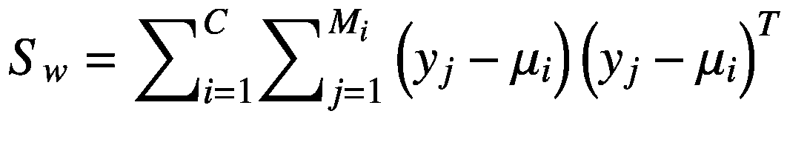
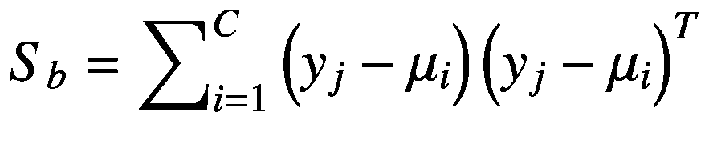
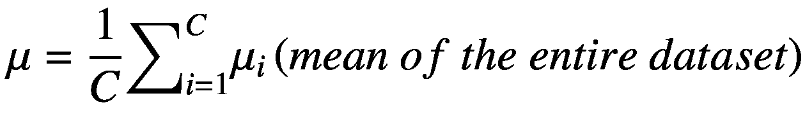
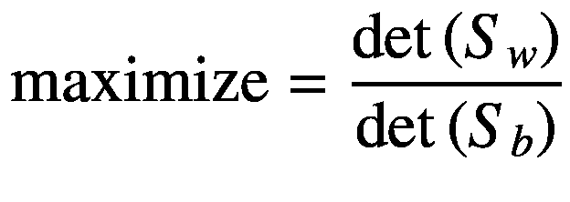
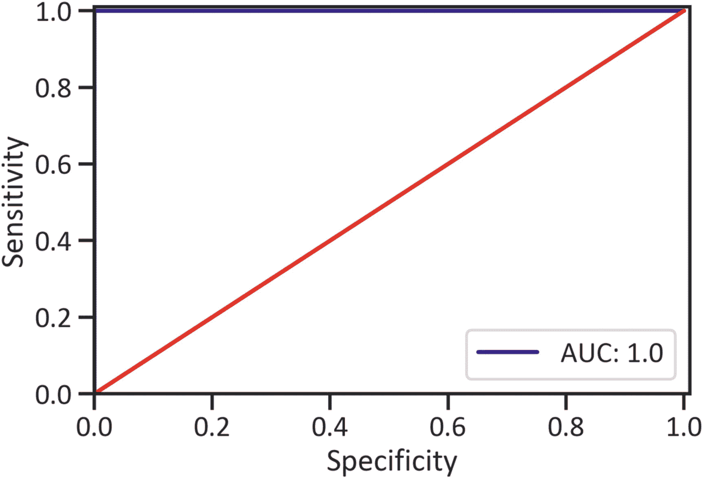
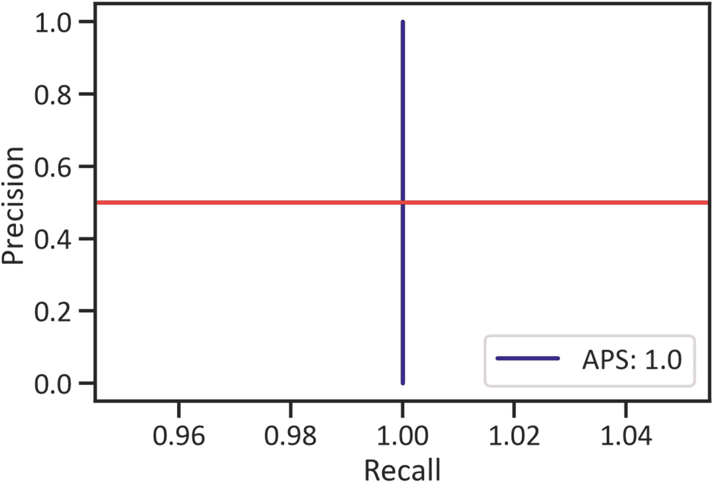
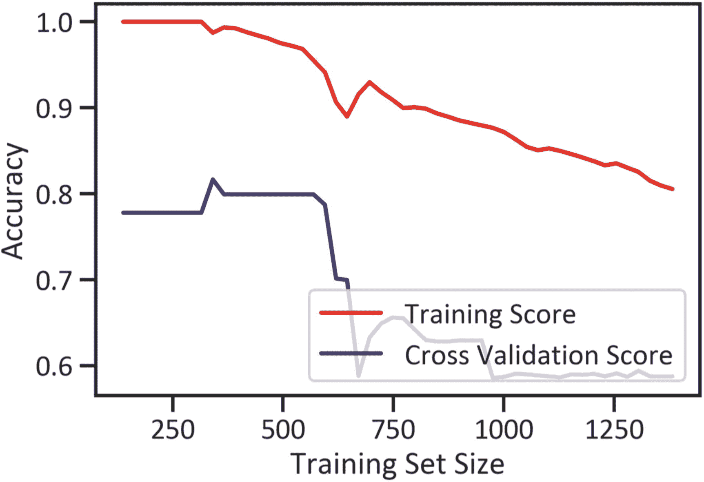

# 6. 使用线性判别分析进行降维与多变量分析

前一章介绍了一种称为逻辑回归的分类方法。它用于解决二分类问题。多项逻辑回归（MLR）是逻辑回归的扩展，它使用 `Softmax` 函数代替 `Sigmoid` 函数，并应用交叉熵损失函数。它是一种用于预测具有两个以上类别的目标变量的逻辑回归形式。它与线性判别分析（LDA）的不同之处在于，MLR 不假设数据来自正态分布。LDA 属于线性家族，它假设正态性和线性。

我们使用 LDA 来解决二分类问题和多分类问题。本章介绍线性分类和判别分析。它揭示了使用 LDA 将数据压缩到更少维度，并利用连续变量估计分类变量的方法。

该模型的工作方式类似于前几章中介绍的模型，如线性回归和逻辑回归。它也与协方差分析（ANOVA）相似。ANOVA 使用分类变量估计连续变量。LDA 合理地假设各组的协方差结构相似。如果各组的协方差结构不相等，则使用二次判别分析。LDA 模型的一个扩展被称为费舍尔判别分析（FDA）。FDA 不执行分类，但变换后获得的特征可用于分类。

逻辑回归和 LDA 都用于估计分类因变量。LDA 与逻辑回归的区别在于它有更多的假设。它也与主成分分析和因子分析相似，因为它寻找最能解释数据的线性组合。当样本量较大时，LDA 效果最佳。

它应用判别函数，通过寻找变量的线性组合并最大化它们之间的差异，将一组连续变量分配到各个类别中。同样，它应用费舍尔线性判别规则来最大化类内散度矩阵与类间散度矩阵之间的比率，并发现组内的线性组合。

最后，它仅使用连续变量来估计分类变量。如果自变量是分类变量，因变量也是分类变量，则使用另一种称为判别对应分析的替代模型。鉴于其继承自线性家族，需要根据线性和正态性假设对模型进行检验。LDA 有两个用途：降维和分类。

### 降维

我们使用 LDA（类似于 PCA）进行降维。它发现数据中解释的方差，并将数据减少到更少的维度。请记住使用特征值来寻找数据中显著变异性的来源。具有最高载荷的特征值是第一个函数，具有第二高载荷的是第二个函数，依此类推。我们根据某些标准剔除具有过高特征值（极端变异性）的因子。

### 分类

LDA 解决二分类和多分类问题。它应用线性分类器将变量分配到某个类别。由于该模型应用线性分类器，因此继承了线性和正态性的严格假设。


## 假设

LDA 对数据结构做出了强假设。如果满足表 6-1 中强调的假设，我们认为 LDA 分类器是可靠的。

**表 6-1** LDA 假设

| 假设 | 描述 |
| --- | --- |
| 多元正态性 | 每个变量分组中必须存在多元正态性；自变量必须服从正态分布。 |
| 协方差 | 各组变量之间的方差在预测变量的各个水平上相同。当协方差相等时，可以使用线性判别分析。否则，使用二次判别分析。 |
| 相关性 | 变量之间不能高度相关。 |
| 随机抽样 | 必须使用随机抽样选择参与者。参与者的得分必须独立于变量。 |

假设有 C 个类别，令类别的均值向量为类别内的样本数量。

公式 6-1 是类内散度矩阵。



（公式 6-1）

公式 6-2 是类间散度矩阵。公式 6-3 是类内散度矩阵。



（公式 6-2）



（公式 6-3）

它执行一种变换，在最小化类内散度的同时最大化类间散度矩阵。参见公式 6-4。



（公式 6-4）

这种变换在保持类别可分性的同时，减少了由身份以外的来源引起的变异。线性变换由一个矩阵 *U* 给出，其列是 *S*[*w*]^(-1)*S*[*b*] 的特征向量。

基本上，它计算 d 维均值向量，然后是散度矩阵以及散度矩阵的特征向量和等效特征值。此后，模型对特征值进行分类，并选择较大的特征值形成一个 *d×k* 维矩阵，并将样本转换到新的子空间。最终结果是类别分离。

## 开发 LDA 分类器

示例数据来自 ML Data。^(⁵) 我们想根据一组自变量预测汽车的质量。参见代码清单 6-1。

```
from sklearn.discriminant_analysis import LinearDiscriminantAnalysis
LDA = LinearDiscriminantAnalysis()
LDA.fit(x_train,y_train)
代码清单 6-1
使用默认超参数开发模型
```

### LDA 超参数优化

调整 LDA 超参数并不像调整其他分类模型的超参数那样繁琐。表 6-2 强调了重要的超参数。

**表 6-2** 可调超参数

| 参数 | 描述 |
| --- | --- |
| `n_component` | 确定组件的数量。 |
| `shrinkage` | 使用 Ledoit-Wolf 引理确定自动收缩或指定值。 |
| `solver` | 确定要使用的求解器；默认使用 `svd` 进行奇异值分解，`lsqr` 用于最小二乘解，`eigen` 用于特征值分解 |
| `store_covariance` | 确定是否存储协方差 |
| `tol` | 确定优化的容差 |

代码清单 6-2 找到了能产生最佳模型性能的超参数。

```
param_gridLDA = {"n_components":[1,2,3,4,5,6,7,8,9],
"solver":("svd", "lsqr", "eigen"),
"store_covariance":[False,True],
"tol":[0.0001,0.001,0.01,1.0]}
grid_modelLDA = GridSearchCV(estimator=LDA, param_grid= param_gridLDA)
grid_modelLDA.fit(x_train,y_train)
print("最佳得分: ", grid_modelLDA.best_score_, "最佳参数: ", grid_modelLDA.best_params_)
最佳得分: 0.7622550979608157 最佳参数: {'n_components': 1, 'solver': 'svd', 'store_covariance': False, 'tol': 0.0001}
代码清单 6-2
超参数优化
```

代码清单 6-3 使用默认超参数完成模型。

```
LDA = LinearDiscriminantAnalysis(n_components= 1,
solver= 'svd',
store_covariance= False,
tol= 0.0001)
LDA.fit(x_train,y_train)
代码清单 6-3
最终确定 LDA 分类器
```

代码清单 6-4 对变量进行变换。

```
features_new = LDA.transform(x_train)
代码清单 6-4
创建新特征
```

代码清单 6-5 估计每个选定组件解释的方差百分比。

```
print(LDA.explained_variance_ratio_)
[1.]
代码清单 6-5
解释方差比
```

每个选定的组件解释了 100% 的方差。代码清单 6-6 打印了原始特征数量和缩减后的特征数量。

```
print('原始特征数 #:', x_train.shape[1])
print('缩减后特征数 #:', features_new.shape[1])
原始特征数 #: 7
缩减后特征数 #: 1
代码清单 6-6
原始特征和缩减特征的数量
```

最初，我们有八个特征；现在有七个特征。

### 预测

在最终确定分类器之后，下一步涉及比较因变量的实际值和变量的预测值。代码清单 6-7 列出了实际值和预测值（参见表 6-3）。

**表 6-3** 实际值与预测值

|   | 实际值 | 预测值 |
| --- | --- | --- |
| **661** | 1 | 1 |
| **122** | 0 | 0 |
| **113** | 0 | 0 |
| **14** | 1 | 1 |
| **529** | 0 | 0 |
| **...** | ... | ... |
| **476** | 1 | 0 |
| **482** | 0 | 0 |
| **230** | 1 | 1 |
| **527** | 0 | 0 |
| **380** | 0 | 0 |

```
y_predLDA = LDA.predict(x_test)
pd.DataFrame({"实际值": y_test,"预测值": y_predLDA})
代码清单 6-7
实际值与预测值
```

表 6-3 并没有告诉我们太多关于分类器性能的信息。

### 评估 LDA 分类器

为了了解 LDA 分类器的性能，我们必须并排比较实际类别和预测类别。

##### 混淆矩阵

我们通常将混淆矩阵视为误差矩阵。它是一个 2×2 的矩阵，用于统计实际标签和预测标签。代码清单 6-8 列出了混淆矩阵（参见表 6-4）。

**表 6-4** 混淆矩阵

|   | 预测：否 | 预测：是 |
| --- | --- | --- |
| **实际：否** | 263 | 0 |
| **实际：是** | 0 | 263 |

```
cmatLDA = pd.DataFrame(metrics.confusion_matrix(y_test,y_predLDA), index=["实际：否","实际：是"],
columns=("预测：否","预测：是"))
cmatLDA
代码清单 6-8
混淆矩阵
```

表 6-4 突出了与逻辑分类器相似的值。我们预计会得到相似的性能结果。


好的，作为一名高级文档工程师和翻译员，我将严格遵循您提供的注意事项和示例，将给定的英文文本翻译成中文。


#### 分类报告

表 6-5 重点展示了重要的分类评估指标。它让我们对分类器的性能有一个概览。请参见代码清单 6-9。

**表 6-5** 分类报告

| | 精确率 | 召回率 | F1 分数 | 支持度 |
| --- | --- | --- | --- | --- |
| **0** | 1.0 | 1.0 | 1.0 | 263.0 |
| **1** | 1.0 | 1.0 | 1.0 | 83.0 |
| **准确率** | 1.0 | 1.0 | 1.0 | 1.0 |
| **宏平均** | 1.0 | 1.0 | 1.0 | 346.0 |
| **加权平均** | 1.0 | 1.0 | 1.0 | 346.0 |

```
creportLDA = pd.DataFrame(metrics.classification_report(y_test,y_predLDA, output_dict=True)).transpose()
creportLDA
```

**代码清单 6-9** 分类报告

LDA 分类器展示了最优的模型性能。它在 100% 的情况下都是准确且精确的。

#### ROC 曲线

代码清单 6-10 应用了 `roc_curve()` 和 `roc_auc_score()` 方法来描绘实际类别和每个类别的概率，从而绘制出曲线（见图 6-1）。



**图 6-1** ROC 曲线

```
y_predLDA_probaLDA = LDA.predict_proba(x_test)[::,1]
fprLDA, tprLDA, _ = metrics.roc_curve(y_test,y_predLDA_probaLDA)
aucLDA = metrics.roc_auc_score(y_test,y_predLDA_probaLDA)
plt.plot(fprLDA, tprLDA,label="AUC: " + str(aucLDA),color="navy")
plt.plot([0,1], [0,1],color="red")
plt.xlim([0.00,1.01])
plt.ylim([0.00,1.01])
plt.xlabel("Sensitivity")
plt.ylabel("Specificity")
plt.legend(loc=4)
plt.show()
```

**代码清单 6-10** ROC 曲线

图 6-1 显示 AUC 分数为 1.0。LDA 分类器展示了最优模型的性能。

#### 精确率-召回率曲线

代码清单 6-11 生成了一条曲线，告诉我们 LDA 分类器在预测类别时的相关性和精确率。我们使用精确率-召回率曲线。

```
precisionLDA, recallLDA, thresholdLDA = metrics.precision_recall_curve(y_test,y_predLDA)
apsLDA = metrics.roc_auc_score(y_test,y_predLDA)
plt.plot(precisionLDA, recallLDA, label="APS: "+str(apsLDA),color="navy")
plt.axhline(y=0.5,color="red",alpha=0.8)
plt.xlabel("Recall")
plt.ylabel("Precision")
plt.legend(loc=4)
plt.show()
```

**代码清单 6-11** 精确率-召回率曲线

图 6-2 展示了一条表现良好的精确率-召回率曲线的特征。



**图 6-2** 精确率-召回率曲线

#### 学习曲线

代码清单 6-12 和图 6-3 描绘了 LDA 分类器的学习过程。



**图 6-3** 学习曲线

```
trainsizeLDA, trainscoreLDA, testscoreLDA = learning_curve(LDA, x, y, cv=5, n_jobs=5, train_sizes=np.linspace(0.1,1.0,50))
trainscoreLDA_mean = np.mean(trainscoreLDA,axis=1)
testscoreLDA_mean = np.mean(testscoreLDA,axis=1)
plt.plot(trainsizeLDA,trainscoreLDA_mean,color="red", label="Training Score")
plt.plot(trainsizeLDA,testscoreLDA_mean,color="navy", label="Cross Validation Score")
plt.xlabel("Training Set Size")
plt.ylabel("Accuracy")
plt.legend(loc=4)
plt.show()
```

**代码清单 6-12** 学习曲线

图 6-3 传达出，分类器的训练和交叉验证准确率在前 550 个数据点上保持稳定，但随着我们增加训练集，准确率会下降。

## 结论

本章探讨了判别分析。它主要关注线性判别分析，并阐述了将其用于降维线性分类的方法。该模型使用了一个单一的分解求解器，该求解器被限制为将优化集的协方差和容差存储为 0.0001。它展示了最优的模型性能。

脚注 1

