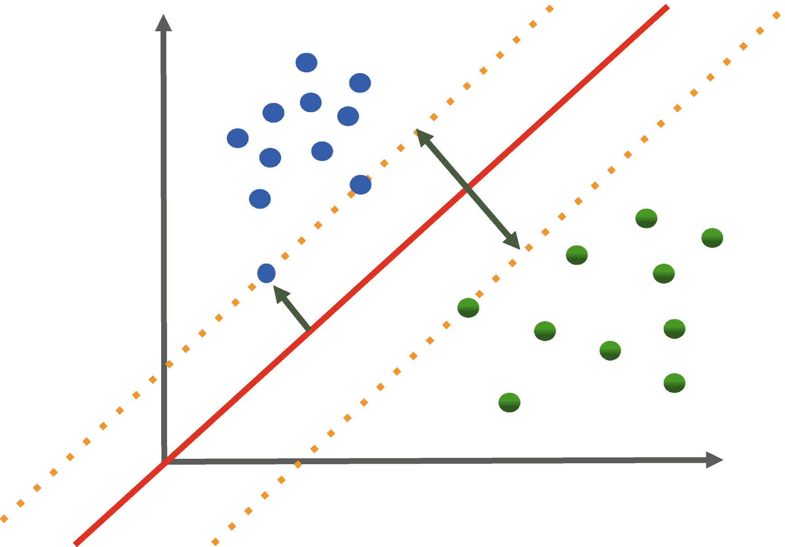
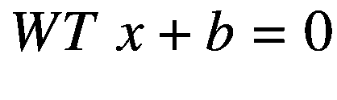
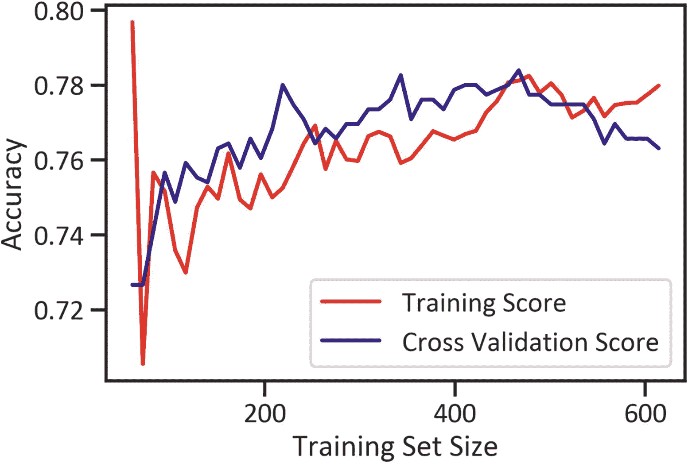

# 7. 使用支持向量寻找超平面

前一章介绍了一种名为线性判别分析（LDA）的线性分类模型，当协方差矩阵相等时，该模型能均等地分布各组。尽管该分类器是最优的线性分类模型之一，但它也有其局限性。首先，我们无法使用分类变量来估计因变量。其次，我们是在严格的正态性假设下训练和测试模型的。本章将介绍另一种线性分类模型，称为支持向量机（SVM）。它属于集成家族；它可以估计连续变量或分类变量。它应用核函数来转换数据，使得超平面能够最佳地拟合数据。与 LDA 不同，SVM 不对数据的底层结构做任何假设。

## 支持向量机

SVM 通常假设数据点在低维空间中线性不可分，而在高维空间中线性可分。它找到一个最优超平面，以充分利用间隔并简化非线性问题。首先，它有效地捕获数据并开发一个新的维度向量空间。然后，它将新向量空间的线性边界划分为两个类别。它将数据点定位在超平面的上方或下方，从而进行分类。它使用核函数来估计具有极大间隔的超平面。主要的核函数有线性函数、多项式函数和 Sigmoid 函数。除非你在分析高维数据，否则完全没有必要深入研究这些函数。你总是可以使用超参数优化来找到最优函数。

### 支持向量

支持向量是紧邻超平面的数据点。它们决定了超平面的位置。此外，当我们移除这些数据点时，超平面的位置会发生变化。

### 超平面

超平面是一条将数据分成两个类别的线（每个类别落在其中一侧）。它充当两侧之间的边界。在使用真实世界数据时，定位一个最优超平面是具有挑战性的。SVM 通过一个称为*核技巧*的过程将数据转换到更高维度。转换数据后，它不再是一条直线，而是一个平面。它应用核函数来转换数据，从而将超平面定位在合适的位置。图 7-1 描绘了一个超平面。



**图 7-1** 超平面

图 7-1 显示了公式 7-1 中表达的直线方程。



**（公式 7-1）**

这里，`W` 代表直线的斜率，`x` 代表输入向量，`b` 代表偏置。两条线（以橙色高亮显示）穿过支持向量并支撑最佳平面。一个理想的超平面对于支持向量具有极大的间隔。

它通过在训练期间使用一种扩大分离的优化过程来确定如何定位超平面。我们不会手动添加超平面。它应用一种被称为核技巧的技术来转换数据。该技术使其能够用更少的计算能力来扩大维度向量空间。

### 支持向量分类器

支持向量分类器（`SVC`），也称为*间隔分类器*，允许某些数据点位于超平面的错误一侧。如果数据无法直接区分，它会引入松弛变量，允许某些数据点落在间隔内部，从而违反约束条件；此外，它还会对这些点进行惩罚。它将松弛变量限制为非负值。如果松弛变量大于 0，它会通过选择 lambda 值，将平面放置在数据点附近而非间隔处，从而搁置约束条件。图 7-2 展示了 SVC 的工作原理。


图 7-2 LinearSVC 工作流程

`LinearSVC` 分类器执行三个基本任务。

- *转换*：将输入空间转换为更高维的向量空间
- *线性分离或直线划分*：实现具有最大间隔的超平面
- *分类*：将数据点分配到某个类别

## 开发 LinearSVC 分类器

我们从 Kaggle 获取了示例数据。^(⁶) 清单 7-1 完成了分类器的构建。

```python
from sklearn.svm import LinearSVC
lsvc = LinearSVC()
lsvc.fit(x_train,y_train)
清单 7-1 完成 LinearSVC 分类器
```

### LinearSVC 超参数优化

表 7-1 突出了关键的超参数。

表 7-1 可调超参数

| 参数 | 描述 |
| --- | --- |
| `Dual` | 决定模型是否必须解决对偶问题 |
| `fit_intercept` | 决定模型是否必须计算截距 |
| `max_iter` | 决定最大迭代次数 |
| `Penalty` | 决定要使用的正则化方法。可用的惩罚项包括 l1 惩罚（Lasso）和 l2 惩罚（Ridge） |
| `Tol` | 决定优化的容差 |
| `Loss` | 决定函数的类型。可用的损失函数包括 hinge 和 squared hinge |

清单 7-2 创建了一个包含分组参数和特定值范围的字典，我们期望从中找到最佳交叉验证分数，然后应用 `GridSearchCV()` 方法开发网格模型并找到具有最佳分数的超参数。

```python
param_gridlsvc = {"dual":[False,True],
"fit_intercept":[False,True],
"max_iter":[1,10,100,100],
"penalty":("l1","l2"),
"tol":[0.0001,0.001,0.01,1.0],
"loss":("hinge", "squared_hinge")}
grid_modellsvc = GridSearchCV(estimator=lsvc, param_grid=param_gridlsvc)
grid_modellsvc.fit(x_train,y_train)
print("Best score: ", grid_modellsvc.best_score_, "Best parameters: ", grid_modellsvc.best_params_)
清单 7-2 超参数优化
```

最佳分数：0.7671331467413035 最佳参数：{‘dual’: False, ‘fit_intercept’: True, ‘loss’: ‘squared_hinge’, ‘max_iter’: 100, ‘penalty’: ‘l1’, ‘tol’: 0.001}

### 完成 LinearSVC 分类器

先前的发现表明，我们应使用平方铰链函数，并通过 L1 惩罚项控制偏差和方差。清单 7-3 完成了 `LinearSVC` 分类器的构建。

```python
lsvc = LinearSVC(dual= False,
fit_intercept= True,
max_iter= 100,
penalty= 'l1',
tol= 0.001,
loss="squared_hinge")
lsvc.fit(x_train,y_train)
清单 7-3 完成 LinearSVC 分类器
```

### 评估 LinearSVC 分类器

清单 7-4 并列展示了实际类别和预测类别。另见表 7-2。

表 7-2 实际值与预测值

|   | 实际值 | 预测值 |
| --- | --- | --- |
| **661** | 1 | 1 |
| **122** | 0 | 0 |
| **113** | 0 | 0 |
| **14** | 1 | 1 |
| **529** | 0 | 0 |
| **...** | ... | ... |
| **476** | 1 | 0 |
| **482** | 0 | 0 |
| **230** | 1 | 1 |
| **527** | 0 | 0 |
| **380** | 0 | 0 |

```python
y_predlsvc = lsvc.predict(x_test)
pd.DataFrame({"Actual":y_test,"Predicted":y_predlsvc})
清单 7-4 实际值与预测值
```

#### 混淆矩阵

清单 7-5 和表 7-3 为我们提供了关于分类器性能的抽象报告。

表 7-3 混淆矩阵

|   | 预测：否 | 预测：是 |
| --- | --- | --- |
| **实际：否** | 98 | 9 |
| **实际：是** | 18 | 29 |

```python
cmatlsvc = pd.DataFrame(metrics.confusion_matrix(y_test,y_predlsvc),
index=["Actual: No","Actual: Yes"],
columns=("Predicted: No","Predicted: Yes"))
cmatlsvc
清单 7-5 混淆矩阵
```

##### 分类报告

清单 7-6 和表 7-4 展示了 `LinearSVC` 分类器的可靠性。它提供了模型的准确率分数、精确率分数、召回率以及其他关键评估指标。

表 7-4 分类报告

|   | 精确率 | 召回率 | F1 分数 | 支持度 |
| --- | --- | --- | --- | --- |
| **0** | 0.844828 | 0.915888 | 0.878924 | 107.000000 |

| **1** | 0.763158 | 0.617021 | 0.682353 | 47.000000 |
| **准确率** | 0.824675 | 0.824675 | 0.824675 | 0.824675 |
| **宏平均** | 0.803993 | 0.766455 | 0.780638 | 154.000000 |
| **加权平均** | 0.819902 | 0.824675 | 0.818931 | 154.000000 |

```
creportlsvc = pd.DataFrame(metrics.classification_report(y_test,y_predlsvc, output_dict=True)).transpose()
creportlsvc
```
清单 7-6 分类报告

`LinearSVC` 分类器的准确率为 82%。在预测类别 0 时，精确率为 84%；在预测类别 1 时，精确率为 76%。

#### 学习曲线

清单 7-7 生成了一条曲线，描绘了 `LinearSVC` 分类器在学习训练数据时准确率的变化过程（见图 7-3）。


图 7-3 学习曲线

```
trainsizelsvc, trainscorelsvc, testscorelsvc = learning_curve(lsvc, x, y, cv=5, n_jobs=5, train_sizes=np.linspace(0.1,1.0,50))
trainscorelsvc_mean = np.mean(trainscorelsvc,axis=1)
testscorelsvc_mean = np.mean(testscorelsvc,axis=1)
plt.plot(trainsizelsvc,trainscorelsvc_mean,color="red", label="Training Score")
plt.plot(trainsizelsvc,testscorelsvc_mean,color="navy", label="Cross Validation Score")
plt.xlabel("Training Set Size")
plt.ylabel("Accuracy")
plt.legend(loc=4)
plt.show()
```
清单 7-7 学习曲线

在学习过程的第一阶段，训练准确率分数急剧下降至约 70% 的历史最低点，随后开始反弹。当分类器处理到第 200 个数据点时，训练准确率分数开始提升。在大多数情况下，训练准确率分数低于交叉验证准确率分数。最后，当分类器即将处理到第 600 个数据点时，训练准确率分数超过了交叉验证准确率分数。

## 结论

本章介绍了 SVM 如何将输入空间转换为更高维的向量空间，创建超平面并对变量进行分类。我们使用平方铰链损失函数和 L1 惩罚项配置了 `LinearSVC` 分类器。请记住，由于该分类器缺乏概率重要性，我们没有绘制 ROC 曲线和精确率-召回率曲线。我们依赖分类报告和学习曲线来理解分类器的潜在性能。

脚注 1