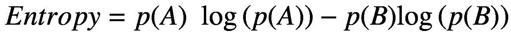
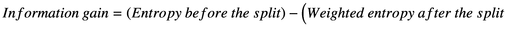
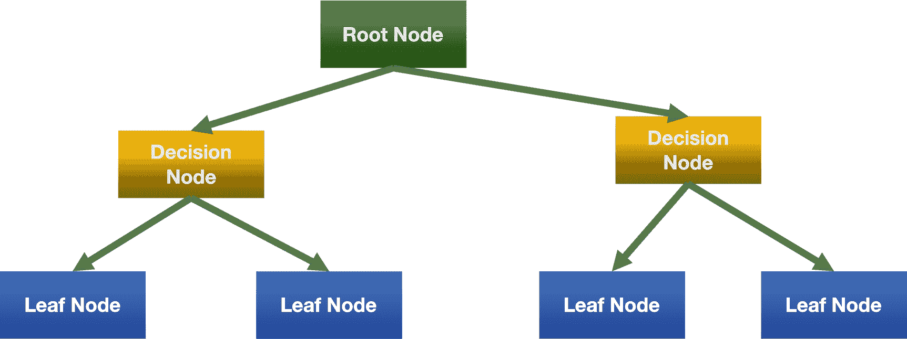
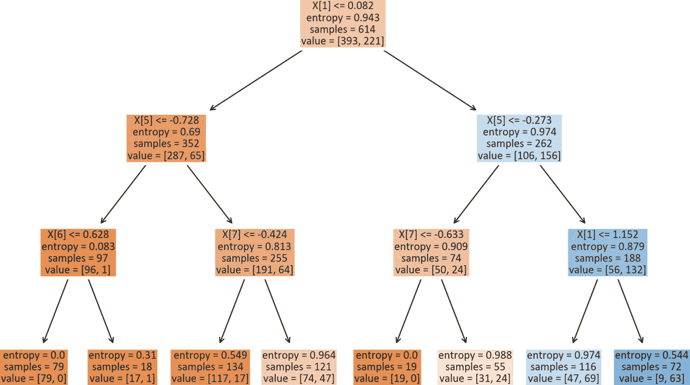
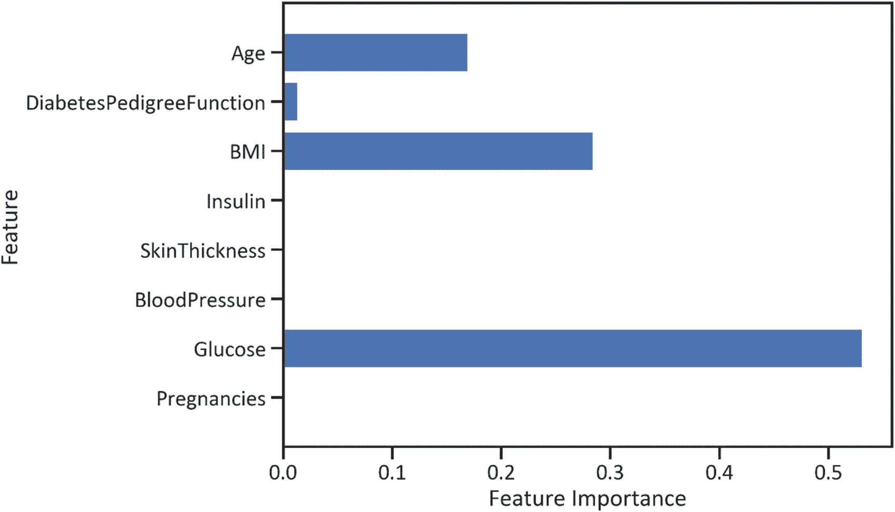
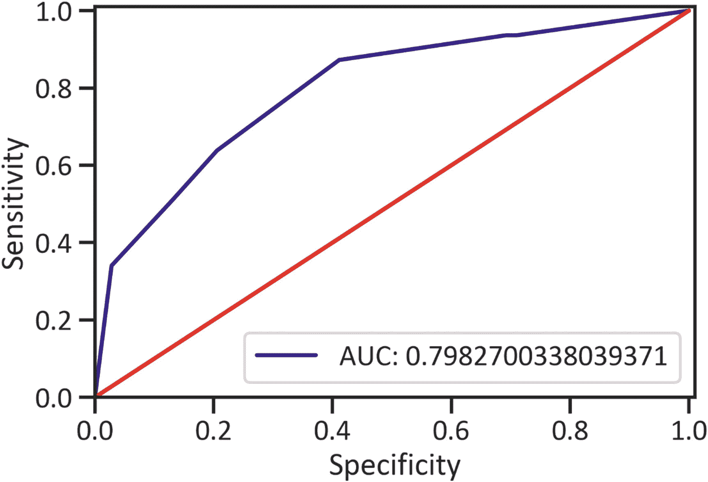
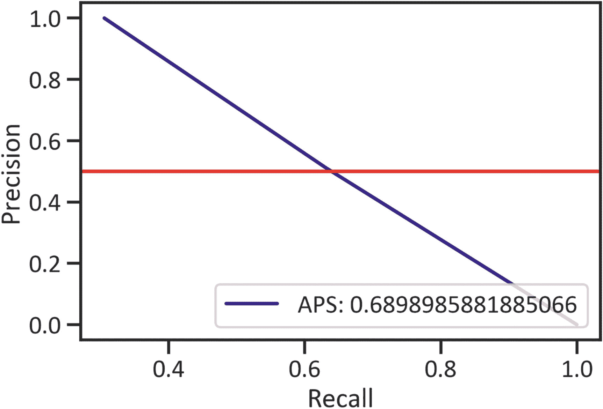
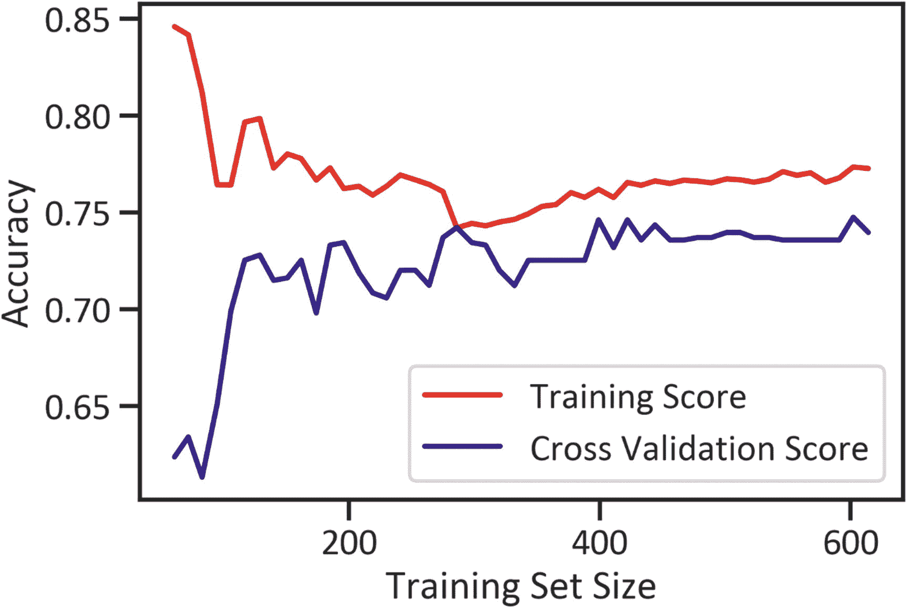

# 8. 使用决策树分类

本章介绍最广泛使用的集成方法——决策树。决策树分类器可以估计分类因变量或连续因变量。它解决二分类和多分类问题。该模型基于树状结构。它在逐步构建决策树的同时，将数据分解成小而易于管理的块。最终结果是一个包含决策节点和叶节点的树状结构。我们将其视为一种贪婪模型，因为它主要关注减少训练时间，同时最大化信息增益。

为了充分利用决策树，需要预先了解数据和分区。我们通过递归地将训练数据划分为决策节点来构建决策树。然后，根据检查结果来检验变量和分支情况。

它会选择预测能力强、不纯度低且熵值低的变量。它还会探索最重要的变量以降低不纯度。最重要的是分区后叶节点的纯度；它会寻找节点上熵值最低的树。总之，决策树分类器有两个目的：将数据分离成不同的子集，以及缩短决策树的分支。它限制了树的深度。

## 熵

熵代表对随机性或不确定性的估计。熵越低，分布越不均匀，节点越多。它表示数据中的无序程度。它估计节点中样本的同质性。如果变量是同质的，那么熵为零。如果样本被均分，那么熵为 1。我们使用公式 8-1 来估计熵。



(公式 8-1)

这里，`p` 是一个类别的比例或比率。我们使用熵将可比较的数据组归入相似的类别。高熵表明数据高度无序。低熵表明数据组织良好。该模型假设不纯度较低的节点需要较少的信息来描述，而不纯度较高的节点需要更多的信息。

决策树估计节点的熵，然后估计分区中每个节点的熵。之后，它对子节点进行加权平均，计算信息增益，并选择信息增益最高的节点进行分区。为决策树分类组织数据涉及将数据分区，并将样本分组到它们所属的类别中，并在每次构建节点时最大化组的纯度。

## 信息增益

信息增益指的是分区后增加确定性水平的信息。它与熵相反。如果加权熵减少，那么信息增益增加，反之亦然。总之，决策树分类器会寻找能带来最显著信息增益的变量。要计算信息增益，我们使用公式 8-2。



(公式 8-2)

## 决策树的结构

如前所述，决策树是一种基于流程图的树状结构。决策树使用一系列 `if`-`then`-`else` 决策规则来估计正弦曲线。决策规则的复杂性取决于树的深度。决策树包含决策节点和叶节点。最顶层的决策节点对应于根节点（最重要的自变量）。叶节点是一个分类或决策。图 8-1 展示了决策树的结构。



`图 8-1` 决策树结构

## 开发决策树分类器

代码清单 8-1 使用默认超参数开发了一个决策树分类器。

```python
from sklearn.tree import plot_tree
from sklearn.tree import DecisionTreeClassifier
dt = DecisionTreeClassifier()
dt.fit(x_train,y_train)
```

`代码清单 8-1` 使用默认超参数开发决策树分类器

### 决策树超参数优化

有数十个可调的决策树超参数。我们只介绍两个关键超参数：`criterion` 和 `max_depth`。标准包括 `gini` 不纯度和 `entropy`。默认情况下，标准是 `gini`，它给出每个标签或类别的概率。值越高表示同质性越高。代码清单 8-2 寻找最优超参数。

```python
param_griddt = {"criterion":("gini","entropy"),
"max_depth":[1,3,5,7,9,12]}
grid_modeldt = GridSearchCV(estimator=dt, param_grid=param_griddt)
grid_modeldt.fit(x_train,y_train)
print("Best score: ", grid_modeldt.best_score_, "Best parameters:", grid_modeldt.best_params_)
```

`代码清单 8-2` 超参数优化

最佳得分：0.7182993469278954 最佳参数：{'criterion': 'entropy', 'max_depth': 3}

上述结果表明，我们应该使用 `entropy` 作为标准，并将树的最大深度设置为 3。参见代码清单 8-3。

```python
dt = DecisionTreeClassifier(criterion= 'entropy', max_depth= 3)
dt.fit(x_train,y_train)
```

`代码清单 8-3` 最终确定决策树分类器

### 可视化决策树

代码清单 8-4 可视化决策树（见图 8-2）。



`图 8-2` 决策树

```python
plt.figure(figsize=(24,14))
tree.plot_tree(dt, filled=True)
plt.show()
```

`代码清单 8-4` 可视化决策树

#### 特征重要性

特征重要性决定了自变量对因变量的相对重要程度。它会为每个自变量分配一个介于 0 到 1 之间的分数。得分最高的自变量是最重要的变量，得分第二高的自变量是第二重要的变量，以此类推。清单 8-5 绘制了特征重要性（见图 8-3）。



`图 8-3` 特征重要性

```python
diabetes_features = [x for i,x in enumerate(df.columns) if i!=8]
def plot_feature_importances_diabetes(model):
plt.figure(figsize=(8,6))
n_features = 8
plt.barh(range(n_features), model.feature_importances_, align="center")
plt.yticks(np.arange(n_features), diabetes_features)
plt.xlabel("Feature Importance")
plt.ylabel("Feature")
plt.ylim(-1, n_features)
plot_feature_importances_diabetes(dt)
plt.savefig('feature_importance')
```

`清单 8-5` `Feature Importance`

图 8-3 显示，有少数几个变量对因变量很重要。`Glucose`的得分最高，这意味着它对于因变量（糖尿病结果）的重要性高于其他变量。紧随其后的是`bmi`和`age`。

我们利用上述发现来减少数据中的变量数量。清单 8-6 对数据进行了缩减。

```python
x = df[["Glucose","DiabetesPedigreeFunction","Age"]]
x = df.iloc[::,0:8]
y = df.iloc[::,-1]
x_train, x_test, y_train, y_test = train_test_split(x,y,test_size=0.2,random_state=0)
scaler = StandardScaler()
x_train = scaler.fit_transform(x_train)
x_test = scaler.transform(x_test)
dt = DecisionTreeClassifier(criterion= 'entropy', max_depth= 3)
dt.fit(x_train,y_train)
```

`清单 8-6` `Re-processing`

### 评估决策树分类器

清单 8-7 返回了一个比较实际值和预测值的表格（见表 8-1）。

**表 8-1** 实际值与预测值

|   | 实际值 | 预测值 |
|---|-------|-------|
| **661** | 1 | 1 |
| **122** | 0 | 0 |
| **113** | 0 | 0 |
| **14** | 1 | 0 |
| **529** | 0 | 0 |

## 混淆矩阵

清单 8-8 和表 8-2 展示了决策树分类器的性能。它包含了实际值和预测值的四种组合。

**表 8-2** 混淆矩阵

|   | 预测：否 | 预测：是 |
| --- | --- | --- |
| **实际：否** | 93 | 14 |
| **实际：是** | 23 | 24 |

```python
cmatdt = pd.DataFrame(metrics.confusion_matrix(y_test,y_preddt), index=["Actual: No","Actual: Yes"],
columns=("Predicted: No","Predicted: Yes"))
cmatdt
```
*Listing 8-8: Confusion Matrix*

### 分类报告

为了深入了解决策树分类器的性能，我们使用了分类报告。清单 8-9 以表格形式呈现了分类报告（见表 8-3）。

**表 8-3** 分类报告

|   | 精确率 | 召回率 | F1 分数 | 支持度 |
| --- | --- | --- | --- | --- |
| **0** | 0.801724 | 0.869159 | 0.834081 | 107.00000 |
| **1** | 0.631579 | 0.510638 | 0.564706 | 47.00000 |
| **准确率** | 0.759740 | 0.759740 | 0.759740 | 0.75974 |
| **宏平均** | 0.716652 | 0.689899 | 0.699393 | 154.00000 |
| **加权平均** | 0.749797 | 0.759740 | 0.751869 | 154.00000 |

```python
creportdt = pd.DataFrame(metrics.classification_report(y_test,y_preddt, output_dict=True)).transpose()
creportdt
```
*Listing 8-9: Classification Report*

表 8-3 表明决策树分类器表现不佳。准确率得分为 74%，比逻辑回归分类器、线性支持向量分类器和线性判别分析分类器的准确率得分低了约 8%。该分类器的精确率得分也低于这两个分类器。

### ROC 曲线

最可靠的方法涉及预测每个类别的概率。首先，我们预测每个类别的概率。然后，我们构建 ROC 曲线并找到 AUC 值。清单 8-10 生成了 ROC 曲线（见图 8-4）。



**图 8-4** ROC 曲线

```python
y_preddt_proba = dt.predict_proba(x_test)[::,1]
fprdt, tprdt, _ = metrics.roc_curve(y_test,y_preddt_proba)
aucdt = metrics.roc_auc_score(y_test, y_preddt_proba)
plt.plot(fprdt, tprdt, label="AUC: "+str(aucdt), color="navy")
plt.plot([0,1],[0,1],color="red")
plt.xlim([0.00,1.01])
plt.ylim([0.00,1.01])
plt.xlabel("Specificity")
plt.ylabel("Sensitivity")
plt.legend(loc=4)
plt.show()
```
*Listing 8-10: ROC Curve*

图 8-4 显示 AUC 得分接近 80%。理想情况下，我们希望 AUC 得分大于 80%。上述 AUC 得分表明该分类器在区分不同类别方面并不熟练。

### 精确率-召回率曲线

清单 8-11 生成了一条曲线，该曲线提供了关于假阳性和假阴性的有意义的见解（见图 8-5）。



**图 8-5** 精确率-召回率曲线

```python
precisiondt, recalldt, thresholddt = metrics.precision_recall_curve(y_test,y_preddt)
apsdt = metrics.roc_auc_score(y_test,y_preddt)
plt.plot(precisiondt, recalldt, label="APS: "+str(apsdt),color="navy")
plt.axhline(y=0.5,color="red")
plt.xlabel("Recall")
plt.ylabel("Precision")
plt.legend(loc=4)
plt.show()
```
*Listing 8-11: Precision-Recall Curve*

在不考虑决策阈值的情况下，APS 为 69%。

### 学习曲线

清单 8-12 生成了一条曲线，该曲线描绘了`LinearSVC`分类器在学习训练数据时准确率的变化过程（见图 8-6）。



**图 8-6** 学习曲线

```python
trainsizedt, trainscoredt, testscoredt = learning_curve(dt, x, y, cv=5, n_jobs=5, train_sizes=np.linspace(0.1,1.0,50))
trainscoredt_mean = np.mean(trainscoredt,axis=1)
testscoredt_mean = np.mean(testscoredt,axis=1)
plt.plot(trainsizedt,trainscoredt_mean,color="red", label="Training Score")
plt.plot(trainsizedt,testscoredt_mean,color="navy", label="Cross Validation Score")
plt.xlabel("Training Set Size")
plt.ylabel("Accuracy")
plt.legend(loc=4)
plt.show()
```
*Listing 8-12: Learning Curve*

图 8-6 显示，从决策树分类器开始学习数据时起，训练准确率得分就高于交叉验证得分。该分类器一开始非常乐观，但随着我们增加训练集，其大小下降，并稳定在 0.75 到 0.80 的范围内。

## 结论

本章介绍了树分类建模技术，包括发现最优超参数、寻找对因变量最重要的变量，以及仅使用重要变量和最佳超参数来可视化决策树和分类器。还有一些独特的决策树分类器扩展算法，例如极端随机树和随机森林树。极端随机树会随机分割决策树的节点，而随机森林树则并行迭代构建多个决策树。