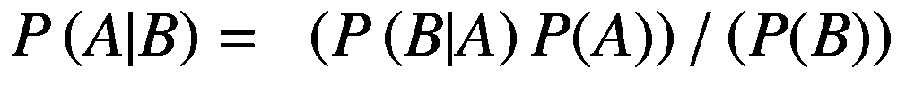
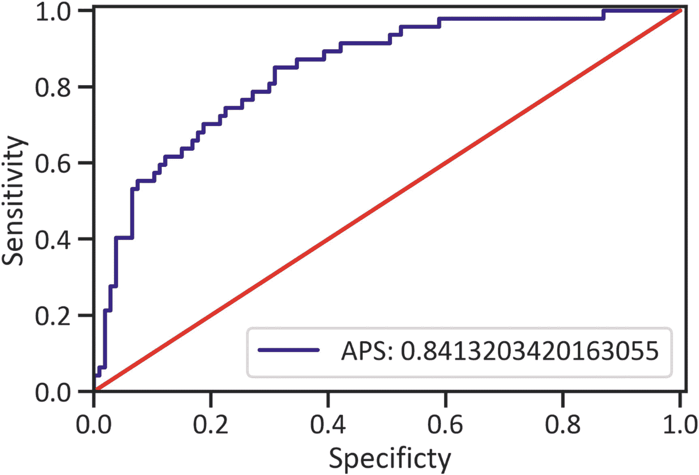
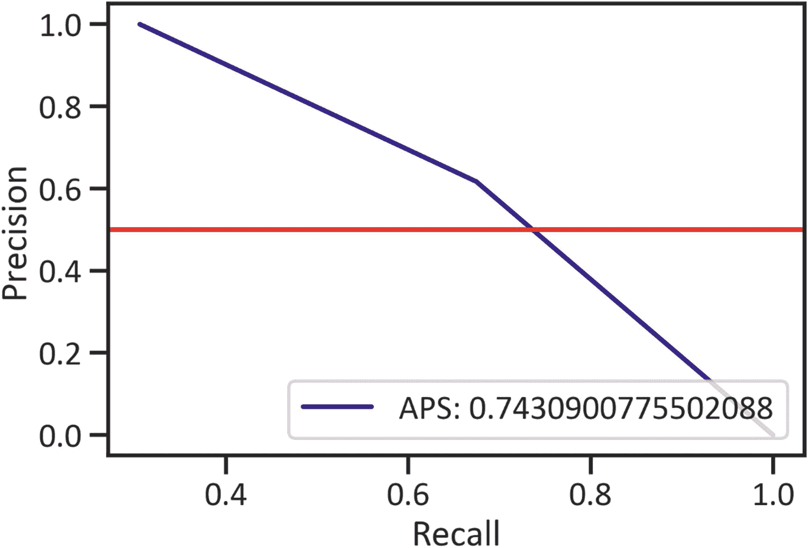
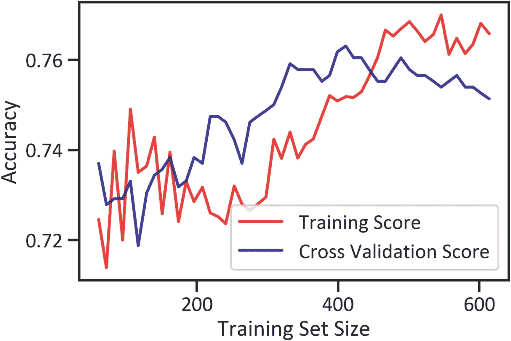

# 9. 回归经典

现在我们将介绍最古老的分类方法之一：朴素贝叶斯，这是一种 18 世纪初期的模型。它是一种监督学习模型，可以解决二分类和多分类问题。*朴素*一词源于该模型对数据所做的假设。我们之所以认为它朴素，是因为它假设变量之间相互独立，即数据之间不存在依赖关系。这在现实世界中很少发生。我们可以将朴素贝叶斯定理简化为公式 9-1。



（公式 9-1）

这里，表示在事件 B 已发生的情况下，事件 A 发生的概率。

本章将介绍高斯朴素贝叶斯。它假设自变量是二元的。然而，我们可以放宽这一假设，以容纳服从正态分布的连续变量。此外，由于我们不需要进行超参数调优（它没有可调的超参数），因此该方法内存效率高且速度快。贝叶斯模型属于概率模型家族。要理解该模型，请先熟悉朴素贝叶斯。

## 朴素贝叶斯定理

当处理连续自变量时，请使用`GaussianNB`分类器。只要您具备处理连续变量的背景知识，建模就相对容易。关于高斯分布（也称为*正态分布*）的回顾，请参考本书第一章。我们提到，当数据点接近实际均值时，数据服从正态分布。`GaussianNB`分类器会估计一个变量属于某个特定类别的概率；同时，它还会估计中心值，即均值或标准差。它最适合高维特征。我们通常在小训练集的情况下使用此分类器。该分类器使用高斯概率密度函数来估计自变量新值的概率。

## 开发高斯朴素贝叶斯分类器

`GaussianNB`分类器不需要超参数优化。同样，我们从 Kaggle 获取了数据。^(⁷) 代码清单 9-1 完成了`GaussianNB`分类器的构建。

```
from sklearn.naive_bayes import GaussianNB
gnb = GaussianNB()
gnb.fit(x_train,y_train)
```
代码清单 9-1 完成`GaussianNB`分类器

代码清单 9-2 返回了一个同时显示实际类别和预测类别的表格（见表 9-1）。

表 9-1 实际值与预测值

|   | 实际值 | 预测值 |
|---|--------|--------|
| **661** | 1 | 1 |
| **122** | 0 | 0 |
| **113** | 0 | 0 |
| **14** | 1 | 1 |
| **529** | 0 | 0 |
| **...** | ... | ... |
| **476** | 1 | 0 |
| **482** | 0 | 0 |
| **230** | 1 | 0 |
| **527** | 0 | 0 |
| **380** | 0 | 0 |

```
y_predgnb = gnb.predict(x_test)
pd.DataFrame({"Actual":y_test, "Predicted":y_predgnb})
```
代码清单 9-2 实际值与预测值

### 评估高斯朴素贝叶斯分类器

要了解`GaussianNB`分类器的性能，我们必须将实际类别与预测类别进行并排比较。

### 混淆矩阵

代码清单 9-3 和表 9-2 生成了一个矩阵，突出显示了用于评估`GaussianNB`分类器关键性能的值。

表 9-2 混淆矩阵

|   | 预测：否 | 预测：是 |
|---|----------|----------|
| **实际：否** | 93 | 14 |
| **实际：是** | 18 | 29 |

```
cmatgnb = pd.DataFrame(metrics.confusion_matrix(y_test,y_predgnb), index=["Actual: No","Actual: Yes"],
columns=("Predicted: No","Predicted: Yes"))
cmatgnb
```
代码清单 9-3 混淆矩阵

### 分类报告

代码清单 9-4 和表 9-3 突出了关键的分类评估指标，如准确率、精确率、召回率等。

表 9-3 分类报告

|   | 精确率 | 召回率 | F1 分数 | 支持度 |
|---|--------|--------|---------|--------|
| **0** | 0.837838 | 0.869159 | 0.853211 | 107.000000 |
| **1** | 0.674419 | 0.617021 | 0.644444 | 47.000000 |
| **准确率** | 0.792208 | 0.792208 | 0.792208 | 0.792208 |
| **宏平均** | 0.756128 | 0.743090 | 0.748828 | 154.000000 |
| **加权平均** | 0.787963 | 0.792208 | 0.789497 | 154.000000 |

```
creportgnb = pd.DataFrame(metrics.classification_report(y_test,y_predgnb, output_dict=True)).transpose()
creportgnb
```
代码清单 9-4 分类报告

表 9-3 显示，类别 0 的精确率得分（0.84）和召回率得分（0.87）最高。总体而言，该模型的准确率为 79%。

### ROC 曲线

代码清单 9-5 和图 9-1 展示了不同的阈值，使操作员能够在精确率和召回率之间进行权衡。阈值介于 0 和 1 之间。


图 9-1 ROC 曲线

```
y_predgnb_proba = gnb.predict_proba(x_test)[::,1]
fprgnb, tprgnb, _ = metrics.roc_curve(y_test,y_predgnb_proba)
aucgnb = metrics.roc_auc_score(y_test, y_predgnb_proba)
plt.plot(fprgnb, tprgnb, label="auc: "+str(aucgnb), color="navy")
plt.plot([0,1],[0,1],color="red")
plt.xlim([0.00,1.01])
plt.ylim([0.00,1.01])
plt.xlabel("特异度")
plt.ylabel("敏感度")
plt.legend(loc=4)
plt.show()
```
代码清单 9-5 ROC 曲线

图 9-1 显示，当特异度在 0 到 0.1 之间时，曲线紧贴右侧边界。然而，随着特异度的增加，曲线弯曲并缓慢趋近于 1。AUC 得分为 0.84。

### 精确率-召回率曲线

分类报告告诉我们，类别 0 拥有大量的数据点（数据不平衡）。我们必须更多地关注精确率和召回率。代码清单 9-6 生成了精确率-召回率曲线（见图 9-2）。


图 9-2 精确率-召回率曲线

```
precisiongnb, recallgnb, thresholdgnb = metrics.precision_recall_curve(y_test,y_predgnb)
apsgnb = metrics.roc_auc_score(y_test,y_predgnb)
plt.plot(precisiongnb, recallgnb, label="aps: "+str(apsgnb),color="navy",alpha=0.8)
plt.axhline(y=0.5,color="red",alpha=0.8)
plt.xlabel("精确率")
plt.ylabel("召回率")
plt.legend(loc=4)
plt.show()
```
代码清单 9-6 精确率-召回率曲线

精确率得分的平均值为 74%。该曲线并未接近最上方的边界。相反，它平滑地下降，直到达到 0.8，然后势头减弱。

### 学习曲线

代码清单 9-7 生成了一条曲线，描绘了`GaussianNB`分类器在学习训练数据时准确率的变化过程（见图 9-3）。


图 9-3 学习曲线

```
trainsizegnb, trainscoregnb, testscoregnb = learning_curve(gnb, x, y, cv=5, n_jobs=5, train_sizes=np.linspace(0.1,1.0,50))
trainscoregnb_mean = np.mean(trainscoregnb,axis=1)
testscoregnb_mean = np.mean(testscoregnb,axis=1)
plt.plot(trainsizegnb,trainscoregnb_mean,color="red", label="Training Score", alpha=0.8)
plt.plot(trainsizegnb,testscoregnb_mean,color="navy", label="Cross Validation Score", alpha=0.8)
plt.xlabel("Training Set Size")
plt.ylabel("Accuracy")
plt.legend(loc=4)
plt.show()
```

# 清单 9-7 学习曲线

图 9-3 显示 `GaussianNB` 分类器是一个快速学习器。鉴于该模型没有可调的超参数，这一点并不令人意外。与我们在前几章中开发的分类器相比，`GaussianNB` 在训练过程的初始阶段过拟合程度更低。与其他学习曲线不同，训练准确率分数在前几个训练集上并未骤降。尽管该分类器学习速度快，但它未能达到 80% 的准确率。

## 结论

本章介绍了朴素贝叶斯分类器。请记住，还有其他朴素分类器，例如多项式朴素贝叶斯模型和伯努利朴素贝叶斯模型。^(⁸) 它们的使用取决于具体情境。

脚注 1 2