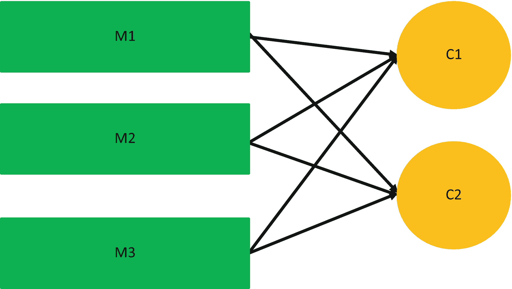
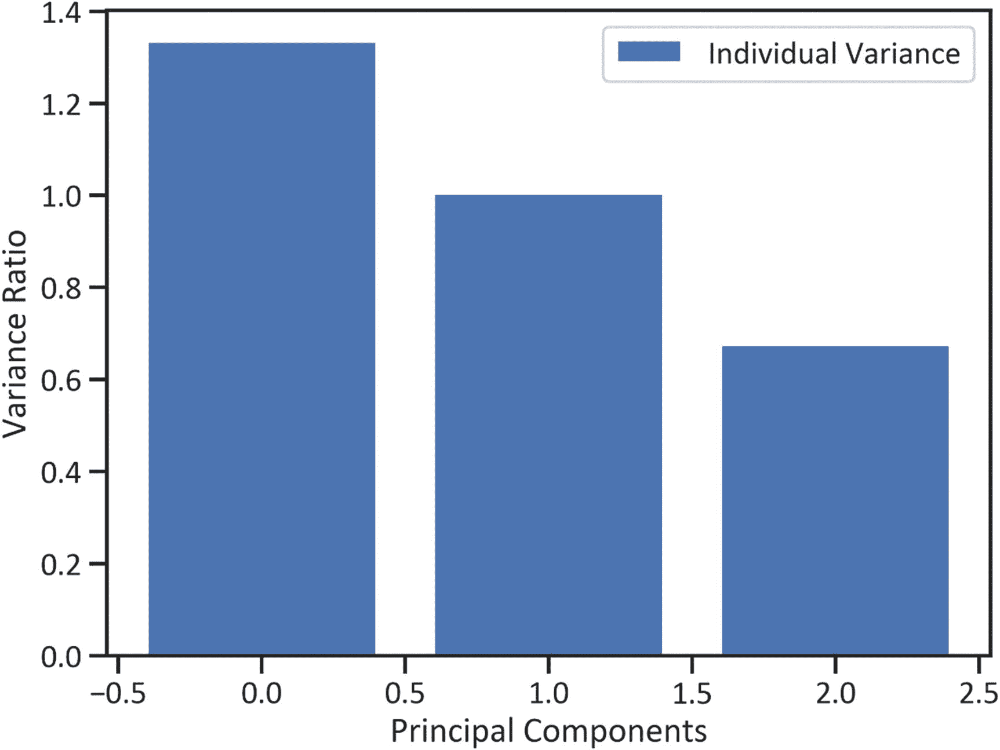
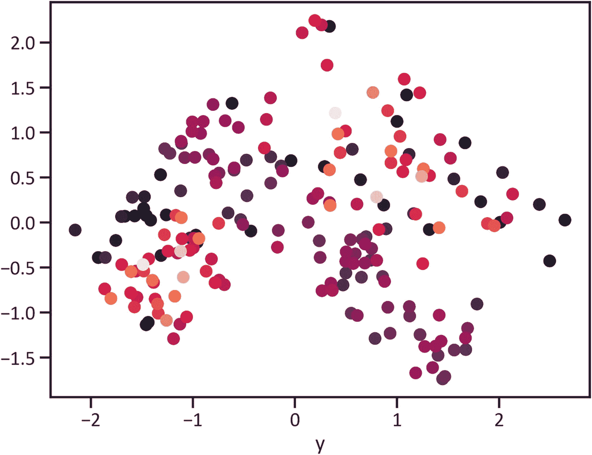
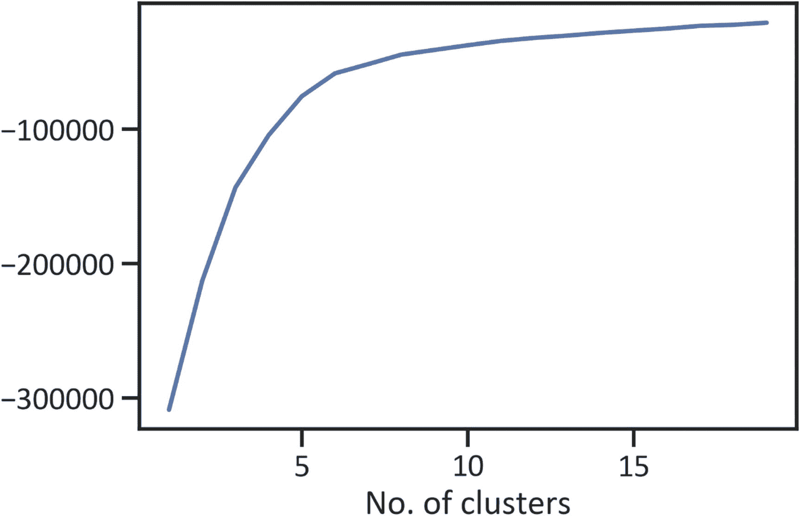
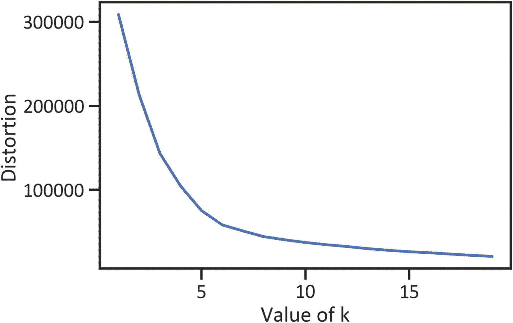
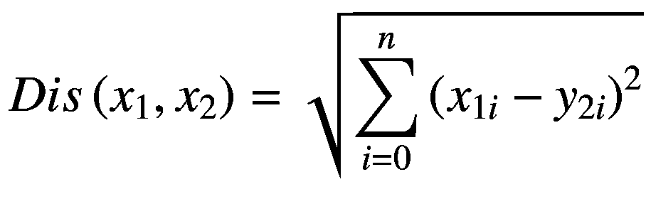
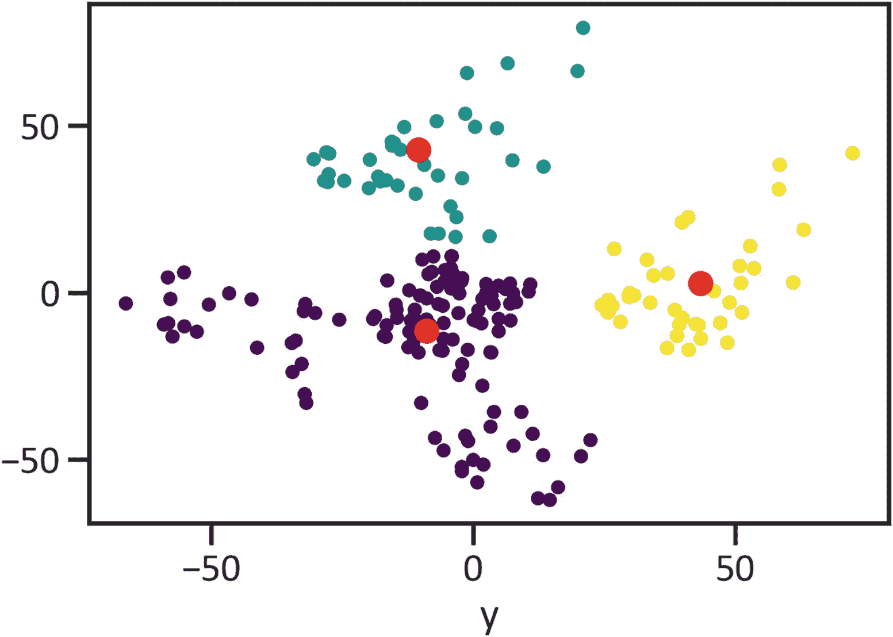
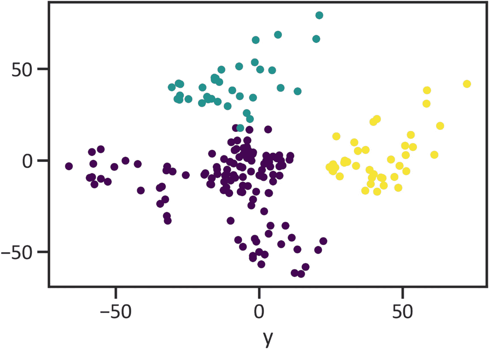
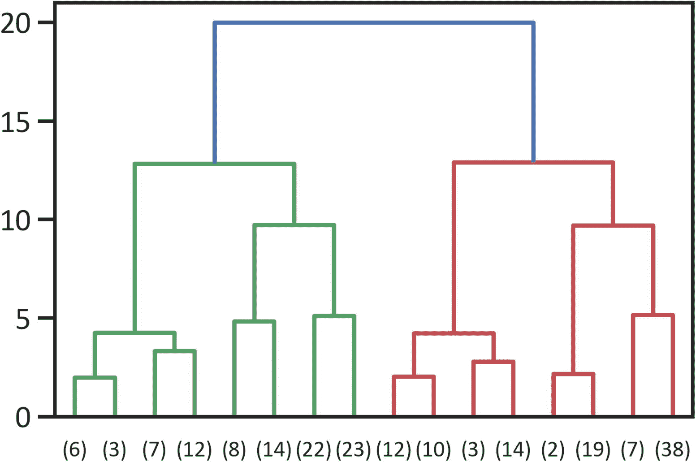
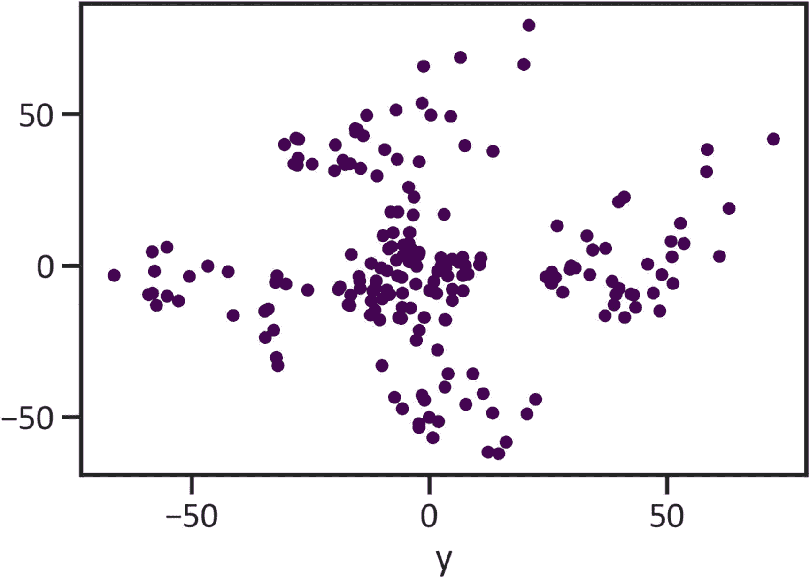

# 10. 聚类分析

本章将以结构化形式简要介绍聚类分析的概念。在前几章中，我们充分介绍了监督学习。在监督学习中，我们向模型提供一组正确答案，然后让它预测未见过的数据。现在，让我们稍微转移一下注意力。假设我们有一组包含多个变量的数据，并且没有需要关注的独立变量。在这种情况下，我们不会对某种现象做出任何看似合理的假设。

本章将介绍无监督学习。我们不会向模型提供一组正确答案；相反，我们允许它做出智能的粗略估计。无监督学习包括降维和聚类分析。在本章中，我们首先让您熟悉一种广泛称为主成分分析（PCA）的降维方法，然后向您介绍聚类分析。之后，我们将开发并评估诸如 K-means 模型、凝聚模型和 DBSCAN 模型等模型。在对数据进行预处理和建模之前，我们先讨论一下聚类分析。

## 什么是聚类分析？

聚类分析是一种能够可靠地找到具有相似性和差异性的数据点组的方法。在聚类分析中，我们关注的是能够解释数据变异的独特聚类。没有真正的因变量。我们平等地对待所有变量。流行的聚类技术包括：*质心聚类*，它是随机的，将数据点的质心选择到一组指定的聚类中，例如 K-means；*密度聚类*，它根据密度分布对数据点进行分组，例如 DBSCAN；以及*分布聚类*，它根据某种分布识别数据点属于某个聚类的概率，例如高斯混合模型等。

## 聚类分析实践

表 10-1 显示了此用例的数据。数据中有三个变量。没有实际的独立变量。所有变量同等重要。我们关注的是数据中的相似性和差异性。同样，我们从 Kaggle 获得了示例数据。^(⁹)

**表 10-1** 数据集

|   | 年龄 | 年收入 (千美元) | 消费评分 (1–100) |
|--- |--- |--- |--- |
| **0** | 19 | 15 | 39 |
| **1** | 21 | 15 | 81 |
| **2** | 20 | 16 | 6 |
| **3** | 23 | 16 | 77 |
| **4** | 31 | 17 | 40 |

## 相关矩阵

我们首先计算数据中变量之间的关联性。当数据中有一组连续变量时，使用皮尔逊方法来衡量相关性。清单 10-1 生成了皮尔逊相关矩阵（见表 10-2）。

**表 10-2** 皮尔逊相关矩阵

|   | 年龄 | 年收入 (千美元) | 消费评分 (1–100) |
|--- |--- |--- |--- |
| **年龄** | 1.000000 | -0.012398 | -0.327227 |
| **年收入 (千美元)** | -0.012398 | 1.000000 | 0.009903 |
| **消费评分 (1–100)** | -0.327227 | 0.009903 | 1.000000 |

```
dfcorr = df.corr()
dfcorr
```

**清单 10-1** 皮尔逊相关矩阵

表 10-2 显示了年龄与年收入之间微弱的负相关关系，以及年龄与消费评分之间较强的负相关关系。

## 协方差矩阵

计算协方差的主要目的是构建特征矩阵。清单 10-2 和表 10-3 总结了变量之间的变异性。

**表 10-3** 协方差矩阵

|   | 年龄 | 年收入 (千美元) | 消费评分 (1-100) |
|--- |--- |--- |--- |
| **年龄** | 195.133166 | -4.548744 | -118.040201 |
| **年收入 (千美元)** | -4.548744 | 689.835578 | 6.716583 |
| **消费评分 (1-100)** | -118.040201 | 6.716583 | 666.854271 |

```
dfcov = df.cov()
dfcov
```

**清单 10-2** 协方差矩阵

大多数情况下，我们对变量之间的协方差不感兴趣；相反，我们感兴趣的是它们之间的相关性以及相关性的严重程度。

## 特征矩阵

为了可靠地找出变量之间相关性的严重程度，请使用特征值。特征值小于 0 表示多重共线性，介于 10 和 100 之间表示轻微多重共线性，大于 100 表示严重多重共线性。清单 10-3 计算并列出了特征值和特征向量（见表 10-4）。

**表 10-4** 特征矩阵

|   | 特征值 | 年龄 | 年收入 (千美元) | 消费评分 (1–100) |
|--- |--- |--- |--- |--- |
| **年龄** | 167.228524 | 0.973210 | 0.188974 | -0.130965 |
| **年收入 (千美元)** | 700.264355 | 0.005517 | -0.588641 | -0.808376 |
| **消费评分 (1–100)** | 684.330136 | 0.229854 | -0.785997 | 0.573914 |

```
eigenvalues, eigenvectors = np.linalg.eig(dfcov)
eigenvalues = pd.DataFrame(eigenvalues)
eigenvectors = pd.DataFrame(eigenvectors)
eigen = pd.concat([eigenvalues,eigenvectors],axis=1)
eigen.index = df.columns
eigen.columns = ("Eigen values","Age","Annual Income (k$)","Spending Score (1-100)")
eigen
```

**清单 10-3** 特征矩阵

表 10-4 显示了特征向量和特征值。存在严重的多重共线性。正如我们在前几章中着重提到的，多重共线性会对结论产生不利影响。

清单 10-4 应用 `StandardScaler()` 方法对数据进行缩放，使得均值为 0，标准差为 1。

```
from sklearn.preprocessing import StandardScaler
scaler = StandardScaler()
df = scaler.fit_transform(df)
```

**清单 10-4** 数据标准化

接下来，我们执行 PCA。


### 主成分分析

在主成分分析（PCA）中，我们利用特征值来寻找数据中的变异来源。PCA 会计算累积比例。请记住，我们并非基于某个模型来执行 PCA，而是由它来寻找能够解释变异的数据点。与因子分析类似，我们使用 PCA^(¹⁰) 来简化一组变量的结构。它通过计算变量的线性组合来得到主成分。该方法的主要目标是解释总方差。同时，它也将数据压缩到更少的成分中，以便所使用的成分能够代表模型估计值。最后，它会剔除具有较大特征值（极端变异性）的因子。不仅如此，它还使用凯泽准则来确定需要保留的因子数量。图 10-1 简化了一组变量的结构。



**图 10-1** 主成分分析

此处，变量（`M1`、`M2` 和 `M3`）基于某些因子或成分 `C1` 和 `C2`。回想一下，我们感兴趣的是找出支持主成分的变量。代码清单 10-5 返回 PCA 载荷并创建一个载荷矩阵。

```
pca = PCA()
pca.fit_transform(df)
pca_variance = pca.explained_variance_
plt.figure(figsize=(8, 6))
plt.bar(range(3), pca_variance, align="center", label="Individual Variance")
plt.legend()
plt.ylabel("Variance Ratio")
plt.xlabel("Principal Components")
plt.show()
```

**代码清单 10-5** 解释方差

图 10-2 展示了各成分对预测变量相对重要性的排序。它证实了第一个成分解释了数据中的大部分变异。参见代码清单 10-6。



**图 10-2** 解释方差

```
pca = PCA(n_components=3).fit(df)
pca_components = pca.components_.T
pca_components = pd.DataFrame(pca_components)
pca_components.index = df.columns
pca_components.columns = df.columns
pca_components
```

**代码清单 10-6** 主成分矩阵

代码清单 10-6 返回一个条件索引，该索引描述了每个成分的 PCA 载荷（见表 10-5）。

**表 10-5** 主成分

|   | 年龄 | 年收入 (k$) | 消费评分 (1–100) |
| --- | --- | --- | --- |
| **年龄** | -0.188974 | 0.130965 | 0.973210 |
| **年收入 (k$)** | 0.588641 | 0.808376 | 0.005517 |
| **消费评分 (1–100)** | 0.785997 | -0.573914 | 0.229854 |

`年龄` 具有最高的 PCA 载荷（它是第一主成分），其次是年收入（`k$`），依此类推。代码清单 10-7 对数据进行转换。请记住，我们将成分数量指定为 3。

```
pca2 = PCA(n_components=3)
pca2.fit(df)
x_3d = pca2.transform(df)
plt.figure(figsize=(8,6))
plt.scatter(x_3d[:,0], x_3d[:,2], c=old_df['Annual Income (k$)'])
plt.xlabel("y")
plt.show()
```

**代码清单 10-7** 完成 PCA

执行降维后，我们使用散点图绘制数据点。图 10-3 展示了数据点的分布。参见代码清单 10-8。



**图 10-3** 主成分

```
df = pca.transform(df)
```

**代码清单 10-8** 数据降维

## 肘部曲线

肘部曲线被广泛认为是*曲线拐点*图。我们用它来发现数据中的聚类数量。其 x 轴为聚类数量，y 轴为解释方差的百分比。我们使用一个截断点来选择聚类数量。截断点是指平滑弯曲结束、急剧弯曲开始的那个点。参见代码清单 10-9。

```
Nc = range(1,20)
kmeans = [KMeans(n_clusters=i) for i in Nc]
scores = [kmeans[i].fit(df).score(df) for i in range(len(kmeans))]
fig, ax = plt.subplots()
plt.plot(Nc, scores)
plt.xlabel("No. of clusters")
plt.show()
```

**代码清单 10-9** 肘部曲线

图 10-4 显示了从聚类 1 到聚类 3 的平滑弯曲。然而，从聚类 3 开始，曲线急剧弯曲。我们使用 3 作为截断点。



**图 10-4**

解决问题的方法不止一种。你也可以使用碎石图来验证截断点。请记住，我们通常在 PCA 中使用碎石图来确定要保留的成分数量。代码清单 10-10 生成一个碎石图，我们也可以用它来确定聚类模型要使用的聚类数量（见图 10-5）。



**图 10-5** 碎石图

```
ks = range(1,20)
ds = []
for k in ks:
    cls = KMeans(n_clusters=k)
    cls.fit(df)
    ds.append(cls.inertia_)
fig, ax = plt.subplots()
plt.plot(ks, ds)
plt.xlabel("Value of k")
plt.ylabel("Distortion")
plt.show()
```

**代码清单 10-10** 碎石图

图 10-5 验证了碎石图的拐点。

## K-Means 聚类

K-Means 模型是最流行的聚类模型。它将数据分割成 *k* 个具有最近均值*质心*的聚类，然后计算子集之间的距离以形成聚类。它还能减少簇内距离并增加簇间距离。其公式如公式 10-1 所示。



**(公式 10-1)**

基本上，该模型会找到初始的 *k*（聚类数量）并计算聚类之间的距离。然后，它将每个数据点分配到最近的质心。该模型在处理大样本时效果最佳。参见代码清单 10-11。

```
kmeans = KMeans(n_clusters=3)
kmeans_output = kmeans.fit(df)
kmeans_output
```

**代码清单 10-11** 使用默认超参数的 K-Means 模型


### K-Means 超参数优化

我们通常不希望使用初始超参数来拟合模型，除非它能带来最佳性能。针对每个用例，我们必须找到最佳的超参数（前提是模型具有可调超参数）。表 10-6 概述了 K-means 的关键可调超参数。

**表 10-6** 可调超参数

| 参数 | 描述 |
| --- | --- |
| `copy_X` | 确定是否必须复制自变量。 |
| `tol` | 确定精度。默认值为 0.003。 |
| `max_iter` | 确定最大迭代次数。 |
| `tol` | 确定优化的容差。 |

代码清单 10-12 为 K-means 模型找到了最佳超参数。

```
param_gridkmeans = {"copy_x":[False,True],
"max_iter":[1,10,100,1000],
"n_init":[5,10,15,20],
"tol":[0.0001,0.001,0.01,1.0]}
grid_modelkmeans = GridSearchCV(estimator=kmeans_output, param_grid=param_gridkmeans)
grid_modelkmeans.fit(df)
print("Best score: ", grid_modelkmeans.best_score_, "Best hyper-parameters: ", grid_modelkmeans.best_params_)
```

**代码清单 10-12** 超参数优化

最佳得分：-49470.220198874384 最佳超参数：`{'copy_x': False, 'max_iter': 1, 'n_init': 15, 'tol': 0.01}`

代码清单 10-13 使用最佳超参数完成了 K-means 模型。

```
kmeans = KMeans(n_clusters=3,
copy_x=False,
max_iter= 1, n_init= 15,
tol= 0.01)
kmeans_output = kmeans.fit(df)
kmeans_output
```

**代码清单 10-13** 最终确定 K-Means 模型

代码清单 10-14 以表格形式列出了预测标签（表 10-7）。

**表 10-7** 预测标签

|   | 预测值 |
| --- | --- |
| **0** | 1 |
| **1** | 1 |
| **2** | 1 |
| **3** | 1 |
| **4** | 1 |
| **...** | ... |
| **195** | 0 |
| **196** | 2 |
| **197** | 0 |
| **198** | 2 |
| **199** | 0 |

```
y_predkmeans = pd.DataFrame(kmeans_output.labels_, columns = ["Predicted"])
y_predkmeans
```

**代码清单 10-14** 预测标签

表 10-7 并未告诉我们太多信息。我们基本上是在观察 K-means 模型生成的标签。

### 质心

数据的集中趋势能揭示数据的许多信息。我们必须找到簇的中心，也称为质心。代码清单 10-15 应用 `cluster_centers_` 来查找质心（见表 10-8）。

**表 10-8** 质心

|   | 簇 1 | 簇 2 | 簇 3 |
| --- | --- | --- | --- |
| **0** | -8.879001 | -11.467679 | 0.891796 |
| **1** | -10.435900 | 42.928296 | -5.127039 |
| **2** | 43.326081 | 2.774284 | 1.470721 |

```
kmean_centroids = pd.DataFrame(kmeans_output.cluster_centers_, columns = ("Cluster 1","Cluster 2","Cluster 3"))
kmean_centroids
```

**代码清单 10-15** 质心

为了真正理解模型，代码清单 10-16 创建了一个散点图，用于显示簇和簇中心（见图 10-6）。



**图 10-6** K-means 模型

```
fig, ax = plt.subplots()
plt.scatter(df[:,0],df[:,1],c=kmeans_output.labels_,cmap="viridis",s=20)
plt.scatter(kmean_centroids[:,0], kmean_centroids[:,1], color="red")
plt.xlabel("y")
plt.show()
```

**代码清单 10-16** 可视化 K-Means 模型

K-means 模型进行了智能的猜测，直到数据点被分配到最近的质心，并找到了质心的平均值。图 10-6 表明数据中存在三个明显的簇。

### 轮廓系数

我们使用轮廓系数法来评估 K-means 模型。该方法比较凝聚度和分离度。其值范围从 -1 到 1，其中 -1 表示严重的错误标记，0 表示簇之间存在重叠，1 表示样本远离相邻簇。参见代码清单 10-17。

```
metrics.silhouette_score(df, y_predkmeans)
0.3839349967742105
```

**代码清单 10-17** 轮廓系数

轮廓系数为 0.38，这表明模型远非完美。簇之间存在重叠。

## 凝聚层次聚类

凝聚模型是一种层次模型，它采用自底向上的方法来生成树状图。它首先创建 *n* 个簇（每个数据点一个），然后计算邻近度。之后，它合并彼此接近的簇，同时更新邻近度矩阵。最终结果是一个单一的簇。计算数据点之间距离的方法有多种。表 10-9 重点介绍了关键的距离计算技术。

**表 10-9** 距离计算技术

| 技术 | 描述 |
| --- | --- |
| **单链接聚类** | 寻找簇之间的最小距离 |
| **全链接聚类** | 寻找簇之间的最大距离 |
| **平均链接聚类** | 寻找簇之间的平均距离 |
| **质心链接聚类** | 寻找簇质心之间的距离 |

与随机初始化质心的 K-means 模型不同，凝聚模型会根据分辨率生成多个分区。代码清单 10-18 完成了凝聚模型。

```
agglo = AgglomerativeClustering(n_clusters=None,distance_threshold=0)
agglo_output = agglo.fit(pca_df)
agglo_output
```

**代码清单 10-18** 最终确定凝聚模型

在最终确定凝聚模型后，代码清单 10-19 查找并以表格形式列出预测标签（表 10-10）。代码清单 10-20 展示了凝聚模型。

**表 10-10** 预测标签

|   | 预测值 |
| --- | --- |
| **0** | -1 |
| **1** | -1 |
| **2** | -1 |
| **3** | -1 |
| **4** | -1 |
| **...** | ... |
| **195** | -1 |
| **196** | -1 |
| **197** | -1 |
| **198** | -1 |
| **199** | -1 |

```
y_pred = pd.DataFrame(agglo_output.labels_,columns = ["Predicted"])
y_pred
```

**代码清单 10-19** 预测标签

```
fig, ax = plt.subplots()
plt.scatter(df[:,0],df[:,1],c=agglo_output.labels_,cmap="viridis",s=20)
plt.xlabel("y")
plt.show()
```

**代码清单 10-20** 凝聚模型

图 10-7 指出了三个簇。大的簇分解成两个小簇。我们还注意到簇 1 和簇 2 之间存在轻微重叠。



**图 10-7** 凝聚模型

我们使用树状图来描绘簇树的层次结构。代码清单 10-21 创建了一个链接矩阵，计算每个节点下的样本数量，并生成相应的树状图（见图 10-8）。



**图 10-8** 凝聚树状图

```
def plot_dendrogram(model, **kwargs):
counts = np.zeros(model.children_.shape[0])
n_samples = len(model.labels_)
for i, merge in enumerate(model.children_):
current_count = 0
for child_idx in merge:
if child_idx < n_samples:
current_count += 1
else:
current_count += counts[child_idx - n_samples]
counts[i] = current_count
linkage_matrix = np.column_stack([model.children_, model.distances_,
counts]).astype(float)
dendrogram(linkage_matrix, **kwargs)
plot_dendrogram(agglo_output, truncate_mode="level", p=3)
```

**代码清单 10-21** 可视化树状图

图 10-8 显示了以簇形式连接的数据点（一个父节点带有两个子节点）。


### 基于密度的含噪声空间聚类模型

我们使用基于密度的含噪声空间聚类模型（`DBSCAN`）来寻找任意空间形状的聚类。该模型识别一个包含若干数据点的半径区域。任何一个数据点都可以是核心点、边界点或离群点。根据这些点，数据点被分组为不同的聚类。表 10-11 重点说明了这些点。

表 10-11

DBSCAN 点类型

| 点类型 | 描述 |
| --- | --- |
| **核心点** | 被最少数量邻居所包围的点。核心点被边界点所包围。 |
| **边界点** | 未被最少数量邻居所包围，但可以从核心点到达的点。 |
| **离群点** | 既不是核心点也不是边界点的点。该点远离核心点的可达范围。 |

该模型会寻找互为邻居的核心点，并将它们归入同一个聚类。因此，一个聚类至少包含一个核心点（可达点）或边界点。此外，它还能发现被不同聚类所包围的聚类。参见代码清单 10-22。

```
dbscan = DBSCAN()
dbscan_output = dbscan.fit(df)
dbscan_output
代码清单 10-22
完成 DBSCAN 模型
```

代码清单 10-23 和表 10-12 重点说明了预测的标签。

表 10-12

预测类别

|   | 预测值 |
| --- | --- |
| **0** | -1 |
| **1** | -1 |
| **2** | -1 |
| **3** | -1 |
| **4** | -1 |
| **...** | ... |
| **195** | -1 |
| **196** | -1 |
| **197** | -1 |
| **198** | -1 |
| **199** | -1 |

```
y_pred = pd.DataFrame(dbscan_output.labels_,columns = ["Predicted"])
y_pred
代码清单 10-23
预测标签
```

代码清单 10-24 描述了 DBSCAN 模型的特征（见图 10-9）。



图 10-9

DBSCAN 模型

```
fig, ax = plt.subplots()
plt.scatter(df[:,0],df[:,1],c=dbscan_output.labels_,cmap="viridis",s=20)
plt.xlabel("y")
plt.show()
代码清单 10-24
可视化 DBSCAN 模型
```

图 10-9 显示，DBSCAN 模型并未做出大量智能的推测。这并不意味着该模型在所有情况下都表现不佳。当满足基于密度的标准时，该模型是适用的。显然，高斯分布表现出更优的性能。

## 结论

本章介绍了降维和聚类分析。我们开发并评估了三种聚类模型，即 K-means 模型、DBSCAN 模型和凝聚层次模型。我们首先使用 PCA 方法降低数据的维度。然后，我们采用肘部法则来确定在 K-means 模型和凝聚层次模型中需要指定的聚类数量。在开发 DBSCAN 模型时，我们不需要预先假定聚类的数量。

聚类模型是宽松的；它们没有强假设条件。聚类分析中令人望而生畏的部分是模型评估。它们缺乏稳健的评估指标，我们依赖轮廓系数法进行模型评估。

脚注 1   2

