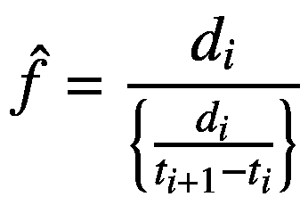
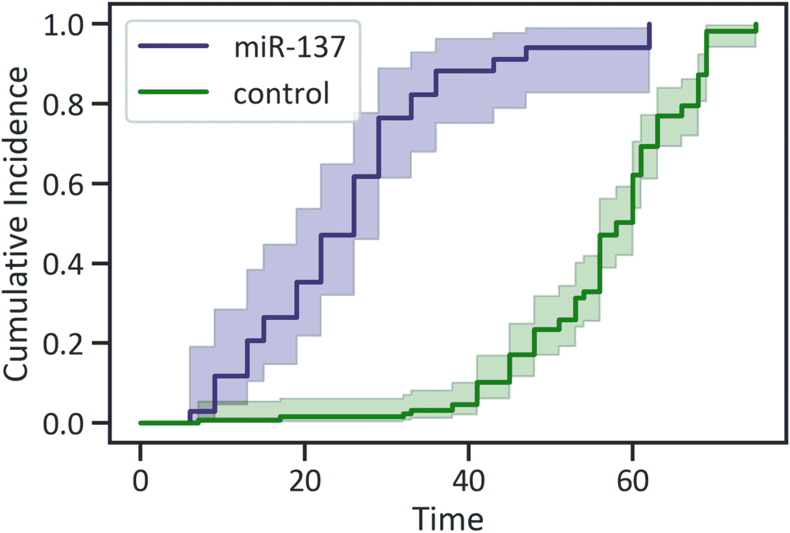
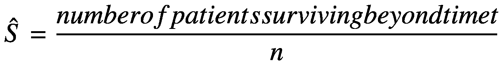
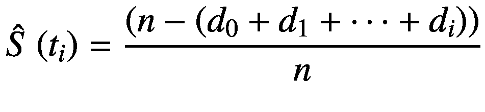
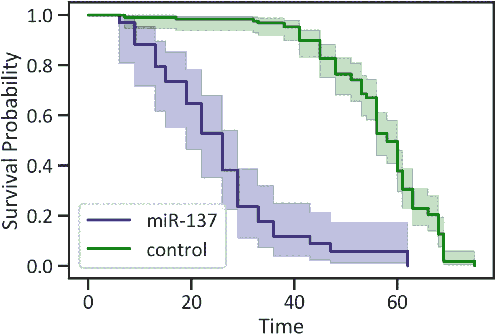
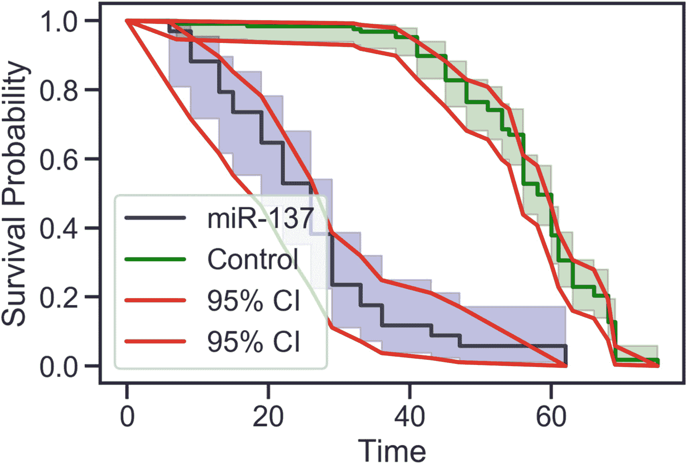

# 生存分析

本章介绍生存分析。该方法包括两个分支：参数方法和非参数方法。参数生存分析模型包括威布尔模型、指数模型、对数线性模型等（更多信息请参阅 Lifelines^(¹¹)）。非参数生存分析模型包括 Kaplan-Meier 模型和 Nelson-Aalen 模型。

本章仅介绍最流行的非参数模型，即 Kaplan-Meier 模型，该模型使用时间来衡量一个二元变量。它对数据的结构有宽松的假设。同样，它也不对数据的线性关系和正态性做出假设。

它不以传统意义来捕捉时间。它捕捉的是研究对象在研究中的实际进入和退出日期。我们也称生存分析为可靠性分析或持续时间建模。当我们使用它时，持续时间比时间更重要。在临床试验中，我们用它来估计患者在特定时间之后存活（即疾病或死亡）的概率。在工程领域，我们用它来估计机器在特定时间之后无故障运行（即机器故障）的概率。

要使一项研究和生存分析模型被认为是可靠的，必须满足某些条件。首先，研究设计应包含一个对照组。其次，必须有严格的方法来记录研究中参与者的活动；我们必须始终考虑诸如患者进入或退出研究、患者处于风险状态以及患者死亡等因素。表 11-1 概述了关键的生存分析术语。

表 11-1 生存分析关键术语

| 术语 | 描述 |
| --- | --- |
| **生存时间** | 表示事件的时间线 |
| **事件** | 表示正在研究的二元结果（通常是疾病或死亡） |
| **删失** | 表示患者从研究中移除 |

衡量疾病和死亡等事件结果的研究需要很长时间。参与者可以进入或退出研究，有些人可能死亡，而其他人则被报告为处于风险中。在生存分析中，我们主要处理缺失值。我们将包含缺失值的数据称为删失数据。与逻辑回归和线性判别分析等其他非参数模型不同，生存分析模型对缺失值不敏感。事实上，我们总是期望在数据中发现缺失值。

## 生存分析实践

我们加载了 Lifeline 包中一个名为`load_watons`的数据集。Lifeline 并非标准的 Python 库。要在 Python 环境中安装它，请使用`pip install lifelines`；要在 Conda 环境中安装，请使用`conda install -c conda-forge lifelines`。该数据包含三列。第一列是时间（自变量），第二列是事件（因变量），第三列指定患者所属的组别。这两个组别是对照组和 miR-137 组。每位患者只能属于其中一组。参见代码清单 11-1 和表 11-2。

表 11-2 数据集

|   | T | E | 组别 |
| --- | --- | --- | --- |
| **0** | 6.0 | 1 | miR-137 |
| **1** | 13.0 | 1 | miR-137 |
| **2** | 13.0 | 1 | miR-137 |
| **3** | 13.0 | 1 | miR-137 |
| **4** | 19.0 | 1 | miR-137 |

```python
from lifelines.datasets import load_walton
import pandas as pd
df = load_waton()
df.head()
# 代码清单 11-1 加载数据
```

代码清单 11-2 返回数据结构。

```python
tdf.info()
# 输出如下：
# RangeIndex: 163 entries, 0 to 162
# Data columns (total 3 columns):
#  #   Column  Non-Null Count  Dtype
# ---  ------  --------------  -----
#  0   T       163 non-null    float64
#  1   E       163 non-null    int64
#  2   group   163 non-null    object
# dtypes: float64(1), int64(1), object(1)
# memory usage: 3.9+ K
# 代码清单 11-2 数据结构
```

如您所见，共有 163 名患者参与了这项研究。数据中没有缺失值。这意味着所使用的数据收集方法是严谨的。请记住，这在现实世界中几乎不会发生。大多数情况下，我们处理的数据都包含缺失值。该数据包含三列；第一列是连续变量（以年数表示的时间线），第二列是二元变量（事件结果——我们将未能在特定时间后存活的患者编码为 0，将在特定时间后存活的患者编码为 1），第三列是二元分类变量（患者属于对照组或 miR-137 组）。基于数据结构，我们可以使用生存分析模型，例如 Kaplan-Meier 模型或 Nelson-Aalen 模型。在本章中，我们将研究 Kaplan-Meier 模型。在开发模型之前，我们先描述一下数据。

代码清单 11-3 统计并列出每个组别的患者数量（见表 11-3）。

表 11-3 每组患者数量

|   | 数量 |
| --- | --- |
| **组别** |   |
| **对照组** | 129 |
| **miR-137** | 34 |

```python
class_series_group = df.groupby("group").size()
class_series_group = pd.DataFrame(class_series_group, columns=["Count"])
class_series_group
# 代码清单 11-3 组别计数
```

表 11-4 强调，在参与研究的 193 名患者中，129 名属于对照组，34 名属于 miR-137 组。对照组占患者总样本的 79.14%，miR-137 组占样本的 20.86%。

表 11-4 事件结果计数

|   | 数量 |
| --- | --- |
| **E** |   |
| **0** | 7 |
| **1** | 156 |

代码清单 11-4 统计并列出事件结果（见表 11-4）。

```python
class_series_event = df.groupby("E").size()
class_series_event = pd.DataFrame(class_series_event, columns=["Count"])
class_series_event
# 代码清单 11-4 事件结果
```

表 11-4 显示，在 163 名患者中，只有 7 名未能在特定时间后存活，而 95.71% 的患者在指定时间后存活。

代码清单 11-5 统计并列出每个组别的事件结果（见表 11-5）。

表 11-5 每组事件结果计数

|   |   | 数量 |
| --- | --- | --- |
| **组别** | E |   |
| **对照组** | 0 | 7 |
| 1 | 122 |
| **miR-137** | 1 | 34 |

```python
class_series_event_per_group = df.groupby(["group","E"]).size()
class_series_event_per_group = pd.DataFrame(class_series_event_per_group, columns = ["Count"])
class_series_event_per_group
# 代码清单 11-5 每组事件结果
```

表 11-5 显示，属于 miR-137 组的所有 34 名患者在特定时间后均存活。在对照组中，122 名患者存活，7 名未存活。

### 数据预处理

代码清单 11-6 将数据拆分为 miR-137 组和对照组。

```python
miR_137 = df.loc[df.group == "miR-137"]
control_group = df.loc[df.group == "control"]
# 代码清单 11-6 拆分数据
```

将数据一分为二后，我们将数据重新调整为所需的格式。参见代码清单 11-7。

```python
T1 = miR_137["T"]
E1 = miR_137["E"]
T2 = control_group["T"]
E2 = control_group["E"]
# 代码清单 11-7 重新调整数据
```

### 描述性统计

请记住，在生存分析中，没有严格的线性和正态性假设；我们使用描述性分析不是为了检验假设，而是为了理解数据的底层结构。我们知道我们正在处理偏态数据。代码清单 11-8 返回描述性统计（见表 11-6）。

表 11-6 MiR-137 描述性统计

|   | 计数 | 均值 | 标准差 | 最小值 | 25% | 50% | 75% | 最大值 |
| --- | --- | --- | --- | --- | --- | --- | --- | --- |
| **T** | 34.0 | 25.705882 | 13.358755 | 6.0 | 16.0 | 26.0 | 29.0 | 62.0 |

```python
pd.DataFrame(miR_137["T"].describe()).transpose()
# 代码清单 11-8 描述性统计
```

表 11-6 显示，患者参与研究的最少年限为 6 年，最多年限为 62 年。患者参与研究的平均年限为 26 年。

### 生存表

我们通常将生命表称为生存表。生存表是一种提供患者参与研究期间活动信息的表格。表 11-7 展示了生存表的内容。

表 11-7

生存表的内容

| 内容 | 描述 |
| --- | --- |
| **已移除** | 在区间 `t` 内死亡（或发生关注事件）的受试者数量 |
| **已观测** | 在区间 `t` 内未发生事件且被认为处于风险中的受试者数量 |
| **已删失** | 在区间 `t` 内退出研究的参与者数量 |
| **已进入** | 在区间 `t` 内进入研究的受试者数量 |
| **处于风险中** | 在区间 `t` 内处于风险中的受试者总数 |

代码清单 11-9 应用了 `survival_from_event()` 方法来创建生存表（见表 11-8）。

表 11-8

生存表

|   | removed | observed | censored | entrance | at_risk |
| --- | --- | --- | --- | --- | --- |
| **event_at** |   |   |   |   |   |
| **0.0** | 0 | 0 | 0 | 34 | 34 |
| **6.0** | 1 | 1 | 0 | 0 | 34 |
| **9.0** | 3 | 3 | 0 | 0 | 33 |
| **13.0** | 3 | 3 | 0 | 0 | 30 |
| **15.0** | 2 | 2 | 0 | 0 | 27 |

```
table = survival_table_from_events(T1, E1)
table.head()
```
代码清单 11-9
生存表

表 11-8 告诉我们以下信息：
- 在第一年，患者进入研究。默认情况下，我们认为所有患者都处于风险中。
- 在第 6 年，一名患者死亡，我们认为另一名患者处于风险中。
- 在第 9 年，三名患者死亡，我们认为另外三名患者处于风险中。
- 在第 13 年，我们报告了三例死亡和三例处于风险中的患者。
- 到第 15 年，我们报告了两例死亡和两例处于风险中的患者。miR-137 组剩余 27 名患者。

## Kaplan-Meier 模型

Kaplan-Meier (KM) 模型是一种非参数方法，用于根据观测到的生存时间估计生存概率。它使用时间测量一个二元变量。我们也将其视为乘积限模型。使用该模型时，我们考察在特定时期内死亡的患者数量，并假设他们在此之前一直存活。为了理解该模型的工作原理，我们解释其底层的生存函数。代码清单 11-10 完成了 Kaplan-Meier 模型。

```
kmf_miR_137 = KaplanMeierFitter().fit(T1, E1)
kmf_control_group = KaplanMeierFitter().fit(T2, E2)
```
代码清单 11-10
完成 Kaplan-Meier 模型

开发模型后，我们找到置信区间的估计值。

### 置信区间

置信区间 (CI) 表示一个值落在特定范围内的概率。表 11-9 显示了在特定时期内生存估计值落在特定范围内的概率。第一列显示时间线，第二列显示置信区间的下限，第三列显示置信区间的上限。参见代码清单 11-11。

表 11-9

Kaplan-Meier 估计置信区间

|   | KM_estimate_lower_0.95 | KM_estimate_upper_0.95 |
| --- | --- | --- |
| **0.0** | 1.000000 | 1.000000 |
| **6.0** | 0.809010 | 0.995804 |
| **9.0** | 0.716269 | 0.954139 |
| **13.0** | 0.616102 | 0.896087 |
| **15.0** | 0.552952 | 0.852504 |

```
kmf_miR_137_ci = kmf_miR_137.confidence_interval_
kmf_control_group_ci = kmf_control_group.confidence_interval_
kmf_miR_137_ci.head()
```
代码清单 11-11
Kaplan-Meier 估计置信区间

表 11-9 显示，如果我们重复该研究 95% 的次数：
- 在第 0 年，miR-137 组患者的生存概率为 100%。
- 在第 6 年，miR-137 组患者的生存概率介于 80.90% 和 99.58% 之间。
- 在第 9 年，miR-137 组患者的生存概率介于 71.27% 和 95.41% 之间。
- 在第 13 年，miR-137 组患者的生存概率介于 61.61% 和 89.61% 之间。
- 在第 15 年，miR-137 组患者的生存概率介于 55.95% 和 85.25% 之间。

### 累积密度

累积密度表示在特定时间 `t` 发生失败的概率。它估计的是累积密度。我们使用公式 11-1 来估计无条件失败率。



(公式 11-1)

这里，`d[i]` 表示事件数量，`t` 是生存时间。参见代码清单 11-12 和表 11-10。

表 11-10

Kaplan-Meier 累积密度估计

|   | KM_estimate |
| --- | --- |
| **timeline** |   |
| **0.0** | 0.000000 |
| **6.0** | 0.029412 |
| **9.0** | 0.117647 |
| **13.0** | 0.205882 |
| **15.0** | 0.264706 |

```
kmf_c_density = kmf_miR_137.cumulative_density_
kmf_control_group_c_density = kmf_control_group.cumulative_density_
kmf_c_density.head()
```
代码清单 11-12
Kaplan-Meier 累积密度估计

为了理解累积密度估计值，我们绘制 Kaplan-Meier 累积密度曲线。

#### 累积密度曲线

我们使用累积密度曲线来理解中位数和四分位距。绘制曲线时，x 轴为累积频率，y 轴为每个区间的上组界。代码清单 11-13 和图 11-1 展示了 Kaplan-Meier 累积密度曲线。从曲线中，我们可以识别中位数四分位数和四分位距。



图 11-1

Kaplan-Meier 累积密度曲线

```
kmf_miR_137.plot_cumulative_density(color="navy", label="miR-137")
kmf_control_group.plot_cumulative_density(color="green", label="control")
plt.xlabel("Time")
plt.ylabel("Cumulative Incidence")
plt.legend(loc=2)
plt.show()
```
代码清单 11-13
Kaplan-Meier 累积密度曲线

图 11-1 显示了以下信息：
- 在第 0 年，无条件失败率为 0%。
- 在第 6 年，无条件失败率为 2.94%。
- 在第 9 年，无条件失败率为 11.17%。
- 在第 13 年，无条件失败率为 20.59%。
- 在第 15 年，无条件失败率为 26.47%。

### 生存函数

在生存分析中，利用事件结果和随访时间来估计生存函数。时间 `t` 的生存函数（在无删失情况下）通过方程 11-2 中的公式进行估计。



（方程 11-2）

此处，`n` 是研究中的患者数量（即时间零点时的数量）。我们将该公式表示为方程 11-3 所示的形式。



（方程 11-3）

此处，`d[i]` 是事件数量，`n` 是存活个体的数量。

### 清单 11-14 估计并制表了 Kaplan-Meier 函数估计值（见表 11-11）。

**表 11-11**

Kaplan-Meier 生存函数估计值

|  | `KM_estimate` |
| --- | --- |
| **时间线** | |
| **0.0** | 1.000000 |
| **6.0** | 0.970588 |
| **9.0** | 0.882353 |
| **13.0** | 0.794118 |
| **15.0** | 0.735294 |

```python
kmf_survival_function = kmf_miR_137.survival_function_
kmf_control_group_survival_function = kmf_control_group.survival_function_
kmf_survival_function.head()
```
清单 11-14 Kaplan-Meier 生存函数估计值

#### 生存曲线

生存曲线是 `Ŝ(t[i])` 相对于 `t` 的绘图。在生存曲线中，x 轴表示以年为单位的时间，y 轴表示生存概率或生存人数比例。清单 11-15 绘制了生存曲线（见图 11-2）。



**图 11-2** Kaplan-Meier 生存曲线

```python
kmf_miR_137.plot_survival_function(color="navy", label="miR-137")
kmf_control_group.plot_survival_function(color="green", label="control")
plt.xlabel("Time")
plt.ylabel("Survival Probability")
plt.legend(loc=3)
plt.show()
```
清单 11-15 Kaplan-Meier 生存曲线

图 11-2 显示，miR-137 组与对照组的生存曲线存在显著差异。miR-137 组的生存曲线在第 9 年急剧下降。与此同时，对照组的生存曲线直到第 45 年才开始下降。清单 11-16 绘制了带有置信区间的生存曲线（见图 11-3）。



**图 11-3** 带有置信区间的 Kaplan-Meier 生存曲线

```python
kmf_miR_137.plot_survival_function(color="navy", label="miR-137")
kmf_control_group.plot_survival_function(color="green", label="Control")
plt.plot(kmf_miR_137.confidence_interval_, color="red", label="95% CI")
plt.plot(kmf_control_group.confidence_interval_, color="red")
plt.xlabel("Time")
plt.ylabel("Survival Probability")
plt.legend(loc=3)
plt.show()
```
清单 11-16 带有置信区间的 Kaplan-Meier 曲线

图 11-3 告诉我们以下信息：

*   在第 0 年，患者生存的概率为 100%。
*   在第 6 年，患者生存的概率为 97.06%。
*   在第 9 年，患者生存的概率为 88.24%。
*   在第 13 年，患者生存的概率为 79.41%。
*   在第 15 年，患者生存的概率为 73.53%。

清单 11-17 查找中位生存时间。

```python
kmf_miR_137.median_survival_time_
```
```
26.0
```
清单 11-17 中位生存时间

中位生存时间为 26 年。清单 11-18 应用 `predict()` 方法来预测未来的事件结果实例。

```python
kmf_miR_137.predict(30)
```
```
0.23529411764705874
```
清单 11-18 预测的事件结果

当生存时间为 30 年时，事件结果为 0。在了解了模型如何预测实例之后，我们来看一下模型的表现。

### 评估 Kaplan-Meier 模型

在估计了两组的生存概率之后，我们必须确定两组的死亡生成是否相等。与其他非参数模型不同，Kaplan-Meier 模型没有复杂的模型评估指标。测试模型的最佳方法是找出各组是否具有相似的生存曲线。我们将假设表述如下：

*   *零假设：* 所有组共享相同的生存曲线。
*   *备择假设：* 并非所有组都共享相同的生存曲线。

清单 1-19 返回了对数秩检验结果（见表 11-12）。清单 11-20 显示了 p 值。

**表 11-12** 对数秩检验结果

| `t_0` | -1 |
| --- | --- |
| **`null_distribution`** | chi squared |
| **`degrees_of_freedom`** | 1 |
| **`test_name`** | `logrank_test` |
| | **`test_statistic`** | **p** |
| **0** | **122.25** | <0.005 |

```python
from lifelines.statistics import logrank_test
results = logrank_test(T1, T2, event_observed_A=E1, event_observed_B=E2)
results.print_summary()
```
清单 1-19 对数秩检验结果

```python
print(results.p_value)
```
```
2.0359832222855426e-28
```
清单 11-20 P 值

上述发现表明 p 值大于 0.05。我们拒绝零假设，接受备择假设。并非所有组都共享相同的生存曲线。

### 结论

本章介绍了最流行的非参数生存分析模型，即 Kaplan-Meier 模型。我们估计了患者在特定时间之后存活过某个事件的生存概率。在开发模型之前，我们将数据分为两组，然后为所研究的组创建了一个生存表。我们绘制了累积密度曲线和生存曲线以理解这些估计值。此后，我们使用对数秩检验测试了两组是否共享相同的生存曲线。在研究了检验统计量后，我们发现该模型是可靠的，并且可以使用它来预测未来的事件结果实例。

脚注 1