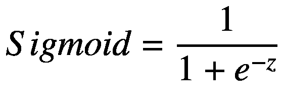
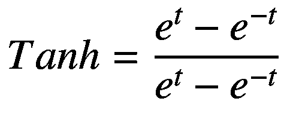
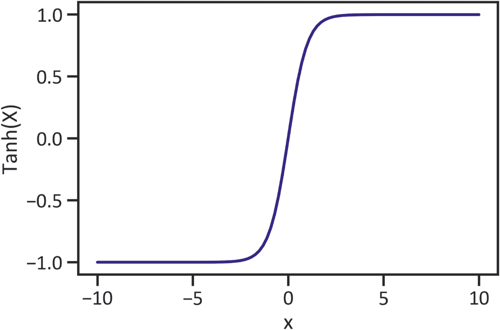
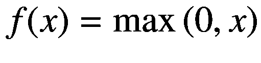
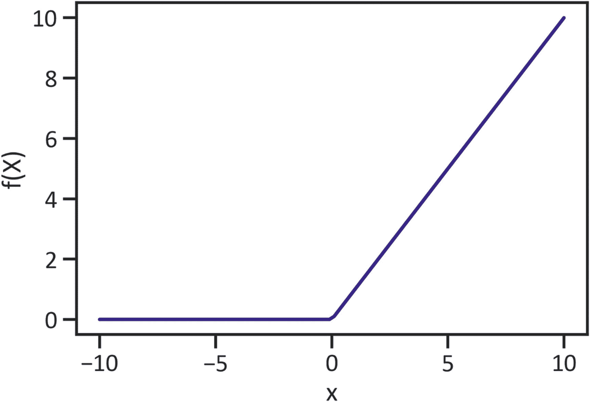
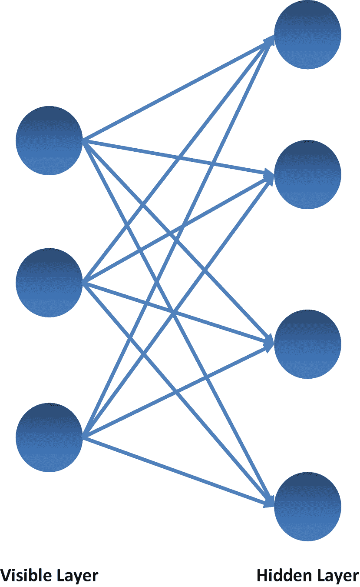

# 12. 神经网络

本章介绍机器学习中常被称为深度学习的一个子领域。首先，介绍不同的人工神经网络。其次，涵盖反向传播和前向传播。第三，介绍不同的激活函数。最后，使用 `SciKit-Learn` 包构建并测试一个受限玻尔兹曼机和一个多层感知器，随后使用 `Keras` 包构建深度信念网络。要在 Python 环境中安装 `Keras`，请使用 `pip install Keras`；在 conda 环境中，请使用 `conda install -c conda-forge keras`。

人工神经网络是一个相互连接的节点组，它通过各层使用不同的权重和偏置来检索和处理输入值，直到产生输出值。神经网络由若干层组成，每层都配置了节点。隐藏层和输出层中的每个节点都包含自己的分类器。可见层中的节点检索输入值，随后激活发生。表 12-1 重点列出了几种神经网络类型及其应用。

**表 12-1** 神经网络类型及其应用

| 神经网络 | 应用 |
| --- | --- |
| `受限玻尔兹曼机` 或 `自编码器` | 未标记数据、变量提取和模式识别 |
| `递归神经张量网络` 或 `循环神经网络` | 文本处理^(¹²) |
| `深度信念网络` 或 `卷积神经网络` | 图像识别 |
| `循环神经网络` | 语音识别 |
| `多层感知器` 或 `深度信念网络` | 分类和时间序列分析 |

## 前向传播

前向传播涉及可见层中的节点接收并处理输入值，然后将它们传输到后续层中的节点，直到产生输出值。尽管每一层都检索相同的输入值，但它们传输的值并不相同。

## 反向传播

反向传播是前向传播的逆过程。在反向传播中，网络反向估计梯度，并转换前一个训练周期的错误率权重。这个过程内存效率不高，并且还会导致模型性能不佳。

## 代价函数

第 1 章介绍了残差分析，因此理解代价函数应该相对容易。代价函数用于估计实际值与预测值之间的差异。它会调整权重和偏置，直到找到最小值。我们可互换使用代价函数和损失函数。

## 梯度

梯度表示代价随权重和偏置变化的速率。我们在训练期间计算梯度。它用于……神经网络将前几层的梯度相乘，以找到后续层的梯度。为了优化梯度，我们使用梯度下降法。梯度下降法有三种类型，即：1) 批量梯度下降法——估计整个训练数据参数的代价函数梯度；2) 随机梯度下降法——为每个自变量和因变量更新参数；3) 小批量梯度下降法——应用批量梯度下降法和随机梯度下降法对训练数据的一个小批量执行操作。

## 梯度消失

如果梯度很大，我们训练网络的速度就快；如果梯度很小，训练就会变慢。通常，第一层的梯度较小，而后续层的梯度较大。传统的机器学习模型学习速度慢，并且在预测类别时会产生很多错误。人工神经网络通过缩放梯度来弥补这一不足。

## 激活函数

激活函数为网络增加非线性。激活函数使得反向传播成为可能。如果没有激活函数，神经网络将退化为线性回归模型。下面，我们将讨论这些激活函数。还有其他一些函数^(¹³)可供我们使用。

### Sigmoid 激活函数

第 5 章介绍了逻辑函数及其如何估计值。我们也把逻辑函数称为 Sigmoid 激活函数。它触发介于 0 和 1 之间的输出值。我们主要使用 Sigmoid 激活函数来解决二分类问题。Sigmoid 函数表示为：



（公式 12-1）

该激活函数为仅需要正输出值的前馈神经网络提供支持。

### 双曲正切激活函数

双曲正切（`tanh`）激活函数是 Sigmoid 激活函数的扩展。它触发介于 -1 和 1 之间的输出值，并使网络能够将均值中心化为 0。该函数表示为：



（公式 12-2）

`tanh` 激活函数将双曲正切曲线拟合到数据上。图 12-1 描绘了标准的 `tanh` 函数。



**图 12-1** Tanh 函数

注意输出值介于 -1 和 1 之间，且均值中心化为 0。

### 线性整流单元激活函数

`ReLU` 是 CNN 和多层感知器中的默认激活函数。`ReLU` 有助于模型更快地学习，并且其性能更好。与 Sigmoid 和 `tanh` 激活函数不同，`ReLU` 激活函数不会将数据饱和到 -1、0 或 1。相反，它会继续前进，直到检索到最优值。它有助于解决梯度消失问题。该函数表示为：



（公式 12-3）

图 12-2 描绘了标准的 `ReLU` 函数。



**图 12-2** ReLU 函数

注意输出值不受限于特定范围。

### 损失函数

损失是检查模型底层性能的标准度量。神经网络应用损失函数来确定是否应在每个训练周期改进其学习过程。损失增加表明模型是一个熟练的学习者。对于连续因变量，最常见的损失函数包括均方误差（`MSE`）、平均绝对误差（`MAE`）、平均绝对百分比误差（`MAPE`）和均方对数误差（`MSLE`）。用于分类结果的损失函数包括用于二分类的二元交叉熵和用于多分类的分类交叉熵。

## 优化

有许多模型性能优化的方法，例如 `SGD`、`RMSProp`、`ADAGRAD`、`Adadelta` 和 `Adam`。本章应用 `Adam` 优化方法^(¹⁴)，因为它在训练期间最小化代价函数方面效果更好。`Adam` 代表自适应矩估计。它考虑动量中的先前梯度并降低学习率。


### 伯努利受限玻尔兹曼机

我们使用受限玻尔兹曼机（RBM）来解决梯度消失问题。RBM 是一种浅层神经网络，包含可见层和隐藏层。它将可见层中的每个节点与隐藏层中的每个节点相连接。此外，它还应用权重和偏置来理解变量之间的潜在关系。

图 12-3 展示了一个在可见层有 3 个节点、隐藏层有 4 个节点的 RBM。



图 12-3

受限玻尔兹曼机

## 训练逻辑分类器

代码清单 12-1 训练了逻辑分类器。

```
from sklearn.linear_model import LogisticRegression
logreg = LogisticRegression(dual= False,
fit_intercept= True,
max_iter= 10,
n_jobs= -5,
penalty= 'l2',
tol=0.0001,
warm_start= False)
logreg.fit(x_train, y_train)
代码清单 12-1
完成逻辑分类器
```

## 流水线

代码清单 12-2 为逻辑分类器和 RBM 分类器创建了一个流水线。

```
from sklearn.neural_network import BernoulliRBM
from sklearn.pipeline import Pipeline
rbm = BernoulliRBM()
classifier = Pipeline(steps=[("rbm", rbm), ("logreg", logreg)])
classifier.fit(x_train, y_train)
代码清单 12-2
完成流水线
```

表 12-2 突出了关键的分类评估指标，如准确率、精确率、召回率等。

表 12-2

分类报告

|   | 精确率 | 召回率 | F1 分数 | 支持度 |
| --- | --- | --- | --- | --- |
| **0** | 0.829787 | 0.728972 | 0.776119 | 107.000000 |
| **1** | 0.516667 | 0.659574 | 0.579439 | 47.000000 |
| **准确率** | 0.707792 | 0.707792 | 0.707792 | 0.707792 |
| **宏平均** | 0.673227 | 0.694273 | 0.677779 | 154.000000 |
| **加权平均** | 0.734224 | 0.707792 | 0.716094 | 154.000000 |

```
y_pred = classifier.predict(x_test)
creportbm = pd.DataFrame(metrics.classification_report(y_test, y_pred, output_dict=True)).transpose()
creportbm
代码清单 12-3
分类报告
```

伯努利 RBM 分类器在预测类别时的准确率为 70.78%。这个准确率分数低于我们在前面章节中介绍的分类器。该分类器在预测类别 0 时的精确率为 82.98%，在预测类别 1 时的精确率为 51.67%。

