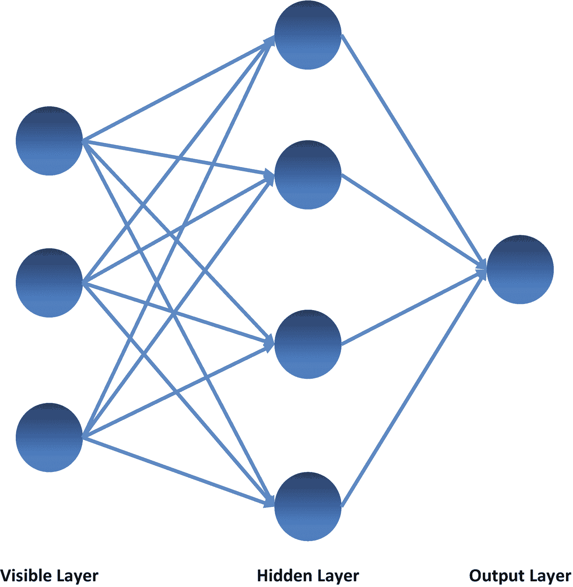
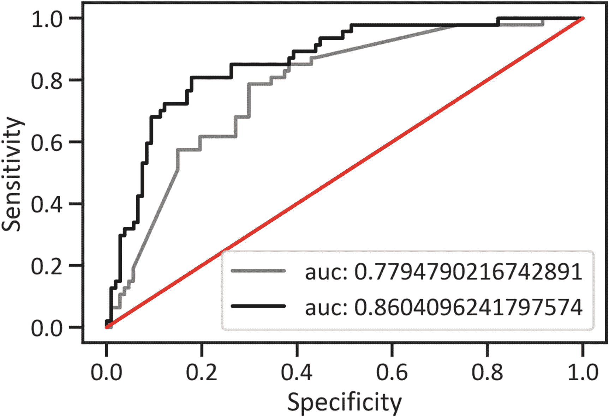
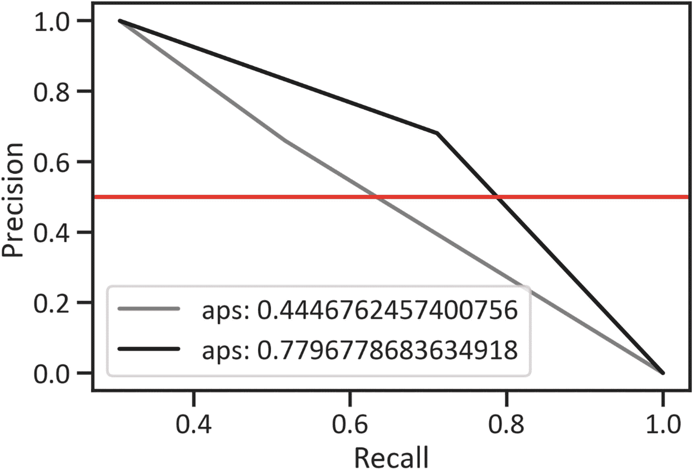
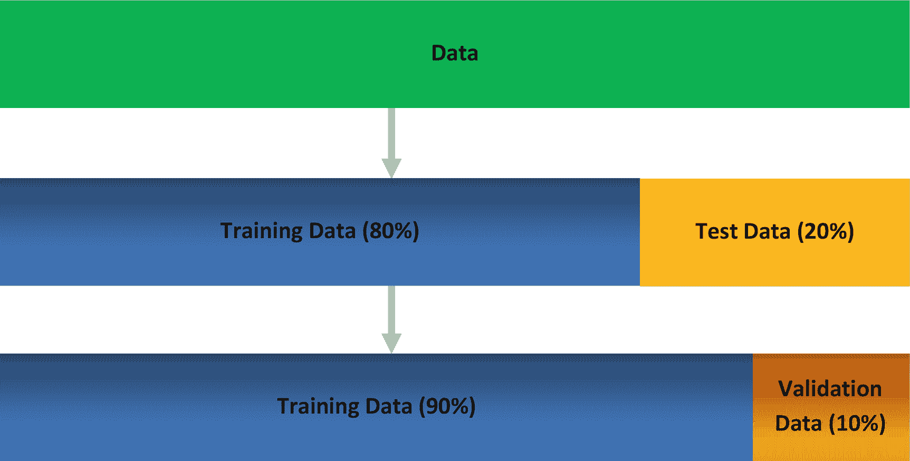
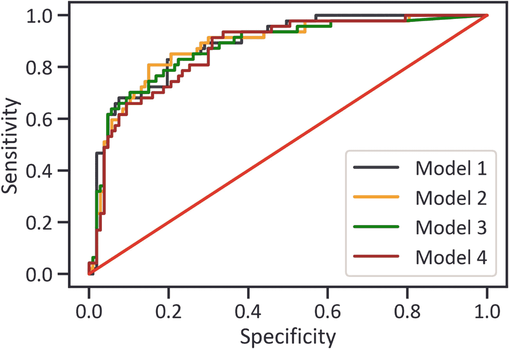
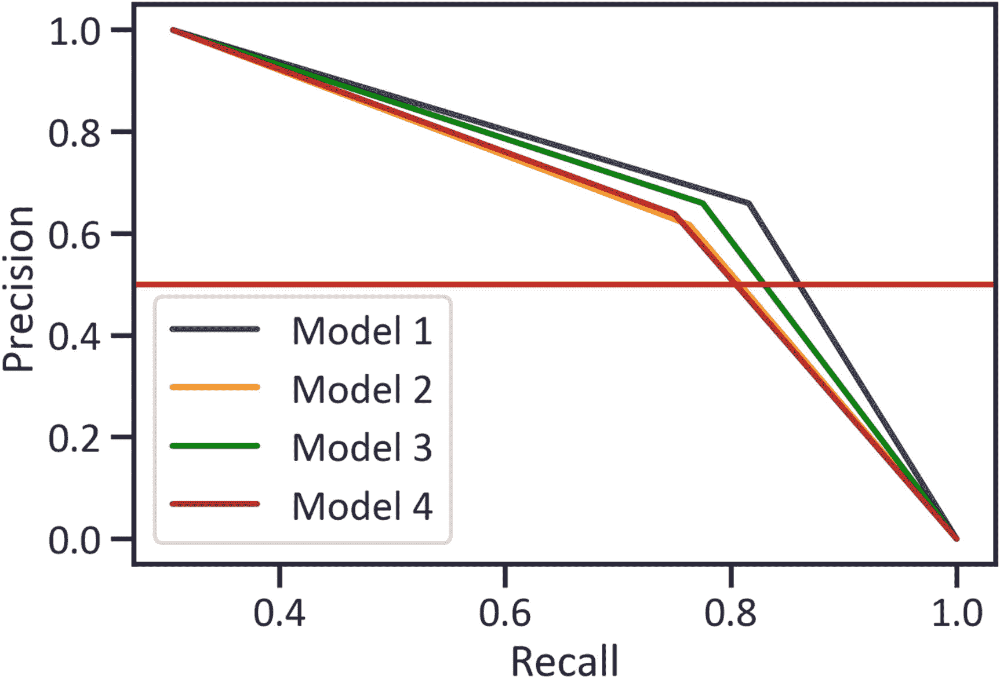
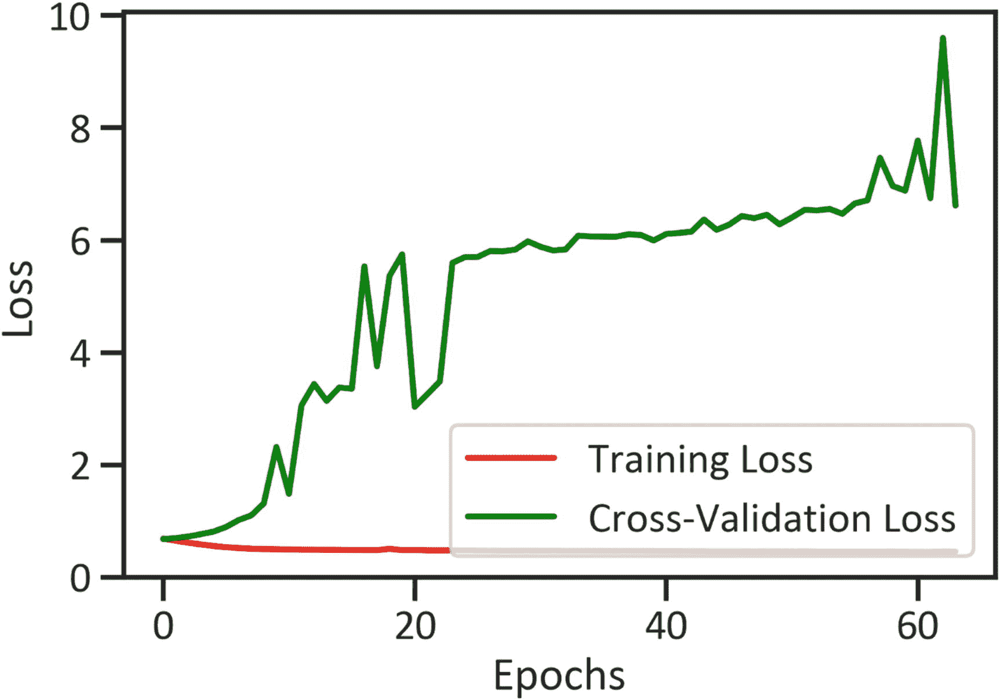
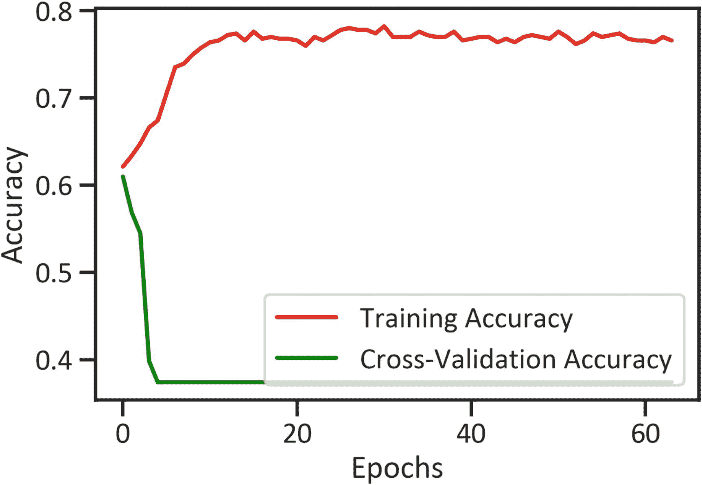

# 使用 SciKit-Learn 的多层感知机

单感知机模型最多只能勉强捕捉数据的底层结构，导致模型性能不佳。多层感知机（MLP）模型解决了这个问题。它训练、加权并阈值化一组随机值，然后使用激活函数估计和控制变化。它包含多个层；至少需要三个层，即可见层、隐藏层和输出层。

图 12-4 展示了在可见层有 3 个节点、隐藏层有 4 个节点、输出层只有一个可能结果的 MLP。


图 12-4 多层感知机

```python
from sklearn.neural_network import MLPClassifier
mlp = MLPClassifier()
mlp.fit(x_train, y_train)
```
代码清单 12-4 完成 MLP 分类器

表 12-3 提供了模型的准确率分数、精确率分数、召回率以及其他关键评估指标。

表 12-3 分类报告

| | 精确率 | 召回率 | F1 分数 | 支持度 |
|---|---|---|---|---|
| 0 | 0.848214 | 0.887850 | 0.867580 | 107.000000 |
| 1 | 0.714286 | 0.638298 | 0.674157 | 47.000000 |
| 准确率 | 0.811688 | 0.811688 | 0.811688 | 0.811688 |
| 宏平均 | 0.781250 | 0.763074 | 0.770869 | 154.000000 |
| 加权平均 | 0.807340 | 0.811688 | 0.808548 | 154.000000 |

```python
y_predmlp = mlp.predict(x_test)
creportmlp = pd.DataFrame(metrics.classification_report(y_test, y_predmlp, output_dict=True)).transpose()
creportmlp
```
代码清单 12-5 分类报告

与 RBM 分类器相比，MLP 分类器更准确、更精确。

## 比较伯努利 RBM 和 MLP 的 ROC 曲线

图 12-5 展示了分类器在区分不同类别方面的能力。


图 12-5 ROC 曲线

```python
y_pred_probarbm = classifier.predict_proba(x_test)[::, 1]
y_pred_probamlp = mlp.predict_proba(x_test)[::, 1]
aucrbm = metrics.roc_auc_score(y_test, y_pred_probarbm)
aucmlp = metrics.roc_auc_score(y_test, y_pred_probamlp)
fprrbm, tprrbm, _ = metrics.roc_curve(y_test, y_pred_probarbm)
fprmlp, tprmlp, _ = metrics.roc_curve(y_test, y_pred_probamlp)
plt.plot(fprrbm, tprrbm, label="auc: "+str(aucrbm), color="gray")
plt.plot(fprmlp, tprmlp, label="auc: "+str(aucmlp), color="black")
plt.plot([0, 1], [0, 1], color="red")
plt.xlabel("特异性")
plt.ylabel("敏感性")
plt.legend(loc=4)
plt.show()
```
代码清单 12-6 ROC 曲线

在图 12-5 中，MLP 分类器的曲线以黑色突出显示，伯努利 RBM 分类器的曲线以灰色突出显示。与 MLP 分类器相比，伯努利 RBM 的曲线更接近 45 度线。两条曲线都不接近边界的右侧。它们没有表现出完美 ROC 曲线的特征。然而，MLP 分类器的 AUC 分数为 0.86（高于本书各章节中介绍的大多数分类器）。同时，伯努利 RBM 分类器的 AUC 分数低于 0.80（低于前面章节中介绍的所有分类器的分数）。

## 比较伯努利 RBM 和 MLP 的精确率-召回率曲线

图 12-6 展示了分类器在不同阈值下如何权衡精确率和召回率。


图 12-6 精确率-召回率曲线

```python
precisionrbm, recallrbm, thresholdrbm = metrics.precision_recall_curve(y_test, y_predrbm)
precisionmlp, recallmlp, thresholdmlp = metrics.precision_recall_curve(y_test, y_predmlp)
apsrbm = metrics.average_precision_score(y_test, y_predrbm)
apsmlp = metrics.roc_auc_score(y_test, y_predmlp)
plt.plot(precisionrbm, recallrbm, label="aps: "+str(apsrbm), color="gray")
plt.plot(precisionmlp, recallmlp, label="aps: "+str(apsmlp), color="black")
plt.axhline(y=0.5, color="red")
plt.xlabel("召回率")
plt.ylabel("精确率")
plt.legend(loc=3)
plt.show()
```
代码清单 12-7 精确率-召回率曲线

所有曲线都没有沿着顶部边界，也没有接近右上角边界。相反，它们很快达到了 1.0 点。平均而言，MLP 分类器比伯努利 RBM 分类器更精确。

## 使用 Keras 的深度信念网络

深度信念网络是多个 RBM 的组合。该网络是反向传播的一种替代方案。其结构类似于 MLP 网络。然而，它们在训练方式上有所不同；一个 RBM 的隐藏层是另一个 RBM 的可见层。

## 将数据拆分为训练集、测试集和验证集

之前，我们将数据拆分为训练集和测试集，其中 80%的数据用于训练，20%的数据用于测试。从现在开始，我们将从训练数据中分配一部分用于验证。首先，我们按照 80/20 的比例将数据拆分为训练集和测试集。最后，我们进一步拆分训练数据，从中分配 10%用于验证。图 12-7 展示了我们如何将数据拆分为三个集合。


图 12-7 数据拆分

我们使用`training_test_split()`方法将数据拆分为训练集、测试集和验证集。

```python
x_train, x_test, y_train, y_test = train_test_split(x, y, test_size=0.2,random_state=0)
x_train, x_val, y_train, y_val = train_test_split(x_train, y_train,test_size=0.2, random_state=0)
x_train = scaler.fit_transform(x_train)
x_test = scaler.transform(x_test)
```
代码清单 12-8 将数据拆分为训练集、测试集和验证集

随后，我们导入 Keras 包。

```python
import tensorflow as tf
from keras import Sequential, regularizers
from keras.layers import Dense, Dropout
from keras.wrappers.scikit_learn import KerasClassifier
```
代码清单 12-9 导入 Keras 包

第一个网络包含一个使用 sigmoid 激活函数的可见层。此外，还有两个隐藏层，分别包含 8 个神经元并使用 ReLu 激活函数。

## 构建模型与超参数优化

我们使用`KerasClassifier()`方法封装网络的架构。

```
model1 = KerasClassifier(build_fn=create_dnn_model1)
```
**代码清单 12-11：封装模型 1**

```
def create_dnn_model1(optimizer="adam"):
    model1 = Sequential()
    model1.add(Dense(8, input_dim=8, activation="sigmoid"))
    model1.add(Dense(8, activation="relu"))
    model1.add(Dense(1, activation="relu"))
    model1.compile(loss="binary_crossentropy", optimizer=optimizer, metrics=["accuracy"])
    return model1
```
**代码清单 12-10：构建模型 1 的架构**

### 超参数优化

代码清单 12-12 寻找训练中包含的最优样本数量以及完整的前向和后向传播次数。

```
batch_size = [15, 30, 60]
epochs = [16, 32, 64]
param_grid = {"batch_size":batch_size, "epochs": epochs}
grid_model = GridSearchCV(estimator=model1, param_grid=param_grid)
grid_model.fit(x_train, y_train, validation_data=(x_val, y_val))
print("Best scores: ", grid_model.best_score_, "Best parameters: ", grid_model.best_params_)
```
**代码清单 12-12：超参数优化**

最佳得分：`0.7535971999168396` 最佳参数：`{'batch_size': 15, 'epochs': 64}`

我们使用上述结果来完成模型。

### 完成模型

我们使用`fit()`方法来训练模型。

```
history1 = model1.fit(x_train, y_train, validation_data=(x_val, y_val), batch_size=15, epochs=64)
history1
```
**代码清单 12-13：完成模型 1**

表 12-4 提供了模型的准确率、精确率、召回率以及其他关键评估指标。

**表 12-4 分类报告**

|             |    精确率 |    召回率 |   F1 分数 | 支持样本数 |
|:------------|----------:|---------:|----------:|-----------:|
| 0           | 0.862069  | 0.934579 | 0.896861  | 107.000000 |
| 1           | 0.815789  | 0.659574 | 0.729412  | 47.000000  |
| 准确率      | 0.850649  | 0.850649 | 0.850649  | 0.850649   |
| 宏平均      | 0.838929  | 0.797077 | 0.813136  | 154.000000 |
| 加权平均    | 0.847945  | 0.850649 | 0.845756  | 154.000000 |

```
y_predmodel1 = model1.predict(x_test)
creportmodel1 = pd.DataFrame(metrics.classification_report(y_test,y_predmodel1, output_dict=True)).transpose()
creportmodel1
```
**代码清单 12-14：分类报告**

第一个深度信念网络表现出优越的性能；它比之前介绍的任何其他分类器都更准确。

## 正则化

在第二章中，我们介绍了偏差-方差权衡的概念。你可以回顾一下那一章。我们通过使用 dropout 方法或添加惩罚项来对深度信念网络进行正则化。

### Dropout

我们使用 dropout 方法在训练过程中移除每一层的神经元，以减少过拟合。网络会估算在某一层丢弃一个神经元的概率。丢弃率表示在某一层中被丢弃的变量所占的比例。代码清单 12-15 构建了第二个深度信念网络，并以 0.2 的比率丢弃层中的神经元。

```
def create_dnn_model2(optimizer="adam"):
    model2 = Sequential()
    model2.add(Dense(8, input_dim=8, activation="sigmoid"))
    model2.add(Dense(8, activation="relu"))
    model2.add(Dropout(0.2))
    model2.add(Dense(1, activation="relu"))
    model2.compile(loss="binary_crossentropy", optimizer=optimizer, metrics=["accuracy"])
    return model2
```
**代码清单 12-15：构建模型 2 的架构**

代码清单 12-16 封装了分类器。

```
model2 = KerasClassifier(build_fn=create_dnn_model2)
```
**代码清单 12-16：封装模型 2**

之后，我们完成分类器。

```
history2 = model2.fit(x_train, y_train, validation_data=(x_val, y_val), batch_size=15, epochs=64)
history2
```
**代码清单 12-17：完成模型 2**

表 12-5 提供了模型的准确率、精确率、召回率以及其他关键评估指标。

**表 12-5 分类报告**

|             |    精确率 |    召回率 |   F1 分数 | 支持样本数 |
|:------------|----------:|---------:|----------:|-----------:|
| 0           | 0.844828  | 0.915888 | 0.878924  | 107.000000 |
| 1           | 0.763158  | 0.617021 | 0.682353  | 47.000000  |
| 准确率      | 0.824675  | 0.824675 | 0.824675  | 0.824675   |
| 宏平均      | 0.803993  | 0.766455 | 0.780638  | 154.000000 |
| 加权平均    | 0.819902  | 0.824675 | 0.818931  | 154.000000 |

```
y_predmodel2 = model2.predict(x_test)
creportmodel2 = pd.DataFrame(metrics.classification_report(y_test,y_predmodel2, output_dict=True)).transpose()
creportmodel2
```
**代码清单 12-18：分类报告**

在我们指定的比率下，dropout 方法未能提升分类器的性能。然而，该分类器的性能仍然优于前面章节中介绍的那些分类器。

### L1 正则化

我们使用 L1 正则化将数据居中到其中心点。这种正则化技术会使弱变量的系数变为零。它有助于减少噪声变量，从而优化学习过程。清单 12-19 展示了第三个深度信念网络的架构。它包含一个使用 sigmoid 激活函数和 alpha 为 0.01 的 L1 惩罚项的可见层。此外，还有两个使用 ReLu 激活函数的隐藏层。

```
def create_dnn_model3(optimizer="adam"):
    model3 = Sequential()
    model3.add(Dense(8, input_dim=8, activation="sigmoid", kernel_regularizer=regularizers.l1(0.001), bias_regularizer=regularizers.l1(0.01)))
    model3.add(Dense(8, activation="relu"))
    model3.add(Dense(1, activation="relu"))
    model3.compile(loss="binary_crossentropy", optimizer=optimizer, metrics=["accuracy"])
    return model3
```
**清单 12-19：构建模型 3 的架构**

清单 12-20 封装了分类器。

```
model3 = KerasClassifier(build_fn=create_dnn_model3)
```
**清单 12-20：封装模型 3**

之后，我们完成分类器的构建。

### L2 正则化

L2 正则化的前提是，在数据归一化后，系数会变小，并且随着 *k* 值的增加，存在多重共线性的系数会改变其行为。这种正则化技术最适合于相关性严重的变量。清单 12-23 构建了第四个深度信念网络的架构。它包含一个使用 sigmoid 激活函数和 alpha 为 0.01 的 L2 惩罚项的可见层。此外，还有两个使用 ReLu 激活函数的隐藏层。

```python
history3 = model3.fit(x_train, y_train, validation_data=(x_val, y_val), batch_size=30, epochs=64)
history3
```

清单 12-21
最终确定模型 3

表 12-6 提供了模型的准确率、精确率、召回率以及其他关键评估指标。

表 12-7
分类报告

|   | precision | recall | f1-score | support |
| --- | --- | --- | --- | --- |
| **0** | 0.850877 | 0.906542 | 0.877828 | 107.000000 |
| **1** | 0.750000 | 0.638298 | 0.689655 | 47.000000 |
| **accuracy** | 0.824675 | 0.824675 | 0.824675 | 0.824675 |
| **macro avg** | 0.800439 | 0.772420 | 0.783742 | 154.000000 |
| **weighted avg** | 0.820090 | 0.824675 | 0.820399 | 154.000000 |

表 12-6
分类报告

|   | precision | recall | f1-score | support |
| --- | --- | --- | --- | --- |
| **0** | 0.859649 | 0.915888 | 0.886878 | 107.000000 |
| **1** | 0.775000 | 0.659574 | 0.712644 | 47.000000 |
| **accuracy** | 0.837662 | 0.837662 | 0.837662 | 0.837662 |
| **macro avg** | 0.817325 | 0.787731 | 0.799761 | 154.000000 |
| **weighted avg** | 0.833815 | 0.837662 | 0.833702 | 154.000000 |

```python
y_predmodel3 = model3.predict(x_test)
creportmodel3 = pd.DataFrame(metrics.classification_report(y_test,y_predmodel3, output_dict=True)).transpose()
creportmodel3
```

清单 12-22
分类报告

向分类器添加 L1 惩罚项可以减少不平衡性。然而，它并没有提高准确率。在预测类别 1 时，该分类器比所有其他分类器都更精确。

### L2 正则化

```python
def create_dnn_model4(optimizer="adam"):
model4 = Sequential()
model4.add(Dense(8, input_dim=8, activation="sigmoid", kernel_regularizer=regularizers.l2(0.001), bias_regularizer=regularizers.l2(0.001)))
model4.add(Dense(8, activation="relu"))
model4.add(Dense(1, activation="relu"))
model4.compile(loss="binary_crossentropy", optimizer=optimizer, metrics=["accuracy"])
return model4
```

清单 12-23
构建模型 4 的架构

清单 12-24 封装了分类器。

```python
model4 = KerasClassifier(build_fn=create_dnn_model4)
```

清单 12-24
封装模型 4

之后，我们完成分类器的构建。

```python
history4 = model4.fit(x_train, y_train, validation_data=(x_val, y_val), batch_size=30, epochs=64)
history4
```

清单 12-25
最终确定模型 4

表 12-6 提供了模型的准确率、精确率、召回率以及其他关键评估指标。

```python
y_predmodel4 = model4.predict(x_test)
creportmodel4 = pd.DataFrame(metrics.classification_report(y_test,y_predmodel4, output_dict=True)).transpose()
creportmodel4
```

清单 12-26
分类报告

向深度信念网络添加 L2 惩罚项并不能提高准确率。当我们仔细比较带惩罚项网络的分类报告时，我们注意到添加 L1 惩罚项以牺牲准确率为代价减少了数据的不平衡性。

### 比较深度信念网络的 ROC 曲线

图 12-8 简洁地总结了所有模型在不同概率阈值下特异性和敏感性之间的权衡。曲线越靠近左侧边框和顶部边框，模型越准确。



图 12-8
ROC 曲线

```python
y_pred_probamodel1 = model1.predict_proba(x_test)[::,1]
y_pred_probamodel2 =  model2.predict_proba(x_test)[::,1]
y_pred_probamodel3 = model3.predict_proba(x_test)[::,1]
y_pred_probamodel4 = model4.predict_proba(x_test)[::,1]
fprmodel1, tprmodel1, _ = metrics.roc_curve(y_test, y_pred_probamodel1)
fprmodel2, tprmodel2, _ = metrics.roc_curve(y_test, y_pred_probamodel2)
fprmodel3, tprmodel3, _ = metrics.roc_curve(y_test, y_pred_probamodel3)
fprmodel4, tprmodel4, _ = metrics.roc_curve(y_test, y_pred_probamodel4)
plt.plot(fprmodel1, tprmodel1, color="navy", label="Model 1")
plt.plot(fprmodel2, tprmodel2, color="orange", label="Model 2")
plt.plot(fprmodel3, tprmodel3, color="green", label="Model 3")
plt.plot(fprmodel4, tprmodel4, color="brown", label="Model 4")
plt.plot([0, 1], [0, 1], color="red")
plt.xlabel("Specificity")
plt.ylabel("Sensitivity")
plt.legend(loc=4)
plt.show()
```

清单 12-27
ROC 曲线

图 12-8 显示所有曲线都表现出良好曲线的特征。它们既没有紧贴左侧边框，也没有到达左侧边框的顶部。尽管曲线努力尝试，但它们逐渐趋近于 45 度线。

## 比较深度信念网络的精确率-召回率曲线

```
aucmodel1 = metrics.roc_auc_score(y_test, y_predmodel1)
aucmodel2 = metrics.roc_auc_score(y_test, y_predmodel2)
aucmodel3 = metrics.roc_auc_score(y_test, y_predmodel3)
aucmodel4 = metrics.roc_auc_score(y_test, y_predmodel4)
aucfinal = [[aucmodel1, aucmodel2, aucmodel3, aucmodel3]]
aucfinaldata = pd.DataFrame(aucfinal, columns = ("Model 1",
"Model 2",
"Model 3",
"Model 4"),
index=["AUC Score"]).transpose()
aucfinaldata
```

**清单 12-28** AUC 分数

在构建 ROC 曲线时，我们非常关注 AUC 分数。表 12-8 突出了所有网络的 AUC 分数。

表 12-8 深度信念网络的 AUC 分数

| | AUC 分数 |
|---|---|
| **模型 1** | 0.797077 |
| **模型 2** | 0.766455 |
| **模型 3** | 0.787731 |
| **模型 4** | 0.787731 |

表 12-9 APS 分数

| | APS 分数 |
|---|---|
| **模型 1** | 0.641970 |
| **模型 2** | 0.587768 |
| **模型 3** | 0.615066 |
| **模型 4** | 0.615066 |

未正则化的网络具有最高的 AUC 分数，其次是使用 L1 和 L2 惩罚项正则化的网络。使用丢弃神经元的网络表现最差。

我们的网络在预测类别 0 时比预测类别 1 更精确。我们必须基于精确率与召回率之间的权衡来得出关于网络性能的结论。代码清单 12-29 绘制了所有网络的精确率-召回率曲线（见图 12-9）。



**图 12-9** 精确率-召回率曲线

```
precisionmodel1, recallmodel1, thresholdmodel1 = metrics.precision_recall_curve(y_test, y_predmodel1)
precisionmodel2, recallmodel2, thresholdmodel2 = metrics.precision_recall_curve(y_test, y_predmodel2)
precisionmodel3, recallmodel3, thresholdmodel3 = metrics.precision_recall_curve(y_test, y_predmodel3)
precisionmodel4, recallmodel4, thresholdmodel4 = metrics.precision_recall_curve(y_test, y_predmodel4)
plt.plot(precisionmodel1, recallmodel1, label="Model 1", color="navy")
plt.plot(precisionmodel2, recallmodel2, label="Model 2", color="orange")
plt.plot(precisionmodel3, recallmodel3, label="Model 3", color="green")
plt.plot(precisionmodel4, recallmodel4, label="Model 4", color="brown")
plt.axhline(y=0.5, color="red")
plt.xlabel("Recall")
plt.ylabel("Precision")
plt.legend(loc=3)
plt.show()
```

**代码清单 12-29** 精确率-召回率曲线

随着我们逐步提高召回率，第四个网络的精确率下降速度比所有模型都快。图 12-9 还显示第一个网络的表现优于其他网络。表 12-9 使用 APS 分数总结了所有网络的精确率和召回率。

```
apsmodel1 = metrics.average_precision_score(y_test, y_predmodel1)
apsmodel2 = metrics.average_precision_score(y_test, y_predmodel2)
apsmodel3 = metrics.average_precision_score(y_test, y_predmodel3)
apsmodel4 = metrics.average_precision_score(y_test, y_predmodel4)
apsfinal = [[apsmodel1, apsmodel2, apsmodel3, apsmodel3]]
apsfinaldata = pd.DataFrame(apsfinal, columns = ("Model 1",
"Model 2",
"Model 3",
"Model 4"),
index=["APS Score"]).transpose()
apsfinaldata
```

**代码清单 12-30** APS 分数

未正则化的网络具有最高的 APS 分数，其次是使用 L1 和 L2 惩罚项进行正则化的网络。使用丢弃神经元的网络精确度较低。

### 各轮次的训练损失与验证损失

图 12-10 展示了领先的深度信念网络如何学习比较实际类别与预测类别。



**图 12-10** 各轮次的训练损失与验证损失

```
plt.plot(history1.history["loss"], color="red", label="Training Loss")
plt.plot(history1.history["val_loss"], color="green", label="Cross-Validation Loss")
plt.xlabel("Epochs")
plt.ylabel("Loss")
plt.legend(loc=4)
plt.show()
```

**代码清单 12-31** 各轮次的训练损失与验证损失

图 12-10 显示，在第 1 轮次，交叉验证损失持续增加，直到在第 60 轮次达到峰值后开始下降。训练损失在各轮次中始终为 0。

### 各轮次的训练准确率与验证准确率

图 12-11 展示了领先的深度信念网络如何学习正确预测类别。



**图 12-11** 各轮次的训练准确率与验证准确率

```
plt.plot(history1.history["accuracy"], color="red", label="Training Accuracy")
plt.plot(history1.history["val_accuracy"], color="green", label="Cross-Validation Accuracy")
plt.xlabel("Epochs")
plt.ylabel("Accuracy")
plt.legend(loc=4)
plt.show()
```

**代码清单 12-32** 各轮次的训练准确率与验证准确率

图 12-11 突出显示，在第 1 轮次，训练准确率上升至约 80%。与此同时，交叉验证准确率持续下降至 0%，此后一直保持为 0%。

## 结论

本章介绍了人工神经网络及其应用，并随后解释了各种激活函数。它使用不同的人工神经网络（如伯努利 RBM 分类器、MLP 分类器和深度信念网络）解决了前几章中涉及的相同分类问题。

在正确构建其架构并完成训练后，我们使用多个分类评估矩阵测试了它们的性能。我们发现伯努利 RBM 分类器难以区分不同类别。然而，MLP 分类器擅长区分不同类别。所有正则化的深度信念网络都表现出良好分类器的特性。此外，未正则化的深度信念网络性能优于其他网络。

脚注 1 2 3