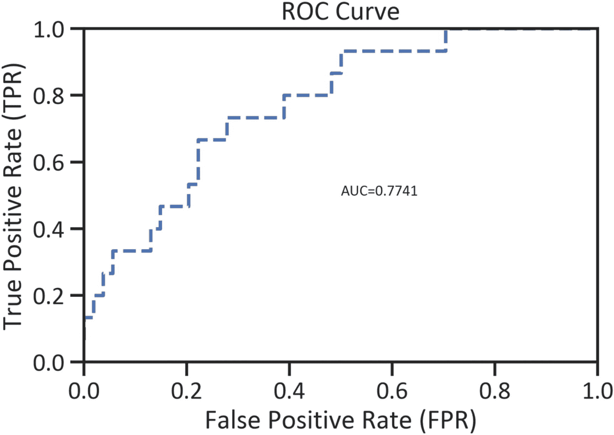
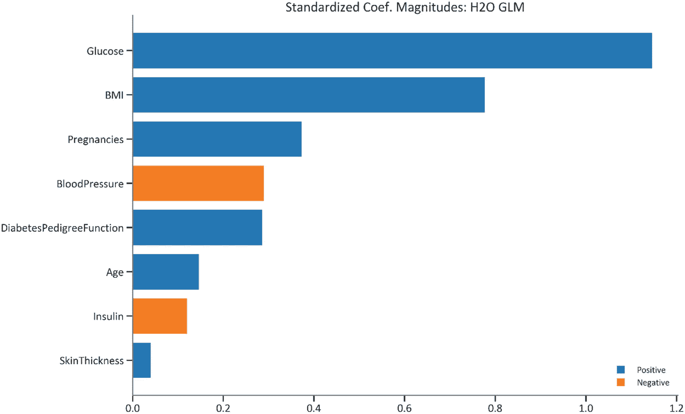
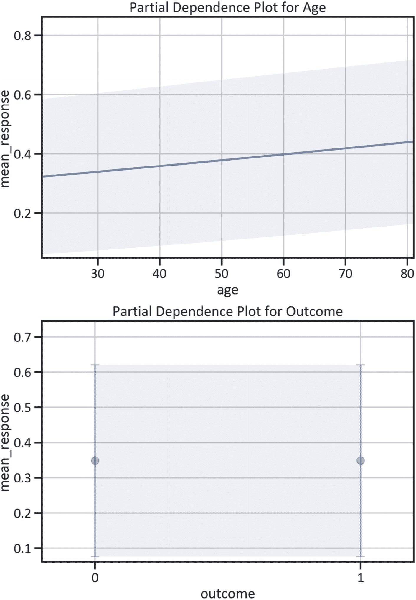
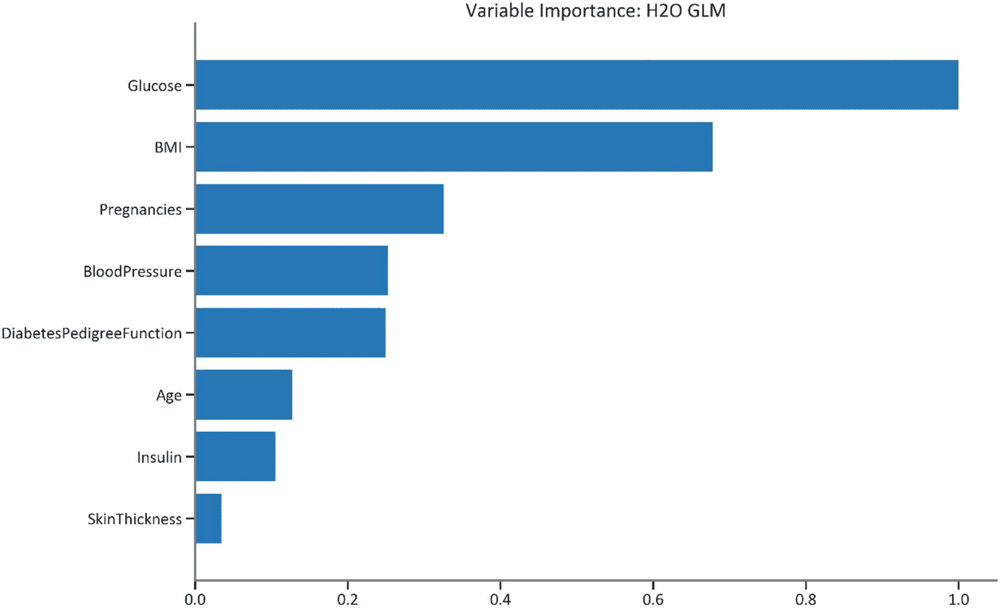

# 13. 使用 H2O 进行机器学习
本章为这本让您熟悉数据科学世界的书画上句号。本书涵盖了监督学习和无监督学习，以及降维。此外，它还涉及了机器学习的一个子领域，通常被称为深度学习。您可能已经意识到机器学习领域非常广泛。您必须能够进行数据工程、优化超参数，并开发、测试、验证、部署和扩展模型，以使用机器学习和深度学习模型解决复杂问题。这通常要求个人了解并应用不同的统计、机器学习和深度学习模型，以及一些编程技巧。
对数据科学家的需求很高，但具备足够技能的数据科学家的供应却很低。在过去十年中，全球各地的智库一直在贡献有据可查且具有开创性的开源软件包，这些软件包极大地帮助我们使用机器学习解决复杂问题。公共领域也有大量可用内容，例如在线教程、传统学位课程、在线学习课程、已发表的学术研究论文等。尽管科学界正试图通过让 AI 易于访问来加速其应用，但大多数组织在一致地采用和扩展 AI 解决方案方面仍面临困难。
要充分利用 H2O，请使用 H2O Flow。它充分提供了无需编写大量代码的能力。它是一个基于 Web 的开源交互式 H2O 环境，允许您将代码执行、文本、数学、图表和富媒体结合在单个文档中。使用 H2O Flow，您可以高效地捕获、重新运行、注释、展示和共享您的工作流程^(¹⁵)。在本章中，我们将向您展示如何使用 Python 代码构建和测试模型。要在 Python 环境中安装 H2O，请使用`pip install h2o`；要在 Conda 环境中安装，请使用`conda install -c h2oai h2o`。

## H2O 的工作原理
H2O 使我们能够以较少的技术投入来开发、测试和验证机器学习和深度学习模型。使用此包时，我们无需编写大量代码。它自动化了大部分数据科学流程。清单 13-1 初始化了 H2O。
表 13-1 环境信息
| `H2O_cluster_uptime:` | 07 秒 |
| --- | --- |
| `H2O_cluster_timezone:` | America/Los_Angeles |
| `H2O_data_parsing_timezone:` | UTC |
| `H2O_cluster_version:` | 3.30.0.7 |
| `H2O_cluster_version_age:` | 3 个月零 3 天 |
| `H2O_cluster_name:` | H2O_from_python_i5_lenov_z4hv4c |
| `H2O_cluster_total_nodes:` | 1 |
| `H2O_cluster_free_memory:` | 2.975 Gb |
| `H2O_cluster_total_cores:` | 0 |
| `H2O_cluster_allowed_cores:` | 0 |
| `H2O_cluster_status:` | 接受新成员，运行健康 |
| `H2O_connection_url:` | [`http://127.0.0.1:54321`](http://127.0.0.1:54321) |
| `H2O_connection_proxy:` | {“http”: null, “https”: null} |
| `H2O_internal_security:` | False |
| `H2O_API_Extensions:` | Amazon S3, Algos, AutoML, Core V3, TargetEncoder, Core V4 |
| `Python_version:` | 3.7.6 final |

```
import h2o
h2o.init()
```
清单 13-1 初始化 H2O

### 数据处理
我们使用 `import_file()` 方法将数据加载到 H2O 数据框中。该包支持不同的文件格式。同样，我们从 Kaggle 获取了示例数据。^((16))
```
df = h2o.import_file(path_name)
```
清单 13-2 将数据加载到 H2O 数据框

清单 13-3 返回前 10 个数据点。
```
df.head()
```
清单 13-3 查看 H2O 数据框

清单 13-4 将自变量和因变量分配到两个独立的数据框中。
```
y = "Outcome"
x = df.col_names
x.remove("Outcome")
df["Outcome"] = df["Outcome"].asfactor()
```
清单 13-4 将变量分配到 X 和 Y 数据框

清单 13-5 应用 `split_frame()` 方法将数据拆分为训练数据、测试数据和验证数据。
```
train, valid, test = df.split_frame(ratios=[.8, .1], seed=1234)
print("Train shape: ", train.shape)
print("Valid shape: ", valid.shape)
print("Test shape: ", test.shape)
```
清单 13-5 将数据拆分为训练数据、测试数据和验证数据

### 模型训练
清单 13-6 完成了逻辑分类器。
```
from h2o.estimators.glm import H2OGeneralizedLinearEstimator
glm = H2OGeneralizedLinearEstimator(family="binomial")
glm.train(x=x, y=y, training_frame=train, validation_frame=valid)
```
清单 13-6 完成逻辑分类器

我们将族类型指定为“binomial”，因为我们正在解决一个二分类问题。如果我们要解决一个多分类问题，那么我们会将族类型指定为“multinomial”。

#### 模型评估
在本书中，我们依赖混淆矩阵、分类报告、ROC 曲线、精确率-召回率曲线和学习曲线来总结二分类器的性能。与 H2O 包相比，SciKit-Learn 包提供的矩阵较少。下面，我们将充分讨论 H2O 包中可用的分类评估指标，然后向您展示如何估算它们。我们从基尼指数开始。

##### 基尼指数
H2O 包使我们能够获取基尼指数值，该值衡量数值中存在的不平等程度。我们使用该指数来正确判断分类器的质量。该指数的取值范围从 0 到 1。其中，0 表示分类器具有完全平等性，1 表示分类器具有完全不平等性。当我们开发分类器时，通常期望找到更接近 1 的基尼指数值。清单 13-7 返回基尼指数的估计值。
```
glm.gini(train=True, valid=True, xval=False)
{'train': 0.6828073360331426, 'valid': 0.548148148148148}
```
清单 13-7 基尼指数

训练数据的基尼指数值为 0.68，验证数据的值为 0.55。这两个数据集都处于平等与不平等的边界线上。我们没有达到预期的完全不平等。然而，这些值并没有小到足以影响关于分类器的结论。

##### 绝对马修斯相关系数
H2O 包中另一个可用的分类模型评估指标是绝对马修斯相关系数 (MCC)。我们用它来确定实际类别与分类器预测类别之间相关性的性质。MCC 的取值范围从 -1 到 1。其中，-1 表示分类器在预测类别时犯了很多错误，0 表示分类器难以猜测类别，1 表示分类器在区分类别方面不熟练。清单 13-8 返回绝对 MCC 的估计值。
```
glm.mcc(train=True, valid=True, xval=False)
{'train': [[0.3356601829569534, 0.5297584436640914]],
'valid': [[0.3790626186045188, 0.39336862882432994]]}
```
清单 13-8 绝对 MCC

上述发现表明，实际类别与分类器预测的类别之间存在微弱的正相关。

##### 混淆矩阵
清单 13-9 返回关于分类器性能的抽象信息。（见表 13-2）。
表 13-2 混淆矩阵
|   |   | 0 | 1 | 错误率 | 比率 |
| --- | --- | --- | --- | --- | --- |
| `0` | 0 | 306.0 | 90.0 | 0.2273 | (90.0/396.0) |
| `1` | 1 | 49.0 | 168.0 | 0.2258 | (49.0/217.0) |
| `2` | 总计 | 355.0 | 258.0 | 0.2268 | (139.0/613.0) |

```
glm.confusion_matrix()
```
清单 13-9 混淆矩阵

清单 13-10 找出训练数据和验证数据的 F1 分数。

## 逻辑回归模型评估

```
glm.F1(train=True, valid=True, xval=False)
{'train': [[0.3356601829569534, 0.7073684210526315]],
'valid': [[0.3790626186045188, 0.5405405405405405]]}
```

清单 13-10 训练数据和验证数据的 F1 分数

上述发现表明，逻辑分类器具有不错的精确率和召回率。清单 13-11 找出准确率系数。

```
glm.accuracy(train=True, valid=True, xval=False)
{'train': [[0.5331122058852918, 0.7862969004893964]], 'valid': [[0.8926783510054471, 0.8115942028985508]]}
```

清单 13-11 准确率系数

清单 13-12 生成一条曲线，总结分类器在区分类别方面的熟练程度（见图 13-1）。



图 13-1 ROC 曲线

```
glm_perf.plot()
```

清单 13-12 ROC 曲线

图 13-1 展示了一条表现良好的曲线的特征；它一开始沿着边界的左侧行进。然而，随着我们增加假阳性率，真阳性率也随之增加。

## 标准化系数幅度

清单 13-13 返回一个图表，以图形方式展示了自变量与因变量之间的关系（见图 13-2）。



图 13-2 标准化系数幅度

```
glm.std_coef_plot()
```

清单 13-13 标准化系数幅度

图 13-2 展示了标准化系数的大小。除血压和胰岛素外，大多数自变量与糖尿病结果呈正相关。我们还观察到血糖与糖尿病结果之间存在强正相关。

## 偏依赖

我们使用偏依赖来确定变量之间关系的影响。表 13-3 突出了年龄与糖尿病结果之间的偏依赖关系。

**表 13-3** 年龄偏依赖

|   | 年龄 | 平均响应 | 响应标准差 | 平均响应标准误差 |
|---|---|---|---|---|
| 0 | 21.000000 | 0.322744 | 0.261743 | 0.009445 |
| 1 | 24.157895 | 0.328581 | 0.263071 | 0.009493 |
| 2 | 27.315789 | 0.334469 | 0.264344 | 0.009539 |
| 3 | 30.473684 | 0.340407 | 0.265559 | 0.009583 |
| 4 | 33.631579 | 0.346395 | 0.266716 | 0.009624 |

```
glm.partial_plot(data = df, cols = ["Age", "Outcome"], server=False, plot = True)
```

清单 13-14 偏依赖

表 13-3 和 13-4 突出了变量值以及响应均值、响应标准差和响应平均标准误差的变化。

**表 13-4** 血糖偏依赖

|   | 结果 | 平均响应 | 响应标准差 | 平均响应标准误差 |
|---|---|---|---|---|
| 0 | 0 | 0.348501 | 0.272299 | 0.009826 |
| 1 | 1 | 0.348501 | 0.272299 | 0.009826 |

图 13-3 展示了变量及其对应的平均响应。这有助于理解偏依赖的概念。



图 13-3 偏依赖

## 特征重要性

我们将特征重要性作为一种降维技术，通过为每个自变量分配一个值，来显示每个自变量对因变量的相对重要性。清单 13-15 绘制了特征重要性图（见图 13-4）。



图 13-4 特征重要性

```
glm.varimp_plot()
```

清单 13-15 特征重要性

图 13-4 显示，血糖是糖尿病结果中最重要的变量，其次是身体质量指数（BMI），然后是怀孕次数，依此类推。如果我们移除年龄、胰岛素和皮肤厚度，可以提高分类器的性能。

### 预测

清单 13-16 以表格形式列出了预测类别和类别概率（见表 13-5）。

**表 13-5** 预测类别和类别概率

| 预测 | p0 | p1 |
|---|---|---|
| 0 | 0.956033 | 0.0439669 |
| 0 | 0.977438 | 0.0225621 |
| 1 | 0.58329 | 0.41671 |
| 0 | 0.753834 | 0.246166 |
| 1 | 0.269132 | 0.730868 |
| 0 | 0.952432 | 0.0475679 |
| 0 | 0.811075 | 0.188925 |
| 0 | 0.917553 | 0.0824472 |
| 0 | 0.665598 | 0.334402 |
| 0 | 0.813001 | 0.186999 |

```
y_predglm = glm.predict(test)
y_predglm
```

清单 13-16 预测类别

## 自动机器学习

AutoML 代表自动机器学习。这个术语不言自明。它使我们能够仅用几行代码就能构建并严格测试不同的机器学习和深度学习模型。它还自动化了超参数优化和数据建模等过程。我们无需开发多个模型并逐一比较，就可以使用它。开发一个 AutoML 模型非常简单。清单 13-17 完成了 AutoML 模型的构建。

```
from h2o.automl import H2OAutoML
automl = H2OAutoML(max_runtime_secs=120)
automl.train(x=x, y=y, training_frame=train, validation_frame=valid)
```

清单 13-17 完成 AutoML 模型

当我们完成时，必须指定不同模型学习数据结构所需的最大秒数。在我们的案例中，我们指定了 2 分钟。当我们使用它时，在后台，H2O 包会优化可用模型的超参数并训练它们。

### 排行榜

表 13-6 突出了所有训练模型的性能，包括 5 折交叉验证的模型性能。它根据 AUC 分数对分类器进行排名。列表中排名第一的分类器具有最高的 AUC 分数，而排名最后的分类器具有最低的 AUC 分数。它还突出了对数损失、精确率-召回率曲线下面积、每类平均误差、均方误差总和以及均方根误差总和。

**表 13-6** AutoML 排行榜

| model_id | auc | logloss | aucpr | mean_per_class_error | rmse | mse |
|---|---|---|---|---|---|---|
| StackedEnsemble_BestOfFamily_AutoML_20201025_135923 | 0.830476 | 0.48388 | 0.703867 | 0.243867 | 0.397547 | 0.158043 |
| GLM_1_AutoML_20201025_135923 | 0.829476 | 0.486136 | 0.70964 | 0.248761 | 0.397072 | 0.157666 |
| GBM_grid__1_AutoML_20201025_135923_model_8 | 0.8278 | 0.483469 | 0.714668 | 0.244595 | 0.398872 | 0.159099 |
| StackedEnsemble_AllModels_AutoML_20201025_135923 | 0.827573 | 0.486645 | 0.707761 | 0.248918 | 0.399255 | 0.159404 |

| `DeepLearning_grid__2_AutoML_20201025_135923_model_1` | 0.823174 | 0.506595 | 0.695583 | 0.244216 | 0.403943 | 0.16317 |
| `DeepLearning_grid__1_AutoML_20201025_135923_model_3` | 0.819415 | 0.571089 | 0.682411 | 0.257378 | 0.415348 | 0.172514 |
| `GBM_5_AutoML_20201025_135923` | 0.818548 | 0.494956 | 0.675015 | 0.244787 | 0.40579 | 0.164665 |
| `DeepLearning_grid__1_AutoML_20201025_135923_model_2` | 0.818118 | 0.554478 | 0.725002 | 0.237461 | 0.41781 | 0.174565 |
| `GBM_grid__1_AutoML_20201025_135923_model_9` | 0.815156 | 0.502735 | 0.687605 | 0.258513 | 0.408501 | 0.166873 |
| `GBM_grid__1_AutoML_20201025_135923_model_5` | 0.814243 | 0.498371 | 0.669688 | 0.262178 | 0.40745 | 0.166015 |

```
leaderboard = automl.leaderboard
leaderboard
```

`清单 13-18` `AutoML` 排行榜

表 13-6 显示，领先的二分类器的 AUC 分数为 0.83，AUCPR 为 0.70。

### 预测

上面，我们找到了领先的分类器。现在让我们考虑预测类别和类别概率（见表 13-7）。

`表 13-7` 预测类别和类别概率

| 预测 | p0 | p1 |
|--- |--- |--- |
| `0` | 0.923024 | 0.0769757 |
| `0` | 0.896685 | 0.103315 |
| `1` | 0.625636 | 0.374364 |
| `1` | 0.713157 | 0.286843 |
| `1` | 0.37774 | 0.62226 |
| `0` | 0.922715 | 0.0772854 |
| `0` | 0.836983 | 0.163017 |
| `0` | 0.910994 | 0.0890061 |
| `1` | 0.587552 | 0.412448 |
| `1` | 0.686241 | 0.313759 |

```
y_pred = automl.predict(test)
y_pred
```

`清单 13-19` 预测类别和类别概率

## 结论

本章介绍了一个名为 `H2O` 的无人驾驶开源软件包。我们开发并测试了一个逻辑分类器和 `AutoML` 模型。你可能已经注意到这个软件包是多么直观和功能丰富。它不需要使用者具备广泛的技术技能和经验。该软件包的易用性使得组织能够加速采用实用的人工智能解决方案。我们预计在可预见的未来会出现更多无人驾驶开源软件包。

至此，我们来到了本书的最后一章；我们相信你已经对数据科学的世界有了足够的洞察。现在，请运用所学知识来解决复杂问题。始终紧跟最新的研究和技术。切勿陷入部署不可靠模型或忽视模型及 Web 应用可扩展性的陷阱。