# 2. 理解大语言模型

如第 1 章所述，AI 最重大的发展是生成式 AI 的引入。正如之前承诺的，我们将全面审视生成式 AI。在此过程中，我们将学习新的术语和概念。完成本章后，你应该能够参与关于生成式 AI 如何帮助组织实现转型的讨论。

## 大语言模型

在生成式 AI 领域，有多种可选的 LLM。以下是最受欢迎的几种：

- `OpenAI` GPT 模型
- `Microsoft Azure OpenAI` GPT 模型
- `Anthropic` 和 `AWS Claude`
- `Google Gemini`（原名 `Bard`）
- `Hugging Face`
- `Llama 2`

这些 LLM 在许多方面存在差异，例如准确性、接地性、可处理数据量以及理解和生成内容的能力。这些概念和术语将在本章中介绍，但由于本书侧重于 `Microsoft Azure`，我们仅会在 `OpenAI` GPT 模型中探讨这些概念。不过，以下是当前可用不同类型 LLM 的总体概述。

### OpenAI 和微软 GPT 模型

来自 `OpenAI` 和 `Microsoft Azure` 的 GPT 模型是*完全相同的*。两家公司的合作方式如下：微软向 `OpenAI` 提供财务和计算基础设施，作为回报，微软有权在其产品（例如 `Microsoft 365 Copilot`）中使用 GPT 模型，并在 `Azure` 中提供这些模型，供开发人员和科学家用于他们的自定义项目。最广为人知的 `OpenAI` 模型如下：

- `GPT-3.5 Turbo`
- `GPT-4`
- `GPT-4 Turbo with Vision`
- `GPT-4 Whisper`
- `DALL-E`

`OpenAI` 模型按类型、上下文窗口和版本进行组织，如下图所示 2-1。上表是模型类型。当我们将上下文窗口和版本也包含进来时，列表将如下所示：

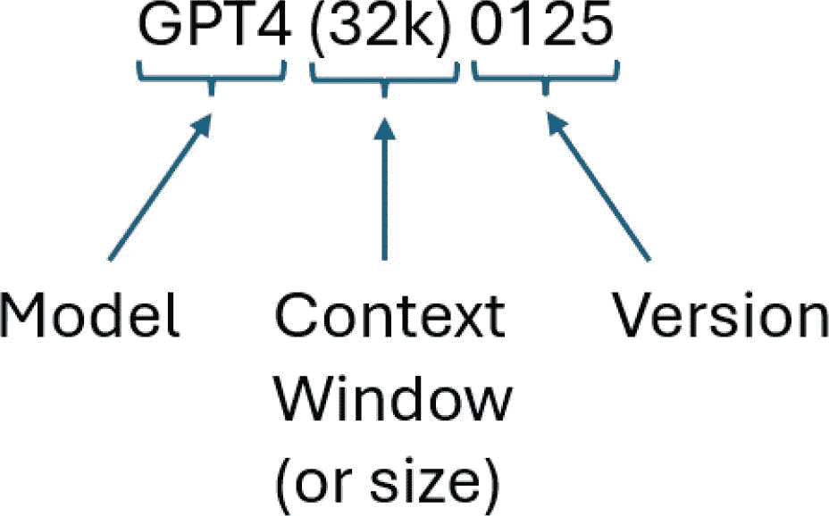

**图 2-1** 模型、上下文窗口和版本

- `GPT-3.5 Turbo (4k) 0613`
- `GPT-3.5 Turbo (4k) 1106`
- `GPT-3.5 Turbo (4k) 0125`
- `GPT-4 (8k) 0613`
- `GPT-4 (32k) 1106`
- `GPT-4 (32k) 0125`
- `GPT-4 Turbo (128k) with Vision`
- `GPT-4 Whisper`
- `DALL-E 3`

#### 版本

模型的版本号即其发布日期的标注。例如，`0613` 代表 6 月 13 日，`1106` 代表 11 月 6 日，`0125` 代表 1 月 25 日。除 `0125` 外，其他日期/版本均属于 2023 年。以 `0125` 为例，它对应的是 2024 年。如果 2024 年 6 月再发布一个新版本（假设为 6 月 5 日），则版本号 `0605` 可能看起来比 `0613` 更旧，但实际上两者相隔一年，因此 `0605` 本应是最新版本。此外，不熟悉这些模型的人无法仅从编号判断 `0125` 是新是旧，因为从数字上看它似乎早于 `0613`。这种编号方式仅对持续关注模型发布顺序的人有意义。

#### 上下文窗口大小

模型的上下文窗口决定了单次请求中它能处理的最大提示内容。提示（`prompt`）是向大语言模型（`LLM`）提出的自然语言问题，其长度通过 `token` 数量来衡量，我们将在本章后续详细讨论。目前只需知道，模型的 `token` 数量越多，它能处理的文本量就越大。上下文窗口可以小至 `GPT-3 Turbo` 模型的 `4k`（4000 个 `token`），也可以大到 `GPT-4 Turbo` 模型的 `128k`（128,000 个 `token`）。

#### OpenAI 还是微软

当选择使用 GPT 模型时，由于在微软或 `OpenAI` 平台上使用并无差异，因此选择哪个平台通常取决于您是否已在 `Azure` 中使用其他微软服务。

企业机构通常更青睐微软，因为其拥有强大且广泛的企业级产品组合。例如，`Azure OpenAI` 的应用程序编程接口（`API`）端点可通过 `专用终结点` 和 `API 管理（APIM）` 等原生 `Azure` 服务进行保护。作为 `Azure` 服务，`Azure OpenAI` 还可以通过 `Log Analytics` 进行日志记录和监控。将整个应用程序或解决方案部署在 `Azure` 云中，更便于管理和监控。

微软独有的另一项优势是在主权云中提供 `Azure` 服务。主权云是为特定主权国家构建的 `Azure` 实例，用于隔离此类服务，这可能是满足监管合规的要求。例如，美国就设有主权云^(²²)。位于美国 `Azure` 政府云中的 `Azure OpenAI` 服务符合 `FedRAMP` 标准，可用于联邦政府常要求的敏感工作负载。

### Anthropic 与 AWS Claude

`Anthropic` 是一家成立于 2021 年的 AI 公司，创始团队来自 `OpenAI` 的前高级成员。2023 年 9 月，`AWS` 投资了 `Anthropic`。`Anthropic` 的生成式 AI 模型名为 `Claude`，`AWS` 将其称为基础模型（`FM`）。

`AWS` 提供了一个名为 `AWS Bedrock` 的全托管前端服务，该服务是连接一系列基础模型的 `API` 网关。下图 2-2 展示了来自不同 AI 提供商的若干基础模型。

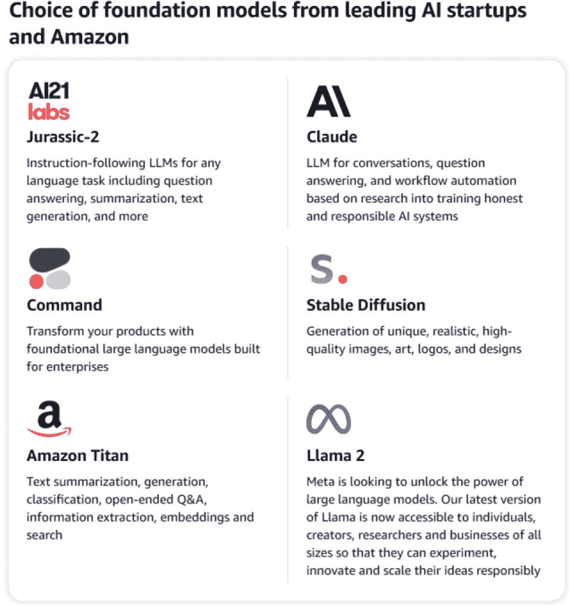

图 2-2

通过 `Amazon Bedrock` 服务可选择的基础模型（`FM`）

### Google Gemini

`Google` 的生成式 AI 服务名为 `Gemini`，是一套内部开发的大语言模型套件。尽管 `Google` 也投资了 `Anthropic`，但它并未像 `AWS` 那样提供 `Claude` 服务。`Google` 对 `Anthropic` 的投资似乎是其通过资助微软和 `OpenAI` 的竞争对手来平衡竞争格局战略的一部分。

`Gemini` 曾多次登上新闻头条。2024 年 2 月，`Google` [宣布 `Gemini 1.5`](https://developers.googleblog.com/2024/02/gemini-15-available-for-private-preview-in-google-ai-studio.html)^(²³) 将拥有 100 万个 `token` 的上下文窗口。但紧接着，由于该模型的图像生成能力产生了历史上不准确甚至不恰当的图片，`Google` 不得不 [将 `Gemini` 下线](https://www.cnbc.com/2024/02/26/googles-gemini-ai-picture-generator-to-relaunch-in-a-few-weeks.html)^(²⁴)。这场争议极为激烈，以至于在要求更换 `Google` 领导层的呼声日益高涨之际，`Google` 首席执行官不得不公开道歉。

另一个持续困扰 `Google` 云服务的问题是其在隐私方面的立场，这源于其广告业务。当有报道称 `Google` 将存储客户对话记录时，这一担忧也延伸到了 `Gemini`。查阅 `Gemini` 的 [隐私中心](https://support.google.com/gemini/answer/13594961#privacy_notice)^(²⁵) 可以发现，对话记录默认在您的 `Google` 帐户中存储 18 个月，但您可以将其修改为 3 到 36 个月，或直接关闭。如果您不关闭此功能，`Google` 可能会审查这些对话记录。被审查的对话记录会在您的 `Google` 帐户之外单独保存长达三年，正因如此，这些对话无法被删除。

### Hugging Face

`Hugging Face` 成立于 2016 年，是一家致力于服务 AI 社区的法国家 AI/ML 公司。该公司提供了一个由工具、数据集、模型和代码组成的平台，帮助数据科学家、开发者和爱好者将其应用于项目，并推动 AI 和 ML 领域的发展。

`Hugging Face` 具有浓厚的开源氛围，因为它提供来自其他公司的模型，以及一系列开源模型和工具。它还设有论坛和课堂，以鼓励社区内的协作。

`Hugging Face`^(²⁶) 还提供用于微调的工具和数据集。微调是一种修改大语言模型的技术，我们将在后续第 6 章中详细介绍。图 2-3 是 `Hugging Face` 上可用模型类别的截图。

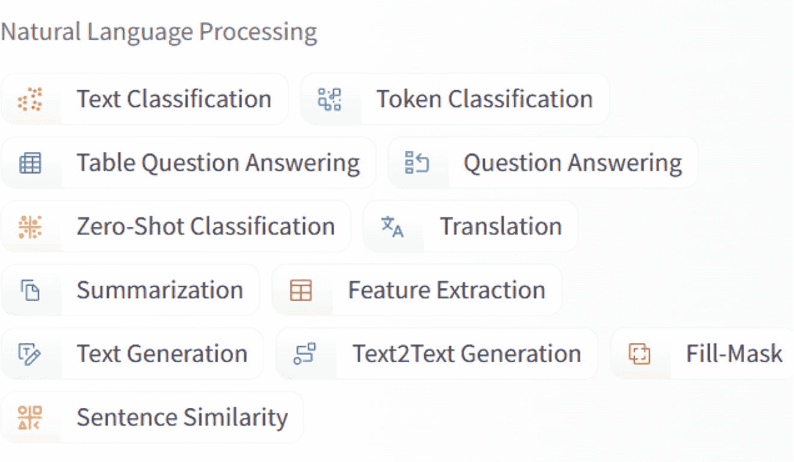

图 2-3

`Hugging Face` 上可用的 `NLP` 和 `LLM` 模型

## 词元

在消费服务时，总是会涉及到计量单位。例如，用电量以千瓦时（`kW/h`）计算。互联网使用费是根据速度（以每秒兆比特 `Mbps` 表示）按月收取的订阅费用。在云计算中，虚拟机（`VM`）等资源按小时计费。虚拟机性能越强，其运行时每小时的价格就越高。云存储则基于每月文件（`blob`）所消耗的平均字节数计费。

对于大语言模型，我们需要引入一种新的度量标准，即 `token`。每当使用 `LLM` 模型处理文本时，都会消耗 `token`，而将文本转换为 `token` 的过程称为 `tokenization`。

`tokenization` 的核心思想是将文本缩小为更小的单元，以便 `LLM` 能够高效地处理。

### 计数令牌（Counting Tokens）

在下一节中，我们将更详细地探讨令牌化的工作原理。但就目前而言，从广义上讲，你可以将一个令牌视为：
- 英语中大约四个字符
- 四分之三个单词

反之，对于生成式 AI 的处理，我们可以使用以下指导原则：
- 一到两句话大约为 30 个令牌。
- 一个段落大约为 100 个令牌。
- 一千五百个单词大约为 2048 个令牌。
- 七十五个单词大约为 100 个令牌。

所需的令牌数量也取决于语言，非英语语言通常比英语需要的令牌更多。因此，处理非英语文本的成本可能会更高。

令牌的挑战在于难以估算所需的令牌数量。幸运的是，有几种工具可供使用。其中之一是由 OpenAI 提供的[令牌化工具（Tokenizer tool）](https://platform.openai.com/tokenizer)^(²⁷)。这是一个简单的工具，允许你将文本复制粘贴到一个文本区域中，它将提供该文本被 OpenAI 处理所需的令牌数量。下面的图 2-4 展示了 OpenAI 令牌化工具的布局。

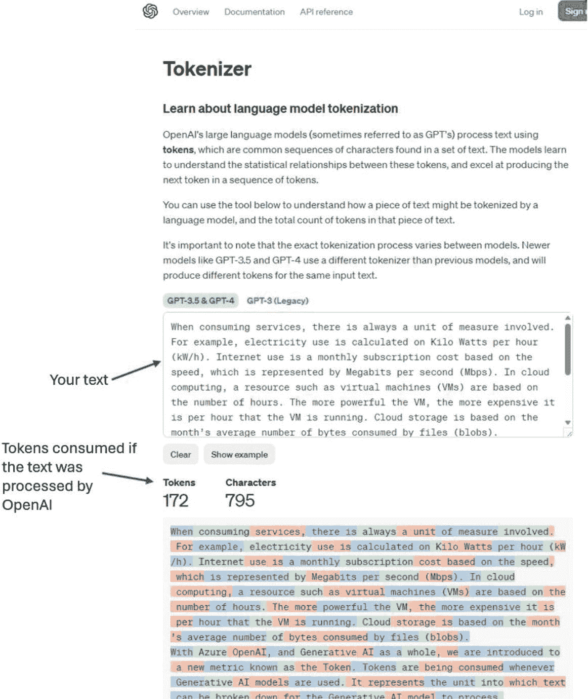
图 2-4 来自 Azure OpenAI 的令牌化工具，显示一篇文本需要 172 个令牌

这种估算令牌的方法是一种概括，但用于拆分文本的算法并非简单地将字符串从文本开头到结尾按顺序任意分组为四个字符。让我们更仔细地看看令牌化过程中发生了什么。

### 令牌化（Tokenization）

令牌化^(²⁸) 在技术上是一种基于[字节对编码（BPE）逻辑](https://en.wikipedia.org/wiki/Byte_pair_encoding)^(²⁹)的算法。`BPE` 识别文本中的模式，并用唯一代表该模式的令牌替换这些模式。这个过程迭代进行，直到无法识别出更多模式。

例如：

```
对文本字符串 "aabccabbbcccaabcc" 进行令牌化
识别模式及其频率：
"aa"
"bcc"
aa bcc abb bcc c aa bcc
通过用字符串中不存在的文本替换这些模式来令牌化：
ZXabbXcZX
Z=aa
X=bcc
迭代：
YabbXcY
Y=ZX
Z=aa
X=bcc
```

生成的令牌化文本（`YaabbXcY`）比原始文本（`aaccaabbbcccaabcc`）更小。令牌化后的文本是可逆且无损的，这意味着你可以将令牌转换回原始文本。

`BPE` 算法是 LLM 中令牌化逻辑的基础，不同之处在于，令牌化不仅仅是识别相邻的成对字符，还识别语言中常用的序列，并使用文本的数字表示形式，因为 LLM 只理解数字。因此，令牌化也是将文本转换为数字格式的过程，即编码。存在不同的编码方法，例如 `cl100k_base`、`p50k_base` 和 `r50k_base`。每个连续的文本、字母或单词都根据所使用的模型由一个唯一数字表示。Azure OpenAI 模型使用不同的编码器，如表 2-1 所示。

**表 2-1** OpenAI 模型使用的编码器

| 编码器（Encoder） | Azure OpenAI 模型 |
| --- | --- |
| `cl100k_base` | `gpt-4`，`gpt-3.5-turbo`，`text-embedding-ada-002`，`text-embedding-3-small`，`text-embedding-3-large` |
| `p50k_base` | `Codex`，`text-davici-002`，`text-davici-003` |
| `r50k_base` | `gpt-3`，`davinci` |

令牌化器同时使用编码器和模型来决定如何选取连续的文本。这种组合构成了令牌化器用于转换的词汇表。在英语中，令牌通常被组合起来，形成一个字符到一个单词（例如，"t" 或 "meet"）。空格通常被组合在单词的*开头*（例如，" an" 而不是 "an "）。

例如：

| `Run` | `n` | `ing` | `is` | `an` | `Olymp` | `ic` | `sport` | `ing` | `event` | 36 个字符 |
| --- | --- | --- | --- | --- | --- | --- | --- | --- | --- | --- |
| `2256` | `25` | `341` | `45` | `85` | `5126` | `18` | `8459` | `341` | `3258` | 10 个令牌 |

```
用唯一数字替换不匹配的字符串或字符：
n=25，Olymp=5126

| Run | n  | ing | is | an | Olymp | ic | sport | ing | event | 36 个字符 |
| 2256 |   | 341 | 45 | 85 |   | 18 | 8459 | 341 | 3258 |   |

令牌化器词汇表：
"ing" = 341
"is" = 45
"an" = 85
"Run" = 2256
"Kick" = 2215
"ic" = 18
"sport" = 8459
"even" = 7485
"event" = 3258
对 "Running is an Olympic sporting event" 进行令牌化
基于库识别连续文本：
"Run"，"ing"，"ic"，"sport"，"event"
令牌化：
```

这个例子使用了一个假设的初级词汇表，但对于像 `GPT-4` 这样的 LLM，词汇表非常庞大，因此所需的令牌会更少。在这个例子中，我们也使用了假设的数字来表示单词是如何转换为数值的。一旦单词或字母被转换为数值，该值对于该单词或字母的每次出现都保持不变。使用相同的文本内容并将其输入到 OpenAI 的令牌化器中，我们得到的结果如下图 2-5 所示。

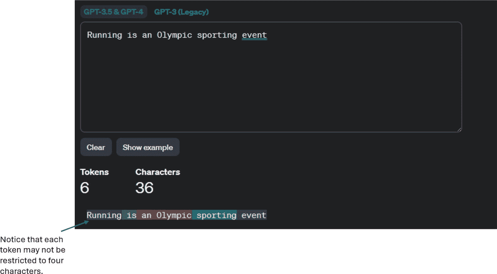
图 2-5 使用 OpenAI 令牌化器组织文本的方式

你可能想知道为什么假设的例子给出了 10 个令牌，而 `Tiktoken` 显示了 6 个令牌。答案在于 OpenAI 所使用的算法。第一个例子仅用于说明令牌是如何从单词中生成的，而 `Tiktoken` 是一个实际的令牌化工具。简而言之，在选择单词/字符方面，`Tiktoken` 比我们的手动转换更优化！因此其令牌计数更低。

为了查看令牌化器生成的编码（数值），我们在一个笔记工具中使用了 OpenAI 的开源令牌化工具 [`Tiktoken`](https://github.com/openai/openai-cookbook/blob/main/examples/How_to_count_tokens_with_tiktoken.ipynb)^(³⁰)，如下图 2-6 所示。

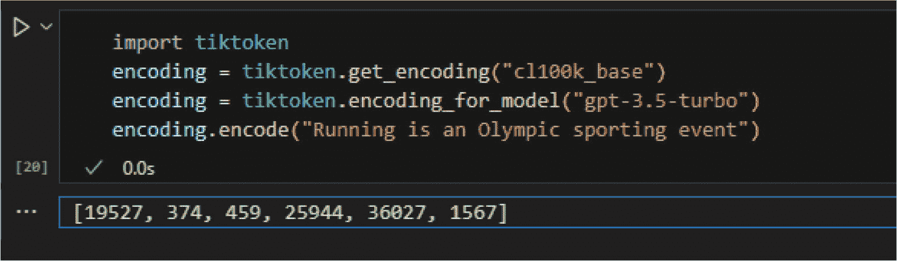
图 2-6 在 Jupyter Notebook 中使用 `Tiktoken` 检索编码的代码块

好的，作为高级文档工程师和翻译员，我将严格遵循注意事项和示例格式，为您提供高质量的翻译。

### 动手练习：探索分词

在本动手练习以及本书的所有其他练习中，您需要具备 `Git`、`Python` 和 `Linux` 的基本操作能力。我们假设您已具备此技能水平，将不会过多赘述配置和工具相关的细节。

推荐先决条件：
- 已安装 `Visual Studio Code`（推荐）或您偏好的 IDE
- 已安装 `Git` 或 `GitHub Desktop`
- 已安装 `Windows Subsystem for Linux (WSL)`（如果您在 Windows 操作系统下进行开发）
- 安装 `Python 3.8` 或更高版本

动手练习开始：

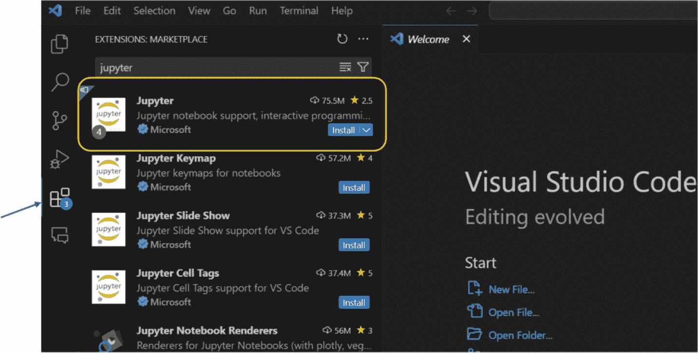
图 2-7 在 Visual Studio Code 中安装 Jupyter 支持扩展

1. 克隆本书的 GitHub 仓库，地址为 [`https://github.com/juliansoh/Data-Science-Solutions-on-Azure-2nd-Edition`](https://github.com/juliansoh/Data-Science-Solutions-on-Azure-2nd-Edition)。
2. 启动 `Visual Studio Code`。
3. 从 `扩展` 市场中安装 `Jupyter Notebook` 支持扩展，如下面的图 2-7 所示。

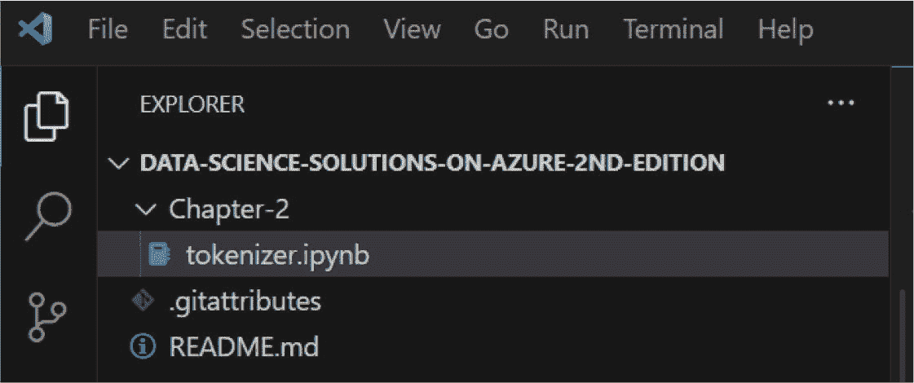
图 2-8 在名为 `Chapter-2` 的文件夹中打开 Jupyter Notebook `tokenizer.ipynb`

1. 在 Visual Studio Code 中选择文件 ➤ 打开文件夹，并导航到您在步骤 1 中克隆的仓库的本地根目录。
2. 导航到名为 `Chapter-2` 的文件夹，并打开 `tokenizer.ipynb`，如下面的图 2-8 所示。

3. 阅读每个代码块中的注释，然后按顺序运行它们。更改代码块 3 中变量 `text` 的值，以查看分词器的表现。

总而言之，使用 `cl100k_base` 编码和 `gpt-3.5-turbo` 模型，对我们的示例进行分词得到如下结果。

| `Running` | `_is` | `_an` | `_Olympic` | `_sporting` | `_event` | `36 characters` |
|-----------|-------|-------|------------|-------------|----------|-----------------|
| `19527`   | `374` | `459` | `25944`    | `36027`     | `1567`   | `6 tokens`      |

如前所述，请注意空格被分组在选定文本的开头而不是结尾。GPT 模型更为庞大，意味着其词汇量更大，因此能够使用比我们假设模型更少的 token（六个 token 对比十个）。

进一步深入探讨 `Tiktoken` 和编码的细节超出了本书的范围，但本次动手练习应该能让您对分词有更好的理解。值得花些时间学习一下笔记本中关于如何使用 `Tiktoken` 计算 token 数量的内容，该笔记本位于脚注中列出的 GitHub 仓库中。

### 提示 token 与补全 token

Token 分为两类：
- 提示 token
- 补全 token

提示 token 是基于用户输入创建的 token。例如，如果您提问 `“Tell me more about this book,”`，所产生的六个 token 就称为提示 token。

如果 LLM 对此问题的回复是 `“This book teaches us how to use Microsoft Azure for Data Science projects with a heavy emphasis on generative AI and Large Language Models,”`，这相当于 26 个 token，这些 token 被称为补全 token。

总之，提示 token 是与问题（提示）相关的 token，而补全 token 是与 LLM 生成的回复相关的 token。此外，在与 LLM 的大多数交互中，消耗的提示 token 数量通常高于补全 token。原因是设置提示不仅需要问题本身，还需要问题的上下文以及所有相关来源（例如，知识库文章）。

在对话场景中，为了向 LLM 提供之前所有对话轮次的上下文，每个后续提示都需要包含之前提出的问题。因此，随着对话的进行，每个后续提示消耗的 token 会比前一个更多。

出于估算目的，下面的表 2-2 列出了常见用例以及每个用例观察到的平均 token 数量。

**表 2-2** 用例及其对应的 token 使用量细分

| 用例                                        | 提示 token | 补全 token | 总 token |
|-----------------------------------------------|---------------|--------------------|--------------|
| 通用聊天问答                                   | 600           | 50                 | 650          |
| 基于自有数据的聊天：检索增强生成 (RAG) 架构 | 2850          | 100                | 2950         |
| 新闻文章（摘要）                              | 6500          | 250                | 6750         |
| 电子邮件（摘要）                               | 800           | 50                 | 850          |
| 聊天记录（摘要）                              | 900           | 200                | 1100         |
| 会议记录（摘要）                              | 1200          | 100                | 1300         |
| 代码补全/生成                                 | 1150          | 50                 | 1200         |
| 代码解释（摘要）                              | 950           | 250                | 1200         |

## Token 的相关性

既然我们知道了什么是 token，就可以将它们应用于其使用的两个重要方面：
- 成本
- 性能

### 成本

由于 token 是 LLM 的计量单位，它自然成为消耗 LLM 时用于计算成本的指标。让 LLM 处理数据的成本基于该过程所需的 token 数量。来自 Microsoft、OpenAI、Google 和 AWS 的生成式 AI 服务都基于价格/token。由于这是一本专注于 Microsoft Azure 平台的书，我们将以 Microsoft Azure OpenAI 为基础来了解使用 Microsoft 平台时可用的成本模型。

Azure OpenAI 有两种成本模型：
- 消耗或即用即付 (`PayGo`) 模型
- 预配置吞吐量单位 (`PTUs`)

#### 即用即付 (`PayGo`)

顾名思义，`PayGo` 模型很简单直接——您需要为每消耗 1000 个 token 付费。与所有 Azure 服务一样，[定价计算器](https://azure.microsoft.com/pricing/calculator) 是估算使用 Azure OpenAI 服务成本的工具。

##### 动手练习：探索成本

1. 如下面的图 2-9 所示，访问 [`https://azure.microsoft.com/pricing/calculator`](https://azure.microsoft.com/pricing/calculator) 上的计算器，在左侧菜单中选择 **AI + 机器学习**，然后选择 **Azure OpenAI 服务**。您会在屏幕的右角看到一个弹出窗口，显示 **已添加 Azure OpenAI 服务**。点击 **查看** 链接。

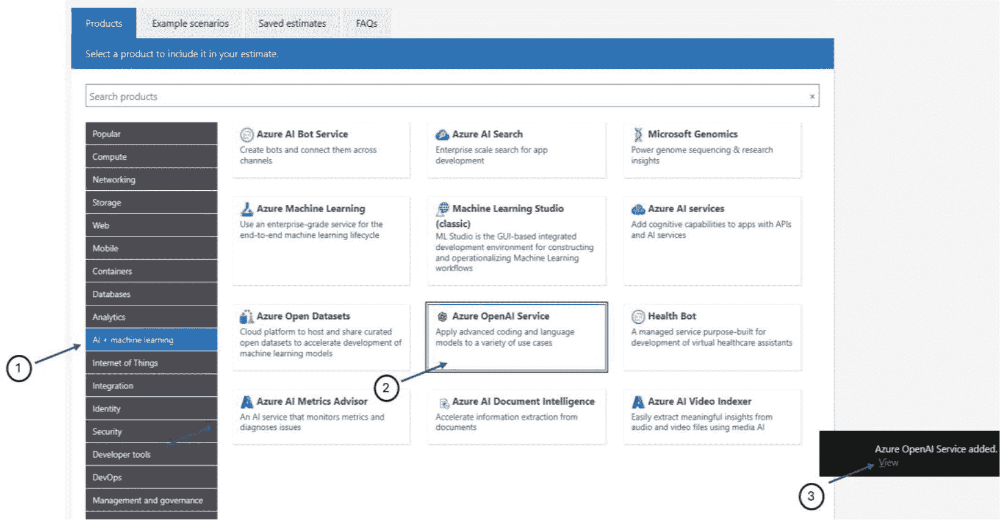
**图 2-9** Azure 在线计算器并选择 Azure OpenAI 服务

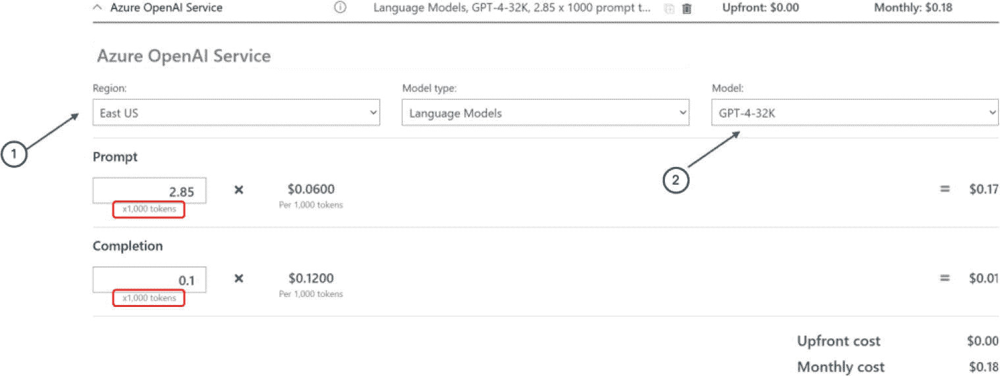
**图 2-10** 在 Azure 计算器中基于 GPT-4 32k 的 token 数量和类型估算成本

2. 还记得本章前面我们区分了提示 token 和补全 token 吗？这就是它重要的地方，因为在 `PayGo` 模型中，不同类型的 token 有不同的定价。参考上面的表 2-2，选择一个用例。然后在计算器中提供该用例的提示 token 和补全 token 的数量。例如，我们将选择“基于自有数据的聊天”用例。因此，我们将在提示 token 处输入 `2.85`（2.85 × 1000 = 2850），在补全 token 处输入 `0.1`（0.1 × 1000 = 100）。参见下面的图 2-10。

3. 请注意计算器中的以下几点：
    1. 我们选择的是 **美国东部** 区域，但 Azure OpenAI 并非在所有区域都可用。因此，如果您选择其他区域，该服务可能不可用。
    2. 即使某个区域提供 Azure OpenAI 服务，也并非所有模型在该区域都可用。
    3. 根据所选模型的不同，每个 `Prompt` 和 `Completion` token 的价格也不同。
    4. 有关各区域 Azure OpenAI 及模型可用性的列表，请参考 [`https://learn.microsoft.com/en-us/azure/ai-services/openai/concepts/models#public-cloud-regions`](https://learn.microsoft.com/en-us/azure/ai-services/openai/concepts/models#public-cloud-regions)。

#### 预置吞吐量单位（PTU）

`预置吞吐量单位（PTU）`是微软 Azure 中用于描述运行 LLM 的专用计算资源的术语。可以将一个`PTU`视为 LLM 所需的计算（GPU）、内存和存储的复合单元。分配给 LLM 的`PTU`越多，其每分钟能处理的 token 数量就越多。同时，支持一个模型也需要最低数量的`PTU`。下图 2-11 描述了 LLM 与`PTU`之间的关系。下表 2-3 显示了不同模型所需的最低`PTU`数量。

**表 2-3** 不同模型所需的最低`PTU`数量

| 模型 | 最低`PTU`数量 |
| --- | --- |
| `gpt-3.5-turbo (16k)` | 50 |
| `gpt-4 (8k)` | 100 |
| `gpt-4 (32k)` | 200 |
| `gpt-4-turbo with Vision` | 100 |

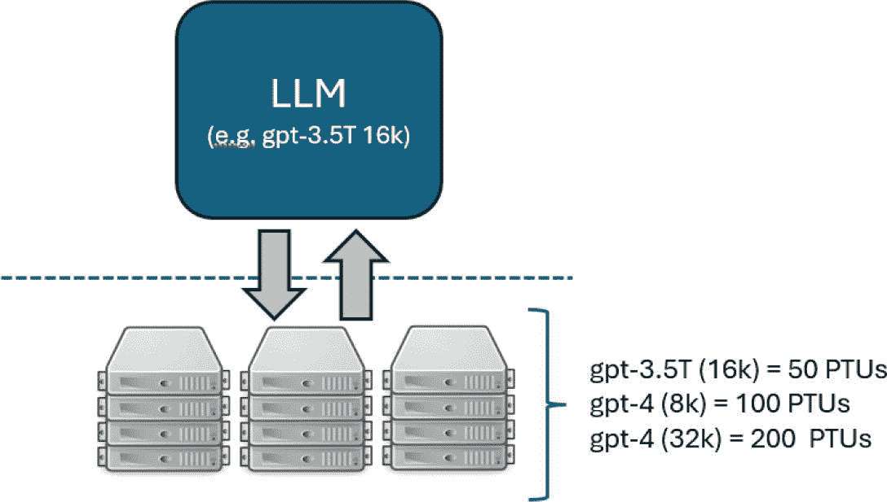

**图 2-11** 由 LLM 使用的`预置吞吐量单位（PTU）`

`PTU`模型并非按消耗的提示和补全 token 数量付费，而是按月固定成本提供“无限”数量的 token。然而，尽管是“无限”的，实际可消耗的最大 token 数量仍受底层物理基础设施（计算、内存、存储等）的约束。

估算不同`PTU`级别能够提供的最大 token 数量，对于能够控制每分钟请求数的批量处理场景非常有用。然而，在事务型场景（例如聊天）中，了解每分钟的峰值请求数可能更为重要，这样你就能知道在任何给定时间，服务是否能处理预期的用户数量。我们将在本章后面的“`PTU` 模型中的峰值用户和 `TPM`”部分详细讨论这一点。

## 性能与服务限制

现在我们已经了解了两种成本模型——即用即付（`PayGo`）和`PTU`；在确定 LLM 规模之前，我们还需要讨论另一个概念，即每分钟 token 数（`TPM`）。

### 每分钟 Token 数（`TPM`）

每分钟 token 数（`TPM`）是衡量每分钟处理 token 数量的吞吐量指标。`TPM`是决定在任何给定分钟内能够处理多少请求或用户的主要指标。

上图 2-12 将容量描绘为一条管道，以 token 形式服务用户请求。在该图中，对于特定的一分钟窗口，共有四个用户，他们的提示和补全 token 各不相同，因为他们向 LLM 发出的请求用于不同目的（例如，聊天、摘要）。因此，每个用户消耗的 token 数量不同。假设它们在同一分钟时间窗口内发出请求，那么这四个请求的总 token 数为 9500。因此，`TPM`为 9500。

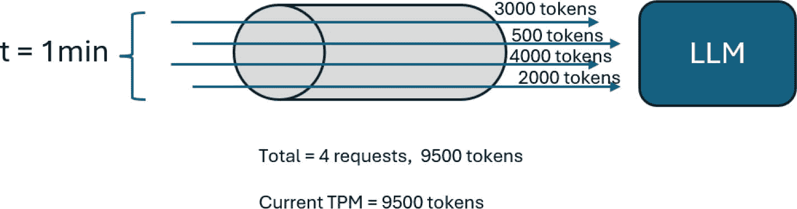

**图 2-12** 将`TPM`概念化为 LLM 容量的示意图

### 配额与服务限制

现在我们理解了`TPM`的概念，请访问 [Azure OpenAI 服务配额和限制页面](https://learn.microsoft.com/en-us/azure/ai-services/openai/quotas-limits)。^(³²)

Azure OpenAI 服务限制主要取决于模型、模型版本、部署类型（即用即付或`PTU`）以及区域。配额和限制页面列出了即用即付部署模型的限制。我们将在下一节讨论`PTU`限制。

首先，我们将查看该页面的 [区域配额限制](https://learn.microsoft.com/en-us/azure/ai-services/openai/quotas-limits#regional-quota-limits)^(³³) 部分。此部分的表格显示了不同区域中每个模型的`TPM`，如图 2-13 所示。例如，`GPT-3.5 Turbo 16K`的`TPM`在`eastus`等某些区域为 240k，但在`japaneast`等其他区域为 300k。

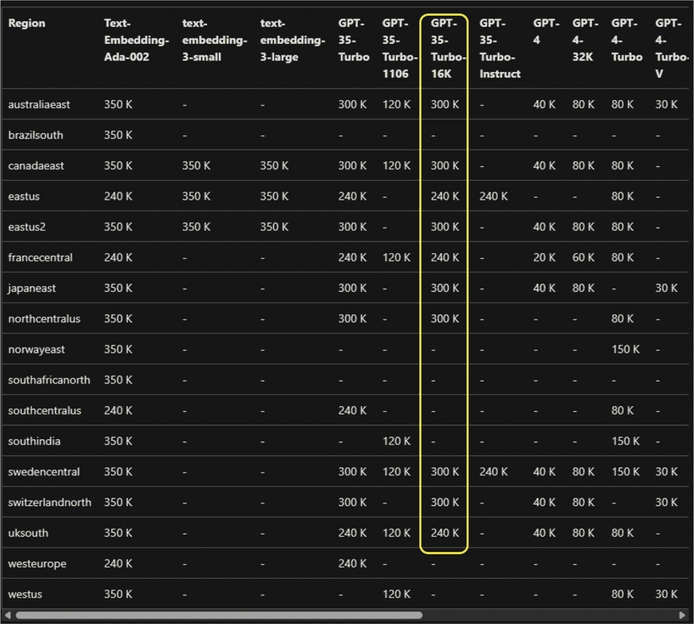

**图 2-13** 区域配额限制（`TPM`）

接下来，查看 [配额和限制参考](https://learn.microsoft.com/en-us/azure/ai-services/openai/quotas-limits#quotas-and-limits-reference)^(³⁴)，找到名为“每次请求的最大提示 token 数”的限制，如下图所示 2-14。

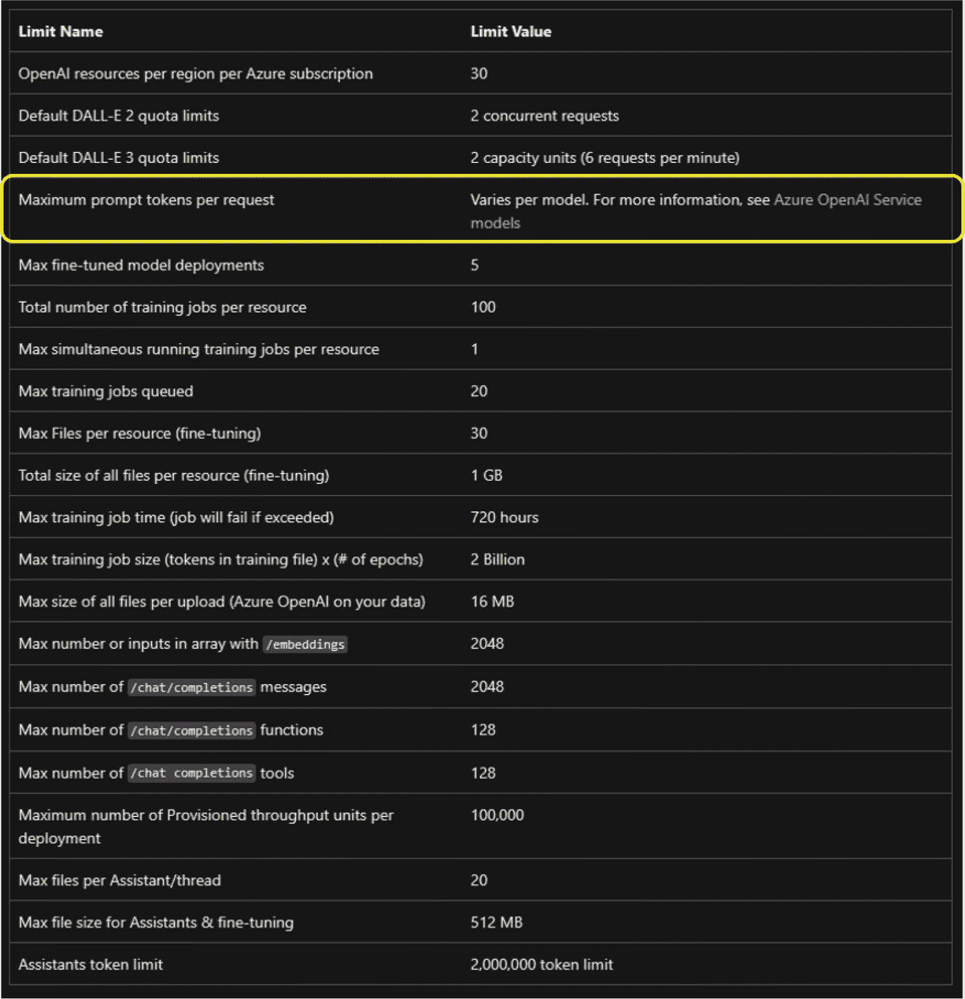

**图 2-14** 配额和限制参考

这是模型每次请求能够接收的最大提示 token 数，我们在本章前面将其称为上下文窗口大小。点击“限制值”列中的 [Azure OpenAI 服务模型链接](https://learn.microsoft.com/en-us/azure/ai-services/openai/concepts/models)^(³⁵)。

找到描述你将使用的模型可用性和区域的部分。例如，我们访问了 [GPT-3.5 Turbo 模型可用性部分](https://learn.microsoft.com/en-us/azure/ai-services/openai/concepts/models#gpt-35-turbo-model-availability)^(³⁶)，并注意到我们感兴趣部署的模型——`GPT-3.5 Turbo 16K 0613`——在美国东部区域可用，其最大 token 请求数为 16,384，如下图所示 2-15。

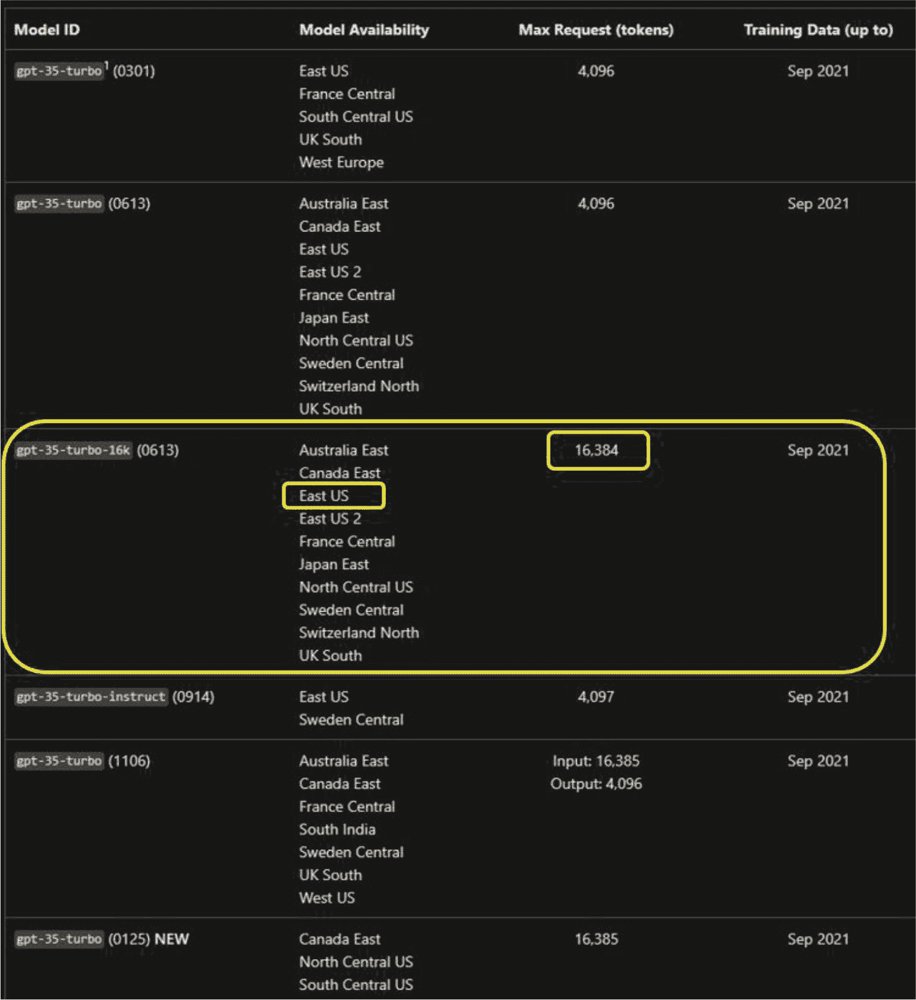

**图 2-15** 按模型和区域划分的每次请求最大 token 大小

总结整个示例，如果我们打算在美国东部区域部署一个`GPT-3.5 Turbo` LLM 解决方案，根据上述三个图表^(³⁷)中的表格，我们可以了解到在即用即付模型中，我们的服务限制如下：

*   来自*所有*请求的提示 token 总和不得超过 240k 个 token。
*   任何单个请求^(³⁸)的提示 token 不得超过 16,384 个 token。
*   该模型在美国东部区域可用。

要了解上述配额和限制是如何执行的，请以图 2-13 为例。考虑在一分钟时间范围内传入的请求 token：20k、15k、200k^(³⁹) 和 6k。最后一个请求（6k token）将使`TPM`达到 241k，从而超过`GPT-3.5 Turbo`模型的 240,000 `TPM`限制（图 2-13：区域配额限制（`TPM`））。

接下来，每个模型还对单个请求的最大 token 数有服务限制。再次参考图 2-13，尽管 200k token 的请求在请求时未超过`TPM`限制而被允许通过，但 LLM 将无法处理它，因为该请求本身超过了 16,384 个 token 的配额（图 2-15：按模型和区域划分的每次请求最大 token 大小）。

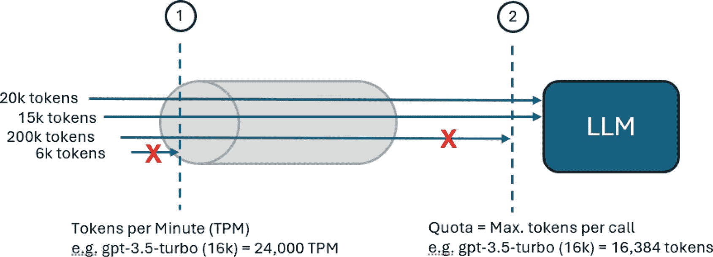

**图 2-16** 按`TPM`和配额划分的服务限制

### 即用即付模型中的峰值用户数和每分钟令牌数

结合上下文，我们再次参考表 2-2 中提到的用例。对于“与自有数据对话”场景，提示令牌数为 2850。因此，如果我们要在美国东部区域部署基于该用例的解决方案，那么在即用即付模型下，该服务每分钟最多可支持约 84 个用户（240,000 / 2850）。

至此，我们关于即用即付部署场景下配额和服务限制如何执行的讨论就结束了。需要注意的一点是，由于区域内的其他因素，这些限制有时可能会更低。如果某个区域使用量很大，那么每分钟令牌数可能会显得更低，因为此时可能没有足够的计算资源来支持所有即用即付客户的需求。最好的理解方式是将它类比为互联网宽带服务。即使你订阅的服务理论上可提供高达 1 Gbps 的带宽，但当你的邻居和你同时在线，并且每个人都在看视频或玩游戏时，实际带宽可能会显著降低。因此，即用即付模型在性能上可能难以预测。

### `PTU` 容量计算器

如果你需要更稳定和可预测的性能，那么预置吞吐量单元（`PTU`）模型可能是部署大语言模型（LLM）工作负载的更好方法。请记住，`PTU` 模型基于预置的计算资源，因此你始终能获得有保障的容量。

Azure OpenAI Studio 中提供了一个 `PTU` 容量计算器。如果你已经在即用即付模型下探索过 Azure OpenAI，你可以通过下图 2-17 所示的方式访问该计算器。但如果您还没有开始体验 Azure OpenAI，也无需担心，我们将在第 3 章中再次详细讨论。

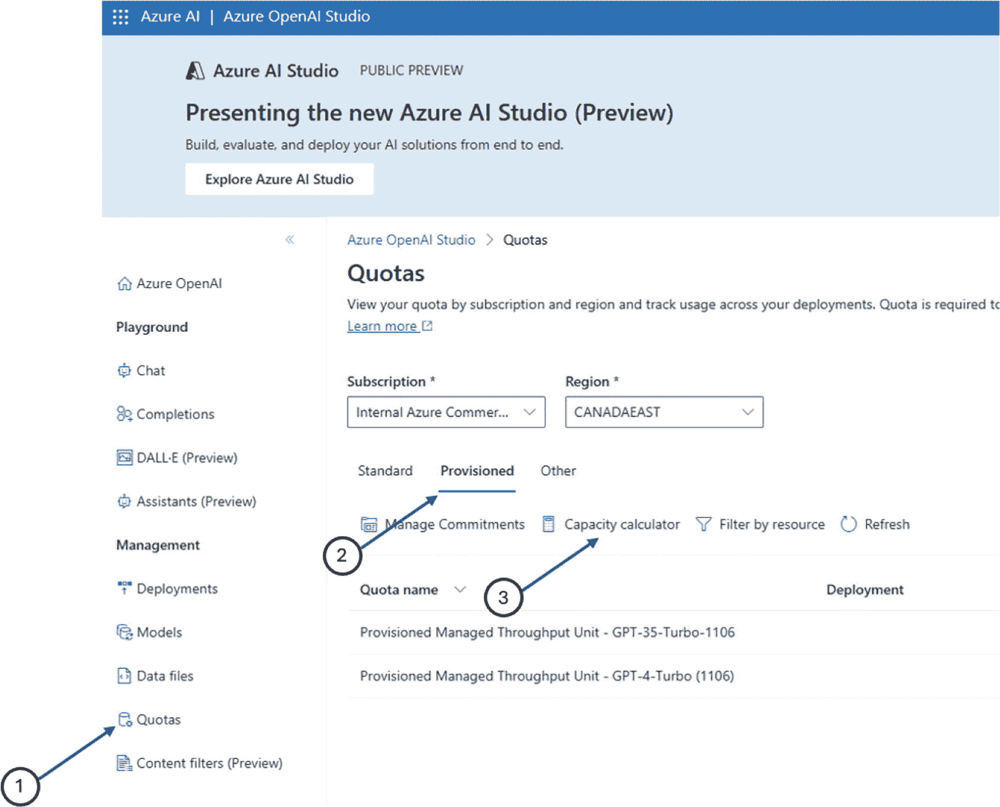

**图 2-17** Azure OpenAI Studio 中的 `PTU` 容量计算器

### `PTU` 模型中的峰值用户数和每分钟令牌数

目前我们尚无法使用 Azure `PTU` 计算器，因此可以参考表 2-4。表 2-4 使用了上文表 2-2 中的“与自有数据对话”用例（提示=2850 个令牌，完成=100 个令牌）；我们可以据此估算出每分钟可服务的峰值用户数。

**表 2-4** 当 `prompt=2850 tokens` 且 `completion=100 tokens` 时，各模型在最小 `PTU` 下的预估峰值请求数

| 模型 | 最小 PTU | 每分钟令牌数 | 每分钟峰值请求/用户数 |
| --- | --- | --- | --- |
| `gpt-3.5-turbo` (16k) 1106 | 50 | 提示 = 2850<br>完成 = 100 | 171 |
| `gpt-3.5-turbo` (16k) 0125 | 50 | 提示 = 2850<br>完成 = 100 | 240 |
| `gpt-4` (8k) 0613 | 100 | 提示 = 2850<br>完成 = 100 | 17 |
| `gpt-4` (8k) 0125 | 100 | 提示 = 2850<br>完成 = 100 | 25 |
| `gpt-4` (32k) 0613 | 200 | 提示 = 2850<br>完成 = 100 | 25 |

从表 2-4 中需要注意几点：
*   有时你可能会看到每分钟令牌数作为一个单一维度被提及，而没有分解为提示令牌和完成令牌，但为了更准确地估算峰值用户数，我们应始终定义每种类型的令牌数量。请记住，提示令牌比完成令牌成本更低，但提示所需的令牌数通常高于完成所需的。
*   各用例（表 2-2）中观察到的提示令牌和完成令牌数量仅供参考。最好使用你环境中实际观察到的提示令牌和完成令牌数据。
*   使用容量计算器来确定你的用例所需的 PTU 数量，我们将在第 3 章中详细讨论这一点。

下图 2-18 总结了不同模型在即用即付与 PTU 模型下每分钟令牌数的对比。

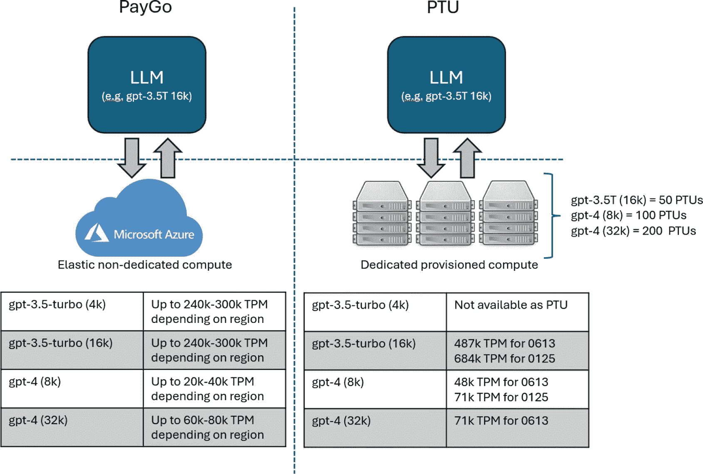
图 2-18 不同模型在即用即付与 PTU 模式下的每分钟令牌数对比

当超出每分钟令牌数限制时，Azure OpenAI 将返回一个 429 错误，如下图 2-19 所示。我们将在后面的章节中探讨处理此错误的方法。

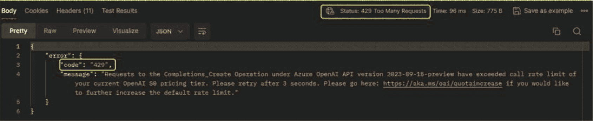
图 2-19 超出每分钟令牌数限制时的 429 错误

## 使用大语言模型
与传统的人工智能和机器学习模型不同，你无需在使用前训练大语言模型。在本章前面部分，我们了解了分词如何将语言转换为数字。大语言模型经过训练，可以使用分词后的内容来计算单词和句子之间的方差。单词和句子之间的方差程度取决于它们的相似或差异程度。单词和句子越相似，方差就越小。这是理解大语言模型工作原理的最简单方式，正因如此，它有时被称为“语言计算器”。

在任何时候，你都不需要将自己的内容加入大语言模型并对其进行训练。大语言模型也不会随着时间的推移根据你的内容学习或识别模式。因此，大语言模型是一个只理解语言而非知识的人工智能模型。^(⁴⁰)

OpenAI 这家公司仍然是各种 GPT 模型的所有者。他们将负责用新参数重新训练大语言模型，并发布新的模型和版本（例如，从 GPT-3.5 到 GPT-4，从 GPT-4 0613 到 GPT-4 0125）。

但是，如果你想添加参数使你的大语言模型满足独特需求，那么只有在这种情况下，你才需要将自己的专有内容注入基础大语言模型。这被称为微调。否则，你将通过一个称为提示工程的过程与大语言模型进行交互。

## 提示工程
`提示工程`是使用自然语言向大型语言模型（`LLM`）提供指令，指导其如何理解内容以及/或生成回应的行为。

以下是一个提示示例：

> *你是一名提供 Microsoft 产品信息（特别是关于 AI、Copilot 和 OpenAI 领域）的助手。信息来源本质上是常见问题解答（FAQ）。*

> *务必提及任何法律或合规问题。务必提供引用来源。回答要简明扼要。仅根据下方来源列表中的事实进行回答。如果下面信息不足，请说明不知道。不要生成未使用下方来源的答案。如果向用户提出澄清性问题有助于解答，请提出该问题。*

> *对于表格信息，请以 HTML 表格形式返回。不要返回 Markdown 格式。*

> *每个来源都有名称，后跟冒号和实际信息，在你回答中使用的每个事实后面，务必包含该来源的名称。使用方括号引用来源，例如 [info1.txt]。不要合并来源，应分别列出每个来源，例如 [info1.txt][info2.pdf]。*

可以看到，其语法读起来就像是一套用英文编写的常规指令。提示中提到的来源指向包含有助于回答问题信息的文档（例如 PDF 文件）。这里的关键点是，通过`提示工程`，源内容与 `LLM` 是分离的。`LLM` 需要在每次回答问题时查阅源文档，即使是连续被问到同一个问题也是如此。这表明源文档从未被整合到 `LLM` 中。

尽管提示基于自然语言，但仍需要能够简洁地提供提示。OpenAI 发布了一份关于`提示工程`的指南^(⁴¹)，你应该阅读一下。该指南的要点是，提示中的指令需要清晰简单。为了帮助我们撰写出好的提示，我们可以采用几种技巧。以下是一些较受欢迎的技巧：
*   思维链提示
*   少样本提示
*   零样本提示
*   自洽性
*   生成知识提示

我们将在第 3 章中探索和实验`提示工程`的不同技巧。

## 微调
大型语言模型（`LLM`）是预训练语言模型。`微调` `LLM` 是针对特定领域优化此预训练语言模型的过程。`微调`涉及调整模型的参数，使其能够更好地理解和生成与主题领域相关的回应，而无需在提示中指定该领域。

例如，你负责为一个骑行俱乐部创建一个聊天解决方案。该解决方案应能够帮助新手骑行者提问，包括骑行俚语。

骑行中的一句俚语是“领骑”（lead out）。然而，当向 `LLM` 询问这个词时，它给出了一个与骑行完全无关的答案（尽管答案本身可能是正确的），如下图 2-20 所示。

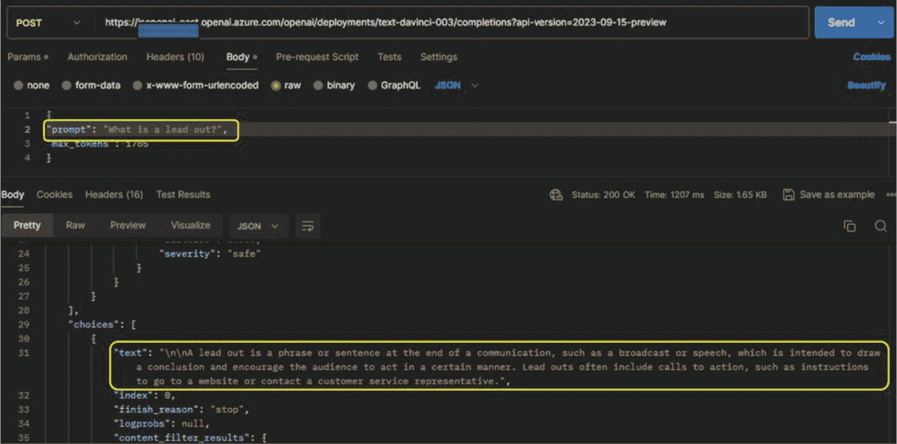
**图 2-20** — 未针对主题领域进行微调的 `LLM`

如果我们对 `LLM` 进行微调，缩小主题领域范围并融入仅与骑行相关的参数，那么相同的提示将产生预期的回应，如下图 2-21 所示。

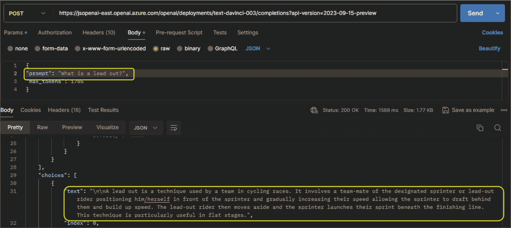
**图 2-21** — 经微调的 `LLM` 在主题领域上下文中进行回应

请注意，我们没有修改提示来指定回应应局限于骑行领域。虽然我们几乎可以通过`提示工程`完成所有事情，但使用`微调`可以使模型执行更快，提示也会更短。然而，缺点在于 `LLM` 现在变成了一个定制模型，你需要负责管理该模型的未来迭代。当新的预训练模型或版本发布时，`微调`需要重新进行。我们将在第 6 章中更详细地介绍`微调`。

### 接地
`接地`^(⁴²) 一个 `LLM` 是指将 `LLM` 与特定用例且通常不属于 `LLM` 知识范围的信息结合使用。当 `LLM` 被接地后，它能提供相关且准确的答案。几乎所有的生成式 AI 项目都涉及对 `LLM` 进行接地。

`接地`通过`提示工程`、`微调`以及限制其使用由检索增强生成（`RAG`）等架构提供的源内容来实现。我们将在后续章节中更详细地介绍 `RAG`。

## 总结
本章涵盖了许多特定于 `LLM` 的术语和概念。如果你是这个领域的新手，可能信息量很大。在接下来的章节中，我们将把这些术语和概念付诸实践，这将使你对 `LLM` 有一个实用的理解。

脚注 1   2   3   4   5   6   7   8   9   10   11   12   13   14   15   16   17   18   19   20   21   22