# 在 Azure 中部署和探索 OpenAI

在本章中，我们将部署 Azure OpenAI 并与不同的 LLM 模型进行交互。Azure 还提供了一个用户界面 (UI) 来与 LLM 进行实验探索，我们也将进行尝试。我们还会介绍一些额外的参数，这些参数可用于影响 LLM 的行为，例如 `Temperature`、`Top-p`、`Frequency penalty` 和 `Presence penalty`。这将为第 4 章做好准备，届时我们将学习如何通过你自己的数据对 LLM 进行接地，然后基于检索增强生成（RAG）架构来构建一个完整的企业级 LLM 解决方案。

我们假定你已经拥有一个 Azure 订阅，因此将不会介绍获取订阅的各种选项。

## 部署 Azure OpenAI

唯一的先决条件是拥有一个 Azure 订阅。^(⁴³) 拥有 Azure 订阅后，部署 Azure OpenAI 与部署任何 Azure 服务完全相同，例外情况是你需要先为 Azure OpenAI 启用一个订阅。你可以通过登录 Azure 门户（`https://portal.azure.com`^(⁴⁴)），在顶部的搜索框中输入“subscriptions”，然后选择^(⁴⁵) 你想要为 Azure OpenAI 启用的订阅的订阅 ID，如图 3-1 所示。或者，如果你在该订阅中*已经*部署了任何 Azure 服务（例如，虚拟机或资源组），则可以在任何服务的`Overview`窗格中找到订阅 ID，如图 3-1 和 3-2 所示。

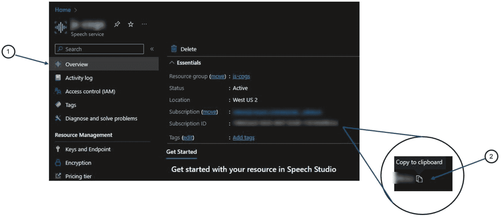
图 3-2 — 从任意 Azure 服务的`Overview`窗格将订阅 ID 复制到剪贴板

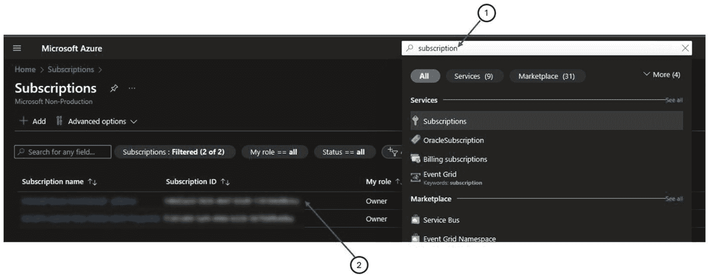
图 3-1 — 订阅名称和订阅 ID

### 为 Azure OpenAI 启用订阅

根据 [Microsoft 负责任的人工智能原则](https://query.prod.cms.rt.microsoft.com/cms/api/am/binary/RE5cmFl?culture=en-us&country=us)^(⁴⁶)，Azure OpenAI 服务被归类为受限访问服务。客户必须证明其 Azure OpenAI 的使用案例已获得 Microsoft 批准。因此，在尝试部署 Azure OpenAI 之前，你需要通过填写[此表单](https://customervoice.microsoft.com/Pages/ResponsePage.aspx?id=v4j5cvGGr0GRqy180BHbR7en2Ais5pxKtso_Pz4b1_xUNTZBNzRKNlVQSFhZMU9aV09EVzYxWFdORCQlQCN0PWcu)来请求访问 Azure OpenAI。你需要提供你的订阅 ID，因为这是表单中的必填字段之一。你可以在同一表单上请求启用最多三个订阅。

如果你的订阅尚未为 Azure OpenAI 启用，在部署期间，你将收到相应通知，如下方图 3-3 所示。

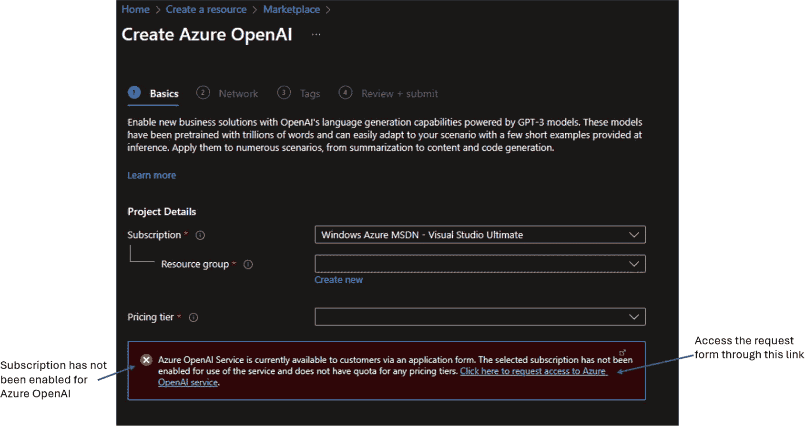
图 3-3 — 订阅未启用 Azure OpenAI 服务

以前批准需要几天时间，你会通过电子邮件收到通知，但最近，Microsoft 在 24 小时内就会批准请求。

你的请求提交后应立即通过电子邮件收到确认，如下方图 3-4 所示。请记下电子邮件中的应用程序 ID，并将其存储在将来可以再次查找的地方。这是因为将来修改订阅的 Azure OpenAI 功能的请求需要你提供此应用程序 ID^(⁴⁷)（例如，将来增加配额的请求）。

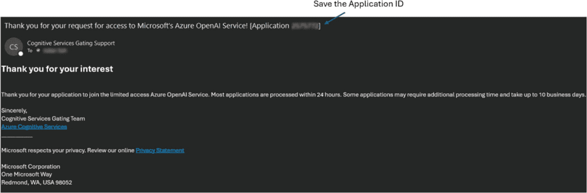
图 3-4 — 确认收到 Azure OpenAI 启用请求的电子邮件

一旦你的申请获得批准，你将收到一封如图 3-5 所示的电子邮件通知。并非所有电子邮件通知都完全相同。你的通知邮件*可能*会提供有关区域或模型限制的额外信息，因此请密切关注邮件中的详细信息。

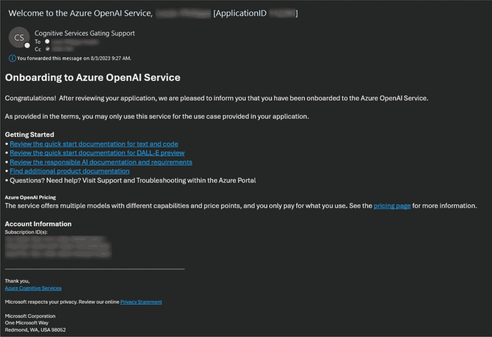
图 3-5 — 通知 Azure OpenAI 已为订阅启用的电子邮件

### 选择区域

既然我们的订阅已为 OpenAI 启用，我们就可以部署服务了。选择在何处部署 Azure OpenAI 服务很重要，因为并非所有模型在所有区域都可用。大多数模型仅在某些区域可用。如果你过去使用 Azure 有经验，你可能下意识地选择在你最近（或你通常选择）的区域部署 Azure OpenAI。但是，该区域可能没有你想要使用的模型。

请访问 [`learn.microsoft.com/zh-cn/azure/ai-services/openai/concepts/models`](https://learn.microsoft.com/zh-cn/azure/ai-services/openai/concepts/models) 了解更多关于模型的信息，并找到包含你想要使用的模型的区域。例如，[GPT-4 (0613)](https://learn.microsoft.com/zh-cn/azure/ai-services/openai/concepts/models#gpt-4-and-gpt-4-turbo-preview-model-availability)^(⁴⁸) 位于澳大利亚东部、加拿大东部、法国中部、瑞典中部、瑞士北部、美国东部、美国东部 2、日本东部和英国南部。请参见下方图 3-6。

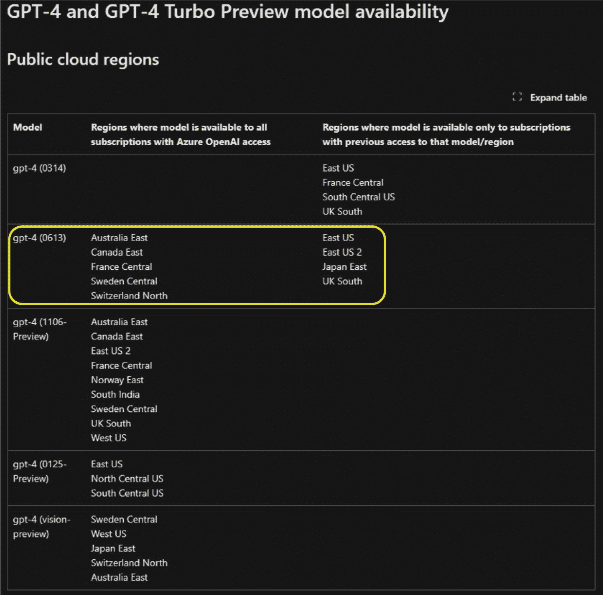
图 3-6 — 提供`gpt-4` (0613) 的区域

#### 动手练习 3-1

在本动手练习中，我们将在美国东部 2 区域部署 Azure OpenAI，然后部署`gpt-4`^(⁴⁹) (16k) 0613 模型。

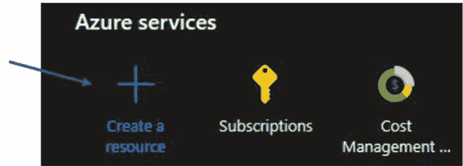
图 3-7 — 在 Azure 门户中创建资源

1. 登录 Azure 门户（商业版 Azure 为 `https://portal.azure.com`）。

2. 在页面顶部，在“Azure 服务”下，点击**创建资源**，如图 3-7 所示。

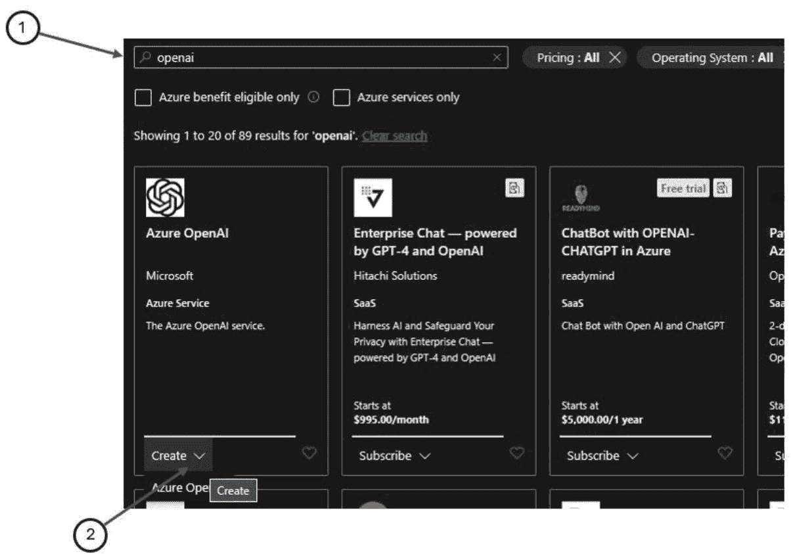
图 3-8 — 搜索并创建 Azure OpenAI 服务

3. 在搜索框中输入“openai”，在结果中找到 Azure OpenAI 服务，点击**创建**，然后在下拉菜单中选择 **Azure OpenAI**，如图 3-8 所示。

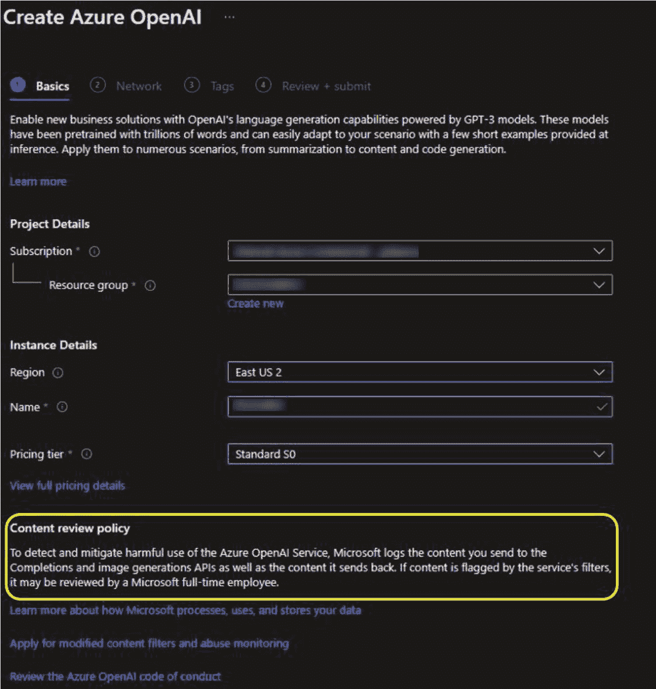
图 3-9 — Azure OpenAI 部署所需的基本信息

4. 如下方图 3-9^(⁵⁰) 所示，选择或创建一个新的**资源组**，区域选择 **美国东部 2**，并为你的 Azure OpenAI 实例指定一个唯一名称。选择 **标准 S0** 作为定价层。请注意**内容审核政策**。我们将在本章后面详细讨论这一点。

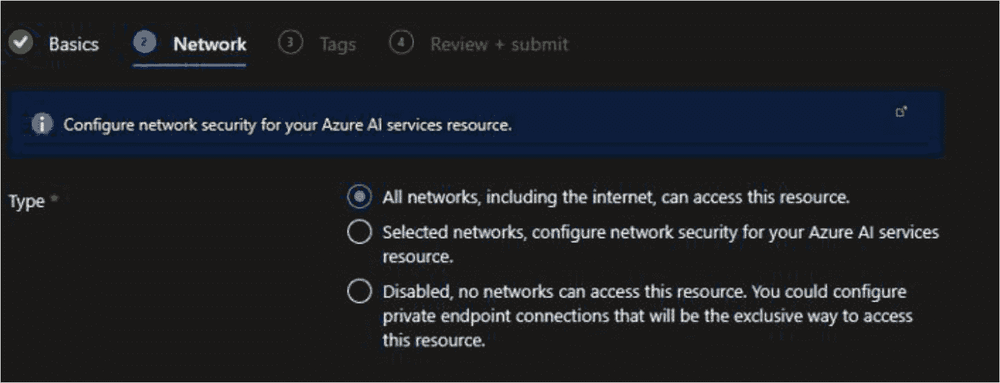
图 3-10 — 定义 Azure OpenAI 的网络访问

5. 点击**下一步**。

6. 在网络部分，选择“所有网络，包括 Internet，都可以访问此资源”，如图 3-10 所示。请注意另外两个可以进一步限制 Azure OpenAI 访问的选项。即使我们当前的选择是部署可通过包括 Internet 在内的所有网络访问，此 Azure OpenAI 实例仍然会通过密钥进行保护，我们稍后将看到这一点。

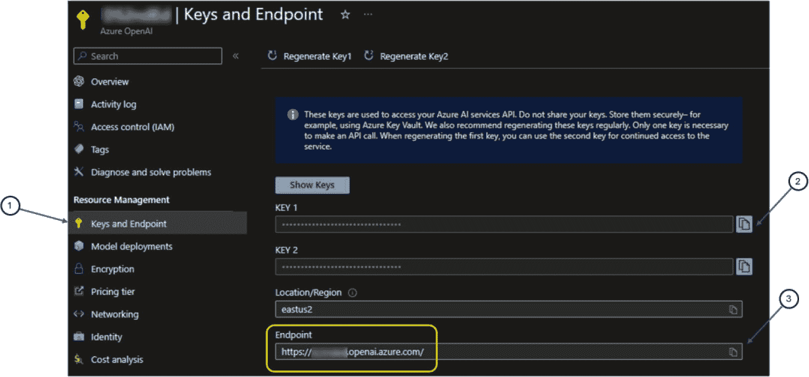
图 3-11 — 从“密钥和终结点”复制**密钥 1** 和**终结点**

7. 点击**下一步**。

8. 在本练习中，我们将跳过标记。点击**下一步**。

9. 在“查看 + 提交”部分，Azure 将验证到目前为止的所有设置，如果验证通过，请点击**创建**。否则，请按照需要修复的错误指示进行操作。

10. 部署你的 Azure OpenAI 服务实例后，转到该服务，在菜单的“资源管理”部分下，选择“密钥和终结点”，如图 3-11 所示。然后复制**密钥 1** 和**终结点**，并将其存放在易于访问的位置（例如，Notepad++^(⁵¹)），因为我们稍后将在练习中用到它。

### 部署模型

现在我们已捕获了 Azure OpenAI 服务终结点详细信息，就可以开始将模型部署到此终结点。此时，该终结点没有任何关联的大语言模型 (LLM)。Azure OpenAI 终结点充当将托管在其上的所有模型的容器。

### 动手练习 3-2  

在本练习中，我们将部署 `GPT-4 (16k) 0613` 模型。

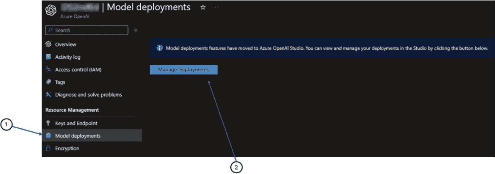
**图 3-12** – 模型部署

### 测试端点和模型

请注意，我们已有 Azure OpenAI 端点，并且至少有一个模型已部署到该端点，我们已准备好测试大语言模型。我们将介绍几种与 LLM 交互的不同方式，在此过程中，我们还将探索其他配置参数。

### 动手练习 3-3：使用 Postman

Azure OpenAI 只是另一个 REST API 端点；我们将使用一种较为流行的 REST 探索工具——Postman（`https://www.postman.com`）。

> **注意：** 在部署模型（动手练习 3-2）后，请至少等待五分钟再开始此练习，因为模型不会立即可用。五分钟后，在进行动手练习 3-3 时，如果你收到如下图所示的错误（图 3-17），并且确定模型已创建且你正在使用当前的部署名称（而非模型名称），那么请稍等片刻再重试。

作为本动手练习的先决条件，如果你尚未安装，请[下载并安装 Postman](https://www.postman.com/downloads/)。我们同时假设你具备 Postman 的基础操作知识，或者会阅读 Postman 的文档以熟悉该工具。这是一个简单但功能强大的工具，所以你不需要花太长时间就能熟练掌握。

1. （可选）在 Postman 中创建一个新集合。
2. 添加一个新请求。
3. 如下图所示（图 3-18），将新请求设置为 `POST` 请求，并在 URL 中拼接你在动手练习 3-1 步骤 10 中复制的 Azure OpenAI 端点以及字符串 `/openai/deployments/gpt-4/chat/completions?api-version=2024-02-15-preview`。请注意，字符串中的 `gpt-4` 是部署名称（如动手练习 3-2 步骤 3 所述）。另请参见示例：`https://myOpenAI.openai.azure.com/openai/deployments/gpt-4/chat/completions?api-version=2024-02-15-preview`。
4. 点击 Postman 中的“标头”选项卡，并添加两个键——`Content-Type` 和 `api-key`——如下图所示（图 3-19）。`Content-Type` 的值为 `application/json`，`api-key` 的值为你在动手练习 3-1 步骤 10 中复制的 Azure OpenAI 端点密钥。
5. 点击“请求体”选项卡，选择“原始”作为输入类型，将以下代码粘贴到请求体中，然后点击保存，如下图所示（图 3-20）。

```json
{
    "messages": [
        {
            "role": "system",
            "content": "You are a helpful assistant"
        },
        {
            "role": "user",
            "content": "Compose a 3-sentence poem"
        }
    ]
}
```

6. 让我们理解基于此请求体我们向 GPT-4 询问了什么：
   - 角色 `system` 表明这是一个系统提示。这是除了任何用户提示之外使用的默认提示，用于补充用户提示。
   - 系统提示中的 `content` 字段提供了一个角色设定，这里仅是对“有帮助的助手”这一角色的描述。
   - 角色 `user` 表明这是一个用户提示。
   - 用户提示的 `content` 是对模型的实际请求，此处要求编写一首三句话的诗歌。
7. 现在点击 `Send`。
8. 检查你收到的 REST 响应。它应该与下图（图 3-21）所示类似。JSON 响应中包含大量有用信息，但以下是需要重点突出的关键内容：
   - 状态码为 `200`，表示请求已被接受并处理（与此相反的是 `429` 响应，表示服务不可用）。
   - 消息内容是 GPT-4 模型的实际响应。
   - 使用情况显示了提示词和补全的令牌数量，这基于我们在第 2 章关于成本的讨论非常有用。
9. （可选）：修改 `System Prompt` 和 `User Prompt`，然后重新提交请求，并观察响应和令牌使用情况。

虽然 `Postman` 是通过 REST API 端点探索 Azure OpenAI 模型的有用工具，但 Azure 本身提供了一个名为 `AI Studio` 的原生用户界面，可以帮助你的项目。我们将在下一节中探索 `AI Studio`。

`AI Studio` 是一个用于实验和原型设计的优秀工具。它还提供了一种将原型发布为应用程序的方法，因此你无需从头开始启动项目。

在撰写本文时，有两个 UI 环境——`AI Studio` 和 `Azure OpenAI Studio`。`AI Studio` 和 `Azure OpenAI Studio` 之间有很多重叠之处，后者存在时间更长，并且在 2023 年底引入 `AI Studio` 之前是唯一可用的 UI。通过介绍 `AI Studio`，你应该也能够导航和使用 `Azure OpenAI Studio`。因此，本书将不涉及 `Azure OpenAI Studio`。

## Azure AI Studio 与 LLM 参数

`Azure AI Studio` 于 2023 年 11 月发布^((57))，可以通过 `Azure Portal` 或访问 `https://ai.azure.com` 进入。在接下来的动手练习中，我们将探索 `AI Studio` 并介绍新的 LLM 术语。**在撰写本文时，Azure AI Studio 处于预览阶段，因此 UI 每周都会发生变化。请查看本书的 GitHub 仓库以获取动手练习的更新。**

请记住，`Azure AI Studio`并非等同于`Azure OpenAI Studio`，相似的名称确实会引起混淆。`Azure AI Studio`是一个基于 Web 的工具，用于所有 AI 工作。它提供对数据集、模型和工具（例如，`Prompt Flow`，稍后将介绍）的访问和管理。通过`Azure AI Studio`提供的模型包括 OpenAI（`GPT`）以及非 OpenAI 模型，如`Mistral`、`Lama`和`Phi-3`。^((58)) `Azure OpenAI Studio`是一个基于 Web 的工具，用于管理和测试 Azure 上可用的仅限 OpenAI 的模型。

`Azure AI Studio`作为实例部署在特定区域，我们将在练习 3-4 中看到。`Azure AI Studio`实例可用的功能也取决于区域。例如，在撰写本文时，微调`Phi-3`小型^((59))语言模型的功能仅适用于部署在`US East 2`区域的`Azure AI Studios`。你可以在一个区域内部署多个`Azure AI Studio`。

将`Azure AI Studio`视为你的生成式 AI 项目的中心^((60))。可以在`AI Studio`实例内管理多个 AI 项目。

### 动手练习 3-4：Azure AI Studio

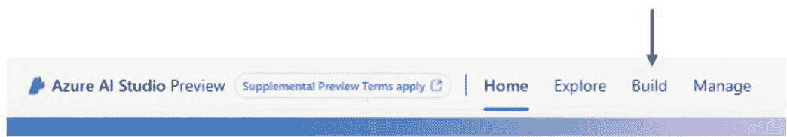
图 3-22 Azure AI Studio 菜单

1. 打开一个新的浏览器，访问[`https://ai.azure.com`](https://ai.azure.com)，点击右上角的`Sign in`并进行身份验证。
2. 如下图所示，点击图 3-22 中的`Build`。
   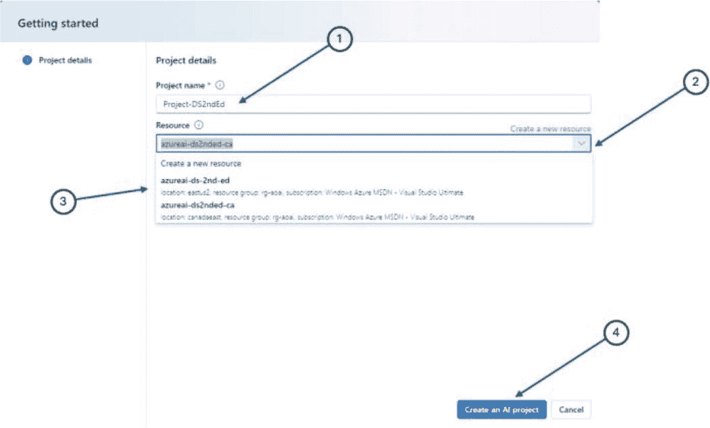
   图 3-23 在 Azure AI Studio 中创建 AI Hub 工作区
3. 点击 ，为项目指定一个名称，并选择我们之前创建的`Azure OpenAI`实例，如图 3-23 所示。然后，点击 。
   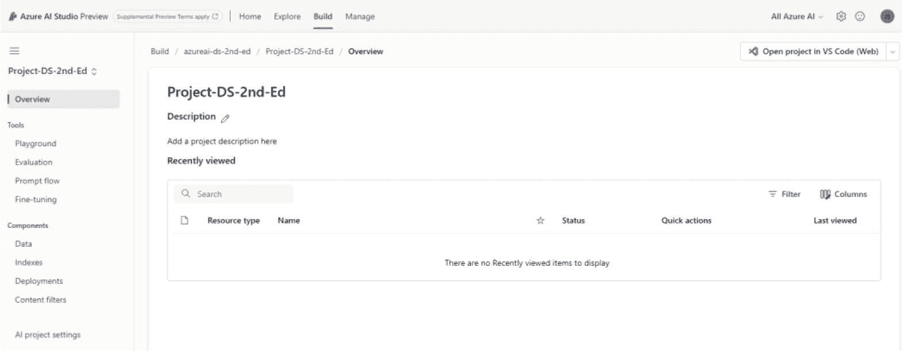
   图 3-24 项目使用的 Azure AI Studio
4. 创建项目后，点击项目名称将其打开，你将进入该项目`Azure AI Studio`的主界面^((61))，如图 3-24 所示。
   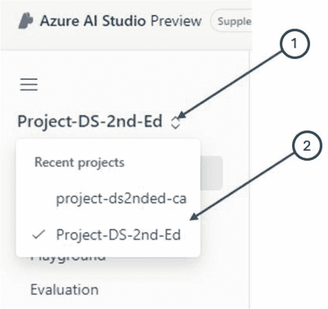
   图 3-25 在 AI Studio 中切换项目
5. 随着时间的推移，当你承担不同的项目时，你可以通过点击项目名称旁边的  图标并选择所需的项目来切换项目，如下图所示，如图 3-25 所示。
   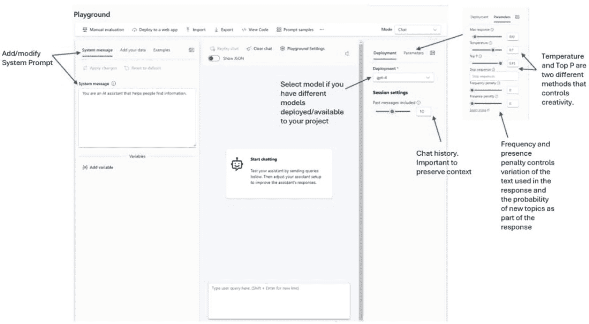
   图 3-26 在 AI Studio 中更改 LLM 的参数
6. 在`Tools`^((62))菜单下，点击`Playground`。如下方图 3-26 所示，`Playground`作为一个用户界面 (UI)，可以快速更改模型参数，例如系统提示词、温度等，然后测试模型的行为。在这里，我们将介绍第 2 章中未涵盖的其他新 LLM 术语。

**表 3-1** 生成的令牌及其对应值

| Token | 概率 |
| --- | --- |
| sandy | 0.4 |
| sunny | 0.2 |
| warm | 0.2 |
| peaceful | 0.15 |
| tranquil | 0.05 |

7. **温度：**^((63)) 此参数是介于 0 和 1 之间的值，控制 LLM 生成响应时的创造力。这种创造力有时被描述为模型的随机性。在构建响应时，它会考虑下一个令牌的概率。作为一个简单的类比，考虑以下句子，并填空：
   *The beach is \_\_\_\_\_.*
   将空白视为下一个令牌。首先想到的词可能是`"sandy"`、`"sunny"`、`"warm"`、`"fun"`等。这些词具有较高的概率分数。
   不太可能的词，尽管并非不正确，可能是`"serene"`、`"tranquil"`等。这些词的概率分数较低。
   接近零的温度值会使 LLM 选择更可能的词。接近一的温度值会导致 LLM 探索概率分数较低的词。

8. **Top-p：**^((64)) `Top-p`参数，有时称为`核采样`，在这种方法中，选择令牌直到它们的累积概率达到或超过由`p`定义的概率值。再次考虑上面的例子，但这次假设 LLM 只有五个词汇表，并且为完成句子而生成的每个令牌的概率如表 3-1 所示。
   令牌按概率从高到低排序。如果`p=0.5`，则`"sandy"`和`"sunny"`将被选中，并且由于`"sunny"`会使累积概率超出`p`的值，因此其余令牌将被丢弃，如下面的表 3-2 所示。

**表 3-2** `p = 0.2` 的累积概率与选择

| Token | Value | Cumulative | Is cumulative > threshold? (Y/N) | Action |
| --- | --- | --- | --- | --- |
| `sandy` | 0.4 | 0.4 | N | Accept |
| `sunny` | 0.2 | 0.6 | Y (just surpassed) | Accept |
| `warm` | 0.2 | 0.8 | NA (not applicable because already surpassed by previous token) | Discard |
| `peaceful` | 0.15 | 0.95 | NA | Discard |
| `tranquil` | 0.05 | 1.0 | NA | Discard |

由于有两个可能的 token，它们的概率将被归一化，然后应用一种称为二项式^(⁶⁵)分布的采样方法，从中选择一个用于响应中。

如果存在两个以上的可能 token，例如，如下表 3-3 所示，当 `p=0.8` 且有三个可能 token 时，将使用多项^(⁶⁶)分布来采样 token，以便选择一个。

**表 3-3** `p = 0.8` 的累积概率与选择

| Token | Value | Cumulative | Is cumulative > threshold? (Y/N) | Action |
| --- | --- | --- | --- | --- |
| `sandy` | 0.4 | 0.4 | N | Accept |
| `sunny` | 0.2 | 0.6 | N | Accept |
| `warm` | 0.2 | 0.8 | N | Accept |
| `peaceful` | 0.15 | 0.95 | Y | Discard |
| `tranquil` | 0.05 | 1.0 | NA | Discard |

9. **Top-k:** `Top-k`是`Top-p`的一种替代方案，但 OpenAI 未使用；因此，您在 AI Studio 中看不到该参数可以配置。但为了完整性，我们将简要讨论这个概念。`Top-k`简单地选择概率最高的前 `k` 个 token，例如，如果 `k=3`，则将选择前 3 个 token – `sandy`、`sunny` 和 `warm`。选择之后，将像`Top-p`中一样应用二项式或多项分布采样。

10. **频率惩罚 (Frequency Penalty):** 此参数会惩罚已用于生成响应的 token。这降低了文本中单词被重复的可能性。每次使用该单词时，它都会按比例受到惩罚，以最大限度地减少重复使用。此参数的值为 0 到 2 之间，数值越大，对每次重复使用单词的惩罚就越重。

11. **存在惩罚 (Presence Penalty):** 此参数在 token 首次用于响应时对其施加一次性惩罚。它是在频率惩罚之上的附加惩罚，其值也在 0 到 2 之间。

在下一个动手练习中，我们将修改这些参数，并观察这对 LLM 响应的影响。在此之前，需要了解几点：通常 `Temperature` 比 `Top-p` 更常用，并且在大多数情况下，除非需要控制响应中文本的使用频率，否则您可能不需要修改频率惩罚和存在惩罚的值。

对于 `Temperature` 设置，经验法则是：如果期望的响应不是确定性的（基于事实的），则应使用接近 0 的值。如果期望的响应更具创造性，则应使用接近 1 的值。

### 动手练习 3-5：探索 LLM 参数与行为

# 动手练习：通过 AI Studio 与 LLM 对话

在此动手练习中，我们将继续上一个练习，通过 AI Studio 与 LLM 进行对话。然后，我们将修改上面讨论过的参数，并观察响应是否有变化。

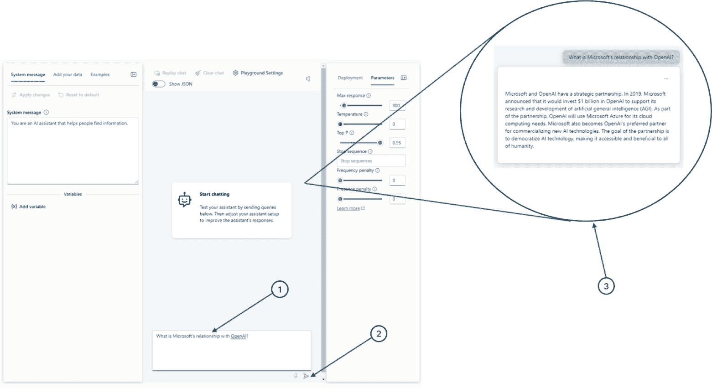
*图 3-27 通过 AI Studio 与 LLM 对话*

1.  在 AI Studio 中，暂时不要更改任何参数，只需开始与 LLM 对话，如下方图 3-27 所示。请随意在此对话中使用您自己的问题或主题。
2.  记下所有参数的默认值，因为我们将对它们逐一进行更改。但在撰写本文时，由于没有将参数重置为默认值的选项，因此在测试完一个参数并准备移至下一个参数时，我们需要手动将参数值改回默认值。
3.  更改 `Temperature`，每次更改 `Temperature` 后，点击中间面板顶部的``。
    1.  将 `Temperature`（或当前正在测试的参数）的值改回默认值，并针对以下参数重复步骤 3：
        1.  `Top-p`
        2.  频率惩罚
        3.  存在惩罚
4.  您观察到每个参数有什么影响？

AI Studio 还有其他功能，我们将在后面的章节中介绍。

## 总结

在本章中，我们学习了如何部署 Azure OpenAI，以及如何通过 Postman 与 LLM 模型进行交互。我们还了解了 AI Studio，这是一个原生 UI，我们可以使用它来交互、实验和原型化我们的 LLM 解决方案。在探索 AI Studio 的过程中，我们介绍了可用于配置 LLM 行为的参数。

在下一章中，我们将继续探索 OpenAI LLM，并通过将 LLM 与数据结合来开始原型化解决方案，并引入检索增强生成架构，这是一种旨在处理大型数据源并使其易于被 LLM 使用的设计方法。

脚注 1 2 3 4 5 6 7 8 9 10 11 12 13 14 15 16 17 18 19 20 21 22 23 24