# 4. 设计生成式 AI 解决方案

## 引言

在本章中，我们将重点探讨设计生成式人工智能（GenAI）解决方案的各种方法。随着技术的不断演进，遗传学与人工智能的融合为从医疗健康到农业等众多领域开辟了突破性创新的道路。这两大领域的结合催生了所谓的“GenAI 解决方案”。设计 GenAI 解决方案，需要利用人工智能算法和机器学习技术的能力，通过分析、修改或在不同的情境中应用遗传信息，以达到分析、解读和操作遗传信息的目的。

设计生成式人工智能解决方案涉及多种方法，每种方法都适用于不同的应用场景和目标。以下是利用不同架构、模型和技术来设计 GenAI 解决方案的多种方式，用于生成文本、图像、音乐或任何需要一定创造力或类人理解能力的内容。

1. **序列到序列模型：** 序列到序列模型将一个输入序列（例如，一个英文句子）转换为一个输出序列（例如，翻译成法语的同一个句子）。这类模型通常采用编码器-解码器架构，其中编码器处理输入序列，解码器生成输出序列。

    **用例：** 机器翻译、摘要、问答

2. **Transformer 模型：** Transformer 模型，如 `GPT`（生成式预训练 Transformer）和 `BERT`（来自 Transformer 的双向编码器表示），依赖注意力机制来权衡输入数据中不同词的影响。例如，`GPT` 能够根据提示生成连贯且上下文相关的文本段落。这些是跨不同行业和应用中最常用的模型，尤其在聊天机器人中促成了颠覆性的类人交互。

    **用例：** 文本生成、语言理解、对话代理

3. **变分自编码器：** 变分自编码器是生成模型，它学习将输入数据编码到一个压缩的潜在空间，然后从这个空间解码以重建输入数据。通过在潜在空间中采样不同的点，变分自编码器可以生成与训练数据具有相同特征的新数据点（例如，图像）。

    **用例：** 图像生成

4. **生成对抗网络：** 生成对抗网络包含两个模型：一个生成图像的生成器和一个试图区分真实图像和生成图像的判别器。通过训练，生成器学会生成更逼真的图像来“欺骗”判别器，从而实现高质量的图像生成。这类模型能产生高质量、逼真的输出，使其更适合于视觉内容生成。

    **用例：** 照片级逼真图像生成、艺术创作

5. **检索增强生成：** RAG 结合了一个检索组件（从数据集中获取相关信息）和一个生成模型（利用这些信息生成响应）。这种方法能够生成不仅连贯，而且基于真实世界数据的有信息量的内容。

    **用例：** 基于知识的问答、具有事实依据的内容创作

6. **基于人类反馈的强化学习：** RLHF 涉及使用强化学习来训练模型，其中奖励信号来自人类反馈。这允许对生成模型进行微调，使其与人类偏好、伦理考虑或特定任务要求保持一致。

    **用例：** 为特定任务或伦理准则微调语言模型

本章重点介绍理解检索增强生成（RAG）方法，这是一种常用的创新方法，用于创建能够基于从大型数据集中检索到的海量信息生成类人文本的人工智能系统。让我们了解概念，以及采用 RAG 方法构建 GenAI 解决方案需要哪些要素。

## 检索增强生成

检索增强生成（RAG）是一个概念，它结合了自然语言处理中两个关键组件的优势：检索和生成。

在传统的自然语言处理任务（如问答或文本生成）中，模型（例如 `GPT` 这样的语言模型）被用于生成响应。虽然这些模型拥有大量的预存知识，但在融入输入中未明确提供的新信息或上下文时，它们可能会遇到困难。

另一方面，基于检索的方法擅长访问和利用来自数据集或知识库的大量信息。它们能够根据给定的查询或提示高效地检索相关信息。

RAG 通过将检索组件与语言生成组件集成在一起，结合了这两种方法。其典型工作流程如下：

1. **检索：** 检索组件在数据集或知识库中进行搜索，以找到基于给定提示或查询的相关信息。这些检索到的信息作为生成响应的额外上下文。

2. **生成：** 语言生成组件（通常是像 `GPT` 这样的大型预训练语言模型）将原始提示和检索到的信息一起作为输入。然后，它基于这个组合上下文生成响应。

通过利用检索和生成两者的优势，RAG 模型相较于单独的传统生成模型，有可能产生更准确、信息更丰富且上下文更相关的响应。在需要访问大量外部信息才能生成高质量响应的场景中，例如问答、摘要和对话系统（如图 4-1 所示），它们尤其有效。

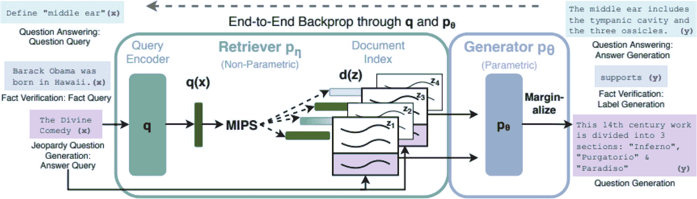

图 4-1：将预训练的检索器（查询编码器 + 文档索引）与预训练的序列到序列模型（生成器）相结合，并进行端到端微调。来源：[`https://arxiv.org/pdf/2005.11401.pdf`](https://arxiv.org/pdf/2005.11401.pdf)

## RAG 是如何工作的？

RAG（检索增强生成模型）的工作基于一个相对简单的概念。首先，数据集中的所有文本片段会通过特定模型转换成向量。随后，使用同一个模型对用户的查询进行编码。这一操作类似于谷歌搜索，它能根据你的问题，从数据集中识别并检索出最相似的文本片段。理想情况下，检索到的文本要么直接包含答案，要么极大地有助于构建答案，从而使大语言模型（`LLM`）能够清晰地表述出回应。图 4-2 展示了新的问题如何与聊天历史结合，形成上下文相关的查询，并从向量存储中检索信息。

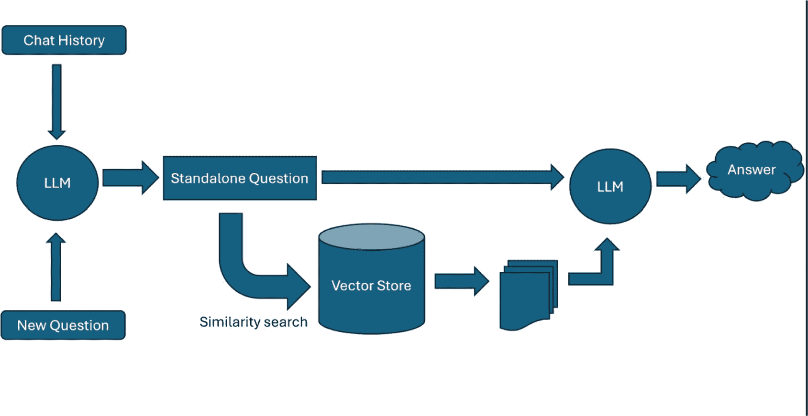

图 4-2 检索增强生成流程

让我们逐步了解一个由生成式 AI 驱动的聊天机器人如何利用 RAG 来响应用户的查询：

1. **用户查询输入：** 用户在聊天机器人界面提出问题，从简单的天气询问到需要详细解释的复杂查询，不一而足。

2. **查询理解：** 聊天机器人运用自然语言处理（`NLP`）技术，解读并理解用户的问题，辨别其意图和相关上下文。

3. **信息检索：** 利用自身的检索能力，聊天机器人搜索庞大的数据库或互联网，以找到与用户问题相关的信息。在此，RAG 扩展了聊天机器人超出其初始训练数据的知识范围，使其能够获取原本无法获得的当前或特定信息。搭建检索系统是 RAG 的核心组成部分，可以通过多种方法构建，包括 Azure AI Search、`Elasticsearch`、`FAISS`（脸书 AI 相似度搜索），或针对较小数据集使用更简单的倒排索引方法。关键在于有效地索引你的数据集，以便检索系统能够基于查询快速准确地找到相关信息。我们将在本章中详细探讨这一点。

4. **相关性评估：** 聊天机器人评估检索到的信息的相关性，运用算法根据准确性、时效性以及与用户查询上下文的一致性等因素对其进行排序。

5. **回答生成：** 基于检索到的相关信息，RAG 系统的生成组件开始发挥作用。聊天机器人利用神经语言模型，将检索到的数据合成为一个连贯且符合上下文的回答。它融合了检索信息的精华、自身现有知识以及查询的特定细节，从而生成一个答案。

6. **回答优化：** 在呈现回答之前，聊天机器人可能会对回答进行优化，使其更加清晰、简洁和相关，确保其包含以用户友好方式呈现的准确信息。

7. **答案交付：** 聊天机器人将生成的回答交付给用户，力求其信息丰富、上下文相关，并直接回应用户的查询——这些特性得益于 RAG 整合与综合相关外部信息的能力。

8. **反馈循环：** 在更先进的系统中，聊天机器人会将用户的反应——例如追问、感谢或纠正——作为反馈加以利用，从而随时间推移提升其性能。

这一从问题到答案的连续过程，凸显了 RAG 系统中检索机制与生成式 AI 协同合作的强大能力。它赋能聊天机器人等工具，使其能够提供更精确、信息更丰富、更具上下文感知能力的回答，标志着从早期较简单的语言模型的重大进步。

### 信息检索系统

信息检索系统（`IRS`）旨在组织、处理并提供对各种形式与格式的海量信息的访问。这些系统使得用户能够找到满足其特定需求的信息——包括文本、图形、音频和视频。“信息检索”这一术语于 1952 年提出，自那时起，尤其是随着计算机和互联网的出现，它已发生了显著演变，不仅涵盖书目信息检索，还拓展至全文、多媒体和基于网络的信息检索。

**信息检索为何重要？**

如今，我们每时每刻都在生成海量数据。然而，如果我们没有一种方法来搜索并从这些数据中找到所需信息，这些数据的作用就不大。搜索引擎和其他信息查找工具对于理解所有这些数据至关重要。没有像谷歌这样的工具，从互联网上获取任何信息都将极其困难。

文本查找与索引系统在数据库中组织信息，以便人们可以搜索它。这些系统让人们能够访问在线信息，而这些信息他们可能甚至不知道其存在。通过执行搜索，用户可以浏览所有已被组织好并可搜索的信息，如图 4-3 所示。

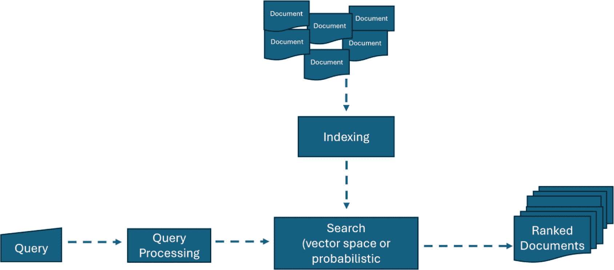

图 4-3 信息检索系统组件

让我们通过一个例子来理解信息检索系统的主要组成部分。以下是 `IRS` 的核心组件：

- **文档集合：** 这是系统可以搜索以查找信息的文档池。

    **示例：** 想象一个包含数千本电子书的数字图书馆，内容涵盖文学、科学、历史等各个学科。这个图书馆充当检索系统的文档集合，允许用户跨广泛的主题搜索信息。

- **索引组件：** 该部分处理源文档和数据，以创建一个组织化的索引。该索引利用一种专门设计的高效结构，将词汇和信息链接到它们出现的文档。

**示例：** 为了提高搜索效率，系统会处理数字图书馆中的所有电子书并创建一个索引。如果某本电子书包含术语“量子力学”，那么该电子书的详细信息（如标题和位置）就会在索引中与该术语关联起来。这类似于教科书末尾的索引，它会告诉你特定主题在哪些页面上被讨论，但功能要复杂得多，能够处理复杂的查询。

- **查询处理器：** 该组件接收用户的搜索词和问题，对其进行分析，并准备将之与索引中的信息进行匹配。

**示例：** 当用户搜索“量子力学原理”时，查询处理器会分析此查询。它会理解用户对量子力学的基本概念感兴趣。通过可能将短语分解为可搜索的关键词，如“量子”、“力学”和“原理”，并判断哪些词对于找到相关文档最为重要，来准备搜索词。

- **排序算法：** 一个评估每个文档与用户搜索查询相关程度并为其分配分数的系统。一个著名的例子是 `BM25` 排序算法。该算法会调整文档中搜索词频率的计分方式，以防止文本被相同的单词或短语过度填充。

**示例：** 假设系统找到了 100 本提及“量子力学”的电子书。排序算法随后评估每本电子书与量子力学原理的相关程度。它会考虑“量子力学”和“原理”在每本电子书中出现的频率，以及它们出现的上下文环境。一本专门论述该主题的电子书，其排名可能高于一本仅用简短章节介绍量子力学的普通理科教材。`BM25` 算法会根据这些因素调整分数，以避免仅仅因为文档多次提及“量子力学”就给予其过高的权重。

- **用户界面（`UI`）：** 这是用户与系统交互的部分。通过用户界面，用户可以输入搜索内容并查看结果。用户界面还允许根据结果对用户需求的有效性进行调整。有时，可能会提供一项功能，让用户反馈他们发现信息的有用程度，这有助于改进系统以供未来搜索使用。

**示例：** 数字图书馆有一个搜索页面，用户可以在其中输入查询。在搜索“量子力学原理”后，页面会显示按相关性排序的电子书列表。列表中的每个条目都包含电子书的标题、带有高亮搜索词的简短摘录，以及打开或下载电子书的链接。此外，可能还有按日期、作者或学科领域优化搜索的选项。在查看结果后，用户可能有机会指出哪些电子书最有帮助，从而提供有价值的反馈以改进未来的搜索结果。

现在我们已经详细了解了信息检索系统，学习生成式 AI 如何丰富这些系统至关重要。先进的机器学习方法正在显著改善我们查找信息的方式，其通过从用户与系统的交互中学习，并适应上下文、位置和个人偏好的变化。在理解自然语言和分析文本含义方面的增强能力，使得系统对用户提出的问题以及文档内容都有了更深刻的理解。此外，这些系统在管理不断产生的大量多媒体内容方面也变得更加出色。

将生成式 AI 引入信息检索从根本上改变了游戏规则。我们不再需要像过去那样面对一个排序后的结果列表（这通常要求用户自己翻阅链接和文档来寻找所需答案），现在可以直接获得对查询的解答。这些系统能够在对多个复杂问题的对话中保持上下文连贯，使交互更加自然流畅。这意味着解释人类语言和理解意图的挑战将大大减少。搜索引擎已经发展到可以为我们整理信息，生成符合我们确切需求的、量身定制的特定内容，从而消除无关信息的干扰。

生成式 AI 的引入以及大型语言模型（`LLMs`）的快速扩张，为向量数据库技术的成长和发展提供了理想环境。向量数据库通过向量嵌入来管理和操作数据。这些嵌入将文本、文档、图像、音频等多种数据类型转换为数值形式或向量表示，从而封装了数据实体之间的本质和相互联系。向量表示使机器能够以促进分析和决策的方式理解和处理数据。这种方法对于机器学习应用非常有利，因为数据库会根据每个数据项与其他数据项的相关性来组织数据。这种空间存储方式有助于检索语义上相关的数据，并且对像 `OpenAI` 的 `GPT-4` 这样的大型语言模型（`LLMs`）特别有利，它使得 AI 聊天机器人能够通过审视过往的相似对话，更有效地把握对话的上下文。

带有向量表示的信息检索系统流程如图 4-4 所示。

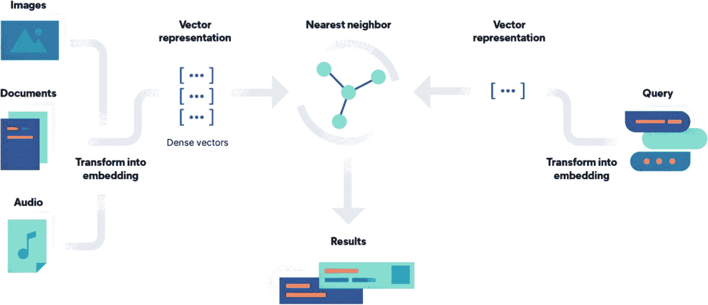

**图 4-4**

带有向量表示的信息检索系统。来源：[*https://medium.com/@ma-korotkov/a-gentle-introduction-to-vector-search-dc6e54e34907*](https://medium.com/@ma-korotkov/a-gentle-introduction-to-vector-search-dc6e54e34907)

## 搜索引擎：从关键词搜索到语义搜索

让我们退一步，理解最基本的搜索类型——**关键词搜索**。

基于关键词的搜索利用 `Apache Lucene` 进行索引和查询，并采用 `BM25` 排名算法对结果进行评分。它的工作方式是将单词或短语输入搜索引擎，然后搜索引擎在互联网上搜索包含这些特定关键词的页面。本质上，它是通过匹配你查询中的关键词与数据库中的关键词，并返回相应结果来运作的。这可以进一步分为“关键词”和“搜索查询”——在日常对话中，这两个词常被混用，但它们实际上存在显著差异，这种差异在最新的搜索技术中扮演着重要角色。

关键词可以被视为搜索查询的概念精髓，代表了从各种搜索输入中抽象出来的版本。

另一方面，搜索查询或搜索词是个人在搜索引擎的搜索框中输入的特定单词或单词序列。它是关键词的具体体现，尽管可能包含拼写错误、多余或混乱的单词，或者可能与关键词本身完全一致，如图 4-5 所示。

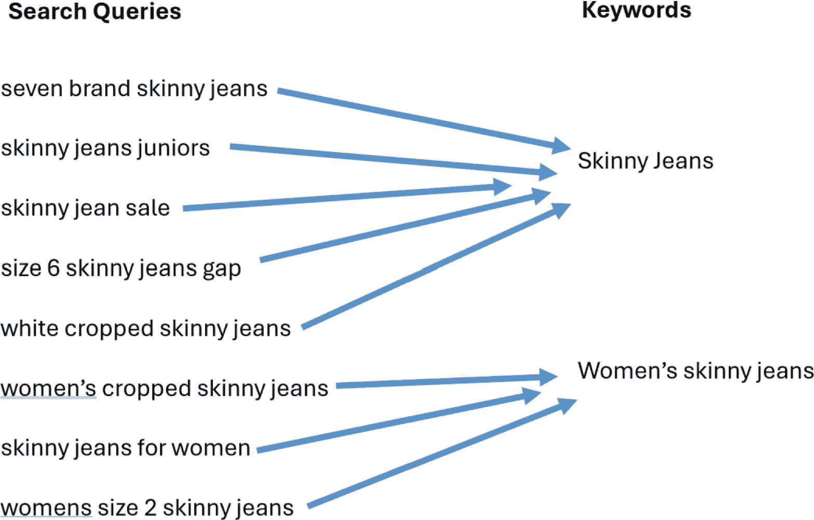

图 4-5

基于关键词的搜索

### 关键词搜索的局限性

1. **匹配范围有限：** 这种搜索天生受限于其对精确匹配查询的依赖。其主要功能是判断查询是否与大型数据集中的特定文本相匹配。更先进的搜索引擎试图通过采用词形还原和词干提取等技术来克服这一限制，这些技术允许将单词的变体（如“send”、“sent”和“sending”）识别为等价词。然而，当查询使用不同的术语来描述语料库（被搜索的文档集合）中未直接反映的概念时，搜索可能会失败，导致用户不满。本质上，这种搜索引擎缺乏对语料库内容的真正理解。

2. **处理对话式查询效率低下：** 随着语音搜索和自然语言处理的日益普及，用户在搜索查询中越来越多地使用对话式语言。传统的搜索技术通常无法准确理解这类查询，这可能导致用户感到沮丧并停止使用。

3. **缺乏个性化：** 这是传统基于关键词的搜索系统的一个显著缺点，因为这种通用方法忽略了每个用户独特的偏好和习惯。此类系统几乎不提供或根本不提供个性化服务，因为它们无法根据用户交互进行调整。

使用默认 `BM25` 排名的查询示例如下，它依赖于词频和邻近度。对于查询“什么酒店有现场美食餐厅”，`BM25` 算法匹配结果的顺序如下方截图所示（图 4-6）。

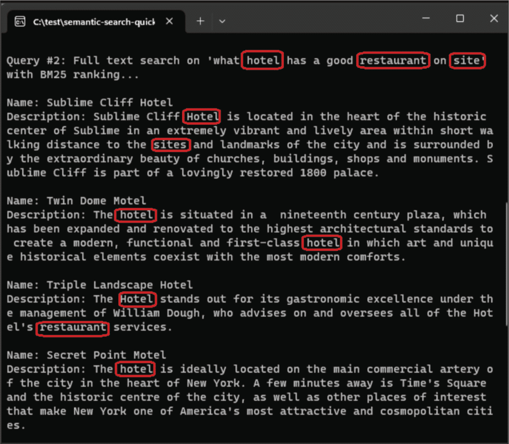

图 4-6

关键词搜索 `BM25` 酒店示例

然而，一种更先进的替代方案，即“语义搜索”，通过利用人工智能解决了这些局限性。这种搜索引擎不仅仅处理你输入的精确词语。相反，它会理解你查询的意图和重要性，捕捉概念并将你的搜索放入上下文中。这种方法产生的结果比传统基于关键词的搜索提供的结果要相关得多。

## 语义搜索

语义搜索利用人工智能（AI）和自然语言处理（NLP）来解释和回答搜索查询，使其更符合自然、上下文的人类交流方式。AI 驱动着系统学习和演进的能力，而 NLP 则促进了类似人类语言的理解和生成。AI 搜索不仅仅是匹配关键词，而是旨在理解你查询的含义和上下文，以便更准确地确定你的意图。

例如，当你搜索“苹果股票价格”时，AI 搜索引擎很可能会解读为你想要科技公司苹果的股价，而不是这种水果的价格。之所以能实现这种解读，是因为 AI 分析海量数据集以理解词语和短语之间的语义联系。要理解语义搜索如何运作，探索更广泛的语义学领域是有帮助的，语义学是对语言意义的研究。语义学考虑各种因素，包括

1. **词义：** 这涉及理解单个词语的定义。例如，“bank”一词可以指河岸或金融机构。其含义由使用的上下文决定。

2. **句子含义与结构：** 这侧重于词语如何组合形成句子并传达特定含义。句子结构（句法）在此起着关键作用。例如，“猫追老鼠”与“老鼠追猫”含义不同，尽管包含相同的词语。

3. **上下文：** 上下文涉及使用某个词或句子时周围的文本或情境。它有助于确定预期的含义。例如，“bark”一词可以指狗叫声或树的外层，具体取决于上下文。

4. **词语间的关系：** 这考察词语之间如何相互关联，例如通过关联、层级或依存关系。例如，在句子“男孩踢了球”中，“男孩”是主语，“球”是宾语，“踢了”描述动作。

5. **同义词：** 这些是含义相似或相同的不同词语。识别同义词有助于理解“happy”和“joyful”通常可以互换使用，从而丰富理解和搜索能力。

6. **文化习语：** 习语是其含义不能从单个词语推断出来的短语。例如，“kick the bucket”意思是“去世”，理解此类习语需要超越字面词义的文化知识。

通过考虑所有这些方面，语义搜索引擎能够根据用户的意图和语言的细微差别提供更准确、更相关的结果。

以同样的语义排名查询示例（“什么酒店有现场美食餐厅”）为例，结果会根据其语义相关性重新排序。这一次，排名第一的结果是一家带餐厅的酒店，更符合用户的期望。图 4-7 是语义搜索响应的截图。

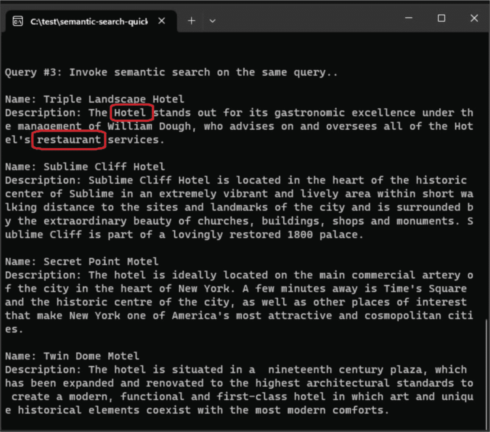

图 4-7

语义搜索酒店示例

## 语义搜索引擎的工作原理

语义搜索引擎利用一系列统称为自然语言处理（`NLP`）和机器学习（`ML`）的先进技术。

### 1. 向量搜索

语义搜索的核心是向量搜索，它将文本转换为数值向量。通过使用`K-近邻（KNN）`算法，它能够匹配代表与查询内容相似的向量。这种方法能根据上下文和意图，提升相关内容的排序与呈现效果。

### 2. 实体识别

实体识别是指识别并分类查询中的关键组成部分，例如人物、地点、组织、产品和日期。这有助于语义搜索引擎理解查询的具体主题，从而得出更精确的结果。例如，它能够区分公司`苹果`和水果苹果。

### 3. 上下文理解

上下文理解涉及通过分析所使用的词语、搜索历史和趋势，来解读查询背后的含义和意图。这有助于语义搜索引擎消除歧义，提高搜索结果的准确性。

### 自然语言处理（`NLP`）

语义搜索引擎利用`NLP`来理解人类撰写查询的自然方式，这些查询可能是对话式的或复杂的。`NLP`能够分解句子、解读语言并生成相关的响应。

### 4. 知识图谱

知识图谱是一种数据库，它利用相互连接的实体及其关系网络来理解和组织信息。通过以图谱形式呈现现实世界的实体及其联系，这些图谱帮助语义搜索引擎理解查询中提及的实体之间的关系。这能产生更细致的搜索结果，反映现实世界中的概念关联。例如，通过检查实体连接，知识图谱可以帮助搜索引擎理解“巴拉克·奥巴马”与“美国总统”及“米歇尔·奥巴马”有关联。

在下方的知识图谱中，您可以检查节点与实体的关系，并回答如下问题（下文图 4-8 展示了该知识图谱）。

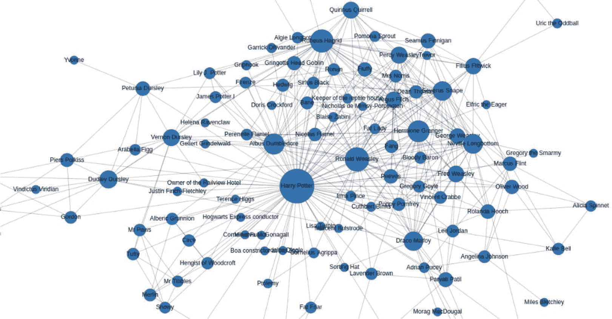

图 4-8 – 《哈利·波特》书籍转化为的知识图谱。来源：[https://neo4j.com/developer-blog/turn-a-harry-potter-book-into-a-knowledge-graph/](https://neo4j.com/developer-blog/turn-a-harry-potter-book-into-a-knowledge-graph/)

> **问：** 哈利·波特在霍格沃茨的朋友有哪些？
>
> **答：** 赫敏·格兰杰和罗恩·韦斯莱。两人都是哈利·波特的朋友，并就读于霍格沃茨魔法学校。

### 5. 机器学习

机器学习是人工智能的一个子集，它允许系统从数据中学习、识别模式并在最少人类干预下做出决策。在语义搜索的语境中，机器学习算法通过分析用户的搜索、交互和反馈，不仅能确定用户想要什么，还能持续提升搜索结果的相关性。通过从过去的用户搜索中学习，语义搜索引擎能更好地预测用户意图，即使查询含糊或不完整。

语义搜索在生成式 AI 中至关重要，因为它超越了单纯的信息检索，能够生成与用户意图和上下文相符的内容。例如，如果用户想根据特定主题创作一个故事，AI 必须在语义上理解该主题，才能生成相关且连贯的叙述。语义搜索真正引领着我们与信息交互方式的范式转变，从基于关键词的检索，转向与数据之间更细致、以意图为导向的对话。生成式 AI 模型（如 OpenAI 的`GPT`系列）的进步，显著增强了语义理解能力，使用户与 AI 之间的交互更加自然且具有上下文相关性。

图 4-9 是对集成了`LLM`的语义搜索过程的分步解释。

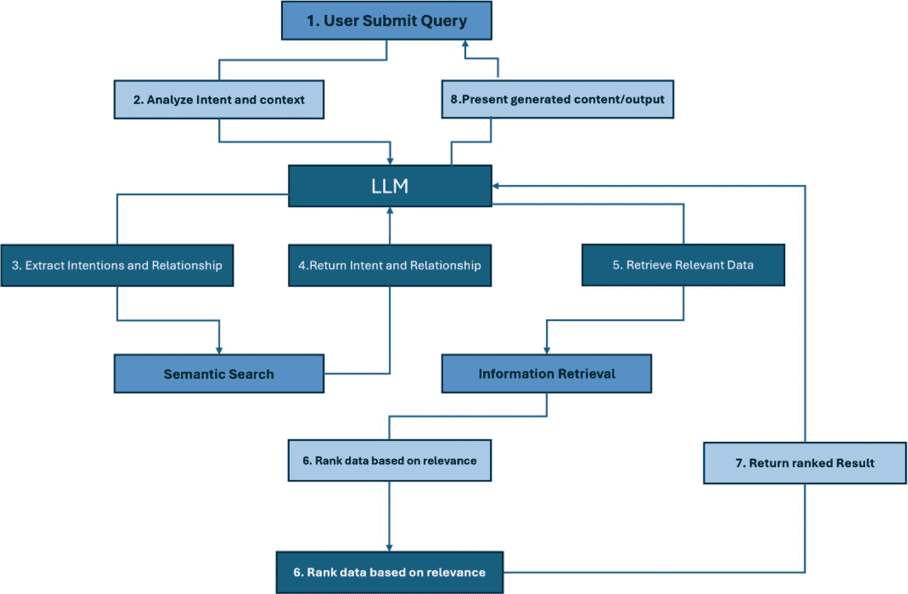

图 4-9 – 带有`LLM`的语义搜索检索系统

## 分步过程

### 1. 用户提交查询

流程始于用户在系统中输入搜索查询。

**示例：** 用户在搜索栏中输入“纽约最好的意大利餐厅”。

**目标：** 捕捉用户的信息需求并启动搜索过程。

### 2. 分析意图与上下文

大语言模型（`LLM`）分析查询，以理解用户的意图以及查询背后的上下文。

**示例：** `LLM`识别出用户正在寻找位于纽约的意大利餐厅推荐。

**目标：** 解读词语背后的含义，考虑用户历史、位置和查询结构等因素。

### 3. 提取意图与关系

语义搜索系统处理查询，以确定各个词语之间的关系以及整体含义。

**示例：** 系统识别出“意大利餐厅”是一种餐饮场所，“纽约”是一个地点。

**目标：** 识别查询中的关键实体及其关系，确保更深入地理解用户请求。

### 4. 返回意图与关系

提取出的意图和关系被发送回`LLM`。

**示例：** 系统发送数据，表明用户对特定地理区域（纽约）的餐饮场所（意大利餐厅）感兴趣。

**目标：** 为`LLM`提供反映用户真实意图的结构化信息。

### 5. 检索相关数据

`LLM`利用已理解的意图来检索与查询相关的数据。

**示例：** `LLM`查询数据库或外部来源，以获取纽约意大利餐厅的信息。

**目标：** 收集一组与用户搜索意图相符的潜在匹配项。

### 6. 基于相关性排序数据

排序算法评估从向量数据库中检索到的数据，并根据其与查询的相关性进行排序。

**示例：** 算法根据用户评论、评分、距离和人气等因素对餐厅进行排序。

**目标：** 优先展示最相关、质量最高的结果，使其最佳匹配用户查询。

### 7. 返回排序结果

排序后的结果随后被发送回`LLM`。

**示例：** 系统编译一份按相关性排序的纽约顶级意大利餐厅列表。

**目标：** 准备最终的搜索结果集，以便呈现给用户。

### 8. 呈现生成的内容/输出

最后，`LLM`将生成的内容或搜索结果呈现给用户，完成语义搜索过程。

**示例：** 用户看到一份推荐的纽约意大利餐厅列表，包含评论、评分和其他相关详细信息。

**目标：** 提供一组用户友好、信息丰富的搜索结果，满足用户需求。

---

## 挑战与最佳实践

尽管语义搜索在信息检索领域取得了显著进展，但它并非没有挑战。其结果质量取决于查询的清晰度。用户在搜索请求中提供的细节越多，获得准确结果的可能性就越高。例如，如果用户仅搜索“纽约”，很难确定其具体意图。他们是计划旅行、寻找附近的餐厅，还是想看一场音乐剧？然而，通过输入更具体的查询，如“纽约音乐剧门票”，搜索引擎就能提供更具相关性和针对性的信息。

# 探索向量搜索

本质上，复杂或模糊的查询有时会导致误解或不完整的结果。克服这些障碍需要不断优化算法以确保最佳性能。总体而言，语义搜索通过将语言理解与现实世界知识相结合，为用户提供了更直观、更个性化的搜索体验。这种融合，借助向量搜索中机器学习的进步，使得搜索引擎甚至在我们表达需求之前就能预测我们的意图，为构建更高效、更具主动性的搜索引擎铺平了道路。

探索向量搜索领域，会发现一幅以机器学习原理为主导的迷人图景。其核心在于，向量搜索利用先进的算法将原始数据转换为称为向量的有意义的表示形式。这些向量充当多维坐标，捕捉信息的本质，并促进对数据集中上下文和关系的更深入理解。机器学习在其中扮演着至关重要的角色，为信息的智能检索提供动力。通过在大规模数据集上训练模型，机器学会了将复杂概念编码成紧凑的向量格式。这些向量捕捉了语义含义和关系，使算法能够高效且精确地穿梭于海量信息之中。下图 4-10 是词嵌入的一个示例。

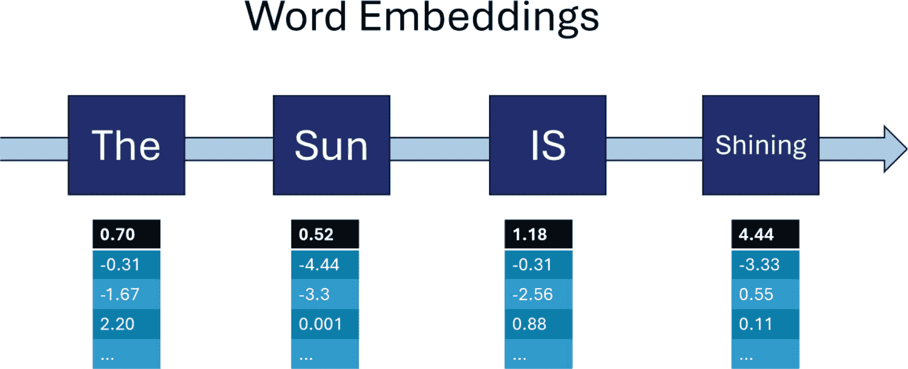

向量搜索代表了相对于传统搜索引擎的一次重大进步，后者主要依赖于文本中的关键词匹配。传统的搜索引擎会通过各种步骤对文本进行预处理，例如规范化术语、扩展查询以及使用同义词列表，以更好地将搜索意图与内容匹配起来。这些技术的发展是为了解决语义相似性问题，即不同的词语或短语可能表达相似的概念。例如，在传统搜索引擎中，如果用户搜索“炸鱼”一词，系统可能难以将其与“海洋”或“钓鱼竿”等相关术语直接关联起来，除非通过同义词或者先进的自然语言处理技术进行明确编程。

另一方面，向量搜索利用机器学习的概念，特别是嵌入技术，将文本转换为向量（高维空间中的数值表示）。每个向量捕捉的是文本的语义含义，而不仅仅是特定词汇的出现。这种方法允许搜索引擎在更深的层面上理解和关联概念。因此，当向量搜索引擎处理一个查询时，它会将查询文本转换为一个向量，并将其与数据库中其他文本的向量进行比较。这种比较通常基于向量之间的余弦相似度。所以，即使词语不同但背后的想法相似——比如“炸鱼”和“钓鱼竿”——向量搜索也能有效地匹配这些文本。这带来了一种更直观、更具上下文感知能力的搜索体验，能更好地与用户意图保持一致。

向量搜索显著提升了几个关键能力。让我们来了解这些能力是什么：

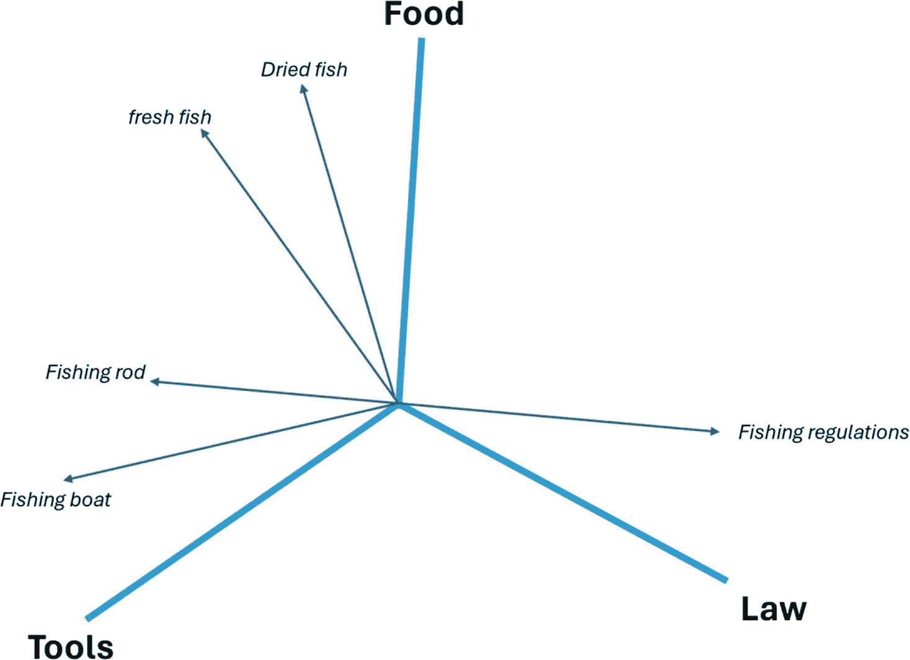

1.  **相似性搜索**：传统搜索引擎常常难以找到上下文相关的文档，因为它们主要依赖关键词匹配。例如，如果你搜索关于“气候变化影响”的文章，传统搜索可能会返回那些恰好包含这些确切词语的文档。然而，通过向量搜索，系统能够理解语义含义，并能检索到讨论相关主题（如“全球变暖影响”或“海平面上升”）的文档，即使没有使用确切的搜索词。这种方法通过分析上下文而不仅仅是词汇本身，提供了更准确、更相关的结果。

2.  **问答系统**：设想一个场景，有人问：“什么导致心脏病发作？”如果没有受过医学训练，他们可能不会使用“心肌梗死”这样的专业术语。在基于向量的系统中，“心脏病发作”和“心肌梗死”这两个短语将由相似的向量表示，因为它们存在上下文关联。因此，系统可以使用更易理解的语言准确回答问题，从而弥合专家术语和日常用语之间的差距。这种方法比传统的关键词搜索更有效，因为后者可能会遗漏表述不同但概念相关的信息之间的联系。

3.  **多语言搜索**：传统方法通常需要为每种语言建立独立的文本分析系统，这既成本高昂又耗费人力。借助多语言的基于向量的模型，用一种语言进行的查询无需直接翻译就能检索到用另一种语言撰写的相关文档。例如，用西班牙语搜索“energía renovable”（可再生能源），可以成功检索到关于太阳能电池板或风力涡轮机的英文相关文档，这得益于跨语言共享的语义内容的底层表示。

4.  **多模态**：在多模态搜索场景中，可以同时查询不同类型的数据，例如文本和图像。例如，使用基于向量的方法，像“给我看热带海滩的图片”这样的查询可以同时分析文本和图像的视觉内容以找到匹配项。这是通过将图像的特征转换为向量，然后直接与文本向量进行比较来实现的，从而允许跨媒体类型进行更集成、更高效的搜索，这是传统搜索技术之前无法实现的。图 4-11 是向量空间中的词表示。

以下是向量搜索数据库通常的运行方式：

1.  **向量嵌入生成：** 最初，数据项通过嵌入技术被转换为向量表示。例如，图像可能通过卷积神经网络（`CNN`）等技术转换为向量，而文本文档则可以通过词嵌入或句子嵌入来表示。这些嵌入本质上以可以计算处理的数字形式捕捉了数据的基本特征。
    **示例：** 考虑一个电影描述数据库。使用句子嵌入方法将每部电影描述转换为一个向量。该向量捕捉的是描述的主题和叙事细微差别，而不仅仅是孤立的词汇。

2.  **索引与查询：**
    *   **索引：** 生成向量后，使用专为高效检索设计的技术（如 `k-d` 树、球树或近似最近邻（`ANN`）算法）将这些向量组织成一个可搜索的索引。这些结构有助于通过基于向量属性缩小潜在匹配的候选列表来优化搜索。
    *   **查询：** 当用户执行搜索时，查询（例如，关于电影情节的一段文字）也会使用相同的嵌入技术转换为向量。然后，搜索引擎会遍历索引化的向量，以找到与查询向量最相似的向量。
    **示例：** 用户查询“一个年轻的巫师对抗黑暗力量”，该查询同样被转换为一个向量。然后，搜索数据库使用距离度量（如余弦相似度）将该向量与索引化的电影描述向量进行比较，从而识别出哪些电影的描述与查询最相似。

3.  **检索与排序：** 其描述向量与查询向量最接近的电影被认为最相关。这些向量根据其相似度得分进行排序，并将排名靠前的结果返回给用户。
    **示例：** 搜索结果可能将《哈利·波特》这样的电影排在列表顶部，因为描述其情节的向量在向量空间中与关于年轻巫师的查询向量最为接近。

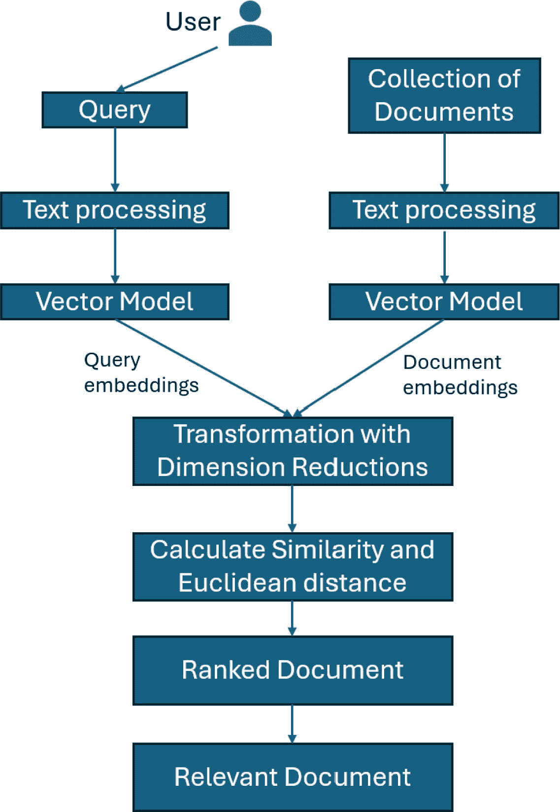

在上述流程图（图 4-12）中，我们可以看到用户查询如何从向量数据库中检索信息。基于向量的信息检索系统在自然语言处理领域越来越受欢迎。这些系统使用向量（即从文档生成的数值表示）来查找与用户查询最相关的文档。创建这些向量的方法有多种，包括 `Word2vec`、`Glove2vec` 和 `Sentence BERT`。为了进一步提升这些系统的性能，会使用 `PCA`（主成分分析）和因子分析等技术。这些方法通过转换词嵌入来优化模型性能。

通常，信息检索系统的流程始于用户输入查询。该查询经过预处理，转换为系统能够理解的格式。然后，系统利用该查询查找并返回最相关的信息。使用 `PCA` 和因子分析等后处理方法已被证明能略微提升结果，使平均精确率提高约 2–3%。这意味着系统在根据用户查询检索相关文档时更加准确。

当然，仅依赖向量搜索的方法也存在局限性。向量嵌入能有效判断文档之间的相似性，使向量搜索成为许多查询类型的更优选择（相较于传统关键词搜索）。尽管有诸多优势，但向量搜索并未普遍应用于所有查询，因为在某些情况下，关键词搜索仍能提供更相关的结果。大多数现代搜索技术倾向于采用混合搜索，即结合语义搜索和向量搜索检索技术。

在探索搜索技术时，认识到语义搜索和向量搜索之间的差异非常重要，因为它们在解释数据含义方面各有独特方法。语义搜索旨在通过分析每次搜索背后的意图和上下文含义来理解用户查询。这种方法力求通过把握搜索词的深层含义，提供高度相关且精准满足用户需求的结果。另一方面，向量搜索通过将文本转换为捕获语义含义的向量来工作，从而能够精确筛选海量数据集。这种方法侧重于查找上下文相似的条目，而非仅依赖关键词匹配。

混合搜索是一种融合多种搜索算法以提升搜索结果精确度和相关性的方法。它整合了基于关键词的搜索方法和向量搜索方法的关键特性，在其框架中同时利用稠密向量和稀疏向量。稀疏向量包含大量零值，通常用于关键词搜索，并由 `BM25` 等传统搜索引擎算法生成。相反，稠密向量包含更多非零值，用于人工智能驱动的搜索算法。通过结合这些不同算法的优势，混合搜索为用户提供了更强大、更有效的搜索体验。

图 4-13 对比了所有三种搜索类型。

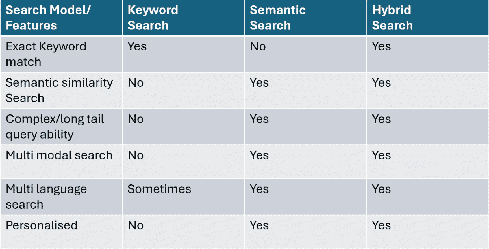

## 本章小结

在本章中，我们学习了设计 `GenAI` 解决方案的几种关键方法。我们研究了现代信息检索系统在组织和访问每日产生的海量数据中如何至关重要。这些系统通过使用文档集合、索引、查询处理器、排序算法和用户界面等组件，促进了跨文本、图形、音频和视频的高效搜索，从而提供精确且相关的信息。

我们还深入探讨了检索增强生成（`RAG`）流程的具体细节，该流程通过结合数据检索与生成式响应能力来增强聊天机器人交互，并讨论了现代信息检索系统的组件及其重要性——这些系统组织并处理海量数据阵列，以促进高效且相关的信息访问。

我们学习了搜索技术的进步，特别强调了语义搜索和向量搜索。语义搜索利用人工智能解释查询背后的上下文和意图，从而提高搜索结果的相关性；而向量搜索则将查询转换为数值向量，以查找上下文相似的条目，从而超越简单的关键词匹配，提升搜索体验。最后，我们提及了混合搜索系统，它整合了语义搜索和向量搜索技术的优势，以优化搜索准确性和相关性。

通过这些讨论，本章全面概述了 `GenAI` 解决方案在当前的能力以及未来在改变我们与技术在各个领域互动及利用方式方面的潜力。

我们将在第 5 章中更深入地探讨如何利用 `RAG` 和 Azure 工具构建信息检索系统。