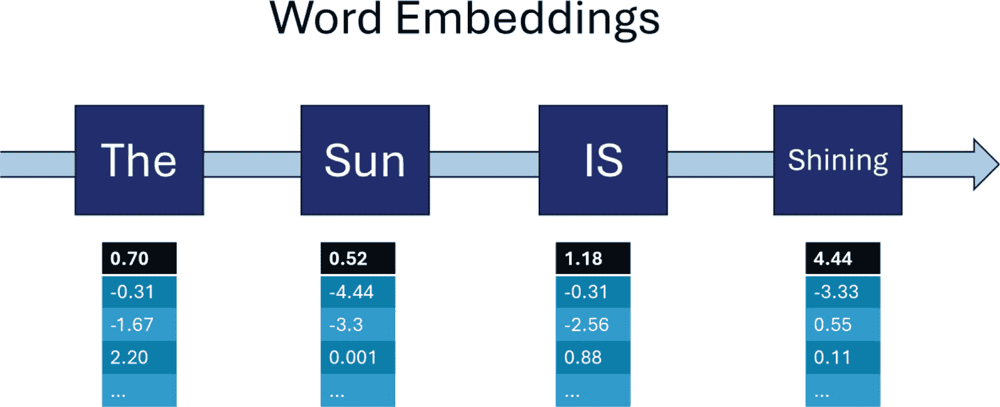
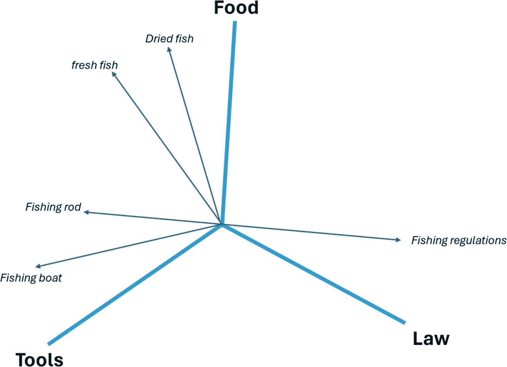
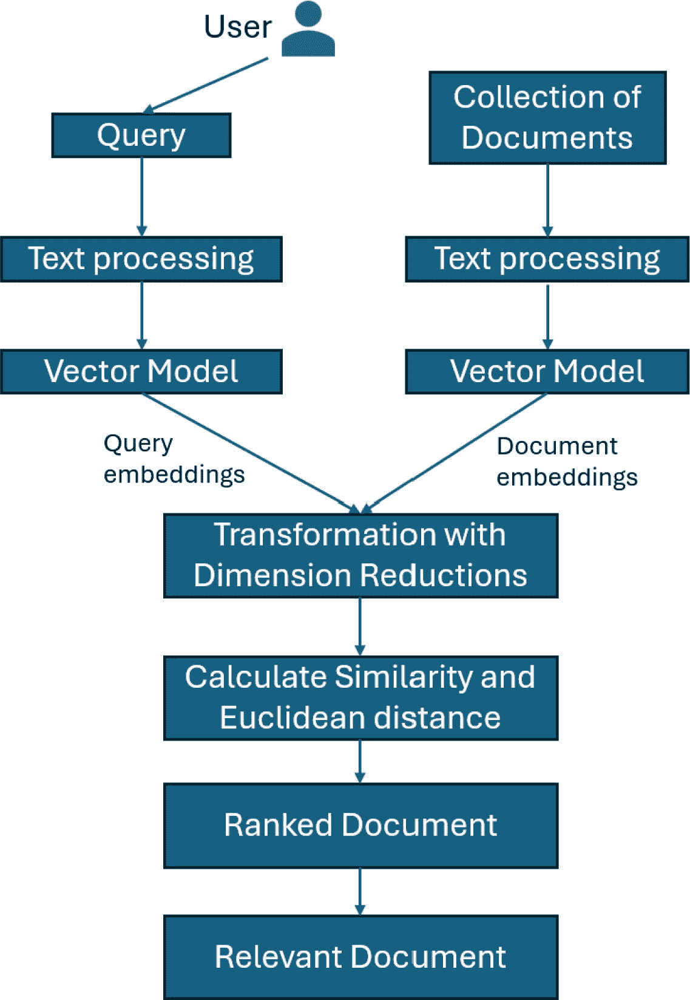
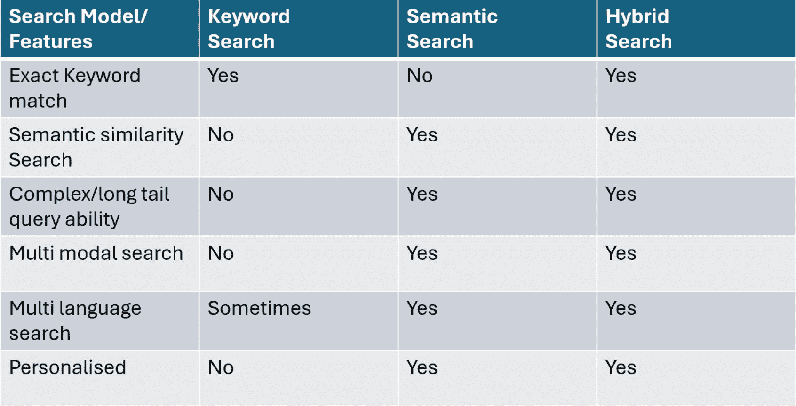

# 排版后的内容

本质上，复杂或模糊的查询有时会导致误解或不完整的结果。克服这些障碍需要不断优化算法以确保最佳性能。总体而言，语义搜索通过将语言理解与现实世界知识相结合，为用户提供了更直观、更个性化的搜索体验。这种融合，借助向量搜索中机器学习的进步，使得搜索引擎甚至在我们表达需求之前就能预测我们的意图，为构建更高效、更具主动性的搜索引擎铺平了道路。

## 探索向量搜索

探索向量搜索领域，会发现一幅以机器学习原理为主导的迷人图景。其核心在于，向量搜索利用先进的算法将原始数据转换为称为向量的有意义的表示形式。这些向量充当多维坐标，捕捉信息的本质，并促进对数据集中上下文和关系的更深入理解。机器学习在其中扮演着至关重要的角色，为信息的智能检索提供动力。通过在大规模数据集上训练模型，机器学会了将复杂概念编码成紧凑的向量格式。这些向量捕捉了语义含义和关系，使算法能够高效且精确地穿梭于海量信息之中。下图 4-10 是词嵌入的一个示例。

图 4-10

词嵌入

向量搜索代表了相对于传统搜索引擎的一次重大进步，后者主要依赖于文本中的关键词匹配。传统的搜索引擎会通过各种步骤对文本进行预处理，例如规范化术语、扩展查询以及使用同义词列表，以更好地将搜索意图与内容匹配起来。这些技术的发展是为了解决语义相似性问题，即不同的词语或短语可能表达相似的概念。例如，在传统搜索引擎中，如果用户搜索“炸鱼”一词，系统可能难以将其与“海洋”或“钓鱼竿”等相关术语直接关联起来，除非通过同义词或者先进的自然语言处理技术进行明确编程。

另一方面，向量搜索利用机器学习的概念，特别是嵌入技术，将文本转换为向量（高维空间中的数值表示）。每个向量捕捉的是文本的语义含义，而不仅仅是特定词汇的出现。这种方法允许搜索引擎在更深的层面上理解和关联概念。因此，当向量搜索引擎处理一个查询时，它会将查询文本转换为一个向量，并将其与数据库中其他文本的向量进行比较。这种比较通常基于向量之间的余弦相似度。所以，即使词语不同但背后的想法相似——比如“炸鱼”和“钓鱼竿”——向量搜索也能有效地匹配这些文本。这带来了一种更直观、更具上下文感知能力的搜索体验，能更好地与用户意图保持一致。

向量搜索显著提升了几个关键能力。让我们来了解这些能力是什么：

图 4-11

向量空间中的词表示

1.  **相似性搜索**：

    传统搜索引擎常常难以找到上下文相关的文档，因为它们主要依赖关键词匹配。例如，如果你搜索关于“气候变化影响”的文章，传统搜索可能会返回那些恰好包含这些确切词语的文档。然而，通过向量搜索，系统能够理解语义含义，并能检索到讨论相关主题（如“全球变暖影响”或“海平面上升”）的文档，即使没有使用确切的搜索词。这种方法通过分析上下文而不仅仅是词汇本身，提供了更准确、更相关的结果。

2.  **问答系统**：

    设想一个场景，有人问：“什么导致心脏病发作？”如果没有受过医学训练，他们可能不会使用“心肌梗死”这样的专业术语。在基于向量的系统中，“心脏病发作”和“心肌梗死”这两个短语将由相似的向量表示，因为它们存在上下文关联。因此，系统可以使用更易理解的语言准确回答问题，从而弥合专家术语和日常用语之间的差距。这种方法比传统的关键词搜索更有效，因为后者可能会遗漏表述不同但概念相关的信息之间的联系。

3.  **多语言搜索**：

    传统方法通常需要为每种语言建立独立的文本分析系统，这既成本高昂又耗费人力。借助多语言的基于向量的模型，用一种语言进行的查询无需直接翻译就能检索到用另一种语言撰写的相关文档。例如，用西班牙语搜索“energía renovable”（可再生能源），可以成功检索到关于太阳能电池板或风力涡轮机的英文相关文档，这得益于跨语言共享的语义内容的底层表示。

4.  **多模态**：
    1.  在多模态搜索场景中，可以同时查询不同类型的数据，例如文本和图像。例如，使用基于向量的方法，像“给我看热带海滩的图片”这样的查询可以同时分析文本和图像的视觉内容以找到匹配项。这是通过将图像的特征转换为向量，然后直接与文本向量进行比较来实现的，从而允许跨媒体类型进行更集成、更高效的搜索，这是传统搜索技术之前无法实现的。图 4-11 是向量空间中的词表示。

以下是向量搜索数据库通常的运行方式：

1.  **向量嵌入生成：** 最初，数据项通过嵌入技术被转换为向量表示。例如，图像可能通过卷积神经网络（CNN）等技术转换为向量，而文本文档则可以通过词嵌入或句子嵌入来表示。这些嵌入本质上以可以计算处理的数字形式捕捉了数据的基本特征。

    **示例：** 考虑一个电影描述数据库。使用句子嵌入方法将每部电影描述转换为一个向量。该向量捕捉的是描述的主题和叙事细微差别，而不仅仅是孤立的词汇。

2.  **索引与查询：**
    *   **索引：** 生成向量后，使用专为高效检索设计的技术（如 k-d 树、球树或近似最近邻（ANN）算法）将这些向量组织成一个可搜索的索引。这些结构有助于通过基于向量属性缩小潜在匹配的候选列表来优化搜索。

    *   **查询：** 当用户执行搜索时，查询（例如，关于电影情节的一段文字）也会使用相同的嵌入技术转换为向量。然后，搜索引擎会遍历索引化的向量，以找到与查询向量最相似的向量。

    **示例：** 用户查询“一个年轻的巫师对抗黑暗力量”，该查询同样被转换为一个向量。然后，搜索数据库使用距离度量（如余弦相似度）将该向量与索引化的电影描述向量进行比较，从而识别出哪些电影的描述与查询最相似。

3.  **检索与排序：** 其描述向量与查询向量最接近的电影被认为最相关。这些向量根据其相似度得分进行排序，并将排名靠前的结果返回给用户。

  
**示例：** 搜索结果可能将《哈利·波特》这样的电影排在列表顶部，因为描述其情节的向量在向量空间中与关于年轻巫师的查询向量最为接近。

图 4-12

基于向量搜索的信息检索系统

在上述流程图（图 4-12）中，我们可以看到用户查询如何从向量数据库中检索信息。基于向量的信息检索系统在自然语言处理领域越来越受欢迎。这些系统使用向量（即从文档生成的数值表示）来查找与用户查询最相关的文档。创建这些向量的方法有多种，包括 `Word2vec`、`Glove2vec` 和 `Sentence BERT`。为了进一步提升这些系统的性能，会使用 `PCA`（主成分分析）和因子分析等技术。这些方法通过转换词嵌入来优化模型性能。

通常，信息检索系统的流程始于用户输入查询。该查询经过预处理，转换为系统能够理解的格式。然后，系统利用该查询查找并返回最相关的信息。使用 `PCA` 和因子分析等后处理方法已被证明能略微提升结果，使平均精确率提高约 2–3%。这意味着系统在根据用户查询检索相关文档时更加准确。

当然，仅依赖向量搜索的方法也存在局限性。向量嵌入能有效判断文档之间的相似性，使向量搜索成为许多查询类型的更优选择（相较于传统关键词搜索）。尽管有诸多优势，但向量搜索并未普遍应用于所有查询，因为在某些情况下，关键词搜索仍能提供更相关的结果。大多数现代搜索技术倾向于采用混合搜索，即结合语义搜索和向量搜索检索技术。

在探索搜索技术时，认识到语义搜索和向量搜索之间的差异非常重要，因为它们在解释数据含义方面各有独特方法。语义搜索旨在通过分析每次搜索背后的意图和上下文含义来理解用户查询。这种方法力求通过把握搜索词的深层含义，提供高度相关且精准满足用户需求的结果。另一方面，向量搜索通过将文本转换为捕获语义含义的向量来工作，从而能够精确筛选海量数据集。这种方法侧重于查找上下文相似的条目，而非仅依赖关键词匹配。

混合搜索是一种融合多种搜索算法以提升搜索结果精确度和相关性的方法。它整合了基于关键词的搜索方法和向量搜索方法的关键特性，在其框架中同时利用稠密向量和稀疏向量。稀疏向量包含大量零值，通常用于关键词搜索，并由 `BM25` 等传统搜索引擎算法生成。相反，稠密向量包含更多非零值，用于人工智能驱动的搜索算法。通过结合这些不同算法的优势，混合搜索为用户提供了更强大、更有效的搜索体验。

图 4-13 对比了所有三种搜索类型。

图 4-13

关键词搜索、语义搜索和向量搜索的对比

## 本章小结

在本章中，我们学习了设计 `GenAI` 解决方案的几种关键方法。我们研究了现代信息检索系统在组织和访问每日产生的海量数据中如何至关重要。这些系统通过使用文档集合、索引、查询处理器、排序算法和用户界面等组件，促进了跨文本、图形、音频和视频的高效搜索，从而提供精确且相关的信息。

我们还深入探讨了检索增强生成（`RAG`）流程的具体细节，该流程通过结合数据检索与生成式响应能力来增强聊天机器人交互，并讨论了现代信息检索系统的组件及其重要性——这些系统组织并处理海量数据阵列，以促进高效且相关的信息访问。

我们学习了搜索技术的进步，特别强调了语义搜索和向量搜索。语义搜索利用人工智能解释查询背后的上下文和意图，从而提高搜索结果的相关性；而向量搜索则将查询转换为数值向量，以查找上下文相似的条目，从而超越简单的关键词匹配，提升搜索体验。最后，我们提及了混合搜索系统，它整合了语义搜索和向量搜索技术的优势，以优化搜索准确性和相关性。

通过这些讨论，本章全面概述了 `GenAI` 解决方案在当前的能力以及未来在改变我们与技术在各个领域互动及利用方式方面的潜力。

我们将在第 5 章中更深入地探讨如何利用 `RAG` 和 Azure 工具构建信息检索系统。

