# 6. 提示工程技术、小型语言模型与微调

## 引言

在本章中，我们将深入探讨不同的提示工程技术。提示工程是任何生成式 AI 项目成功的核心。除了提供准确信息外，提示工程还解决了行业广泛关注的问题，如幻觉。

然后我们将转向小型语言模型（SLM）的主题。SLM 因其进入生成式 AI 领域的较低成本以及较小的资源占用而日益流行，这使得我们能够将生成式 AI 集成到物联网和端点解决方案中，这些方案需要在设备上进行推理，而无需大语言模型所需的 GPU 和存储资源。

## 提示工程

提示工程是一个新兴领域，专注于创建和优化提示，以有效利用语言模型（LM）解决广泛的应用场景和日常任务。掌握提示工程的艺术对于深入理解大语言模型（LLM）的优势和局限性至关重要。个人可以借助提示工程来增强 LLM 在各种任务上的性能，从简单的问答到复杂的问题解决。

例如，一个普通用户可能会设计一个提示，帮助 LLM 根据每周的膳食计划创建购物清单，不断调整措辞和格式，直到模型能够始终如一地提供准确且全面的清单。或者，有人可以开发一个提示，引导 LLM 回答关于他们最喜欢食谱的问题，微调提示以提高理解力和相关性。

对于开发者而言，提示工程涉及构建稳健且有效的提示技术，使 LLM 与其他工具之间能够无缝交互。例如，开发者可能创建一个提示，指示 LLM 为特定编程任务生成代码片段，或以通俗易懂的术语提供复杂概念的详细解释。然而，提示工程不仅仅是设计和开发提示；它涵盖了一系列与 LLM 交互和开发 LLM 所必需的多样化技能和技术。这套技能对于与 LLM 接口、构建应用程序以及理解其能力至关重要。此外，提示工程还可用于提升 LLM 的安全性并引入新功能，例如将领域特定知识和外部工具集成到 LLM 中。例如，可以设计一个提示，确保 LLM 避免生成有害或有偏见的内容，从而增强模型的安全性。另一个例子是创建提示，使 LLM 能够访问和利用专门的数据库或 API，从而通过外部信息增强模型的能力。

### 技巧

我们将从提示工程的基础知识讨论到高级技巧，并通过几个用例来观察一些出色的实际应用。但在深入探讨提示工程之前，让我们先了解一下那些会显著影响 GPT 响应的关键参数。通过一些实验，大多数用例都能找到合适的设置。在设计并测试提示时，与大型语言模型（LLM）的交互通常是通过 API 进行的，其中有几个可配置的参数能够影响响应结果。以下是调用 GPT 模型时常用的参数：

在设计并测试提示时，与大型语言模型（LLM）的交互通常通过 API 进行，多个可配置的参数会影响响应结果。调整这些设置对于增强输出的可靠性和期望性至关重要，并且通常需要经过实验才能确定特定用例的最佳配置。以下是你将遇到的一些常见设置及其示例：

1.  **温度：** 控制模型输出的随机性。较低的值通过选择最高概率的下一个标记来使结果更具确定性，适用于基于事实的问答。较高的值会引入随机性，有利于诗歌生成等创意性任务。示例：

    **低温度（0.2）：** 适用于基于事实的问答，你需要简洁准确的答案。提示语：“法国首都是哪里？”

    **回复：** “法国首都是巴黎。”

    **高温度（0.8）：** 适用于创意性任务，鼓励多样化和富有想象力的回复。提示语：“写一首关于大海的诗。”

    **回复：** “大海，一个广阔无垠的梦，那里波浪起舞，海鸥长鸣。”

2.  **Top-p（核采样）：** 控制模型的确定性。较低的 Top-p 值会选择最自信的回复，适用于需要精确答案的情况。较高的 Top-p 值会考虑更多标记，从而产生多样化的输出。通常，只需调整温度或 Top-p 中的一个，不必两者都调。示例：

    **低 Top-p（0.2）：** 用于精确、事实性的答案。

    **提示语：** “描述光合作用的过程。”

    **回复：** “光合作用是绿色植物利用阳光，以二氧化碳和水为原料合成有机物的过程。”

    **高 Top-p（0.9）：** 用于更多样化的回复。

    **提示语：** “给我讲一个关于英雄的故事。”

    **回复：** “从前，在一个遥远的国度，有一位名叫艾莉亚的英雄，她能跟动物说话，还能操控元素。”

3.  **最大长度：** 限制生成的标记数量，有助于避免生成过长或不相关的回复，并控制成本。示例：

    **短最大长度（50 个标记）：** 用于保持回复简洁。

    **提示语：** “概括《罗密欧与朱丽叶》的情节。”

    **回复：** “《罗密欧与朱丽叶》是一部悲剧，讲述了两个年轻恋人的死亡最终化解了家族世仇的故事。”

    **长最大长度（200 个标记）：** 用于详细的解释。

    **提示语：** “解释相对论。”

    **回复：** “相对论由阿尔伯特·爱因斯坦提出，包含两个相互关联的理论：狭义相对论和广义相对论。狭义相对论适用于没有引力的所有物理现象。广义相对论解释了万有引力定律及其与自然界其他力的关系。它不仅是一个引力理论，也是一个时空理论，将引力描述为质量引起的时空弯曲。”

4.  **停止序列：** 能够中止标记生成的字符串，用于控制回复长度和结构。示例：

    **停止序列（“11”）：** 用于限制列表项。

    **提示语：** “列出 10 种水果。”

    **回复：** “1. 苹果 2. 香蕉 3. 橙子 4. 葡萄 5. 菠萝 6. 芒果 7. 桃子 8. 樱桃 9. 草莓 10. 蓝莓”（生成在“11”处停止）

5.  **频率惩罚：** 通过对重复出现的标记进行惩罚来降低单词重复的可能性。示例：

    **高频惩罚（1.0）：** 用于最小化单词重复。

    **提示语：** “描述一个美丽的花园。”

    **回复：** “花园里开满了五颜六色的花朵，绿植茂盛，各种鸟儿歌声悦耳。微风吹来，带着盛开的玫瑰和茉莉花的芬芳香气。”

    **低频惩罚（0.0）：** 允许更多重复。

    **提示语：** “描述一个美丽的花园。”

    **回复：** “花园很美丽，有美丽的花朵和美丽的树木。美丽的鸟儿唱着美丽的歌。”

6.  **存在惩罚：** 对重复出现的标记施加统一惩罚，防止模型过度重复某些短语。较高的值鼓励多样性，较低的值则保持内容聚焦。示例：

    **高存在惩罚（1.0）：** 用于鼓励回复的多样性。

    **提示语：** “描述一个美丽的花园。”

    **回复：** “花园是一个宁静的绿洲，有鲜艳的花朵、高大的树木和各种植物。蝴蝶翩翩起舞，鸟儿在枝头啁啾。一个小池塘倒映着蓝天，清新的花香弥漫在空气中。”

    **低存在惩罚（0.0）：** 允许重复，保持内容聚焦。

    **提示语：** “描述一个美丽的花园。”

    **回复：** “花园很美丽，有花、树和植物。花儿很美，树很高，植物很茂盛。这是一个非常非常美丽的花园。”

了解了上述参数如何改变 GPT 的响应后，让我们来了解一下提示工程的最佳实践和类型。

#### 最佳实践

在为 AI 模型编写提示时，考虑几个关键设置以确保模型的行为符合你的期望至关重要。这些设置包括`系统消息`、`用户消息`和`助手消息`。它们在塑造交互过程中各自扮演着独特的角色。

- `系统消息`：为 AI 模型设定舞台并充当序幕。它为对话建立背景并设定所需的语气。
- `用户消息`：提出问题，代表用户的输入或查询。它明确了用户正在寻求或需要帮助的内容。
- `助手消息`：提供回应，即 AI 对用户查询的回复。它由系统消息塑造，并应与最初设定的背景和语气保持一致。

我们将运行我们的提示工程笔记本来理解构建有效提示的常见最佳实践，以下是每种实践的详细说明。你可以从本书的 GitHub 仓库下载该笔记本的副本，地址为[`https://github.com/juliansoh/Data-Science-Solutions-on-Azure-2nd-Edition/blob/main/Chapter-6/Prompt-Enginnering-Samples/prompt_engineering101.ipynb`](https://github.com/juliansoh/Data-Science-Solutions-on-Azure-2nd-Edition/blob/main/Chapter-6/Prompt-Enginnering-Samples/prompt_engineering101.ipynb)。

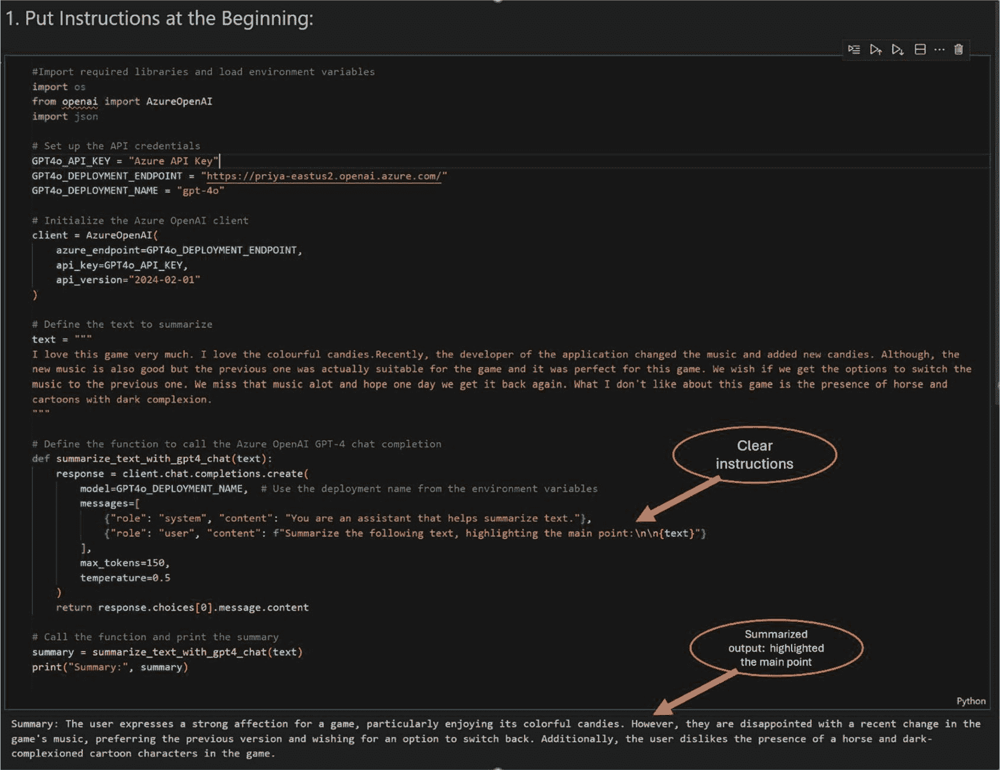

图 6-1 – 提示工程代码示例 #1

1.  **将指令放在开头：** 通过清晰说明你想要模型做什么来开始你的提示。这有助于设定背景，并从一开始就让模型清楚地理解任务。在开头提供明确的指令可以最大限度地减少歧义，并引导模型生成所需的输出。例如，不要直接进入内容，而是以一个清晰的指令开始，比如“总结以下文本，突出主要观点”。运行笔记本的第一个单元格，如下图 6-1 所示：

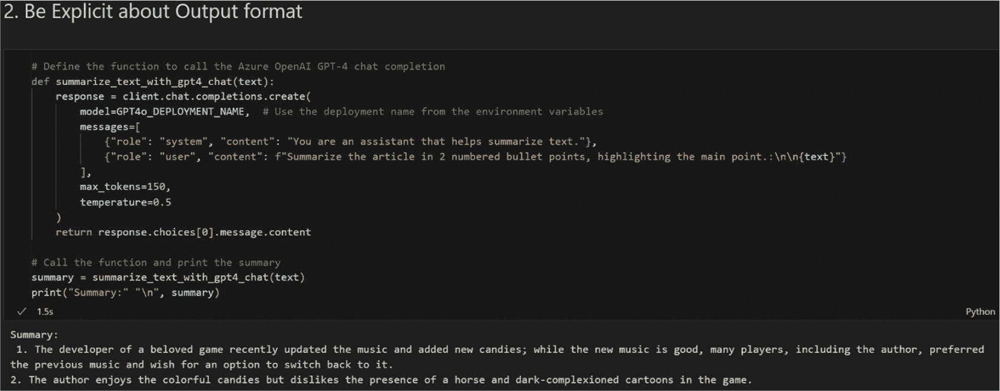

图 6-2 – 提示工程代码示例 #2

2.  **明确具体：** 清晰指定你期望模型输出的格式或结果。如下图 6-2 所示，明确的指令有助于模型更好地理解你的要求，并生成更接近你预期的响应。具体说明输出格式可以减少收到模糊或偏离目标响应的可能性。例如，与其仅仅要求一份摘要，你可以明确说明，“用 3 句话总结这篇文章，突出关键数字。”运行第二个单元格查看输出。

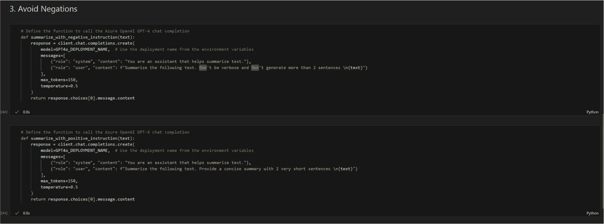

图 6-3 – 提示工程代码示例 #3：正面与负面指令

3.  **避免否定表述：** 如下图 6-3 所示，聚焦于正面指令，而不是告诉模型不要做什么。正面指令更容易让模型解读和遵循。否定表述有时会被模型误解或忽略，导致效果欠佳的响应。例如，与其说“不要啰嗦”，不如说“提供一个简洁的总结”。

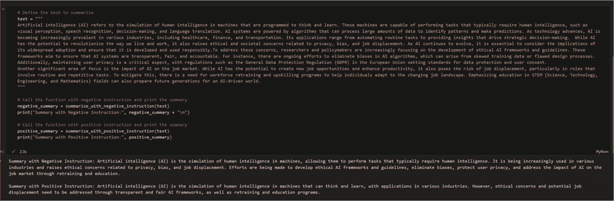

图 6-4 – 提示工程代码示例 #4：GPT 响应

从以上示例中，我们可以看到负面和正面指令的结果。负面指令“不要啰嗦，不要生成超过 2 个句子”提供了负面焦点，告诉模型要避免什么而不是做什么，因此生成了 3 个句子。这可能存在歧义，因为模型需要从否定句中推断出正面动作。这可能导致模型误解或忽略否定，从而生成的响应可能仍然冗长。然而，正面指令“总结以下文本。提供一个简洁的总结，用 2 个非常短的句子”提供了正面焦点，清晰陈述了期望的动作，因此根据提示引导生成了两个句子。这有助于模型准确理解期望。此类指令是清晰的指导，更容易让模型解读和遵循，从而产生更准确和相关的响应。

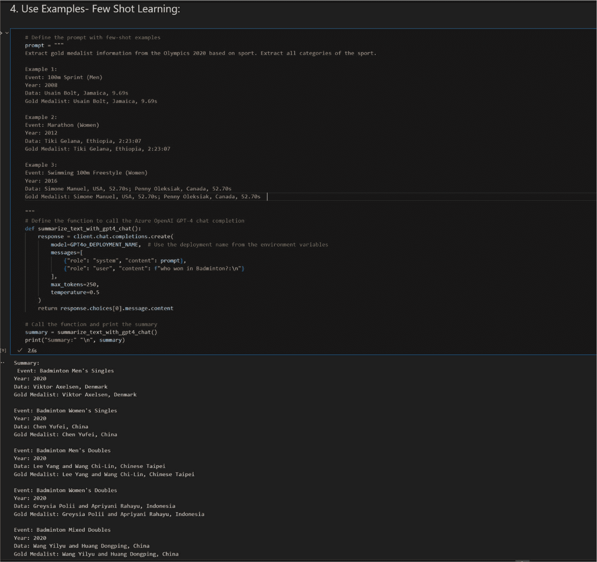

图 6-5 – 提示工程代码示例：少样本学习

4.  **使用示例 – 少样本学习：** 这是通过利用零样本、一样本和少样本学习等技术实现的。提供预期输出的示例非常有帮助。示例为模型提供了具体的参考，精确说明了你想要什么。这可以显著提高模型生成准确和相关信息的能力。下图 6-5 展示了一个少样本学习的例子。

在上面的例子中，我们看到少样本示例如何强制执行输出行为，使其具有高度的通用性。少样本学习的工作原理如下：
    - **使用示例进行条件设置：** 在提示中向模型提供几个示例（通常称为“样本”）。这些示例展示了给定输入的期望行为或输出。
    - **上下文学习：** 模型使用这些示例作为上下文，来理解如何处理新的、相似的输入。这种条件设置帮助模型从提供的示例泛化到新数据。
    - **提示设计：** 输入提示的设计同时包含示例和新任务，从而有效引导模型如何生成预期输出。

少样本提示在处理需要复杂推理、多步逻辑或深度理解的任务时可能会遇到困难。模型推断复杂关系或执行高级问题解决的能力通常是有限的。这时，我们想要利用下一种技术“思维链提示”或两者的结合。

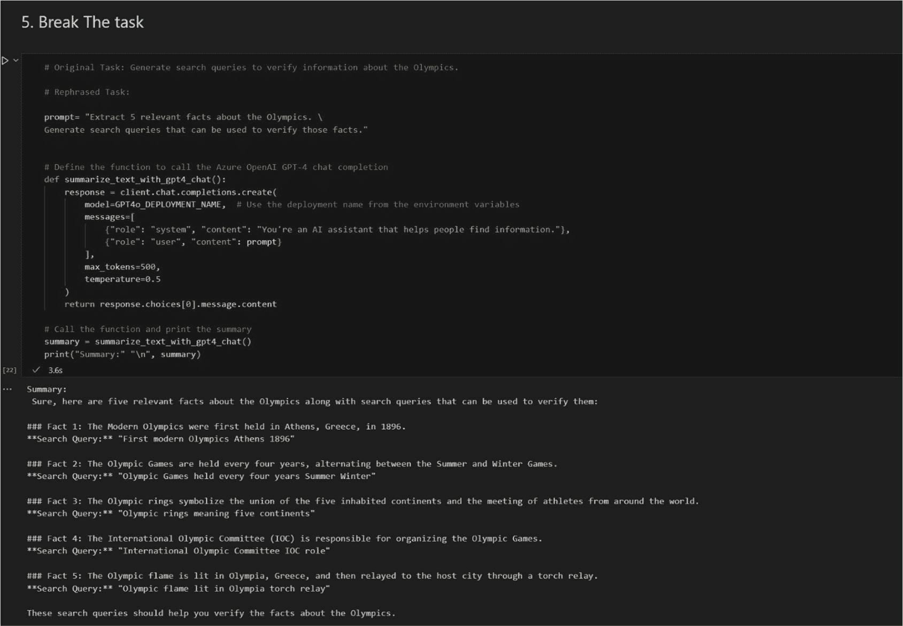

图 6-6 – 提示工程代码示例：提示链

5.  **提示链或任务分解：** 提示链可应用于涉及多个操作或转换的各种场景。通过将任务分解为更小、更易于管理的步骤，可以提升大型语言模型（LLM）的性能。例如，与其直接生成搜索查询，不如先要求模型提取相关事实，然后创建搜索查询来验证这些事实。下面的图 6-6 展示了这样一个提示的例子。

#### 思维链（CoT）提示

`CoT` 提示是一种鼓励推理和多步骤思考的技术。它涉及提供一些示例问题和答案，然后跟随着实际问题（少样本提示），这有助于模型生成推理以回应提示。这项技术是“分解任务”方法的一种变体。如下图 6-7 所示，`CoT` 提示不仅仅是把任务拆分成更小的步骤，它还指示模型逐步进行并展示所有涉及的步骤。这种系统化的方法最大限度地减少了不准确性，并使评估模型的响应变得更加容易。以下是 `CoT` 的一些优势：

- **增强推理能力：** `CoT` 提示促进了通过问题进行逻辑化和系统化的思考。
- **减少错误：** 将任务分解成更小、更易于管理的步骤会降低出错的可能性。
- **清晰透明：** 逐步呈现的方式阐明了推理过程，使得验证结果更加容易。
- **改善学习：** 这种方法有助于精确找出模型需要改进的特定领域，从而实现有针对性的训练。

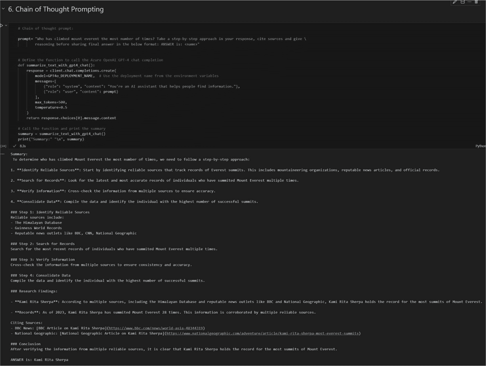

**图 6-7** — 提示工程代码示例：思维链提示

通过思维链提示，模型可以增强其推理能力，并产生更准确、更易理解的响应。然而，它也存在以下局限性：

- **复杂性管理：** 虽然 `CoT` 提示有助于处理复杂任务，但处理每一步可能需要更多的计算资源和时间。
- **额外开销：** 阐明每一步可能很繁琐，尤其是对于那些直接回答就足够的简单任务。
- **可扩展性：** 对于非常庞大和复杂的问题，逐步方法可能会变得过于详尽，需要在全面性和效率之间取得平衡。

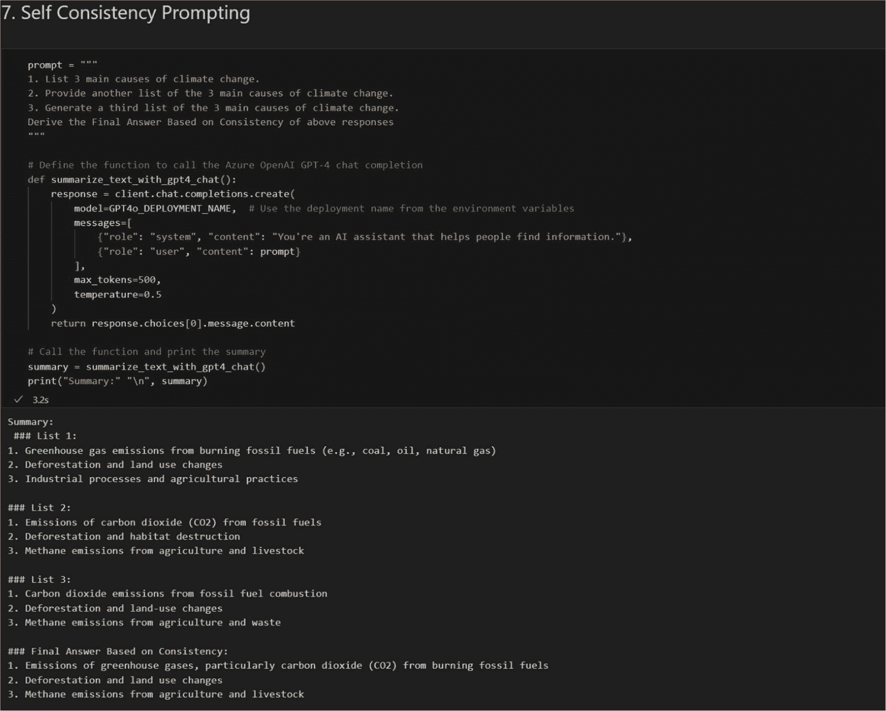

**图 6-8** — 提示工程代码示例：自一致性提示

#### 自一致性提示

与 `CoT` 直接生成 token 的简单方法相比，这可能是更高级的提示工程技术之一，它涵盖了生成响应的多种不同路径。如下图 6-8 所示，此方法用于提高少样本 `CoT`（常识变换器）模型在需要算术和常识推理任务上的性能。它涉及通过 `CoT` 模型采样多个不同的推理路径，并使用生成的响应来选择最一致的答案。在这种技术中，`CoT` 模型被提示执行一个需要算术或常识推理的特定任务或问题。不是依赖单一的推理路径，而是通过扰动输入或使用不同的推理技术，让模型生成多个响应。这些多样化的推理路径允许模型探索不同的可能解决方案或解释。

一旦模型生成了这些多个响应，就会对它们进行一致性评估。彼此一致的响应被认为更可靠，并能指示出正确答案。然后选择最一致的响应作为最终答案。通过使用自一致性提示技术，可以提升 `CoT` 模型在涉及算术和常识推理任务上的性能。这种方法利用了模型生成多个不同响应的能力，并选择最一致的那个，从而提高了模型预测的整体准确性和可靠性。

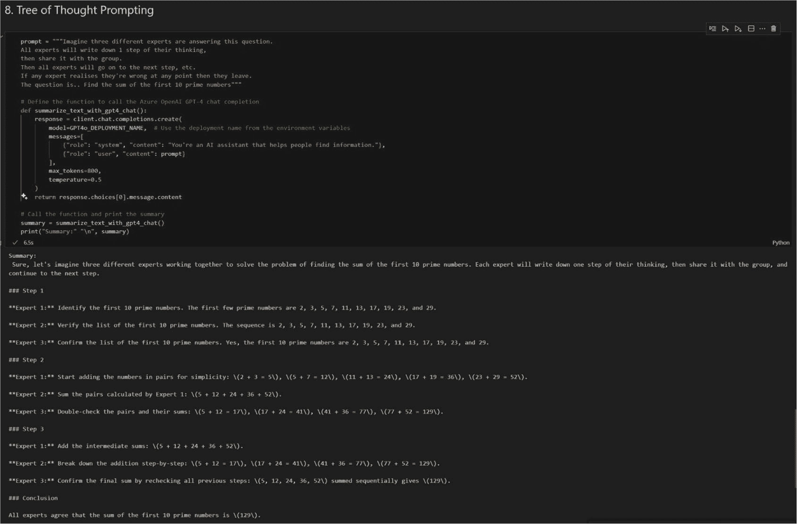

**图 6-10** — 提示工程代码示例：思维树

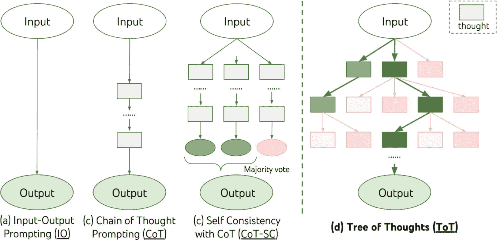

**图 6-9** — 思维树提示架构。来源：[*https://arxiv.org/pdf/2305.10601*](https://arxiv.org/pdf/2305.10601)

#### 思维树

Yao 等人 (2023) 和 Long (2023) 引入了一个称为思维树 (ToT) 的框架，该框架解决了传统提示技术在处理需要探索或战略性前瞻的复杂任务时的局限性。ToT 建立在思维链提示的概念之上，并强调将中间思维作为一种使用语言模型解决问题的手段进行探索。如下面的图 6-9 所示，在 ToT 中，维护了一个树状结构，其中每个节点代表一个连贯的语言序列（思维），作为解决问题的中间步骤。该框架使语言模型 (LM) 能够通过自我评估推理过程中生成的中间思维来评估其进展。通过将 LM 的思维生成和评估能力与广度优先搜索或深度优先搜索等搜索算法相结合，ToT 促进了通过前瞻和回溯对思维进行系统化探索。

为了更好地理解 ToT，请考虑图 6-10 中显示的示例提示，其中语言模型的任务是解决一个复杂的数学问题：“找出前 10 个质数的和。”在 ToT 框架中，初始提示可以是“生成一个给定范围内的质数列表。”然后模型将生成中间思维，例如“检查一个数是否为质数”或“在找到质数时记录总和。”这些思维代表了解决最终问题的连贯步骤。模型可以评估这些思维的质量和相关性，并探索思维树的不同分支，以找到最有效的解决方案。

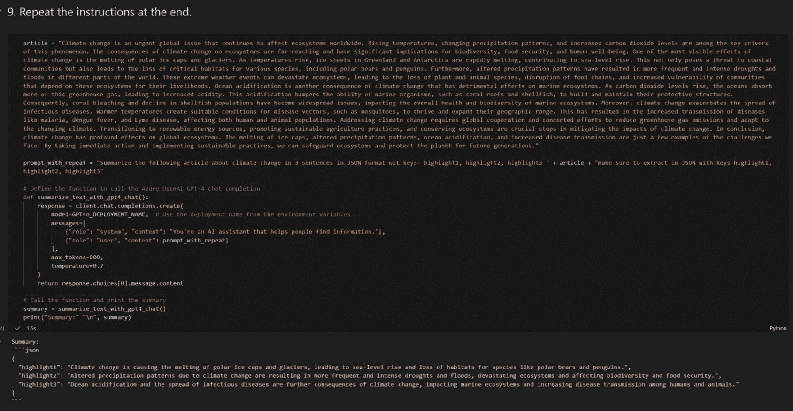

**图 6-11** — 提示工程代码示例：在最后重复指令

#### 在末尾重复指令

近因偏差可能会影响模型，其中提示末尾的信息对输出的影响可能比开头的信息更大。为了减轻这种偏差，探索在提示末尾重复指令的效果并评估其对生成响应的影响是很有价值的。如下图 6-11 所示，考虑一个提示，其任务是生成给定文章的摘要：“用 JSON 格式，以 `highlight1`、`highlight2`、`highlight3` 为键，用三句话总结以下关于气候变化的文章 {article}。”为了解决近因偏差，可以修改提示，在末尾增加重复：“用 JSON 格式，以 `highlight1`、`highlight2`、`highlight3` 为键，用三句话总结以下关于气候变化的文章 {article}，确保提取为 JSON，键为 `highlight1`、`highlight2`、`highlight3`。”

通过在提示末尾重复关于包含文章中特别与气候变化相关的关键点的指令，目的是确保模型对整篇文章的信息给予同等的考虑，而不是过度优先处理结尾部分。然后可以通过比较针对原始提示和修改后提示生成的响应来评估这一修改的影响，以确定重复指令是否有助于减少近因偏差并生成更均衡的摘要。

#### 迭代与实验

最后，创建有效的提示通常需要一个迭代和实验的过程。根据模型的响应来微调你的提示，并观察不同的指令如何影响结果。这个迭代过程可以帮助你优化提示，使其更好地满足你的需求并达到期望的结果。根据反馈和结果调整你的提示，尝试不同的措辞和指令，看看哪些能产生最佳响应。

到目前为止，我们探索了提示工程的最佳实践。我们了解了提示工程在充分发挥语言模型潜力方面所起的关键作用。它涉及设计能够有效引导模型生成准确且相关响应的提示。本章重点介绍了几种增强提示工程的策略；这些策略包括：融入系统消息、减少偏见、提供相关上下文、提示链、思维链提示、在结尾重复指令，以及通过实验进行迭代。这些实践有助于优化语言模型的性能和可靠性，使其能够生成准确且符合预期的响应。接下来，我们将深入探讨小型语言模型以及如何/何时利用它们。

## 小型语言模型

尽管本书的核心内容和当今的主流认知都集中在大型语言模型（LLM）上，但对于任何关注的人来说，小型语言模型（SLM）的崛起几乎无法忽视，其原因在于物联网和边缘计算等用例。Hugging Face 的首席执行官兼联合创始人 Clem Delangue 甚至声称，2024 年将是 SLM 之年。

### 概念

SLM 本质上只是 LLM 的缩小版本，其目标同样是理解、生成和解释自然语言。

SLM 旨在平衡以下两个方面：一方面要具备足够的语言处理能力，另一方面要控制存储和处理自然语言请求所需的模型体积。下面的表 6-1 比较了训练 SLM 和 LLM 时使用的参数数量范围。

**表 6-1** 训练中使用的参数数量（LLM 与 SLM 对比）

| 模型类型 | 参数数量 | 模型示例 |
| --- | --- | --- |
| 小型语言模型（SLM） | 100 万 – 50 亿 | `Phi-1`, `Phi-2`, `Phi-3-mini`, `Phi-3-small`, `Mistral-7B`, `Zephyr-7B` |
| 大型语言模型（LLM） | 100 亿 – > 1 万亿 | `GPT-3.5`, `GPT-4`, `Gemini`, `LLaMA` |

#### 更大并不总是更好

SLM 的理念在于，更大的模型并不总是更好，尽管最初的驱动力可能主要来自于成本。

较低的计算需求使得 SLM 的运营成本更低。其他优势包括推理速度，这带来了更高效的响应时间。综合来看，部署多个面向任务的 SLM 可能比部署单个 LLM 效率更高。

在某些情况下，SLM 的性能优于 LLM。在此语境下，性能是衡量响应质量而非速度的指标。响应质量受到准确性、幻觉风险和偏见的影响。

由于参数数量较少，SLM 往往比 LLM 的偏见更少。此外，正如我们稍后将看到的，SLM 通常通过微调进行定制，以包含有针对性的、特定领域的训练数据。这种针对领域特定数据集的微调降低了偏见风险。另一方面，LLM 是基于从互联网收集的大量数据进行训练的。这就是为什么正确地对 LLM 进行“落地”（`grounding`）非常重要，并且与 SLM 相比，对 LLM 进行此操作的难度更高。SLM 训练数据集较小的另一个好处是降低了幻觉风险。图 6-12 展示了 SLM 的优势。了解了这些优势后，让我们来看看 SLM 的用例。

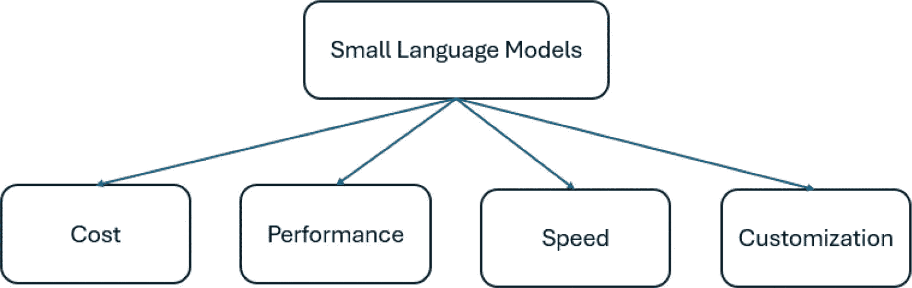

**图 6-12** 小型语言模型（SLM）的优势

### 用例

SLM 可用于与 LLM 相同的用例——客户服务、内容生成、翻译等。然而，如上所述，它们的特点是能够将生成式 AI 扩展到以下对当前 LLM 而言可能具有挑战性的环境中：

#### 物联网

物联网（IoT）指的是连接到互联网的设备。它们通常被称为“智能设备”，在我们的日常生活中随处可见。智能锁、冰箱、摄像头、暖炉、车库门开启器等都是“智能家居”类别中的物联网设备示例，这是现代家庭的一部分。物联网设备可以从设备端 AI 能力中获益，以实现更高效的处理。

#### 低带宽和断网设备

许多场景下网络连接受限，例如美国的许多国家公园以及全球许多基础设施不完善的地区。这些无网络连接的区域可以通过配备生成式 AI 的设备来更好地服务人们。低带宽或无网络连接的用例也可能发生在海上或太空。通常，一项技术的可用性，尤其是诸如生成式 AI 这样的技术，不仅能使这些地区或情境中的人们受益，而且还可能关乎生死。例如，一个用例可能是遏制人口贩卖。

#### 语言翻译与本地化

除了低带宽或无带宽地区之外，配备特定语言 SLM 并针对本地化或情境用例进行微调的设备可用于解决特定问题。例如，为了减少人口贩卖导致的死亡，被困在偏远地区的受害者将能够访问支持 AI 的设备来寻求帮助。SLM 可以提升移动性，从而使援助人员能够携带支持 AI 的设备前往村庄提供帮助，在这些场景中，翻译服务起着关键作用。除了翻译之外，作为生成式 AI 模型（尽管训练参数比 LLM 少），SLM 仍然可以具备情感分析能力，并进一步使用领域特定数据进行微调。以援助偏远村庄工作人员为例，一个领域特定的数据集可能涉及卫生以及食用野味⁶⁷的危险（这是 COVID-19 的一个可能起因）。这将显著提升互动质量，并最终提高通过教育提供援助的有效性。

### 动手练习 6-1：部署 `Phi-3`

尽管市面上有若干种小型语言模型（SLM）可供选择，本动手练习将使用微软最新发布的 `Phi-3`。该模型可在 Azure 及 Hugging Face 上获取。

如前所述，像 `Phi-3` 这类 SLM 可以在本地加载和微调。不过，大多数情况下，微调 SLM 需要一台配备 Nvidia GPU 的机器。如果本地没有这样的机器，可以使用启用 GPU 的 Azure 虚拟机、配备 GPU 计算资源的 Azure 机器学习工作室，或者通过 Azure AI 工作室。

最简单的选择是使用 Azure AI 工作室，因为无需管理计算基础设施。

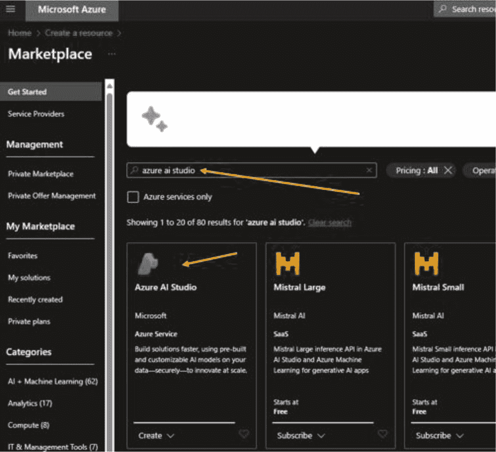

**图 6-13** 部署新的 Azure AI 工作室资源

1.  登录 Azure 门户（`https://portal.azure.com`）。
2.  创建新的 Azure 资源，并找到 Azure AI 工作室，如下图 6-13 所示。

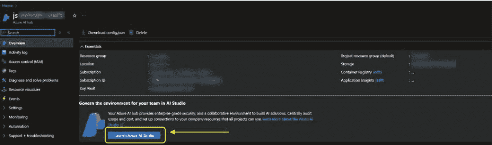

**图 6-14** 启动 Azure AI 工作室

3.  在本文撰写时，`Phi-3` 模型及其微调功能在美国东部 2 区域可用。因此，请将此新的 AI 工作室资源部署在美国东部 2 区域。
4.  接受所有默认设置，继续创建 AI 工作室资源。
5.  部署完成后，启动 AI 工作室，如下图 6-14 所示。

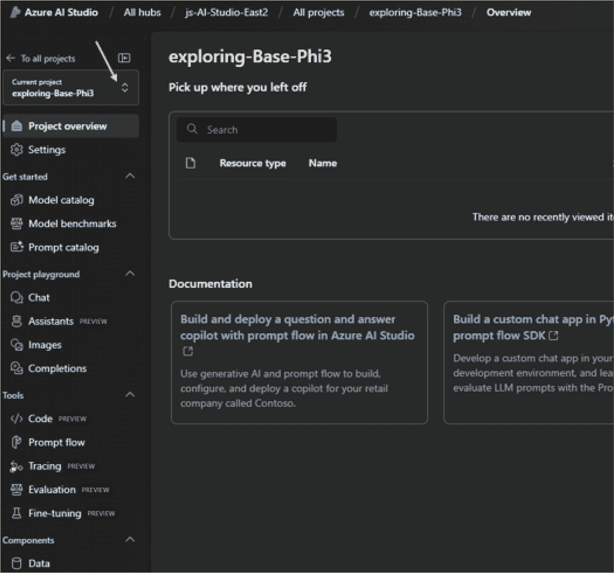

**图 6-15** Azure AI 工作室中的项目视图

6.  单击导航窗格中的 ，然后单击  创建一个新项目。
7.  提供项目名称。在本练习中，我们将项目命名为 `exploring-Base-Phi3`。然后点击“创建项目”按钮。
8.  项目创建完成后，您将返回主 AI 工作室界面，并自动选中当前项目。如果您有多个项目，可以通过单击项目名称旁边的  在不同项目之间切换，如下图 6-15 所示。

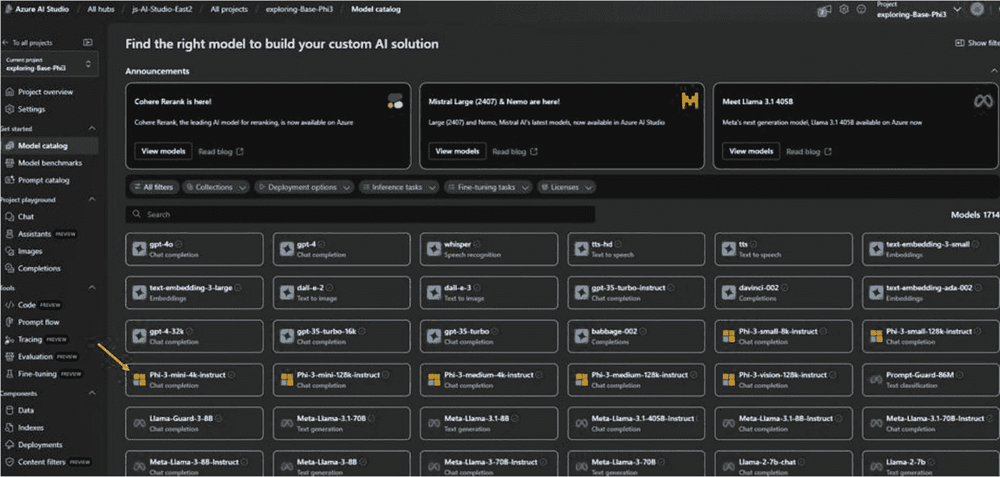

**图 6-16** 从 Azure AI 工作室的模型目录部署 `Phi-3` 模型

9.  在此项目中，首先需要部署一个模型。单击 `Model Catalog` 以显示所有可部署到此项目的模型。
10. 选择 `Phi-3-mini-rk-instruct`，如下图 6-16 所示。

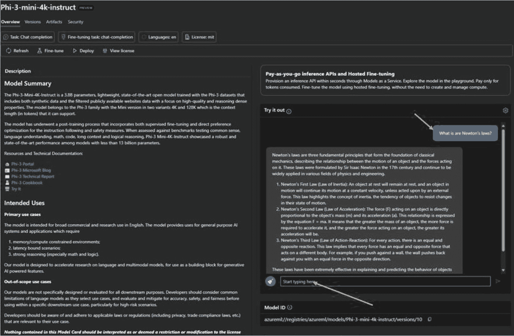

**图 6-17** 在部署前试用模型（`Phi-3`）

11. 在部署模型前，您可以使用聊天界面进行试用，如下图 6-17 所示。

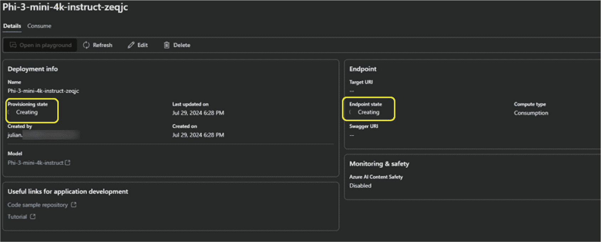

**图 6-18** 部署 `Phi-3` 模型及端点

12. 单击  将此模型部署到项目中。
13. 选择“使用 Azure AI 内容安全的无服务器 API”选项。此选项无需我们部署和管理计算资源即可使用模型。
14. 根据提示，为部署命名或选择默认生成的名称。由于这是动手练习，通过将滑块滑动至  来禁用内容过滤器。
15. 单击 。
16. 部署模型需要一些时间。您可以监控模型和端点的 `Provisioning` 状态，如下图 6-18 所示。
17. 您可以单击  获取最新的 `Provisioning` 状态，或等待其从“Creating”变为“Succeeded”。
18. 在侧边菜单的 `Project playground` 部分，单击 。
19. 使用 `Chat playground` 与刚刚部署的 SLM 进行交互。

在此动手练习中，使用 Azure AI 工作室部署 SLM 并与其交互。这与使用 LLM 操作 AI 工作室并无区别。事实上，AI 工作室中的所有工具，如 `Prompt flow`、`Tracing` 和 `Evaluation`，均可使用。

在结束本练习前，还有最后一个任务。在聊天试验场中，输入以下问题：

> *“阿里亚妮·蒂特马斯在 2024 年巴黎奥运会上获得奖牌了吗？”*

我们知道她确实赢得了女子 400 米自由泳金牌，但基础模型并不知道这一点。因此，您应该会收到类似下图 6-19 所示的响应。

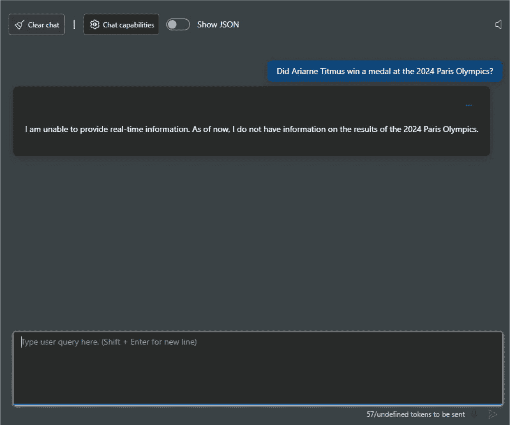

**图 6-19** 由于训练数据不包含当前/实时信息，`Phi-3` 模型无法提供回答

接下来，我们将进行微调，看看如何使用这种方法来回答关于 2024 年巴黎奥运会的问题。

## 微调

SLM 与 LLM 的关键区别之一在于微调模型所需的时间、精力和成本⁶⁸。与对 LLM 使用 RAG（检索增强生成）相比，微调更可能是定制 SLM 的推荐方法。

### 概念

微调是将自定义数据集融入基础模型的过程。这扩展了基础模型，使其能够原生生成依赖于所融入数据集知识的响应。与 RAG 架构（模型依赖搜索服务返回的结果进行接地）不同，这使得模型更高效。

微调最常用于针对特定领域知识定制 LLM 或 SLM。微调过程对 SLM 和 LLM 相同，包括以下步骤：

-   部署基础模型
-   引入自定义数据集
-   重新训练基础模型，将自定义数据集整合到微调后的模型中
-   部署新微调后的模型

一旦创建了微调后的模型，它便被视为自定义模型。基础模型的新版本需要使用自定义数据集进行定制，并应作为 MLOps 模型生命周期管理的一部分来纳入。

### 动手练习 6-2 和 6-3 的背景

在本文撰写时（2024 年 7 月 30 日），巴黎奥运会刚开幕五天。所有 LLM 和 SLM 模型此时都不包含任何巴黎奥运会的详细信息。

我们将使用一个包含更近期信息的数据集来微调模型。但请注意，当您进行此练习时，您部署的基础模型可能已经包含了这些信息，因此您可能需要提供一个包含基础模型训练范围之外数据的数据集。

或者，您可以在练习中使用 `GPT-3.5 Turbo 0125` 版本，该版本肯定不包含 2024 年巴黎奥运会的任何信息。

在开始动手练习之前，我们想再次强调，即使在这种特定用例中，使用 RAG 架构也可能比微调更好。RAG 最重要的方面是易于添加和更新信息。更新嵌入到模型中的信息需要重新训练模型，这是一个耗时的过程。

这个奥运用例仅用于说明目的，因为我们想挑选一些我们知道基础模型不包含的内容。

### 微调的数据准备

或许微调过程中最重要的一环（实际上也是所有数据科学相关工作的核心）就是数据准备。这个过程通常属于被称为数据工程的学科范畴。在本书的第一个版本中，我们对此主题进行了全面阐述。自那时起，数据工程领域出现了新的^(⁶⁹)工具，例如 `Azure Fabric`。像 `Databricks` 这样的主流第三方工具也取得了显著进展。向读者更新数据工程的知识超出了本书的范围，因为这个主题本身就值得出一本书！

用于微调的数据集有两个重要要求：

* `{"messages": [{"role": "system", "content": "You are an Xbox customer support agent whose primary goal is to help users with issues they are experiencing with their Xbox devices. You are friendly and concise. You only provide factual answers to queries, and do not provide answers that are not related to Xbox."}, {"role": "user", "content": "Is Xbox better than PlayStation?"}, {"role": "assistant", "content": "I apologize, but I cannot provide personal opinions. My primary job is to assist you with any issues related to your Xbox device. Do you have any Xbox-related issues that need addressing?"}]}`
* `{"messages": [{"role": "system", "content": "You are an Xbox customer support agent whose primary goal is to help users with issues they are experiencing with their Xbox devices. You are friendly and concise. You only provide factual answers to queries, and do not provide answers that are not related to Xbox."}, {"role": "user", "content": "Can I play PC games on my Xbox?"}, {"role": "assistant", "content": "While Xbox consoles don't natively support PC games, they can play an array of Xbox games, many of which are also available on PC. Can I assist you with finding games compatible with your Xbox device?"}]}`
* `{"messages": [{"role": "system", "content": "You are an Xbox customer support agent whose primary goal is to help users with issues they are experiencing with their Xbox devices. You are friendly and concise. You only provide factual answers to queries, and do not provide answers that are not related to Xbox."}, {"role": "user", "content": "I'm having trouble connecting my Xbox to the Wi-Fi."}, {"role": "assistant", "content": "No worries, let's go through the network settings on your Xbox. Can you please tell me what happens when you try to connect it to the Wi-Fi?"}]}`

1. 数据应当是干净的。
2. 数据需要采用 `jsonl`（JSON lines）格式^(⁷⁰)，并使用以下示例 schema：

考虑到这些，我们已经准备好开始下一个动手实践环节的数据准备过程。

### 动手实践 6-2：微调的数据准备

你可以选择准备自己的特定领域数据，或者在本练习中，我们将使用来自 Kaggle 的数据集。

如果你想跳过此动手实践环节，下一个动手实践环节会提供一个可用于训练的 `jsonl` 文件供你使用（[`https://github.com/juliansoh/Data-Science-Solutions-on-Azure-2nd-Edition/blob/main/Chapter-6/exercise-6-2/data/prepped_data_for_training/medals.jsonl`](https://github.com/juliansoh/Data-Science-Solutions-on-Azure-2nd-Edition/blob/main/Chapter-6/exercise-6-2/data/prepped_data_for_training/medals.jsonl)）。

1. 你可以从 Kaggle 下载最新的奥运会数据集，网址为 [`https://www.kaggle.com/datasets/piterfm/paris-2024-olympic-summer-games?select=medals.csv`](https://www.kaggle.com/datasets/piterfm/paris-2024-olympic-summer-games?select=medals.csv)，或者使用本书 GitHub 仓库中提供^(⁷¹)的数据集，其位置在 [`https://github.com/juliansoh/Data-Science-Solutions-on-Azure-2nd-Edition/blob/main/Chapter-6/exercise-6-2/data/raw/medals.csv`](https://github.com/juliansoh/Data-Science-Solutions-on-Azure-2nd-Edition/blob/main/Chapter-6/exercise-6-2/data/raw/medals.csv)。

2. 克隆第 6 章的 GitHub 仓库，并使用 Visual Studio Code 或你偏好的 IDE 打开 `training_data_prep.py`^(⁷²)。

3. 查看 `training_data_prep.py`。这段 Python 代码会选取我们想要纳入微调数据集的 CSV 列（第 18 至 27 行），将其格式化为微调所需的 `jsonl` 文件，并输出该文件（第 8 行）。对代码进行任何必要的修改，然后执行它。

4. 使用简单的编辑器或 JSON 查看器，检查所创建的 `jsonl` 文件。将其与 [`https://github.com/juliansoh/Data-Science-Solutions-on-Azure-2nd-Edition/blob/main/Chapter-6/exercise-6-2/data/prepped_data_for_training/medals.jsonl`](https://github.com/juliansoh/Data-Science-Solutions-on-Azure-2nd-Edition/blob/main/Chapter-6/exercise-6-2/data/prepped_data_for_training/medals.jsonl) 中的文件进行比较。它们应该是完全相同的。

### 动手实验 6-3：微调

有多种方式可以执行微调任务：

- 在配备 GPU 的本地计算机上
- 在云中使用配备 GPU 的虚拟机（例如 Azure 数据科学虚拟机）
- Azure 机器学习工作室
- Azure AI Studio
- 在 Google、AWS 等平台使用非 Microsoft 工具和虚拟机

你也可以使用笔记本和优化包，例如 `LoRA`、`ONNX` 和 `Olive`。还可以使用 Visual Studio Code 来设置微调参数。微软提供了名为 Phi-3 食谱的综合性资源，地址位于 [`https://github.com/microsoft/Phi-3CookBook`](https://github.com/microsoft/Phi-3CookBook)。

其中一种较新的方法是使用 Azure AI Studio 中的无代码版本。在撰写本文时，这还是一个处于公开预览阶段的新功能。

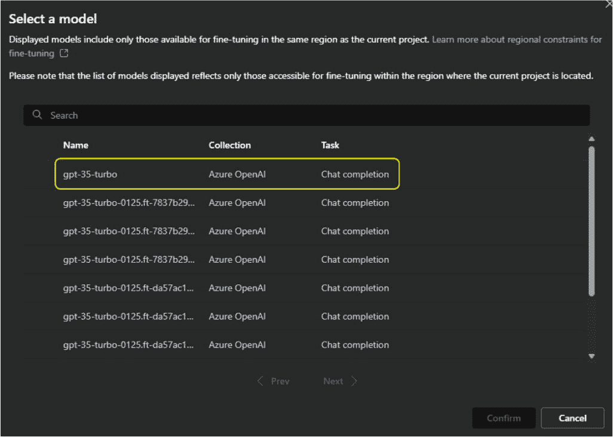

**图 6-20** 可用于微调的模型

1. 接续动手实验 6-2 的操作，在 AI Studio 中，点击 。

2. 点击 。

3. 你应该会看到 `gpt-35-turbo`，如下方图 6-20 所示。在截图中，我们还展示了其他模型（例如 `gpt-35-xxxxxxxx`）。这些是我们之前微调过的模型，可用于进一步^(⁷³)微调或重新训练。选择 `gpt-35-turbo`，然后点击 。

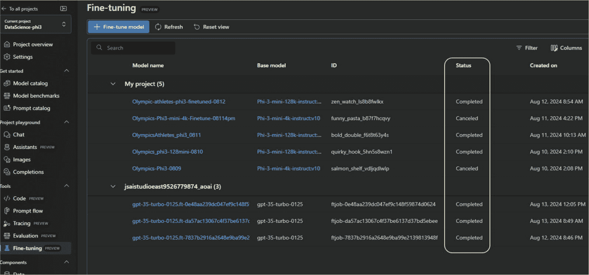

**图 6-21** 微调作业的状态

1. 选择要微调的模型版本（GPT-3.5 Turbo 为 0125），为模型添加后缀，并提供此微调模型的描述。在此练习中，我们添加了 `medal-winners` 作为后缀，并提供了以下描述：

   *“使用截至 2024 年 7 月 27 日的 2024 年巴黎奥运会奖牌获得者数据微调的模型。”*

2. 点击 。

3. 在步骤 2（训练数据）中，从训练数据的下拉菜单中选择 。

4. 点击 ，并导航到我们在上一个练习中准备好的 `medals.jsonl` 文件的存储位置。

5. 点击 。

6. 在验证数据选项中，选择 `None`，除非你有验证数据集（本练习中我们没有）。

7. 点击 。

8. 接受批量大小、学习率乘数、训练轮数和随机种子的默认值。然后点击 。

9. 点击 。

10. 你的训练作业将被排队并最终开始运行。你可能需要点击  来获取最新状态。已完成和已取消作业的状态如下方图 6-21 所示。你的作业最初会显示为“已排队”，然后是“正在运行”。

1. 或者，你也可以通过从侧边菜单中选择 ，然后选取  模型来微调 Phi-3^(⁷⁴) 基础模型。
   1. 在模型的概览窗格中，沿顶部点击 。

2. 在下一页点击 。

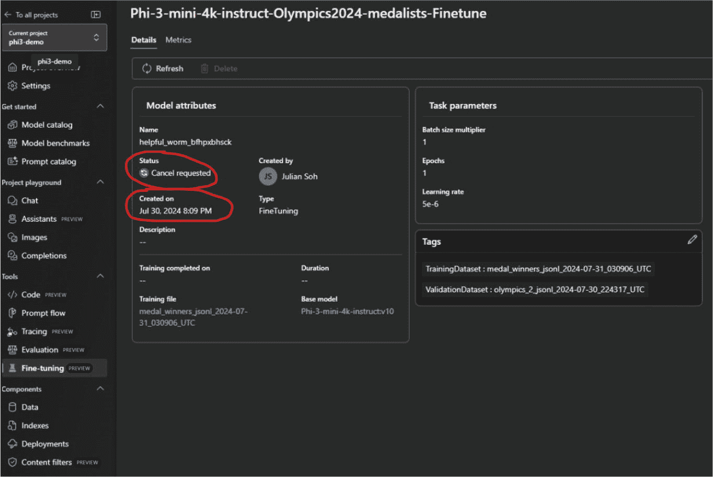

**图 6-23** 请求取消作业

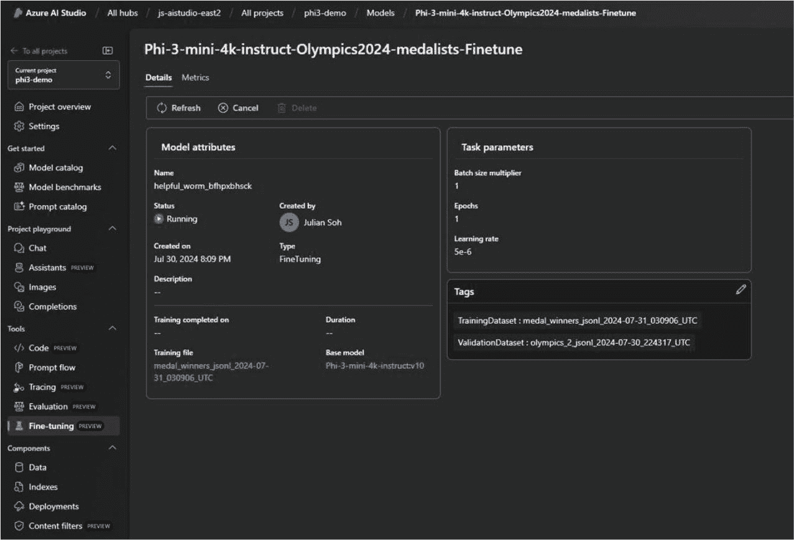

**图 6-22** 正在运行的作业的详细信息

1. 点击正在运行的作业将为你提供运行的详细信息、参数、训练文件和状态，如下方图 6-22 所示。如果你查看作业的顶部，可以选择取消作业。如果你选择取消正在运行的作业，可能需要几分钟才能取消，状态将更改为 `已请求取消`，如下方图 6-23 所示。

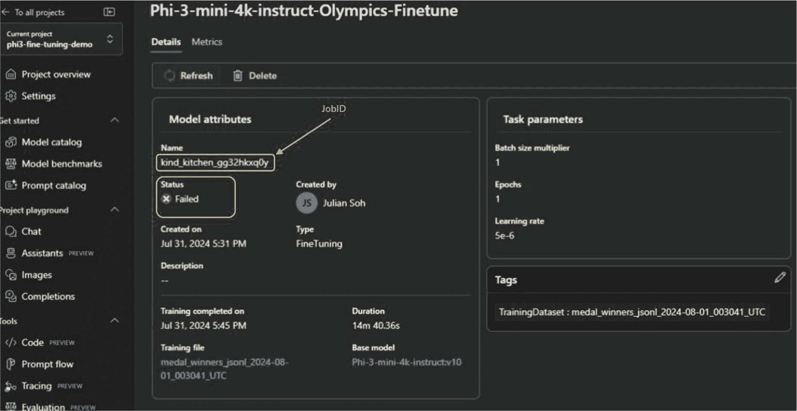

**图 6-24** 失败的作业和作业 ID

1. 微调作业（如果你未取消）要么完成，要么失败。如果作业失败，其状态将显示为 `失败`，如下方图 6-24 所示。如果作业失败，你需要查看日志^(⁷⁵)来确定失败原因。在查看日志或与支持人员沟通时，你需要用到 `jobID`，而 `jobID` 就是作业的名称。

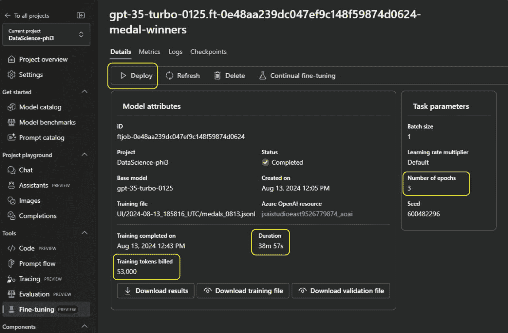

**图 6-25** 作业的统计详细信息及部署选项

1. 如下方图 6-25 所示，作业成功完成后，点击该作业将为你提供关键指标，例如微调过程中分词步骤消耗的训练轮数和令牌数量，并提供部署模型的选项。我们需要先部署模型，才能在游乐场或通过应用程序使用它。

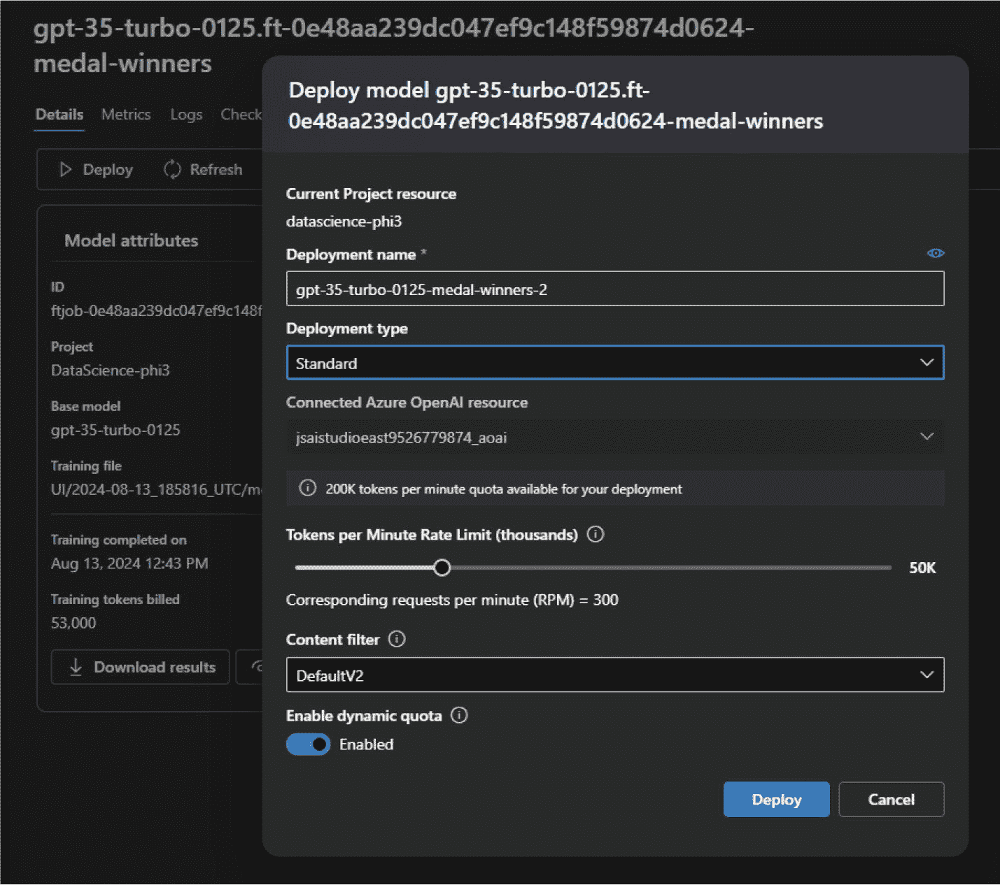

**图 6-26** 部署微调后的模型

1. 点击 。

2. 为此模型提供一个部署名称，选择 `标准` 作为部署类型，配置每分钟令牌数 (TPM) 设置，并选择是否希望在容量允许、需求较高时启用动态配额以自动调整 TPM。下方图 6-26 显示了本练习的部署设置。部署模型是在使用模型之前的必要步骤，因为这会为模型创建一个端点。

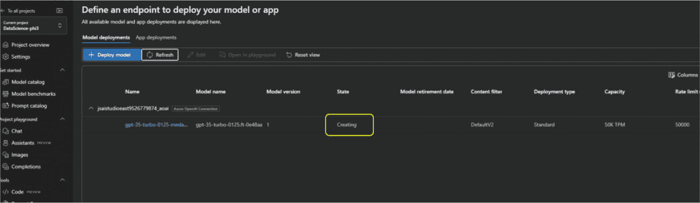

**图 6-27** 在部署阶段创建模型端点

1. 点击 。

2. 在部署阶段，你的模型端点的状态将为 `正在创建`，如下方图 6-27 所示。创建成功后，此端点的状态将显示为 `已成功`。

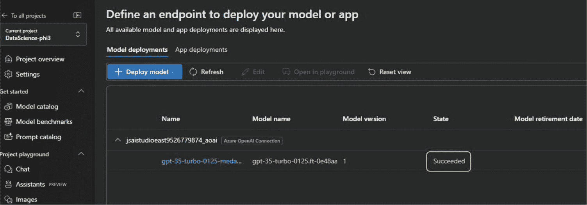

**图 6-28** 模型端点部署成功

1. 所有成功的模型端点部署都会列在部署屏幕中。从侧边菜单点击 。

2. 一旦看到模型端点部署状态为 `已成功`，如下方图 6-28 所示，点击该端点。

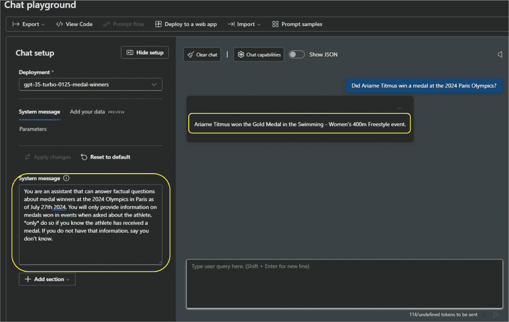

**图 6-29** 使用聊天游乐场测试模型

1. 然后点击^(⁷⁶) 。

2. 游乐场提供了一个聊天界面，方便你检查这个微调后的模型。使用以下文本更新系统消息，完成后记得点击 。

   *“你是一位能够回答关于截至 2024 年 7 月 27 日的 2024 年巴黎奥运会奖牌获得者事实性问题的助手。当被问及运动员时，你*只*会提供关于其赢得奖牌项目的信息，但前提是你知道该运动员获得了奖牌。如果你没有该信息，请说你不知道。”*

3. 在聊天框中输入我们之前提出的问题：

*“阿里亚妮·蒂特马斯在 2024 年巴黎奥运会上赢得奖牌了吗？”*

4. 如图 6-29 所示，模型现在应该能够根据我们微调过的数据集为你提供答案。

在本练习中，我们使用自定义数据集对基础模型进行了微调。请继续使用数据集中的其他问题进行测试，并运用本章开头学到的提示工程技术调整系统消息。请记住，由于数据集较小且未调整任何参数，你仍可能会遇到不准确的回答，但这就是迭代微调过程发挥作用的地方。该模型现在是一个自定义模型，你需要将其作为 MLOps 中模型开发生命周期的一部分加以管理。

### 动手练习 6-4：清理不需要的资源

微调会产生 Token 消耗成本，但这是每次微调任务的一次性成本。然而，部署模型端点是一项持续的模型托管成本，除非你自己托管该模型^(⁷⁷)。在本练习中，我们使用了无服务器端点，以便无需管理计算基础设施。因此，如果你不再需要某个模型端点，请务必删除该端点，否则你将产生持续费用。

请注意，删除模型端点*不会*删除微调后的模型，而且在大多数情况下，我们也不希望这样做。因为我们可能还需要此模型进行进一步的微调。***但由于为了测试模型，我们必须将其部署到端点，因此需要记住删除所有未使用的端点。***

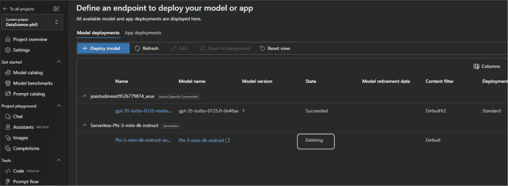

**图 6-30** – 删除模型端点

1.  点击模型部署端点。然后选择 。
2.  确保端点进入“正在删除”状态，如图 6-30 所示，并且最终从部署屏幕中消失。

## 总结

在本章中，我们学习了不同的提示工程技术及最佳实践。提示工程是让 LLM 和 SLM 接地的重要方面，也是你需要做的第一件事。

除了提示工程，我们还可以依赖 RAG 模型（推荐），并配置语义和向量搜索来提供结果，如前面章节所述。

然而，在某些用例中，你可能需要微调模型，例如需要在边缘设备或断网环境中托管模型时。或者，当 RAG 架构效率不够高时，你可能希望开发一个领域特定模型。这些是微调的一些良好用例，但建议在微调之前始终先考虑 RAG。请记住，一旦基础模型被微调过，它就变成了自定义模型，你需要管理其生命周期。自定义微调模型不会重新引入到未来版本的基础模型中。

脚注 1 2 3 4 5 6 7 8 9 10 11

