# 7. 语义内核、插件与函数调用

在本章中，我们将从关注 LLM 本身，转向设计由 LLM 驱动的解决方案。因此，本章的主题是如何让 LLM 执行通过请求或工作流发来的任务。传统上，任务和工作流由批量作业、Logic Apps、Power Automate、UIPath 等自动化工具编排。

我们可以将这些自动化工具视为外部编排器，因为它们主要依赖 API 与不同服务交互，并根据从不同服务收到的响应，这些编排器可以调用其他服务，包括 LLM。事实上，本书的前几章及前一版本在很大程度上依赖于这种方法。下图 7-1 描述了编排器执行结构化工作流，将不同服务连接成一个工作流或解决方案的方式。

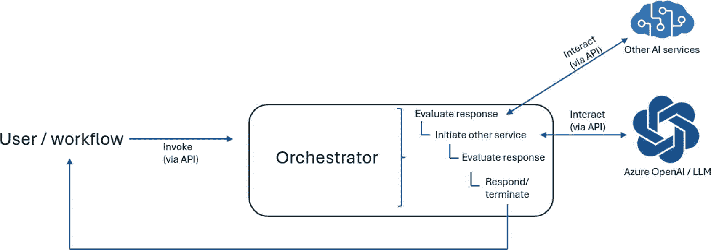

**图 7-1** – 通过传统编排工具实现自动化

另一方面，对于 LLM，存在一种让 LLM 本身成为编排器的概念。为了实现这一点，我们需要能够扩展 LLM，使其直接启动外部任务。让 LLM 成为编排器是一个非常自然的概念，因为正如我们在第一章中将生成式 AI 描述为人类大脑的数字表示一样，决策自然应该由 LLM 驱动。下图 7-2 展示了 LLM 作为编排器，并利用专门处理不同任务的主体（Agent）概念。与传统自动化相比，LLM 驱动的编排本质上更具动态性，并且可以通过自然语言触发。

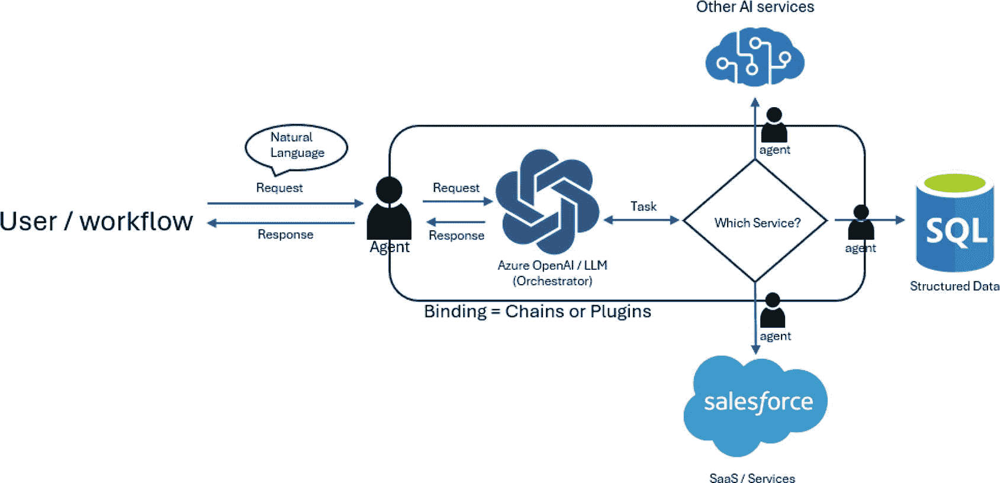

**图 7-2** – 概念图 – 利用并扩展 LLM 以执行外部任务

将 LLM“绑定”到不同能力以使其能够启动任务的最流行方法，由两个开源框架提供——LangChain 和语义内核。根据你使用的框架，图 7-2 中描述的“绑定”要么称为`链`（LangChain），要么称为`插件`（语义内核）。这是两个框架共同的概念表示，尽管它们在实现上有所不同。

在本章中，我们将重点介绍语义内核，并学习主体和插件的概念。在下一章中，我们将比较语义内核和 LangChain，但我们将使用 LangChain 作为开发解决方案（DBCopilot）的方法，这样你就能理解这两个框架。

哪个框架最好？遗憾的是，和大多数答案一样，“视情况而定”。我们将在下一章帮你评估这两个框架，但现在，让我们专注于语义内核。

## 语义内核^(⁷⁸)简介

语义内核是微软提供的一个开源软件开发工具包（SDK）。开发人员使用它为 LLM 构建主体。语义内核不仅适用于 OpenAI 模型和模型，也适用于 Hugging Face 等其他模型。语义内核支持 Python、C#和 Java 代码。

### 使用场景

到目前为止，大多数使用场景都是像 ChatGPT 那样的聊天界面，或网站上的问答形式，但这并非唯一的用例，在我们看来，也不是最引人注目的用例。

#### 超越聊天机器人

LLM 可以集成到各类应用程序中，无论是基于云的应用程序（Web 应用）还是安装在计算机上的软件。我们认为，参照每个产品对应的微软 Copilot^(⁷⁹)，将此类用例称为`智能副驾`是最简单的表述方式。事实上，这些微软 Copilot 正是使用`Semantic Kernel`构建的。

尽管“智能副驾”一词已被宽泛地用于指代任何具有 LLM 功能的事物，包括聊天机器人，但我们认为，智能副驾应该仅指代由 LLM 驱动的应用程序。这意味着智能副驾存在于应用程序内部，并且是解决方案的一部分。你无需离开当前系统就能使用 LLM。在你使用应用程序时，LLM 会积极地提供协助。

例如，使用 GitHub Copilot 时，在你开始编码的同时，它就会开始建议下一行代码。它还能协助调试，并可以解释和/或修复问题。GitHub Copilot 是一个安装到 Visual Studio Code 和 Visual Studio 等 IDE 中的扩展，^(⁸⁰)从而扩展了这些 IDE 的功能。同样地，当你在 Word 中开始新文档时，M365 Copilot 会让你选择为其提供一个提示，以帮助你完成写作任务。

`Semantic Kernel`允许开发者实现不同的插件，包括 AI 插件，这样新的和现有的代码现在都可以受益于 LLM 的赋能。因此，我们提出了两个不同的用例类别——聊天机器人与智能副驾。

#### 实时数据

LLM 的一个缺点是其受限于模型训练时的时间界限数据。在第 4 章中，我们也了解了通过 RAG 架构将 LLM 与精心整理的数据源相结合。然而，这仍然是基于有时限的数据源。

`Semantic Kernel`的一个引人注目的用例是让 LLM 能够从 Web 服务获取实时数据。例如，使用`Semantic Kernel`，LLM 可以查询 Web 服务中的航班状态以了解其航班时刻表。一个投资追踪应用程序，当用自然语言询问当天当前的最大市场异动股是什么时，它可以连接到 Web 服务以获取该信息，并研究可能导致这种波动的相关最新新闻。

#### 执行任务

除了检索信息、创建内容或回答问题之外，使用`Semantic Kernel`的另一个好处是能够执行任务。例如，在查询了航班状态和价格后，`Semantic Kernel`可以启动购买机票或预订酒店等操作。

#### 代理与智能副驾

如上所述，代理是 LLM 的一种表现形式，其目的是帮助回答问题并自动化任务。智能副驾是一种特殊类型的代理，它可以帮助回答问题，但不会自动化任务。这就是为什么许多用例目前都是智能副驾，因为它们相对更容易实现，并且由于没有任务被自动化，所以也更安全。智能副驾与人类协同工作，提供建议和回答问题，但人类始终掌握控制权，并负责执行智能副驾建议的任何任务。

一旦智能副驾部署完毕，它随后可以转变为一个功能完备的代理；因此，无需从头重建。

## 动手练习 7-1：开始使用 Semantic Kernel

在第一个动手练习中，我们将使用`Semantic Kernel`与 Azure OpenAI 进行交互。`Semantic Kernel`支持 Python 和 C#。实际上，与 LangChain^(⁸¹)等其他框架的一个区别是，`Semantic Kernel`原生支持 C#。因此，本动手练习将使用 C#。

在本章中，我们将使用一个零售场景。该场景是利用`Semantic Kernel`和 Azure OpenAI 来协助客户和库存管理。对于第一个用例，我们希望构建一个有助于创建营销信函的代理。

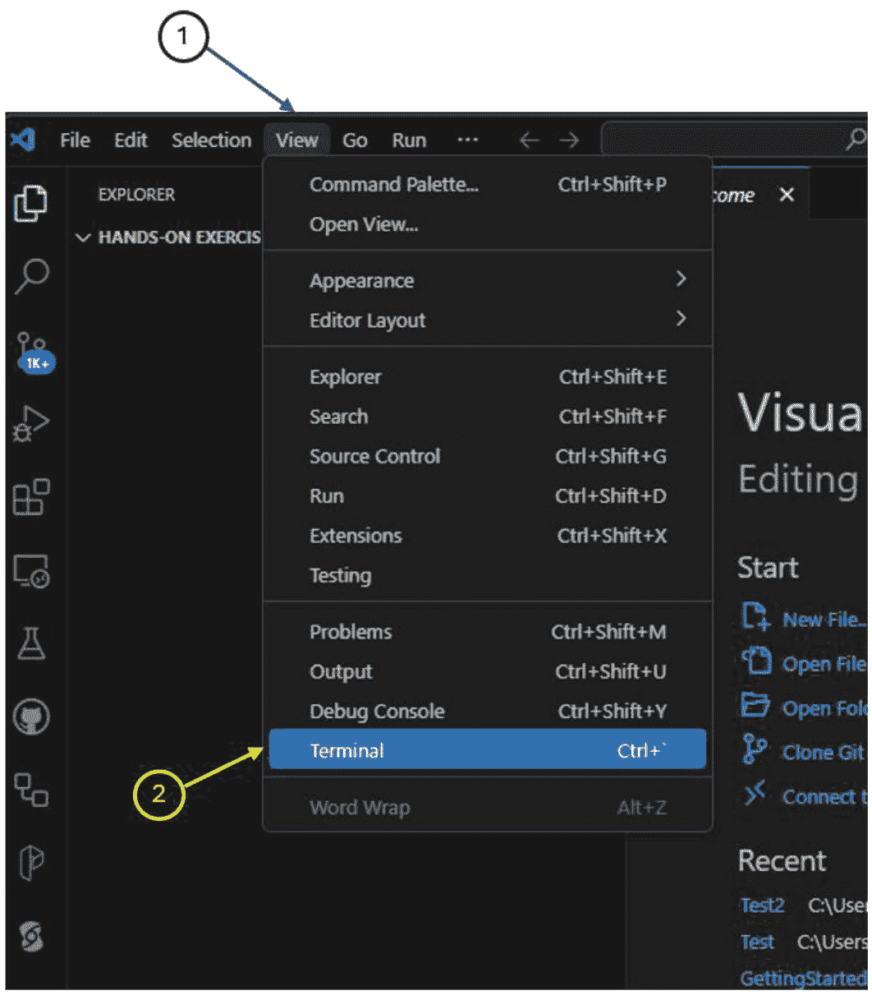

图 7-3 显示 VS Code 中的终端窗口

1.  从 Azure 门户中，从你的 Azure OpenAI 端点检索以下信息。你也可以使用之前动手练习中的相同模型和相应的值：

    1.  部署名称

    2.  Azure OpenAI 端点（URL）

    3.  Azure OpenAI 密钥

2.  在你的开发环境中，为此练习创建一个新文件夹（例如，如果你已经克隆了本章的仓库，可以在本地仓库中创建一个新文件夹）。

3.  启动一个新的 Visual Studio Code 窗口，并从 VS Code 的资源管理器视图中选择“打开文件夹”。

4.  导航到并选择你在步骤 2 中创建的文件夹。

5.  从“查看”菜单中选择“终端”，如下方图 7-3 所示。

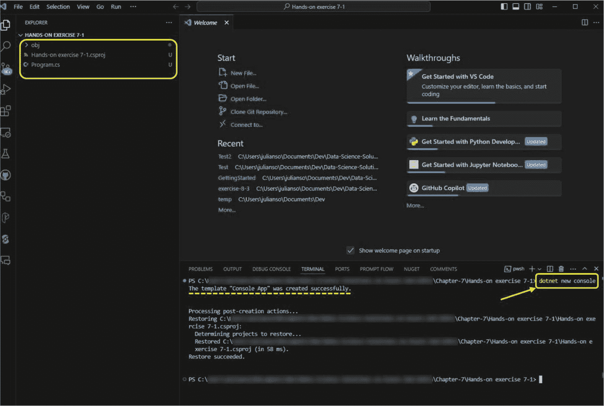

图 7-4 创建新的 C# .Net 控制台应用程序

6.  如图 7-4 所示，在编辑器内的终端窗口中，输入以下命令以创建一个新的.Net 控制台应用程序：

```csharp
dotnet new console
```

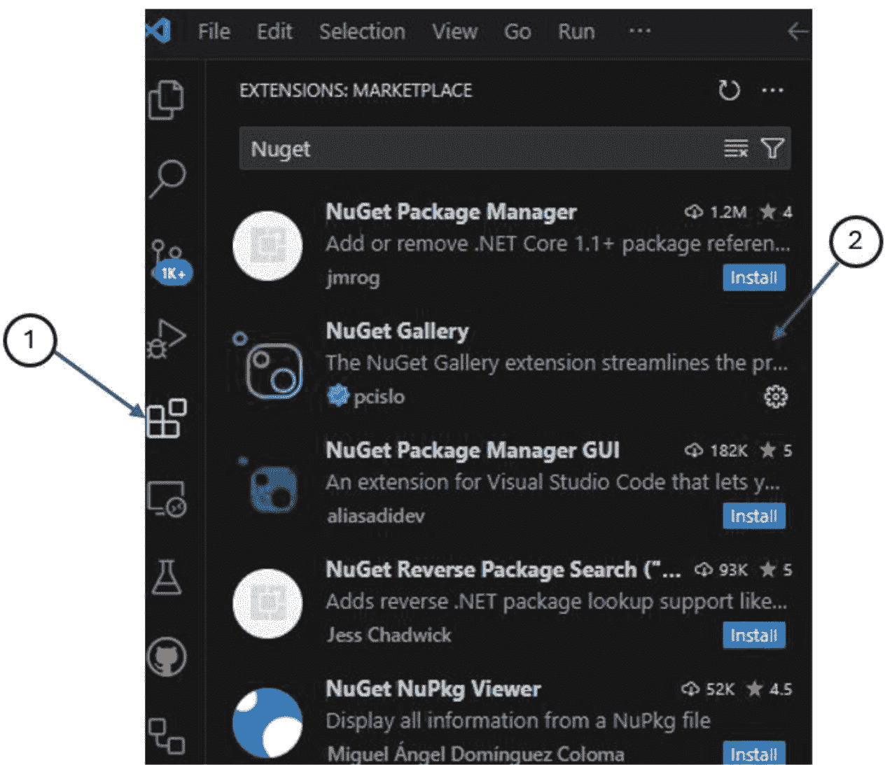

图 7-5 在 VS Code 中安装 NuGet 扩展

7.  同样如图 7-4 所示，请注意控制台应用程序已成功创建，并且项目文件夹中已创建了新的文件和文件夹（`obj`文件夹、`.csproj`文件和`program.cs`）。

8.  接下来，我们需要从 Nuget 安装`Semantic Kernel`模块。我们也可以通过终端来完成此操作，但更友好的 GUI 方法是向 VS Code 安装一个 Nuget 扩展（如果尚未安装的话）。你可以通过在 VS Code 中选择“扩展”选项，然后在搜索框中输入“Nuget”来完成。本练习我们使用了 NuGet Gallery，如图 7-5 所示。

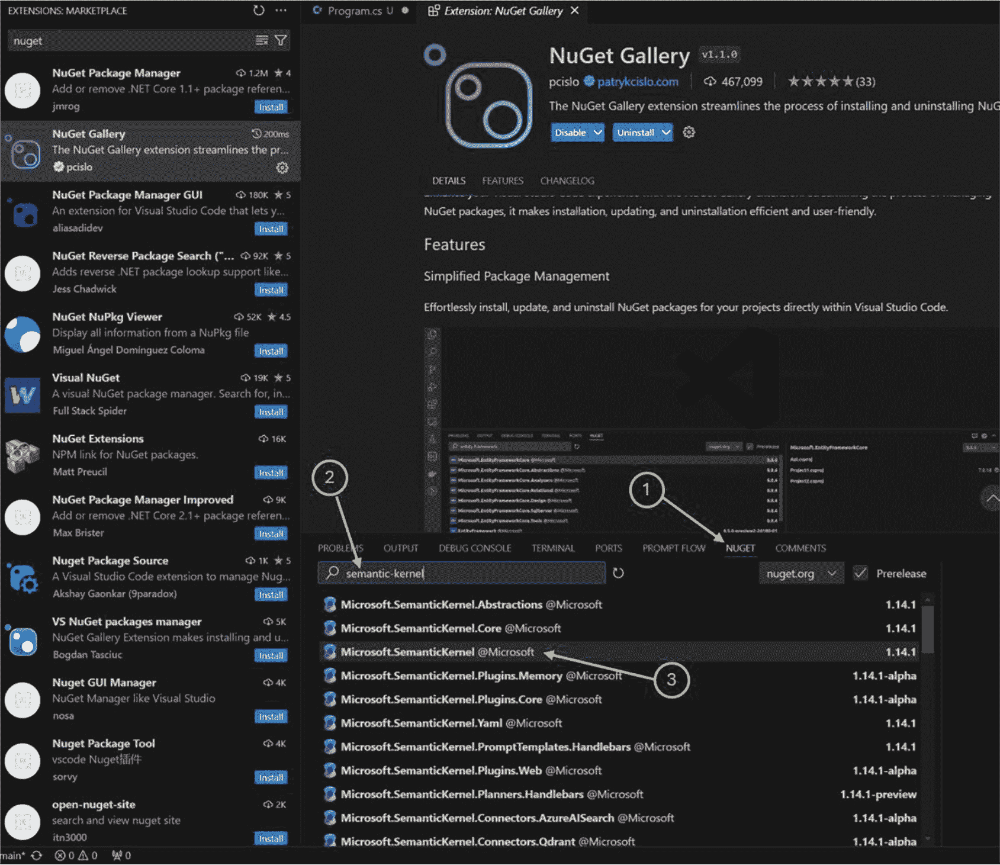

图 7-6 使用 NuGet Gallery 扩展安装 Semantic Kernel NuGet 包

9.  参照图 7-6，一旦 NuGet Gallery 扩展安装完毕，你应在终端窗口中看到一个新的 NUGET 菜单选项。如果没有看到此选项，请保存项目，重启 VS Code，然后重新打开项目。点击“NuGet”，在搜索框中输入`semantic-kernel`，然后在结果中选择`Microsoft.SemanticKernel @Microsoft`。

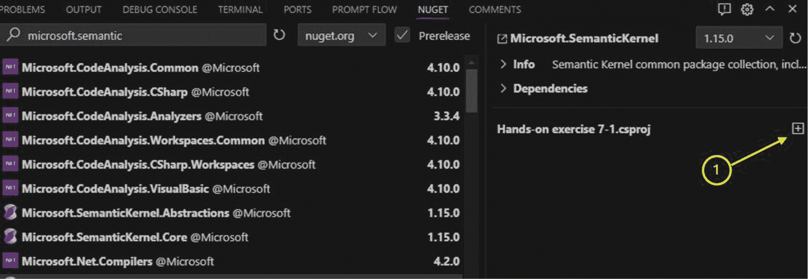

图 7-7 向项目添加 NuGet 包

# Semantic Kernel 与插件

## Plugins 和 Functions

`Plugins` 以前被称为 `Skills`。如上所述，`Semantic Kernel` 中的插件使开发人员能够为 `LLM` 创建扩展以执行任务。插件可以组合成基于业务的插件集，以形成功能任务。

插件可以执行一个或多个任务。插件的功能被称为 `functions`。因此，在高级层面上，插件是一组可以暴露给 `LLM` 的函数。

### 样式

延续我们的零售场景，我们零售商店的业务功能示例可以包括订单、退货、客户关系、销售人员以及库存。我们可以创建一个基于业务的插件，其中包含如下方图 7-10 所示的功能任务。

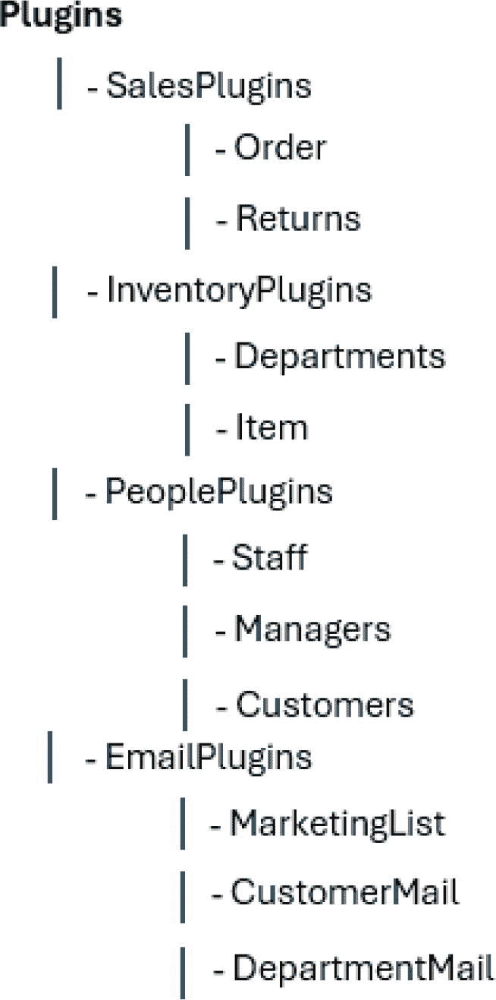

**图 7-10** 零售商店的插件结构

现在，如果我们想向过去订购过特定商品的客户发送邮件，告知他们有同款或相关商品的促销活动，我们可以向 `LLM` 发出以下指令：

*   `请向订购过商品 SKU 123-456 或类似商品并选择接收营销信息的客户发送邮件。`

我们可以从图 7-3 中找到不同插件的组合，并基于 `Item` + `Orders` + `Customers` + `MarketingList` 插件来完成此任务。

### 模板

`Semantic Kernel` 中的插件通过使用遵循特定格式的模板来定义。插件模板的格式是一组提示及其相关配置。下方图 7-11 描述了 `Semantic Kernel` 插件模板的格式。

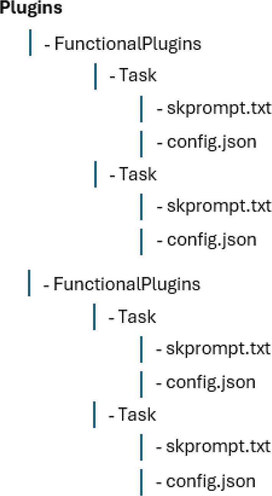

**图 7-11** `Semantic Kernel` 插件模板的格式

使用图 7-10 中的示例，我们零售商店的 `Semantic Kernel` 模板（包含其中两个插件）将如下方图 7-12 所示。

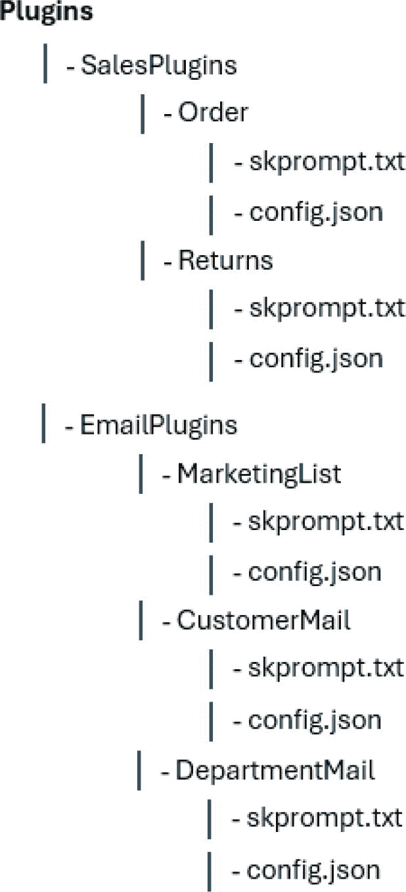

**图 7-12** `Semantic Kernel` 模板示例

`skprompt.txt` 文件保存了任务的功能提示，并支持参数化。参数使用格式 `{{$参数名}}` 声明。例如，`MarketList` 的 `skprompt.txt` 可以如下所示：

```
使用{{$language}}向列表{{$input$}}中的客户发送内容为{{$content}}的邮件。
```

此函数的职责是使用客户偏好的语言向其发送邮件。这些客户在特定语言的邮件列表中被识别。因此，我们传递了三个参数——邮件列表名称、邮件中使用的语言以及邮件内容。

`config.json` 包含特定于 `LLM` 的配置细节，例如最大令牌数、`temperature` 等。上述邮件功能的 `Semantic Kernel` 模板示例如下方图 7-13 所示。

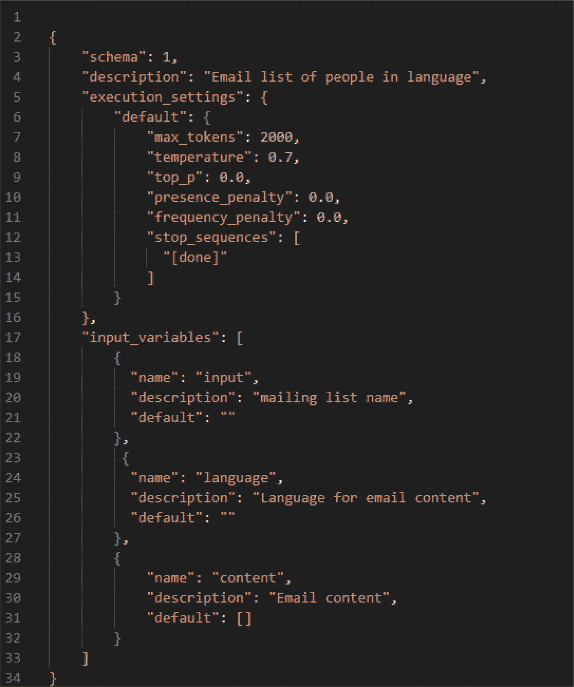

**图 7-13** 本例中邮件功能的 `Semantic Kernel` 模板示例

通过插件，我们可以根据业务场景来组织工作，以便可以指示 `LLM` 如何执行不同的业务功能。

### 动手练习 7-2：插件

现在我们已经理解了插件的概念、格式（样式）以及模板的概念，我们将在本动手练习中加以应用。我们将继续使用 C#，但我们切换到 `Jupyter Notebook` 以更好地探索 `Semantic Kernel`。

`Jupyter Notebook` 传统上与 `Python` 一起使用，因此为了让笔记本能在 VS Code 中识别并执行 C# 代码块，我们需要安装一个 `.Net Kernel`。

#### 为 VS Code 安装 .Net Kernel

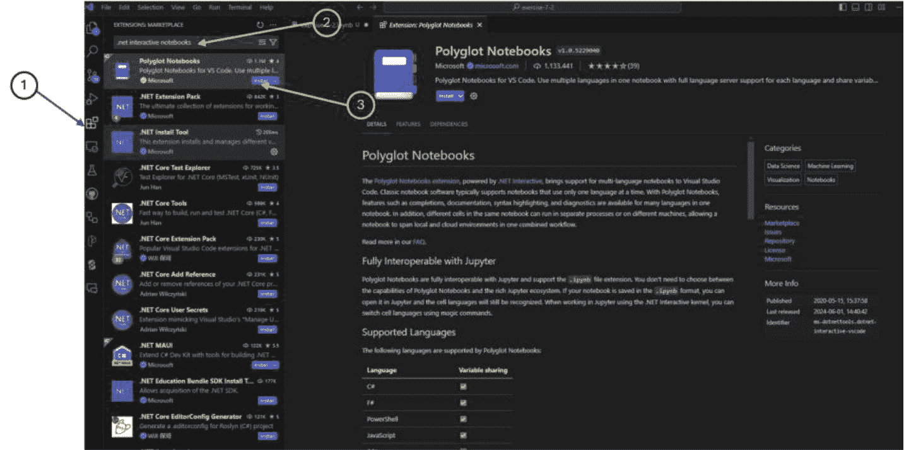

**图 7-14** 安装 `Polyglot Notebooks` 扩展

1.  在 VS Code 中，点击 `Extensions`，在搜索框中输入".net interactive notebooks"，并从搜索结果中安装"Polyglot Notebooks"，如下方图 7-14 所示。

2.  重启 VS Code。

#### 从文件加载并执行插件

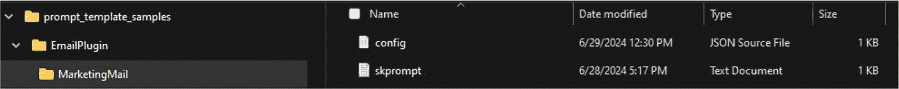

**图 7-15** `prompt_template_samples` 文件夹的内容

1. 在您克隆的仓库副本中，打开 `Chapter-7\exercise-7-2` 文件夹。

2. 探索 `prompt-template_samples` 文件夹的内容，如下方图 7-15 所示。

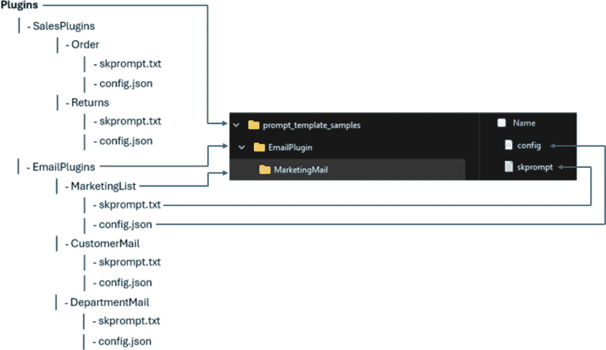

**图 7-16** 预期样式与实际部署之间的实际映射

1. 将内容与图 7-12 中的结构进行比较，您会看到两者之间的映射关系，如图 7-16 所示。虽然我们对名称做了一些细微更改（例如，使用 `MarketingMail` 代替 `MarketingList`），但结构是相同的：有一个包含所有插件的顶级目录（`prompt_template_samples` 文件夹），每个插件有一个子目录（在我们仓库中，只有一个插件，即 `EmailPlugin`），以及一个用于存放函数定义和配置的子目录（`MarketingMail`）。

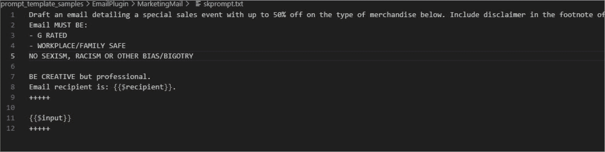

**图 7-17** 包含两个参数的 `MarketingMail` 函数的 `skprompt.txt` 文件

1. 启动 VS Code 并打开 `exercise-7-2` 文件夹。

2. 打开 `exercise-7-2.jpynb`、`config.json` 和 `skprompt.txt` 文件。

3. 让我们首先研究一下 `skprompt.txt`，如下方图 7-17 所示。请注意，它是一个简单的文本文件，包含的提示词与我们在练习 7-1 中使用的类似。唯一的区别在于，我们现在定义了两个参数：收件人的名称 `{{$recipient}}` 和正在促销的商品类型 `{{$input}}`。这将使我们能够重用此插件来为不同类型的商品生成促销信函。

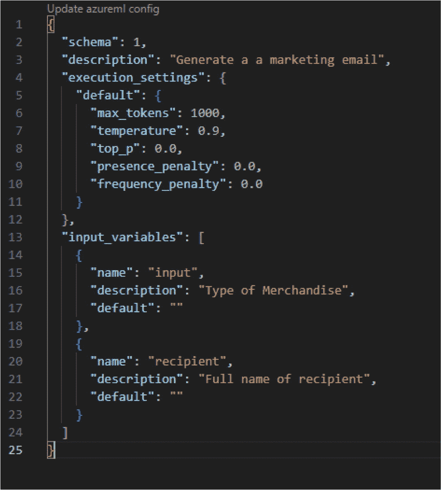

**图 7-18** 包含 LLM 配置信息的 `config.json` 文件

1. 接下来，查看 `config.json`。如图 7-18 所示，该文件包含 LLM 的配置，我们看到了最大令牌数、温度等设置。`config.json` 文件还包含了 `skprompt.txt` 文件中提及的两个参数（`input` 和 `recipient`）的定义。

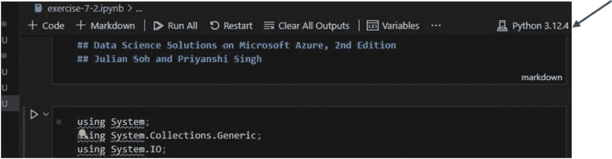

**图 7-19** 定位当前活动的内核

现在查看 `exercise-7-2.jpynb`。在 VS Code 窗口的右上角，您应该会看到 Python 内核作为当前活动的计算环境，如图 7-19 所示。

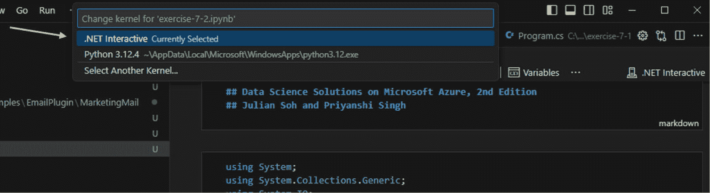

**图 7-20** 选择 .NET 内核

我们需要从 Python 内核切换到 .NET 内核，因为代码是 C# 编写的。由于您之前已经安装了 .NET 内核，应该能够进行此切换。点击 Python 内核，调出 VS Code 中央的下拉菜单，然后选择“.NET interactive”，如下方图 7-20 所示。VS Code 会指示它现在正在使用 .NET 内核。

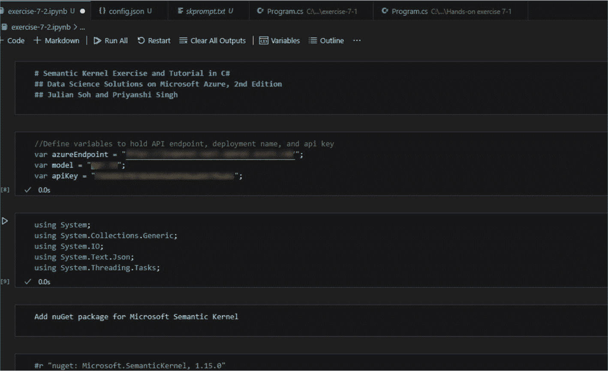

**图 7-21** 定义变量以存储 LLM 信息（端点、部署名称和 API 密钥）

当 VS Code 在窗口右上角显示  而非 Python 时，即表示您已成功将内核切换到 .NET。此时，笔记本中的代码将正确格式化并着色，因为 IntelliSense 已处于正确的上下文中。

在第一个代码块中，输入您的 Azure OpenAI 端点、部署名称和 API 密钥，如您在之前的练习中所做的那样，如下方图 7-21 所示。

现在依次运行笔记本中的每个代码块。笔记本中有足够的注释，您可以跟随操作。请注意插件是如何被导入并随后用于生成所需的营销信函和收件人信息的。

### 规划器与函数调用

一旦您拥有多个插件（这在许多（即便不是全部）实际应用中很可能会出现），就需要 LLM 知晓这些插件，并能够将它们组合使用以完成请求或任务。

Semantic Kernel 引入了规划器的概念，允许 LLM 使用不同的插件。规划器使用提示词请求 AI 选择要调用哪个函数。

然而，更新版本的 OpenAI 模型（0613 版及以上）具备原生调用函数的能力，这被称为函数调用。因此，Semantic Kernel 正在演进，将函数调用作为规划和执行任务的主要方式。尽管 Semantic Kernel 仍然支持规划器，但其他 AI 模型（如 Gemini、Claude 和 Mistral）也支持函数调用作为原生能力，这使得 Semantic Kernel 中的函数调用成为一项可跨多种模型使用的功能。因此，建议将 Semantic Kernel 中的函数调用作为规划和执行任务的主要方法^(⁸⁸)。

鉴于这一发展，我们将不介绍规划器，而是重点关注函数调用。如果您使用的是不支持函数调用的旧模型，可以了解规划器及其向函数调用的演进过程；这里有一个很好的[资源](https://devblogs.microsoft.com/semantic-kernel/migrating-from-the-sequential-and-stepwise-planners-to-the-new-handlebars-and-stepwise-planner/) ^(⁸⁹)，来自 Microsoft 开发者博客，涵盖了这一内容。

#### 自动函数调用

函数调用仅仅是 AI 模型原生调用函数的一种方式。函数调用的一个扩展——称为自动函数调用——是指 LLM 能够理解哪些函数可用于不同任务，并随后将其作为知识的一部分来响应请求。

描述自动函数调用的一个好方法是将其与“后续问题或后续操作”场景联系起来。这些场景涉及的任务请求需要先进行澄清性问题或操作之后才能执行。

**示例 1：后续问题（基于聊天的场景）**

用户：请给我最近客户服务地点的电话号码

LLM：您在哪里？

用户：我在西雅图。

LLM：我在西雅图有几个地点。以下是地址 – ...

**示例 2：后续操作（自动化场景）**

用户：请打开所有灯

LLM：思考过程 = *找到所有灯，选择当前关闭的灯，识别关闭的灯的名称，打开它们，向用户报告所有灯现在都已打开，并且具体打开的灯是 x、y 和 z。*

在上述两个示例中，要执行后续问题或后续操作，需要迭代逻辑（例如，循环），直到获取执行任务所需的所有信息。自动函数调用为您处理了这一点。

### 聊天补全中的自动函数调用

下图 7-22^(⁹⁰) 展示了 Semantic Kernel 如何实现自动函数调用。当通过模板或代码中的函数暴露给内核时，内核会将这些函数序列化，并呈现给大语言模型（LLM）。

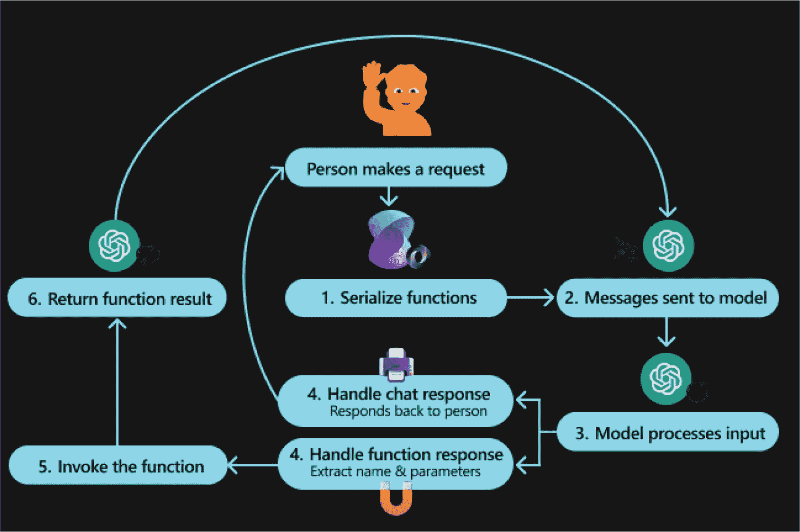

**图 7-22** Semantic Kernel 如何实现函数调用

序列化是内核的一项内置功能，序列化后的函数使 LLM 能够理解这些函数及其所需的任何参数。

当用户发出请求时，序列化后的函数、聊天历史记录以及当前请求都会一起发送给 LLM。有了这些信息，LLM 可以在必要时提出澄清性问题，或者调用函数来执行任务。结果随后会返回给用户。

### 动手实验 7-3：具有自动函数调用功能的 Semantic Kernel 与聊天补全

在本实验中，我们使用了 `GPT-4o`，但您也可以使用任何 `0125` 或更高版本的 Azure OpenAI 模型。

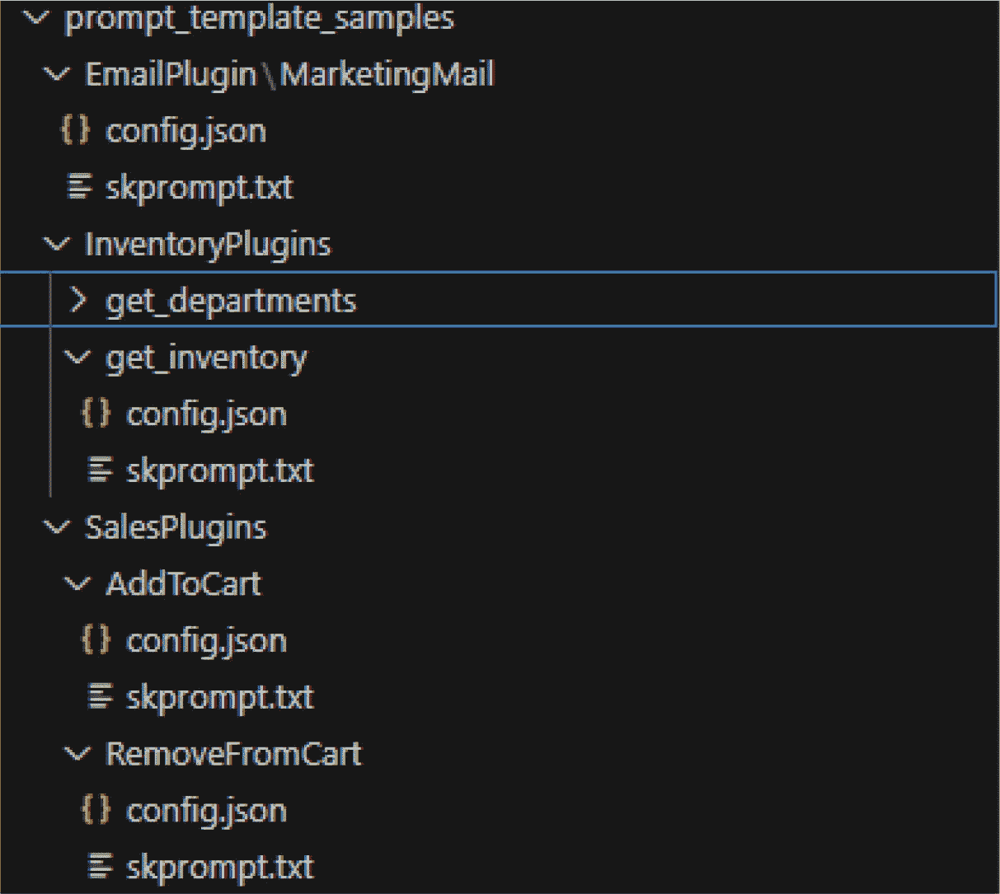

**图 7-23** 添加了 `InventoryPlugins` 和 `SalesPlugins`

如果尚未部署 `GPT-4o` 或任何 `0125` 或更高版本的模型，请先进行部署。

为此项目创建一个新文件夹。

将名为 [`prompt_template_samples` 的文件夹](https://github.com/juliansoh/Data-Science-Solutions-on-Azure-2nd-Edition/tree/main/Chapter-7/exercise-7-3/prompt_template_samples)^(⁹¹) 从克隆后的[仓库](https://github.com/juliansoh/Data-Science-Solutions-on-Azure-2nd-Edition/blob/main/Chapter-7/exercise-7-1/Program.cs)^(⁹²)副本中复制过来。

启动 VS Code，在 IDE 的资源管理器选项卡中，点击 。

导航至上面步骤 2 中创建的文件夹，并点击  选中它。

点击菜单栏中的**视图**，然后选择**终端**，以便在 IDE 中显示终端窗口。

创建一个新的 .NET 控制台应用程序（请参见动手实验 7-1 中的图 7-4）。

安装 `Microsoft.SemanticKernel` NuGet 包（请参见动手实验 7-1 中的图 7-6）。

打开 `Program.cs`，将“Hello World”代码替换为[第 7 章动手实验 7-3 的仓库](https://github.com/juliansoh/Data-Science-Solutions-on-Azure-2nd-Edition/blob/main/Chapter-7/exercise-7-3/Program.cs)^(⁹³)中 `Program.cs` 的代码。

将 `azureEndpoint`、`model` 和 `apiKey` 变量替换为 Azure OpenAI 部署中的对应值。

保存所有文件。

让我们来探索一下提示模板示例。在 `prompt_template_samples` 文件夹中，我们看到了与实验 7-2 相同的电子邮件插件（`EmailPlugin`）。我们还增加了两个插件，分别用于库存（`InventoryPlugins`）和销售（`SalesPlugins`），如下图 7-23 所示。

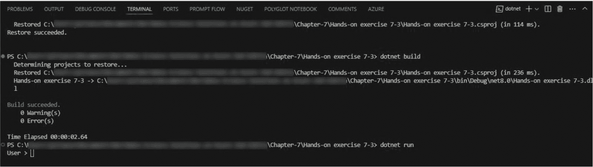

**图 7-24** 构建并运行 exercise-7-3 的代码

检查这些插件中的 `skprompt.txt` 和 `config.json` 文件，以了解插件中各个函数对应的提示词。

- `get_inventory` 函数的 `skprompt.txt` 包含一个硬编码的库存项目列表。这是为了简化实验，以便我们专注于自动函数调用的概念。在现实世界中，该函数将替换为来自数据库的值（请参见第 8 章和 DBCopilot）。

在**终端**窗口中，使用 `dotnet build` 和 `dotnet run` 命令构建并运行解决方案，如下面的图 7-24 所示。

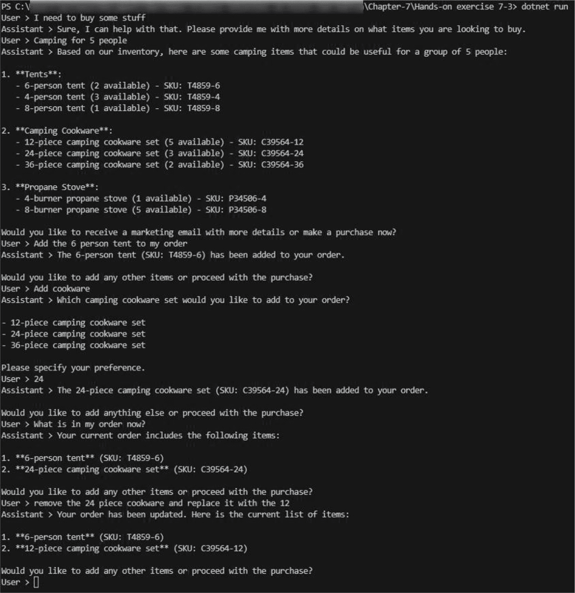

**图 7-25** 利用 Semantic Kernel 和自动函数调用与 LLM 进行的示例对话

### 与代理进行对话^(⁹⁴)

图 7-25 显示了一个示例对话。请记住，因为我们是在与 LLM 以及可能不同的模型打交道，所以您得到的响应可能会有所不同。但最重要的是，您能体验到“追问”类型的交互。

以上述对话为例，以下是我们在本实验中探索的关键特性：

- 当请求模糊不清时，LLM 会请求更多信息。
    - 例如，当需要澄清用户请求的是哪种类型的商品、具体是哪类炊具等时。

- LLM 中的自动函数调用允许 `Semantic Kernel` 调用正确的函数，而无需开发复杂的逻辑。
    - 请注意 `Semantic Kernel` 是如何仅从 `InventoryPlugins` 的 `get_inventory` 中获取露营物品，并通过 `SalesPlugins` 中的 `AddToCart` 函数将其添加到订单中的。

### 创建函数的最佳实践

由于在聊天补全过程中，函数的序列化信息会被发送给 LLM，因此存在一些最佳实践可以改善补全的性能和质量。

#### 函数模式的详细程度

序列化会占用令牌。因此，更冗长的模式需要更多的令牌，这会减慢响应时间。尽量保持函数简洁，并使用具有自解释性的函数名，因为这有助于避免为函数提供描述。

#### 参数

指定函数所需的参数。同样，如果模型不需要某些参数，则应将其隐藏。

同时指定参数类型，这有助于模型在响应中提高准确性。在可能的情况下，避免使用 `string` 作为参数类型，因为模型无法推断 `string` 类型的参数。尽可能使用 `int`、`float` 或复杂类型。

#### 函数描述

为函数提供描述是可选的，但这样做可能有助于提高 LLM 理解函数功能的能力。然而，如上所述，使用自解释的函数名也能达到同样的目的，这是推荐的做法。如果函数名具有自解释性，则可以省略提供函数描述。

#### 插件名称

如前所述，插件是函数的集合。然而，插件及其名称被用作函数的命名空间属性。因此，同名函数可以存在于不同的插件中，并且每个同名函数可以具有不同的功能。例如，一个名为 `search` 的函数可以存在于多个插件中，每个插件负责在不同的上下文或位置执行搜索。

在实验和示例中，我们在名称中使用了“plugins”。这是有意为之，以强化概念。然而，在实践中，应去除这些多余的词语，因为这将有助于减少模式的冗长性。

### 在代码中加载插件

我们一直使用 `skprompt.txt` 提示模板和对应的 `config.json` 文件来定义插件和函数。这些也可以与代码一起内联定义。

#### 动手练习 7-4：内联插件与函数

由于我们已经多次进行过类似操作，本练习将省略步骤的详细说明。

1.  与之前的所有练习一样，创建一个新文件夹，并在该文件夹中新建一个 .Net 控制台应用程序。

2.  安装 `Microsoft.SemanticKernel` NuGet 包。

3.  用[练习 7-4 中的 `Program.cs`](https://github.com/juliansoh/Data-Science-Solutions-on-Azure-2nd-Edition/blob/main/Chapter-7/exercise-7-4/Program.cs) 文件内容替换 `Program.cs` 中的代码。

4.  在代码中提供 `azureEndpoint`、`model` 和 `apiKey` 的值。

5.  生成并运行应用程序。

与智能体进行交互。示例对话如下图所示（图 7-26）。一个插件包含两个内联定义的函数。

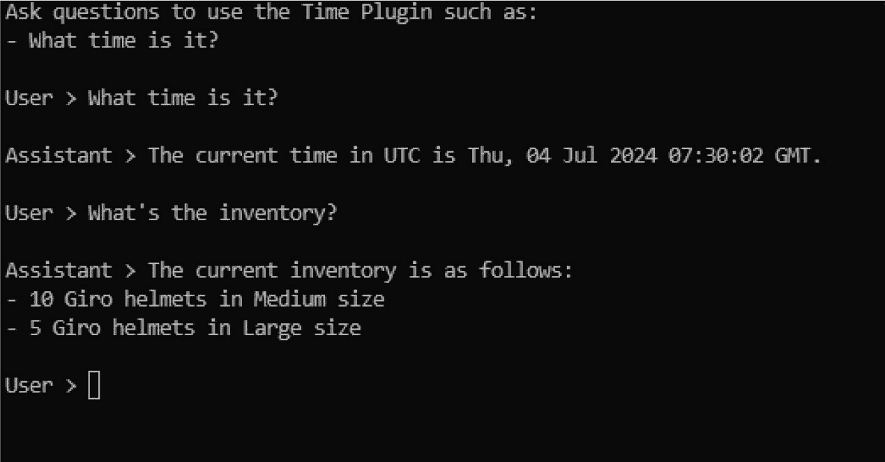

**图 7-26** 与使用内联插件的信息智能体进行示例对话

## 总结

像 OpenAI 这样的大语言模型可以调用函数来执行任务。这使大语言模型超越了聊天、文本摘要、图像分析或创建等范畴。`Semantic Kernel` 是微软的一个开源解决方案，用于向大语言模型描述函数及其参数。正如我们在本章的示例和练习中所见，函数可以分组到插件中。

借助较新版本大语言模型内置的自动函数调用功能，`Semantic Kernel` 正从使用规划器概念转向利用此能力轻松创建业务逻辑和流程逻辑。在定义函数时，请遵循推荐的最佳实践。

在下一章中，我们将介绍 LangChain，它是 `Semantic Kernel` 的替代方案。我们还将使用 LangChain 引入 `DBCopilot` 的概念。但需要注意的是，尽管我们使用 LangChain 来介绍 `DBCopilot`，您也可以使用 `Semantic Kernel` 来实现 `DBCopilot`。

脚注