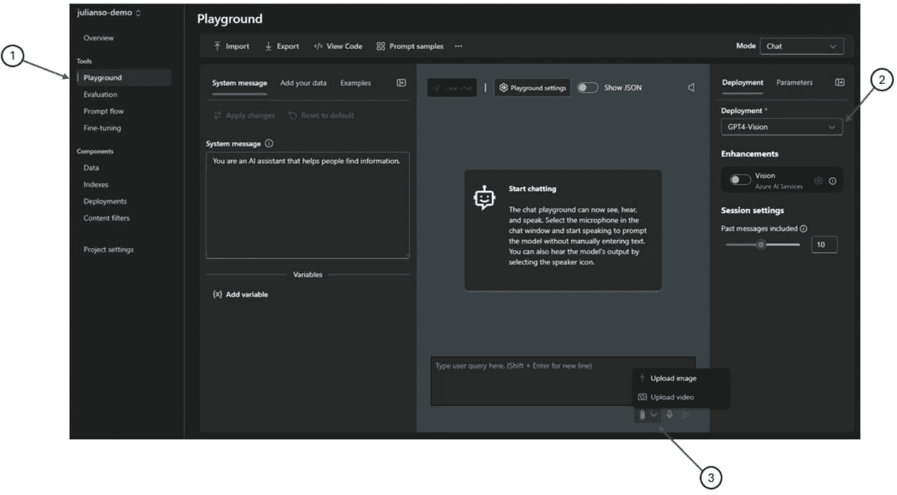
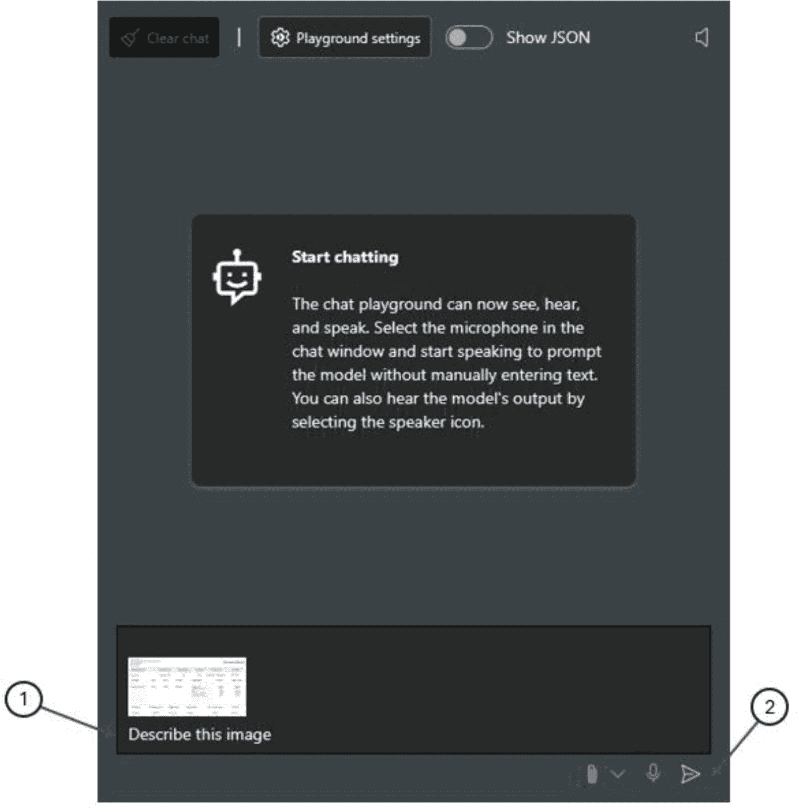
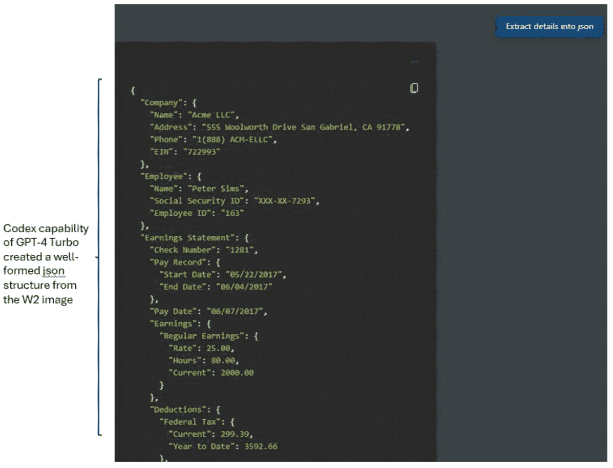
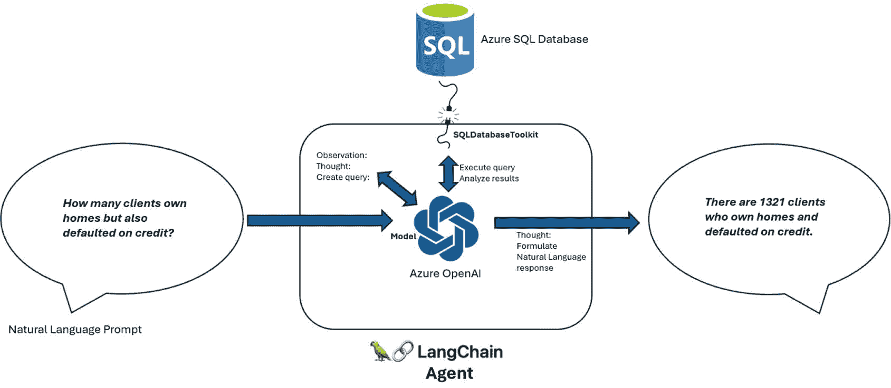
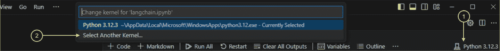
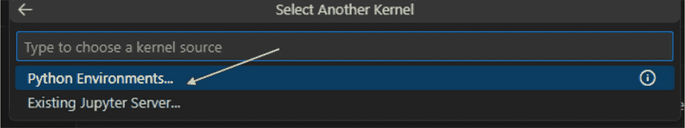
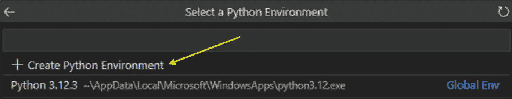
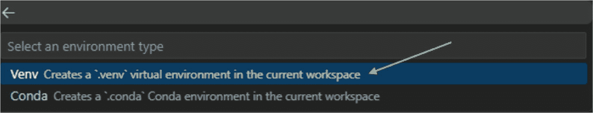
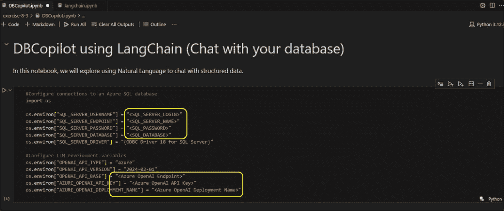
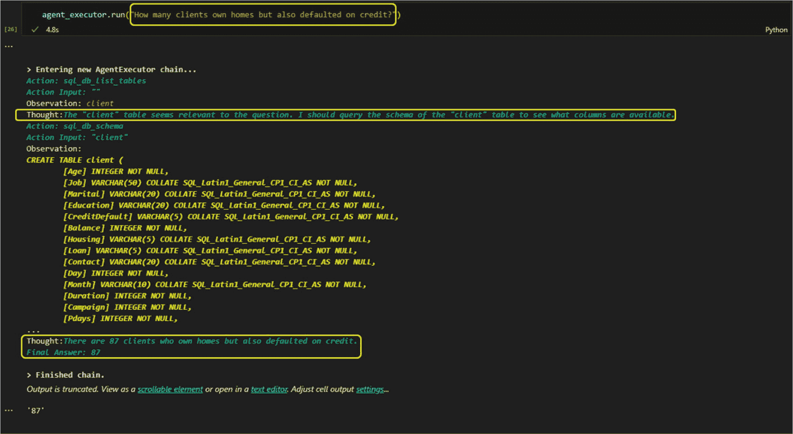

# 8. 结构化数据、Codex、智能体与 DBCopilot

到目前为止，我们一直在非结构化数据的背景下讨论生成式 AI。我们已经了解了如何将大语言模型与非结构化数据结合，并通过自然语言处理与数据进行交互。

OpenAI 将自然语言与来自 GitHub 仓库和其他公共来源的数十亿行开源代码的训练数据相结合。其结果是一个能够理解数十种编程语言以及数据库关系和模式等计算概念的模型。结合 NLP 训练数据，用户和应用程序可以用自然语言讨论技术主题。该模型被称为 Codex，是实现本章用例的核心能力。

## Codex

Codex 最初是一个独立的模型。它是微软 GitHub 与 OpenAI 在 2021 年合作的产物，也是为 GitHub Copilot 提供支持的模型。它曾一度停产，因为它成为了 GPT-3.5 Turbo 和 GPT-4 模型的一项能力，但后来由于大众需求而撤销了该决定。尽管因用例而异，但作为多模态模型方法，对 GPT-3.5T 或 GPT-4 Turbo 进行单次 API 调用可能仍然更具成本效益和效率。

### 动手练习 8-1：GPT 中的 Codex

在本练习中，我们将使用 GPT-4 Turbo + Vision。您可以选择像第 3 章中的练习 3-3 那样使用 Postman 进行测试，但本练习我们将使用 Azure AI Studio。



**图 8-1** 在 GPT-4 Turbo + Vision 模型的 Playground 中上传图像

1.  如果尚未部署 GPT-4 Turbo + Vision 模型，请先进行部署。
2.  如果您已克隆本书的 GitHub 仓库，所需文件位于 `Chapter-8\exercise-8-1` 文件夹中。否则，请从仓库下载三个 JPEG 文件：`https://github.com/juliansoh/Data-Science-Solutions-on-Azure-2nd-Edition/tree/main/Chapter-8/exercise-8-1`。
3.  访问 AI Studio 网站 `https://ai.azure.com`。
4.  选择 Playground，然后选择 GPT-4 Vision 作为模型，点击图标并选择“上传图像”，如下方图 8-1 所示。



**图 8-2** 使用 GPT-4 Turbo 分析图像

1.  从步骤 2 中选择任意一个 JPEG 文件。例如，我们选择 `mockPayStub.jpg`。
2.  提供提示词“描述此图像”，如图 8-2 所示。



**图 8-3** GPT-4 Turbo 的 Codex 能力：从 W2 图像中创建信息的 json 结构

1.  注意大语言模型的响应。它是对工资单的摘要描述，突出了年初至今的收入、净工资、扣除额等细节。
2.  为了演示 GPT-4 Turbo 的 Codex 能力，输入提示词：“将详细信息提取为 json”。
3.  现在观察响应。大语言模型应该已经根据 W2 图像中的信息创建了一个格式良好的 json，如下方图 8-3 所示。
4.  尝试以下其他提示词，或自行编写提示词，并观察每个输出：
    1.  创建一条 SQL 语句，将此信息保存到 SQL 数据库中。
    2.  编写 C# 代码，将信息插入到 SQL 数据库中。
    3.  编写 Python 代码，将信息保存到 PostgreSQL 表中。
    4.  使用 Go 语言将信息保存到 Cosmos DB 中。

上面创建的 SQL 语句（步骤 10.a）与本章节最为相关，因为我们接下来将重点讨论如何使用大语言模型生成基于数据库数据的响应。因此，通过首先创建正确的 SQL 语句然后执行它来选择正确的行，是实现模式。

## 结构化数据

结构化数据是指以表格形式（行和列）呈现的任何数据。这是对数据库的形式化描述，其主要区别在于数据库通过包含关系等概念并提供管理、组织和过滤结构化数据的工具来扩展结构化数据。

当在大语言模型上下文中使用时，结构化数据与数据库引擎的类型无关，尽管在我们的示例和动手练习中，我们将使用 Microsoft SQL 数据库和 SQL 语言。


## 代理

`代理`是 LLM（大型语言模型）的扩展，使其能够执行外部操作。例如，如果某个 LLM 的请求是发送一封电子邮件，该 LLM 可以初始化一个能够调用并连接 SMTP 服务器来发送邮件的代理。在本章中，我们将构建的基于 LLM 的代理，将能够连接数据库并执行由 LLM 的`Codex`能力生成的查询，从而实现自然语言处理（NLP）到 SQL 的转换，并随后执行查询。`代理`通常使用诸如`LangChain^(⁹⁹)`和`Semantic Kernel^(¹⁰⁰)`等框架构建。

### LangChain

`LangChain`是一个基于 Python 的开源框架，它集成了多种工具包（有时称为软件包），可与不同的服务和应用程序集成。创建一个由 LLM 驱动的应用程序，需要将操作（如同积木块）连接成一个编排好的工作流程，这也是`LangChain`中“链”（Chains）这一术语的来源，这里的“链”指将操作编排成工作流程。因此，其名称来源于“Lang”（代表该框架支持的语言模型）和“Chain”（代表其连接服务的核心功能）。`LangChain`支持来自 OpenAI、Cohere、Hugging Face、Anthropic 等公司的模型。

### Semantic Kernel

`Semantic Kernel`是微软开发的`LangChain`替代框架，同样也是开源的。它以 Python、C#和 Java 的 SDK 形式提供。

与“链”不同，`Semantic Kernel`围绕着一个内核运行，该内核通过插件和函数调用事件来完成一项任务。它包含一个规划器，可以根据给定的提示自动决定使用哪些插件和函数。我们在前一章介绍了`Semantic Kernel`，但随着生成式 AI 模型新版本中自动函数调用功能的引入，我们正逐渐从规划器转向自动函数调用。

### 使用哪个框架？

选择哪个框架取决于你的项目需求。`LangChain`比`Semantic Kernel`出现得更早，拥有更广泛的社区支持，目前拥有的软件包也比`Semantic Kernel`更多。`LangChain`最适合在 Python 中使用，但它也支持 JavaScript/TypeScript 等其他语言。另一方面，由于`Semantic Kernel`来自微软，它与.NET 以及包括 Azure 在内的微软生态系统集成更紧密。相比`LangChain`，`Semantic Kernel`的变更和更新不频繁且更受控制，这在生产级工作负载方面有时被视为一个优点。`Semantic Kernel`支持 Python、C#和 Java。

因此，在这两个框架之间进行选择取决于项目所需的功能、偏好的编程语言以及与微软生态系统的集成程度。

下表 8-1 是对`LangChain`和`Semantic Kernel`的高级总结对比。理想情况下，你应该熟悉这两个框架。

**表 8-1**

比较 `LangChain` 和 `Semantic Kernel`

| 特性 | LangChain | Semantic Kernel |
| --- | --- | --- |
| 社区支持与流行度 | 社区支持极其强大，因其易用性而非常流行 | 不如`LangChain`流行，变更频繁，因此更稳定，具备生产级/企业级解决方案的特性 |
| 集成能力 | 拥有大量的软件包和工具包，使其功能比`Semantic Kernel`更丰富 | 在集成方面不如`LangChain`广泛，但仍然强大，可能支持多种用例。与微软产品、工具、.NET 和 Azure 的集成更深入 |
| 编程语言 | Python, JavaScript/TypeScript | Python, C#, Java |
| 定价 | 免费（开源） | 免费（遵循 MIT 许可开源） |

## 动手练习 8-2：探索 LangChain

为了理解`LangChain`，我们将通过一个简单的练习来创建一个使用`LangChain`的应用程序。这个练习将为构建一个与数据库对话的应用程序奠定基础。

**图 8-4** – 在环境变量中为 Azure OpenAI 模型、终结点和 API 密钥提供值

1. 如果你已克隆本书的 GitHub 仓库，请启动 Visual Studio Code 并打开“Chapter-8\exercise-8-2”文件夹。否则，你可以从[`https://github.com/juliansoh/Data-Science-Solutions-on-Azure-2nd-Edition/tree/main/Chapter-8/exercise-8-2`](https://github.com/juliansoh/Data-Science-Solutions-on-Azure-2nd-Edition/tree/main/Chapter-8/exercise-8-2)下载文件。

2. 打开`langchain.jpynb`，并使用来自 Azure 门户的 Azure OpenAI 终结点和模型部署，提供以下值^(¹⁰¹)，如下方图 8-4 所示。
   - `<Azure OpenAI API Key>`
   - `<Azure OpenAI Endpoint>`
   - `<Azure OpenAI Deployment Name>`

**图 8-5** – 用与`langchain.jpynb`中相同的环境变量替换`serve.py`中的环境变量

3. 保存文件。

4. 现在运行笔记本中的每个单元格，并阅读其中解释每个代码单元格作用的 Markdown 文本。请在到达标题为“Serving with LangServe”的最后一部分时停止。

5. 至此，通过运行笔记本，你已经了解了`LangChain`的基础知识、链的概念，以及如何与 Azure OpenAI 交互。但我们希望能在应用程序中使用这些链。因此，实现这一目标的方法是将链暴露为应用程序可以调用的 API。

6. 打开`serve.py`。

7. 从`langchain.jpynb`（你在上面第 2 步中提供的）复制环境变量，并替换`serve.py`中的环境变量，如下方图 8-5 所示。

**图 8-6** – 在 VSC 中启动新的 WSL 终端会话

8. 保存文件。

9. 在 Visual Studio 中启动集成终端，并启动一个 WSL 会话，如下方图 8-6 所示。

10. 创建一个新的 conda 环境。你可以根据需要命名环境，但在下面的示例中，我们使用“ex8-2”作为环境名称。

11. 激活 conda 环境。

```
conda create -n ex8-2 python=3.9
```

```
conda activate ex8-2
```

**图 8-7** – LangServe 启动，监听本地主机

12. 执行`serve.py`。

```
python serve.py
```

`LangServe`将启动并开始监听`http://localhost:8000`，如下方图 8-7 所示。

**图 8-8** – 通过 Playground UI 与链交互

13. 打开浏览器，访问`http://localhost:8000/chain/playground`。现在你可以通过 Playground UI 与链交互，如下方图 8-8 所示。


## 与你的数据库对话

“与你的数据库对话”是一个非常吸引人的概念，因为到目前为止，你需要掌握数据库查询语言（例如 `SQL`）才能从数据库中检索到正确的信息。虽然编写简单的 `SQL` 语句很多人都能做到，但这仍然不像自然语言那样是一项普及的技能。

此外，即便是最优秀的查询编写者，在编写复杂查询（例如，当数据跨越多张表时）时也会感到越来越困难。

在商业场景中，这通常需要两类专业人员——业务分析师和数据分析师。业务分析师了解业务规则和流程，也理解数据，但可能缺乏将这样的知识*翻译*成能提供正确信息的数据库查询所需的技术专长。因此，业务分析师必须将需求传达给数据分析师，再由数据分析师将请求转化为数据库查询，这使得流程效率低下且容易出错。`LLM` 的 `NLP` 和 `Codex` 能力可以充当这个翻译层。

### DBCopilot

基于我们通过 `LangChain` 掌握的技能，我们将构建一个数据库 Copilot（`DBCopilot`），这样你就可以使用自然语言与数据库对话。

#### 架构与流程

我们的 `DBCopilot` 将包含一个 `LangChain Agent`，其组件如下：

1.  `LLM`（Azure OpenAI）
2.  `LangChain` SQL 数据库工具包（`SQLDatabaseToolkit`）

`LangChain Agent` 将利用 `LLM`，通过 `SQLDatabaseToolkit` 与数据库进行交互，如下图 8-9 所示。



图 8-9 `LangChain DBCopilot Agent` 的架构与流程

### 动手练习 8-3：构建一个 `LangChain DBCopilot`



图 8-10 更改内核

表 8-2 数据集各列描述

| 列名 | 角色 | 类型 | 人口统计特征 | 描述 |
| --- | --- | --- | --- | --- |
| `age` | 特征 | 整数 | 年龄 | |
| `job` | 特征 | 分类 | 职业 | 工作类型（分类：'admin.'，'blue-collar'，'entrepreneur'，'housemaid'，'management'，'retired'，'self-employed'，'services'，'student'，'technician'，'unemployed'，'unknown'） |
| `marital` | 特征 | 分类 | 婚姻状况 | 婚姻状况（分类：'divorced'，'married'，'single'，'unknown'；注意：'divorced' 表示离异或丧偶） |
| `education` | 特征 | 分类 | 教育水平 | （分类：'basic.4y'，'basic.6y'，'basic.9y'，'high.school'，'illiterate'，'professional.course'，'university.degree'，'unknown'） |
| `creditdefault`¹ | 特征 | 二元 | | 是否有信用违约？ |
| `balance` | 特征 | 整数 | | 平均年余额 |
| `housing` | 特征 | 二元 | | 是否有住房贷款？ |
| `loan` | 特征 | 二元 | | 是否有个人贷款？ |
| `contact` | 特征 | 分类 | | 联系通讯类型（分类：'cellular'，'telephone'） |
| `day` | 特征 | 日期 | | 上周最后一次联系日 |
| `month` | 特征 | 日期 | | 上一年最后一次联系月（分类：'jan', 'feb', 'mar', ..., 'nov', 'dec'） |
| `duration` | 特征 | 整数 | | 最后一次联系时长，以秒为单位（数值）。重要说明：该属性对输出目标影响很大（例如，如果 `duration = 0`，则 `y = 'no'`）。然而，在进行通话之前，时长是未知的。另外，通话结束后 `y` 显然是已知的。因此，该输入仅应用于基准测试目的，若意图构建一个现实的预测模型，则应将其舍弃。 |
| `campaign` | 特征 | 整数 | | 本次营销活动中对此客户进行的联系次数（数值，包括最后一次联系） |
| `pdays` | 特征 | 整数 | | 自上次营销活动联系此客户以来经过的天数（数值；-1 表示之前未联系过该客户） |
| `previous` | 特征 | 整数 | | 本次营销活动之前对此客户进行的联系次数 |
| `poutcome` | 特征 | 分类 | | 上次营销活动的结果（分类：'failure'，'nonexistent'，'success'） |
| `deposit` | 特征 | 二元 | | 客户是否认购了定期存款？ |

1.  对于本练习，我们将使用一个 Azure SQL 数据库实例。如果你在 Azure 中还没有 SQL 数据库，请按照以下文章部署一个：[`https://learn.microsoft.com/en-us/azure/azure-sql/database/single-database-create-quickstart?view=azuresql&tabs=azure-portal`](https://learn.microsoft.com/en-us/azure/azure-sql/database/single-database-create-quickstart?view=azuresql&tabs=azure-portal)。

2.  同时下载并安装 SQL Server ODBC 驱动程序。版本 18 位于：[`https://learn.microsoft.com/en-us/sql/connect/odbc/download-odbc-driver-for-sql-server?view=sql-server-ver16`](https://learn.microsoft.com/en-us/sql/connect/odbc/download-odbc-driver-for-sql-server?view=sql-server-ver16)。

3.  如果你已经克隆了本书的 GitHub 仓库，请启动 Visual Studio Code 并打开“Chapter-8\exercise-8-3”文件夹。否则，你可以从 [`https://github.com/juliansoh/Data-Science-Solutions-on-Azure-2nd-Edition/tree/main/Chapter-8/exercise-8-3`](https://github.com/juliansoh/Data-Science-Solutions-on-Azure-2nd-Edition/tree/main/Chapter-8/exercise-8-3) 下载这些文件。


4.  在本练习中，我们将重用上一版书中使用的银行数据集。在该文件夹中，您应该能看到一个包含银行客户信息的`bank.csv`文件。该数据集是我们在“Data Science Solutions on Azure 1st Edition”中使用过的 Kaggle 数据集，也可在此处找到：[`https://www.kaggle.com/datasets/janiobachmann/bank-marketing-dataset/data`](https://www.kaggle.com/datasets/janiobachmann/bank-marketing-dataset/data)。

5.  （可选）现在，请在 Excel 中打开此 CSV 文件以查看其内容。

6.  该数据集的列^([102])如下表 8-2 所示。您稍后可以使用这些信息来创建自然语言查询。

7.  在 VS Code 中打开`DBCopilot.jpynb`笔记本。

8.  我们将创建一个新的 Jupyter 环境。点击笔记本右上角的“内核”图标，然后点击“选择其他内核…”，如下图 8-10 所示。



图 8-11 选择 Python 环境以创建新环境

1.  然后选择“Python 环境…”，如下图 8-11 所示。



图 8-12 创建新的 Python 环境

1.  选择“+ 创建 Python 环境”，如下图 8-12 所示。



图 8-13 创建 Venv 虚拟环境

1.  然后选择“Venv 在当前工作区创建 '.venv' 虚拟环境”，如下图 8-13 所示。



图 8-14 配置连接到 Azure SQL 数据库所需的环境变量

1.  现在，`DBCopilot.jpynb`应该正在新的内核环境中运行。

2.  配置连接到 Azure SQL 数据库和 Azure OpenAI 所需的环境变量，如下图 8-14 所示。



图 8-15 当用自然语言提问时，DBCopilot 代理的输出

1.  浏览笔记本，阅读每个 Markdown 单元格并按顺序运行每个代码块。

2.  最后一个代码块通过向代理提供一个自然语言问题来调用它。观察输出中的思维过程、观察结果和最终响应，如下图 8-15 所示。

1.  参考表 8-2 修改自然语言问题。然后重新运行代码并观察结果。

## 总结

在本章中，我们学习了使用 LangChain 和 Semantic Kernel 等框架来创建由 LLM 编排的应用程序。最好熟悉这两个框架，这就是为什么我们在上一章介绍了 Semantic Kernel，并在本章使用 LangChain 进行了专门的练习。

在我们关于 DBCopilot 的动手练习中，我们只使用了一个包含单个表的数据库。然而，LLM 可以处理包含多个表的数据库。扩展`DBCopilot.jpynb`笔记本，让它连接到一个包含多个表的数据库并用自然语言提问，将是一个有趣的练习。您应该能够观察到 LLM 在表之间创建复杂连接以提供问题答案的能力。

到目前为止，尽管我们主要关注非结构化数据，但数据库从一开始就是计算历史的一部分。现在，DBCopilot 代理使数据对于不具备数据库查询专业知识的领域专家来说更易于访问，从而可以解锁大量洞察。

脚注 1   2   3   4   5   6   7   8

