# 9. Azure AI 服务

在本书的第一版中，我们专注于数据科学中的科学。我们讨论了统计方法、机器学习、数据准备，以及如何通过 MLOps（机器学习运维）创建、更新和维护模型。

在这一版中，我们不仅专注于生成式 AI，还将关注应用型 AI。应用型 AI 是数据科学的消费端，我们*不需要*担心模型的创建和维护，而只需使用那些已针对特定任务优化的模型。这就是为什么应用型 AI 有时被称为“预封装 AI”或“AI 即服务”。

## Azure AI 服务

微软 Azure 自 2016 年起就拥有了一系列预封装的 AI 服务，目前这个系列的名称为 Azure AI 服务。您可能还听说过其他名称，如认知服务和应用型 AI。回顾这些服务的历史，将有助于了解这些名称的由来以及这些服务的未来路线图。

### 历史

自推出 AI 服务以来，微软已多次重命名和重新打包这些服务，这导致了不少困惑。

#### Azure 认知服务

微软最初将其预封装的 AI 服务命名为 Azure 认知服务。之所以选择这个名称，是因为它大致涵盖了人类的认知能力——语音、语言、视觉和决策。微软研究院投入了大量资源来创建能够识别物体、理解语言以及处理面部特征以识别年龄、性别和情绪的模型。

这些能力随后被打包成易于应用程序开发者使用的服务，从而以非常交钥匙的方式提供人工智能。微软称此为人工智能的民主化。

它是如何工作的？开发者不再需要成为数据科学家，也不需要拥有海量数据就能创建能够准确识别人或特定物体的模型。微软也能够获取训练、维护和改进这些预封装模型所需的大量公共数据。

微软通过将这些以开发者为中心的预封装 AI 模型与传统的“数据科学”工作进行区分，将其与 Azure 机器学习（AML）分离开来。


#### Azure Applied AI

随后，微软开发了一套代表不同用例场景的 AI 能力，例如之前名为 `Forms Recognizer` 的服务。

`Forms Recognizer` 源自于 `OCR`（视觉能力），因为人工智能不仅用于从手写文字中准确识别文本，还用于识别键值对。这在表单中很常见。人们之所以知道如何填写表单，是因为表单的布局和字段名称。因此，即使你第一次拿到一张不熟悉的表单，也应该能够弄清楚如何提供所需信息。

因此，Azure Applied AI 是微软用来对这些基于场景的 AI 服务进行分类的名称。

下面的图 9-1 展示了微软 AI 产品组合，当时 Applied AI 服务与认知服务（Cognitive Services）是分开列出的，而 Azure OpenAI 则被添加到了认知服务中。它被表示为一个技术栈，因为基于场景的 AI 服务是构建在更基础的认知服务模型之上的。

反过来，认知服务模型，以及任何自定义模型，都是基于 `Azure Machine Learning` 构建的，数据科学家会利用其中的训练数据、计算资源和模型开发生命周期（MLOps）。

最后，AI 栈的最上面两层是平台和应用程序，AI 能力通过这些层被暴露出来。

当以栈的形式呈现时，微软为何这样划分 AI 栈就变得更加合乎逻辑。这类似于开放系统互连（OSI）模型试图做的事情，只不过这里是针对 AI 的。

微软在引入新类别的同时，还对一些服务进行了重命名，这并没有让情况变得更好。再次举例，`Forms Recognizer` 被重命名为 `Document Intelligence`，然后从认知服务产品组合中移出，放入了新成立的 Applied AI 服务产品组合。

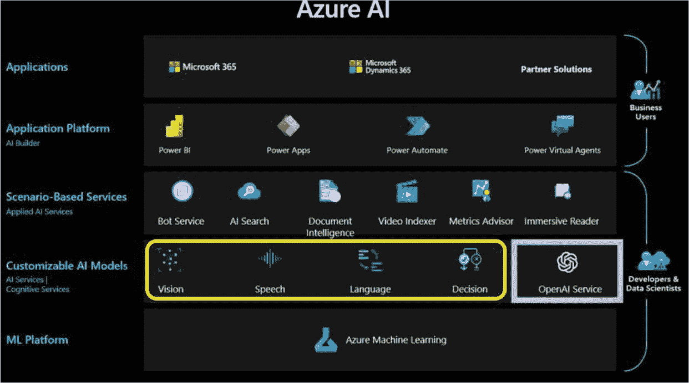

图 9-1

在所有服务被统称为 Azure AI 服务之前的 Azure AI 栈

#### Azure AI Services

在撰写本文时，微软已将其*所有* AI 服务整合到一个产品组合中，并命名为 `Azure AI services`。请注意，这仍然与数据科学家使用的自定义工具 `Azure Machine Learning` 分开，但将数据科学家的领域与以开发者为中心的领域分开是有意义的。

`Azure AI services` 现在包含以下内容：

1.  AI 视觉^(¹⁰⁴)
    1.  **图像分析**^(¹⁰⁵)：使用预构建模型检测和分类图像中的对象，因此无需构建自己的模型。
    2.  **自定义视觉：** 通过标记图像来训练自己的模型。自定义模型可用于识别或分类对象和人。AI 自定义视觉拥有其自己的工作室 UI，位于 [`https://customvision.ai`](https://customvision.ai)。
    3.  **光学字符识别（OCR**^(¹⁰⁶)**:）** 从图像中提取文本。
    4.  **空间分析：** 分析视频内容，例如创建摘要、生成关键词、识别和计数对象或人，以及监控视频画面中的区域和距离。
    5.  **人脸：** 检测图像中一张或多张人脸的位置，以及姿态、口罩和面部属性。

2.  AI 语言^(¹⁰⁷)
    1.  自然语言处理 (NLP)
    2.  提供翻译服务的多语言模型

3.  AI 语音^(¹⁰⁸)
    1.  **语音转文本：** 将可听的语音转录为可搜索的文本。
    2.  **文本转语音：** 将文本转换为逼真的自然语音。
    3.  **语音翻译：** 将实时语音翻译成不同语言。
    4.  **说话人识别：** 基于训练音频识别说话人。
    5.  **语音命令：** 为应用程序和物联网设备创建语音激活或语音命令功能。

4.  AI 翻译器^(¹⁰⁹)
    1.  类似于语音翻译，但针对文本。实时或批量地将文本从一种语言翻译成另一种语言。

5.  AI 内容安全
    1.  预训练 AI 模型，用于识别色情、暴力、仇恨和自残内容
    2.  支持多种语言的内容过滤
    3.  预训练 AI 视觉模型，用于检测描绘色情、暴力、仇恨和自残内容的图像

6.  AI 搜索^(¹¹⁰)
    1.  **AI 驱动的搜索：** 回顾第 4 章和第 5 章，我们在那里以 RAG 架构的形式介绍了 AI 搜索。

7.  AI 文档智能^(¹¹¹)
    1.  以前称为 `Forms Recognizer`。
    2.  理解 AI 文档智能的最佳方式是“增强版 OCR”。文档智能使用 AI 来识别键值对，通常用于从表单和文档中提取信息。

8.  Azure OpenAI
    1.  `Azure OpenAI` 是 `Azure AI services` 产品组合中的最新成员，也是本书的重点。

所有 Azure AI 服务都提供 API 端点，这些端点接收来自你的应用程序或设备的输入，并以 JSON 格式返回相关结果。

## 探索 Azure AI Services

部分 Azure AI 服务提供了用户界面，供你探索这些服务的工作原理。类似于 Azure OpenAI 的 AI 工作室，这些也被称为工作室。例如，AI 视觉有视觉工作室（Vision Studio），文档智能有文档智能工作室（Document Intelligence Studio）。访问脚注中引用的每个 AI 服务的网站，即可找到相应服务的工作室。


### 动手练习 9-1：部署 Azure AI 服务实例

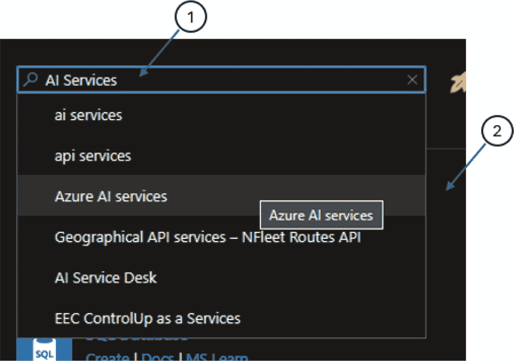

图 9-2：查找并选择 Azure AI 服务

1.（如果已部署 Azure 自定义视觉则可跳过，直接进入第 5 步）。通过访问 Azure 门户 [`https://portal.azure.com`](https://portal.azure.com) 来部署 AI 视觉服务。
2. 点击 ，然后在搜索框中输入 "AI Services"，并在结果中选择 Azure AI services，如下方图 9-2 所示。

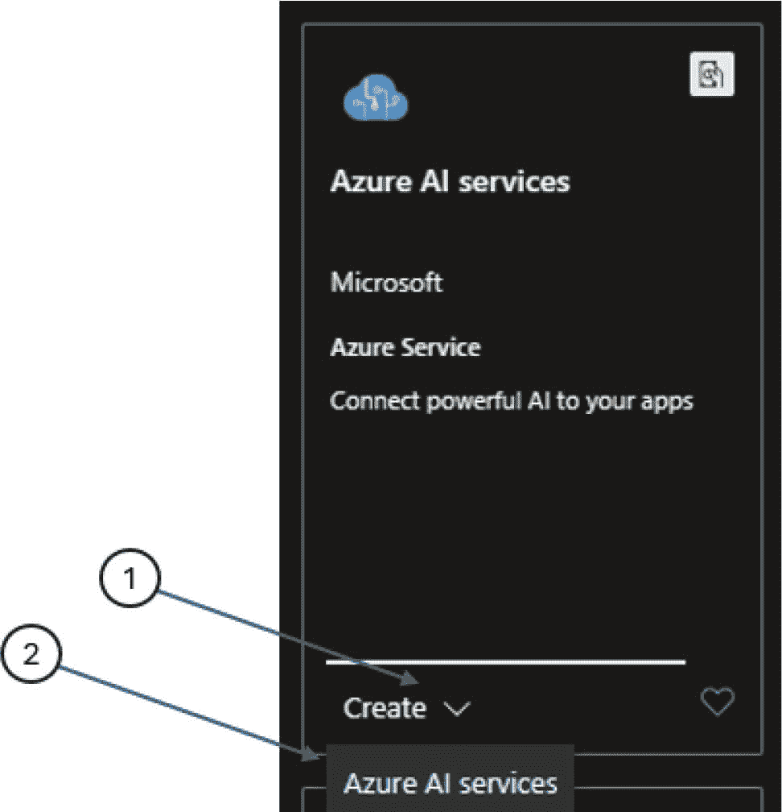

图 9-3：选择 "创建 ➤ Azure AI 服务"

1. 找到 Azure AI 服务框，然后点击 "创建" 并选择 Azure AI 服务，如下方图 9-3 所示。

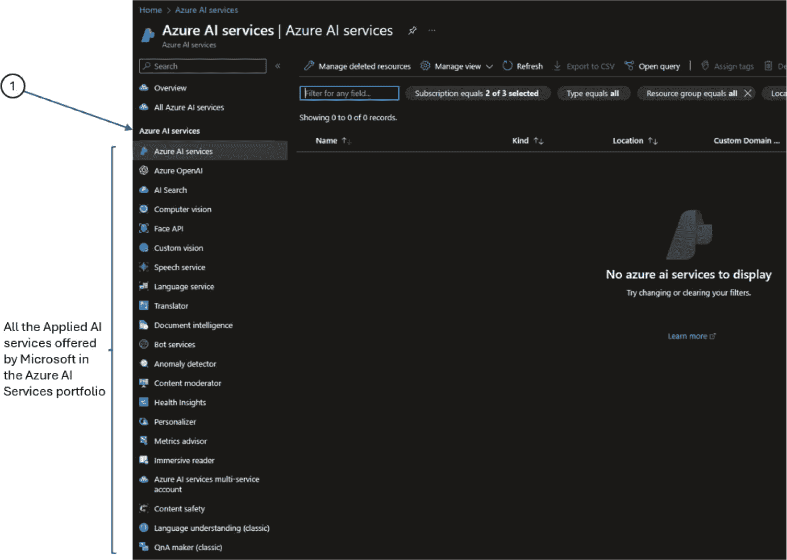

图 9-4：从门户中看到的 Azure AI 服务

1. 按照提示并提供必要信息以部署该服务。其步骤应与你在第 3 章中部署 Azure OpenAI 时几乎完全相同。
2. 转到 Azure AI 服务实例。这是你可在订阅中部署或管理所有 Azure AI 服务的地方，如下方图 9-4 所示。

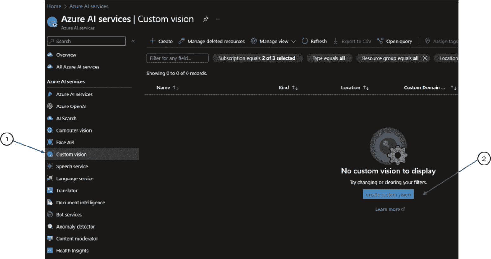

图 9-5：创建自定义视觉实例

1. 我们可以通过*在菜单窗格中选择任意一项* Azure AI 服务，然后创建该资源来部署它。为进行下一个练习，我们将从菜单窗格中选择 "自定义视觉"，然后在主窗格中点击 "创建自定义视觉"，如下方图 9-5 所示。

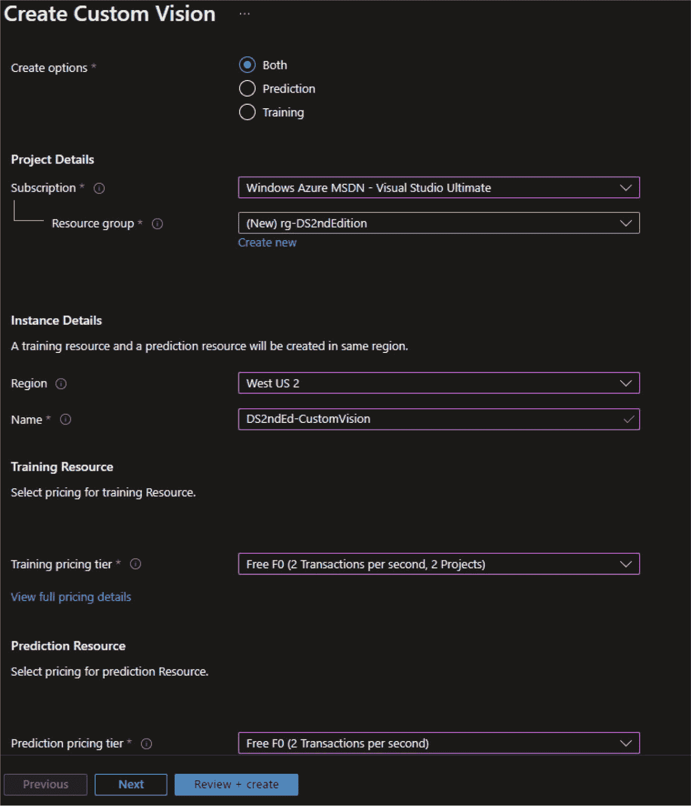

图 9-6：创建自定义视觉实例的选项

1. 如图 9-6 所示，为 "创建选项" 选择 "两者"，选择一个现有或新建的资源组，并设置你偏好的区域、自定义视觉实例的名称，以及为训练和预测资源都选择 F0 定价层。
2. 点击 "查看 + 创建" 按钮，因为如果你点击了 "下一步"，系统将要求你配置此资源的网络访问选项，为简单起见，我们跳过此步骤，因为我们不锁定此资源^(¹¹²)。
3. 点击 "创建"。

### 动手练习 9-2：自定义视觉

鉴于本书篇幅限制，我们无法探索*每一个* AI 服务，但通过了解一个 Azure AI 服务的工作原理，其原则是相同的，并可以应用于所有其他 AI 服务。

在本动手练习中，我们将通过创建一个可以检测对象的模型来探索 AI 自定义视觉。

*场景：* 你被要求使用 AI 来确保工作场所安全。现有从视频中提取的图像，这些是可供你使用的工件。AI 需要确保工人佩戴安全帽作为防护装备。

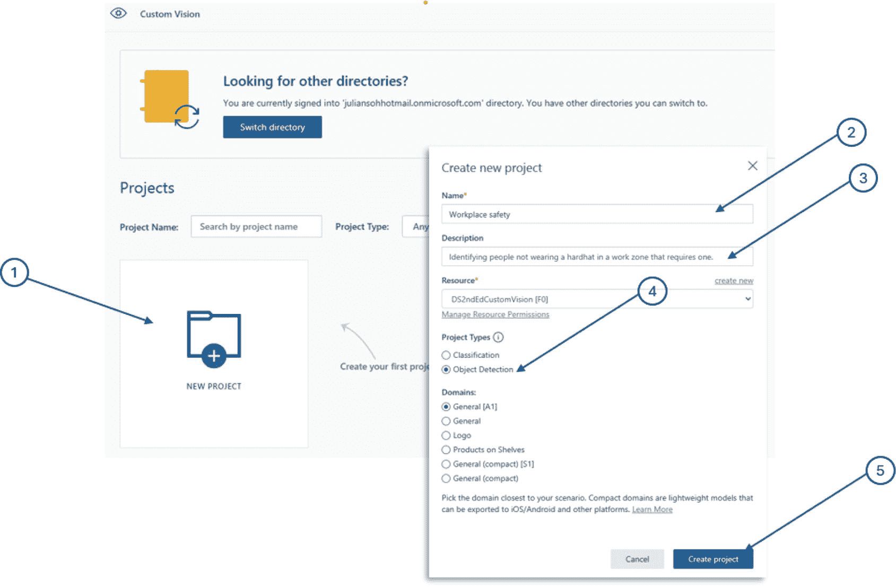

图 9-7：类型为 "对象检测" 的自定义视觉项目的属性

1. 创建好自定义视觉资源后，在浏览器中打开一个新标签页，访问 [`https://customvision.ai`](https://customvision.ai) 并登录。
2. 如果提示同意服务条款，请勾选复选框并点击 "我同意"^(¹¹³)。
3. 自定义视觉工作室是你自定义视觉项目的用户界面。点击 "新建项目"，如图 9-7 所示。

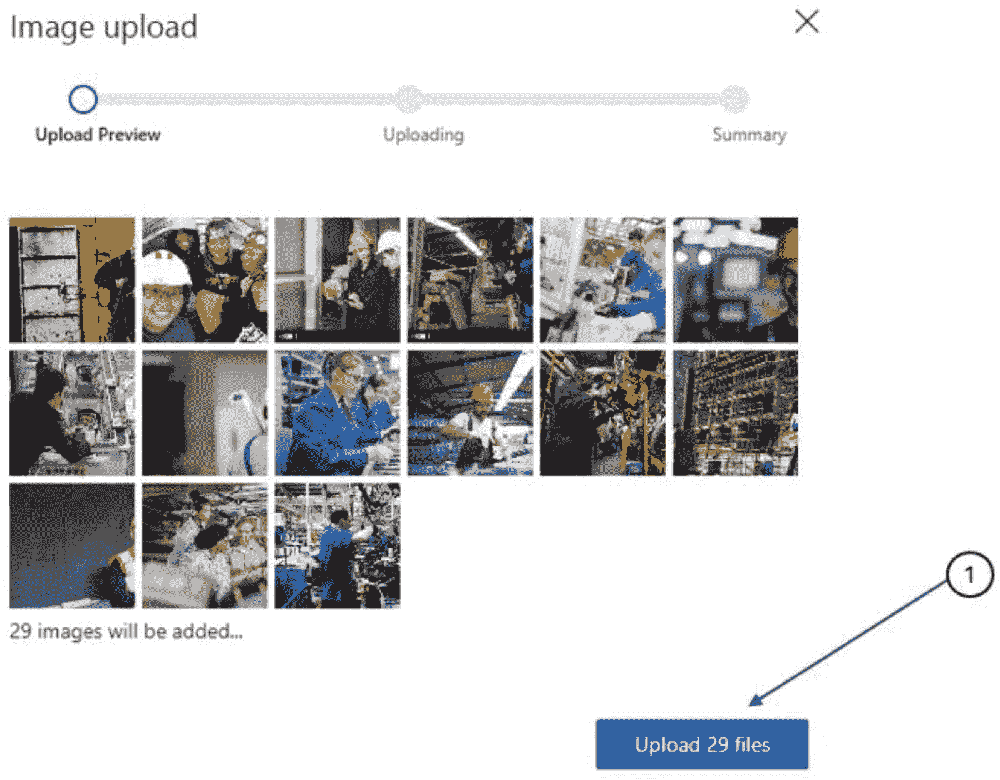

图 9-8：上传训练图像

1. 参考上方图 9-7，为项目提供一个名称和可选的描述。资源应已自动填入我们在上一个练习中创建的资源。对于项目类型，由于我们要识别未戴安全帽的人员，因此选择 "对象检测" 作为项目类型。选择 "通用 [A1]" 作为领域类型^(¹¹⁴)。
2. 点击 "创建项目"。
3. 从 [`https://github.com/juliansoh/Data-Science-Solutions-on-Azure-2nd-Edition/tree/main/Chapter-9/exercise-9-2`](https://github.com/juliansoh/Data-Science-Solutions-on-Azure-2nd-Edition/tree/main/Chapter-9/exercise-9-2) 获取训练和测试数据集。
4. 在自定义视觉工作室中，选择 ，然后点击 。
5. 导航到 `hardhat-training-dataset` 文件夹，并上传所有 29 个图像文件，如下方图 9-8 所示。

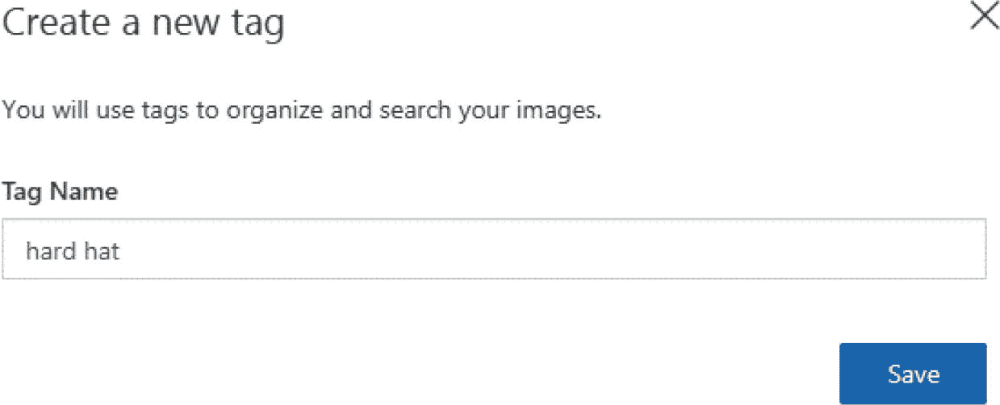

图 9-9：创建新标签

1. 点击位于 "标签" 部分中  上方的 。
2. 创建一个名为 "hard hat" 的新标签，如下方图 9-9 所示。然后点击 "保存"。

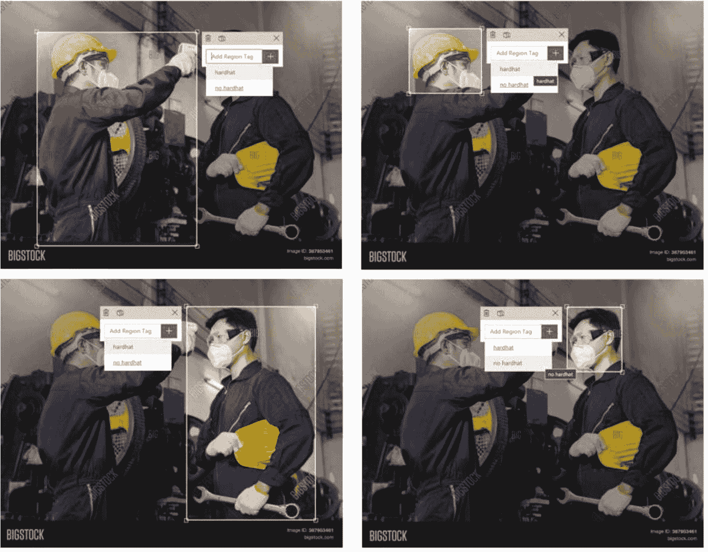

图 9-10：在图像中标记对象（多标签）

1. 重复步骤 9 和 10，创建第二个名为 "no hard hat" 的标签。
2. 现在我们有了两个标签，我们将使用它们来标记戴安全帽的人员和未戴安全帽的人员。
3. 点击其中一个图像，突出显示图像中的人物，然后调整选定区域的大小，直到它包含头部（无论是否戴安全帽）。如果图像中有多人，请相应地为所有人添加标签，如下方图 9-10 所示。

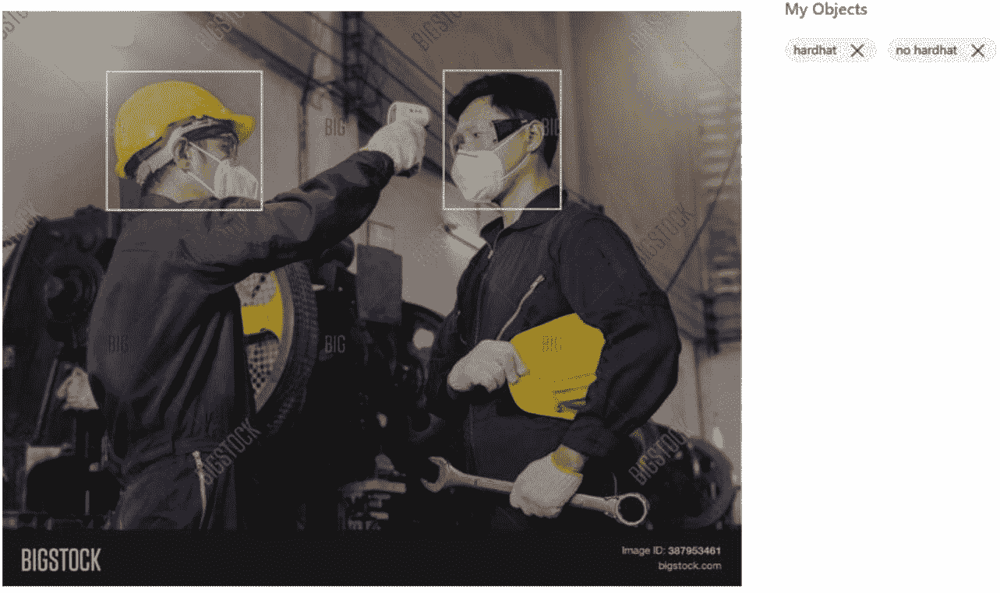

图 9-11：图像中所有相关区域均已标记

1. 图像中的所有人员都应被标记为 "hard hat" 或 "no hard hat"，如下方图 9-11 所示。

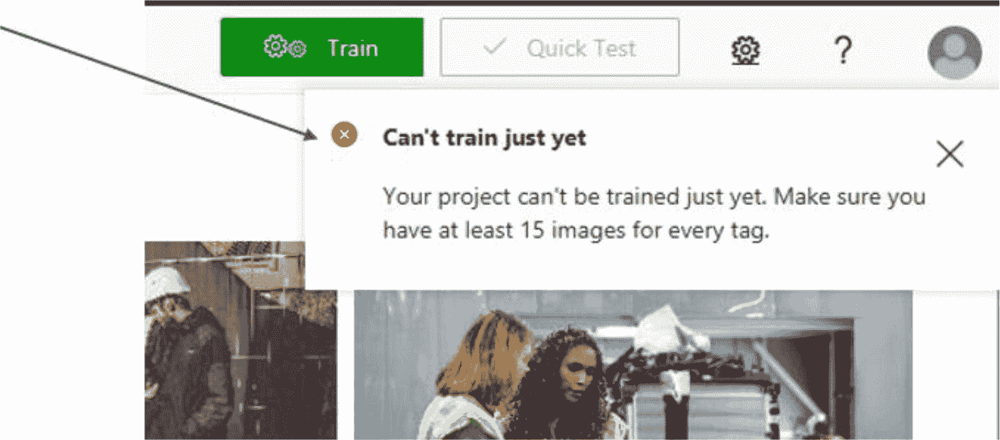

图 9-12：每个标签的图像数量不足。训练前，每个标签至少需要 15 张图像

1. 完成后，点击窗口右上角的  以关闭。


2.  现在让我们训练模型。点击 Custom Vision Studio 项目工作区顶部的``，选择“快速训练”，然后点击“训练”。

3.  你应该会在工作室工作区的右上方看到一条错误消息，提示你图像数量不足，如图 9-12 所示。*每个*标签至少需要有 15 张图像。

``

**图 9-13** 每个标签关联的图像数量

1.  在“标签”部分点击``，并记下每个标签关联的图像数量，如图 9-13 所示。在我们选择的图像中，有两个人物，一个戴安全帽，一个没戴。因此，每个标签都关联了一张图像（同一张）。根据错误消息，我们需要让每个标签至少关联 15 张图像。

``

**图 9-14** 快速测试图像以检测佩戴和未佩戴安全帽的人员

1.  从``中点击“未标记”，选择第一张未标记的图像。重复步骤 14，将图像中的人员标记为“安全帽”或“无安全帽”。然后点击``移动到下一张图像进行标记。重复此操作，直到所有图像都被标记。

2.  点击``，选择“快速训练”，然后点击“训练”。

3.  训练可能需要几分钟，但完成后，点击``。

4.  点击``，从 `hardhat-test-dataset` 文件夹中选择一张图像，然后点击“打开”。

5.  模型现在正用于分析你所选的图像，结果以图像中的区域以及每个标记区域的概率形式显示，如图 9-14 所示。

1.  对其他测试图像重复步骤 22，以查看结果。

现在你已经测试了模型，是时候发布并使用该模型了。

### 动手练习 9-3：发布模型

``

**图 9-15** 将模型发布到终结点

1.  如图 9-15 所示，点击“性能”，然后点击“发布”，并为模型命名。选择在练习 9-1 步骤 7 中创建的 Azure Custom Vision 实例，然后点击``。

``

**图 9-16** 模型终结点的 URL、标头和正文

1.  模型发布后，``选项将变为可用。点击它。

2.  记下有关如何调用终结点并向其传递要分析的图像 URL 或作为负载的实际图像的说明，如下方图 9-16 所示。

``

**图 9-17** 使用 Postman 测试模型终结点

1.  接下来，我们需要找到一个图像 URL。在互联网上搜索一张包含人员和安全帽的图像。找到你想要传递给模型进行评估的图像后，复制该 URL。例如，我们找到了这张图像：`https://media.sciencephoto.com/image/f0187039/800wm/F0187039-Construction_workers_eating_lunch.jpg`，如果链接仍然有效，你可以使用此 URL。否则，请搜索你自己的样本图像。

2.  在 Postman 中构造一个 `POST` 请求，如图 9-17 所示，然后点击``。使用上面步骤 4 中的 URL。

1.  分析 `POST` 响应的结果。

2.  现在，从响应中复制整个 JSON 输出，并将其粘贴到像记事本或 Notepad++ 这样的轻量级文本编辑器中。我们将在下一节的另一个练习中使用此 JSON。

## 组合 AI 服务

在构建 AI 解决方案时，组合 AI 服务的情况并不少见。组合 AI 服务主要有三种场景：

*   通过“链接”服务
*   利用 Azure OpenAI 的自然语言和 LLM 能力
*   使用特定的 AI 服务增强和提升 Azure OpenAI LLM

### 链接 AI 服务

顾名思义，链接 AI 服务是指在工作流中使用多个 AI 服务。其概念很简单——一个 AI 服务的输出成为另一个 AI 服务的输入。


### 动手练习 9-4：Azure 语音转文本与翻译

在本动手练习中，我们将探索 Azure AI 语音服务。

*场景：我们需要接收传入的语音邮件，转录音频内容，如果非英文则进行翻译。*

有多种方法可以更高效地处理此场景，而无需向不同服务发出多个 API 调用；例如，使用新的 GPT-4 Whisper 模型，只需一次调用即可解决。然而，为了演示如何将多个 Azure AI 服务串联起来，我们将先使用 AI 语音服务转录文本。然后，我们将调用 AI 翻译服务将文本翻译成英文。最后，我们将使用 GPT-3.5T 创建转录摘要、推荐后续操作项，并评估翻译后语音邮件的情绪倾向。

本练习的设计中，我们将使用 Postman 并设置环境变量，以将一个 AI 服务的输出传递给下一个。如果您不熟悉 Postman 环境，请查阅相关文档。使用 Postman，我们可以对工作流或 RPA 流程进行建模，如图 9-18 所示。

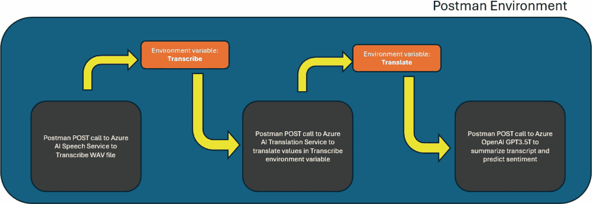

**图 9-18** 将多个 Azure AI 服务串联成工作流（在 Postman 中建模）

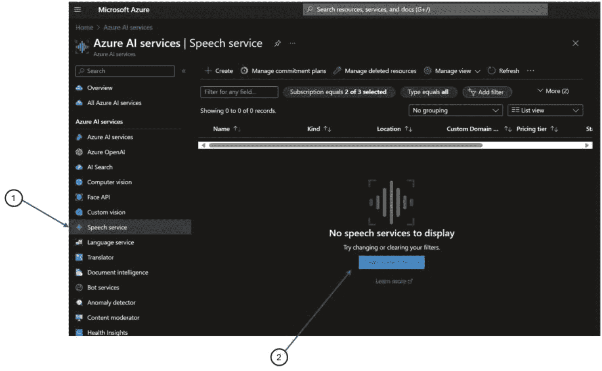

**图 9-19** 创建 Azure AI 语音服务

1. 访问 GitHub 仓库 ([`https://github.com/juliansoh/Data-Science-Solutions-on-Azure-2nd-Edition/tree/main/Chapter-9/wav_files`](https://github.com/juliansoh/Data-Science-Solutions-on-Azure-2nd-Edition/tree/main/Chapter-9/wav_files)) 并下载音频文件样本。其中有三个`wav`文件，它们是来自 [`https://freesound.org`](https://freesound.org) 的开源示例`wav`文件。一个`wav`文件是英文的，另外两个是中文（简体普通话）的。我们将在本练习中使用其中一个文件。
2. 启动 Azure 门户 ([`https://portal.azure.com`](https://portal.azure.com)) 并转到你的 AI 服务。
3. 从菜单窗格中选择“语音服务”，然后点击 ，如图 9-19 所示。

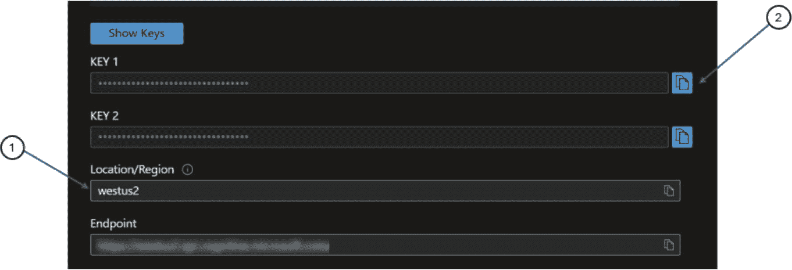

**图 9-20** AI 语音服务的密钥和区域

4. 按照提示创建一个新的语音服务实例。创建完成后，点击 。
5. （家庭作业/可选）在语音服务的概览页面上，可以通过点击链接自由探索 Speech Studio。我们*不会*审查 Speech Studio，但这是一个直观的 UI，您可以自行导航和探索，不会遇到问题。
6. 复制区域和一个密钥，以便稍后在此练习（Postman）中使用，如下方图 9-20 所示。将信息暂时粘贴到你喜欢的轻量级文本编辑器中，比如记事本或 Notepad++。

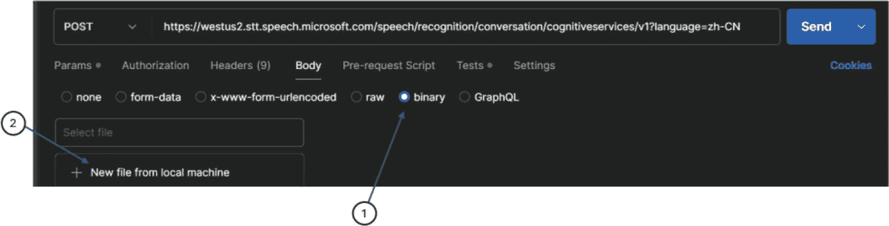

**图 9-21** 设置 Postman 请求以接受二进制文件

7. 对于请求体，选择 binary，然后点击 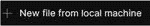，如下方图 9-21 所示。然后导航到你从步骤 1 下载的`wav`文件所在位置。
8. 重复步骤 2 到 6 来创建一个 AI 翻译器服务。
9. 启动 Postman 并创建一个新的 POST 请求，参数如下：

- 类型：POST
- URL：`https://<REGION>.stt.speech.microsoft.com/speech/recognition/conversation/cognitiveservices/v1?language=zh-CN`（例如 `https://westus2.stt.speech.microsoft.com/speech/recognition/conversation/cognitiveservices/v1?language=zh-CN`）
- 请求头：
  - `Ocp-Apim-Subscription-Key`：来自步骤 6 的密钥
  - `Content-Type`：`audio/wav`

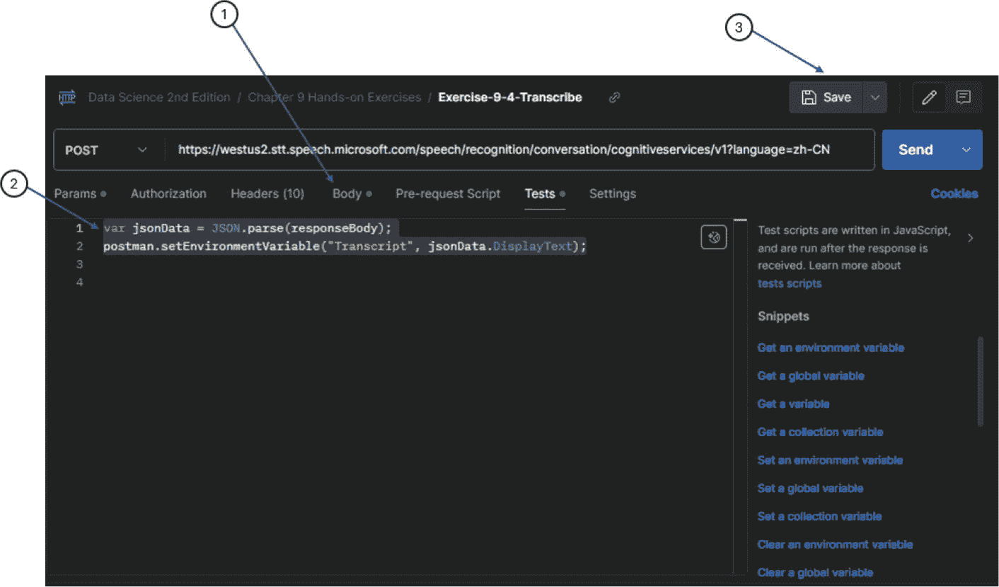

**图 9-22** 向 AI 语音服务的 Postman POST 调用添加测试脚本

10. 导航到步骤 1 中下载的`wav`文件所在位置，并选择名为“`612867__petehaase__vm-mandarin.wav`”的文件。
11. 你会注意到文件名旁边有一个 。这表示文件已选中但尚未上传。点击  并确认文件将被上传并可供 Postman 团队中的其他人使用。
12. 点击 Tests 并输入下面的代码片段，如图 9-22 所示。然后点击 。

```
var jsonData = JSON.parse(responseBody);
postman.setEnvironmentVariable("Transcript", jsonData.DisplayText);
```

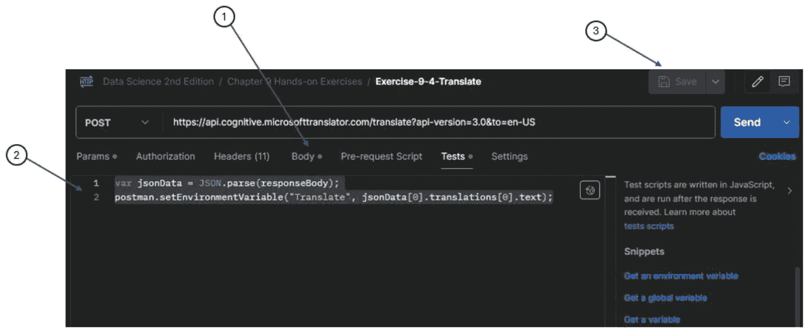

**图 9-24** 向 AI 翻译服务的 Postman POST 调用添加测试脚本

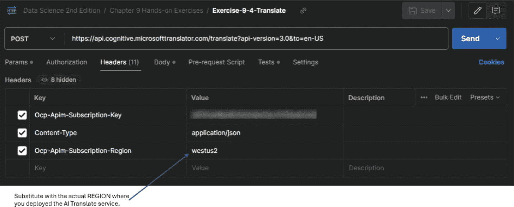

**图 9-23** 创建对 AI 翻译服务的 POST 请求

13. 使用以下信息创建一个新的 POST 请求，如图 9-23 所示：

- 类型：POST
- URL：[`https://api.cognitive.microsofttranslator.com/translate?api-version=3.0&to=en-US`](https://api.cognitive.microsofttranslator.com/translate?api-version=3.0&to=en-US)
- 请求头：
  - `Ocp-Apim-Subscription-Key`：AI 翻译服务的密钥
  - `Content-Type`：`application/json`
  - `Ocp-Apim-Subscription-Region`：AI 翻译服务所部署到的区域

14. 点击 Tests 并输入下面的代码片段，如图 9-24 所示。然后点击 。

```
var jsonData = JSON.parse(responseBody);
postman.setEnvironmentVariable("Translate", jsonData[0].translations[0].text);
```

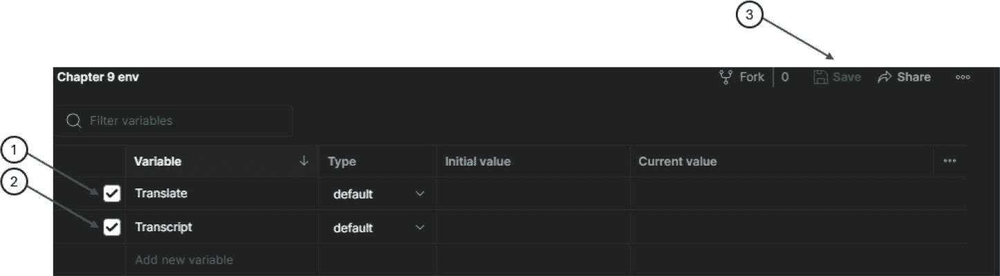

**图 9-25** 向 Postman 环境添加变量

15. 在 Postman 中，点击 ，然后点击  创建一个新环境。将新环境命名为“Chapter 9 env”。
16. 使这个新环境成为活动环境，方法是将鼠标悬停在环境名称上，然后点击环境名称右侧的 。环境的符号将变为 ，表示它现在是活动环境。
17. 点击变量框添加两个名为“`Transcript`”和“`Translate`”的新变量，如图 9-25 所示。然后点击 。

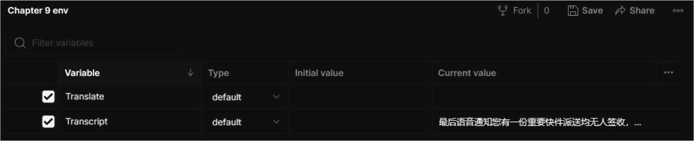

**图 9-26** 语音邮件的转录文本（中文）

18. 转到“集合”。
19. 选择针对 AI 语音服务的 POST 调用，然后点击 。
20. 转到“环境”并注意，`Transcript` 变量现在包含了语音邮件的转录文本，如图 9-26 所示。

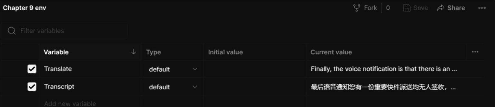

**图 9-27** 语音邮件转录文本从中文到英文的翻译

21. 转到“集合”，现在选择针对 AI 翻译服务的 POST 调用，然后点击 。


2.  转到 `Environments`，注意 `Transcript` 变量现在包含来自语音邮件的转录文本，如图 9-27 所示。

我们将留一个作业给您，即创建一个对 Azure OpenAI 的第三个 `POST` 调用（提示：回顾第 3 章中的练习 3-3）。让 Azure OpenAI 获取翻译后的语音邮件转录文本（`Translate` 变量中的值），并生成摘要、建议的后续步骤以及情感分析。

## 利用 Azure OpenAI 的 NLP 和 LLM 功能

每个 Azure AI 服务的响应均为 JSON 格式，如上面的练习 9-3 所示。因此，使用 AI 服务的一个关键要求是能够解析和解释 JSON。这并非难事，但仍需具备 JSON 的实用知识。如果 JSON 嵌套层级深且内容冗长，可能会成为一项耗时且潜在劳动密集型的任务。

### 动手练习 9-5：Azure OpenAI Codex

借助 Azure OpenAI 的 Codex 功能，模型能够理解 JSON。因此，为了简化上述练习 9-3 中的步骤 6，我们可以使用 Azure OpenAI。

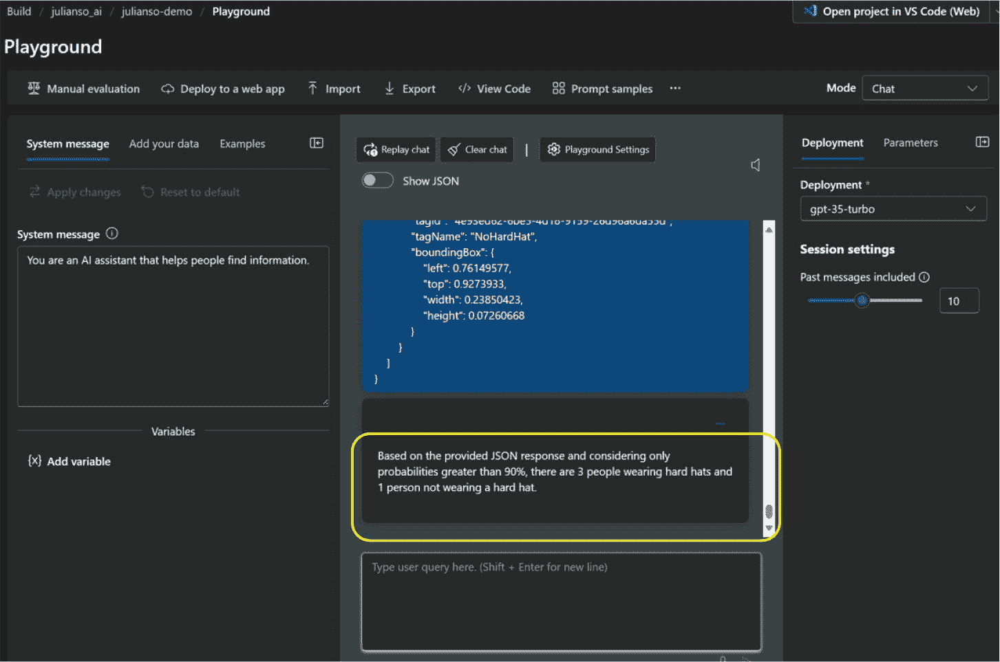

图 9-28
Azure OpenAI 分析来自自定义视觉的 JSON 响应后给出的回复

1.  从练习的步骤 7 开始，在 JSON 的顶部添加以下提示：

```
分析此 JSON 响应，并确定有多少人佩戴了安全帽，多少人没有佩戴。仅考虑概率大于 90% 的情况。
```

完整的提示加上 JSON 将如下所示：

```
分析此 JSON 响应，并确定有多少人佩戴了安全帽，多少人没有佩戴。仅考虑概率大于 90% 的情况。
{
"id": "132b435c-f57c-4a08-820e-e1f4150d85ae",
"project": "b62d8129-f23f-449f-9c32-bc7c8ba47d3a",
"iteration": "c8b2a04f-6317-427d-9db9-d704d9c398e5",
"created": "2024-03-29T04:29:36.610Z",
"predictions": [
{
"probability": 0.99930894,
"tagId": "f2095e40-117c-4d4b-a1fe-4cd37ae71958",
"tagName": "HardHat",
"boundingBox": {
"left": 0.42043838,
"top": 0.15247175,
"width": 0.10820511,
"height": 0.22593826
}
},
{
"probability": 0.997747,
"tagId": "f2095e40-117c-4d4b-a1fe-4cd37ae71958",
"tagName": "HardHat",
"boundingBox": {
"left": 0.7534834,
"top": 0.16329207,
"width": 0.15334052,
"height": 0.26272762
}
},
{
"probability": 0.9943516,
"tagId": "f2095e40-117c-4d4b-a1fe-4cd37ae71958",
"tagName": "HardHat",
"boundingBox": {
"left": 0.15086874,
"top": 0.0,
"width": 0.19470087,
"height": 0.32445565
}
},
{
"probability": 0.24975587,
"tagId": "f2095e40-117c-4d4b-a1fe-4cd37ae71958",
"tagName": "HardHat",
"boundingBox": {
"left": 0.29458895,
"top": 0.14121412,
"width": 0.2193059,
"height": 0.22541712
}
},
{
"probability": 0.12658808,
"tagId": "f2095e40-117c-4d4b-a1fe-4cd37ae71958",
"tagName": "HardHat",
"boundingBox": {
"left": 0.28740525,
"top": 0.12198121,
"width": 0.12210685,
"height": 0.25974143
}
},
{
"probability": 0.11289566,
"tagId": "f2095e40-117c-4d4b-a1fe-4cd37ae71958",
"tagName": "HardHat",
"boundingBox": {
"left": 0.001150167,
"top": 0.9665307,
"width": 0.02726431,
"height": 0.03346932
}
},
{
"probability": 0.08512633,
"tagId": "f2095e40-117c-4d4b-a1fe-4cd37ae71958",
"tagName": "HardHat",
"boundingBox": {
"left": 0.10612007,
"top": 0.020601613,
"width": 0.394977,
"height": 0.3514491
}
},
{
"probability": 0.023785047,
"tagId": "f2095e40-117c-4d4b-a1fe-4cd37ae71958",
"tagName": "HardHat",
"boundingBox": {
"left": 0.73871917,
"top": 0.9338605,
"width": 0.26128083,
"height": 0.06613952
}
},
{
"probability": 0.01651364,
"tagId": "f2095e40-117c-4d4b-a1fe-4cd37ae71958",
"tagName": "HardHat",
"boundingBox": {
"left": 0.0016166002,
"top": 0.9543639,
"width": 0.043376926,
"height": 0.045636117
}
},
{
"probability": 0.013959761,
"tagId": "f2095e40-117c-4d4b-a1fe-4cd37ae71958",
"tagName": "HardHat",
"boundingBox": {
"left": 0.9742923,
"top": 0.9724258,
"width": 0.025707722,
"height": 0.027574182
}
},
{
"probability": 0.013862156,
"tagId": "f2095e40-117c-4d4b-a1fe-4cd37ae71958",
"tagName": "HardHat",
"boundingBox": {
"left": 0.0019367501,
"top": 0.9748782,
"width": 0.036663122,
"height": 0.025121808
}
},
{
"probability": 0.94616395,
"tagId": "4e93ed62-6be5-4d18-9159-26d96a6da55d",
"tagName": "NoHardHat",
"boundingBox": {
"left": 0.2737054,
"top": 0.1393743,
"width": 0.13060656,
"height": 0.2496189
}
},
{
"probability": 0.1826986,
"tagId": "4e93ed62-6be5-4d18-9159-26d96a6da55d",
"tagName": "NoHardHat",
"boundingBox": {
"left": 0.115989015,
"top": 0.0,
"width": 0.2607643,
"height": 0.32838482
}
},
{
"probability": 0.03791033,
"tagId": "4e93ed62-6be5-4d18-9159-26d96a6da55d",
"tagName": "NoHardHat",
"boundingBox": {
"left": 0.19338831,
"top": 0.08210535,
"width": 0.21481234,
"height": 0.28253514
}
},
{
"probability": 0.022902392,
"tagId": "4e93ed62-6be5-4d18-9159-26d96a6da55d",
"tagName": "NoHardHat",
"boundingBox": {
"left": 0.00088261964,
"top": 0.9655527,
"width": 0.027619155,
"height": 0.034447312
}
},
{
"probability": 0.013809467,
"tagId": "4e93ed62-6be5-4d18-9159-26d96a6da55d",
"tagName": "NoHardHat",
"boundingBox": {
"left": 0.76149577,
"top": 0.9273933,
"width": 0.23850423,
"height": 0.07260668
}
}
]
}
```

2.  启动 AI Studio (`https://ai.azure.com`)，并使用你的 LLM 和自然语言来帮助解析 JSON。你将收到来自 Azure OpenAI 的响应，如下面的图 9-28 所示。

利用 Azure OpenAI 的 Codex 功能，解析 JSON 的任务变得简单得多。也不再需要考虑 JSON 模式可能发生变化的情况，因为 Azure OpenAI 能够动态地解释任何 JSON 结构。

## 使用 AI 服务增强 LLM

`GPT-4 Turbo with Vision` 是一个多模态 LLM 模型，这意味着它不仅限于基于文本的查询。该模型可以基于图像或视频源进行 grounding。

此外，你可以通过 Azure AI 服务^(¹²⁰)（特别是 Azure AI 视觉）来增强和提升该 LLM 的视觉能力。通过这样做，AI 视觉可以帮助在视觉上区分并突出显示图像的重要方面。

在 AI Studio 中，有一个滑块允许你使用 AI 视觉服务来增强 `GPT-4 Vision` 模型，如图 9-29 所示。

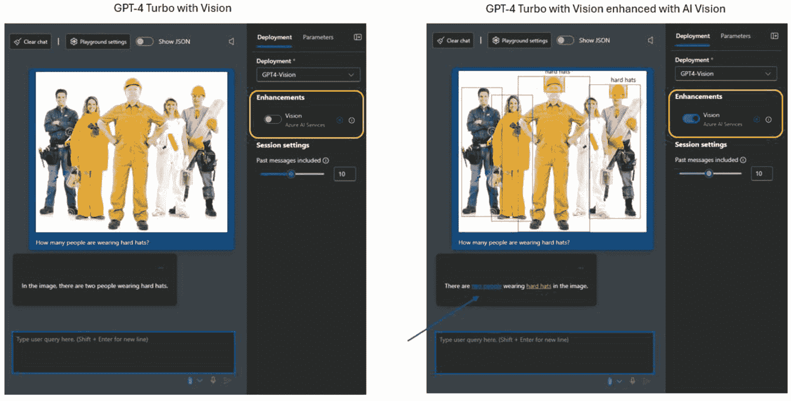

图 9-29
`GPT-4 Turbo with Vision`（使用和不使用 AI 视觉增强）

左侧图像没有使用 AI 视觉，`GPT-4 Turbo with Vision` 模型可以基于图像回答问题。然而，右侧图像显示，一旦 AI 视觉服务与 LLM 一起使用，响应将包含可点击的链接，这些链接会高亮显示（边界框）图像。


## 总结

本章虽然只重点介绍了 Azure AI 服务中的自定义视觉服务，但该系列所有 AI 服务的概念都是相通的。这些服务是预先打包好的 AI 功能，你只需发出 REST API 调用，然后解析服务返回的 JSON 响应即可。

请求头通常也是类似的，包含身份验证密钥和内容类型。JSON 响应中还会包含预测结果的置信水平（概率）。根据经验法则，我们通常将概率大于 75% 的结果解读为真正例，将概率低于 50% 的结果解读为真负例。

我们还看到了这些 AI 服务如何相互连接，包括利用 Azure OpenAI 对预测结果进行自然语言解读。Azure AI 服务通常被用作构建块，可快速在新应用或现有应用以及机器人流程自动化（RPA）工作流场景中启用 AI 功能。

生成式 AI 与应用型 AI 的结合，其应用场景是无限的。


脚注 1 2 3 4 5 6 7 8 9 10 11 12 13 14 15 16 17

