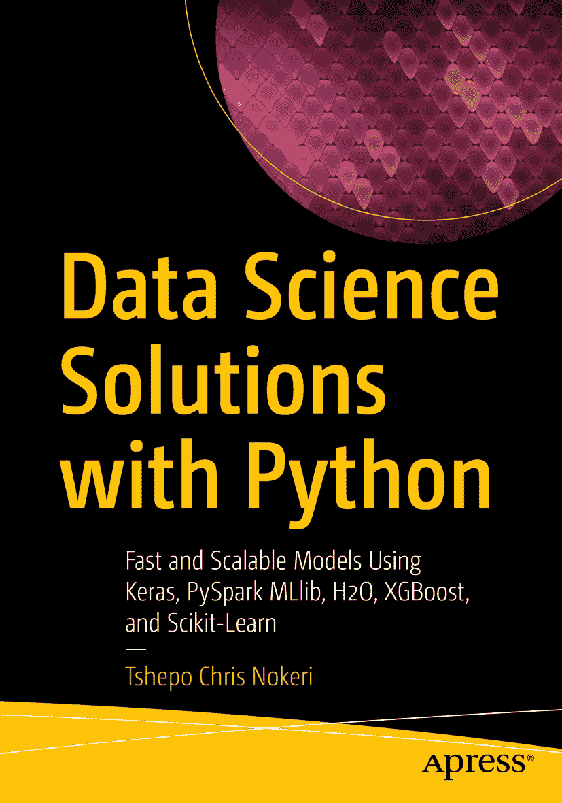

ISBN 978-1-4842-7761-4 e-ISBN 978-1-4842-7762-1 [`doi.org/10.1007/978-1-4842-7762-1`](https://doi.org/10.1007/978-1-4842-7762-1) © Tshepo Chris Nokeri 2022

Apress Standard 本出版物中使用的通用描述性名称、注册商标、商标、服务标记等，即使未作明确声明，也不意味着这些名称不受相关保护性法律和法规的约束，因此可供一般使用。出版商、作者和编辑可以假定本书中的建议和信息在出版之日是真实准确的。出版商、作者或编辑均不对本文所含材料或可能存在的任何错误或遗漏提供明示或暗示的担保。出版商对已出版地图中的管辖权主张和机构归属保持中立。

本 Apress 印记由注册公司 APress Media, LLC（Springer Nature 的一部分）出版。

注册公司地址为：1 New York Plaza, New York, NY 10004, U.S.A.

*谨以此书献给我的家人以及所有在我生命中愉快地扮演过重要角色的人。*

## 引言

本书涵盖了名为`PySpark`的内存分布式集群计算框架，名为`Scikit-Learn`、`PySpark MLlib`、`H2O`和`XGBoost`的机器学习框架平台，以及名为`Keras`的深度学习框架。阅读本书后，您将能够应用监督学习和无监督学习来解决实际和真实世界的数据问题。在本书中，您将学习如何设计特征、优化超参数、训练和测试模型、开发流水线以及自动化机器学习流程。

首先，本书精心介绍了监督和无监督的机器学习与深度学习模型，并审视了大数据框架以及机器学习和深度学习框架。它还讨论了名为广义线性模型的参数模型，以及名为 Cox 比例风险模型和加速失效时间（AFT）的生存回归模型。它介绍了名为逻辑回归的二分类模型和名为梯度提升树的集成模型。它还介绍了深度学习以及一种人工神经网络——多层感知器（MLP）分类器。它描述了使用 k-means 模型执行聚类分析的方法。它探讨了主成分分析和线性判别分析等降维技术，最后通过解析自动化机器学习作为结尾。

本书的目标读者是希望学习如何应用关键大数据框架以及机器学习和深度学习框架的中级数据科学家和机器学习工程师。在探索本书内容之前，请确保您了解基础统计学、Python 编程、概率论和预测分析。

本书的示例使用了`Anaconda`（一种开源的 Python 编程发行版）。以下列表突出显示了本书涵盖的一些 Python 库。

*   `Pandas`：用于数据结构和工具。
*   `PySpark`：用于内存集群计算。
*   `XGBoost`：用于梯度提升和生存回归分析。
*   `Auto-Sklearn`、`基于树的流水线优化工具（TPOT）`、`Hyperopt-Sklearn`和`H2O`：用于 AutoML。
*   `Scikit-Learn`：用于构建和验证关键机器学习算法。
*   `Keras`：用于深度学习的高级框架。
*   `H2O`：用于无人驾驶机器学习。
*   `Lifelines`：用于生存分析。
*   `NumPy`：用于数组和矩阵。
*   `SciPy`：用于积分、求解微分方程和优化。
*   `Matplotlib`和`Seaborn`：用于创建公认的图表和图形。

## 致谢

撰写一本独著书籍颇具挑战性，但我得到了家人和挚友们的坚定支持和积极鼓励。衷心感谢 Apress 出版团队在写作和编辑过程中给予的所有支持。最后，衷心感谢各位阅读此书；我真诚地希望它能对您有所帮助。

## 关于作者 关于技术审校