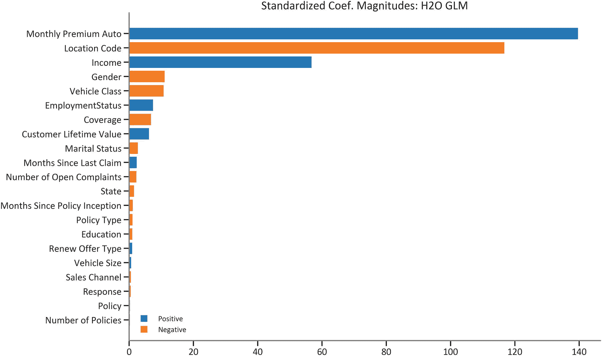
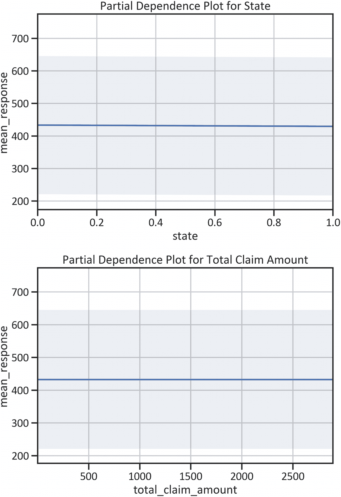
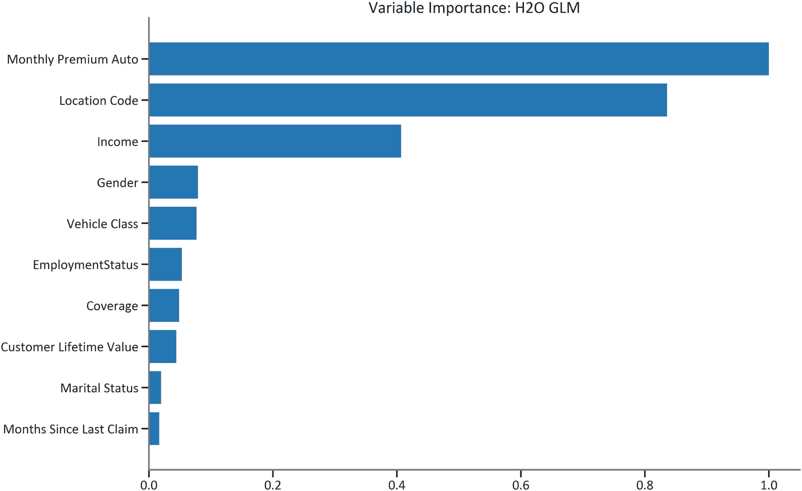

# 3. 使用 Scikit-Learn、PySpark 和 H2O 进行线性建模

本章介绍普通最小二乘法，并使用主要的 Python 框架（即 `Scikit-Learn`、`Spark MLlib` 和 `H2O`）执行该方法。首先解释该方法背后的基本概念。

## 探索普通最小二乘法

普通最小二乘法用于具有不受限制（连续）输出特征的数据。此方法要求正态性和线性，并且误差项（也称为*残差*）中不能存在自相关，也不能存在多重共线性。它也非常容易受到数据异常的影响，因此如果此方法效果不佳，你可能希望使用替代方法，例如 `Ridge`、`Lasso` 和 `Elastic Net`。

清单 3-1 从 Microsoft CSV 文件中获取必要的数据。

```python
import pandas as pd
df = pd.read_csv(r"filepath\WA_Fn-UseC_-Marketing_Customer_Value_Analysis.csv")
```
清单 3-1 获取数据

清单 3-2 指定要删除的列名，然后执行 `drop()` 方法。然后它将轴指定为 `columns`，以便删除数据中不必要的列。

```python
drop_column_names = df.columns[[0, 6]]
initial_data = df.drop(drop_column_names, axis="columns")
```
清单 3-2 删除数据中不必要的特征

清单 3-3 获取此数据中分类特征的虚拟值。

```python
initial_data.iloc[::, 0] = pd.get_dummies(initial_data.iloc[::, 0])
initial_data.iloc[::, 2] = pd.get_dummies(initial_data.iloc[::, 2])
initial_data.iloc[::, 3] = pd.get_dummies(initial_data.iloc[::, 3])
initial_data.iloc[::, 4] = pd.get_dummies(initial_data.iloc[::, 4])
initial_data.iloc[::, 5] = pd.get_dummies(initial_data.iloc[::, 5])
initial_data.iloc[::, 6] = pd.get_dummies(initial_data.iloc[::, 6])
initial_data.iloc[::, 7] = pd.get_dummies(initial_data.iloc[::, 7])
initial_data.iloc[::, 8] = pd.get_dummies(initial_data.iloc[::, 8])
initial_data.iloc[::, 9] = pd.get_dummies(initial_data.iloc[::, 9])
initial_data.iloc[::, 15] = pd.get_dummies(initial_data.iloc[::, 15])
initial_data.iloc[::, 16] = pd.get_dummies(initial_data.iloc[::, 16])
initial_data.iloc[::, 17] = pd.get_dummies(initial_data.iloc[::, 17])
initial_data.iloc[::, 18] = pd.get_dummies(initial_data.iloc[::, 18])
initial_data.iloc[::, 20] = pd.get_dummies(initial_data.iloc[::, 20])
initial_data.iloc[::, 21] = pd.get_dummies(initial_data.iloc[::, 21])
```
清单 3-3 获取虚拟特征

清单 3-4 概述了自变量和因变量特征。

```python
import numpy as np
int_x = initial_data.iloc[::,0:19]
fin_x = initial_data.iloc[::,19:21]
x_combined = pd.concat([int_x, fin_x], axis=1)
x = np.array(x_combined)
y = np.array(initial_data.iloc[::,19])
```
清单 3-4 概述特征

### Scikit-Learn 实战

清单 3-5 对数据框进行随机划分。

```python
from sklearn.model_selection import train_test_split
x_train, x_test, y_train, y_test = train_test_split(x, y, test_size=0.2, random_state=0)
```
清单 3-5 随机划分数据框

清单 3-6 对自变量进行缩放。

```python
from sklearn.preprocessing import StandardScaler
sk_standard_scaler = StandardScaler()
sk_standard_scaled_x_train = sk_standard_scaler.fit_transform(x_train)
sk_standard_scaled_x_test = sk_standard_scaler.transform(x_test)
```
清单 3-6 缩放自变量

清单 3-7 执行 Scikit-Learn 的普通最小二乘回归方法。

```python
from sklearn.linear_model import LinearRegression
sk_linear_model = LinearRegression()
sk_linear_model.fit(sk_standard_scaled_x_train, y_train)
```
清单 3-7 执行 Scikit-Learn 普通最小二乘回归方法

清单 3-8 确定 Scikit-Learn 普通最小二乘回归方法的最佳超参数。

```python
from sklearn.preprocessing import GridSearchCV
sk_linear_model_param = {'fit_intercept':[True,False]}
sk_linear_model_param_mod  = GridSearchCV(estimator=sk_linear_model, param_grid=sk_linear_model_param, n_jobs=-1)
sk_linear_model_param_mod.fit(sk_standard_scaled_x_train, y_train)
print("Best OLS score: ", sk_linear_model_param_mod.best_score_)
print("Best OLS parameter: ", sk_linear_model_param_mod.best_params_)
Best OLS score:  1.0
Best OLS parameter:  {'fit_intercept': True}
```
清单 3-8 确定 Scikit-Learn 普通最小二乘回归方法的最佳超参数

清单 3-9 执行 Scikit-Learn 的普通最小二乘回归方法。

```python
sk_linear_model = LinearRegression(fit_intercept= True)
sk_linear_model.fit(sk_standard_scaled_x_train, y_train)
sk_linear_model_param_mod.best_params_)
```
清单 3-9 执行 Scikit-Learn 普通最小二乘回归方法

清单 3-10 计算 Scikit-Learn 普通最小二乘回归方法的截距。

```python
print(sk_linear_model.intercept_)
433.0646521131769
```
清单 3-10 计算 Scikit-Learn 普通最小二乘回归方法的截距

清单 3-11 计算 Scikit-Learn 普通最小二乘回归方法的系数。

# 普通最小二乘法

```python
print(sk_linear_model.coef_)
```
```
[-6.15076155e-15  2.49798076e-13 -1.95573220e-14 -1.90089677e-14
-5.87187344e-14  2.50923806e-14 -1.05879478e-13  1.53591400e-14
-1.82507711e-13 -7.86327034e-14  4.17629484e-13  1.28923537e-14
6.52911311e-14 -5.28069778e-14 -1.57900159e-14 -6.74040176e-14
-9.28427833e-14  5.03132848e-14 -8.75978166e-15  2.90235705e+02
-9.55950515e-14]
```

`清单 3-11` 计算 Scikit-Learn 普通最小二乘回归方法的系数

`清单 3-12` 计算普通最小二乘回归方法的预测值。

```python
sk_yhat = sk_linear_model.predict(sk_standard_scaled_x_test)
```

`清单 3-12` 计算 Scikit-Learn 普通最小二乘回归方法的预测值

`清单 3-13` 评估 Scikit-Learn 普通最小二乘方法（见 `表 3-1`）。

`表 3-1` Scikit-Learn 普通最小二乘方法评估

| | Sk 平均绝对误差 | Sk 均方误差 | Sk 均方根误差 | Sk 决定系数 | Sk 方差分数 |
| --- | --- | --- | --- | --- | --- |
| `估计值` | 9.091189e-13 | 1.512570e-24 | 1.229866e-12 | 1.0 | 1.0 |

```python
from sklearn import metrics
sk_mean_ab_error = metrics.mean_absolute_error(y_test, sk_yhat)
sk_mean_sq_error = metrics.mean_squared_error(y_test, sk_yhat)
sk_root_sq_error = np.sqrt(sk_mean_sq_error)
sk_determinant_coef = metrics.r2_score(y_test, sk_yhat)
sk_exp_variance = metrics.explained_variance_score(y_test, sk_yhat)
sk_linear_model_ev = [[sk_mean_ab_error, sk_mean_sq_error, sk_root_sq_error,
sk_determinant_coef, sk_exp_variance]]
sk_linear_model_assessment = pd.DataFrame(sk_linear_model_ev, index = ["Estimates"], columns = ["Sk mean absolute error",
"Sk mean squared error",
"Sk root mean squared error",
"Sk determinant coefficient",
"Sk variance score"])
sk_linear_model_assessment
y = np.array(initial_data.iloc[::,19])
```

`清单 3-13` 评估 Scikit-Learn 普通最小二乘方法

`表 3-1` 显示，Scikit-Learn 普通最小二乘方法解释了全部变异性。

## PySpark 实战

本节使用 PySpark 框架执行并评估普通最小二乘方法。`清单 3-14` 使用 `findspark` 框架准备 PySpark 环境。

```python
import findspark as initiate_pyspark
initiate_pyspark.init("filepath\spark-3.0.0-bin-hadoop2.7")
```

`清单 3-14` 准备 PySpark 框架

`清单 3-15` 使用 `SparkConf()` 方法指定 PySpark 应用。

```python
from pyspark import SparkConf
pyspark_configuration = SparkConf().setAppName("pyspark_linear_method").setMaster("local")
```

`清单 3-15` 指定 PySpark 应用

`清单 3-16` 使用 `SparkSession()` 方法准备 PySpark 会话。

```python
from pyspark.sql import SparkSession
pyspark_session = SparkSession(pyspark_context)
```

`清单 3-16` 准备 Spark 会话

`清单 3-17` 使用 `createDataFrame()` 方法将本章前面创建的 `pandas` 数据框转换为 PySpark 数据框。

```python
pyspark_initial_data = pyspark_session.createDataFrame(initial_data)
```

`清单 3-17` 将 Pandas 数据框转换为 PySpark 数据框

`清单 3-18` 为自变量创建一个列表，并为因变量创建一个字符串。它使用 `VectorAssembler()` 方法转换数据，以便在 PySpark 框架中进行建模。

```python
x_list = list(x_combined.columns)
y_list = initial_data.columns[19]
from pyspark.ml.feature import VectorAssembler
pyspark_data_columns = x_list
pyspark_vector_assembler = VectorAssembler(inputCols=pyspark_data_columns, outputCol="variables")
pyspark_data = pyspark_vector_assembler.transform(pyspark_initial_data)
```

`清单 3-18` 转换数据

`清单 3-19` 使用 `randomSplit()` 方法划分数据。

```python
(pyspark_training_data, pyspark_test_data) = pyspark_data.randomSplit([.8,.2])
```

`清单 3-19` 划分数据框

`清单 3-20` 执行 PySpark 普通最小二乘回归方法。

```python
from pyspark.ml.regression import LinearRegression
pyspark_linear_model = LinearRegression(labelCol=y_list, featuresCol=pyspark_data.columns[-1])
pyspark_fitted_linear_model = pyspark_linear_model.fit(pyspark_training_data)
```

`清单 3-20` 执行 PySpark 普通最小二乘回归方法

`清单 3-21` 计算 PySpark 普通最小二乘回归方法的预测值。

```python
pyspark_yhat = pyspark_fitted_linear_model.transform(pyspark_test_data)
```

`清单 3-21` 计算 PySpark 普通最小二乘回归方法的预测值

`清单 3-22` 评估 PySpark 普通最小二乘方法。

```python
pyspark_linear_model_assessment = pyspark_fitted_linear_model.summary
print("PySpark root mean squared error", pyspark_linear_model_assessment.rootMeanSquaredError)
print("PySpark determinant coefficient", pyspark_linear_model_assessment.r2)
PySpark root mean squared error 2.0762306526480097e-13
PySpark determinant coefficient 1.0
```

`清单 3-22` 评估 PySpark 普通最小二乘方法

## H2O 实战

本节将使用 H2O 框架执行并评估普通最小二乘法。

`清单 3-23` 准备 H2O 框架。

```python
import h2o as initialize_h2o
initialize_h2o.init()
```

`清单 3-23` 准备 H2O 框架

`清单 3-24` 将 pandas 数据框转换为 H2O 数据框。

## H2O 普通最小二乘回归示例

### 清单 3-24 将 `Pandas` 数据框转换为 `H2O` 数据框

```python
h2o_data = initialize_h2o.H2OFrame(initial_data)
```

### 清单 3-25 概述自变量和因变量特征

```python
y = y_list
x = h2o_data.col_names
x.remove(y_list)
```

### 清单 3-26 随机划分数据框

```python
h2o_training_data, h2o_validation_data, h2o_test_data = h2o_data.split_frame(ratios=[.8,.1])
```

### 清单 3-27 执行 `H2O` 普通最小二乘回归方法

```python
from h2o.estimators import H2OGeneralizedLinearEstimator
h2o_linear_model = H2OGeneralizedLinearEstimator(family="gaussian")
h2o_linear_model.train(x=x,y=y,training_frame=h2o_training_data,validation_frame=h2o_validation_data)
```

### 清单 3-28 计算 `H2O` 普通最小二乘方法的预测值

```python
h2o_yhat = h2o_linear_model.predict(h2o_test_data)
```

### 清单 3-29 计算 `H2O` 普通最小二乘方法的标准化系数（见图 3-1）



图 3-1 `H2O` 普通最小二乘方法的标准化系数

```python
h2o_linear_model_std_coefficients = h2o_linear_model.std_coef_plot()
h2o_linear_model_std_coefficients
```

### 清单 3-30 计算 `H2O` 普通最小二乘方法的偏依赖关系（见图 3-2）



图 3-2 `H2O` 普通最小二乘方法的偏依赖关系

```python
h2o_linear_model_dependency_plot = h2o_linear_model.partial_plot(data = h2o_data, cols = list(initial_data.columns[[0,19]]), server=False, plot = True)
h2o_linear_model_dependency_plot
```

### 清单 3-31 按升序排列对 `H2O` 普通最小二乘法最重要的特征（见图 3-3）



图 3-3 `H2O` 普通最小二乘方法的特征重要性

```python
h2o_linear_model_feature_importance = h2o_linear_model.varimp_plot()
h2o_linear_model_feature_importance
```

### 清单 3-32 评估 `H2O` 普通最小二乘法

```python
h2o_linear_model_assessment = h2o_linear_model.model_performance()
print(h2o_linear_model_assessment)
ModelMetricsRegressionGLM: glm
** Reported on train data. **
MSE: 24844.712331260016
RMSE: 157.6220553452467
MAE: 101.79904883889066
RMSLE: NaN
R²: 0.7004468136072375
Mean Residual Deviance: 24844.712331260016
Null degrees of freedom: 7326
Residual degrees of freedom: 7305
Null deviance: 607612840.7465751
Residual deviance: 182012362.53881088
AIC: 94978.33944003603
```

### 清单 3-33 通过将 `remove_collinear_columns` 指定为 `True` 来改进 `H2O` 普通最小二乘法的性能

```python
h2o_linear_model_collinear_removed = H2OGeneralizedLinearEstimator(family="gaussian", lambda_ = 0,remove_collinear_columns = True)
h2o_linear_model_collinear_removed.train(x=x,y=y,training_frame=h2o_training_data,validation_frame=h2o_validation_data)
```

### 清单 3-34 评估 `H2O` 普通最小二乘法

```python
h2o_linear_model_collinear_removed_assessment = h2o_linear_model_collinear_removed.model_performance()
print(h2o_linear_model_collinear_removed)
MSE: 23380.71864337616
RMSE: 152.9075493341521
MAE: 102.53007935777588
RMSLE: NaN
R²: 0.7180982143647627
Mean Residual Deviance: 23380.71864337616
Null degrees of freedom: 7326
Residual degrees of freedom: 7305
Null deviance: 607612840.7465751
Residual deviance: 171287144.78137374
AIC: 94533.40762597627
ModelMetricsRegressionGLM: glm
** Reported on validation data. **
MSE: 25795.936313899092
RMSE: 160.6111338416459
MAE: 103.18677222520363
RMSLE: NaN
R²: 0.7310558588001701
Mean Residual Deviance: 25795.936313899092
Null degrees of freedom: 876
Residual degrees of freedom: 855
Null deviance: 84181020.04623385
Residual deviance: 22597240.210975606
AIC: 11430.364002305443
```

## 结论

本章执行了三个关键的机器学习框架（Scikit-Learn、PySpark 和 `H2O`）来对数据进行建模，并使用线性方法生成一个连续输出特征。本章还探讨了评估该方法的各种方式。