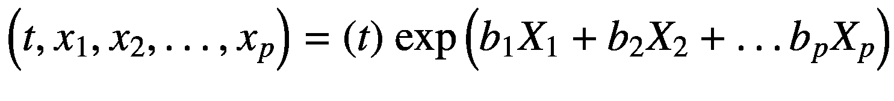

# 4. 使用 PySpark 和 Lifelines 进行生存分析

本章描述并执行了多种使用主要 Python 框架（即 Lifelines 和 PySpark）的生存分析方法。首先解释了 Cox 比例风险模型背后的基本概念，然后介绍了加速失效时间方法。

## 探索生存分析

生存方法在制造业、保险业和医学科学领域很常见。当独立调查需要长时间进行，且受试者在特定时间点进入和退出时，这些方法便于正确评估风险。

本章将使用这些方法来确定机器故障的概率、患者从疾病中存活的概率以及其他应用。它们同样适用于处理缺失值（删失数据）。

## 探索 Cox 比例风险方法

Cox 比例风险方法是处理具有相关变化的受试者的删失数据的最佳生存方法。它与 Mantel-Haenszel 方法类似，并假设风险率是时间的函数。它指出该率是协变量的函数。公式 4-1 定义了 Cox 比例风险方法。



（公式 4-1）

清单 4-1 从 Microsoft Excel 文件中获取所需数据。

```
import pandas as pd
initial_data = pd.read_excel(r"filepath\survival_data.xlsx", index_col=[0])
清单 4-1
获取数据
```

清单 4-2 查找划分数据的比例。

```
int(initial_data.shape[0]) * 0.8
345.6
清单 4-2
查找划分数据的比例
```

清单 4-3 划分数据。

```
lifeline_training_data = initial_data.loc[:346]
lifeline_test_data = initial_data.loc[346:]
清单 4-3
划分数据
```


