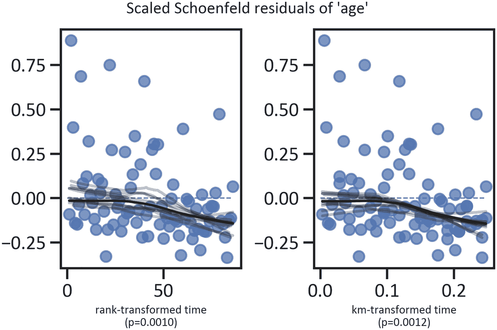
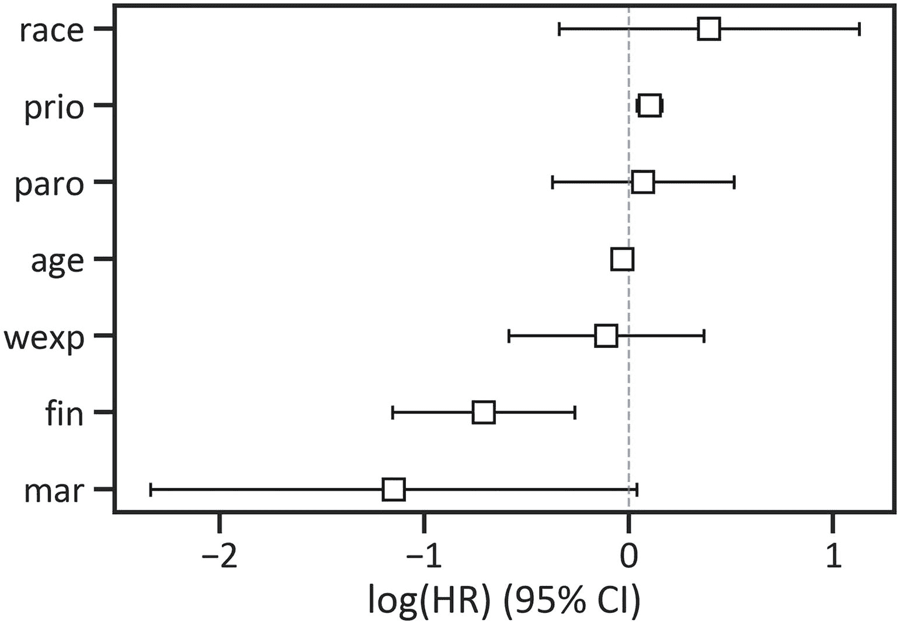

# Lifeline 实战

本节将使用 Lifeline 框架执行并评估 Cox 比例风险方法。代码清单 4-4 执行了 Lifeline Cox 比例风险方法。

```
from lifelines import CoxPHFitter
lifeline_cox_method = CoxPHFitter()
lifeline_cox_method.fit(lifeline_training_data, initial_data.columns[0], initial_data.columns[1])
代码清单 4-4
执行 Lifeline Cox 比例风险方法
```

代码清单 4-5 计算了检验统计量（见表 4-1），并使用缩放 Schoenfeld 残差评估了 Lifeline Cox 比例风险方法，这有助于揭示残差中的任何异常（见图 4-1）。



图 4-1

年龄的缩放 Schoenfeld 残差

表 4-1

Lifeline Cox 比例风险方法的检验统计量

|   |   | 检验统计量 | p |
| --- | --- | --- | --- |
| Age | km | 10.53 | <0.005 |
| rank | 10.78 | <0.005 |
| Fin | km | 0.12 | 0.73 |
| rank | 0.14 | 0.71 |
| Mar | km | 0.18 | 0.67 |
| rank | 0.20 | 0.66 |
| Paro | km | 0.13 | 0.72 |
| rank | 0.11 | 0.74 |
| Prio | km | 0.49 | 0.48 |
| rank | 0.47 | 0.49 |
| Race | km | 0.34 | 0.56 |
| rank | 0.37 | 0.54 |
| Wexp | km | 11.91 | <0.005 |
| rank | 11.61 | <0.005 |

```
lifeline_cox_method_test_statistics_schoenfeld = lifeline_cox_method.check_assumptions(lifeline_training_data, show_plots=True)
lifeline_cox_method_test_statistics_schoenfeld
代码清单 4-5
计算 Lifeline Cox 比例风险方法的检验统计量和残差
```

代码清单 4-6 确定了 Lifeline Cox 比例风险方法的评估摘要（见表 4-2）。

表 4-2

Cox 比例风险模型摘要

| Coef | Exp(coef) | Se(coef) | Coef Lower 95% | Coef Upper 95% | Exp(coef) Lower 95% | Exp(coef) Upper 95% | Z | P | -log2(p) |   |
| --- | --- | --- | --- | --- | --- | --- | --- | --- | --- | --- |
| Fin | -0.71 | 0.49 | 0.23 | -1.16 | -0.27 | 0.31 | 0.77 | -3.13 | <0.005 | 9.14 |
| Age | -0.03 | 0.97 | 0.02 | -0.08 | 0.01 | 0.93 | 1.01 | -1.38 | 0.17 | 2.57 |
| Race | 0.39 | 1.48 | 0.37 | -0.34 | 1.13 | 0.71 | 3.09 | 1.05 | 0.30 | 1.76 |
| Wexp | -0.11 | 0.90 | 0.24 | -0.59 | 0.37 | 0.56 | 1.44 | -0.45 | 0.65 | 0.62 |
| Mar | -1.15 | 0.32 | 0.61 | -2.34 | 0.04 | 0.10 | 1.04 | -1.90 | 0.06 | 4.11 |
| Paro | 0.07 | 1.07 | 0.23 | -0.37 | 0.51 | 0.69 | 1.67 | 0.31 | 0.76 | 0.40 |
| Prio | 0.10 | 1.11 | 0.03 | 0.04 | 0.16 | 1.04 | 1.17 | 3.24 | <0.005 | 9.73 |

```
lifeline_cox_method_assessment_summary = lifeline_cox_method.print_summary()
lifeline_cox_method_assessment_summary
代码清单 4-6
计算评估摘要
```

代码清单 4-7 确定了数据中每个特征的对数检验置信区间（见图 4-2）。



图 4-2

对数检验置信区间

```
lifeline_cox_log_test_ci = lifeline_cox_method.plot()
lifeline_cox_log_test_ci
代码清单 4-7
执行 Lifeline Cox 比例风险方法
```

## 探索加速失效时间方法

加速失效时间方法使用对数线性函数对删失数据进行建模，以描述生存时间的对数。同样，它也假设每个实例是独立的。

### PySpark 实战

本节将使用 PySpark 框架执行加速失效时间方法。

代码清单 4-8 使用 `findspark` 框架运行 PySpark 框架。

```
import findspark as initiate_pyspark
initiate_pyspark.init("filepath\spark-3.0.0-bin-hadoop2.7")
代码清单 4-8
准备 PySpark 框架
```

代码清单 4-9 使用 `SparkConf()` 方法指定 PySpark 应用。

```
from pyspark import SparkConf
pyspark_configuration = SparkConf().setAppName("pyspark_aft_method").setMaster("local")
代码清单 4-9
指定 PySpark 应用
```

代码清单 4-10 使用 `SparkSession()` 方法准备 PySpark 会话。

```
from pyspark.sql import SparkSession
pyspark_session = SparkSession(pyspark_context)
from pyspark.sql import SparkSession
代码清单 4-10
准备 Spark 会话
```

代码清单 4-11 使用 `createDataFrame()` 方法将本章前面创建的 `pandas` 数据框转换为 PySpark 数据框。

```
pyspark_initial_data = pyspark_session.createDataFrame(initial_data)
代码清单 4-11
将 Pandas 数据框转换为 PySpark 数据框
```

代码清单 4-12 为自变量创建一个列表，并为因变量创建一个字符串。然后使用 `VectorAssembler()` 方法转换数据，以便在 PySpark 框架中进行建模。

```
x_list = list(initial_data.iloc[::, 0:9].columns)
from pyspark.ml.feature import VectorAssembler
pyspark_data_columns = x_list
pyspark_vector_assembler = VectorAssembler(inputCols=pyspark_data_columns, outputCol="variables")
pyspark_data = pyspark_vector_assembler.transform(pyspark_initial_data)
代码清单 4-12
转换数据
```

代码清单 4-13 执行 PySpark 加速失效时间方法。

```
from pyspark.ml.regression import AFTSurvivalRegression
pyspark_accelerated_failure_method = AFTSurvivalRegression(censorCol=pyspark_data.columns[1], labelCol=pyspark_data.columns[0],featuresCol="variables",)
pyspark_accelerated_failure_method_fitted = pyspark_accelerated_failure_method.fit(pyspark_data)
代码清单 4-13
执行 PySpark 加速失效时间方法
```

代码清单 4-14 计算 PySpark 加速失效时间方法的预测值。

```
pyspark_accelerated_failure_method_fitted.transform(pyspark_data).select(pyspark_data.columns[1],"prediction")
pyspark_yhat.show()
+------+------------------+
|arrest|        prediction|
+------+------------------+
|     1|18.883982665910125|
|     1| 16.88228128814963|
|     1|22.631360777172517|
|     0|373.13041474613107|
|     0| 377.2238319806288|
|     0| 375.8326538406928|
|     1|  20.9780526816987|
|     0| 374.6420738270714|
|     0| 379.7483494080467|
|     0| 376.1601473382181|
|     0| 377.1412349521787|
|     0| 373.7536844216336|
|     1| 36.36443059383637|
|     0|374.14261327949384|
|     1| 22.98494042401171|
|     1| 50.61463874375869|
|     1| 25.56399364288275|
|     0|379.61997114629696|
|     0| 384.3322960430372|
|     0|376.37634062210844|
+------+------------------+
代码清单 4-14
计算 PySpark 加速失效时间方法的预测值
```

代码清单 4-15 计算 PySpark 加速失效时间方法的系数。

```
pyspark_accelerated_failure_method_fitted.coefficients
DenseVector([0.0388, -1.7679, -0.0162, -0.0003, 0.0098, -0.0086, -0.0026, 0.0115, 0.0003])
代码清单 4-15
计算 PySpark 加速失效时间方法的系数
```

## 结论

本章执行了两个关键的机器学习框架（Lifeline 和 PySpark），使用 Cox 比例风险方法和加速失效时间方法对删失数据进行了建模。

