# 5. 使用 Scikit-Learn、PySpark 和 H2O 进行非线性建模

本章将使用一系列全面的 Python 框架（即 Scikit-Learn、Spark MLlib 和 H2O）来执行并评估一种用于二分类的非线性方法（称为*逻辑回归*）。首先，它阐明了 sigmoid 函数背后的基本概念。


## 探索逻辑回归方法

逻辑回归方法统一接收数值，然后通过执行一个函数（`sigmoid`）来对它们进行建模，以预测分类输出特征的值。方程 5-1 定义了 sigmoid 函数，该函数适用于逻辑回归（另请参见图 5-1）。

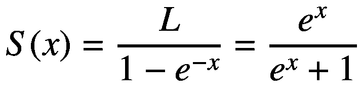

（方程 5-1）

方程 5-1 和图 5-1 都表明该函数产生二值输出。

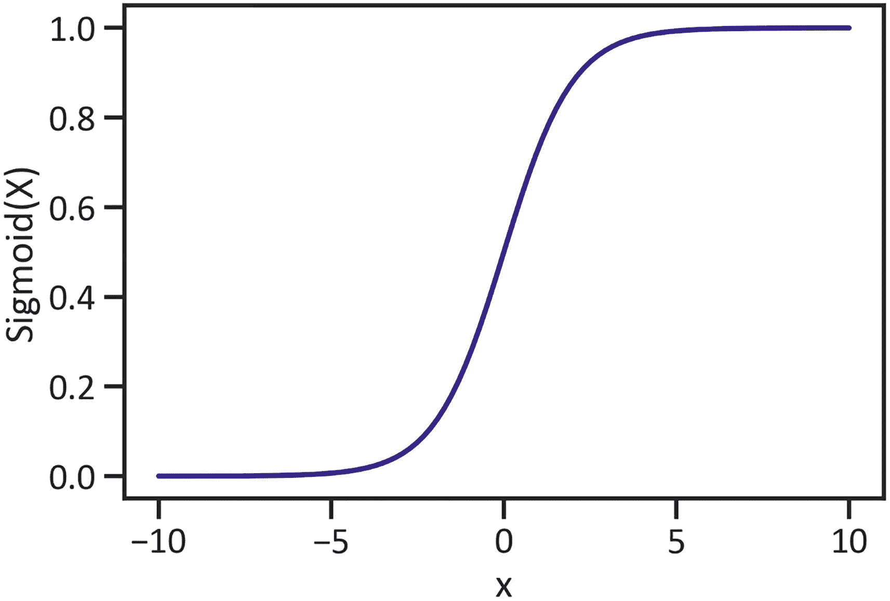

图 5-1

Sigmoid 函数

清单 5-1 使用 `pandas` 框架从一个 Microsoft CSV 文件中获取必要的数据。

```
import pandas as pd
df = pd.read_csv(r"C:\Users\i5 lenov\Downloads\banking.csv")
清单 5-1
获取数据
```

清单 5-2 指定了要删除的列名，然后执行 `drop()` 方法。它指定轴为 `columns`，以便删除数据中不必要的列。

```
drop_column_names = df.columns[[8, 9, 10]]
initial_data = df.drop(drop_column_names, axis="columns")
清单 5-2
删除数据中不必要的特征
```

清单 5-3 获取数据中分类特征的虚拟变量值。

```
initial_data.iloc[::, 1] = pd.get_dummies(initial_data.iloc[::, 1])
initial_data.iloc[::, 2] = pd.get_dummies(initial_data.iloc[::, 2])
initial_data.iloc[::, 3] = pd.get_dummies(initial_data.iloc[::, 3])
initial_data.iloc[::, 4] = pd.get_dummies(initial_data.iloc[::, 4])
initial_data.iloc[::, 5] = pd.get_dummies(initial_data.iloc[::, 5])
initial_data.iloc[::, 6] = pd.get_dummies(initial_data.iloc[::, 6])
initial_data.iloc[::, 7] = pd.get_dummies(initial_data.iloc[::, 7])
initial_data.iloc[::, 11] = pd.get_dummies(initial_data.iloc[::, 11])
清单 5-3
获取虚拟特征
```

清单 5-4 删除空值。

```
initial_data = initial_data.dropna()
清单 5-4
删除空值
```

### Scikit-Learn 实战

本节使用 Scikit-Learn 框架执行并评估逻辑回归方法。清单 5-5 概述了自变量和因变量特征。

```
import numpy as np
x = np.array(initial_data.iloc[::, 0:17])
y = np.array(initial_data.iloc[::,-1])
清单 5-5
概述特征
```

清单 5-6 随机划分数据框。

```
from sklearn.model_selection import train_test_split
x_train, x_test, y_train, y_test = train_test_split(x, y, test_size=0.2, random_state=0)
清单 5-6
随机划分数据框
```

清单 5-7 对自变量特征进行缩放。

```
from sklearn.preprocessing import StandardScaler
sk_standard_scaler = StandardScaler()
sk_standard_scaled_x_train = sk_standard_scaler.fit_transform(x_train)
sk_standard_scaled_x_test = sk_standard_scaler.transform(x_test)
清单 5-7
缩放自变量特征
```

清单 5-8 执行 Scikit-Learn 逻辑回归方法。

```
from sklearn.linear_model import LogisticRegression
sk_logistic_regression_method = LogisticRegression()
sk_logistic_regression_method.fit(sk_standard_scaled_x_train,  y_train)
清单 5-8
执行 Scikit-Learn 逻辑回归方法
```

清单 5-9 确定 Scikit-Learn 逻辑回归方法的最佳超参数。

```
from sklearn.model_selection import GridSearchCV
sk_logistic_regression_method_param = {"penalty":("l1","l2")}
sk_logistic_regression_method_param_mod  = GridSearchCV(estimator=sk_logistic_regression_method, param_grid=sk_logistic_regression_method_param, n_jobs=-1)
sk_logistic_regression_method_param_mod.fit(sk_standard_scaled_x_train, y_train)
print("Best logistic regression score: ", sk_logistic_regression_method_param_mod.best_score_)
print("Best logistic regression parameter: ", sk_logistic_regression_method_param_mod.best_params_)
Best logistic regression score:  0.8986039453717755
Best logistic regression parameter:  {'penalty': 'l2'}
清单 5-9
确定 Scikit-Learn 逻辑回归方法的最佳超参数
```

清单 5-10 使用 Scikit-Learn 框架执行逻辑回归方法。

```
sk_logistic_regression_method = LogisticRegression(penalty="l2")
sk_logistic_regression_method.fit(sk_standard_scaled_x_train, y_train)
清单 5-10
执行 Scikit-Learn 逻辑回归方法
```

清单 5-11 计算逻辑回归方法的截距。

```
print(sk_logistic_regression_method.intercept_)
[-2.4596243]
清单 5-11
计算逻辑回归方法的截距
```

清单 5-12 计算系数。

```
print(sk_logistic_regression_method.coef_)
[[ 0.03374725  0.04330667 -0.01305369 -0.02709009  0.13508899  0.01735913
0.00816758  0.42948983 -0.12670658 -0.25784955 -0.04025993 -0.14622466
-1.14143485  0.70803518  0.23256046 -0.02295578 -0.02857435]]
清单 5-12
计算逻辑回归方法的系数
```

清单 5-13 计算 Scikit-Learn 逻辑回归方法的混淆矩阵，该矩阵包含两种错误类型——假正例和假负例，以及真正例和真负例（见表 5-1）。

表 5-1

Scikit-Learn 逻辑回归方法的混淆矩阵

|   | 预测：存款 | 预测：无存款 |
| --- | --- | --- |
| 实际：存款 | 7230 | 95 |
| 实际：无存款 | 711 | 202 |


```python
from sklearn import metrics
sk_logistic_regression_method_assessment_1 = pd.DataFrame(metrics.confusion_matrix(y_test, sk_yhat), index=["Actual: Deposit","Actual: No deposit"], columns=("Predicted: deposit","Predicted: No deposit"))
print(sk_logistic_regression_method_assessment_1)
```
清单 5-13：计算 Scikit-Learn 逻辑回归方法的混淆矩阵

清单 5-14 计算了相应的分类报告（见表 5-2）。

**表 5-2** Scikit-Learn 逻辑回归方法的分类报告

| | 精确率 | 召回率 | F1 分数 | 支持度 |
| --- | --- | --- | --- | --- |
| 0 | 0.910465 | 0.987031 | 0.947203 | 7325.000000 |
| 1 | 0.680135 | 0.221249 | 0.333884 | 913.000000 |
| 准确率 | 0.902161 | 0.902161 | 0.902161 | 0.902161 |
| 宏平均 | 0.795300 | 0.604140 | 0.640544 | 8238.000000 |
| 加权平均 | 0.884938 | 0.902161 | 0.879230 | 8238.000000 |

```python
sk_logistic_regression_method_assessment_2 = pd.DataFrame(metrics.classification_report(y_test, sk_yhat, output_dict=True)).transpose()
print(sk_logistic_regression_method_assessment_2)
```
清单 5-14：计算 Scikit-Learn 逻辑回归方法的分类报告

清单 5-15 整理了 Scikit-Learn 逻辑回归方法的受试者工作特征曲线。其目标是精简真正率（该方法正确区分正类别的倾向）和假正率（该方法正确区分负类别的倾向）的排列。见图 5-2。

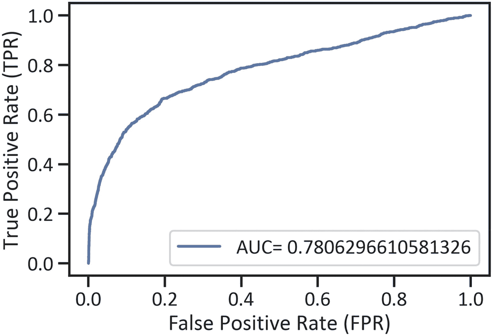

**图 5-2** Scikit-Learn 逻辑回归方法的受试者工作特征曲线

```python
sk_yhat_proba = sk_logistic_regression_method.predict_proba(sk_standard_scaled_x_test)[::,1]
fpr_sk_logistic_regression_method, tprr_sk_logistic_regression_method, _ = metrics.roc_curve(y_test, sk_yhat_proba)
area_under_curve_sk_logistic_regression_method = metrics.roc_auc_score(y_test, sk_yhat_proba)
plt.plot(fpr_sk_logistic_regression_method, tprr_sk_logistic_regression_method, label="AUC= "+ str(area_under_curve_sk_logistic_regression_method))
plt.xlabel("False Positive Rate (FPR)")
plt.ylabel("True Positive Rate (TPR)")
plt.legend(loc="best")
plt.show()
```
清单 5-15：Scikit-Learn 逻辑回归方法的受试者工作特征曲线

清单 5-16 整理了 Scikit-Learn 逻辑回归方法的精确率-召回率曲线，以精简精确率和召回率的排列（见图 5-3）。

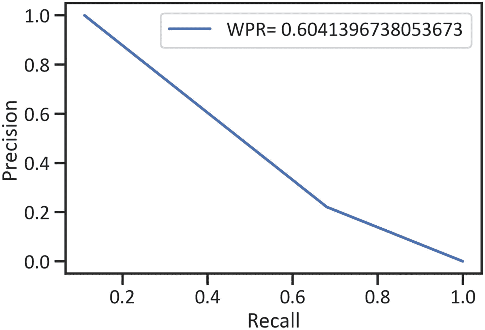

**图 5-3** Scikit-Learn 逻辑回归方法的精确率-召回率曲线

```python
p_sk_logistic_regression_method, r__sk_logistic_regression_method, _ = metrics.precision_recall_curve(y_test, sk_yhat)
weighted_ps_sk_logistic_regression_method = metrics.roc_auc_score(y_test, sk_yhat)
plt.plot(p_sk_logistic_regression_method, r__sk_logistic_regression_method,
label="WPR= " +str(weighted_ps_sk_logistic_regression_method))
plt.xlabel("Recall")
plt.ylabel("Precision")
plt.legend(loc="best")
plt.show()
```
清单 5-16：Scikit-Learn 逻辑回归方法的精确率-召回率曲线

清单 5-17 整理了 Scikit-Learn 逻辑回归方法的学习曲线，以揭示加权训练准确率和交叉验证准确率的变化（见图 5-4）。

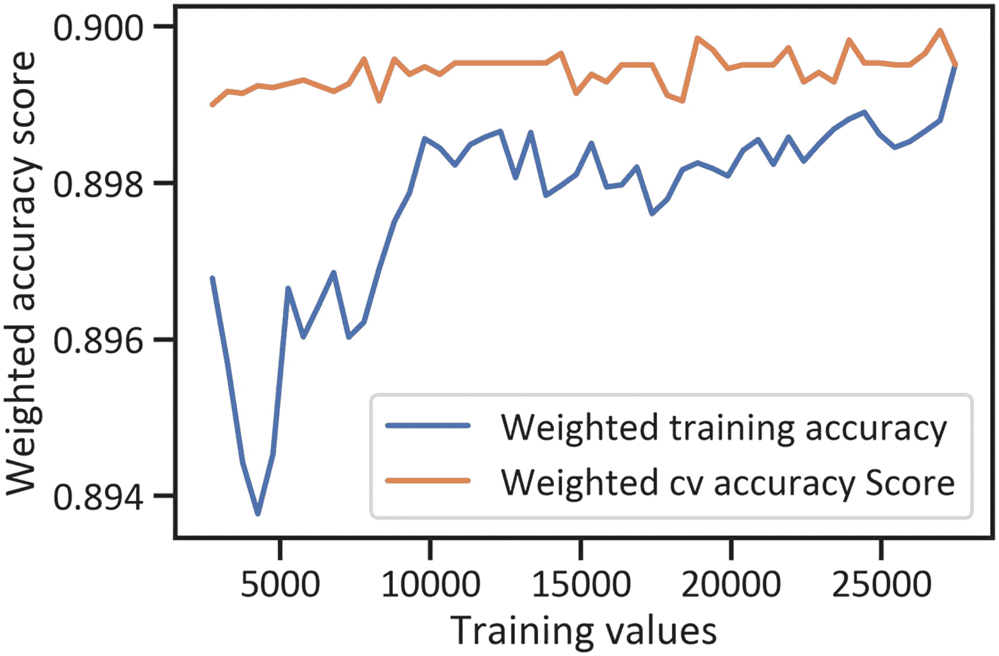

**图 5-4** 由 Scikit-Learn 执行的逻辑回归方法的学习曲线

```python
from sklearn.model_selection import learning_curve
train_port_sk_logistic_regression_method, trainscoresk_logistic_regression_method, testscoresk_logistic_regression_method = learning_curve(sk_logistic_regression_method, x, y,
cv=3, n_jobs=-5, train_sizes=np.linspace(0.1,1.0,50))
trainscoresk_logistic_regression_method_mean = np.mean(trainscoresk_logistic_regression_method, axis=1)
testscoresk_logistic_regression_method_mean = np.mean(testscoresk_logistic_regression_method, axis=1)
plt.plot(train_port_sk_logistic_regression_method, trainscoresk_logistic_regression_method_mean, label="Weighted training accuracy")
plt.plot(train_port_sk_logistic_regression_method, testscoresk_logistic_regression_method_mean, label="Weighted cv accuracy Score")
plt.xlabel("Training values")
plt.ylabel("Weighted accuracy score")
plt.legend(loc="best")
plt.show()
```
清单 5-17：由 Scikit-Learn 执行的逻辑回归方法的学习曲线


### PySpark 实战

本节将使用 PySpark 框架执行并评估逻辑回归方法。

清单 5-18 使用 `findspark` 框架准备 PySpark 框架。

```
import findspark as initiate_pyspark
initiate_pyspark.init("filepath\spark-3.0.0-bin-hadoop2.7")
清单 5-18
准备 PySpark 框架
```

清单 5-19 使用 `SparkConf()` 方法指定 PySpark 应用。

```
from pyspark import SparkConf
pyspark_configuration = SparkConf().setAppName("pyspark_logistic_regression_method").setMaster("local")
清单 5-19
指定 PySpark 应用
```

清单 5-20 使用 `SparkSession()` 方法准备 PySpark 会话。

```
from pyspark.sql import SparkSession
pyspark_session = SparkSession(pyspark_context)
清单 5-20
准备 Spark 会话
```

清单 5-21 使用 `createDataFrame()` 方法将本章前面创建的 `pandas` 数据框转换为 PySpark 数据框。

```
pyspark_initial_data = pyspark_session.createDataFrame(initial_data)
清单 5-21
将 Pandas 数据框转换为 PySpark 数据框
```

清单 5-22 创建一个自变量列表和一个因变量字符串。然后使用 `VectorAssembler()` 方法转换数据，以便使用 PySpark 框架进行建模。

```
x_list = list(initial_data.iloc[::, 0:17].columns)
y_list = str(initial_data.columns[-1])
from pyspark.ml.feature import VectorAssembler
pyspark_data_columns = x_list
pyspark_vector_assembler = VectorAssembler(inputCols=pyspark_data_columns, outputCol="features")
pyspark_data = pyspark_vector_assembler.transform(pyspark_initial_data)
清单 5-22
转换数据
```

清单 5-23 使用 `randomSplit()` 方法划分数据。

```
(pyspark_training_data, pyspark_test_data) = pyspark_data.randomSplit([.8,.2])
清单 5-23
划分数据框
```

清单 5-24 执行 PySpark 逻辑回归方法。

```
from pyspark.ml.classification import LogisticRegression
pyspark_logistic_regression_method = LogisticRegression(labelCol = y_list, featuresCol = "features")
pyspark_logistic_regression_method_fitted = pyspark_logistic_regression_method.fit(pyspark_training_data)
清单 5-24
执行 PySpark 逻辑回归方法
```

清单 5-25 计算 PySpark 逻辑回归方法的预测值。

```
pyspark_yhat = pyspark_logistic_regression_method_fitted.transform(pyspark_test_data)
清单 5-25
逻辑回归方法预测（使用 PySpark 框架执行）
```

清单 5-26 绘制 PySpark 逻辑回归方法的受试者工作特征曲线，以浓缩精确率和召回率的排列（见图 5-5）。

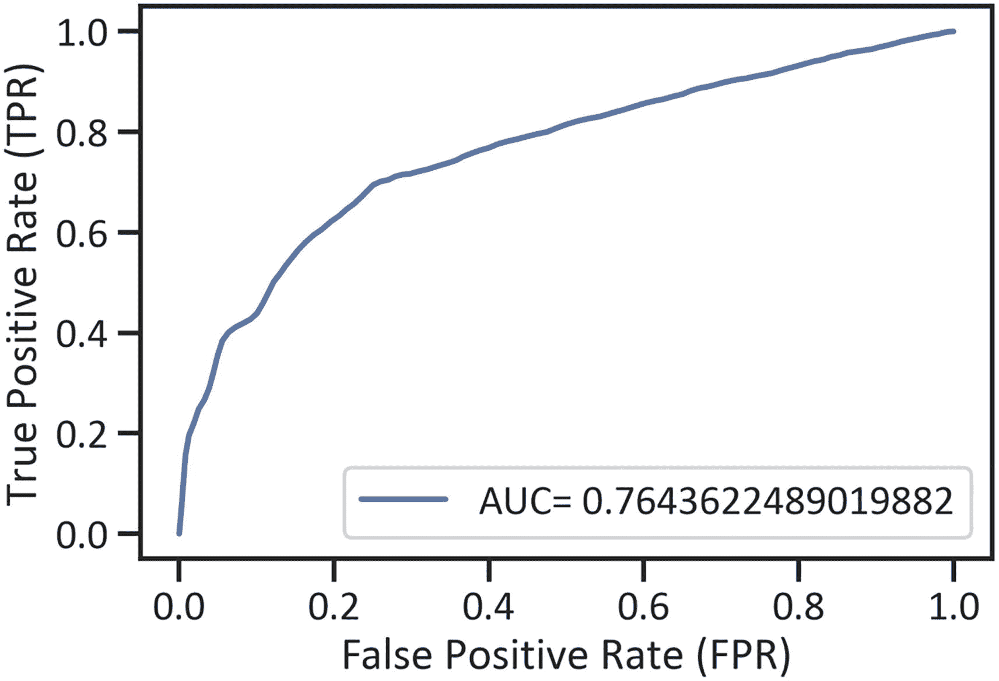

图 5-5

PySpark 逻辑回归方法的受试者工作特征曲线

```
pyspark_logistic_regression_method_assessment = pyspark_logistic_regression_method_fitted.summary
pyspark_logistic_regression_method_roc = pyspark_logistic_regression_method_assessment.roc.toPandas()
pyspark_logistic_regression_method_auroc = pyspark_logistic_regression_method_assessment.areaUnderROC
plt.plot(pyspark_logistic_regression_method_roc["FPR"], pyspark_logistic_regression_method_roc["TPR"],
label="AUC= "+str(pyspark_logistic_regression_method_auroc))
plt.xlabel("False Positive Rate (FPR)")
plt.ylabel("True Positive Rate (TPR)")
plt.legend(loc=4)
plt.show()
清单 5-26
PySpark 逻辑回归方法的受试者工作特征曲线
```

清单 5-27 绘制 PySpark 逻辑回归方法的精确率-召回率曲线，以浓缩精确率和召回率的排列（图 5-6）。

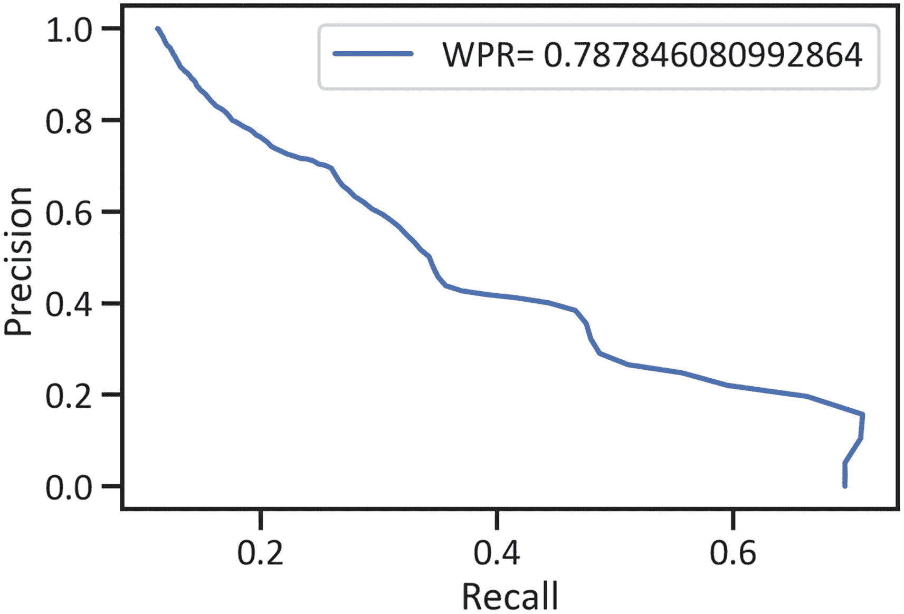

图 5-6

PySpark 逻辑回归方法的精确率-召回率曲线

```
pyspark_logistic_regression_method_assessment = pyspark_logistic_regression_method_fitted.summary
pyspark_logistic_regression_method_assessment_pr = pyspark_logistic_regression_method_assessment.pr.toPandas()
pyspark_logistic_regression_method_assessment_wpr = pyspark_logistic_regression_method_assessment.weightedPrecision
plt.plot(pyspark_logistic_regression_method_assessment_pr["precision"],
pyspark_logistic_regression_method_assessment_pr["recall"],
label="WPR: "+str(pyspark_logistic_regression_method_assessment_wpr))
plt.xlabel("Precision")
plt.ylabel("Recall")
plt.legend(loc="best")
plt.show()
清单 5-27
PySpark 逻辑回归方法的精确率-召回率曲线
```


### H2O 实战

本节使用 `H2O` 框架执行并评估逻辑回归方法。清单 5-28 准备了 H2O 框架。

```
import h2o as initialize_h2o
initialize_h2o.init()
清单 5-28
准备 H2O 框架
```

清单 5-29 将 `pandas` 数据框转换为 H2O 数据框。

```
h2o_data = initialize_h2o.H2OFrame(initial_data)
清单 5-29
将 Pandas 数据框转换为 H2O 数据框
```

清单 5-30 概述了自变量和因变量特征。

```
x_list = list(initial_data.iloc[::, 0:17].columns)
y_list = str(initial_data.columns[-1])
y = y_list
x = h2o_data.col_names
x.remove(y_list)
清单 5-30
概述特征
```

清单 5-31 随机划分数据。

```
h2o_training_data, h2o_validation_data, h2o_test_data = h2o_data.split_frame(ratios=[.8,.1])
清单 5-31
随机划分数据框
```

清单 5-32 执行 H2O 逻辑回归方法。

```
from h2o.estimators.glm import H2OGeneralizedLinearEstimator
h2o_logistic_regression_method = H2OGeneralizedLinearEstimator(family="binomial")
h2o_logistic_regression_method.train(x = x, y = y, training_frame = h2o_training_data, validation_frame = h2o_validation_data)
清单 5-32
执行 H2O 逻辑回归方法
```

清单 5-33 计算 H2O 逻辑回归方法的预测结果。

```
h2o_yhat = h2o_logistic_regression_method.predict(h2o_test_data)
清单 5-33
计算 H2O 逻辑回归方法的预测结果
```

清单 5-34 计算 H2O 逻辑回归方法的预测结果（见图 5-7）。

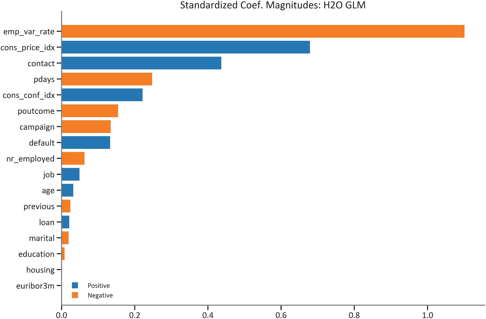

图 5-7

H2O 逻辑回归方法的标准化系数

```
h2o_logistic_regression_method_std_coefficients = h2o_logistic_regression_method.std_coef_plot()
h2o_logistic_regression_method_std_coefficients
清单 5-34
计算 H2O 逻辑回归方法的标准化系数
```

清单 5-35 计算 H2O 逻辑回归方法的偏依赖关系（见图 5-8）。

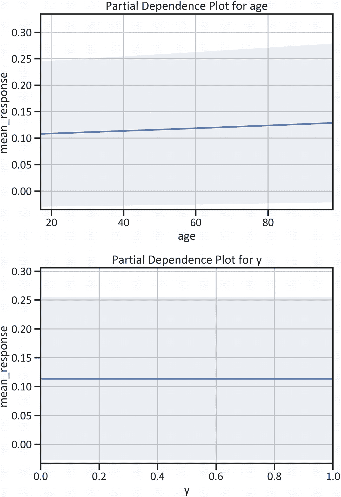

图 5-8

H2O 逻辑回归方法的标准化系数

```
h2o_logistic_regression_method_dependency_plot = h2o_logistic_regression_method.partial_plot(data = h2o_data, cols = list(initial_data.columns[[0, 17]]), server=False, plot = True)
h2o_logistic_regression_method_dependency_plot
清单 5-35
计算 H2O 逻辑回归方法的偏依赖关系
```

清单 5-36 按升序排列对 H2O 逻辑回归方法最重要的特征（见图 5-9）。

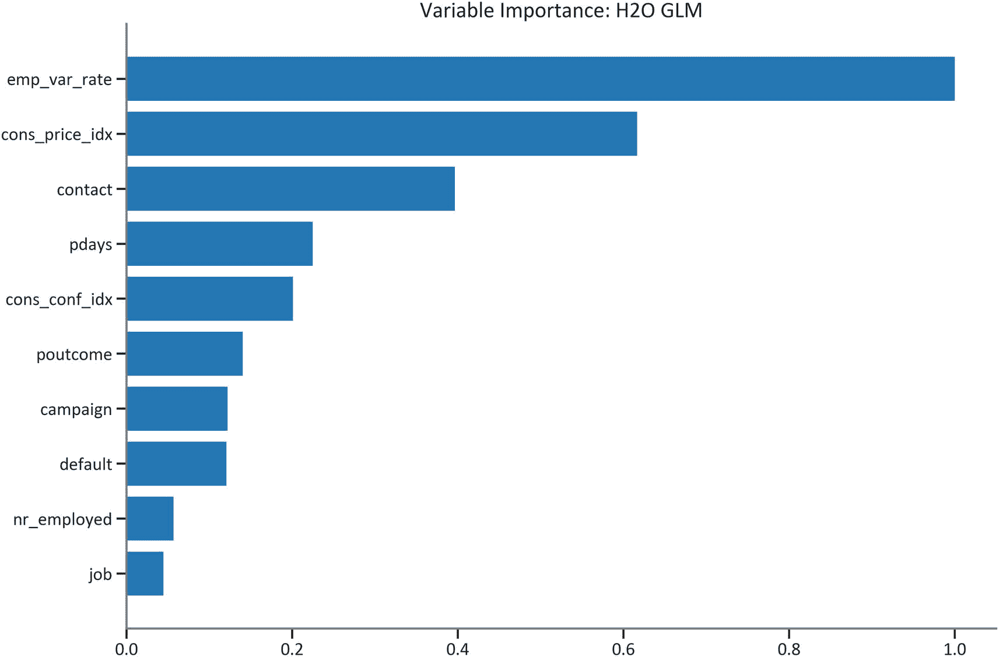

图 5-9

H2O 逻辑回归方法的方差重要性

```
h2o_logistic_regression_method_feature_importance = h2o_logistic_regression_method.varimp_plot()
h2o_logistic_regression_method_feature_importance
清单 5-36
计算 H2O 逻辑回归方法的方差重要性
```

清单 5-37 绘制 H2O 逻辑回归方法的受试者工作特征曲线，以浓缩真阳性率和假阳性率的排列（见图 5-10）。

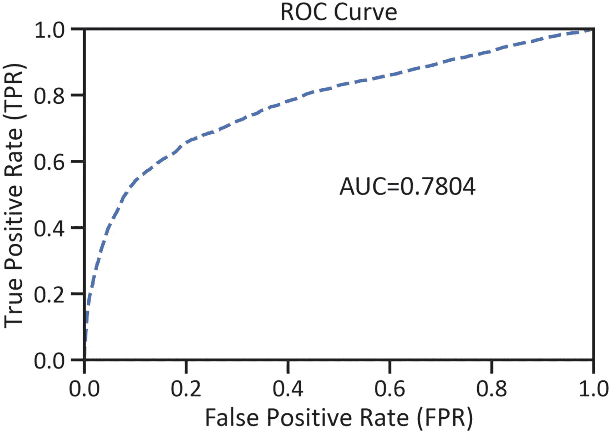

图 5-10

H2O 逻辑回归方法的受试者工作特征曲线

```
h2o_logistic_regression_method_assessment = h2o_logistic_regression_method.model_performance()
清单 5-37
H2O 逻辑回归方法的受试者工作特征曲线
```

## 结论

本章执行了三个关键的机器学习框架（Scikit-Learn、PySpark 和 H2O）来对数据进行建模，并使用逻辑回归方法生成具有两个类别的分类输出特征。

