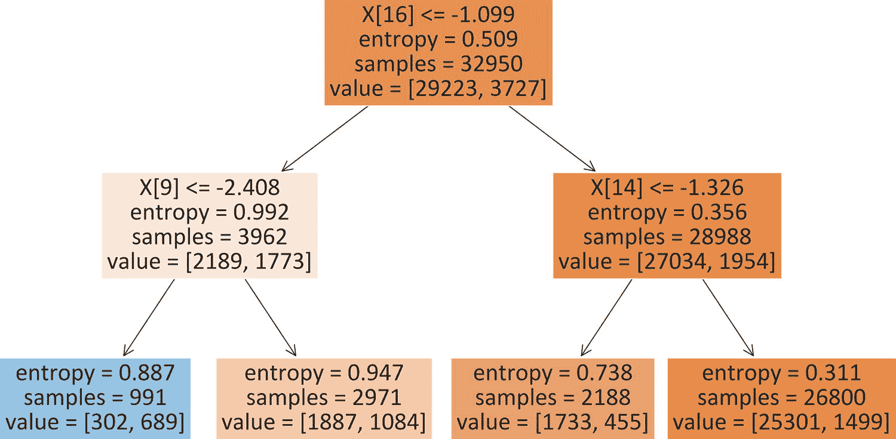
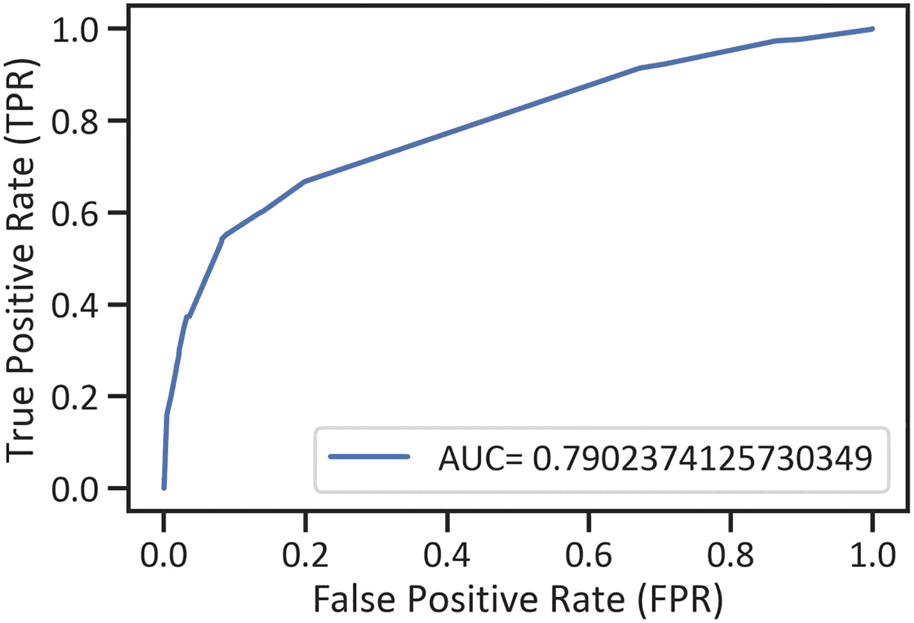
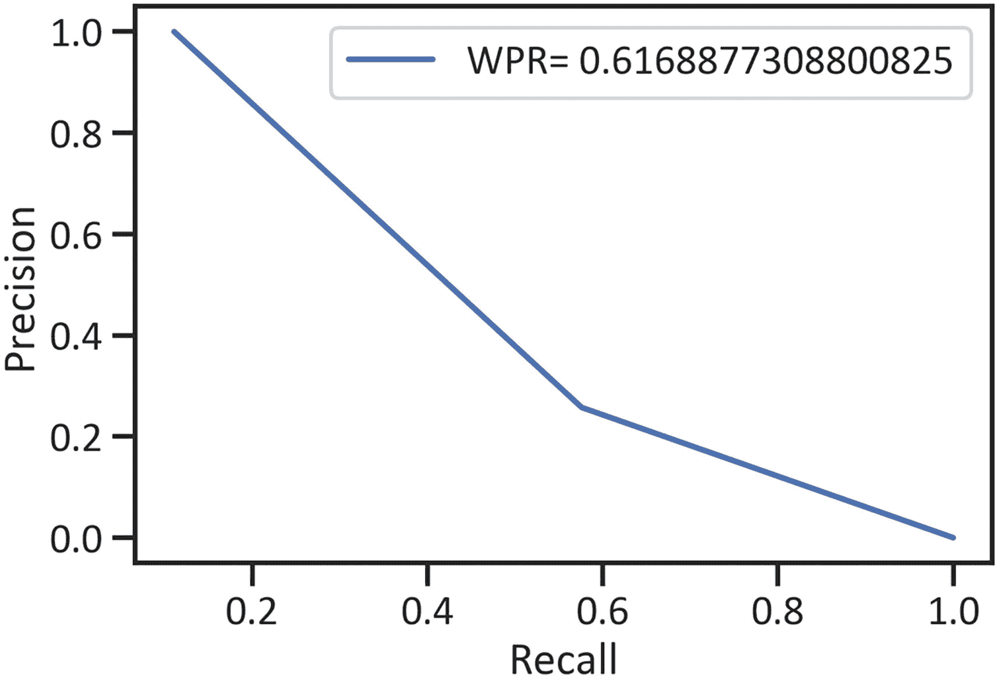

# 6. 使用 Scikit-Learn、XGBoost、PySpark 和 H2O 进行树模型与梯度提升

本章使用一系列全面的 Python 框架（即 Scikit-Learn、XGBoost、PySpark 和 H2O）执行并评估一种基于树的方法（决策树方法）和一种集成方法（梯度提升树方法）。首先，本章阐明了决策树如何计算类别的概率。

## 决策树

决策树是一种基础的非参数方法，适用于线性和非线性建模。它执行决策规则，并发展出一种树状结构，以最小的深度将值划分为不同的组（见图 6-1）。



图 6-1 决策树

## 预处理特征

本章直接操作第 5 章的数据，因此不再按顺序介绍预处理任务。清单 6-1 执行所有预处理任务。

```
from sklearn.tree import DecisionTreeClassifier
import numpy as np
import pandas as pd
from sklearn.preprocessing import StandardScaler
from sklearn.model_selection import train_test_split
df = pd.read_csv(r"filepath\banking.csv")
drop_column_names = df.columns[[8, 9, 10]]
initial_data = df.drop(drop_column_names, axis="columns")
initial_data.iloc[::, 1] = pd.get_dummies(initial_data.iloc[::, 1])
initial_data.iloc[::, 2] = pd.get_dummies(initial_data.iloc[::, 2])
initial_data.iloc[::, 3] = pd.get_dummies(initial_data.iloc[::, 3])
initial_data.iloc[::, 4] = pd.get_dummies(initial_data.iloc[::, 4])
initial_data.iloc[::, 5] = pd.get_dummies(initial_data.iloc[::, 5])
initial_data.iloc[::, 6] = pd.get_dummies(initial_data.iloc[::, 6])
initial_data.iloc[::, 7] = pd.get_dummies(initial_data.iloc[::, 7])
initial_data.iloc[::, 11] = pd.get_dummies(initial_data.iloc[::, 11])
initial_data = initial_data.dropna()
x = np.array(initial_data.iloc[::, 0:17])
y = np.array(initial_data.iloc[::, -1])
x_train, x_test, y_train, y_test = train_test_split(x, y, test_size=0.2, random_state=0)
sk_standard_scaler = StandardScaler()
sk_standard_scaled_x_train = sk_standard_scaler.fit_transform(x_train)
sk_standard_scaled_x_test = sk_standard_scaler.transform(x_test)
清单 6-1 预处理特征
```

### Scikit-Learn 实战

本节使用 `Scikit-Learn` 框架执行并评估决策树方法。代码清单 6-2 使用 `Scikit-Learn` 框架执行决策树方法。

```
from sklearn.tree import DecisionTreeClassifier
sk_decision_tree_method = DecisionTreeClassifier()
sk_decision_tree_method.fit(sk_standard_scaled_x_train, y_train)
代码清单 6-2 执行 Scikit-Learn 决策树方法
```

代码清单 6-3 确定了 `Scikit-Learn` 决策树方法的最佳超参数。

```
from sklearn.model_selection import GridSearchCV
sk_decision_tree_method_parameters = {"criterion":("gini","entropy"), "max_depth":[1, 2, 3, 4, 5, 6]}
sk_decision_tree_method_g_search = GridSearchCV(estimator = sk_decision_tree_method, param_grid = sk_decision_tree_method_parameters)
sk_decision_tree_method_g_search.fit(sk_standard_scaled_x_train, y_train)
print("最佳决策树回归得分: ", sk_decision_tree_method_g_search.best_score_)
print("最佳决策树参数: ", sk_decision_tree_method_g_search.best_params_)
最佳决策树回归得分:  0.900030349013657
最佳决策树参数:  {'criterion': 'entropy', 'max_depth': 5}
代码清单 6-3 确定 Scikit-Learn 决策树方法的最佳超参数
```

代码清单 6-4 使用 `Scikit-Learn` 框架执行决策树方法。

```
sk_decision_tree_method = DecisionTreeClassifier(criterion = "entropy", max_depth = 5)
sk_decision_tree_method.fit(sk_standard_scaled_x_train, y_train)
代码清单 6-4 执行 Scikit-Learn 决策树方法
```

代码清单 6-5 整理了 `Scikit-Learn` 决策树方法的分类报告（见表 6-1）。

表 6-1 Scikit-Learn 决策树方法的分类报告

|   | 精确率 | 召回率 | F1 分数 | 支持度 |
|---|---|---|---|---|
| 0 | 0.914696 | 0.982253 | 0.947271 | 7325.000000 |
| 1 | 0.650538 | 0.265060 | 0.376654 | 913.000000 |
| 准确率 | 0.902768 | 0.902768 | 0.902768 | 0.902768 |
| 宏平均 | 0.782617 | 0.623656 | 0.661963 | 8238.000000 |
| 加权平均 | 0.885420 | 0.902768 | 0.884031 | 8238.000000 |

```
from sklearn import metrics
sk_yhat = sk_decision_tree_method.predict(sk_standard_scaled_x_test)
sk_decision_tree_method_assessment_2 = pd.DataFrame(metrics.classification_report(y_test, sk_yhat, output_dict=True)).transpose()
sk_decision_tree_method_assessment_2
代码清单 6-5 整理 Scikit-Learn 决策树方法的分类报告
```

代码清单 6-6 整理了决策树方法的受试者工作特征曲线，以浓缩真阳性率和假阳性率的排列（见图 6-2）。



图 6-2 Scikit-Learn 决策树的受试者工作特征曲线

## 梯度提升

梯度提升方法继承输入特征的值，然后执行无数个树模型以最小化损失函数（例如，线性建模的平均绝对误差）。它通过吸收弱模型来实现这一点，然后逐步迭代地对数据进行加权建模，并勤勉地伴随选择性能最佳的弱模型。

### XGBoost 实战

本节将使用 XGBoost 框架执行并评估决策树方法。`代码清单 6-9` 执行了 XGBoost 梯度提升方法。

```python
from xgboost import XGBClassifier
xgb_gradient_boosting_method = XGBClassifier()
xgb_gradient_boosting_method.fit(sk_standard_scaled_x_train, y_train)
```

`代码清单 6-9`：执行 XGBoost 梯度提升方法

`代码清单 6-10` 整理了 XGBoost 梯度提升方法的分类报告（见`表 6-2`）。

**表 6-2：XGBoost 梯度提升方法的分类报告**

|       | 精确率    | 召回率    | F1 分数   | 支持度      |
|-------|-----------|----------|-----------|------------|
| 0     | 0.913410  | 0.976382 | 0.943847  | 7325.00000 |
| 1     | 0.575980  | 0.257393 | 0.355791  | 913.000000 |
| 准确率 | 0.896698  | 0.896698 | 0.896698  | 0.896698   |
| 宏平均 | 0.744695  | 0.616888 | 0.649819  | 8238.000000 |
| 加权平均 | 0.876013 | 0.896698 | 0.878674  | 8238.000000 |

```python
sk_yhat_xgb_gradient_boosting_method = xgb_gradient_boosting_method.predict(sk_standard_scaled_x_test)
xgb_gradient_boosting_method_assessment_2 = pd.DataFrame(metrics.classification_report(y_test, sk_yhat_xgb_gradient_boosting_method, output_dict=True)).transpose()
print(xgb_gradient_boosting_method_assessment_2)
```

`代码清单 6-10`：整理 XGBoost 梯度提升方法的分类报告

`代码清单 6-11` 整理了 XGBoost 梯度提升方法的接收者操作特征曲线，以精简精确率和召回率的呈现方式（见`图 6-5`）。


`图 6-5`：XGBoost 梯度提升方法的接收者操作特征曲线

## 梯度提升方法评估与实战

### XGBoost 梯度提升方法评估

```python
yhat_proba_xgb_gradient_boosting_method = xgb_gradient_boosting_method.predict_proba(sk_standard_scaled_x_test)[::,1]
fpr_xgb_gradient_boosting_method, tprr_xgb_gradient_boosting_method, _ = metrics.roc_curve(y_test, yhat_proba_xgb_gradient_boosting_method)
area_under_curve_xgb_gradient_boosting_method = metrics.roc_auc_score(y_test, yhat_proba_xgb_gradient_boosting_method)
plt.plot(fpr_xgb_gradient_boosting_method, tprr_xgb_gradient_boosting_method, label="AUC= "+ str(area_under_curve_xgb_gradient_boosting_method))
plt.xlabel("False Positive Rate (FPR)")
plt.ylabel("True Positive Rate (TPR)")
plt.legend(loc="best")
plt.show()
```

*代码清单 6-11：XGBoost 梯度提升方法的接收者操作特征曲线*

代码清单 6-12 整理了 XGBoost 梯度提升方法的精确率-召回率曲线，以精简精确率和召回率的呈现方式（见图 6-6）。



*图 6-6：Scikit-Learn 决策树方法的精确率-召回率曲线*

```python
weighted_ps_xgb_gradient_boosting_method = metrics.roc_auc_score(y_test, sk_yhat_xgb_gradient_boosting_method)
plt.plot(p_xgb_gradient_boosting_method, r__xgb_gradient_boosting_method,
label="WPR= " +str(weighted_ps_xgb_gradient_boosting_method))
plt.xlabel("Recall")
plt.ylabel("Precision")
plt.legend(loc="best")
plt.show()
```

*代码清单 6-12：Scikit-Learn 决策树方法的精确率-召回率曲线*

### PySpark 实战

本节将使用 PySpark 框架执行并评估梯度提升方法。代码清单 6-13 使用 `findspark` 框架准备 PySpark 框架。

```python
import findspark as initiate_pyspark
initiate_pyspark.init("filepath\spark-3.0.0-bin-hadoop2.7")
```

*代码清单 6-13：准备 PySpark 框架*

代码清单 6-14 使用 `SparkConf()` 方法指定 PySpark 应用。

```python
from pyspark import SparkConf
pyspark_configuration = SparkConf().setAppName("gradient_boosting_method").setMaster("local")
```

*代码清单 6-14：指定 PySpark 应用*

代码清单 6-15 使用 `SparkSession()` 方法准备 PySpark 会话。

```python
from pyspark.sql import SparkSession
pyspark_session = SparkSession(pyspark_context)
```

*代码清单 6-15：准备 Spark 会话*

代码清单 6-16 使用 `createDataFrame()` 方法将本章前面创建的 `pandas` 数据框转换为 PySpark 数据框。

```python
pyspark_initial_data = pyspark_session.createDataFrame(initial_data)
```

*代码清单 6-16：将 Pandas 数据框转换为 PySpark 数据框*

代码清单 6-17 为自变量创建一个列表，并为因变量创建一个字符串。然后使用 `VectorAssembler()` 方法转换数据，以便在 PySpark 框架中进行建模。

```python
x_list = list(initial_data.iloc[::, 0:17].columns)
y_list = str(initial_data.columns[-1])
from pyspark.ml.feature import VectorAssembler
pyspark_data_columns = x_list
pyspark_vector_assembler = VectorAssembler(inputCols=pyspark_data_columns, outputCol="features")
pyspark_data = pyspark_vector_assembler.transform(pyspark_initial_data)
```

*代码清单 6-17：转换数据*

代码清单 6-18 使用 `randomSplit()` 方法划分数据。

```python
(pyspark_training_data, pyspark_test_data) = pyspark_data.randomSplit([.8,.2])
```

*代码清单 6-18：划分数据框*

代码清单 6-19 执行 PySpark 梯度提升回归方法。

```python
from pyspark.ml.classification import GBTClassifier
pyspark_gradient_boosting_method = GBTClassifier(labelCol = y_list, featuresCol = "features")
pyspark_gradient_boosting_method_fitted = pyspark_gradient_boosting_method.fit(pyspark_training_data)
```

*代码清单 6-19：执行 PySpark 梯度提升方法*

代码清单 6-20 使用 PySpark 框架计算梯度提升回归方法的预测结果。

```python
pyspark_yhat = pyspark_gradient_boosting_method_fitted.transform(pyspark_test_data)
```

*代码清单 6-20：梯度提升方法的预测结果（使用 PySpark 框架执行）*

### H2O 实战

本节将使用 H2O 框架执行并评估主成分方法。清单 6-21 准备了 H2O 框架。

```python
import h2o as initialize_h2o
initialize_h2o.init()
```

*清单 6-21：准备 H2O 框架*

清单 6-22 将 `pandas` 数据框转换为 H2O 数据框。

```python
h2o_data = initialize_h2o.H2OFrame(initial_data)
```

*清单 6-22：将 Pandas 数据框转换为 H2O 数据框*

清单 6-23 概述了特征。

```python
x_list = list(initial_data.iloc[::, 0:17].columns)
y_list = str(initial_data.columns[-1])
y = y_list
x = h2o_data.col_names
x.remove(y_list)
```

*清单 6-23：概述特征*

清单 6-24 随机划分数据框。

```python
h2o_training_data, h2o_validation_data, h2o_test_data = h2o_data.split_frame(ratios=[.8,.1])
```

*清单 6-24：随机划分数据框*

清单 6-25 执行 H2O 梯度提升方法。

```
### 清单 6-25 执行 H2O 梯度提升方法

```python
from h2o.estimators import H2OGradientBoostingEstimator
h2o_gradient_boosting_method = H2OGradientBoostingEstimator(nfolds=3)
h2o_gradient_boosting_method.train(x = x, y = y, training_frame = h2o_training_data, validation_frame = h2o_validation_data)
```

### 清单 6-26 评估 H2O 梯度提升方法（见表 6-3）

#### 表 6-3 H2O 梯度提升方法评估

| 时间戳 | 持续时间 | 树的数量 | 训练集均方根误差 | 训练集平均绝对误差 | 训练集偏差 | 验证集均方根误差 | 验证集平均绝对误差 | 验证集偏差 |
| --- | --- | --- | --- | --- | --- | --- | --- | --- |
| 0 | 2021-08-24 04:04:30 | 10.384 秒 | 0.0 | 0.317003 | 0.200981 | 0.100491 | 0.311883 | 0.197762 | 0.097271 |
| 1 | 2021-08-24 04:04:30 | 10.496 秒 | 1.0 | 0.309924 | 0.196310 | 0.096053 | 0.305219 | 0.193472 | 0.093159 |
| 2 | 2021-08-24 04:04:30 | 10.586 秒 | 2.0 | 0.304085 | 0.192122 | 0.092468 | 0.299762 | 0.189611 | 0.089857 |
| 3 | 2021-08-24 04:04:30 | 10.659 秒 | 3.0 | 0.299238 | 0.188351 | 0.089543 | 0.295379 | 0.186199 | 0.087249 |
| 4 | 2021-08-24 04:04:30 | 10.745 秒 | 4.0 | 0.295198 | 0.184939 | 0.087142 | 0.291736 | 0.183116 | 0.085110 |

```python
h2o_gradient_boosting_method_history = h2o_gradient_boosting_method.scoring_history()
print(h2o_gradient_boosting_method_history.head(5))
```

## 结论

本章执行了四个关键的机器学习框架（Scikit-Learn、XGBoost、PySpark 和 H2O）来对数据进行建模，并使用决策树和梯度提升方法生成具有两个类别的分类输出特征。
```