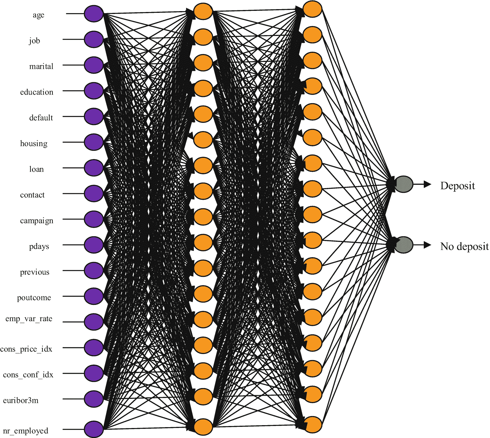
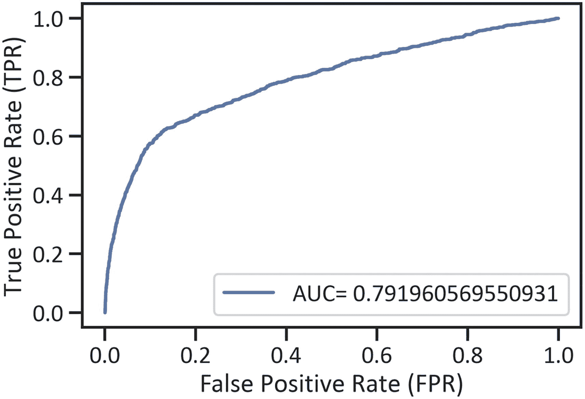
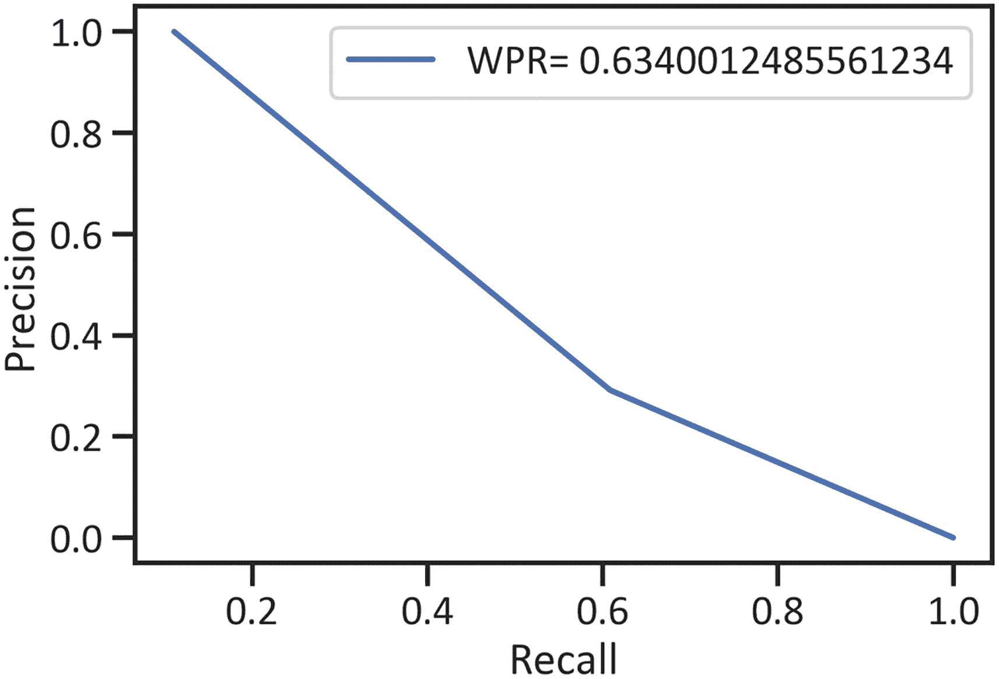
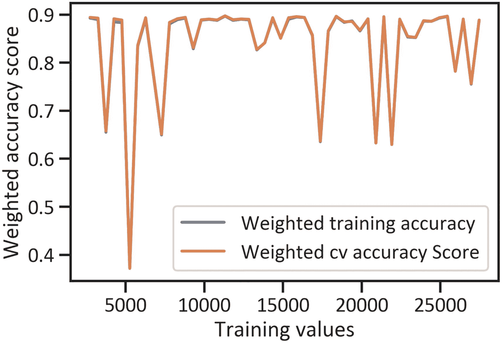
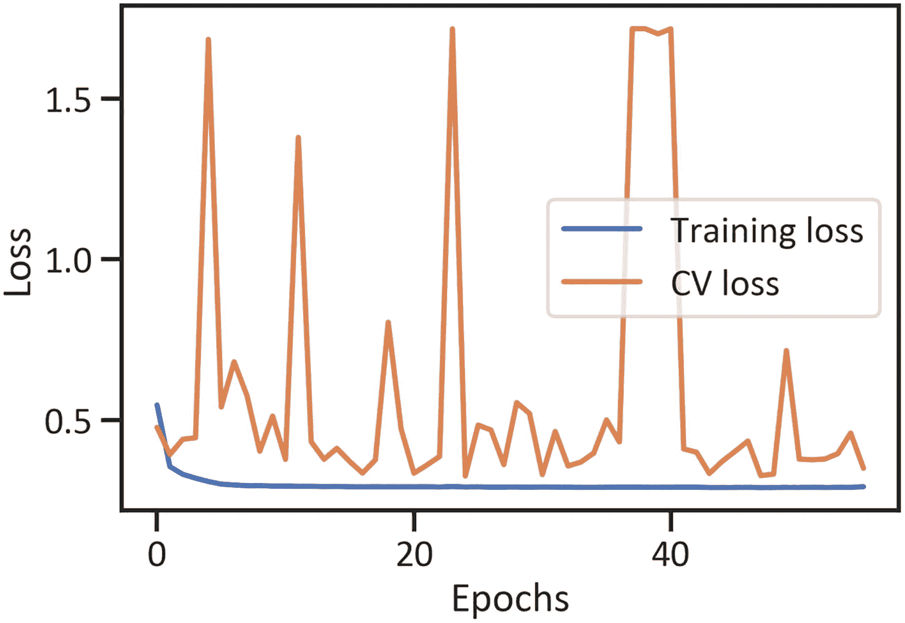
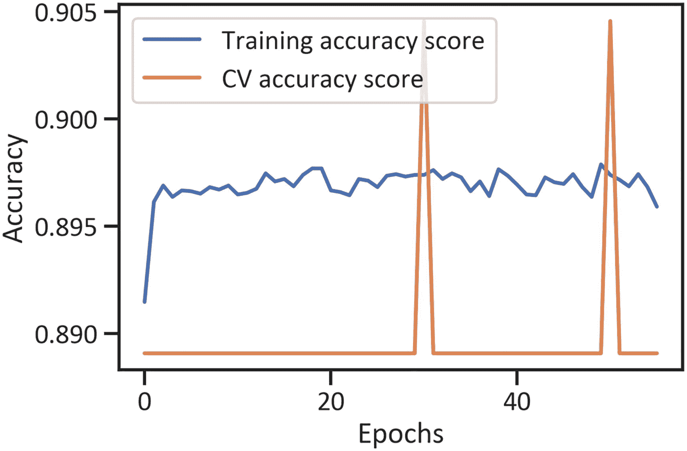

# 7. 使用 Scikit-Learn、Keras 和 H2O 的神经网络

本章将执行并评估非线性神经网络，使用一组多样化的综合性 Python 框架（即 Scikit-Learn、Keras 和 H2O）来解决二分类问题。

## 探索深度学习

深度学习方法超越了机器学习方法。它们通过包含大量的隐藏层来处理模型和方法中的巨大复杂性。机器学习方法通常类似于一个输入-输出系统，其中目标函数接收输入值，并通过目标函数对其进行转换以产生输出值。深度学习通过包含许多层来扩展处理活动，这些层包含重复且迭代地处理数据的节点。深度学习的广泛认可与其可定制性有关；它使开发者能够根据偏好定制方法。

## 多层感知器神经网络

顾名思义，多层感知器神经网络包含多个层。此外，其基本结构保持不变；必须有一个层用于接收输入值，一个层用于生成输出值。那些对数据进行建模以分配不同权重和偏置的层被视为隐藏层。

图 7-1 展示了本章使用的多层感知器神经网络。



图 7-1 多层感知器神经网络

## 预处理特征

本章操作的是在第 6 章中获取的数据，因此不会详细描述预处理任务。清单 7-1 执行了所有预处理任务。

```python
import numpy as np
import pandas as pd
from sklearn.preprocessing import StandardScaler
from sklearn.model_selection import train_test_split

df = pd.read_csv(r"C:\Users\i5 lenov\Downloads\banking.csv")
drop_column_names = df.columns[[8, 9, 10]]
initial_data = df.drop(drop_column_names, axis="columns")
initial_data.iloc[::, 1] = pd.get_dummies(initial_data.iloc[::, 1])
initial_data.iloc[::, 2] = pd.get_dummies(initial_data.iloc[::, 2])
initial_data.iloc[::, 3] = pd.get_dummies(initial_data.iloc[::, 3])
initial_data.iloc[::, 4] = pd.get_dummies(initial_data.iloc[::, 4])
initial_data.iloc[::, 5] = pd.get_dummies(initial_data.iloc[::, 5])
initial_data.iloc[::, 6] = pd.get_dummies(initial_data.iloc[::, 6])
initial_data.iloc[::, 7] = pd.get_dummies(initial_data.iloc[::, 7])
initial_data.iloc[::, 11] = pd.get_dummies(initial_data.iloc[::, 11])
initial_data = initial_data.dropna()
x = np.array(initial_data.iloc[::, 0:17])
y = np.array(initial_data.iloc[::, -1])
x_train, x_test, y_train, y_test = train_test_split(x, y, test_size=0.2, random_state=0)
sk_standard_scaler = StandardScaler()
sk_standard_scaled_x_train = sk_standard_scaler.fit_transform(x_train)
sk_standard_scaled_x_test = sk_standard_scaler.transform(x_test)
```

清单 7-1 预处理特征

### Scikit-Learn 实战

本节使用 `Scikit-Learn` 框架执行并评估一个多层感知器方法。代码清单 7-2 执行了 `Scikit-Learn` 的多层感知器神经网络。

```python
from sklearn.neural_network import MLPClassifier
sk_multilayer_perceptron_net = MLPClassifier()
sk_multilayer_perceptron_net.fit(sk_standard_scaled_x_train, y_train)
```

代码清单 7-2 执行 `Scikit-Learn` 多层感知器神经网络

代码清单 7-3 整理了 `Scikit-Learn` 多层感知器神经网络的分类报告（见表 7-1）。

表 7-1 `Scikit-Learn` 多层感知器神经网络的分类报告

|   | 精确率 | 召回率 | F1 分数 | 支持度 |
|---|---|---|---|---|
| 0 | 0.917062 | 0.976655 | 0.945921 | 7325.000000 |
| 1 | 0.608696 | 0.291347 | 0.394074 | 913.000000 |
| 准确率 | 0.900704 | 0.900704 | 0.900704 | 0.900704 |
| 宏平均 | 0.762879 | 0.634001 | 0.669998 | 8238.000000 |
| 加权平均 | 0.882886 | 0.900704 | 0.884761 | 8238.000000 |

```python
from sklearn import metrics
sk_yhat_multilayer_perceptron_net = sk_multilayer_perceptron_net.predict(sk_standard_scaled_x_test)
sk_multilayer_perceptron_net_assessment = pd.DataFrame(metrics.classification_report(y_test, sk_yhat_multilayer_perceptron_net, output_dict=True)).transpose()
print(sk_multilayer_perceptron_net_assessment)
```

代码清单 7-3 整理 `Scikit-Learn` 多层感知器神经网络的分类报告

代码清单 7-4 整理了多层感知器神经网络的受试者工作特征曲线，以浓缩真阳性率和假阳性率的排列（见图 7-2）。



图 7-2 使用 `Scikit-Learn` 框架执行的多层感知器网络的受试者工作特征曲线

```python
import matplotlib.pyplot as plt
%matplotlib inline
yhat_proba_sk_multilayer_perceptron_net = sk_multilayer_perceptron_net.predict_proba(sk_standard_scaled_x_test)[::, 1]
fpr_sk_multilayer_perceptron_net, tprr_sk_multilayer_perceptron_net, _ = metrics.roc_curve(y_test, yhat_proba_sk_multilayer_perceptron_net)
area_under_curve_sk_multilayer_perceptron_net = metrics.roc_auc_score(y_test, yhat_proba_sk_multilayer_perceptron_net)
plt.plot(fpr_sk_multilayer_perceptron_net, tprr_sk_multilayer_perceptron_net, label="AUC= " + str(area_under_curve_sk_multilayer_perceptron_net))
plt.xlabel("假阳性率 (FPR)")
plt.ylabel("真阳性率 (TPR)")
plt.legend(loc="best")
plt.show()
```

代码清单 7-4 为多层感知器网络整理受试者工作特征曲线（使用 `Scikit-Learn` 框架执行）

代码清单 7-5 整理了 `Scikit-Learn` 多层感知器神经网络的精确率-召回率曲线，以浓缩精确率和召回率的排列（见图 7-3）。



图 7-3

Scikit-Learn 多层感知器神经网络的精确率-召回率曲线

```
p_sk_multilayer_perceptron_net, r_sk_multilayer_perceptron_net, _ = metrics.precision_recall_curve(y_test, sk_yhat_multilayer_perceptron_net)
weighted_ps_sk_multilayer_perceptron_net = metrics.roc_auc_score(y_test, sk_yhat_multilayer_perceptron_net)
plt.plot(p_sk_multilayer_perceptron_net, r_sk_multilayer_perceptron_net,
label="WPR= " +str(weighted_ps_sk_multilayer_perceptron_net))
plt.xlabel("召回率")
plt.ylabel("精确率")
plt.legend(loc="best")
plt.show()
```

代码清单 7-5

Scikit-Learn 多层感知器神经网络的精确率-召回率曲线

代码清单 7-6 整理了 Scikit-Learn 多层感知器神经网络的学习曲线（见图 7-4）。

```
from sklearn.model_selection import learning_curve
train_port_sk_multilayer_perceptron_net, trainscore_sk_multilayer_perceptron_net, testscore_sk_multilayer_perceptron_net = learning_curve(sk_multilayer_perceptron_net, x, y,
cv=3, n_jobs=-5, train_sizes=np.linspace(0.1,1.0,50))
trainscoresk_multilayer_perceptron_net_mean = np.mean(trainscore_sk_multilayer_perceptron_net, axis=1)
testscoresk_multilayer_perceptron_net_mean = np.mean(testscore_sk_multilayer_perceptron_net, axis=1)
plt.plot(train_port_sk_multilayer_perceptron_net, trainscoresk_multilayer_perceptron_net_mean, label="加权训练准确率")
plt.plot(train_port_sk_multilayer_perceptron_net, testscoresk_multilayer_perceptron_net_mean, label="加权交叉验证准确率分数")
plt.xlabel("训练样本数")
plt.ylabel("加权准确率分数")
plt.legend(loc="best")
plt.show()
```

代码清单 7-6

为使用 Scikit-Learn 框架执行的多层感知器网络整理学习曲线



图 7-4

使用 Scikit-Learn 框架执行的多层感知器网络的学习曲线

### Keras 实战

本节使用 Keras 框架执行并评估一个深度信念神经网络。清单 7-7 对特征进行预处理。

```
x_train, x_test, y_train, y_test = train_test_split(x, y, test_size=0.2, random_state=0)
x_train, x_val, y_train, y_val = train_test_split(x_train,y_train,test_size=0.2,random_state=0)
sk_standard_scaler = StandardScaler()
sk_standard_scaled_x_train = sk_standard_scaler.fit_transform(x_train)
sk_standard_scaled_x_test = sk_standard_scaler.transform(x_test)
```

清单 7-7

特征预处理

清单 7-8 使用 `tensorflow` 框架作为后端，并安装 Keras 框架。

```
import tensorflow as tf
from  tensorflow.keras import Sequential, regularizers
from  tensorflow.keras.layers import Dense
from  tensorflow.keras.wrappers.scikit_learn import KerasClassifier
```

清单 7-8

使用 Tensorflow 框架作为后端并安装 Keras 框架

清单 7-9 构建了一个多层感知器神经网络，该网络包含两个隐藏层，每层有 17 个神经元。输入层包含一个速率为 0.001 的 `"l1"` 正则化器、`relu` 激活函数，以及 `binary_crossentropy loss` 和 `accuracy` 指标。

```
def keras_multilayer_perceptron_net(optimizer="adam"):
    keras_multilayer_perceptron_net_model = Sequential()
    keras_multilayer_perceptron_net_model.add(Dense(17, input_dim=17, activation="sigmoid",kernel_regularizer=regularizers.l1(0.001), bias_regularizer=regularizers.l1(0.01)))
    keras_multilayer_perceptron_net_model.add(Dense(17, activation="relu"))
    keras_multilayer_perceptron_net_model.add(Dense(17, activation="relu"))
    keras_multilayer_perceptron_net_model.add(Dense(1, activation="relu"))
    keras_multilayer_perceptron_net_model.compile(loss="binary_crossentropy", optimizer=optimizer, metrics=["accuracy"])
    return keras_multilayer_perceptron_net_model
```

清单 7-9

使用 Keras 构建多层感知器

清单 7-10 绑定多层感知器神经网络。

```
keras_multilayer_perceptron_net_model = KerasClassifier(build_fn=keras_multilayer_perceptron_net)
```

清单 7-10

绑定多层感知器神经网络

清单 7-11 执行 Keras 多层感知器神经网络，设置 56 个周期和 `batch_size` 为 14。

```
keras_multilayer_perceptron_net_model_history = keras_multilayer_perceptron_net_model.fit(sk_standard_scaled_x_train, y_train, validation_data=(x_val, y_.val), batch_size=14, epochs=56)
print(keras_multilayer_perceptron_net_model_history)
```

清单 7-11

使用 Keras 框架执行多层感知器神经网络

清单 7-12 为使用 `Keras` 框架执行的多层感知器网络整理了一份分类报告（见表 7-2）。

表 7-2

使用 Keras 框架执行的多层感知器网络的分类报告

|   | 精确率 | 召回率 | F1 分数 | 支持度 |

| --- | --- | --- | --- | --- |

| 0 | 0.908443 | 0.991536 | 0.948172 | 7325.000000 |

| 1 | 0.744856 | 0.198248 | 0.313149 | 913.000000 |

## Keras 框架实战

| 准确率 | 0.903617 | 0.903617 | 0.903617 | 0.903617 |

| 宏平均 | 0.826649 | 0.594892 | 0.630661 | 8238.000000 |

| 加权平均 | 0.890313 | 0.903617 | 0.877794 | 8238.000000 |

清单 7-12 为使用 `keras` 框架执行的多层感知器网络整理分类报告。

```
keras_multilayer_perceptron_net_model.predict(sk_standard_scaled_x_test)
keras_multilayer_perceptron_net_model = pd.DataFrame(metrics.classification_report(y_test, keras_yhat_multilayer_perceptron_net,
output_dict=True)).transpose()
print(keras_multilayer_perceptron_net_model)
```

清单 7-13 为使用 `keras` 框架执行的多层感知器网络整理了训练损失和交叉验证损失（见图 7-5）。


*图 7-5 使用 Keras 框架执行的多层感知器网络的训练损失和交叉验证损失*

清单 7-13 的代码如下：

```
plt.plot(keras_multilayer_perceptron_net_model_history.history["loss"], label="训练损失")
plt.plot(keras_multilayer_perceptron_net_model_history.history["val_loss"], label="交叉验证损失")
plt.xlabel("周期数")
plt.ylabel("损失")
plt.legend(loc="best")
plt.show()
```

清单 7-14 为使用 `keras` 框架执行的多层感知器网络整理了训练准确率和交叉验证准确率（见图 7-6）。


*图 7-6 使用 Keras 框架执行的多层感知器网络的训练准确率和交叉验证准确率*

清单 7-14 的代码如下：

```
plt.plot(keras_multilayer_perceptron_net_model_history.history["accuracy"], label="训练准确率分数")
plt.plot(keras_multilayer_perceptron_net_model_history.history["val_accuracy"], label="交叉验证准确率分数")
plt.xlabel("周期数")
plt.ylabel("准确率")
plt.legend(loc="best")
plt.show()
```

### 深度信念网络

深度信念网络通过包含隐藏层超越了多层感知器神经网络。网络在生成输出值之前必须重复地对数据进行建模。

### H2O 实战

本节使用 H2O 框架执行一个深度信念神经网络。

清单 7-15 准备 H2O 框架。

```
import h2o as initialize_h2o
initialize_h2o.init()
```

清单 7-16 将 `pandas` 数据框转换为 H2O 数据框。

```
h2o_data = initialize_h2o.H2OFrame(initial_data)
```

清单 7-17 概述了特征。

```
x_list = list(initial_data.iloc[::, 0:17].columns)
y_list = str(initial_data.columns[-1])
y = y_list
x = h2o_data.col_names
x.remove(y_list)
```

清单 7-18 随机划分数据。

```
h2o_training_data, h2o_validation_data, h2o_test_data = h2o_data.split_frame(ratios=[.8,.1])
```

清单 7-19 执行 H2O 深度信念神经网络。

```
from h2o.estimators.deeplearning import H2ODeepLearningEstimator
h2o_deep_belief_net = H2ODeepLearningEstimator(hidden=[5], epochs=56)
h2o_deep_belief_net.train(x= x, y= y, training_frame = h2o_training_data, validation_frame = h2o_validation_data)
```

## 结论

本章执行了三个关键的机器学习框架（Scikit-Learn、Keras 和 H2O）来对数据进行建模。它使用多层感知器和深度信念网络生成了一个二元结果。它还应用了 `binary_crossentropy` 损失函数（用于评估神经网络）和 `adam` 优化器（用于提升神经网络的性能）。