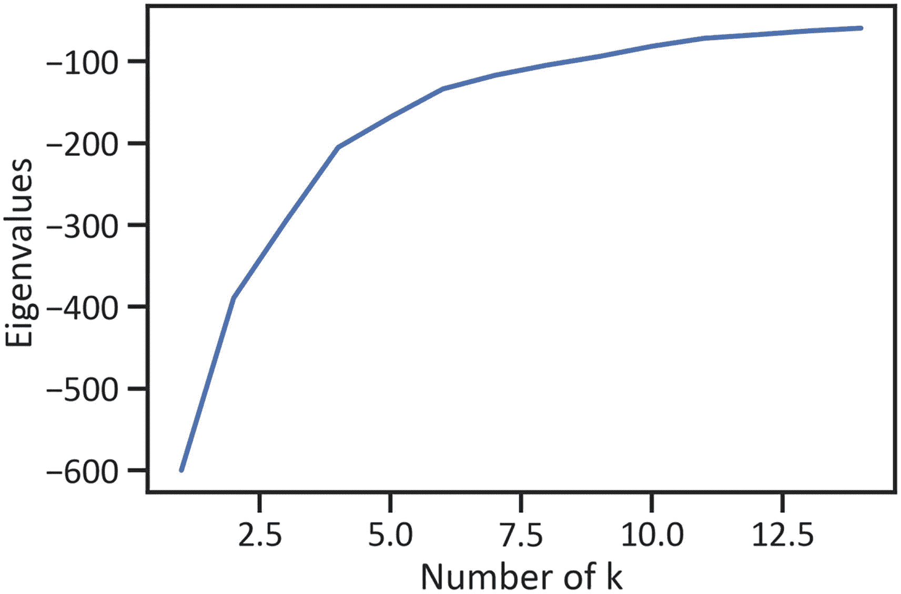
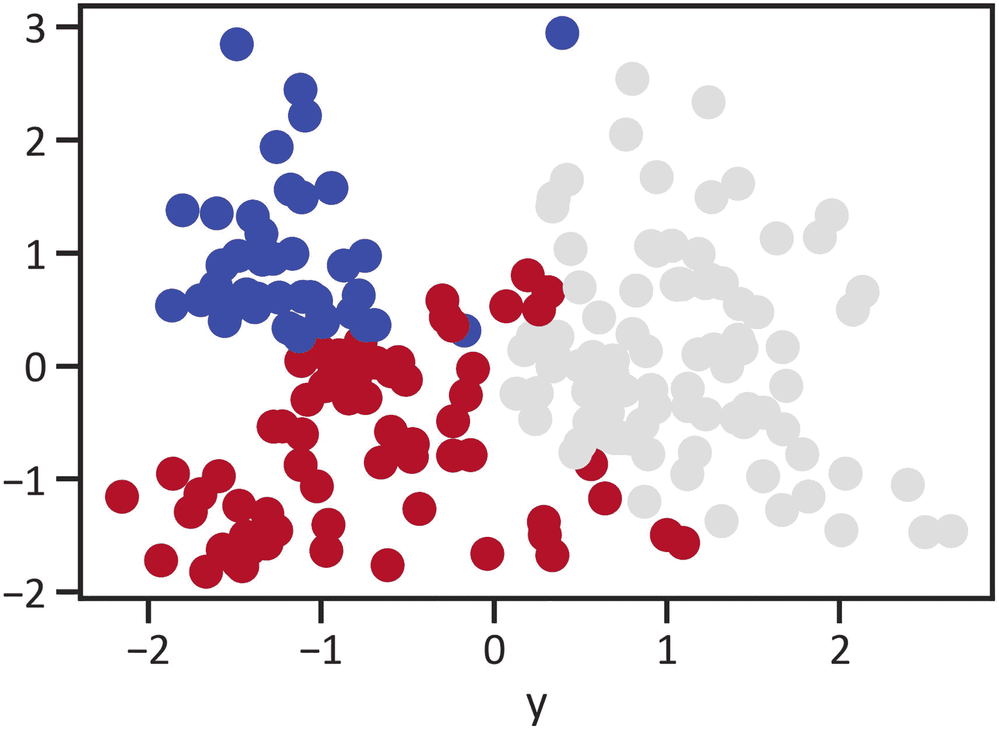
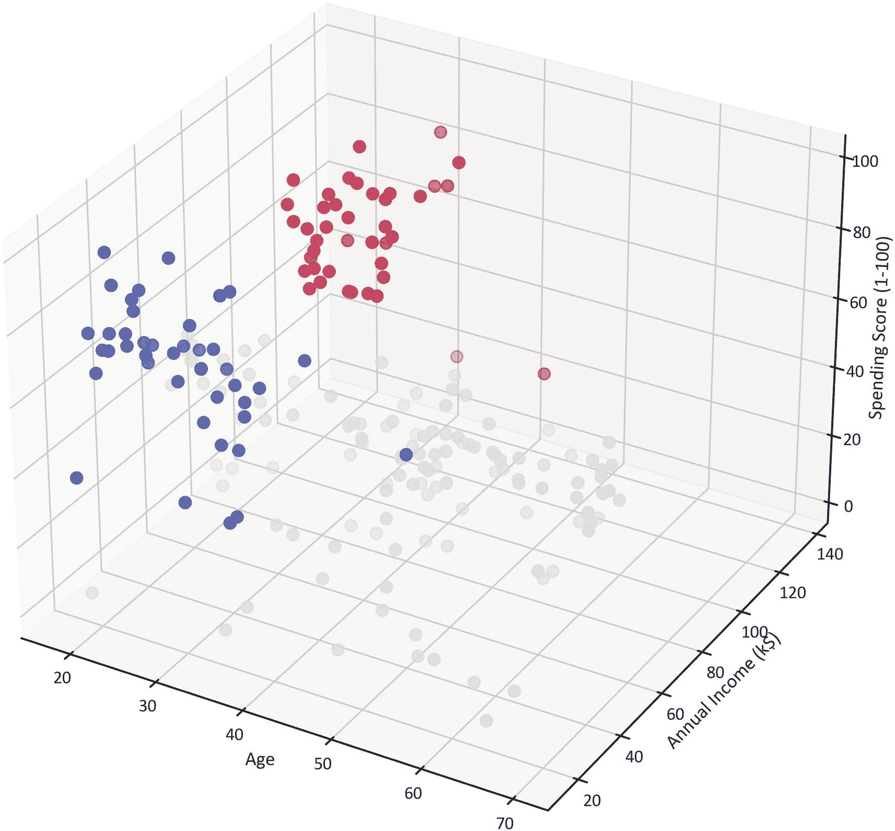

# 8. 使用 Scikit-Learn、PySpark 和 H2O 进行聚类分析

本章通过实现一组多样化的 Python 框架（即 Scikit-Learn、PySpark 和 H2O）来解释 k-means 聚类方法。首先，它阐明了该方法如何将值分配到聚类中。

## 探索 K-Means 方法

k-means 方法是最常见的距离计算方法，属于无监督机器学习家族。它采用欧几里得距离目标函数来高效计算数值间的距离，然后确定中心点，并将中心点附近的数值归集起来，从而建立聚类。

与其他聚类方法（例如空间聚类方法、`birch` 和 `agglomerative`）相比，该方法要求你在训练前指定 `k` 的数值。本章使用肘部曲线，该曲线揭示了线性变化向量的波动情况，用以确定 `k` 的数值。本章将执行该方法，根据特定特征（例如年龄、收入和消费习惯）将客户分组到不同的聚类中。

清单 8-1 从一个微软 CSV 文件中获取所需数据。

```
import pandas as pd
df = pd.read_csv(r"filepath\Mall_Customers.csv")
```

清单 8-2 删除数据中不必要的特征。

```
drop_column_names = df.columns[[0, 1]]
initial_data = df.drop(drop_column_names, axis="columns")
```

清单 8-3 使用标准缩放器对数据进行缩放。

```
from sklearn.preprocessing import StandardScaler
sk_standard_scaler = StandardScaler()
sk_standard_scaled_data = sk_standard_scaler.fit_transform(initial_data)
```

清单 8-4 使用 Scikit-Learn 框架执行主成分方法。

```
from sklearn.decomposition import PCA
sk_principal_component_method = PCA(n_components=3)
sk_principal_component_method.fit(sk_standard_scaled_data)
sk_principal_component_method_transformed_data = sk_principal_component_method.transform(sk_standard_scaled_data)
```

清单 8-5 使用肘部曲线揭示 `k` 的数值（见图 8-1）。



图 8-1 使用肘部曲线揭示 k 的数值

```
from sklearn.cluster import KMeans
import matplotlib.pyplot as plt
%matplotlib inline
elbow_range = range(1, 15)
sk_kmeans_method = [KMeans(n_clusters=x) for x in elbow_range]
sk_kmeans_method_score = [sk_kmeans_method[x].fit(sk_principal_component_method_transformed_data).score(sk_principal_component_method_transformed_data) for x in range(len(sk_kmeans_method))]
plt.plot(elbow_range, sk_kmeans_method_score)
plt.xlabel("Number of k")
plt.ylabel("Eigenvalues")
plt.show()
```

图 8-1 显示曲线突然发生扭转，这表明 k-means 方法必须包含三个成分。

### Scikit-Learn 实战

本节使用 Scikit-Learn 框架执行 k-means 方法；参见清单 8-6。

清单 8-6 使用 Scikit-Learn 框架执行 K-Means 方法

```
sk_kmeans_method = KMeans(n_clusters=3)
sk_kmeans_method_fitted = sk_kmeans_method.fit(sk_standard_scaled_data)
```

清单 8-7 计算 Scikit-Learn k-means 方法的标签。

```
sk_kmeans_method_labels = pd.DataFrame(sk_kmeans_method_fitted.labels_, columns = ["Labels"])
```

清单 8-8 计算聚类中心，并确定其均值和标准差（见表 8-1）。

表 8-1 质心统计量

| | **中心均值** | **中心标准差** |
| --- | --- | --- |
| 第一个中心 | -0.157489 | 0.942836 |
| 第二个中心 | 0.129950 | 0.854012 |
| 第三个中心 | 0.222984 | 0.891719 |

```
sk_kmeans_method = KMeans(n_clusters=3)
sk_kmeans_method_centers = sk_kmeans_method_fitted.cluster_centers_
sk_kmeans_method_centers = pd.DataFrame(sk_kmeans_method_centers, columns = ("1st center","2nd center","3rd center"))
sk_kmeans_method_centers_mean = pd.DataFrame(sk_kmeans_method_centers.mean())
sk_kmeans_method_centers_std = pd.DataFrame(sk_kmeans_method_centers.std())
sk_kmeans_method_centers_mean_std = pd.concat([sk_kmeans_method_centers_mean, sk_kmeans_method_centers_std], axis=1)
sk_kmeans_method_centers_mean_std.columns =["Center mean", "Center standard deviation"]
print(sk_kmeans_method_centers_mean_std)
```

清单 8-9 确定由 Scikit-Learn k-means 方法计算出的缩放数据和标签（见图 8-2）。



图 8-2 Scikit-Learn k-means 方法标签

```
plt.scatter(sk_principal_component_method_transformed_data[:,0], sk_principal_component_method_transformed_data[:, 1],
c=sk_kmeans_method_fitted.labels_,cmap="coolwarm", s=120)
plt.xlabel("y")
plt.show()
```

### PySpark 实战

本节将使用 PySpark 框架执行并评估 k-means 方法。

清单 8-10 使用 `findspark` 框架准备 PySpark 框架。

```
import findspark as initiate_pyspark
initiate_pyspark.init("filepath\spark-3.0.0-bin-hadoop2.7")
```

清单 8-11 使用 `SparkConf()` 方法规定 PySpark 应用。

# 使用PySpark和H2O进行K-Means聚类分析

## PySpark 实战

### 代码清单 8-11
规定 PySpark 应用
```python
from pyspark import SparkConf
pyspark_configuration = SparkConf().setAppName("pyspark_kmeans_method").setMaster("local")
```

清单 8-12 使用 `SparkSession()` 方法准备 PySpark 会话。

### 代码清单 8-12
准备 Spark 会话
```python
from pyspark.sql import SparkSession
pyspark_session = SparkSession(pyspark_context)
```

清单 8-13 使用 `createDataFrame()` 方法将本章前面创建的 `pandas` 数据框转换为 PySpark 数据框。

### 代码清单 8-13
将 Pandas 数据框转换为 PySpark 数据框
```python
pyspark_initial_data = pyspark_session.createDataFrame(initial_data)
```

清单 8-14 为自变量创建一个列表，并为因变量创建一个字符串。然后使用 `VectorAssembler()` 方法转换数据，以便在 PySpark 框架中进行建模。

### 代码清单 8-14
转换数据
```python
x_list = list(initial_data.iloc[::, 0:3].columns)
from pyspark.ml.feature import VectorAssembler
pyspark_data_columns = x_list
pyspark_vector_assembler = VectorAssembler(inputCols=pyspark_data_columns, outputCol="features")
pyspark_data = pyspark_vector_assembler.transform(pyspark_initial_data)
```

清单 8-15 使用 PySpark 框架执行 k-means 方法。

### 代码清单 8-15
使用 PySpark 框架执行 K-Means 方法
```python
from pyspark.ml.clustering import KMeans
pyspark_kmeans_method = KMeans().setK(3).setSeed(1)
pyspark_kmeans_method_fitted = pyspark_kmeans_method.fit(pyspark_data)
```

清单 8-16 计算 k-means 方法的标签，并将其传递给 `pandas` 数据框。

### 代码清单 8-16
计算 PySpark K-Means 方法的标签
```python
pyspark_yhat = pyspark_kmeans_method_fitted.transform(pyspark_data)
pyspark_yhat_pandas_df = pyspark_yhat.toPandas()
```

清单 8-17 展示了 PySpark k-means 方法计算出的缩放数据和标签（见图 8-3）。



### 代码清单 8-17
展示 PySpark K-Means 方法的标签
```python
from mpl_toolkits.mplot3d import Axes3D
figure = plt.figure(figsize=(12, 12))
ax = Axes3D(figure)
ax.scatter(pyspark_yhat_pandas_df.iloc[::, 0],
          pyspark_yhat_pandas_df.iloc[::, 1],
          pyspark_yhat_pandas_df.iloc[::, 2],
          c = pyspark_yhat_pandas_df.iloc[::, 4],
          cmap = "coolwarm",
          s = 120)
ax.set_xlabel(initial_data.columns[0])
ax.set_ylabel(initial_data.columns[1])
ax.set_zlabel(initial_data.columns[2])
figure.show()
```

清单 8-18 计算 PySpark k-means 方法的中心点。

### 代码清单 8-18
计算 PySpark K-Means 方法的中心点
```python
pyspark_kmeans_method_centers = pyspark_kmeans_method_fitted.clusterCenters()
print("K-Means method cluster centers")
for pyspark_cluster_center in pyspark_kmeans_method_centers:
    print(pyspark_cluster_center)
```

K-Means method cluster centers
[26.5952381  33.14285714 65.66666667]
[45.30769231 60.52991453 34.47008547]
[32.97560976 88.73170732 79.24390244]

清单 8-19 使用轮廓系数法评估 PySpark k-means 方法。

### 代码清单 8-19
使用轮廓系数法评估 PySpark K-Means 方法
```python
from pyspark.ml.evaluation import ClusteringEvaluator
pyspark_kmeans_method_assessment = ClusteringEvaluator()
pyspark_kmeans_method_silhoutte = pyspark_kmeans_method_assessment.evaluate(pyspark_yhat)
print("Silhouette score = " + str(pyspark_kmeans_method_silhoutte))
```

Silhouette score = 0.45097978411312134

## H2O 实战

本节将使用 H2O 框架执行并评估 k-means 方法。

清单 8-20 准备 H2O 框架。

### 代码清单 8-20
准备 H2O 框架
```python
import h2o as initialize_h2o
initialize_h2o.init()
```

清单 8-21 将 `pandas` 数据框转换为 H2O 数据框。

### 代码清单 8-21
将 Pandas 数据框转换为 H2O 数据框
```python
h2o_data = initialize_h2o.H2OFrame(initial_data)
```

清单 8-22 概述自变量和因变量。

### 代码清单 8-22
概述特征
```python
y = y_list
x = h2o_data.col_names
x.remove(y_list)
```

清单 8-23 保留用于训练和验证 H2O k-means 方法的数据。

### 代码清单 8-23
随机划分数据框
```python
h2o_training_data, h2o_validation_data = h2o_data.split_frame(ratios=[.8])
```

清单 8-24 执行 H2O k-means 方法。

### 代码清单 8-24
使用 H2O 框架执行 K-Means 方法
```python
from h2o.estimators import H2OKMeansEstimator
h2o_kmeans_method = H2OKMeansEstimator(k=3)
h2o_kmeans_method.train(x = x_list, training_frame = h2o_training_data, validation_frame = h2o_validation_data)
```

清单 8-25 计算 H2O k-means 方法的标签。

### 代码清单 8-25
计算 H2O K-Means 方法的标签
```python
h2o_yhat = h2o_kmeans_method.predict(h2o_validation_data)
```

清单 8-26 评估 H2O k-means 方法（见表 8-2）。

表 8-2 PySpark 质心统计

|    | 质心 | 大小 | 簇内平方和 |
|----|------|------|------------|
| 0  | 1.0  | 78.0 | 134.983658 |
| 1  | 2.0  | 51.0 | 69.748489  |
| 2  | 3.0  | 32.0 | 33.898533  |


```python
from h2o.estimators import H2OKMeansEstimator
h2o_kmeans_method_assessment = h2o_kmeans_method.model_performance()
h2o_kmeans_method_assessment
```

输出结果：
```
ModelMetricsClustering: kmeans
Reported on train data.
MSE: NaN
RMSE: NaN
Total Within Cluster Sum of Square Error: 238.6306804611187
Total Sum of Square Error to Grand Mean: 479.99999503427534
Between Cluster Sum of Square Error: 241.36931457315666
```

清单 8-26 评估使用 H2O 框架执行的 K-Means 方法

## 结论

本章执行了三个关键的机器学习框架（Scikit-Learn、PySpark 和 H2O），以便将数据分组为三个簇。你了解了如何使用肘部曲线确定 `k` 的数量。为了评估该方法，你使用了轮廓系数法并查看了误差平方和。
