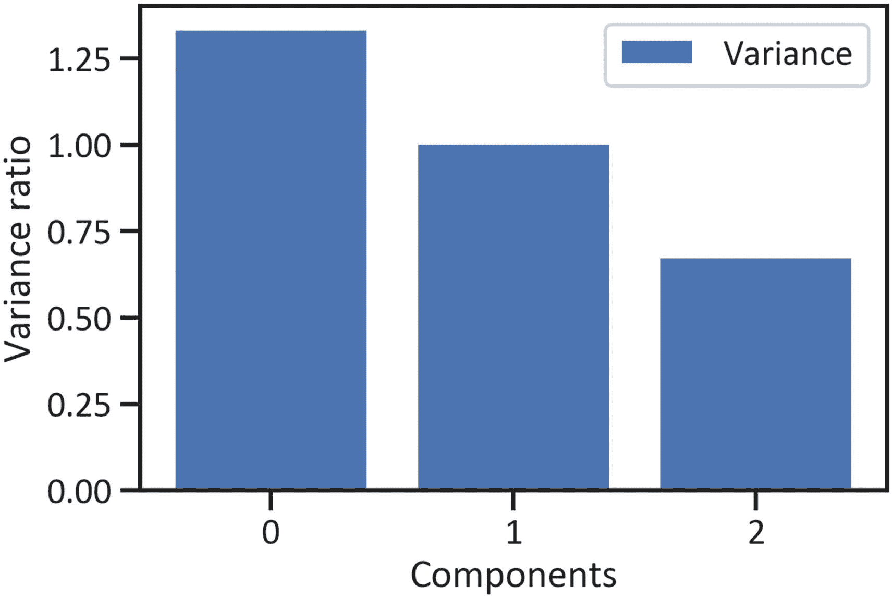
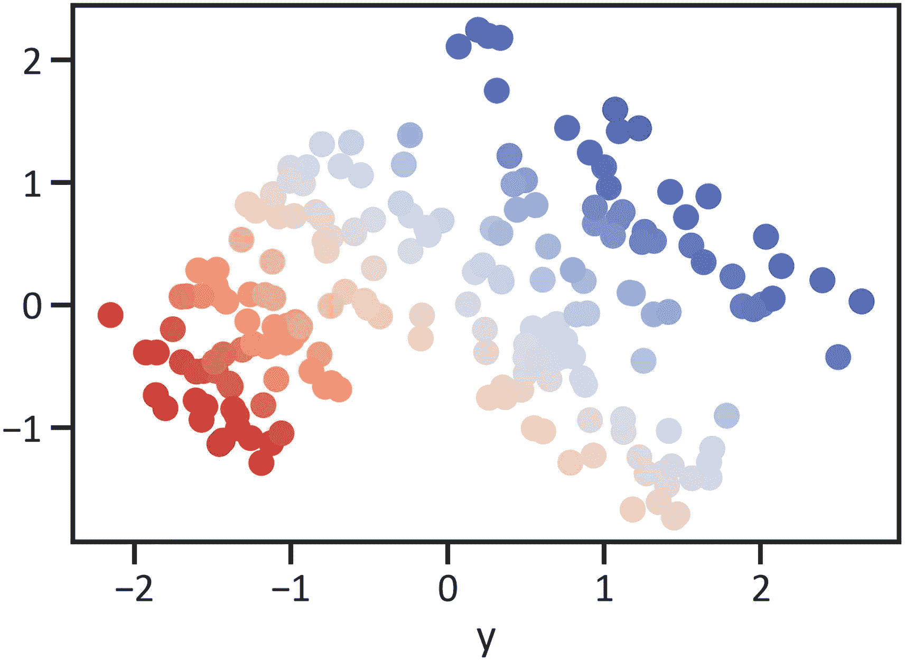
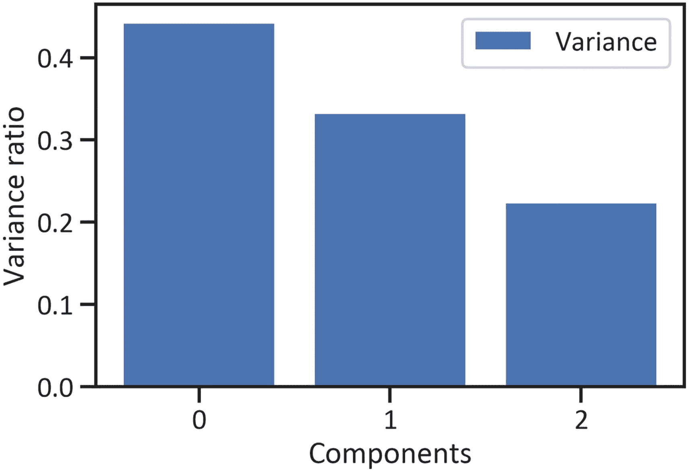
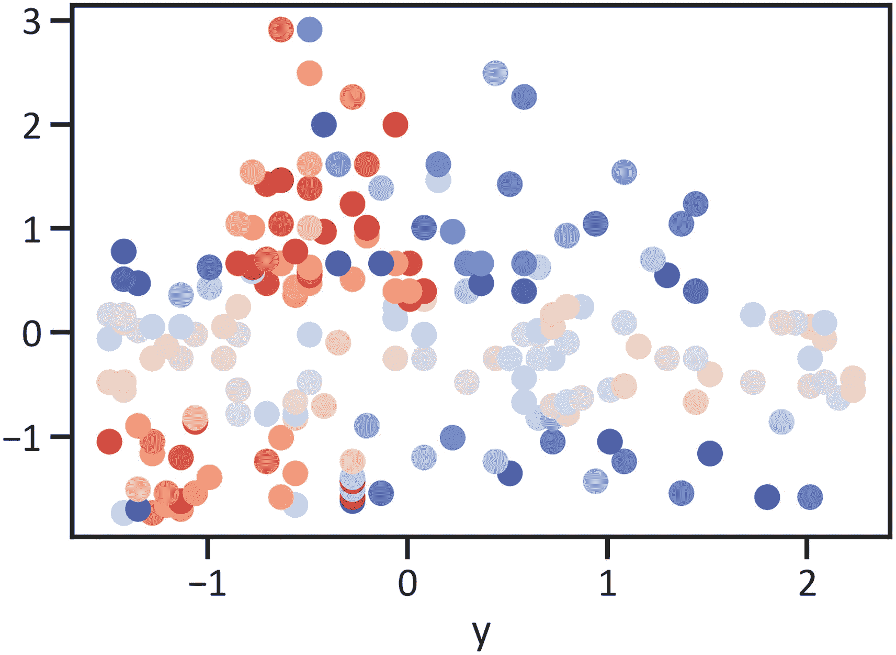

# 9. 使用 Scikit-Learn、PySpark 和 H2O 进行主成分分析

本章通过实现多种 Python 框架（`Scikit-Learn`、`PySpark` 和 `H2O`）来执行一个简单的降维方法（主成分方法）。首先，它阐明了该方法如何计算主成分。

## 探索主成分方法

主成分方法是一种简单的降维工具。它对整个数据集进行线性变换，以获取向量（即`特征值`），然后识别数据中的增量变化。它能让你检测数据中特征的变化。该方法有助于确定每个特征的比例，从而决定保留哪些特征用于建模。当你的数据包含无数特征时，它非常适用，因为它能帮助你识别对模型至关重要的特征。需要注意的是，尽管我在本章中称其为“方法”，但严格来说并非如此。与其他方法相比，它不考虑任何合理的假设；相反，你是在执行线性、非线性和聚类等方法之前执行它。

本章使用上一章（涵盖 `k-means` 方法）的数据。

清单 9-1 从微软 CSV 文件中获取所需数据。

```python
import pandas as pd
initial_data = df.drop(drop_column_names, axis="columns")
```
清单 9-1 获取数据

清单 9-2 删除数据中任何不必要的特征。

```python
drop_column_names = df.columns[[0, 1]]
initial_data = df.drop(drop_column_names, axis="columns")
```
清单 9-2 删除不必要的特征

### Scikit-Learn 实战

清单 9-3 使用标准缩放器对整个数据集进行缩放。

```python
from sklearn.preprocessing import StandardScaler
sk_standard_scaler = StandardScaler()
sk_standard_scaled_data = sk_standard_scaler.fit_transform(initial_data))
```
清单 9-3 缩放整个数据集

清单 9-4 使用 `Scikit-Learn` 框架执行主成分方法。然后展示每个成分所解释的方差（见图 9-1）。



**图 9-1** `Scikit-Learn` 主成分方法的方差

```python
import matplotlib.pyplot as plt
%matplotlib inline
from sklearn.decomposition import PCA
sk_principal_component_method = PCA(n_components=3)
sk_principal_component_method.fit_transform(sk_standard_scaled_data)
sk_principal_component_method_variance = sk_principal_component_method.explained_variance_
plt.bar(range(3), sk_principal_component_method_variance, label="Variance")
plt.legend()
plt.ylabel("Variance ratio")
plt.xlabel("Components")
plt.show()
```
清单 9-4 排列 `Scikit-Learn` 主成分方法解释的方差

图 9-1 显示所有成分解释的方差均超过 0.5。因此，所有主成分方法都将包含三个成分。

清单 9-5 展示 `Scikit-Learn` 主成分方法的方差。

```python
print("SciKit-Learn PCA explained variance ratio", sk_principal_component_method_variance)
```
`SciKit-Learn PCA explained variance ratio [1.33465831 1.00427272 0.67614435]`
清单 9-5 打印 `Scikit-Learn` 主成分方法揭示的方差

清单 9-6 使用 `Scikit-Learn` 框架执行主成分方法，并展示更少的维度（见图 9-2）。



**图 9-2** `Scikit-Learn` 主成分方法的维度

```python
sk_principal_component_method_ = PCA(n_components=3)
sk_principal_component_method_.fit(sk_standard_scaled_data)
sk_principal_component_method_reduced_data = sk_principal_component_method_.transform(sk_standard_scaled_data)
plt.scatter(sk_principal_component_method_reduced_data[:,0], sk_principal_component_method_reduced_data[:,2], c=initial_data.iloc[::, -1], cmap="coolwarm")
plt.xlabel("y")
plt.show()
```
清单 9-6 使用 `Scikit-Learn` 框架执行主成分方法

图 9-2 展示了 `Scikit-Learn` 主成分方法找到的维度。

### PySpark 实战

本节将使用 `PySpark` 框架执行主成分方法。

清单 9-7 使用 `findspark` 框架准备 `PySpark` 环境。

```python
import findspark as initiate_pyspark
initiate_pyspark.init("filepath\spark-3.0.0-bin-hadoop2.7")
```
清单 9-7 准备 `PySpark` 框架

清单 9-8 使用 `SparkConf()` 方法指定 `PySpark` 应用。

```python
from pyspark import SparkConf
pyspark_configuration = SparkConf().setAppName("pyspark_principal_components_analysis").setMaster("local")
```
清单 9-8 指定 `PySpark` 应用

清单 9-9 使用 `SparkSession()` 方法准备 `PySpark` 会话。

```python
from pyspark.sql import SparkSession
pyspark_session = SparkSession(pyspark_context)
```
清单 9-9 准备 `Spark` 会话

清单 9-10 使用 `createDataFrame()` 方法将本章前面创建的 `pandas` 数据框转换为 `PySpark` 数据框。

```python
pyspark_initial_data = pyspark_session.createDataFrame(initial_data)
```
清单 9-10 将 `Pandas` 数据框转换为 `PySpark` 数据框

清单 9-11 为自变量创建一个列表，并为因变量创建一个字符串。然后使用 `VectorAssembler()` 方法转换数据，以便在 `PySpark` 框架中进行建模。

```python
x_list = list(initial_data.iloc[::, 0:3].columns)
from pyspark.ml.feature import VectorAssembler
pyspark_data_columns = x_list
pyspark_vector_assembler = VectorAssembler(inputCols=pyspark_data_columns, outputCol="variables")
pyspark_data = pyspark_vector_assembler.transform(pyspark_initial_data)
```
清单 9-11 转换数据

清单 9-12 使用 `Lifeline` `PySpark` 框架缩放整个数据集。

# PySpark 和 H2O 实战

本节将使用 PySpark 和 H2O 框架执行并评估主成分方法。

## 使用 PySpark 进行主成分分析

清单 9-12 展示了使用 Lifeline PySpark 框架缩放整个数据集的方法。

```python
from pyspark.ml.feature import StandardScaler
pyspark_standard_scaler = StandardScaler(inputCol = pyspark_data.columns[-1], outputCol = "pyspark_scaled_features", withMean = True, withStd = True).fit(pyspark_data)
pyspark_data_scaled_data = pyspark_standard_scaler.transform(pyspark_data)
```

清单 9-13 执行 PySpark 主成分方法。

```python
from pyspark.ml.feature import PCA
number_of_k = 3
pyspark_principal_components_method = PCA(k = number_of_k, inputCol = pyspark_data_scaled_data.columns[-1], outputCol = "pca_reduced_features").fit(pyspark_data_scaled_data)
pyspark_principal_components_method_data = pyspark_principal_components_method.transform(pyspark_data_scaled_data)
```

清单 9-14 展示了每个成分解释的方差（见图 9-3）。



```python
pyspark_principal_component_method_variance = pyspark_principal_components_method.explainedVariance.toArray()
plt.bar(range(3), pyspark_principal_component_method_variance, label="Variance")
plt.legend()
plt.ylabel("Variance ratio")
plt.xlabel("Components")
plt.show()
```

清单 9-15 打印 PySpark 主成分方法揭示的方差。

```python
print('Explained variance ratio', pyspark_principal_components_method.explainedVariance.toArray())
```

`PySpark PCA variance ratio [0.44266167 0.33308378 0.22425454]`

结果显示，第一个成分解释了数据中特征相关变化的 `0.44`，第二个成分解释了 `0.33`，第三个成分解释了 `0.22`。

清单 9-16 使用 PySpark 主成分方法减少数据。

```python
pyspark_principal_components_method_reduced_data = pyspark_principal_components_method_data.rdd.map(lambda row: row.pyspark_scaled_features).collect()
pyspark_principal_components_method_reduced_data = np.array(pyspark_principal_components_method_reduced_data)
```

清单 9-17 展示了 PySpark 主成分方法减少后的数据（见图 9-4）。



```python
plt.scatter(pyspark_principal_components_method_reduced_data[:,0], pyspark_principal_components_method_reduced_data[:,1], c=initial_data.iloc[::, -1], cmap = "coolwarm")
plt.xlabel("y")
plt.show()
```

图 9-4 展示了 PySpark 主成分方法找到的维度。

## H2O 实战

本节将使用 H2O 框架执行并评估主成分方法。

清单 9-18 准备 H2O 框架。

```python
import h2o as initialize_h2o
initialize_h2o.init()
```

清单 9-19 将 `pandas` 数据框转换为 H2O 数据框。

```python
h2o_data = initialize_h2o.H2OFrame(initial_data)
```

清单 9-20 随机划分数据框。

```python
h2o_training_data, h2o_validation_data = h2o_data.split_frame(ratios=[.8])
```

清单 9-21 执行 H2O 主成分方法。

```python
from h2o.estimators import H2OPrincipalComponentAnalysisEstimator
h2o_principal_components_method = H2OPrincipalComponentAnalysisEstimator(k = 3, transform = "standardize")
h2o_principal_components_method.train(training_frame = h2o_training_data)
```

清单 9-22 使用 H2O 主成分方法减少数据。

```python
h2o_yhat = h2o_principal_components_method.predict(h2o_validation_data)
```

## 结论

本章通过执行三个关键的机器学习框架（Scikit-Learn、PySpark 和 H2O），运用主成分方法将数据压缩到少数几个维度。正如本章开头所述，本章并未执行该方法来检验可能的假设，因此没有用于客观评估该方法的关键指标。