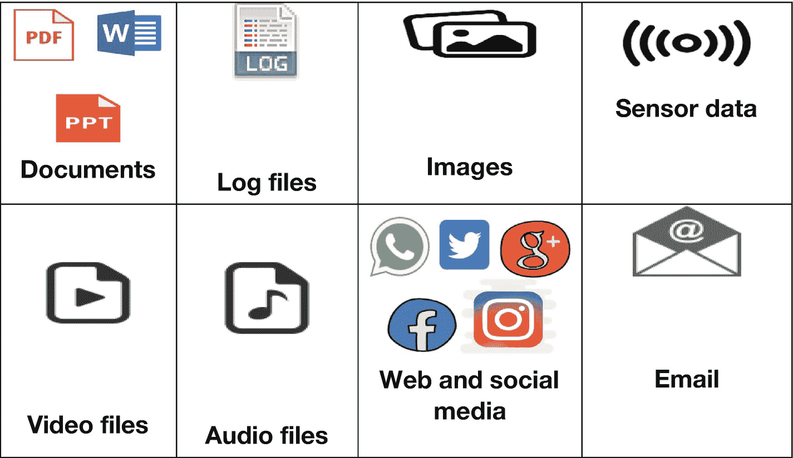
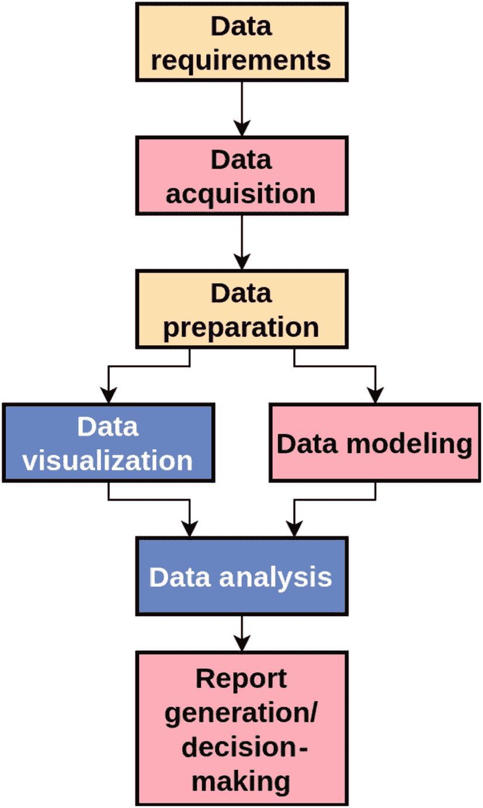
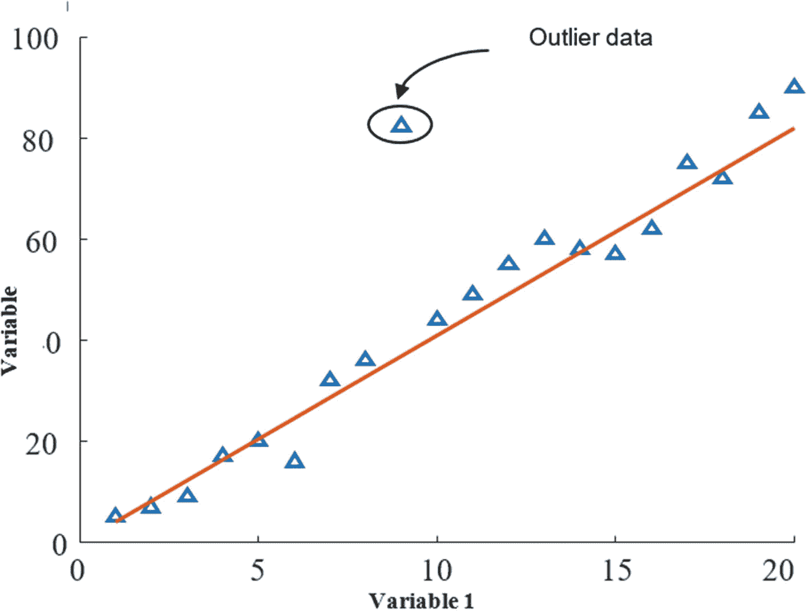

# 1. 数据科学导论

数据是以词语、数字和关于主体的描述形式存在的信息集合。考虑以下表述：“那条狗有四条腿，身高`1.5m`，长着棕色毛发。” 这句话包含了关于这条狗的三种不同类型的信息（即数据）。数据“四”和“`1.5m`”是数值型数据，而“棕色毛发”是描述型数据。了解各种数据类型有助于理解数据、进行有效分析，并更好地从数据中提取知识。从根本上说，数据可以分为两种类型。

*   `定量数据`

*   `定性数据`

`定量数据`只能通过测量获得，而不能通过观察得到。它可以以数值形式表示。定量数据可进一步分为连续型和离散型。精确的整数值是`离散数据`，而`连续数据`可以是某个范围内的任意值。`定性数据`是对主体特征的描述。通常，定性数据可以通过观察获得，无法进行测量。换言之，定性数据可称为分类数据，而定量数据可称为数值型数据。

例如，在前面那句表述中，“棕色毛发”描述了狗的一个特征，属于定性数据；而“四条腿”和“`1.5m`”则是定量数据，分别属于离散数据和连续数据。

数据可以以结构化形式和非结构化形式存在。当数据按照预定义的数据模型/结构进行组织时，被称为`结构化数据`。结构化数据可以以表格格式存储，或借助查询语言存储在关系数据库中。我们也可以用 Excel 文件格式存储这类数据，例如表 1-1 中给出的学生数据库。

**表 1-1** 结构化数据示例

| **学号** | 分数 | 出勤率 | 年级 | 性别 |
| --- | --- | --- | --- | --- |
| 111401 | 492/500 | 98% | 2011-2014 | 男 |
| 111402 | 442/500 | 72% | 2011-2014 | 男 |
| 121501 | 465/500 | 82% | 2012-2015 | 女 |
| 121502 | 452/500 | 87% | 2012-2015 | 男 |

大多数人类生成和机器生成的数据都是非结构化数据，例如电子邮件、文档、文本文件、日志文件、短信、图像、视频和音频文件、网络和社交媒体上的消息，以及来自传感器的数据。这些数据只有通过人工或机器干预，才能转换为结构化格式。图 1-1 展示了非结构化数据的各种来源。

**图 1-1** 非结构化数据的来源

## 数据类型在数据科学中的重要性

在开始分析数据之前，了解数据类型非常重要，这样你才能选择合适的分析方法。连续数据的分析与分类数据的分析是不同的；因此，对两者使用相同的分析方法可能导致错误的分析结果。

例如，在涉及连续数据的统计分析中，某个精确事件发生的概率为零，而对于离散数据，其结果可能不同。

你还可以根据数据类型选择可视化工具。例如，连续数据通常使用直方图表示，而离散数据则可以借助柱状图进行可视化。

## 数据科学概述

正如本章开头所讨论的，数据科学无非就是从数据中提取知识或信息。不幸的是，并非所有数据都能提供有用信息。这取决于客户需求、假设、数据类型性质以及用于分析和建模的方法。因此，在为智能决策而分析或建模数据之前，需要经历一些流程。图 1-2 描述了这些数据科学流程。

**图 1-2** 数据科学流程

## 数据需求

为了开展一个数据科学项目，数据科学家首先需要基于客户/业务需求来理解问题，然后为分析问题定义目标。例如，假设一个客户想要分析公众对某项政府政策的情绪。首先，问题的目标可以设定为“收集民众对政府政策的看法”。接着，数据科学家需要确定能够支撑该目标的数据类型以及数据来源。对于这个示例问题，可能的数据来源是社交媒体数据，包括不同类别人群的短信和民意调查，以及关于他们的教育水平、年龄、职业等信息。在开始数据收集之前，制定一份从各种来源收集数据的良好工作计划至关重要。设定目标和制定工作计划可以减少收集数据所花费的时间，并有助于准备报告。

## 数据获取

互联网上有许多类型的结构化开放数据，我们称之为`二手数据`，因为这些数据是由他人收集并整理成某种表格格式的。如果用户想要直接从某个来源收集数据，则称之为`一手数据`。最初，非结构化数据是通过众多资源收集的，例如移动设备、电子邮件、传感器、摄像头、与人的直接互动、视频文件、音频文件、短信、博客等。

## 数据准备

数据准备是数据科学流程中最重要的部分。准备数据就是将数据整理成适合知识提取的形式。数据准备阶段包含三个步骤。

1.  数据处理

2.  数据清洗

3.  数据转换

### 数据处理

这一步很重要，因为当我们从各种来源导入数据时，需要检查数据质量。进行这种质量检查是为了确保数据具有正确的数据类型、标准格式，并且变量中没有拼写错误或错误。这一步将减少进行分析时的数据问题。此外，在此阶段，可以将收集到的非结构化数据组织成结构化形式，以便于分析和可视化。

### 数据清洗

数据处理完成后，还需要清洗数据，因为数据中可能仍然存在一些错误。这些错误会影响数据中存在的真实信息。可能的错误如下：

*   `重复值`

*   `人为或机器错误`

*   `缺失值`

*   `异常值`

*   `不恰当的值`

#### 重复值

在数据库中，某些数据会重复出现多次，这导致了`重复值`。最好检查并删除重复值，以减少数据分析过程中的计算开销。

#### 人为或机器错误

数据是通过人工或机器从各种来源收集的。在此过程中，由于人为疏忽或机器故障，一些错误是不可避免的。避免此类错误的可行解决方案是将变量和值与标准值进行匹配。

#### 缺失值

在将非结构化数据转换为结构化形式时，某些行和列可能没有任何值（即空值）。这种错误会导致信息中断，并使可视化变得困难。许多编程语言都提供了内置函数，我们可以用它们来检查数据中是否存在缺失值。

#### 异常值

在统计学中，异常值是指与其他观测数据存在显著差异的数据点。异常值可能源于测量过程中的变异性，也可能表明实验误差；异常值有时会从数据集中排除。图 1-3 展示了一个异常值数据的示例。异常值数据会对某些类型的模型造成问题，进而影响决策制定。

图 1-3

异常值数据

### 数据变换

数据变换可以通过多种方法实现，例如归一化、最小-最大值运算、相关性信息等。

## 数据可视化

根据用户的需求，可以借助图表、图形等可视化工具对数据进行分析。这些可视化工具有助于人们理解数据集中特定变量的趋势、变化和偏差。可视化技术可作为探索性数据分析的一部分来使用。

## 数据分析

进一步地，可以借助数学技术（例如统计技术）对数据进行分析。改进点、偏差和变化将以数值形式确定。我们还可以通过结合可视化工具的结果和分析技术来生成分析报告。

### 建模与算法

如今，许多机器学习算法被用于从原始数据中预测有用信息。例如，神经网络可以根据用户的历史行为，识别出愿意向孤儿捐款的用户。在此场景中，可以根据用户的教育背景、活动、职业、性别等收集其历史行为数据，并利用这些收集到的数据训练神经网络。每当有新用户的数据输入该模型时，它就能预测该新用户是否会捐款。然而，预测的准确性取决于训练时所使用数据的可靠性和数据量。

现有许多机器学习算法，例如回归技术、支持向量机、神经网络、深度神经网络、循环神经网络等，均可应用于数据建模。完成数据建模后，可以通过输入新用户的数据并生成预测报告来对模型进行分析。

### 报告生成/决策制定

最后，可以借助可视化工具、数学或统计技术以及模型，基于分析结果生成报告。此类报告在许多场景下都很有帮助，例如预测某个组织、行业或政府的优势与劣势等。报告中的事实与发现能够使决策变得相当简单且明智。此外，根据客户需求，还可以使用某些自动化工具来自动生成分析报告。

## 数据科学的最新趋势

数据科学中的某些领域正在呈指数级增长，因此将对数据科学家颇具吸引力。以下各节将对此进行讨论。

### 数据科学自动化

在当前的状况下，数据科学仍需要大量人工操作，例如数据处理、数据清洗和数据变换。这些步骤耗费大量时间和计算资源。现代世界要求实现数据科学流程的自动化，例如数据处理、数据清洗、数据变换、分析、可视化和报告生成。因此，自动化领域将成为数据科学行业中的顶级需求。

### 基于人工智能的数据分析师

人工智能技术和机器学习算法可以有效地用于数据建模。特别是，使用深度神经网络的强化学习可根据数据的变化来升级模型的学习能力。同时，机器学习技术也可用于自动化数据科学项目。

### 云计算

如今人们使用的数据量呈指数级增长。一些行业每天都会收集大量数据，因此发现借助本地服务器来存储和分析这些数据十分困难。这使得计算和维护方面的成本变得高昂。因此，他们更倾向于采用云计算，即数据可以存储在云服务器上，并且可以随时随地检索以进行分析。许多云计算公司在其云服务器上提供数据分析平台。数据处理量增长得越多，这个领域就越会获得关注。

## 边缘计算

许多小型行业不需要在云服务器上分析数据，而是需要即时获得分析报告。对于这类应用，边缘设备可能是一种可行的解决方案，用于获取数据、分析数据，并立即以可视化形式或数值形式向用户呈现报告。未来，对边缘计算的需求将显著增加。

## 自然语言处理

自然语言处理可用于从网站、电子邮件、服务器、日志文件等来源提取非结构化数据。此外，`NLP` 还可用于将文本转换为统一的数据格式。例如，我们可以根据人们在社交媒体上的消息，将其情感转换为数据格式。这将是一种从多种来源收集数据的强大工具，其需求将持续增长。

## 为什么要在树莓派上学习数据科学？

许多书籍在云计算背景下解释了数据科学涉及的不同流程。但本书将结合树莓派的实时应用来讨论数据科学的概念。树莓派板卡可以通过其通用输入/输出（`GPIO`）引脚连接多种传感器，从而与现实世界进行交互，这使其更易于收集实时数据。由于其体积小、成本低，可以将多个树莓派板卡节点连接成网络，从而实现本地化操作。换句话说，树莓派可以作为一种边缘计算设备，在更靠近信息采集设备的位置进行数据处理和存储，从而克服了与云计算相关的缺点。因此，许多数据处理应用可以通过分布式的这类设备来实现，它们可以管理实时数据并在本地运行分析。本书将帮助您使用树莓派实现实时的数据科学应用。