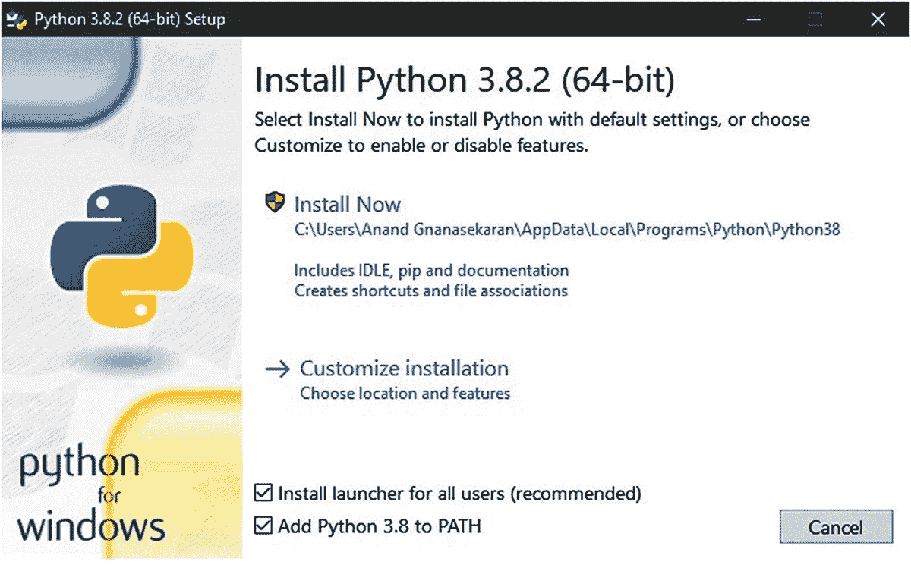
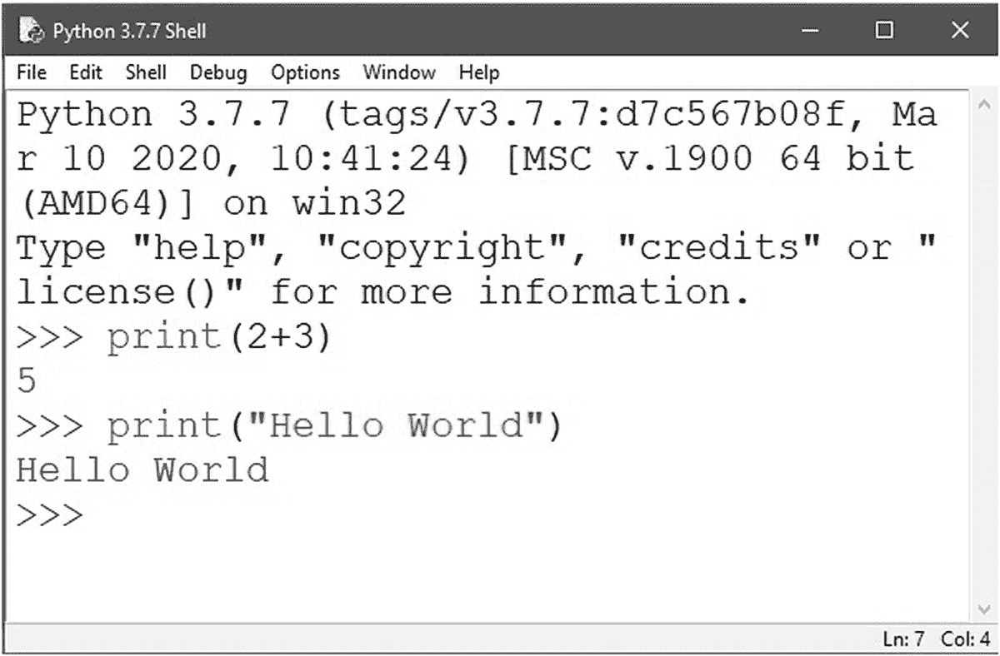
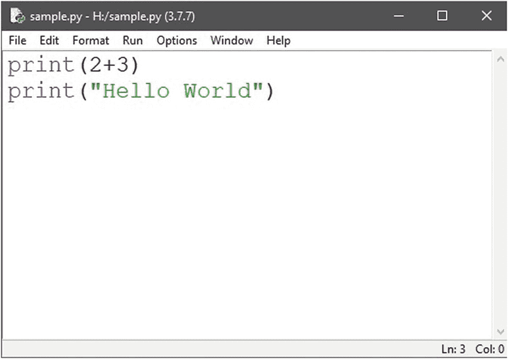
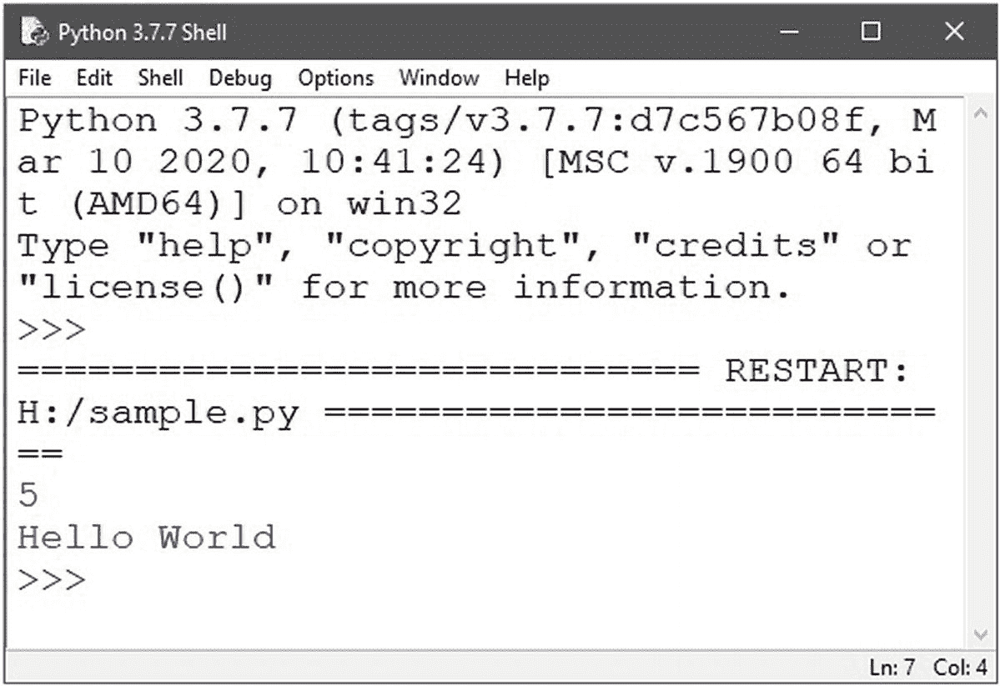

# 2. Python 编程基础

Python 是一种通用动态编程语言，由荷兰程序员吉多·范罗苏姆于 1989 年创建。它是数据科学领域最常用的编程语言。由于用 Python 学习和编写代码比其他语言更容易，因此它是初学者的理想选择。Python 的广泛使用也归功于其免费且开源的特点。Python 社区开发的大量科学库和软件包使数据科学家能够处理数据密集型的实时应用。一些领先的组织，例如谷歌、Dropbox 和 Netflix，正在不同层面上使用 Python 来增强其软件。本章中，我们将讨论 Windows 操作系统上 Python 的安装、不同的 Python 集成开发环境、Python 提供的基本数据类型、控制流语句、Python 函数以及不同的 Python 数据科学库。


## 为什么选择 Python？

Python 是数据科学家最青睐的编程语言，原因如下：

- 这是一款开源编程语言，拥有庞大且不断壮大的贡献者与用户社区。
- 与 C、C++ 和 Java 等其他编程语言相比，其语法更简洁。
- 支持用户进行面向对象编程。
- 拥有大量的库，可用于执行开发网站、构建机器学习应用等多种任务。
- 可应用于树莓派等嵌入式小型硬件设备，从而实现各种应用程序的实时部署。

## Python 安装

大多数 Linux 操作系统发行版都预装了 Python 软件包，但在 Windows 操作系统上则需要单独安装。在 Windows 操作系统上安装 Python 的步骤如下：



图 2-1：Python 安装向导

1. 打开浏览器，访问 Python 官方网站 `Python.org`。
2. 在该页面点击 `Downloads` 选项卡，并在结果页面下载最新版本的软件。
3. 下载完成后，打开安装包。在如图 2-1 所示的安装向导中，勾选 `Add Python to PATH`，这将确保 Python 被自动添加到系统环境变量路径中；否则，此路径必须在系统的 `Environment Variables` 设置中手动添加。
4. 点击 `Install Now` 安装该软件包。

安装完成后，你可以在命令提示符下输入 `python --version` 来验证安装，系统将显示已安装的 Python 版本。如果没有显示版本号，则可能是安装过程或系统路径变量存在问题。

请参阅官方网站上的 Python 文档，了解为该软件下载额外模块和包的操作步骤。你可以直接在命令提示符下开始使用 Python，也可以安装下一节介绍的各种集成开发环境（IDE）之一。

## Python 集成开发环境（IDE）

*集成开发环境*（IDE）是一个将开发者工具整合到图形用户界面（GUI）中的软件套件，包含编辑代码、构建、执行和调试程序等功能。Python 有许多可用的 IDE，每种都有其自身优势。本节将讨论一些常用的 IDE。

### PyCharm

PyCharm IDE 由捷克公司 JetBrains 开发。它是一款跨平台 IDE，可在 Windows、macOS 和 Linux 上使用。它提供代码分析和图形化调试器，还支持使用 Django 进行 Web 开发以及使用 Anaconda 进行数据科学。PyCharm 的一些吸引人的特性包括智能代码补全、简单的包管理界面以及重构选项，该选项提供了对代码中多行进行修改的能力。

### Spyder

Spyder 是一款用于 Python 语言科学编程的跨平台 IDE。Spyder 集成了多个科学包，包括 `NumPy`、`SciPy`、`Matplotlib`、`Pandas`、`IPython` 以及其他开源软件。它采用 MIT 许可证发布。

### Jupyter Notebook

Jupyter Notebook 是一个基于 Web 的交互式计算环境。该笔记本将代码及其输出整合在单个文档中，该文档结合了可视化图表、文本、数学方程和其他媒体，使其非常适合数据科学应用。

### 使用 IDLE 进行 Python 编程

IDLE 是一款简单的跨平台 IDE，适合教育环境中的初学者。它具有多窗口文本编辑器、带有语法高亮的 Python shell 以及集成调试器等功能。由于这是 Python 自带的默认编辑器，下面来看看如何使用 IDLE 执行 Python 代码。

在此 IDLE 中有两种执行 Python 代码的方式。第一种是交互模式，你可以在 Python shell 中直接在 `>>>` 符号旁边输入代码，如图 2-2 所示。每行代码在按下 `Enter` 后立即执行。使用交互模式的缺点是：保存代码时，会连同结果一并保存，这意味着你无法将保存的代码用于后续执行。



图 2-2：在交互模式下运行 Python 代码

第二种方式是在脚本模式下运行代码，你可以打开一个脚本窗口，在其中输入完整代码，然后以 `.py` 扩展名保存，供以后使用。要打开脚本文件窗口，请转到顶部的 `File` 菜单并点击 `New File`。在脚本窗口中，输入图 2-2 中所示的两行相同代码。图 2-3 显示了包含代码的脚本文件窗口。然后转到 `File` 菜单，点击 `Save`，并通过指定合适的文件名保存程序。确保文件名不以数字开头，也不要与现有的 Python 关键字同名。



图 2-3：脚本文件窗口

文件保存后，可以通过转到顶部的 `Run` 菜单并点击 `Run Module` 来执行脚本。这将执行脚本并在 Python shell 中打印输出，如图 2-4 所示。



图 2-4：脚本文件的输出

## Python 注释

在我们开始讨论 Python 数据类型之前，有必要了解 Python 中的注释行，因为我们会在代码中经常使用它们。根据注释的目的，有两种编写注释行的方法。

如果你想为自己编写关于代码中某一行简短说明，那么单行注释是最佳选择。这些单行注释只需在行首使用井号（`#`）字符即可创建，并会在行尾自动结束。执行代码时，Python 编译器会忽略井号符号之后直到行尾的所有内容。

多行注释用于向他人解释代码的特定方面，可以通过在注释的开头和结尾添加三个单引号（`'''`）来创建。Python 编译器不会忽略这些注释，如果脚本中除了注释没有其他内容，它们会出现在输出中。这两种注释在 IDLE Python shell 格式中的示例如下：

```
>>> # 这是一个注释
>>> "'这是一个注释"'
'这是一个注释'
```

## Python 数据类型

在编程语言中，*数据类型* 由变量可以取值的类型定义。Python 数据类型主要可分为数字型和序列型两类。本节将讨论属于这两类的数据类型，并为每种类型提供相关示例。

### 数字型数据类型

数字型数据类型是可以取数值的标量变量。数字型数据类型的类别包括 `int`、`float` 和 `complex`。此外，我们还将讨论使用布尔变量的 `bool` 数据类型。


#### `int`

`int` 数据类型表示整数，即不带小数点的有符号整数。清单 2-1 中的代码展示了整数的数据类型。

```
a=5
"'使用 type() 函数打印变量 a 的数据类型"'
print("a 的类型是",type(a))
输出：
a 的类型是 
清单 2-1
整数数据类型
```

#### `float`

`float` 数据类型表示浮点数，即用小数点分隔整数部分和小数部分的数字。清单 2-2 中的代码打印了浮点值的数据类型。

```
a = 5.0
print('a 的类型是',type(a))
输出：
a 的类型是 
清单 2-2
浮点数据类型
```

#### `complex`

`complex` 数据类型表示形式为 *a*+*bj* 的复数，其中 *a* 和 *b* 分别是实部和虚部。数字 *a* 和 *b* 可以是整数或浮点数。清单 2-3 中的代码打印了复数数据类型。

```
a=3.5+4j
print('a 的类型是',type(a))
输出：
a 的类型是 
清单 2-3
复数数据类型
```

#### `bool`

在 Python 中，布尔变量通过 `True` 和 `False` 关键字定义。由于 Python 区分大小写，关键字 `True` 和 `False` 的首字母必须大写。清单 2-4 演示了 `bool` 数据类型。

```
a= 8>9
print('a 的类型是',type(a))
print(a)
输出：
a 的类型是 
False
清单 2-4
布尔数据类型
```

布尔值可以通过布尔运算符进行操作，包括 `and`、`or` 和 `not`，如清单 2-5 所示。

```
a = True
b = False
print(a or b)
输出：
True
清单 2-5
布尔数据类型的操作
```

### 数值运算符

表 2-1 总结了 Python 中可应用于数值数据类型的数值运算。

表 2-1

Python 中的数值运算符

| 运算符 | 运算 |
| --- | --- |
| `( )` | 括号 |
| `**` | 幂运算 |
| `*` | 乘法 |
| `/` | 除法 |
| `+` | 加法 |
| `-` | 减法 |
| `%` | 取模运算 |

表 2-1 中的运算符按其优先级顺序列出。当代码的某一行执行多个运算时，执行的顺序将根据表 2-1 中的优先级顺序进行。考虑涉及乘法和加法的示例 `2*3+5`。从表 2-1 可以看出，乘法优先级高于加法，因此会先执行乘法运算符（`*`）得到 `2*3=6`，然后执行加法运算符（`+`），最终得到结果 `6+5=11`。

### 序列数据类型

序列数据类型允许在变量中存储多个值。序列数据类型的五种类型是 `list`、`tuple`、`str`、`set` 和 `dict`。

#### `list`

列表是数据科学家在 Python 中最常用的数据类型。列表是一个有序的元素序列。列表中的元素不必属于同一数据类型。列表可以声明为用逗号分隔并括在方括号 `[]` 内的项。列表是可变的；也就是说，列表中元素的值可以更改。列表中的元素从零开始索引，因此可以通过其对应的索引访问列表中的任何元素，如清单 2-6 所示。索引必须是整数，对索引使用任何其他数据类型都会导致 `TypeError`。同样，尝试访问列表范围之外的索引会导致 `IndexError`。

```
a = [1, 2.5, 5, 3+4j, 3, -2]
print("a 的类型是",type(a))
"'打印列表中的第一个值"'
print("a[0]=",a[0])
"'打印列表中的第三个值"'
print("a[2]=",a[2])
"'打印从索引 0 到 2 的值"'
print("a[0:3]=",a[0:3])
"'打印从索引 4 到列表末尾的值"'
print("a[4:]=",a[4:])
"'将索引 3 处的值更改为 4"'
a[3]=4
print("a=",a)
"'小数索引导致 TypeError"'
print(a[1.5])
"超出范围索引导致 IndexError"'
print(a[8])
第 2 行输出：a 的类型是 
第 4 行输出：a[0]= 1
第 6 行输出：a[2]= 5
第 8 行输出：a[0:3]= [1, 2.5, 5]
第 10 行输出：a[4:]= [3, -2]
第 13 行输出：a= [1, 2.5, 5, 4, 3, -2]
第 15 行输出：TypeError: list indices must be integers or slices, not float
第 17 行输出：IndexError: list index out of range
清单 2-6
列表操作
```

考虑分别存储在变量 `a` 和 `b` 中的两个列表。表 2-2 显示了 Python 提供的一些可以对列表 `a` 和 `b` 执行的其他操作。其中一些函数也适用于元组、字符串和集合。

表 2-2

Python 中的列表操作

| 函数 | 描述 |
| --- | --- |
| `a+b` | 连接两个列表 `a` 和 `b` |
| `a*n` | 将列表 `a` 重复 `n` 次，其中 `n` 是整数 |
| `len(a)` | 计算列表 `a` 中元素的个数 |
| `a.append()` | 向列表 `a` 末尾添加一个元素 |
| `a.remove()` | 从列表 `a` 中移除一个项 |
| `a.pop()` | 移除并返回列表 `a` 中给定索引处的元素 |
| `a.index()` | 返回列表 `a` 中第一个匹配项的索引 |
| `a.count()` | 返回列表 `a` 中作为参数传递的项的数量 |
| `a.sort()` | 按升序对列表 `a` 中的项进行排序 |
| `a.reverse()` | 反转列表 `a` 中项的顺序 |

#### `tuple`

元组与列表一样，也是一个有序的元素序列，但区别在于元组是不可变的；也就是说，元组中的值不能更改。尝试更改元组中元素的值会导致 `TypeError`。将不会更改的数据存储为元组，可以确保它们保持写保护状态。元组可以声明为用逗号分隔并括在圆括号 `()` 内的项。元组也可以像列表一样进行索引，如清单 2-7 所述。

```
a = (1, 3, -2, 4, 6)
print("a 的类型是",type(a))
print("a[3]=",a[3])
a[2] = 5
第 2 行输出：a 的类型是 
第 3 行输出：a[3]= 4
第 4 行输出：TypeError: 'tuple' object does not support item assignment
清单 2-7
元组操作
```

#### `str`

`str` 数据类型表示一个字符串。字符串可以声明为用双引号（`" "`）括起来的字符。也可以使用单引号（`' '`），但由于某些单词中会出现撇号，使用双引号可以避免混淆。字符串中的字符与列表和元组相同的方式索引。字符串中两个单词之间的空格也被视为一个字符。与元组一样，字符串也是不可变的，如清单 2-8 所述。

```
a = "Hello World!"
print("a 的类型是",type(a))
print("a[3:7]=",a[3:7]
a[2] = "r"
第 2 行输出：a 的类型是 
第 3 行输出：a[3:7]= lo W
第 4 行输出：TypeError: 'str' object does not support item assignment
清单 2-8
字符串操作
```


### `set` 集合

`set` 是一个无序的集合，因此不支持索引。`set` 由花括号 `{}` 内逗号分隔的值定义。`set` 可用于去除序列中的重复项。清单 2-9 展示了 `set` 中的操作。

```
a = {1, 2, 3, 2, 4, 1, 3}
print("a is of type",type(a))
print("a=",a)
第 2 行的输出：a is of type 
第 3 行的输出：a= {1, 2, 3, 4}
清单 2-9
集合中的操作
```

假设两个集合分别存储在变量 `a` 和 `b` 中。表 2-3 展示了 Python 支持的可应用于这两个集合的各种集合操作。

**表 2-3** Python 中的集合操作

| 函数 | 描述 |
| --- | --- |
| `a.union(b)` | 返回两个集合 `a` 和 `b` 的并集，存于新集合中 |
| `a.difference(b)` | 返回两个集合 `a` 和 `b` 的差集，存于新集合中 |
| `a.intersection(b)` | 返回两个集合 `a` 和 `b` 的交集，存于新集合中 |
| `a.isdisjoint(b)` | 如果两个集合 `a` 和 `b` 没有交集，则返回 `True` |
| `a.issubset(b)` | 如果 `a` 是 `b` 的子集，即集合 `a` 的所有元素都存在于集合 `b` 中，则返回 `True` |
| `a.symmetric_difference(b)` | 返回两个集合 `a` 和 `b` 的对称差集，存于新集合中 |

### `dict` 字典

`dict` 表示字典数据类型，它是一种无序的数据集合，表示为键值对。字典可以用花括号 `{}` 定义，每个项都是以 `{key:value}` 形式存在的键值对。字典针对数据检索进行了优化，可以使用相应的键来检索字典中的特定值。换句话说，键充当该值的索引。键和值可以是任何数据类型。键通常是不可变的，并且在字典中不能重复，而值可以有重复的条目。尝试访问字典中不存在的键将导致 `KeyError`，如清单 2-10 所述。

```
a = {1: 'Hello', 4: 3.6}
print("a is of type", type(a))
print(a[4])
print(a[2])
第 2 行的输出：a is of type 
第 3 行的输出：3.6
第 4 行的输出：KeyError: 2
清单 2-10
字典中的操作
```

### 类型转换

类型转换是将任何数据类型的值转换为另一种数据类型的过程。Python 提供的类型转换函数如下：

* `int()`: 将任何数据类型更改为 `int` 数据类型
* `float()`: 将任何数据类型更改为 `float` 数据类型
* `tuple()`: 将任何数据类型更改为元组
* `list()`: 将任何数据类型更改为列表
* `set()`: 将任何数据类型更改为集合
* `dict()`: 将任何数据类型更改为字典

清单 2-11 演示了其中一些函数。

```
a = 2
print(a)
float(a)
b = [2 , 3, -1, 2, 4, 3]
print(tuple(b))
print(set(b))
第 2 行的输出：2.0
第 4 行的输出：(2, 3, -1, 2, 4, 3)
第 5 行的输出：(2, 3, 4, -1)
清单 2-11
类型转换操作
```

## 控制流语句

控制流语句允许根据表达式的值执行一条语句或一组语句。控制流语句可以分为三类：*顺序控制流语句*按程序中的顺序执行语句，*决策控制流语句*根据条件为 `True` 或 `False` 来执行或跳过一组语句，*循环控制流语句*允许重复执行一组语句直到满足终止条件。

### `if` 语句

决策控制流语句类别中的 `if` 控制语句以 `if` 关键字开头，后跟条件语句，并以冒号结尾。条件语句计算一个布尔表达式，只有当布尔表达式计算结果为 `True` 时，才会执行 `if` 语句中的语句体。`if` 块语句从缩进开始，第一个没有缩进的语句标志着块的结束。`if` 语句的语法如下，清单 2-12 展示了它的工作原理：

```
if <条件>:
    <语句>
```

```
x = 12
y=8
if x > y:
out = "x is greater than y"
print(out)
输出：x is greater than y
清单 2-12
if 语句操作
```

#### `if-else` 语句

`if` 语句后面可以跟一个可选的 `else` 语句。如果 `if` 语句中条件语句对应的布尔表达式为 `True`，则执行 `if` 块中的语句；如果布尔表达式为 `False`，则执行 `else` 块中的语句。换句话说，`if-else` 语句提供了双向决策过程。`if-else` 语句的语法如下：

```
if <条件>:
    <语句>
else:
    <语句>
```

清单 2-13 展示了 `if-else` 语句的示例代码。

```
x = 7
y=9
if x > y:
out = "x is greater than y"
else:
out = "x is less than y"
print(out)
输出：
x is less than y
清单 2-13
if-else 语句操作
```

#### `if...elif...else` 语句

`if...elif...else` 语句可以提供多路决策过程。关键字 `elif` 是 `else-if` 的缩写形式。如果需要从多个可能的选择中选取一个，则可以将 `elif` 语句与 `if` 语句一起使用。`else` 语句将最后出现，作为默认操作。以下是 `if...elif...else` 语句的语法，清单 2-14 展示了示例代码：

```
if <条件 1>:
    <语句>
elif <条件 2>:
    <语句>
elif <条件 3>:
    <语句>
...
else:
    <默认语句>
```

```
x = 4
y=4
if x > y:
out = "x is greater than y"
elif x<y:
out = "x is less than y"
else:
out = "x is equal to y"
print(out)
输出：
x is equal to y
清单 2-14
if...elif...else 语句操作
```

### `while` 循环

`while` 和 `for` 循环是循环控制流语句。在 `while` 循环中，会计算条件语句中的布尔表达式。只有当布尔表达式为 `True` 时，才会执行 `while` 循环中的语句块。循环块的每次重复被称为循环的一次*迭代*。每次迭代后都会检查 `while` 语句中的布尔表达式。循环持续执行直到表达式变为 `False`，此时 `while` 循环退出。`while` 循环的语法如下，清单 2-15 展示了它的工作原理：

```
while <条件>:
    <语句>
```

```
x=0
while x < 4:
print("Hello World!")
x=x+1
输出：
Hello World!
Hello World!
Hello World!
Hello World!
清单 2-15
while 循环操作
```


