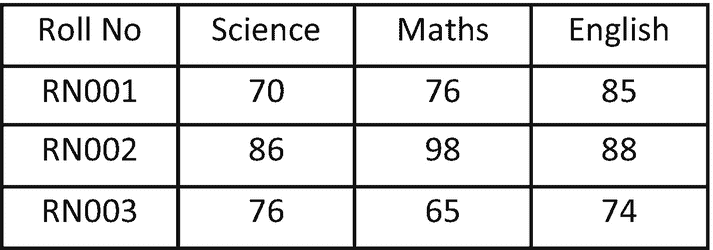

# 用于数据科学的 Python 库

Python 社区积极参与为各种应用开发多个工具包。数据科学应用中最常用的一些工具包是 `NumPy`、`SciPy`、`Pandas` 和 `Scikit-Learn`。

## 用于科学计算的 `NumPy` 与 `SciPy`

`NumPy` 是 Python 提供的一款科学计算包。`NumPy` 支持多维数组、线性代数函数和矩阵。`NumPy` 数组表示为数据科学家提供了有效的数据结构。`NumPy` 数组被称为 `ndarray`，可以使用 `array()` 函数创建。列表 2-21 演示了如何创建一维和二维数组，以及如何索引其元素。

```python
'''导入 NumPy 库'''
import numpy as np
'''创建一个一维数组'''
a=np.array([1,2,3,4])
'''打印变量 a 的数据类型'''
print(type(a))
'''创建一个二维数组'''
a=np.array([[1, 2, 3, 4], [5, 6, 7, 8]])
print(a)
'''打印数组的维度'''
print(a.ndim)
'''打印数组的行数和列数'''
print(a.shape)
'''打印第一行的第三个元素'''
print(a[0,2])
'''按给定索引打印切片后的矩阵'''
print(a[0:2,1:3])
a=np.array([1, 2, 3, 4, 5, 6, 7, 8, 9])
'''将 1 x 9 数组重塑为 3 x 3 数组'''
b=a.reshape(3,3))
print(b)
第 6 行输出：
第 9 行输出：
[[1 2 3 4]
[5 6 7 8]]
第 11 行输出：2
第 13 行输出：(2, 4)
第 15 行输出：3
第 17 行输出：
[[2 3]
[6 7]]
第 21 行输出：
[[1 2 3]
[4 5 6]
[7 8 9]]
列表 2-21
使用 NumPy 创建数组
```

任何维度数组的元素总和都可以使用 `sum()` 计算。可以计算数组中所有元素的总和，也可以沿着某个维度计算总和，如列表 2-22 中针对之前创建的数组 `b` 所示。

```python
'''打印数组 b 中元素的总和'''
print(b.sum())
'''打印沿每一列的元素总和'''
print(b.sum(axis=0))
'''打印沿每一行的元素总和'''
print(b.sum(axis=1))
输出：
第 2 行输出：45
第 4 行输出：array([12,15,18])
第 6 行输出：array([6, 15, 18])
列表 2-22
使用 NumPy 创建数组
```

与数组相关的另一个重要操作是多维数组的展平。在许多基于机器学习的应用中，这一过程更为常见，可以通过使用 `flatten()` 函数来完成，如下所示：

```python
b.flatten()
输出：
array([1, 2, 3, 4, 5, 6, 7, 8, 9]
```

`flatten()` 函数将任意维度的数组转换为单一维度数组。这也可以使用 `reshape()` 实现，但与 `flatten()` 函数不同，在这种情况下必须指定单一维度数组的大小。表 2-4 描述了在进行数据分析应用时可能用到的一些其他数组操作。

**表 2-4**  

用于数据分析的 NumPy 函数

| 语法 | 描述 |
| --- | --- |
| `np.ones()` | 在括号内指定的维度中创建一个全为 1 的数组。 |
| `np.zeros()` | 在括号内指定的维度中创建一个全为 0 的数组。 |
| `np.flip(a,axis)` | 沿给定轴反转数组 `a`。如果未指定轴，则沿两个维度反转数组。 |
| `np.concatenate(a,b,axis)` | 沿指定轴（`=0` 或 `1` 分别对应垂直和水平方向）连接两个数组 `a` 和 `b`。 |
| `np.split(a,n)` | 将数组 `a` 拆分为 `n` 个较小的数组。其中 `n` 可以是任何正整数。 |
| `np.where(a==n)` | 给出数组 `a` 中数字 `n` 所在的索引值。 |
| `np.sort(a,axis)` | 沿给定轴对数组 `a` 中的数字进行排序。 |
| `np.random.randint(n,size)` | 使用从 0 到数字 `n` 的整数生成给定大小的数组。 |

`SciPy` 生态系统是一个基于 Python 的 `NumPy` 扩展构建的、用于科学计算的开源软件集合。它提供了用于操作和可视化数据的高级命令。该生态系统的主要两个组成部分是 `SciPy` 库（一个包含数值算法和特定领域工具箱的集合）和 `Matplotlib`（一个提供二维和三维绘图的绘图包）。以下语法可用于在代码中导入并使用 `SciPy` 模块中的任何函数：

```python
from scipy import some_module
some_module.some_function()
```

根据 `SciPy` 官方文档，该库被组织成涵盖不同领域的多个子类型，汇总在表 2-5 中。

**表 2-5**  

SciPy 的子包

| 子包 | 描述 |
| --- | --- |
| `cluster` | 聚类算法 |
| `constants` | 物理和数学常数 |
| `fftpack` | 快速傅里叶变换例程 |
| `integrate` | 积分和常微分方程求解器 |
| `interpolate` | 插值和平滑样条 |
| `io` | 输入和输出 |
| `linalg` | 线性代数 |
| `ndimage` | N 维图像处理 |
| `odr` | 正交距离回归 |
| `optimize` | 优化和求根例程 |
| `signal` | 信号处理 |
| `sparse` | 稀疏矩阵及相关例程 |
| `spatial` | 空间数据结构和算法 |
| `special` | 特殊函数 |
| `stats` | 统计分布和函数 |

## 用于机器学习的 `Scikit-Learn`

`Scikit-Learn` 是一个用于 Python 编程的开源机器学习库，提供多种分类、回归和聚类算法。它被设计为能与 `NumPy` 和 `SciPy` 等其他 Python 库互操作。

## 用于数据分析的 Pandas

`Pandas` 是一个为 Python 编程语言编写的快速且强大的开源数据分析与处理库。它拥有一个快速高效的 `DataFrame` 对象，用于进行集成索引的数据操作。其工具集支持在内存数据结构与不同文件格式（如 CSV、Microsoft Excel 等）之间读写数据。假设有一个名为 `data.csv` 的 CSV 文件，其中包含三个学生三门科目的成绩，如图 2-5 所示。代码清单 2-23 展示了使用 `Pandas` 读取和访问该数据的过程。



图 2-5

包含学生成绩数据的 CSV 文件

```python
import pandas as pd
'''使用 read_csv 包读取 data.csv 文件，header=None 选项允许 pandas 为列分配默认名称
假设上表中的数据是在 Excel 工作表中输入的，并保存为 CSV 文件，路径为 C:\Python_book\data.csv
'''
d = pd.read_csv("C:\Python_book\data.csv",header=None)
print(type(d))
print(d)
"'打印第 1 行第 2 列的元素'"
print(d.loc[1,2])
"'打印第 1、2 行以及第 1、2 列共有的元素'"
d.loc[1:2, 1:2]
第 4 行的输出：
第 5 行的输出：
0           1       2           3
0  Roll No  Science  Maths   English
1    RN001       70        76          85
2    RN002       86        98          88
3    RN003       76        65          74
第 7 行的输出： 76
第 9 行的输出：
1      2
1   70   76
2   86   98
代码清单 2-23
使用 Pandas 函数进行数据修改
```

类似地，还有其他读取函数，例如 `read_excel`、`read_sql`、`read_html` 等，用于读取其他格式的文件，并且每个读取函数都有对应的写入函数，如 `to_csv`、`to_excel`、`to_sql`、`to_html` 等，允许您将 `Pandas` 数据帧写入不同的格式。

# 时间序列数据分析

从传感器收集的大多数实时数据都是时间序列数据形式，即按时间顺序索引的一系列数据。假设有一个数据集，包含澳大利亚墨尔本 10 年间（1981 年至 1990 年）每日最低气温（摄氏度）。数据来源于澳大利亚气象局。尽管这同样是一个 CSV 文件，但与前面示例中的 `DataFrame` 不同，它是时间序列数据。代码清单 2-24 展示了探索时间序列数据的不同方法。

```
Series=pd.read_csv('daily-min-temperatures.csv',header=0, index_col=0)
"'打印序列中从顶部开始的的前 5 条数据'"
print(series.head(5))
"'打印序列中的条目数'"
print(series.size)
print(series.describe())
"'describe() 函数生成时间序列数据的 7 个描述性统计数据，包括观察值的均值、标准差、中位数、最小值和最大值'"
第 3 行的输出：
Date                  Temp
1981-01-01            20.7
1981-01-02            17.9
1981-01-03            18.8
1981-01-04            14.6
1981-01-05            15.8
第 5 行的输出： 3650
第 6 行的输出：
Temp
count  3650.000000
mean     11.177753
std       4.071837
min       0.000000
25%       8.300000
50%      11.000000
75%      14.000000
max      26.300000
代码清单 2-24
Pandas 中的数据修改
```

# 用于机器学习的 TensorFlow

TensorFlow 是一个由谷歌大脑团队创建的端到端开源机器学习平台。TensorFlow 拥有大量的机器学习模型和算法。它使用 `Python` 提供前端 API，以便用该框架构建应用程序。Keras 是一个运行在 TensorFlow 之上的高级神经网络 API。Keras 允许轻松快速地进行原型设计，并支持卷积网络和循环神经网络。