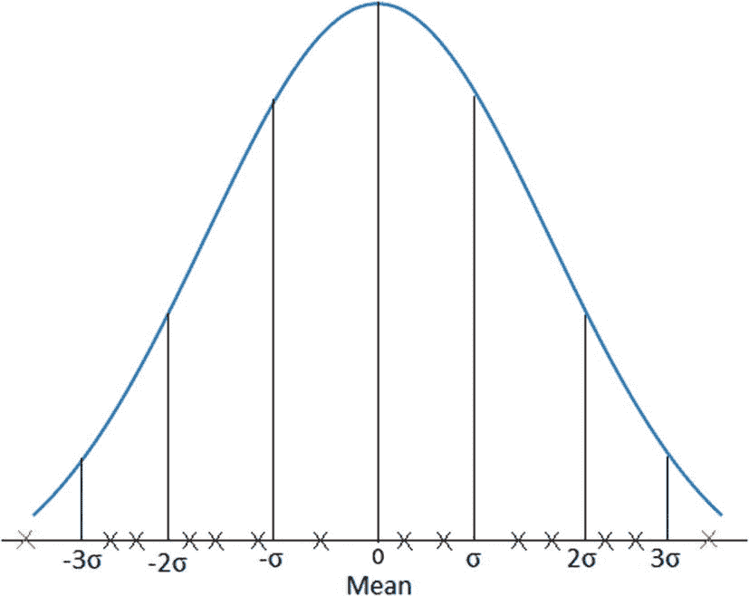
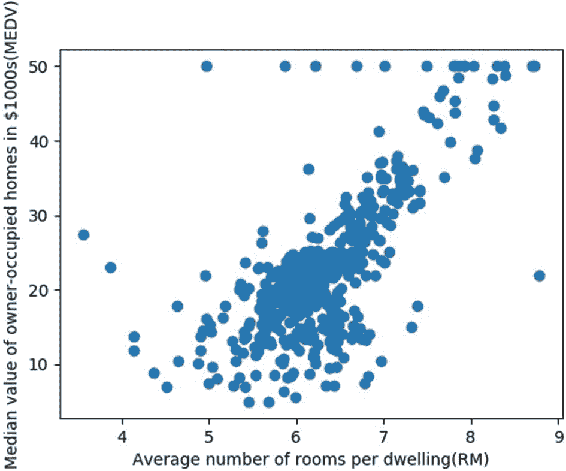
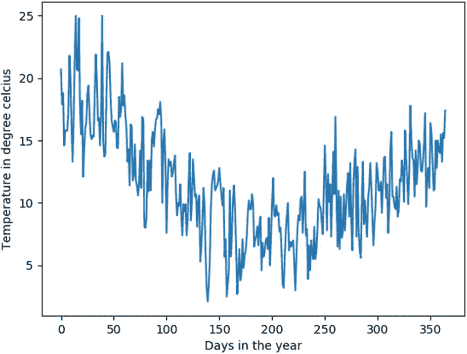
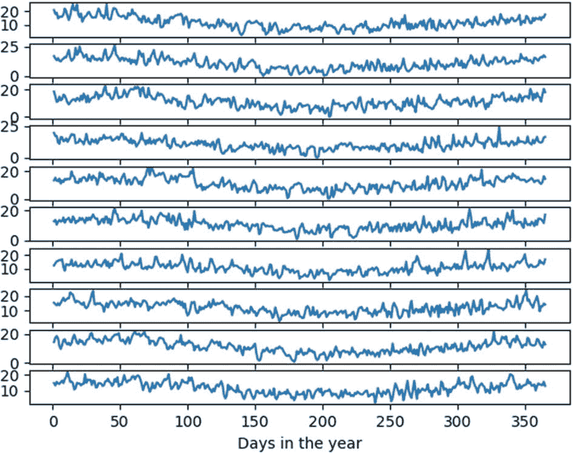
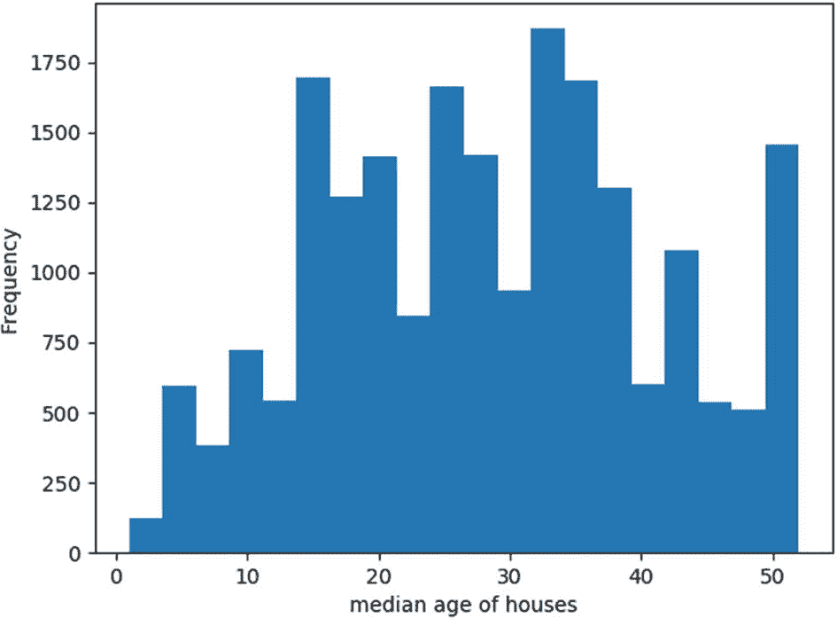
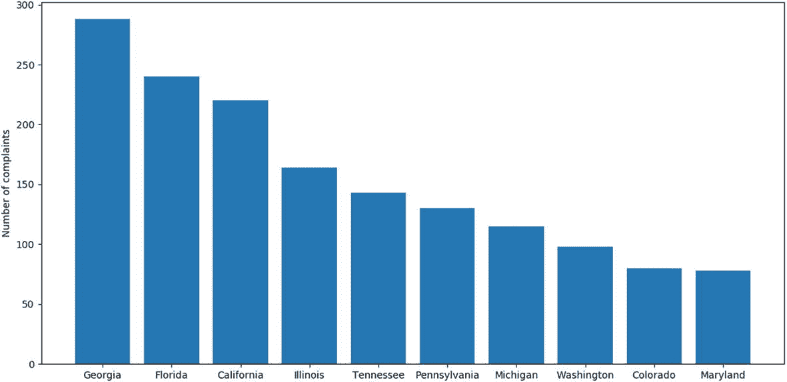
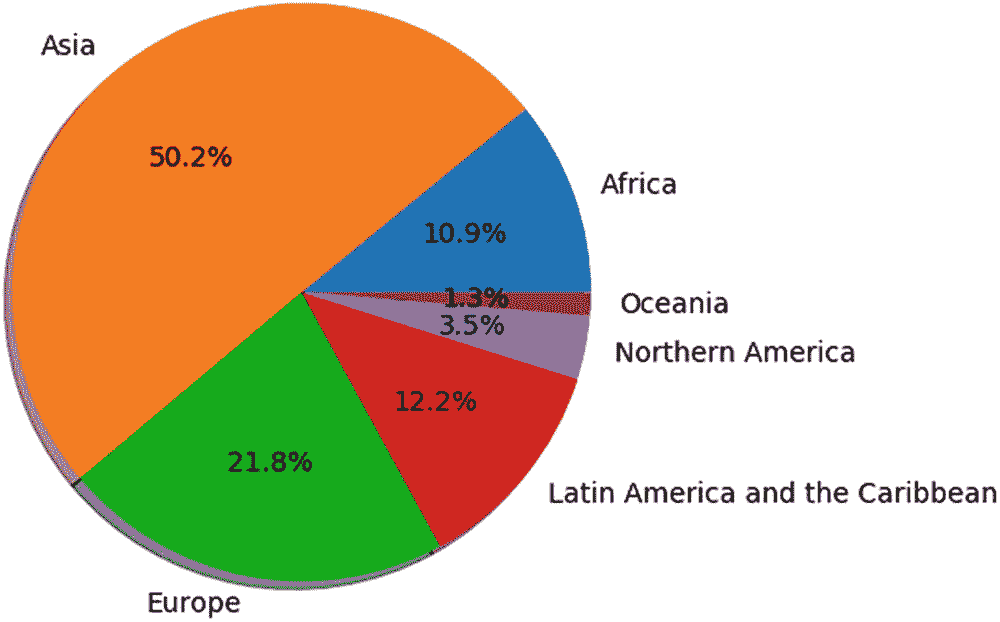

# 5. 准备数据

数据科学中最重要的步骤是准备数据。数据准备是清理、处理和转换原始数据以供分析的过程。在此阶段，可以通过清理、识别缺失值、处理异常值等方法来有效处理数据中的错误。因此，本章将讨论使用 Python 中的 Pandas 包来准备数据的方法。

## Pandas 与数据结构

Pandas 是一个为 Python 编程语言编写的软件库，主要用于数据处理和分析。

简而言之，Pandas 就像是 Python 中的 Excel，拥有由行和列（在 Pandas 中称为 `series`）组成的表格（在 Pandas 中称为 `dataframes`）。Pandas 具备许多功能，使其成为数据处理、检查和操作的优秀库。

### 安装与使用 Pandas

在系统上安装 Pandas 需要先安装 NumPy，如果要从源代码构建库，则需要合适的工具来编译 Pandas 所依赖的 C 和 Cython 源码。

有关此安装的详细信息，请参阅 Pandas 文档。可以使用 `pip` 功能安装 Pandas，命令如下：`pip install pandas`。Pandas 安装完成后，您可以导入它并检查版本，如下所示：

```
import pandas
pandas.__version__
```

就像我们通常以别名 `np` 导入 NumPy 一样，我们将以别名 `pd` 导入 Pandas，并且本书的其余部分将继续使用此导入约定。

```
import pandas as pd
```

### Pandas 数据结构

数据结构是一种数据组织、管理和存储的格式，它支持高效的访问和修改。更准确地说，数据结构是数据值、它们之间的关系以及可应用于数据的函数或操作的集合。Pandas 为 Python 引入了两种新的数据结构：`Series` 和 `DataFrame`，它们都构建在 NumPy 之上（这意味着它们速度很快）。

### Series

`Series` 是一种一维对象，类似于数组、列表或表中的一列。它会为序列中的每个项目分配一个带标签的索引。默认情况下，每个项目会收到一个从 0 到 N 的索引标签，其中 N 是序列长度减 1，如下所示：

```
s = pd.Series([1, 'Raspberry Pi', 3.14, -500, 'Data'])
print(s)
输出:
0          1
1   Raspberry Pi
2    3.14
3    -500
4    Data
dtype: object
```

除了提供默认索引之外，我们还可以在创建序列时为每个条目指定要使用的索引，如下所示：

```
s = pd.Series([1, 'Raspberry Pi', 3.14, -500, 'Data'],
index=['M', 'A', 'X', 'I', 'E'])
print(s)
输出:
M          1
A   Raspberry Pi
X    3.14
I    -500
E    Data
dtype: object
```

`Series` 构造函数也可以将字典转换为序列，并使用字典的键作为其索引，如下所示：

```
d = {'English': 95, 'Math': 100, 'Science': 98, 'Social Science': 93}
marks = pd.Series(d)
print(marks)
输出:
English           95
Math             100
Science           98
Social Science    93
dtype: float64
```

索引可用于从序列中选择特定项目。例如，可以通过指定索引 `Math` 来选择数学成绩。同样，可以通过在列表中提供对应的索引（以逗号分隔）来打印一组项目，如下所示：

```
print (marks['Math'])
print(marks[['English', 'Science', 'Social Science']])
输出 :
100.0
English           95
Science           98
Social Science    93
dtype: float64
```

还可以使用布尔索引来过滤值。例如，使用索引 `marks < 96` 会返回一个布尔值序列，然后我们将其传递给我们的 `marks` 序列，返回对应的 `True` 项目，如下所示：

```
marks[marks < 96]
输出:
Math             100
Science           98
dtype: float64
```

可以通过访问项目的对应索引来动态更改序列中某个特定项目的值，如下所示：

```
print('旧值:', marks['Math'])
marks['Math'] = 99
print('新值:', marks['Math'])
输出:
('旧值:', 100.0)
('新值:', 99.0)
```

我们还可以使用以下代码检查序列中是否存在某个项目：

```
print('Math' in marks)
print('French' in marks)
输出:
True
False
```

数学运算也可以应用于数值序列，如下所示：

```
marks * 10
输出:
English           950
Math              990
Science           980
Social Science    930
dtype: float64
np.square(marks)
输出:
English           9025
Math              9801
Science           9604
Social Science    8649
dtype: float64
```

### DataFrame

表格状的 `DataFrame` 数据结构由行和列组成，类似于电子表格或数据库表。您也可以将 `DataFrame` 视为一组共享索引（列名）的 `Series` 对象。

#### 读取数据

要从常见的 Python 数据结构创建 `DataFrame` 数据结构，我们可以将字典的列表传递给 `DataFrame` 构造函数。

```
a={'Name':['Augustus', 'Hazel', 'Esther', 'Cavas'],
'Gender':['Male','Female','Female','Male'],
'Age':[19, 18, 22, 21]}
b=pd.DataFrame.from_dict(a)
print(b)
输出:
Name      Gender   Age
0  Augustus    Male   19
1     Hazel  Female   18
2    Esther  Female   22
3     Cavas    Male   21
```

#### 读取 CSV 数据

读取 CSV 文件就像调用 `read_csv` 函数一样简单。默认情况下，`read_csv` 函数期望列分隔符为逗号，但您可以使用 `sep` 参数进行更改。以下代码展示了将 CSV 文件读入 `DataFrame` `df` 并使用 `head()` 函数打印 `df` 的前五行所需的语法：

```
df = pd.read_csv('data.csv')
print(df.head())
```

还有一组写入函数，用于将 `DataFrame` 对象写入各种格式，例如 CSV 文件、HTML 表格、JSON 等。以下代码行展示了将 `DataFrame` 对象写入 CSV 文件的语法：

```
df.to_csv('path_to_file.csv')
```

#### 读取 Excel 数据

Pandas 允许我们读取和写入 Excel 文件，因此我们可以轻松地在 Python 中从 Excel 读取数据，然后将数据写回 Excel。读取 Excel 文件需要 `xlrd` 库，可以使用 `pip` 命令安装，如下所示：

```
pip install xlrd
```

以下代码说明了将 Excel 工作表中的内容读入 `DataFrame` `df` 所使用的语法。将 `data.xlsx` 替换为您的 Excel 文件的路径/文件名以运行代码。

```
df = pd.read_excel('data.xlsx', 'Sheet1')
print(df.head())
```

类似地，来自 `DataFrame` 对象的数据也可以写入 Excel 文件，如下所示：

```
dataframe.to_excel('path_to_file.xlsx', index=False)
```

#### 读取 URL 数据

`read_table` 函数可用于直接从 URL 读取数据。以下代码说明了使用给定 URL 的原始数据创建 `DataFrame`：

### 数据清洗

在大多数数据分析项目中，可用的数据并不总是完美的。原始数据往往很混乱，除了有用数据之外，还可能包含损坏或不准确的数据。因此，数据科学家必须处理这些混乱的数据样本，以便将原始数据转换为可工作的形式，并且他们通常需要花费相当长的时间来执行此操作。

数据清洗是识别数据中不准确、错误或不完整的部分，并通过替换、删除或修改数据来处理它们的过程。换句话说，它是通过处理原始数据中的所有不规则性来为分析准备数据的过程。在后续部分中，我们将讨论如何处理缺失值和异常值、填充不恰当的值以及删除重复条目。

#### 处理缺失值

缺失值在原始数据中相当常见。假设输入数据包含通过调查表收集的来自数千名客户的产品反馈。客户在填写调查表时跳过几个条目是常见行为。例如，部分客户可能不会分享他们对产品的体验，有些可能不会分享他们使用产品的时长，还有另一些可能不会填写联系方式。在整理这些调查表并将其转换为表格时，表中必定会出现大量缺失值。

来自传感器的数据也可能因各种原因而出现缺失数据，例如传感器节点临时断电、硬件故障、通信干扰等。因此，处理这些缺失值是数据科学家处理原始数据时的首要任务。以下代码演示了如何使用 NumPy 库中的 `random.randn` 函数创建一个随机数数据库：

```
import pandas as pd
import numpy as np
df = pd.DataFrame(np.random.randn(6,4),
index = ['1','3','4','6','7','9'],
columns = ['a','b','c','d'])
```

从前面的代码可以看出，行和列的索引是手动分配的。从分配的行索引可以看出，索引 2、5 和 8 缺失。使用 Pandas 库中的 `reindex` 函数，这些索引被创建出来，并带有缺失的“非数字”（`NaN`）值，如下所示：

```
df=df.reindex(['1','2','3','4','5','6','7','8','9'])
print(df)
输出：
a         b         c         d
1  0.099344  0.293956  1.002970  0.516942
2       NaN       NaN       NaN       NaN
3  1.608906 -1.748396 -1.013634 -0.651055
4  3.211263 -2.555312 -1.036068 -0.728020
5       NaN       NaN       NaN       NaN
6 -0.101766 -0.205572  1.369707 -1.133026
7  0.062344  1.483505  0.026995  1.560656
8       NaN       NaN       NaN       NaN
9 -0.3243347 -0.342040  0.107224  0.272153
```

现在已经创建了一个包含缺失值的数据库，下一步就是处理这些值。在考虑处理这些值的选项之前，首要任务是检测缺失值的位置。Pandas 库中的 `isnull()` 函数可用于检测包含缺失值的行，如下所示：

```
df1=df[df.isna().any(axis=1)]
print(df1)
输出：
a   b   c   d
2   NaN NaN NaN NaN
5   NaN NaN NaN NaN
8   NaN NaN NaN NaN
```

上述过程让我们大致了解了数据库中缺失数据的数量。一旦检测到这些缺失数据，下一步就是处理它们。我们可以通过两种方式做到这一点：一种是用值填充缺失数据，另一种是直接删除缺失数据。

Pandas 库中的 `fillna()` 函数可用于用用户指定的标量值填充缺失值，如下所示。如图所示，第 2 行和第 5 行中的缺失值被替换为 0.000000。

```
df2=df.fillna(0)
print(df2.head())
输出：
a         b         c         d
1  0.099344  0.293956  1.002970  0.516942
2  0.000000  0.000000  0.000000  0.000000
3  1.608906 -1.748396 -1.013634 -0.651055
4  3.211263 -2.555312 -1.036068 -0.728020
5  0.000000  0.000000  0.000000  0.000000
```

另一种替换缺失值的方法是使用 Pandas 库中的 `ffill` 或 `bfill` 函数。`ffill` 代表“前向填充”，它通过重复缺失值之前出现的值来填充；`bfill` 代表“后向填充”，它通过重复缺失值之后出现的值来填充。以下代码说明了填充缺失值的前向填充方法：

```
df3= df.fillna(method='ffill')
print(df3.head())
输出：
a         b         c         d
1  0.099344  0.293956  1.002970  0.516942
2  0.099344  0.293956  1.002970  0.516942
3  1.608906 -1.748396 -1.013634 -0.651055
4  3.211263 -2.555312 -1.036068 -0.728020
5  3.211263 -2.555312 -1.036068 -0.728020
```

处理缺失值的第二种可能方法是直接删除它们，使用 Pandas 库中的 `dropna` 函数，如下所示：

```
df4=df.dropna()
print(df4)
输出：
a         b         c         d
1  0.099344  0.293956  1.002970  0.516942
3  1.608906 -1.748396 -1.013634 -0.651055
4  3.211263 -2.555312 -1.036068 -0.728020
6 -0.101766 -0.205572  1.369707 -1.133026
7  0.062344  1.483505  0.026995  1.560656
9 -0.324347 -0.342040  0.107224  0.272153
```

我们创建了一个带有缺失值的简单数据集来理解处理缺失值的概念。实际上，分析项目中使用的数据集很大，可能轻松包含 500 到 1000 行甚至更多。鼓励您将这个示例中学到的知识应用到真实数据集上。处理缺失值的方法可能取决于应用的性质以及数据集中缺失值的数量或频率。

#### 处理异常值

在数据集中，异常值指的是那些与其他所有观测值（即数据）截然不同的观测值。换句话说，异常值是数据集中远离所有其他数据点的数据点。异常值可能源于测量或数据录入时的错误，也可能是数据中真实的极端值。例如，考虑数列 112, 123, 120, 132, 106, 26, 118, 140, 125。在这个数列中，除了 26 之外，所有数字都接近 100。因此，26 是一个异常值，因为它与其他数字相差甚远。

检测异常值有两种方法：使用可视化技术和使用数学方法。在本节中，我们将介绍两种用于识别数据中异常值的数学方法，即四分位距（IQR）和 Z 分数。

四分位距是衡量数据集中数据变异性或分散程度的指标。数据首先被排序并划分为四个部分。将整个范围划分为四个部分的值称为四分位数。因此，将数据分成四个部分需要三个四分位数。这三个四分位数分别是 `Q[1]`、`Q[2]` 和 `Q[3]`，其中 `Q[2]` 是整个数据的中位数，`Q[1]` 是数据上半部分的中位数，`Q[3]` 是数据下半部分的中位数。IQR 是第三个四分位数与第一个四分位数的差，即 `Q[3]` – `Q[1]`。

为了说明使用 IQR 移除异常值的过程，我们首先创建一个包含 15 个条目且包含异常值的 `DataFrame`。

# 异常值检测与处理

在前面的代码中，我们创建了一个包含 15 名成年人（单位：公斤）体重数据的数据库。为方便起见，我们用字母`A`到`O`为这些成年人命名。我们将 15 公斤和 180 公斤的体重作为异常值包含进来，因为健康的成年人不太可能体重如此之轻或如此之重。为了检测这些异常值，我们需要分别计算第 25 百分位和第 75 百分位的值，即`Q1`和`Q3`。根据这些值，可以通过计算`Q3 – Q1`的差值得到`IQR`值。此过程如下所示：

```python
import pandas as pd
a={'Name':['A','B','C','D','E','F','G','H','I','J','K','L','M','N','O'],
'Weight':[56,62,48,72,15,80,76,64,68,180,75,47,58,63,71]}
df=pd.DataFrame.from_dict(a)
print(df.head())
```

输出：

```
Name  Weight
0    A      56
1    B      62
2    C      48
3    D      72
4    E      25
```

通过将`DataFrame`对象中的条目与先前计算的四分位数进行比较，可以看出有四个值低于`Q1`，七个值介于`Q1`和`Q3`之间，四个值高于`Q3`。但我们知道，在`Q1`之下只有一个异常值，在`Q3`之上也只有一个异常值。为了检测这些异常值，我们需要形成一个区间，其下限远低于`Q1`，上限远高于`Q3`。一旦确定了这些界限，就可以稳妥地认为低于下限和高于上限的值是异常值。这在以下代码中进行了说明：

```python
Q1=df.Weight.quantile(0.25)
Q3=df.Weight.quantile(0.75)
IQR=Q3-Q1
print('Q1=',Q1,'Q3=',Q3,'IQR=',IQR)
```

输出：

```
Q1= 57.0 Q3= 73.5 IQR= 16.5
```

```python
lower_limit = Q1 - 1.5 * IQR
upper_limit = Q3 + 1.5 * IQR
df1=df[(df.Weight < lower_limit) | (df.Weight > upper_limit)]
print(df1)
```

输出：

```
Name  Weight
4    E      25
9    J     180
```

可以看出，使用`IQR`值创建的界限准确地检测到了我们数据中的异常值。现在可以使用以下代码轻松地过滤掉这些异常值：

```python
df2=df.drop(df1.index)
print(df2)
```

输出：

```
Name  Weight
0     A      56
1     B      62
2     C      48
3     D      72
5     F      80
6     G      76
7     H      64
8     I      68
10    K      75
11    L      47
12    M      58
13    N      63
14    o      71
```

## Z 分数

Z 分数，也称为标准分数，可以反映一个数据点距离平均值有多远。从技术上讲，Z 分数将数据拟合到正态分布中，并衡量数据点关于整个数据集平均值的标准差个数，如图 5-1 所示。



*图 5-1：用于基于 Z 分数检测异常值的数据正态分布*

图 5-1 显示，每个数据点都沿着以零均值为中心的正态分布进行映射。距离零均值过远的数据点被视为异常值。在大多数情况下，阈值被设定为 3，任何超出`3σ`或`-3σ`的数据点都被视为异常值。让我们使用与上一节相同的数据库，并利用 Z 分数来识别异常值。

```python
import pandas as pd
from scipy import stats
import numpy as np
a={'Name':['A','B','C','D','E','F','G','H','I','J','K','L','M','N','O'],
'Weight':[56,62,48,72,15,80,76,64,68,180,75,47,58,63,71,]}
df=pd.DataFrame.from_dict(a)
z = np.abs(stats.zscore(df.Weight))
print(z)
df1=df[z>3]
print(df1)
```

输出：

```
Name  Weight
9    J     180
```

从上述代码可以看出，对应于体重值 180 的 Z 分数超过了阈值 3，因此它被显示为异常值。遗憾的是，体重值 15 并未被检测为异常值。其原因可以通过将该值与平均值和标准差进行比较来理解，这可以通过`np.mean`和`np.std`函数实现，如下所示：

```python
print(np.mean(df.Weight))
print(np.std(df.Weight))
```

输出：

```
67.0
33.448467827390836
```

我们将标准差的值近似为 33.45。可以看出，体重值 180 与平均值之差为 111，大于三倍标准差（>3σ），而体重值 15 与平均值之差仅为 54，小于两倍标准差（<2σ）。解决这个问题的一种方法是降低阈值。让我们假设一个`Threshold`值为 1。

```python
df1=df[z>1]
print(df1)
```

输出：

```
Name  Weight
4    E      15
9    J     180
```

从上述示例可以看出，理想的阈值 3 可能并不适用于所有数据集，因此应根据数据的分布情况来选择阈值。现在，与`IQR`的情况类似，可以使用以下代码简单地过滤掉这些异常值：

```python
df2=df.drop(df.Name[z>1].index)
print(df2)
```

输出：

```
Name  Weight
0     A      56
1     B      62
2     C      48
3     D      72
5     F      80
6     G      76
7     H      64
8     I      68
10    K      75
11    L      47
12    M      58
13    N      63
14    o      71
```

## 过滤掉不合适的值

在某些情况下，数据集中可能包含一些与数据完全无关的不合适值，这在传感器数据中尤为常见。从传感器记录的数据通常是时间序列数据，每个数据点都带有唯一的时间戳。这些时间戳在许多分析场景中并不需要，因此可以被视为不合适值。为了说明这一概念，我们创建一个类似于传感器数据的时间序列温度数据，如下所示：

```python
import pandas as pd
data={'Time':['12:00:05','12:08:33','12:25:12','12:37:53','12:59:08'],
'Temperature':['T=22','T=22','T=23','T=23','T=24']}
df=pd.DataFrame.from_dict(data)
print(df)
```

输出：

```
  Time Temperature
0  12:00:05        T=22
1  12:08:33        T=22
2  12:25:12        T=23
3  12:37:53        T=23
4  12:59:08        T=24
```

现在，需要移除每个数据点对应的时间戳以及每个数据点中的前缀`'T='`。时间戳可以使用 Pandas 库中的`drop`函数移除，而前缀可以使用`str.replace`函数移除。由于每个数据点中都存在前缀，数据最初存储为字符串数据类型。因此，在移除这些前缀后，必须将数据类型更改为`int`或`float`。这些步骤说明如下：

```python
df.drop('Time',inplace=True,axis=1)
df=df.Temperature.str.replace('T=','')
df=df.astype(float)
print(df)
```

输出：

```
0    22.0
1    22.0
2    23.0
3    23.0
4    24.0
Name: Temperature, dtype: float64
```

## 移除重复项

重复条目在数据科学中很常见，尤其是当我们从多个来源收集数据并整合处理时。根据分析的性质，这些重复项可能会带来问题。因此，最好在分析数据之前移除这些重复项，如下所示：

import pandas as pd
a={'Name':['Alan','Joe','Jim','Tom','Alan','Anna','Elle','Rachel','Mindy'],
'Age':[22,24,25,24,22,23,21,22,23]}
df=pd.DataFrame.from_dict(a)
print('DATA\n',df)
print('DUPLICATES\n',df[df.duplicated()])
df1=df.drop_duplicates()
print('DATA AFTER REMOVING DUPLICATES\n',df1)
Output:
DATA
Name  Age
0    Alan   22
1     Joe   24
2     Jim   25
3     Tom   24
4    Alan   22
5    Anna   23
6   Ellen   21
7  Rachel   22
8   Mindy   23
DUPLICATES
Name  Age
4  Alan   22
DATA AFTER REMOVING DUPLICATES
Name  Age
0    Alan   22
1     Joe   24
2     Jim   25
3     Tom   24
5    Anna   23
6   Ellen   21
7  Rachel   22
8   Mindy   23
```

如代码所示，从一个包含若干人姓名和年龄的字典中创建了一个 `DataFrame`，并且我们特意为名字 `Alan` 创建了一个重复条目。可以看到，Pandas 库中的 `duplicated` 函数清楚地识别出了该名字的第二个条目。随后，通过 Pandas 库中的 `drop_duplicates` 函数移除了这个重复条目。

## 数据可视化

在上一章中，我们讨论了准备数据分析所涉及的多个步骤。在分析数据之前，必须了解所处理数据的性质。数据可视化可以让我们对数据的性质有一些有用的洞察。这些洞察，例如数据中的模式、数据的分布、数据中存在的异常值等，对于确定分析数据所用的方法非常有用。此外，在分析结束时，可视化可用于向相关方传达分析结果，因为通过可视化技术传达分析结果比编写数页文本内容解释结果更有效。在本章中，我们将学习 Python 的 `Matplotlib` 包提供的一些基本可视化图表，以及如何定制这些图表以传达不同数据的特点。

### Matplotlib 库

`Matplotlib` 是一个绘图库，用于使用 Python 编程语言创建达到出版质量的图表。该包根据要传达的信息类型提供各种类型的图表。这些图表带有交互选项，如平移、缩放和子图配置。图表还可以保存为不同格式，如 PNG、PDF 等。此外，`Matplotlib` 包为每种图表提供了大量的自定义选项，可用于有效呈现要传达的信息。

#### 散点图

散点图是一种使用标记来表示数据点，以展示两个变量之间关系的图表。在数据分析中，散点图有多种用途。例如，将数据点作为一个整体来看，散点图可以揭示数据中的模式和趋势，这反过来有助于数据科学家理解两个变量之间的关系，从而能够提出有效的预测技术。散点图也可用于识别数据中的聚类。它还能揭示数据中存在的异常值，而识别异常值至关重要，因为它们往往会显著影响预测系统的性能。

创建散点图通常需要两列数据，每列对应图表的一个维度。表中的每一行数据将对应图表中的一个数据点。可以使用 `Matplotlib` 库中的 `scatter` 函数来创建散点图。为了演示散点图的实用性，我们考虑一个可以从 `Scikit-Learn` 库中导入的波士顿房价数据集。该数据集实际上来自卡内基梅隆大学维护的 `StatLib` 库。它包含 506 个样本，具有 13 个不同的特征属性，例如城镇人均犯罪率（`CRIM`）、每套住宅的平均房间数（`RM`）、径向高速公路可达性指数（`RAD`）等。此外，还有一个目标属性 `MEDV`，表示自住房屋房价中位数（单位：千美元）。

以下代码演示了创建波士顿房价数据集 Pandas 数据框的过程，该数据集最初是字典格式。为方便起见，代码中使用 `print` 命令仅显示数据框的前五行。

```
import matplotlib.pyplot as plt
import numpy as np
import pandas as pd
from sklearn.datasets import load_boston
dataset = load_boston()
boston_data=pd.DataFrame(dataset.data,columns=dataset.feature_names)
print(boston_data.head())
Output:
CRIM  ZN   INDUS   CHAS  NOX ...  RAD  TAX PTRATIO  B  LSTAT
0  0.00632  18.0  2.31  0.0  0.538  ...  1.0  296.0  15.3  396.90  4.98
1  0.02731   0.0  7.07  0.0  0.469  ...  2.0  242.0  17.8  396.90  9.14
2  0.02729   0.0  7.07  0.0  0.469  ...  2.0  242.0  17.8  392.83  4.03
3  0.03237   0.0  2.18  0.0  0.458  ...  3.0  222.0  18.7  394.63  2.94
4  0.06905   0.0  2.18  0.0  0.458  ...  3.0  222.0  18.7  396.90  5.33
[5 rows x 13 columns]
```

该房价数据集最初是字典形式，并保存在变量 `dataset` 中。13 个特征属性被赋值给键 `data`，目标属性 `MEDV` 被赋值给键 `target`。然后，将这 13 个特征转换为 Pandas 数据框。现在，可以通过以下代码得到特征变量 `RM` 与目标变量 `MEDV` 的散点图。从图 6-1 中可以看出，房价随着房间数量的增加而上涨。除了这一趋势外，图中还可以看到一些异常值。



**图 6-1** – 房价与每套住宅平均房间数的关系图

```
plt.scatter(boston_data['RM'],dataset.target)
plt.xlabel("Average number of rooms per dwelling(RM)")
plt.ylabel("Median value of owner-occupied homes in $1000s(MEDV)")
plt.show()
```

#### 线图

线图本质上是由一条线连接起来的一系列数据点，可用于传达某个变量在特定时间段内的变化趋势。线图常用于可视化时间序列数据，以观察数据随时间的变化情况。它也可以作为分析过程的一部分，用于检查迭代过程中变量的变化。

可以使用 `Matplotlib` 包中的 `plot` 函数来绘制线图。为了演示线图，我们考虑一个时间序列数据集，该数据集包含澳大利亚墨尔本市 10 年（1981-1990）的每日最低气温（单位：°C）。以下代码演示了加载包含该数据集的 `.csv` 文件、将其转换为数据框，并绘制 1981 年气温变化的过程。

```
import pandas as pd
import matplotlib.pyplot as plt
import numpy as np
dataset=pd.read_csv('daily-min-temperatures.csv')
df=pd.DataFrame(dataset,columns=['Date','Temp'])
print(df.head())
Output:
Date    Temp
0        1981-01-01    20.7
1        1981-01-02    17.9
2        1981-01-03    18.8
3        1981-01-04    14.6
4        1981-01-05    15.8
plt.plot(df['Temp'][0:365])
plt.xlabel("Days in the year")
plt.ylabel("Temperature in degree celcius")
plt.show()
```

图 6-2 中的线图清晰地展示了 1981 年墨尔本逐日气温变化。



**图 6-2** – 1981 年墨尔本全年气温（°C）变化

Matplotlib 包还提供了子图选项，可以在单个图形对象中创建子图布局。在这个时间序列数据示例中，我们可以使用一个简单的 `for` 循环来提取 10 年中每一年的数据，并将其绘制在各自的子图中，如下列代码所示：

```
y,k=0,1
x=np.arange(1,366)
for i in range(10):
plt.subplot(10,1,k)
plt.plot(x,df['Temp'][y:y+365])
y=y+365
k=k+1
plt.xlabel("Days in the year")
plt.show()
```

图 6-3 包含 10 个子图，每个子图展示了从 1981 年到 1990 年的某一年中气温的变化。因此，使用多个子图使我们能够比较墨尔本在这十年间的气温变化趋势。



**图 6-3** – 墨尔本 10 年（1981 年至 1990 年）气温变化

### 直方图

直方图通过将变量中的数据划分为不同的区间（称为箱）来绘制图形；然后统计每个箱内的数据点数量，并将其绘制为垂直条柱。这类图表能够很好地展示数值数据的近似分布。箱的宽度（即每个箱中数值的范围）是一个重要参数，需要通过尝试不同的值来选取最适合数据的宽度。

为了演示直方图，我们考虑 `Scikit-Learn` 库中提供的加利福尼亚房价数据集。该数据集源于 1990 年美国人口普查，每行对应一个普查街区组。街区组是美国人口普查局发布样本数据的最小地理单位（一个街区组通常有 600 到 3000 人）。该数据集包含 8 个参数，如街区收入中位数、街区房龄中位数、平均房间数等，以及一个目标属性——加利福尼亚各地区的房价中位数。数据中总共有 20,640 个数据点（行）。以下代码绘制了一个直方图，展示了基于街区内房龄中位数的街区分布情况。图 6-4 显示了该直方图。数值较低通常意味着建筑物较新。



**图 6-4** – 基于街区房龄中位数的街区分布图

```
import matplotlib.pyplot as plt
from sklearn.datasets import fetch_california_housing
import pandas as pd
dataset = fetch_california_housing()
df=pd.DataFrame(dataset.data,columns=dataset.feature_names)
print(df.head())
Output:
MedInc  HouseAge    AveRooms  ...  AveOccup  Latitude  Longitude
0    8.3252      41.0    6.984127  ...  2.555556     37.88    -122.23
1    8.3014      21.0    6.238137  ...  2.109842     37.86    -122.22
2    7.2574      52.0    8.288136  ...  2.802260     37.85    -122.24
3    5.6431      52.0    5.817352  ...  2.547945     37.85    -122.25
4    3.8462      52.0    6.281853  ...  2.181467     37.85    -122.25
plt.hist(df['HouseAge'],bins=20)
plt.xlabel("median age of houses")
plt.ylabel("Frequency")
plt.show()
```

从图 6-4 的直方图中可以看出，街区内大部分房屋的房龄分布在中间区域，这表明新建街区与非常老旧街区的数量都低于房龄一般的街区。

### 条形图

数据科学家经常在演示文稿和报告中使用条形图，以水平或垂直的矩形条来表示分类数据，条的长度或高度对应其所代表数据的数值。通常，一个坐标轴表示数据的类别，而另一个坐标轴表示相应的数值。因此，条形图是比较不同类别数据的理想选择。条形图也可用于展示一个或多个变量在一段时间内的变化趋势。

尽管条形图看起来与直方图相似，但两者之间存在细微差别。例如，直方图用于绘制变量的分布，而条形图用于比较不同类别的变量。直方图将定量数据分组到有限数量的箱中，并绘制这些箱中数据的分布，而条形图则用于绘制分类数据。

为了演示条形图，我们考虑电信消费者投诉数据集，该数据集收集了美国全球电信公司康卡斯特收到的投诉。该公司因大量客户投诉被收取从未使用过的服务费用，于 2016 年 10 月被罚款 230 万美元。该数据集收集了 2,224 条此类投诉，并分为 11 列，如客户投诉内容、日期、城市、州、邮政编码、状态等。在以下代码中，首先加载以 Excel 表格形式提供的数据集，并将其转换为数据框。然后选择包含投诉来源州的列，并使用函数 `groupby()` 将同一州的多个条目合并为一个条目。接着使用函数 `size()` 获取每个州出现的次数，这对应于从每个州收到的投诉数量。然后可以使用函数 `sort_values()` 按计数值降序排列数据。图 6-5 显示了投诉数量最多的前 10 个州的条形图，清晰地展示了哪些地区的客户面临更多问题。该图基本上基于客户投诉数量，对公司在不同州的问题进行了比较。



**图 6-5** – 显示来自不同州的投诉数量的条形图

```
import pandas as pd
import matplotlib.pyplot as plt
dataset=pd.read_excel('Comcast_telecom_complaints_data.csv.xlsx')
data=pd.DataFrame(dataset)
print(data.head(3))
Output:
Ticket #        Customer Complaint   ...   Zip code  Status
0  250635  Comcast Cable Internet Speeds   ...   21009  Closed
1  223441  Payment disappear - service got disconnected ... 30102  Closed
2  242732               Speed and Service  ...  30101  Closed
[3 rows x 11 columns]
a=data.groupby("State").size().sort_values(ascending=False).reset_index()
plt.bar(a['State'][0:10],a[0][0:10],align='center')
plt.show()
```

### 饼图

饼图通常用于以百分比形式展示不同类别数据在整体中的分布情况，其表现形式为成比例的圆弧形切片。换句话说，每个圆弧形切片对应一个特定的数据类别。通过查看饼图，用户仅凭视觉观察就能快速掌握分类数据的分布，无需像条形图那样查看具体的百分比数字。饼图与条形图的另一个区别在于：饼图用于比较每个数据类别对整体的贡献，而条形图则用于比较不同数据类别之间的贡献。

为了演示饼图，我们考虑一个包含 1980 年至 2013 年加拿大移民详细信息的数据集。该数据集包含了每年出入加拿大的移民的各项属性。这些属性包括原籍国/目的地名称、地区名称、区域名称等。根据移民的原籍国/目的地，共有 197 行数据。以下代码绘制了一个饼图，展示 1980 年至 2013 年间按大洲分类的移民总数：

```
import pandas as pd
import matplotlib.pyplot as plt
df = pd.read_excel('Canada.xlsx',skiprows=range(20),skipfooter=2)
df.columns = list(map(str, df.columns))
df['Total']=df.sum(axis=1)
df_continents = df.groupby('AreaName', axis=0).sum().reset_index()
print(df_continents)
Output:
AreaName   AREA    REG     ...  2012  2013    Total
0                          Africa   48762   49242   ...  38083 38543   765660
1                            Asia   45815   109147  ...  152218 155075  3516953
2                          Europe   39044   39754   ...  29177 28691   1528488
3 Latin America and the Caribbean   29832   30395   ...  27173 24950   855141
4                Northern America   1810    1810   ...  7892   8503    246564
5                         Oceania   12726   13210   ...  1679     1775    93736
```

将数据集加载为 Pandas 数据框后，其中表示数据年份的数字列标题被转换为字符串格式。这样做是为了确保在下一步对行求和计算移民总数时，不会将标题也计入总和。这个移民总数被保存在一个名为`Total`的新增列中。计算完移民总数后，数据按照包含移民大洲信息的`AreaName`列进行分组。通过这样做，行数从 197 行减少到了 6 行，这表明整个数据集被分成了 6 个大洲。

现在，这六个大洲的移民总数（位于`Total`列中）可以绘制成饼图，如图 6-6 所示。因此，饼图将包含对应于六大洲的六个圆弧形切片。为了在图中标记这些切片，我们将`AreaName`列中的大洲名称转换为列表，并存储在一个变量中，以便在绘图函数中用作标签。此代码示例如下：



**图 6-6** 饼图显示 1980 年至 2013 年间来自不同大洲的移民进出加拿大的情况

```
t=list(df_continents.AreaName)
plt.pie(df_continents['Total'],labels=t,autopct='%1.1f%%',shadow=True)
plt.show()
```

### 其他图表与扩展包

除了本章讨论的基本图表外，`Matplotlib`扩展包中还提供了其他图表，如等高线图、流线图、3D 图等，可以根据数据性质或分析需求选择使用。除了`Matplotlib`扩展包，还有其他扩展包可以提供更复杂的图表，用于增强不同类别数据的可视化效果。其中一个扩展包是`Seaborn`库，它可用于在 Python 中制作统计图形。`Seaborn`库提供了诸如箱线图、热力图、小提琴图、聚类图等更复杂的图表，能够提供增强的数据可视化效果。我们鼓励您探索这些其他类别的图表和库。