# 9. 案例研究

本章介绍了实施数据科学概念的真实世界案例研究。讨论了三种场景：基于脑电图信号的人类情感分类、图像数据和工业 4.0 的数据科学概念。

对于人类情感分类，使用`NeuroSky MindWave Mobile`套件提取人类的脑电图信号，并在`Raspberry Pi`上接收和分析这些信号。`NeuroSky MindWave Mobile`套件和`Raspberry Pi`可以通过蓝牙连接。在图像数据中，应用数据科学步骤对图像数据进行预处理以进行进一步分析。在工业 4.0 案例研究中，`Raspberry Pi`充当本地化云。在此，许多传感器连接到`Raspberry Pi`，传感器信号被转换为结构化数据，以便进一步分析和可视化。

## 案例研究 1：人类情感分类

情感是一种以强烈大脑活动为特征的感觉。大量研究聚焦于识别人类情感，其应用范围广泛，包括医疗、健康、机器人学以及脑机接口（BCI）等领域。识别人类情感的方式有多种，例如面部表情识别、语音信号音调识别、脑电图（EEG）信号情感识别等。其中，基于 EEG 信号的分类是一种简单便捷的方法。此外，EEG 信号包含有关人类情感的有用信息。因此，许多研究者专注于使用 EEG 信号对人类情感进行分类。EEG 信号通过将电极放置在头皮上来测量电信号，从而记录人类大脑活动。

让我们考虑一个简单的情感识别系统，它使用单电极设备，即`NeuroSky MindWave`设备，从参与者处获取 EEG 信号，并借助机器学习算法（即`k-近邻`（`k-NN`）和`神经网络`（`NN`））将其情感分类为快乐、恐惧或悲伤。

### 方法论

参与者来自不同的年龄段，他们被单独进行实验，通过向他们展示来自全球公认数据库日内瓦情感图片数据库（`GAPED`）中不同类别的图片。图片包括婴儿、快乐场景、虐待动物、人类关怀、蛇和蜘蛛的图像，每种图像都会在参与者中激发不同的情感。随后，针对所有参与者，获得与记录的 EEG 信号相对应的特征数据集，这些特征再被输入到`k-NN`和`NN`等机器学习模型中，模型将每个信号分类为三种情感之一：快乐、恐惧或悲伤。

#### 数据集

用于数据收集的两个设备是`NeuroSky MindWave Mobile`设备和`Raspberry Pi 3`板。`NeuroSky MindWave`设备可用于安全地记录 EEG 信号。该设备包含一个头戴式耳机、一个耳夹和一个传感器（电极）臂。头戴式耳机的接地电极位于耳夹上，而 EEG 电极位于传感器臂上，佩戴头戴式耳机后，传感器臂会搁在眼睛上方的额头上。该设备使用一节 AAA 电池，可续航八小时。

该设备通过蓝牙连接到`Raspberry Pi 3`板，如图 9-1 所示。这是第三代`Raspberry Pi`型号，配备四核处理器、1GB RAM 以及多个用于连接各种设备的端口。它还支持无线局域网和蓝牙，有助于连接诸如`MindWave Mobile`之类的无线设备。`NeuroSky`设备供应商提供的软件安装在`Pi`板上，以从设备获取串行数据。

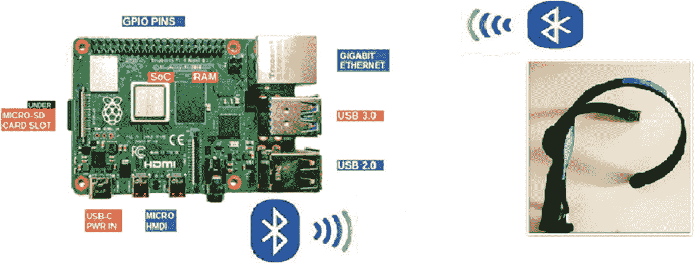
图 9-1 通过蓝牙连接`MindWave Mobile`的`Raspberry Pi`

#### 通过蓝牙连接`Raspberry Pi`与`MindWave Mobile`

将`MindWave Mobile`与`Raspberry Pi`连接有两种方法。第一种是将`MindWave Mobile`与`Raspberry Pi`桌面配对。首先打开`Raspberry Pi`，启动进入`Raspberry Pi`操作系统，然后打开`MindWave Mobile`的蓝牙。接着点击`Raspberry Pi`操作系统中的蓝牙符号，它会显示准备与`Raspberry Pi`配对的设备。在列表中可以选择`MindWave Mobile`，并使用供应商规定的配对密码 `0000`。现在，`MindWave Mobile`设备已与`Pi`配对，如图 9-2 所示。

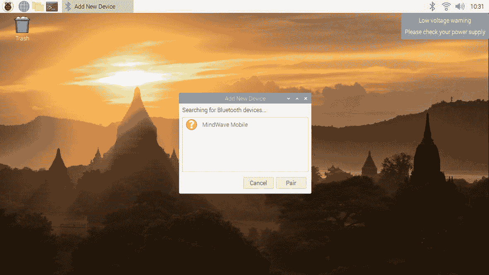
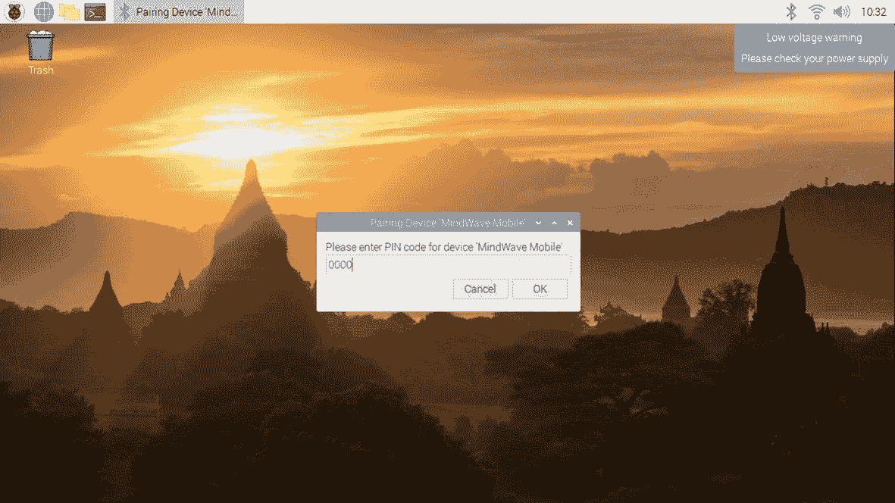
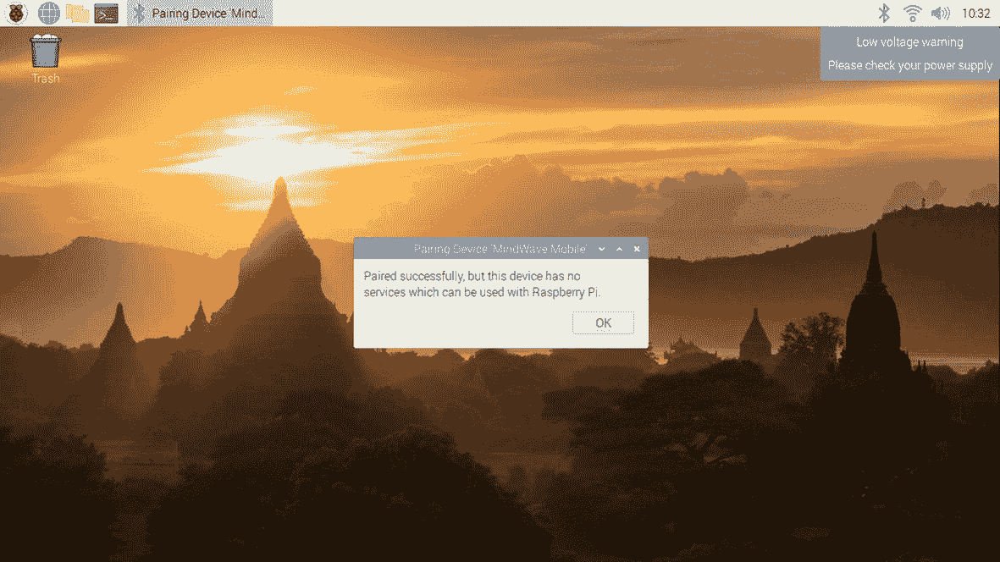
图 9-2 `Raspberry`桌面与`MindWave Mobile`配对

来自`MindWave Mobile`设备的信号可以通过此蓝牙连接提取。另一种连接`Raspberry`与`MindWave`的方法是使用 `Pypi 0.1.0`。相关步骤在 [`https://github.com/cttoronto/python-MindWave-mobile`](https://github.com/cttoronto/python-MindWave-mobile) 中说明。此链接提供了脑电波信号中 alpha、beta 和 gamma 值的数据。然而，在本研究中，数据集是基于 EEG 信号开发的。

#### 数据采集过程

参与者被安排坐在一个黑暗的小房间里，该房间也保持无线电静默，以防止受到声学和视觉干扰。实验前向其解释了条款和条件，并指示他们在感到任何不适时停止测试。还向参与者提供了一份手动评分表，以对他们在每张图片期间的情感进行评分。共有 15 名参与者，记录了跨越三种不同情感的 15 个信号，因此总共得到 15 × 3 = 45 个 EEG 信号。这三种情感是快乐、恐惧和悲伤。

最初，使用`NeuroSky`设备从用户处获取原始 EEG 信号。从大脑提取的原始 EEG 信号不能直接用于进一步处理。由于受试者在特定时间段内基于视觉输入接受情感刺激，由此产生的情感反应将是时变的。因此，识别大脑活动高峰期的持续时间，并仅在该持续时间内提取特征以增强分类结果至关重要。为实现这一点，记录在实验开始后恰好一分钟开始，这为使用与特定情感相对应的图片幻灯片来激发参与者情感提供了足够的时间。此外，为了避免处理大量数据，仅考虑包含每秒 512 个样本的 15 秒数据，从而将数据大小减少到仅 15 × 512 = 7680 个样本，如图 9-3 所示。图 9-3 显示了整个记录持续时间的信号，其中大脑活动高峰期信号用红色标出，图 9-4 则单独显示了这一部分。

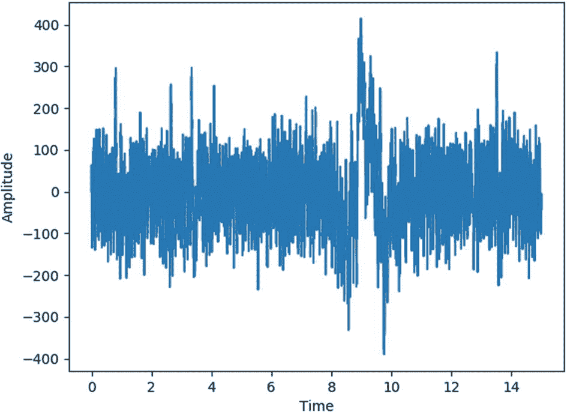
图 9-4 在大脑活动高峰期提取的 EEG 信号

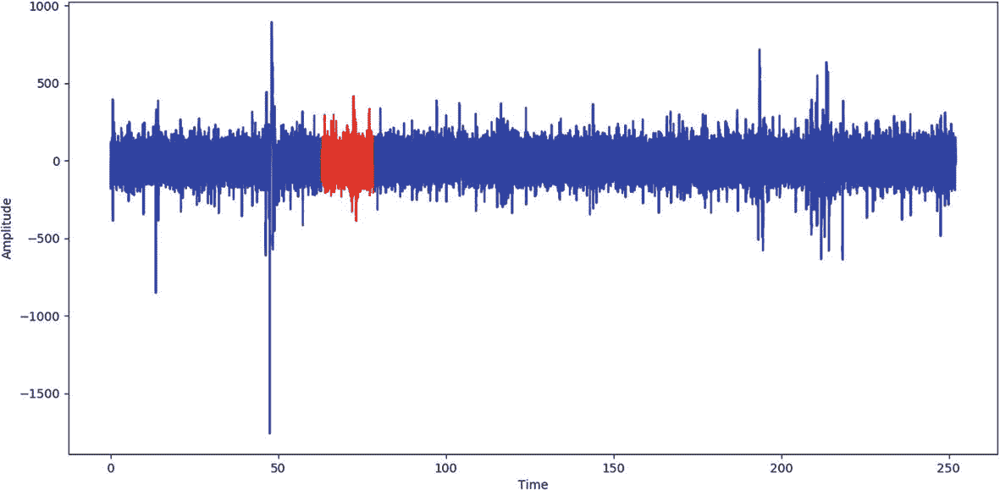
图 9-3 整个记录持续时间的样本 EEG 信号

### 从脑电波信号中提取的特征

脑电图（EEG）信号蕴含着丰富的脑功能信息。为了从 EEG 信号中获取有意义的信息，需要提取信号的不同属性。本文从 EEG 信号中提取了 9 种不同的时域属性，这些特征说明如下。

潜伏期与幅值比（`LAR`）定义为最大信号时间与最大信号幅值的比值，见公式 9-1。

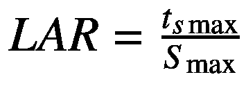 (9-1)

其中，`t[smAx]`={`t`|`s(t)=s[mAx]`} 是出现最大信号值的时间，`s[mAx]=max{s(t)}` 是最大信号值。

峰峰值信号值（`PP`）定义为最大信号值与最小信号值之差，如公式 9-2 所示。

`s[pp]` = `s[mAx]` − `s[min]` (9-2)

其中，`s[mAx]` 和 `s[min]` 分别是信号的最大值和最小值。

峰峰值时间窗（`PPT`）定义为最大信号时间与最小信号时间之差，如公式 9-3 所示。

`t[pp]` = `t[s mAx]` − `t[s min]` (9-3)

其中，`t[s mAx]` 和 `t[s min]` 分别是出现最大和最小信号值的时间。

峰峰值斜率（`PPS`）定义为峰峰值信号值（`PP`）与峰峰值时间值（`PPT`）的比值，如公式 9-4 所示。

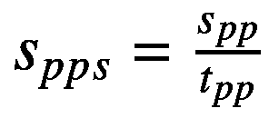 (9-4)

其中，`s[pp]` 是峰峰值信号值，`t[pp]` 是峰峰值时间窗。

信号功率（`P`）定义为在恒定幅值下无限时间存在的信号。信号功率如公式 9-5 所示。

# 信号时域特征提取

## 信号功率 (P)

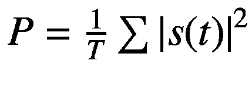 (9-5)

## 信号均值 (μ)

信号均值（`μ`）定义为选定区域端点之间数据样本的平均值，并显示平均值。信号均值如公式 9-6 所示。

![$$ \mu =\frac{1}{N}\sum \limits_{i=1}^Ns\left[i\right] $$](images/496535_1_En_9_Chapter/496535_1_En_9_Chapter_TeX_IEq4.png) (9-6)

其中，`N` 是信号中的总样本数。

## 峭度 (K)

峭度（`K`）是频率分布曲线峰值的陡峭程度，如公式 9-7 所示。

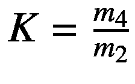 (9-7)

其中，`m[4]` 和 `m[2]` 分别是信号的四阶矩和方差。

## 移动性 (M)

移动性（`M`）定义为信号一阶方差与信号方差的比值，如公式 9-8 所示。

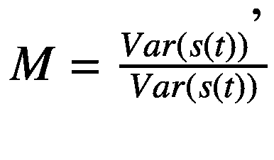 (9-8)

## 复杂度 (C)

复杂度（`C`）定义为移动性的一阶导数除以移动性，如公式 9-9 所示。

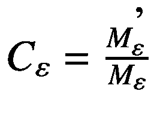 (9-9)

### 特征提取 Python 函数实现

针对这九个时域特征的所有公式，其 Python 代码被编写成一个函数，该函数后续在主程序中被调用。这个函数接收大脑情绪活动峰值期间 15 秒的 EEG 信号及对应的时间样本，具体实现如下：

```python
def eegfeat(ynew,tnew):
from scipy.stats import kurtosis
# latency to amplitude ratio
smax=max(ynew)
locmax=np.where(ynew==smax)
tsmax=tnew[locmax]
lar1=tsmax/smax
lar=lar1[0]
# peak to peak signal value
smin=min(ynew)
locmin=np.where(ynew==smax)
tsmin=tnew[locmin]
spp=smax-smin
# peak to peak time window.
tpp1=tsmax+tsmin
tpp=tpp1[0]
# peak to peak slope
spps=spp/tpp
# mean value of signal
m=np.mean(ynew)
# kurtosis
k=kurtosis(ynew)
# mobility and complexity
n=ynew.shape[0]
dynew=np.diff(ynew)
ddynew=np.diff(dynew)
mx2=np.mean(np.power(ynew,2))
mdx2=np.mean(np.power(dynew,2))
mddx2=np.mean(np.power(ddynew,2))
mob=mdx2/mx2
complexity=np.sqrt(mddx2/(mdx2-mob))
mobility=np.sqrt(mob)
# signal power
tt=np.power(ynew,2)
s=0
for i in np.arange(0,tt.shape[0]):
s=s+tt[i]
signalpower=s/ynew.shape[0]
feat = [lar, spp, tpp, spps, m, k, complexity, mobility, signalpower]
return feat
```

## 非结构化数据到结构化数据集

现在我们有了从 EEG 信号中提取特征的函数，下一步是开发代码以获取结构化数据集。首先，使用`for`循环内的`pd.read_csv`函数，逐一加载所有 15 名参与者对应三种不同情绪的 EEG 信号。在 EEG 信号作为数据框加载后，首先移除时间戳，然后将剩余列中的幅值转换为 NumPy 数组。每次迭代得到的数组被堆叠到一个新变量中，从而得到一个由 45 列组成的最终数组，对应 45 个不同的 EEG 信号。然后，将该数组的每一列传递给之前创建的`eegfeat`函数，该函数为每一列（每个信号）提供九个特征，从而得到一个大小为 9×45 的最终特征数组。该数据集如表 9-1 所示，并保存为 Excel 表格中的`emotion_data1.xls`。最后，使用`sklearns`模块中的`StandardScaler`和`fit`函数对特征进行缩放。这种缩放的工作原理是：首先计算所有 45 个信号中每个特征的均值和标准差，然后从所有值中减去均值，并将此差值除以标准差。以下代码说明了特征提取过程：

### 表 9-1 人类情感数据集特征

| LAR | PP | PPT | PPS | Power | 均值 | 峰度 | 流动度 | 复杂度 | 标签 |
| --- | --- | --- | --- | --- | --- | --- | --- | --- | --- |
| 0.016024 | 678 | 11.18505 | 60.61663 | -0.04396 | 6.543546 | 0.864608 | 0.272718 | 3095.76805 | ‘快乐’ |
| 0.021638 | 805 | 17.95937 | 44.8234 | -0.13187 | 1.147168 | 0.908352 | 0.323672 | 8861.53844 | ‘快乐’ |
| 0.013645 | 1156 | 18.50241 | 62.47835 | -0.13599 | 11.54561 | 0.909418 | 0.253198 | 5615.14591 | ‘快乐’ |
| 0.020861 | 913 | 20.6941 | 44.11885 | -0.19559 | 4.77647 | 0.869794 | 0.274665 | 7488.51785 | ‘快乐’ |
| 0.027464 | 1051 | 29.44133 | 35.69811 | 0.073972 | -0.04979 | 0.920326 | 0.739543 | 17478.1566 | ‘快乐’ |
| 0.003051 | 1056 | 3.215262 | 328.4335 | 0.555873 | -0.70347 | 0.829795 | 0.648545 | 26836.2039 | ‘快乐’ |
| 0.009142 | 708 | 5.996875 | 118.0615 | -1.4202 | 1.801014 | 0.807949 | 0.203007 | 5224.79068 | ‘快乐’ |
| 0.044871 | 577 | 27.64032 | 20.8753 | 0.774106 | 5.355427 | 0.872217 | 0.221742 | 3616.08585 | ‘快乐’ |
| 0.025742 | 1017 | 25.99948 | 39.11617 | -0.02595 | 15.2165 | 0.909882 | 0.275513 | 4281.25747 | ‘快乐’ |
| 0.037152 | 595 | 19.31892 | 30.79882 | 0.490321 | 2.851322 | 0.908083 | 0.295561 | 3403.52707 | ‘快乐’ |
| 0.017313 | 940 | 15.40826 | 61.00625 | 0.107773 | 0.582757 | 0.772671 | 0.179429 | 14818.1692 | ‘快乐’ |
| 0.015074 | 1626 | 22.58107 | 72.00723 | -2.5419 | 2.847854 | 0.813119 | 0.216638 | 25075.0479 | ‘快乐’ |
| 0.034336 | 812 | 24.72197 | 32.84528 | 0.310597 | 9.089532 | 0.908852 | 0.326948 | 3481.33912 | ‘快乐’ |
| 0.012292 | 918 | 12.0211 | 76.36575 | -0.1356 | 12.5699 | 0.88202 | 0.218335 | 4644.36149 | ‘快乐’ |
| 0.001722 | 3060 | 4.613882 | 663.2159 | -0.01663 | 34.31637 | 0.827843 | 0.097603 | 30433.0506 | ‘快乐’ |

| 0.018688 | 402 | 8.89569 | 45.19043 | 0.032993 | 4.738717 | 0.882602 | 0.423034 | 1124.38087 | ‘恐惧’ |
| 0.040525 | 579 | 26.50345 | 21.84621 | 0.254913 | 2.882232 | 0.906008 | 0.304122 | 4124.12924 | ‘恐惧’ |
| 0.020358 | 1517 | 21.62 | 70.1665 | -0.11243 | 40.33238 | 0.916268 | 0.270259 | 7677.61001 | ‘恐惧’ |
| 0.057451 | 383 | 22.63576 | 16.92013 | 0.012297 | 0.515585 | 0.915245 | 0.524744 | 1586.28054 | ‘恐惧’ |
| 0.02732 | 735 | 23.11238 | 31.80113 | -0.4819 | 2.371013 | 0.840896 | 0.430931 | 5550.91016 | ‘恐惧’ |
| 0.010694 | 1567 | 16.40448 | 95.52269 | 0.170683 | -0.28034 | 0.906462 | 0.697989 | 35493.9062 | ‘恐惧’ |
| 0.027347 | 378 | 10.88423 | 34.72915 | 0.02714 | 0.021038 | 0.779173 | 0.311332 | 2214.34304 | ‘恐惧’ |
| 0.038418 | 717 | 29.58198 | 24.23773 | -0.75375 | 2.735193 | 0.886821 | 0.155092 | 7204.2341 | ‘恐惧’ |
| 0.023423 | 1115 | 25.76507 | 43.27564 | -0.3602 | 2.435107 | 0.860817 | 0.38882 | 12420.8748 | ‘恐惧’ |
| 0.002859 | 4420 | 12.57976 | 351.358 | 4.408442 | 5.755933 | 0.6055 | 0.123552 | 296978.069 | ‘恐惧’ |
| 0.025219 | 971 | 24.71416 | 39.28922 | -0.08303 | 1.857694 | 0.766682 | 0.165919 | 11425.814 | ‘恐惧’ |
| 0.015038 | 2516 | 21.53405 | 116.8382 | -2.2011 | 30.45224 | 0.93143 | 0.384335 | 22246.7576 | ‘恐惧’ |
| 0.017566 | 833 | 14.40422 | 57.83028 | -0.42794 | 2.695262 | 0.842994 | 0.172786 | 8374.92373 | ‘恐惧’ |
| 0.019647 | 935 | 20.27608 | 46.11346 | 0.316469 | 3.61666 | 0.9339 | 0.34069 | 8803.85773 | ‘恐惧’ |
| 0.006667 | 1404 | 12.45475 | 112.7281 | 0.157155 | 27.96396 | 0.854443 | 0.211712 | 6280.25928 | ‘恐惧’ |
| 0.01213 | 992 | 14.45891 | 68.6082 | -0.29278 | 7.918369 | 0.826067 | 0.157843 | 8135.80814 | ‘悲伤’ |
| 0.016787 | 1187 | 19.33846 | 61.38029 | 0.17177 | 5.274371 | 0.862185 | 0.195176 | 16224.2062 | ‘悲伤’ |
| 0.025382 | 1017 | 24.46803 | 41.56444 | 0.228652 | 14.78168 | 0.863634 | 0.195593 | 5841.32003 | ‘悲伤’ |
| 0.012709 | 1524 | 18.68212 | 81.57532 | -0.20364 | 19.9148 | 0.873179 | 0.190631 | 10495.4369 | ‘悲伤’ |
| 0.047707 | 499 | 24.13986 | 20.6712 | 0.102337 | 3.259416 | 0.864654 | 0.309553 | 2265.85228 | ‘悲伤’ |
| 0.006046 | 1933 | 10.67717 | 181.0405 | 0.758343 | 2.349937 | 1.003761 | 0.682323 | 24010.3048 | ‘悲伤’ |
| 0.020863 | 1305 | 24.40943 | 53.46295 | 0.003427 | 0.833297 | 0.768599 | 0.488095 | 22671.4565 | ‘悲伤’ |
| 0.020863 | 1305 | 24.40943 | 53.46295 | 0.003427 | 0.833297 | 0.768599 | 0.488095 | 22671.4565 | ‘悲伤’ |
| 0.033872 | 863 | 25.47207 | 33.88025 | 0.105906 | 9.95777 | 0.858691 | 0.220224 | 5482.11932 | ‘悲伤’ |
| 0.02912 | 535 | 15.78331 | 33.89658 | -0.01854 | 0.234449 | 0.896769 | 0.619883 | 4619.19634 | ‘悲伤’ |
| 0.000649 | 5070 | 3.141034 | 1614.118 | -4.11542 | 6.964611 | 0.795685 | 0.173283 | 231638.996 | ‘悲伤’ |
| 0.015449 | 856 | 14.58393 | 58.69474 | 0.157962 | 1.97371 | 0.786113 | 0.225146 | 6764.73669 | ‘悲伤’ |
| 0.005224 | 3800 | 20.26826 | 187.4852 | 0.570607 | 22.94134 | 0.791691 | 0.094596 | 63679.0805 | ‘悲伤’ |
| 0.016787 | 1187 | 19.33846 | 61.38029 | 0.17177 | 5.274371 | 0.862185 | 0.195176 | 16224.2062 | ‘悲伤’ |
| 0.008937 | 494 | 4.879542 | 101.239 | 0.109418 | 0.696421 | 0.769311 | 0.304871 | 3185.67894 | ‘悲伤’ |

```python
import pandas as pd
import numpy as np
from sklearn.preprocessing import StandardScaler
F=512
a=np.zeros([(75*F)-(60*F),1])
for i in np.arange(1,4):
    for j in np.arange(1,16):
        filename = 'G:/Anand-EEG/EEG Database/Dataset/user'+str(j)+'_'+str(i)+'.csv'
        s=pd.read_csv(filename)
        s.drop('Time',inplace = True, axis=1)
        s1=s[' Value'][60*F:75*F]
        a=np.column_stack((a,s1.to_numpy()))
a=np.delete(a,0,1)
tnew=np.linspace(0,15,a.shape[0])
features=np.zeros([9,45])
for i in np.arange(0,a.shape[1]):
    parameters=eegfeat(a[:,i],tnew)
    for j in np.arange(0,features.shape[0]):
        features[j,i]=parameters[j]
scaler = StandardScaler()
features=scaler.fit(features)
```

### 基于脑电图数据的探索性数据分析

要读取 `emotion_data.xls` 文件，请使用以下代码：

```python
import pandas as pd
emotion_data = pd.read_excel('\file_path\emotion_data1.xls')
```

要显示数据的键和前 5 个数据集，请使用以下代码：

# 9.3 分析情感数据

## 查看数据

以下是用于查看数据键名和前五行的代码及其输出：

```python
print(emotion_data.keys())
```

输出：

```
Index(['LAR', 'PP', 'PPT', 'PPS', 'Power', 'Mean', 'Kurtosis', 'Mobility',
       'Complexity', 'Label'],
      dtype='object')
```

```python
print(emotion_data.head(5))
```

输出：

```
LAR       PP    PPT       PPS       ...  Kurtosis  Mobility  Complexity  Label
0  0.016024  678   11.18505  60.61663  ...  0.864608  0.272718  3095.76805  'Happy'
1  0.021638  805   17.95937  44.82340  ...  0.908352  0.323672  8861.53844  'Happy'
2  0.013645  1156  18.50241  62.47835  ...  0.909418  0.253198  5615.14591  'Happy'
3  0.020861  913   20.69410  44.11885  ...  0.869794  0.274665  7488.51785  'Happy'
4  0.027464  1051  29.44133  35.69811  ...  0.920326  0.739543  17478.15660 'Happy'
```

通过以下代码，可以查看最后五个数据点：

```python
print(emotion_data.tail(5))
```

输出：

```
LAR    PP        PPT  ...  Mobility   Complexity      Label
40  0.000649  5070   3.141034  ...  0.173283  231638.99600    'Sad'
41  0.015449   856  14.583930  ...  0.225146    6764.73669      'Sad'
42  0.005224  3800  20.268260  ...  0.094596   63679.08050  'Sad'
43  0.016787  1187  19.338460  ...  0.195176   16224.20620  'Sad'
44  0.008937   494   4.879542  ...  0.304871    3185.67894     'Sad'
[5 rows x 10 columns]
```

要检查数据的形状，请使用以下代码：

```python
print(emotion_data.shape)
```

输出：

```
(45, 10)
```

通过以下代码，可以显示情感数据中的数据类型：

```python
print(emotion_data.dtypes)
```

输出：

```
LAR              float64
PP                 int64
PPT              float64
PPS              float64
Power            float64
Mean             float64
Kurtosis         float64
Mobility         float64
Complexity       float64
Emotion Label     object
dtype: object
```

数据集中的修改包括删除列，并使用第8章探索性数据分析部分中的方法更改数据。

图9-5显示了情感数据集中平均值数据的直方图可视化。

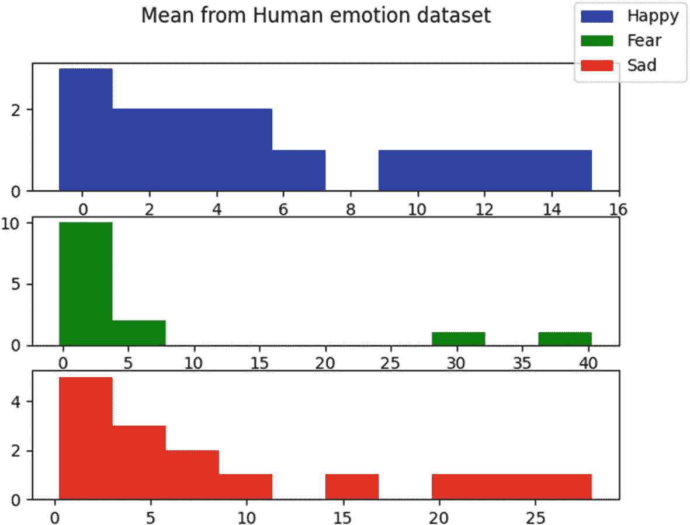

**图 9-5** 每种情感的平均值直方图

### 使用学习模型对情感进行分类

特征提取后的下一步是应用分类算法来识别与信号对应的情感。由于我们已经知道所使用的每个信号对应的情感，因此显然最好采用监督学习算法进行分类。在此之前，另一项重要任务是将我们的数据分为训练数据和测试数据。在每种情感的15个信号中，我们考虑前12个信号对应的数据用于训练，其余3个信号对应的数据用于测试。同时，应创建与训练和测试数据相对应的标签。为此，我们将“快乐”情感标记为1，“恐惧”标记为2，“悲伤”标记为3。数据及其标签的分割如下代码所示：

#### 1. k-近邻算法 (k-NN)

```python
m1 = np.ones((15,), dtype=int)
ids = np.concatenate((m1, 2*m1, 3*m1), axis=0)
x_train = np.concatenate((features[:, 0:12], features[:, 15:27], features[:, 30:42]), axis=1)
x_test = np.concatenate((features[:, 12:15], features[:, 27:30], features[:, 42:45]), axis=1)
y_train = np.concatenate((ids[0:12], ids[15:27], ids[30:42]))
y_test = np.concatenate((ids[12:15], ids[27:30], ids[42:45]))
```

让我们首先使用k-NN算法根据数据对情感进行分类。k-NN是一种简单的监督机器学习算法，它根据相似度得分对现有数据进行分类，并将新数据分配到特定类别。k-NN算法通过计算测试数据与训练数据之间的距离来工作。在计算出到每个训练数据的距离后，训练数据按距离值的升序排序。在此有序数据中，选择前k个数据，算法将把其中出现频率最高的标签分配给测试数据。**欧几里得距离**是k-NN算法最常用的距离度量，两个数据点`x[i]`和`y[i]`之间的距离由以下表达式给出：

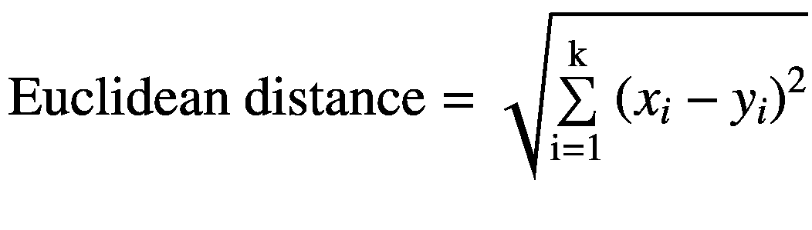

k-NN分类是使用Python模块`sklearn`中的`KNeighborsClassifier`包实现的。使用此包的情感分类代码如下所示：

```python
from sklearn.neighbors import KNeighborsClassifier
from sklearn.metrics import confusion_matrix, classification_report

classifier = KNeighborsClassifier(n_neighbors=16)
classifier.fit(x_train.T, y_train)
y_pred = classifier.predict(x_test.T)
cm = confusion_matrix(y_test, y_pred)
print("混淆矩阵\n", cm)
print("准确率:", (sum(np.diagonal(cm))/9)*100)
```

输出：

```
混淆矩阵
[[1 0 2]
 [1 2 0]
 [2 0 1]]
准确率: 44.44444444444444
```

前面代码中的参数`n_neighbors`表示k的值，我们将其选为16。因此，在做出分类决策时会考虑16个邻居。首先，计算测试数据与所有其他训练数据之间的距离。然后，训练数据点按计算距离的升序排序。在排序后的数据中，考虑前16个数据对应的标签，并将这16个数据中出现次数最多的标签分配给测试数据。对所有九个测试信号（每种情感三个）重复此过程，并使用混淆矩阵显示结果，通过表9-2中的信息可以更好地理解该矩阵。

**表 9-2** 使用k-NN进行情感分类的混淆矩阵

|             | **快乐** | **恐惧** | **悲伤** |
|-------------|-----------|----------|---------|
| **快乐**   | 1         | 0        | 2       |
| **恐惧**    | 1         | 2        | 0       |
| **悲伤**     | 2         | 0        | 1       |

在混淆矩阵中，行标题可以视为输入，列标题可以视为输出。例如，如果我们考虑第一行，与“快乐”情感对应的三个脑电图信号中只有一个被正确识别，其余两个信号被错误地分类为“悲伤”情感。类似地，在第二行中，与“恐惧”情感对应的两个信号被正确分类，在第三行中，与“悲伤”情感对应的一个信号被正确识别。为了更好地理解，混淆矩阵中的对角线元素表示正确分类的数据，其余元素表示错误分类。总共九个测试信号中有四个被正确分类，系统的准确率为 44.44%。

## 案例研究 2：图像数据的数据科学

尽管当今的数字设备能够以比人类视觉更高的分辨率和更多细节来捕捉图像，但计算机只能将这些图像视为表示颜色的数值数组。*计算机视觉*指的是能让计算机理解数字图像和视频的技术。计算机视觉系统可以被视为人类视觉系统的复制，使计算机能够像人类一样处理图像和视频。计算机视觉系统用于许多应用，例如人脸识别、自动驾驶汽车、医疗保健、安防、增强现实等。

任何计算机视觉系统的第一步都是捕捉感兴趣的目标图像。这可以通过多种方式实现，例如相机、显微镜、X 光机、雷达等，具体取决于应用的性质。然而，捕捉到的原始图像不能直接使用，需要进一步处理。由于各种原因引入的噪声，原始图像可能达不到期望的质量。因此，在进一步处理之前，增强捕捉到的原始图像是至关重要的。为了让计算机能够从图像中学习，有时必须使用分析技术从图像中提取有用信息。在本节中，我们将了解如何使用连接到树莓派板的相机捕捉图像，并讨论准备原始图像以供进一步处理的步骤。

第一步是将 USB 网络摄像头连接到我们的树莓派板，如图 9-6 所示。

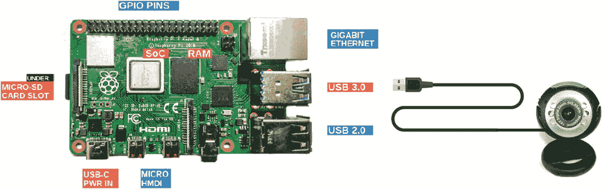

`图 9-6` 带网络摄像头的树莓派

为此，我们需要在 Pi 配置设置中启用 SSH 和 Camera。安全壳协议（SSH）可以帮助通过本地网络远程连接到树莓派，而启用摄像头配置则有助于将网络摄像头与 Pi 板连接。这可以通过以下步骤完成：

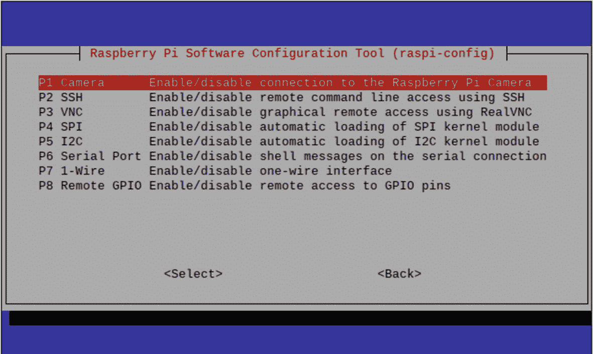

`图 9-8` 用于启用摄像头和 SSH 的接口选项

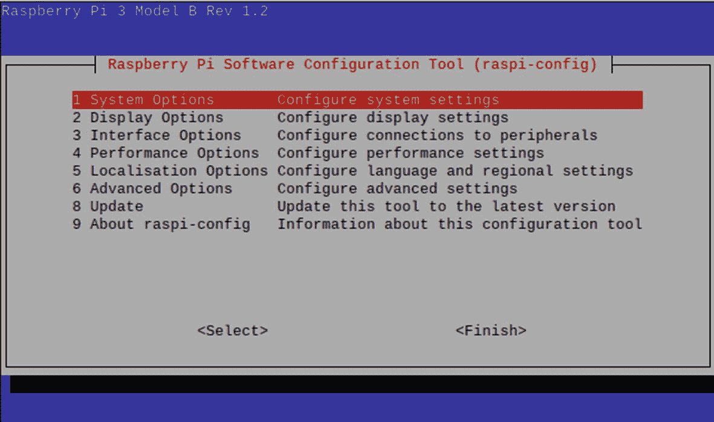

`图 9-7` 软件配置工具窗口

1. 在树莓派操作系统的终端窗口中输入命令 `sudo raspi-config`。这将打开软件配置工具窗口，如图 9-7 所示。
2. 进入接口选项，如图 9-8 所示，并启用 SSH 和摄像头。
3. 重启树莓派设备。

重启完成后，在终端窗口中运行 `lsusb` 命令，检查连接的 USB 网络摄像头是否已被列出。然后打开 Python IDE 并输入以下代码，使用网络摄像头捕捉并保存图像：

```python
import cv2
import pandas as pd
import numpy as np
import matplotlib.pyplot as plt
camera=cv2.VideoCapture( )
ret, img = camera.read( )
cv2.imwrite('image.png',img)
img= cv2.cvtColor(img,cv2.COLOR_BGR2RGB)
plt.imshow(img)
plt.axis('off')
plt.show( )
```

如代码所示，`OpenCV` 包用于在 Python 中处理图像。为了捕捉图像，首先创建一个 `VideoCapture` 对象。使用 `read()` 函数通过创建的对象捕捉图像，然后将其存储在变量 `img` 中。捕捉到的图像可以使用 `imwrite()` 函数保存。`OpenCV` 以 BGR 格式显示图像，而非标准的 RGB 格式。因此，在显示图像之前，需使用 `cv2.color` 函数将其转换为 RGB 图像。为了显示图像，可以使用 `Matplotlib` 包中的 `imshow()` 函数。由于使用该包创建的图默认带有坐标轴值，因此在显示图像时，必须移除坐标轴。这可以通过将 `Matplotlib` 包中的 `axis` 函数设置为 `off` 状态来实现。图 9-9 显示了使用上述代码捕捉到的示例图像。


`图 9-9` 使用连接到树莓派板的网络摄像头捕捉的图像

### 探索性图像数据分析

图像显示一些静止物体放置在白纸上。为了理解获取的图像数据，最好打印出图像的数据类型和尺寸，如下所示：

```
print(type(img))
print(img.shape)
输出：

(719, 1206, 3)
```

捕获的图像是一个 `NumPy` 数组。使用网络摄像头捕获的图像通常为 RGB 格式，其中包含三个像素平面：红色、蓝色和绿色。换句话说，图像中的每个像素都由三个值组成，这些值分别代表红色、蓝色和绿色的比例，从而在可见光谱中产生各种颜色。打印出的图像形状中的数字 3 表示三个平面；即图像由对应 RGB 的三个平面组成，每个平面的尺寸均为 719 × 1206 像素。在许多应用中，图像中的边缘、形状等其他细节比颜色信息更重要。例如，如果我们的目标是识别给定图像中的静止物体，物体的形状将比颜色更重要。在这种情况下，可以使用以下代码将三平面 RGB 图像转换为单平面灰度图像：

```
gray = cv2.cvtColor(img, cv2.COLOR_BGR2GRAY)
plt.imshow(gray,cmap= 'gray')
plt.axis('off')
plt.show( )
print(gray.shape)
输出：
(719, 1206)
```

图 9-10 显示了一个单平面灰度图像，其中的颜色已被移除。这可以从上一段代码中打印出的图像尺寸看出。现在灰度图像的尺寸仅为单平面 719×1206。在某些情况下，由于图像传感器的缺陷，捕获的图像可能包含一些缺失值。这些值也可能反映在灰度图像中，可以通过将图像转换为数据框（`dataframe`）来检测和处理这些值，如下所示：

```
df=pd.DataFrame(gray)
s=df.isnull( ).sum( ).sum( )
print(s)
if s!=0:
    df=df.ffill(axis=0)
    gray=df.to_numpy( )
输出：

```

`isnull()` 函数可用于检测图像行和列中是否存在缺失值。`sum()` 函数可用于统计数据框行和列中缺失值的数量。如果 `sum()` 函数的结果不等于零，则图像包含缺失值，可以使用 `ffill()` 函数进行处理，该函数用上方的像素值替换每个缺失值。这种前向填充或后向填充的方法不会在图像中引起任何可见的变化，因为除了图像边缘外，图像中的像素值通常非常接近。从上一段代码可以看出，缺失值的数量为 0；即图像中没有缺失值。一旦对图像进行了缺失值检查和处理后，可以使用 `Pandas` 中的 `to_numpy()` 将数据框转换回 `NumPy` 数组。由于像素值非常接近，图像中许多区域可能重复出现相同的像素值。因此，在图像数据的情况下，识别重复值是不相关的。


`图 9-10` 转换为灰度后的图像

使用 USB 网络摄像头或 Pi 摄像头在自然光下拍摄，通常会导致图像质量不佳。因此，处理缺失值后的下一步是绘制图像的直方图。直方图可以了解图像的对比度，如图 9-11 所示。具体实现如下代码所示：

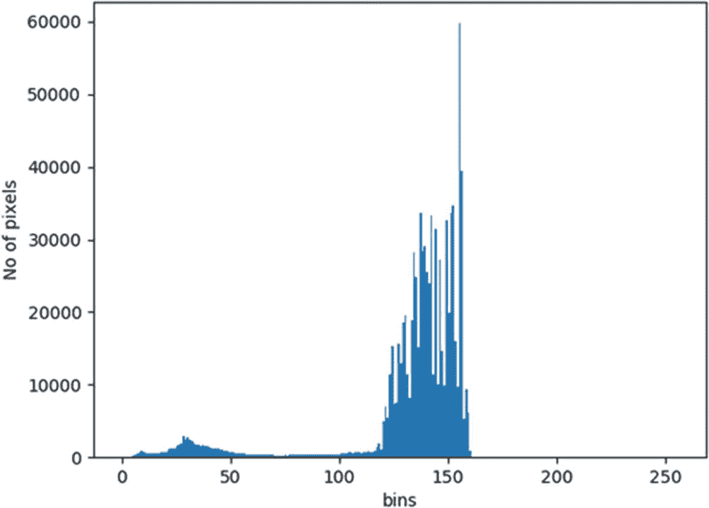

`图 9-11` 灰度图像的直方图

```
plt.hist(gray.ravel( ),bins=256)
plt.xlabel('bins')
plt.ylabel('No of pixels')
plt.show( )
```

灰度图像中的像素值范围从 0（代表黑色）到 255（代表白色）。上一段代码中的 `hist()` 函数绘制了一个条形图，显示该范围内每个像素值的计数。该图可以让我们了解所处理图像的对比度。图 9-11 显示了我们的灰度图像的直方图。可以看出，大多数像素集中在 (120,160) 范围内。如果像素的分布集中在较低的分组（`bins`）中，则图像对比度较低，反之亦然。因此，根据此图，可以决定是否需要对图像进行对比度调整。

## 图像处理技术

导致图像质量不佳的另一个原因可能是各种因素引入的噪声。在观察捕获的图像时，这些噪声可以通过颗粒的形式被视觉感知。在这种情况下，在进行进一步处理之前，必须先消除这些噪声。噪声有多种不同类型，例如高斯噪声、椒盐噪声等，并且有许多不同类型的滤波器可用于去除这些噪声，但这超出了本书的范围。

### 噪声滤波

让我们只看一种在图像处理中常用的特定滤波器，称为均值滤波器。它是一种低通滤波器，可用于去除数字图像中的高频内容。该滤波的工作原理是，将一个特定尺寸（例如 3×3）的核在图像的维度上滑动，计算核区域内所有像素的平均值，并用该平均值替换中心元素。整体效果是产生模糊效果。以下代码说明了如何将均值滤波器应用于我们的图像。图 9-12 显示了滤波后得到的图像。


**图 9-12** — 通过均值滤波得到的图像

```
blur=cv2.blur(gray,(3,3))
plt.imshow(blur)
plt.axis('off')
plt.show( )
```

### 为模型准备图像数据

预处理步骤完成后，下一步是分析图像或为学习模型准备图像。这可以通过两种方式完成。第一种方法是提取代表有用信息的特征，并将其用于建模。提取的特征可能是另一个变换后的图像，也可能是从原始图像中提取的属性。可以从图像中提取无数种特征，而特定特征的选择取决于我们应用的性质。讨论这些众多的特征超出了本书的范围。相反，我们将讨论一个特定的特征：边缘检测。

边缘代表图像中的高频内容。Canny 边缘检测是一种算法，它采用多阶段方法来检测图像中广泛的边缘。可以通过使用 OpenCV 中的 `Canny()` 函数在 Python 中实现，如下列代码所示。图 9-13 显示了边缘检测过程后的图像。

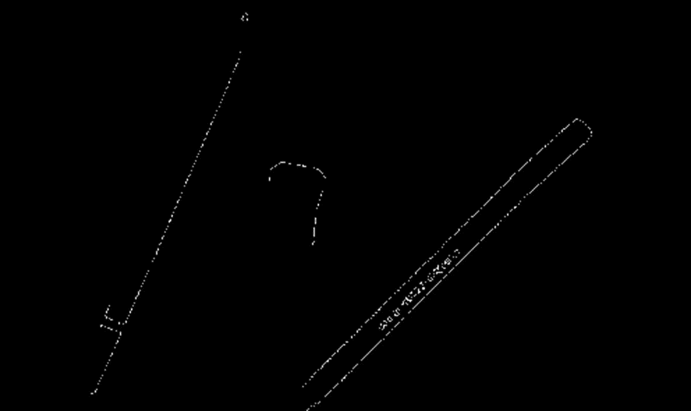

**图 9-13** — 边缘检测后的图像

```
edge_img=cv2.Canny(gray,100,200)
plt.imshow(edge_img,cmap='gray')
plt.axis('off')
plt.show( )
```

第二种方法是直接将图像输入到深度学习模型中。深度学习是一种流行的机器学习方法，越来越多地被用于分析和学习图像。这种方法可以直接从图像中学习有用信息，不需要任何特征提取。可以将图像调整为不同的尺寸，然后输入到学习模型中，或者将图像数组转换为一个一维向量，然后输入到模型中。

### 使用深度神经网络进行目标检测

目标检测是一种从图像或视频中识别现实世界物体（如椅子、书籍、汽车、电视、花卉、动物、人类等）的技术。该技术能够检测、识别和辨认图像中的多个物体，以便更好地理解或从现实环境中提取信息。目标检测在计算机视觉应用中扮演着重要角色，例如自动驾驶汽车、监控系统、工业自动化以及为视障人士设计的辅助设备。Python 环境中提供了多种用于目标检测的模块，具体如下：

- 基于特征的目标检测
- Viola Jones 目标检测
- 基于 HOG 特征的 SVM 分类
- 深度学习目标检测
- 单次多框检测器（SSD）目标检测
- YOLO (You Only Look Once) 模型目标检测
- 基于区域的卷积神经网络（R-CNN）
- Faster R-CNN

在此，我们使用了单次多框检测器来识别图像或视频中的多个物体。单次多框检测器由 C. Szegedy 等人于 2016 年 11 月提出。SSD 可以解释如下：

- **单次**：在此阶段，借助单个前向传播网络完成图像的定位和分类。
- **多框**：表示在图像中为多个物体绘制边界框。
- **检测器**：这是一种目标检测器，用于对图像或视频中的物体进行分类。

图 9-14 展示了单次多框检测器的架构。

在该架构中，输入图像的尺寸被视为 `300×300×3`。`VGG-16` 架构被用作基础网络，并且去掉了全连接网络。`VGG-16` 架构非常流行，并借助迁移学习技术具备强大的分类能力。此处，在早期阶段使用了 `VGG-16` 架构的部分卷积层。关于 SSD 的详细解释，请访问 [`https://towardsdatascience.com/understanding-ssd-multibox-real-time-object-detection-in-deep-learning-495ef744fab`](https://towardsdatascience.com/understanding-ssd-multibox-real-time-object-detection-in-deep-learning-495ef744fab)。

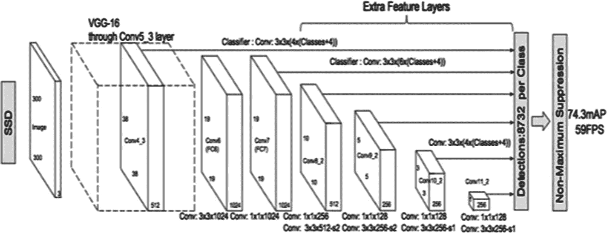

**图 9-14** — 单次多框检测器的架构（[ `https://towardsdatascience.com/understanding-ssd-multibox-real-time-object-detection-in-deep-learning-495ef744fab`](https://towardsdatascience.com/understanding-ssd-multibox-real-time-object-detection-in-deep-learning-495ef744fab)）

多框架构是一种识别边界框坐标的技术，它基于两个损失函数：置信度损失和位置损失。置信度损失使用分类熵来衡量边界框识别物体的置信水平。位置损失则衡量边界框与图像中物体的偏离距离。测量距离时使用 L2 范数。多框损失可以通过以下公式计算：

```
多框损失 = 置信度损失 + α * 位置损失
```

这提供了边界框与预测物体之间的距离信息。以下代码实现了 SSD 配置文件，该文件带有用于检测 COCO 数据集类别中物体的 DNN 权重。用于检测 COCO 类别中物体的 SSD 配置文件（即 `ssd_mobilenet_v3_large_coco_2020_01_14.pbtxt`）和 DNN 权重（即 `frozen_inference_graph.pb`）可以从 [`https://github.com/AlekhyaBhupati/Object_Detection_Using_openCV`](https://github.com/AlekhyaBhupati/Object_Detection_Using_openCV) 下载。

在此上下文中，COCO 类别指的是常见物体，COCO 类别的数据集可在其官方网站获取：[`https://cocodataset.org/#home`](https://cocodataset.org/%2523home)。COCO 包含了诸如椅子、汽车、动物、人类等常见物体的分割图像，这些分割图像可用于训练深度神经网络。请参见图 9-15 和图 9-16。


**图 9-15** — 用于物体识别的输入图像

代码如下：

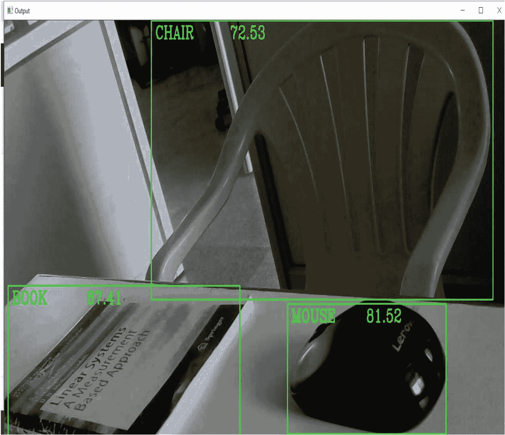

**图 9-16** — 已识别物体的输出图像

## 案例研究 3：工业 4.0

工业 4.0 代表了制造业的第四次革命。第一次工业革命（即工业 1.0）是利用蒸汽动力创造机械能，以提高装配线的生产力。第二次革命（即工业 2.0）将电力引入装配线以提升生产力。第三次革命（即工业 3.0）将计算机引入以自动化工业流程。目前，工业 4.0 正在采用计算机、数据分析和机器学习工具，借助传感器采集的数据来进行智能决策或监控流程。物联网（IoT）近年来在数据采集和传输以实现远程访问方面发挥了重要作用。

图 9-17 描述了工业 4.0 的基本流程。首先，借助传感器采集物理系统的数据，并将其制成数字记录。然后，将物理系统的数字记录发送到服务器系统进行实时数据处理和分析。在此阶段应用数据科学技术对数据进行预处理和准备。接着，可以使用现代学习算法，通过使用已学习的模型预测输出来进行智能决策。此外，还使用可视化技术来监控物理系统的实时数据。在此，`Raspberry Pi` 可以作为服务器或本地化云来用于实时数据处理。

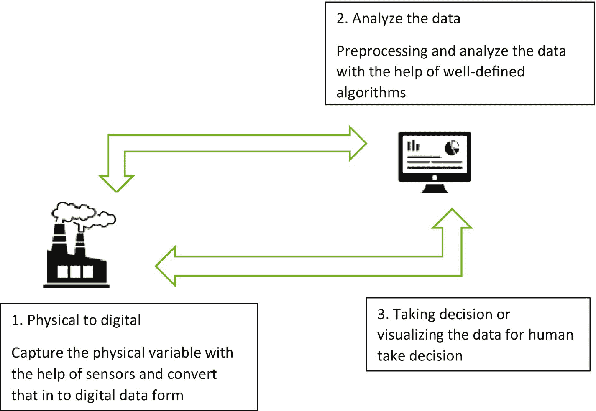

**图 9-17** 工业 4.0 框图

### 树莓派作为工业 4.0 的本地化云

要实现工业 4.0，需要一台高性能计算机来连接设备、采集数据和处理数据。采集到的数据可以存储在云服务中以便进一步处理。然而，如今云服务的订阅费用较高，仅适用于高利润公司。小规模公司希望实现本地化云来进行实时处理。此外，本地化云方法可以提供数据安全性，因为其位于本地，攻击者无法通过远程访问入侵。

如第 3 章所述，`Raspberry Pi` 可以充当本地化云，连接传感器、物联网设备、其他附近的计算机和手机，如图 9-18 所示。高性能计算机也可以充当本地化云，但它们占用空间较大。此外，在偏远地区部署计算机也很困难。`Raspberry Pi` 具有占用空间小且可在偏远地区部署的优势。基于此，`Raspberry Pi` 被用作工业 4.0 框架的本地化云，如图 9-19 所示。

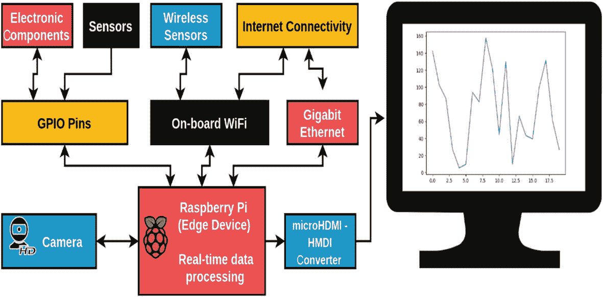

**图 9-19** 采用树莓派的工业 4.0 框架

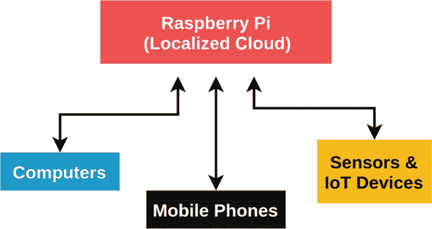

**图 9-18** 树莓派作为本地化云

在使用 `Raspberry Pi` 的工业 4.0 框架中，有三个可用模块：从传感器采集数据、使用摄像头采集信息、以及将 `Raspberry Pi` 与其他计算机连接。

### 从传感器采集数据

我们将使用温湿度传感器来测量温度和湿度。将 `DHT 11/22` 传感器模块连接到 `Raspberry Pi`，如第 3 章所示。以下代码在 100 秒内采集温度和湿度百分比，并将采集到的数据存储为 CSV 文件。

```
import Adafruit_DHT
import time
from datetime import datetime

DHT_SENSOR = Adafruit_DHT.DHT11
DHT_PIN = 17

data = []
while _ in range(100):
    humidity, temperature = Adafruit_DHT.read(DHT_SENSOR, DHT_PIN)
    if humidity is not None and temperature is not None:
        now = datetime.now()
        dt_string = now.strftime("%d/%m/%Y %H:%M:%S")
        data.append(dt_string,humidity,temperature)
    time.sleep(60*5)

df = pd.DataFrame(data)
df.to_csv('data.csv',index=None,header=None)
```

CSV 文件的内容将类似于表 9-3。

**表 9-3** 来自温湿度传感器的带时间戳数据

| 17/05/2020 01:05:14 | 26.24 | 69.91 |
|----------------------|-------|-------|
| 17/05/2020 01:10:14 | 26.24 | 70.65 |
| 17/05/2020 01:15:14 | 26.22 | 68.87 |
| 17/05/2020 01:20:14 | 26.15 | 70.11 |
| 17/05/2020 01:25:14 | 26.11 | 69.02 |

#### 在树莓派中准备行业数据集

我们将使用一个包含两列数据的数据集，这些数据来自连接到树莓派主板的温度与湿度传感器；数据每 5 分钟记录一次，持续 28 小时。因此，该数据集本质上是`.csv`格式的时间序列数据。在进行预处理之前，最好先了解数据集的概况。因此，第一步将是读取文件并打印其内容，如下所示：

当代码执行时，使用 `OpenCV capture` 函数捕获来自网络摄像头的视频帧。然后，将每一帧输入到已训练好的 `SSD-DNN` 模型中进行物体识别。`SSD-DNN` 模型基于 `COCO` 类别对物体进行分类，并在检测到的图像上创建带有 `COCO` 类别标签和准确率的边界框。图 9-15 中的视频文件被作为输入提供给上述程序。该图中包含了椅子、书籍和鼠标等物体。从图 9-16 中可以清晰地得出结论：基于 `SSD` 的 `DNN` 模型识别出了这三个物体，其中椅子的准确率为 72.53%，书籍为 67.41%，鼠标为 81.52%。

```
import cv2

thres = 0.5 # Threshold to detect object
cap = cv2.VideoCapture(0)
cap.set(3,1280)
cap.set(4,720)
cap.set(10,70)

classNames= []
classFile = 'coco.names'
with open(classFile,'rt') as f:
    classNames = f.read().rstrip('\n').split('\n')

configPath = 'ssd_mobilenet_v3_large_coco_2020_01_14.pbtxt'
weightsPath = 'frozen_inference_graph.pb'

net = cv2.dnn_DetectionModel(weightsPath,configPath)
net.setInputSize(320,320)
net.setInputScale(1.0/ 127.5)
net.setInputMean((127.5, 127.5, 127.5))
net.setInputSwapRB(True)

print('1st done')

while True:
    success, img = cap.read()
    classIds, confs, bbox = net.detect(img, confThreshold=thres)
    print(classIds, bbox)
    if len(classIds) != 0:
        for classId, confidence,box in zip(classIds.flatten(),confs.flatten(),bbox):
            cv2.rectangle(img,box,color=(0,255,0),thickness=2)
            cv2.putText(img,classNames[classId-1].upper(),(box[0]+10,box[1]+30),
                        cv2.FONT_HERSHEY_COMPLEX,1,(0,255,0),2)
            cv2.putText(img,str(round(confidence*100,2)),(box[0]+200,box[1]+30),
                        cv2.FONT_HERSHEY_COMPLEX,1,(0,255,0),2)

    cv2.imshow("Output",img)
    # Hit 'q' on the keyboard to quit!
```

```
import pandas as pd
import matplotlib.pyplot as plt
import numpy as np
dataset = pd.read_csv('datasets_384649_744229_log_temp.csv')
print(dataset.head())
```
Output:
```
Date      Time    Temperature    Humidity
0  3/14/19  19:33:07         T=22.0      H=20.0
1  3/14/19  19:38:10         T=22.0      H=20.0
2  3/14/19  19:43:11         T=22.0      H=26.0
3  3/14/19  19:48:14         T=22.0      H=26.0
4  3/14/19  19:53:15         T=22.0      H=20.0
```

从打印出的`dataset`前五个条目可以清楚地看出，在开始分析之前，数据需要清洗。前两列包含条目的日期和时间，对于分析来说并不需要，因此可以删除这些列。第三和第四列包含实际数据，是字符串和数字的混合。我们需要过滤掉这些不合适的值，并将数据集从`string`类型转换为`float`类型。这两个操作可以按如下方式执行：
```python
# 删除日期和时间列
drop=['Date','Time']
dataset.drop(drop, inplace=True, axis=1)
# 移除 'T=' 和 'H=' 字符串
dataset['Temperature'] = dataset['Temperature'].str.replace('T=','')
dataset['Humidity'] = dataset['Humidity'].str.replace('H=','')
dataset = dataset.astype(float)
print(dataset.head())
```
Output:
```
   Temperature  Humidity
0         22.0      20.0
1         22.0      20.0
2         22.0      26.0
3         22.0      26.0
4         22.0      20.0
```

下一步是检查两列中是否存在缺失数据。如前所述，缺失数据通常以 `NaN` 的形式存在，可以使用 Pandas 包中的`isna()`函数来检测此类数据的存在。NumPy 包中的`where()`函数可以与`isna()`函数一起使用，以获取各自列中缺失值的位置，如下所示：
```python
print(np.where(dataset['Temperature'].isna()))
print(np.where(dataset['Humidity'].isna()))
```
Output:
```
(array([206, 207, 214, 215, 216, 217, 218, 219, 220, 221, 222, 223, 224,
       225, 226, 227], dtype=int64),)
(array([206, 207, 214, 215, 216, 217, 218, 219, 220, 221, 222, 223, 224,
       225, 226, 227], dtype=int64),)
```

从前面的结果可以看出，温度列和湿度列都存在缺失数据，并且两列中缺失数据的位置相同。下一步将是处理缺失值。处理缺失值的方法可能因数据的性质而异。在我们的数据集中，由于我们每五分钟测量一次温度和湿度值，可以合理地假设在缺失值范围内不会有太大变化。因此，可以使用`ffill`方法填充缺失值，`ffill`代表“向前填充”，即用前一行的值替换缺失值。这可以使用 Pandas 包中的`fillna()`函数来实现。在实现此填充过程后，可以使用`isna().any()`函数进行验证，如果任何列中都没有缺失值，该函数将返回`false`，如下所示：
```python
dataset['Temperature'] = dataset['Temperature'].fillna(axis=0, method='ffill')
dataset['Humidity'] = dataset['Humidity'].fillna(axis=0, method='ffill')
print(dataset.isna().any())
```
Output:
```
Temperature    False
Humidity       False
dtype: bool
```

既然缺失值已处理完毕，下一步就是寻找数据中的异常值。为此，我们使用之前讨论过的 Z 分数。在计算 Z 分数之前，数据集中的条目应转换为整数。以下代码说明了使用 Z 分数检测和移除异常值的方法：
```python
from scipy import stats
z = np.abs(stats.zscore(dataset))
df1 = dataset[z > 3]
print(df1)
dataset = dataset[(z < 3).all(axis=1)]
```
Output:
```
   Temperature  Humidity
47          9.0     140.0
157        37.0      12.0
```

从前面的输出可以看出，存在两个异常值，分别对应行索引 47 和 157。我们不会移除 Z 分数大于 3 的数据点对应的异常值，而是保留所有 Z 分数小于 3 的数据点。

#### 实时传感器数据的探索性数据分析

我们讨论了一些数据科学家常用的基础图表，并用一些现成的数据集演示了每种图表。在本节中，我们将使用实时传感器数据演示一些图表。我们使用与第 5 章中相同的温度和湿度传感器数据来讨论数据准备的概念。由于我们已经在那一章中完成了所有数据清洗步骤，这里提供相同的代码用于在绘制图表之前准备数据。

# 数据分析与可视化

```python
import pandas as pd
import matplotlib.pyplot as plt
import numpy as np
from scipy import stats

dataset = pd.read_csv('datasets_384649_744229_log_temp.csv')

# 删除日期和时间列
drop = ['Date', 'Time']
dataset.drop(drop, inplace=True, axis=1)

# 移除字符串头 'T=' 和 'H='
dataset['Temperature'] = dataset['Temperature'].str.replace('T=', '')
dataset['Humidity'] = dataset['Humidity'].str.replace('H=', '')
dataset = dataset.astype(float)

print('移除不合适数据后\n', dataset.head())

# 检测缺失数据的位置（如果有）
print('温度中的缺失值\n', np.where(dataset['Temperature'].isna()))
print('湿度中的缺失值\n', np.where(dataset['Humidity'].isna()))

# 使用向前填充法填充缺失值
dataset['Temperature'] = dataset['Temperature'].fillna(axis=0, method='ffill')
dataset['Humidity'] = dataset['Humidity'].fillna(axis=0, method='ffill')

# 使用 Z 分数检测并移除异常值
z = np.abs(stats.zscore(dataset))
df1 = dataset[z > 3]
dataset = dataset[(z < 3).all(axis=1)]

print(dataset.head())
```

```
Output:
移除不合适数据后
   Temperature  Humidity
0         22.0      20.0
1         22.0      20.0
2         22.0      26.0
3         22.0      26.0
4         22.0      20.0
温度中的缺失值
(array([206, 207, 214, 215, 216, 217, 218, 219, 220, 221, 222, 223, 224,
       225, 226, 227], dtype=int64),)
湿度中的缺失值
(array([206, 207, 214, 215, 216, 217, 218, 219, 220, 221, 222, 223, 224,
       225, 226, 227], dtype=int64),)
   Temperature  Humidity
0         22.0      20.0
1         22.0      20.0
2         22.0      26.0
3         22.0      26.0
4         22.0      20.0
```

## 可视化实时传感器数据

数据清洗过程完成后，下一步是绘制数据图表。使用的图表类型取决于数据的性质以及分析流程的要求。由于我们在 28 小时内测量了温度和湿度，因此最理想的方式是按时间绘制它们。但为了更好地理解这两个参数的变化，我们每四小时取一次平均值，并用条形图绘制这些平均值。如果我们想了解整个时间段内温度和湿度的分布情况而非其变化趋势，那么可以将温度和湿度的范围划分为若干区间，并统计每个区间内的数值计数，然后用这些数据制作饼图。这三种图表说明如下：

```python
# Taking average over every 4 hours
a = dataset.shape[0]
b = []
c = []
for i in np.arange(0, a-(a%12), 48):
    b.append(np.mean(dataset.Temperature[i:i+47]))
    c.append(np.mean(dataset.Humidity[i:i+47]))

# Temperature vs Time over 28 hours
plt.subplot(221)
plt.plot(np.linspace(0,28,a), dataset.Temperature)
plt.title('Temperature vs Time')

# Humidity vs Time over 28 hours
plt.subplot(222)
plt.plot(np.linspace(0,28,a), dataset.Humidity)
plt.title('Humidity vs Time')

# Bar plot of average temperature over every 4 hours during the 28 hours
plt.subplot(223)
x = ['1','2','3','4','5','6','7']
plt.bar(x, b)
plt.title('Average temperature over every 4 hours')

# Bar plot of average humidity over every 4 hours during the 28 hours
plt.subplot(224)
plt.bar(x, c)
plt.title('Average humidity over every 4 hours')

# Pie chart for temperature distribution
d = pd.DataFrame(dataset.Temperature.value_counts(bins=4))
plt.subplot(235)
plt.pie(d.Temperature, labels=d.index)
plt.title('Temperature distribution')

# Pie chart for humidity distribution
e = pd.DataFrame(dataset.Humidity.value_counts(bins=4))
plt.subplot(236)
plt.pie(e.Humidity, labels=e.index)
plt.title('Humidity distribution')

plt.show()
```

在图 9-20 中，前两个图展示了温度和湿度的分布，其中每个数据样本都沿着时间轴（以小时为单位）绘制。我们可以看出，温度和湿度如预期般呈反比关系。但随时间变化的趋势通过每四小时取一次样本平均值并以条形图绘制（如第三和第四张图所示）能更好地体现。第五和第六张图展示了饼图，侧重于温度和湿度的整体分布情况而非随时间的变化。由于传感器数据仅记录了 28 小时，数据不会有太大变化，因此仅使用四个区间来绘制分布图。从这两张图中可以看出，在这 28 小时内，温度大多处于 15 至 20 摄氏度范围内，而湿度则大多处于 19 至 25 范围内。

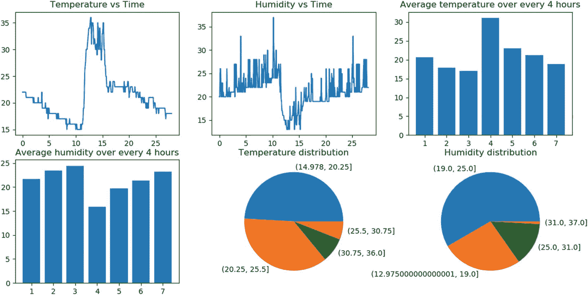

图 9-20

温度和湿度的变化与分布

### 使用视觉相机读取条形码生成报告

如今，许多行业借助条形码和二维码对其产品进行文档化记录。产品信息可以印在产品上，便于识别和归档。市场上有专用的条码/二维码扫描器，但扫描产品上的条码/二维码需要人工操作。这可能会降低装配线的生产效率。如今，视觉系统被用来自动扫描产品上的条码/二维码。这将通过消除人工操作和减少装配线上的时间来提升生产效率。因此，可以将摄像头与树莓派连接，用于扫描装配线上产品的条码/二维码。

我们在本章的案例研究 2 中已经讨论过如何在树莓派上启用摄像头（关于将网络摄像头与树莓派连接的步骤，请参考案例研究 2）。以下代码[30]持续采集装配线上产品的图像，识别图像中的条码/二维码，解码条码/二维码中的信息，并将解码后的信息显示在图像屏幕上。

# 条形码扫描器示例

```
# import the required packages
from imutils.video import VideoStream
from pyzbar import pyzbar
import argparse
import datetime
import imutils
import time
import cv2
# construct the argument parser and parse the arguments
ap = argparse.ArgumentParser()
ap.add_argument("-o", "--output", type=str, default="barcodes.csv",
help="path to output CSV file containing barcodes")
args = vars(ap.parse_args())
# initialize the video stream and allow the camera sensor to warm up
print("[INFO] starting video stream...")
vs = VideoStream(src=0).start()
#vs = VideoStream(usePiCamera=True).start()
time.sleep(2.0)
# open the output CSV file for writing and initialize the set of
# barcodes found thus far
csv = open(args["output"], "w")
found = set()
# loop over the frames from the video stream
while True:
    # grab the frame from the threaded video stream and resize it to
    # have a maximum width of 400 pixels
    frame = vs.read()
    frame = imutils.resize(frame, width=400)
    # find the barcodes in the frame and decode each of the barcodes
    barcodes = pyzbar.decode(frame)
    # loop over the detected barcodes
    for barcode in barcodes:
        # extract the bounding box location of the barcode and draw
        # the bounding box surrounding the barcode on the image
        (x, y, w, h) = barcode.rect
        cv2.rectangle(frame, (x, y), (x + w, y + h), (0, 0, 255), 2)
        # the barcode data is a bytes object so if we want to draw it
        # on our output image we need to convert it to a string first
        barcodeData = barcode.data.decode("utf-8")
        barcodeType = barcode.type
        # draw the barcode data and barcode type on the image
        text = "{} ({})".format(barcodeData, barcodeType)
        cv2.putText(frame, text, (x, y - 10),
                    cv2.FONT_HERSHEY_SIMPLEX, 0.5, (0, 0, 255), 2)
        # if the barcode text is currently not in our CSV file, write
        # the timestamp + barcode to disk and update the set
        if barcodeData not in found:
            csv.write("{},{}\n".format(datetime.datetime.now(),
                                       barcodeData))
            csv.flush()
            found.add(barcodeData)
    # show the output frame
    cv2.imshow("Barcode Scanner", frame)
    key = cv2.waitKey(1) & 0xFF
    # if the `q` key was pressed, break from the loop
    if key == ord("q"):
        break
# close the output CSV file do a bit of cleanup
print("[INFO] cleaning up...")
csv.close()
cv2.destroyAllWindows()
vs.stop()
```

# 使用说明

上述代码使用网络摄像头采集图像，并通过 `while` 循环捕捉每一帧图像。接着，借助一个无限 `while` 循环持续显示这些帧。使用 `'q'` 键来中断这个无限 `while` 循环。然后，可以通过 `cap.release` 释放图像采集功能。在程序中，每一帧采集到的图像都被送入 `pyzbar` 模块，以识别图像中的条码/二维码，并解码条码/二维码中的数据[30]。解码后的信息显示在对应的帧中。图 9-21 展示了该程序的输出。

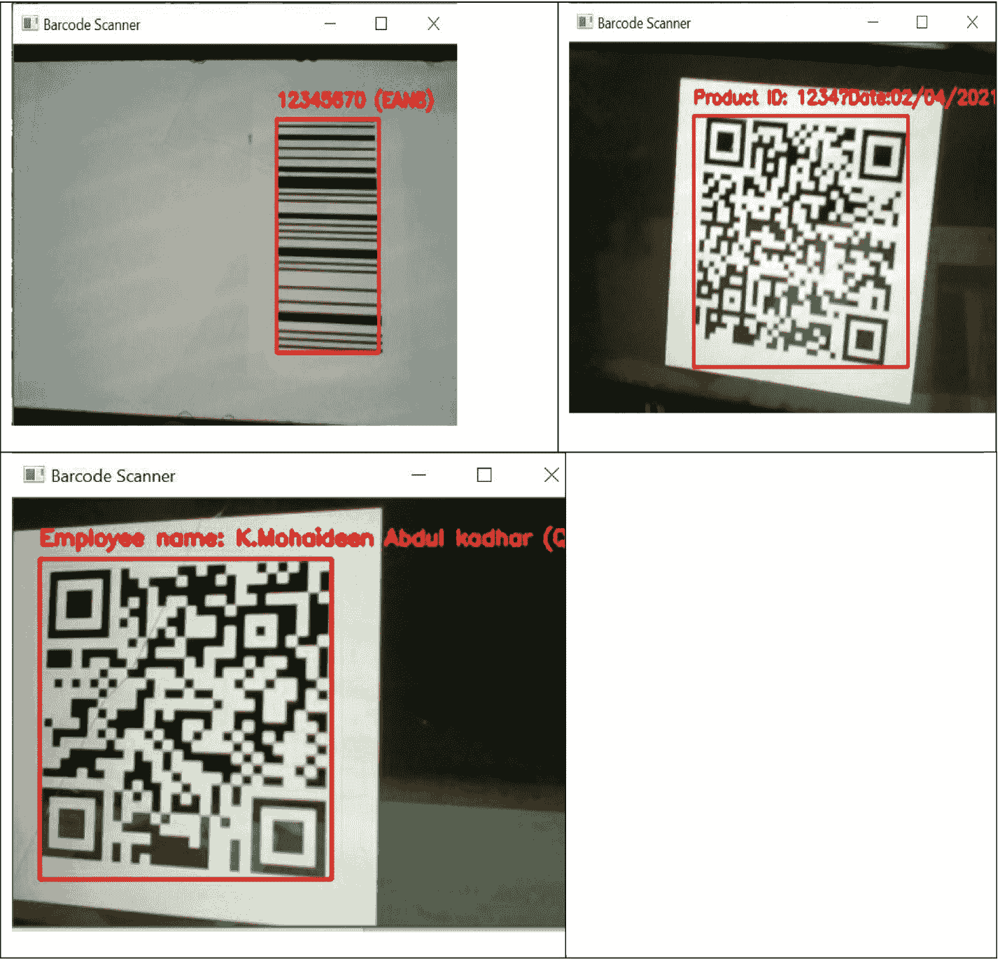

图 9-21 条形码与二维码扫描器输出结果

## 将文件或数据从树莓派传输到计算机

在某些场景下，需要将树莓派中的数据分享给附近的计算机。此外，如果树莓派位于其他地方，则需要通过远程访问来连接。传输数据的方式有很多种。其中最简单且高效的方法之一是使用 `VNC` 查看器来共享数据和进行远程访问。`VNC` 是一种图形化桌面共享应用，允许用户通过远程访问从一台系统（即树莓派）控制另一台系统。本节将讨论使用 `VNC` 查看器共享文件以及通过 `VNC` 从远程桌面计算机控制树莓派的安装步骤和使用方法。

要在树莓派中安装 `VNC`，需在树莓派的命令窗口中使用以下代码，如图 9-22 所示：

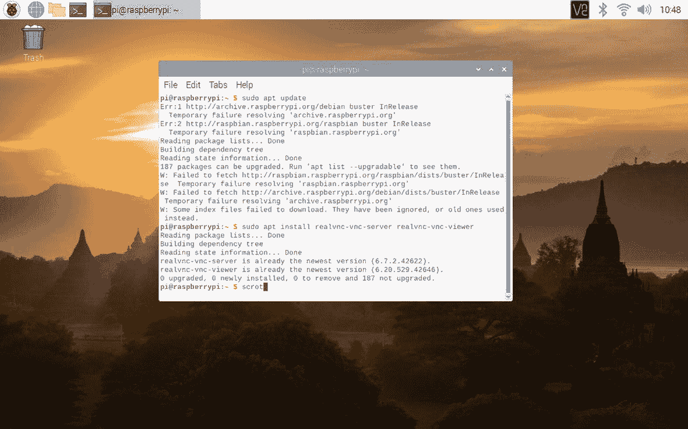

图 9-22 在树莓派中安装 `VNC` 查看器

```
sudo apt update
sudo apt install realvnc-vnc-server realvnc-vnc-viewer
```

同时，需要在远程桌面计算机上安装 `VNC` 查看器。如果远程桌面计算机的操作系统（OS）不同，`VNC` 与所有操作系统兼容。在树莓派中安装 `VNC` 后，必须在树莓派中启用 `VNC` 服务器。可通过以下步骤在树莓派中以图形化方式启用 `VNC` 服务器：

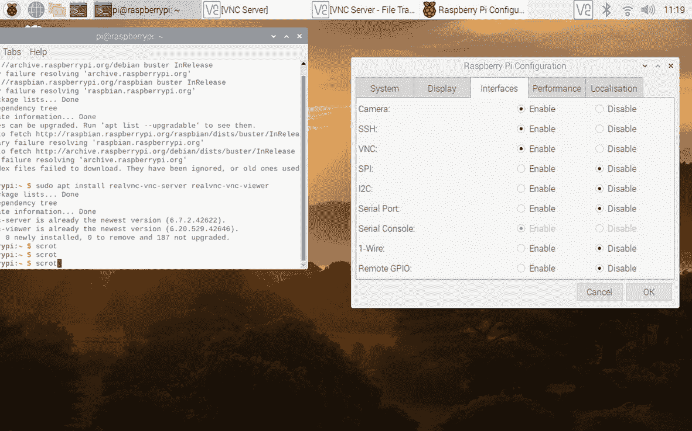

图 9-23 在树莓派上以图形化方式启用 `VNC` 服务器

1. 进入树莓派图形化桌面，选择 **菜单** > **首选项** > **树莓派配置**。将打开树莓派配置窗口，如图 9-23 所示。

2. 在树莓派配置窗口中，选择 **接口** 选项并确保 `VNC` 已启用。如果 `VNC` 未启用，请点击窗口中的 **启用** 按钮。

3. 启用 `VNC` 服务器后，点击树莓派图形化桌面右上角的 `VNC` 图标 。`VNC` 查看器应用窗口将打开。窗口中会显示树莓派的 `IP` 地址，如图 9-8 所示。只有当树莓派连接到网络时，`IP` 地址才会显示。此处，树莓派通过 `WiFi` 网卡/手机热点连接 `WiFi` 网络。

以上步骤用于在远程桌面与树莓派之间建立私有连接。要建立私有连接，远程桌面和树莓派需连接到同一网络。这将仅在公司园区内建立连接。如果用户想要将数据上传到云端，则需要登录`VNC`查看器，以便将树莓派与任何位置的远程桌面连接。

在另一台远程桌面中打开`VNC`查看器，如图 9-24 所示，在指定位置输入树莓派的`IP`地址，`VNC`服务器即在计算机与树莓派之间建立连接。将打开登录窗口，如图 9-25 所示，并提示输入用户名和密码。

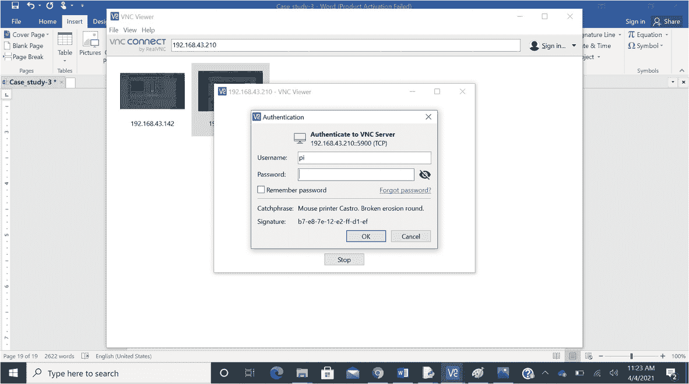

*图 9-25* 使用`VNC`查看器从桌面连接树莓派


*图 9-24* 树莓派中的`VNC`查看器

通常，树莓派的用户名和密码均为`pi`。输入`pi`作为用户名和密码，树莓派桌面将出现在远程桌面计算机上，如图 9-26 所示。

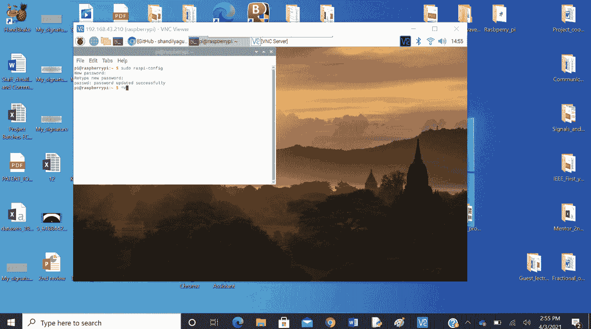

*图 9-26* 远程计算机上的树莓派图形化桌面

现在，树莓派桌面可以远程访问其他计算机。此外，还可以通过`VNC`查看器中的文件共享选项共享树莓派中的文件和数据，如图 9-27 所示。

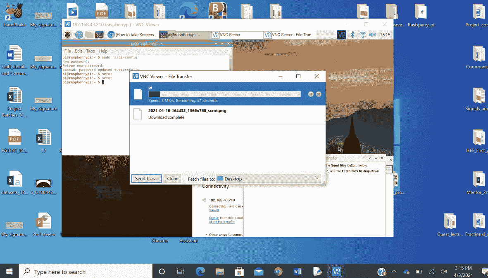

*图 9-27* 从远程桌面上的树莓派进行文件传输