# 3. Raspberry Pi 简介

Raspberry Pi，或简称为 Pi，是一系列由英国 Raspberry Pi 基金会发明的小型、低成本、单板计算机，旨在向全球学生推广基础计算机科学和电子学。学生和技术爱好者使用 Raspberry Pi 来学习编程概念、构建硬件项目和机器人，以及进行人工智能项目。它也被用于工业应用。

## 你能用 Raspberry Pi 做什么？

一个 Raspberry Pi 开发板几乎可以做台式机能做的所有事情：上网、观看高清视频、听音乐、查看和编辑图片、进行文字处理、制作电子表格和演示文稿、编写和编译代码、参加视频会议，甚至玩游戏。

### 使用 Raspberry Pi 进行物理计算

Raspberry Pi 还可以用于与物理世界进行交互。这是通过 Raspberry Pi 开发板上的通用输入/输出（`GPIO`）引脚实现的。这使得 Raspberry Pi 功能强大，因为它可以与传感器以及其他电子和电气元件（如 LED、舵机和步进电机、继电器等）进行接口连接。

### 如何为 Raspberry Pi 编程？

Raspberry Pi 预装了两门语言（Scratch 和 Python），但它也支持其他语言。Scratch 是一种面向儿童的视觉化编程语言，而 Python 是一种高级通用编程语言；这两种语言都易于学习。如果您学会了用 Python 编程，那么您就可以用 Raspberry Pi 做所有可能的事情。

## Raspberry Pi 硬件

Raspberry Pi 基金会于 2012 年发布了第一款 Raspberry Pi，即 Raspberry Pi model B。此后发布了多个改进版本，我们稍后会介绍所有这些版本。最新版本是 2019 年 6 月发布的 Raspberry Pi 4 model B。图 3-1 显示了带有许多 I/O 端口的 Raspberry Pi 开发板的俯视图。让我们来看看它的硬件规格和其他特性。

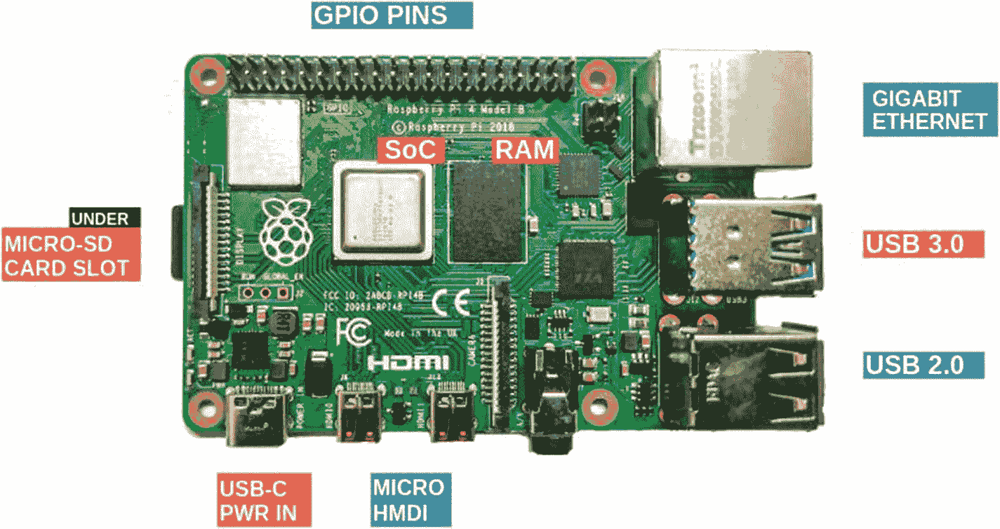
图 3-1 Raspberry Pi 硬件

### 片上系统

*片上系统*（`SoC`）是 Raspberry Pi 的大脑，如图 3-2 所示。这个小小的芯片包含许多重要部分：中央处理单元（`CPU`）、图形处理单元（`GPU`）和数字信号处理器。

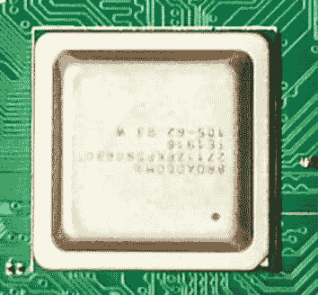
图 3-2 片上系统

Raspberry Pi 4 model B 采用了强大的 Broadcom BCM2711（1.5 GHz 64 位四核）`SoC`。Pi 的 `CPU` 执行基本算术、逻辑、控制和输入/输出等操作，而 Pi 的 `GPU` 用于处理多媒体任务，如数字图像处理、绘制 3D 图形和玩游戏。

### Raspberry Pi 内存

随机存取存储器（`RAM`）是 Raspberry Pi 4 model B 中位于 `SoC` 旁边的黑色矩形，如图 3-3 所示。在早期版本的 Raspberry Pi 中，`RAM` 被封装在 `SoC` 内部。Pi 4 提供了三种容量的 `LPDDR4` `RAM` 选择：1GB、2GB 和 4GB。

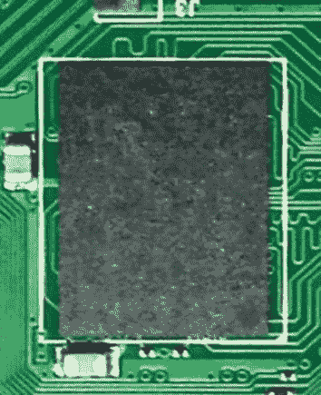
图 3-3 Raspberry Pi 内存

`RAM` 存储应用程序使用的短期数据，当 Raspberry Pi 关闭时，这些数据将被删除。`RAM` 由中央处理单元和图形处理单元共享。

### 连接性

树莓派 4B 型号配备有板载 Wi-Fi、蓝牙和千兆以太网。这些功能在进行远程访问树莓派时非常方便，使其成为物联网项目的理想硬件选择。这也释放了用于连接外部 Wi-Fi 和蓝牙模块的 `USB` 端口和 `GPIO` 引脚。

## 设置树莓派

本节将介绍如何设置树莓派。

### microSD 存储卡

与台式机和笔记本电脑不同，树莓派使用 `microSD` 存储卡来存储文件、应用程序甚至操作系统。`microSD` 存储卡与硬盘相比体积小巧且易于使用。树莓派至少需要 8GB 的存储空间。对于数据科学项目，建议使用 16GB 或 32GB 的 `microSD` 存储卡。为了更快地读写数据，建议使用 Class 10 超高速 (UHS) 存储卡。

### 安装操作系统

`Raspbian` 是树莓派基金会发布的官方且最常用的树莓派操作系统。使用 `Raspberry Pi Imager` 软件可以轻松地将其安装到 `microSD` 卡上，如图 3-4 所示。树莓派也支持其他操作系统，例如 `Ubuntu` 和 `Windows 10 IOT Core`。

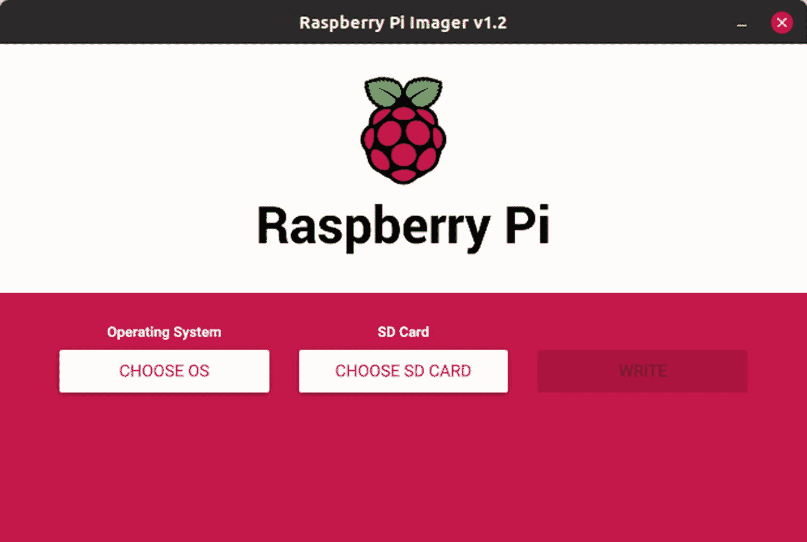
图 3-4 Raspberry Pi Imager 软件界面

请按照以下说明在你的树莓派上安装 `Raspbian` 操作系统：

1.  访问树莓派官网的下载页面，在你的操作系统上下载 `Raspberry Pi Imager` 软件。
2.  下载完成后，点击启动安装程序。
3.  将 `microSD` 存储卡插入电脑。请务必备份卡中所有重要数据，因为卡上的所有内容都将被格式化。
4.  选择你想要安装的 `Raspbian` 或其他所需操作系统，以及你想要安装的 `microSD` 卡。
5.  最后，点击 `写入` 按钮，等待操作完成。

### 插入 microSD 存储卡

树莓派底部的薄金属插槽即为 `microSD` 存储卡插槽，如图 3-5 所示。当操作系统安装到 `microSD` 存储卡后，将其插入树莓派的存储卡插槽。

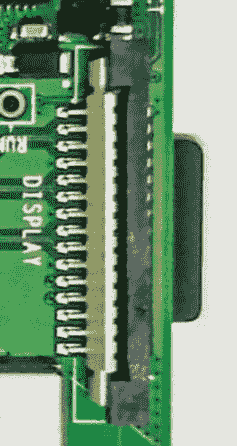
图 3-5 MicroSD 卡插槽

由于操作系统与其他文件一起存储在 `microSD` 存储卡上，这使得树莓派的存储器具有便携性。将 `microSD` 存储卡插入一块新的树莓派，它就能完美运行。

### 连接键盘和鼠标

图 3-6 显示了树莓派的 `USB` 端口。树莓派 4B 型号有两个 `USB 2.0` 端口（黑色）和两个通用串行总线 (`USB`) 3.0 端口（蓝色）。`USB` 可用于连接键盘、鼠标、摄像头和其他 `USB` 外设。`USB 3.0` 端口的速度大约是 `USB 2.0` 端口的 10 倍。通常，键盘和鼠标等外设连接到 `USB 2.0` 端口，而将更快的 `USB 3.0` 端口留给硬盘和摄像头等设备。

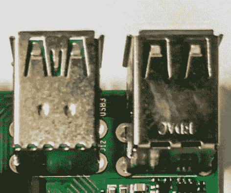
图 3-6 USB 端口

如果你使用的是无线键盘和鼠标而非有线组合，可以通过将 `USB` 适配器插入两个黑色端口之一来连接到树莓派。这样也可以释放一个 `USB` 端口，用于连接其他设备。

### 连接显示器

树莓派可通过图 3-7 所示的 `micro-HDMI` 端口连接到显示器。`HDMI` 代表高清多媒体接口，树莓派通过此端口提供音频和视频的复合输出。树莓派 4 型号带有两个支持 4K 分辨率的 `micro-HDMI` 端口，这意味着你可以同时将两台 4K 显示器连接到树莓派。

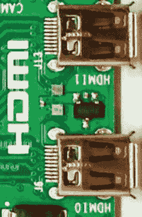
图 3-7 HDMI 端口

如果你的电视或显示器支持 `HDMI` 输入，那么你需要一根 `micro HDMI` 转 `HDMI` 线缆来将树莓派连接到电视或显示器。旧版本的树莓派配有一个标准 `HDMI` 端口。如果你的电视或显示器有 `VGA` 输入，则需要使用 `micro HDMI` 转 `VGA` 适配器将其连接到树莓派。类似地，对于具有 `DVI` 输入的显示器，你可以使用 `HDMI` 转 `DVI` 线缆。

### 为树莓派供电

树莓派 4B 需要通过 5.1V DC `USB-C` 型连接器供电，如图 3-8 所示，最小电流输入为 3A。它也可以通过 `GPIO` 引脚供电。`USB-C` 型电源端口位于树莓派靠近角落的位置。所有树莓派型号都没有电源开关；一旦将树莓派连接到电源，它就会启动。

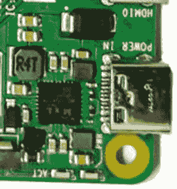
图 3-8 USB-C 型连接器

提供错误的电压或不足的电流可能会损坏树莓派；因此，建议使用官方的树莓派电源。

### 树莓派外壳

# 树莓派简介与接口

树莓派需要装入外壳中，以防止裸露的连接点和 GPIO 引脚。树莓派有各种各样的外壳可供选择，你也可以自己制作外壳，但建议使用树莓派基金会发布的官方外壳。带有散热风扇的外壳也可用。它们可以在运行高负载应用程序时防止树莓派过热。

## 树莓派版本

本节介绍不同的版本。

### 树莓派 1

树莓派 B 是树莓派基金会于 2012 年推出的第一款型号，随后于 2013 年推出了 `Pi A`。它们有 26 个 `GPIO` 引脚、一个 700MHz 处理器和 256MB/512MB RAM，并且没有内置 Wi-Fi 或蓝牙。2014 年，推出了紧凑型 `Pi A+` 和改进型 `B+` 型号，它们拥有 40 个 `GPIO` 引脚。

### 树莓派 2

树莓派 2 于 2015 年发布，配备了改进的 900MHz 四核处理器和 1GB RAM。该型号有 40 个 `GPIO` 引脚，没有内置 Wi-Fi 或蓝牙。它有四个 USB 2.0 端口、一个以太网端口和一个 HDMI 端口。

### 树莓派 3

2016 年，树莓派 3 发布。它采用了 1.2GHz 四核处理器，配备 1GB RAM。该型号有 40 个 `GPIO` 引脚，并且是第一款内置 Wi-Fi 和蓝牙的树莓派型号。与树莓派 2 类似，它有四个 USB 2.0 端口、一个以太网端口和一个 HDMI 端口。后来在 2018 年，紧凑型 `Pi 3 A+` 和改进型 `Pi 3 B+` 型号相继推出。

### 树莓派 Zero (W/WH)

2015 年，一款尺寸小巧、成本低廉、`GPIO` 引脚较少的树莓派 `Zero` 发布。`Pi Zero W` 于 2017 年发布，内置 Wi-Fi 和蓝牙。随后推出了 `Pi Zero WH`，它带有预先焊接好的 `GPIO` 排针。

### 树莓派 4

树莓派 4 型号 B 于 2019 年发布，采用强大的 1.5GHz 四核处理器，并提供 1GB/2GB/4GB RAM 选项。这是第一款配备双 4K 显示输出、USB-C 型电源输入和两个 USB 3.0 端口的型号。

## 推荐的树莓派版本

树莓派有多个版本可供选择，但对于数据科学项目，推荐使用树莓派 4，因为它比其他版本性能更强大，并且 RAM 可选配高达 4GB。

`Pi Zero WH` 是现有树莓派中尺寸最小的版本，当对单板计算机的尺寸有小型化需求时，推荐使用该版本。但其处理器速度相对较慢，RAM 较小，且 `GPIO` 引脚数量较少。

## 树莓派与传感器的接口连接

本节重点介绍如何将树莓派与传感器进行接口连接。

### GPIO 引脚

图 3-9 中所示的 `GPIO` 引脚是树莓派最强大的功能之一。`GPIO` 引脚是沿着电路板边缘的一排小引脚。近期发布的所有树莓派版本都配备了一个 40 针的 `GPIO` 接口。这些引脚是树莓派与现实世界之间的连接。`GPIO` 引脚可以在软件中被指定为输入或输出，并可用于多种用途，例如打开/关闭 `LED`、控制舵机以及从传感器获取数据。它们可以使用 Python 或任何其他语言（如 Scratch 或 C/C++）进行编程。

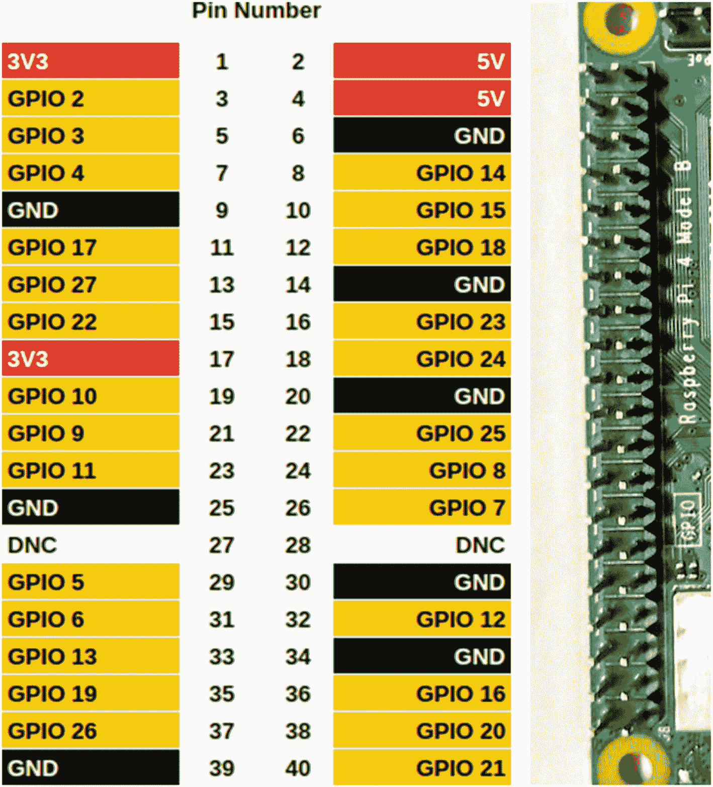

图 3-9 树莓派 `GPIO` 引脚

### GPIO 引脚排列

在对树莓派 `GPIO` 引脚进行任何连接之前，我们需要了解 `GPIO` 引脚排列的参考信息。引脚排列配置并未印在树莓派上，但我们可以通过打开终端窗口并输入命令 `pinout` 来获取任何树莓派的引脚排列参考信息。该工具由 `gpiozero` 库提供，该库预装在 Raspbian 操作系统中。

### GPIO 输出

树莓派有两个 5V 引脚和两个 3V3 引脚；它还有八个接地引脚 (0V)，这些引脚不可配置。其余 28 个引脚都是通用的 3V3 引脚。这些引脚的输出被设置为 3V3，或者可以接收最高 3V3 的输入。一个被指定为输出引脚的 `GPIO` 引脚可以设置为高电平 (3V3) 或低电平 (0V)。

### 使用 Python 控制 GPIO 输出

使用 `gpiozero` 库可以轻松地通过 Python 控制 `GPIO` 引脚。让我们看一个简单的 Python 示例，演示如何打开/关闭连接到 `GPIO` 引脚的 `LED`。`LED` 必须始终通过电阻连接到 `GPIO` 引脚。电阻器将确保电路中只流过很小的电流；因此，可以保护树莓派或 `LED` 免受损坏。

我们将通过一个 330Ω 电阻将 `LED` 连接到 `GPIO` 引脚 17，如图 3-10 所示。现在，可以使用清单 3-1 中给出的 Python 代码使 `LED` 持续亮灭。`led.on()` 函数点亮 `LED`，`led.off()` 函数熄灭 `LED`。

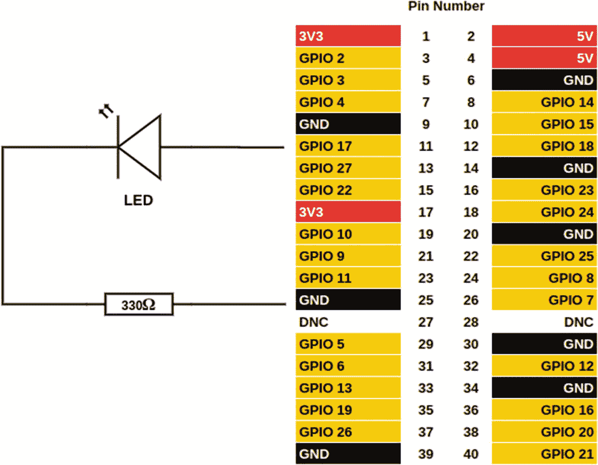

图 3-10 将 `LED` 连接到 `GPIO` 引脚

```python
from gpiozero import LED
from time import sleep

led = LED(17)

while True:
    led.on()
    sleep(1)
    led.off()
    sleep(1)
```

清单 3-1 使用 `GPIO` 的 `LED` 功能

### GPIO 输入信号

被指定为输入引脚的 `GPIO` 引脚可以读取为高电平 (3V3) 或低电平 (0V)。这意味着 `GPIO` 引脚不支持模拟输入，只能接收数字输入。虽然树莓派没有用于模数转换器的硬件，但我们可以使用外部 ADC（例如 MCP3008）来读取来自传感器的模拟数据。

#### 使用 Python 读取 GPIO 输入

通过将传感器连接到 `GPIO` 引脚，可以轻松地将传感器与树莓派进行接口连接。可以通过将传感器的 VCC 连接到树莓派的 3.3V/5V，并将传感器的 GND 连接到树莓派的 GND 来为传感器供电。来自传感器的数字输出可以直接连接到 `GPIO` 引脚并进行读取。但在读取模拟输出时，需要模数转换器才能将模拟传感器与树莓派连接。

##### 来自传感器的数字信号

树莓派将任何低于 1.8V 的输入视为低电平 (0)，将任何高于 1.8V 的输入视为高电平 (1)，如图 3-11 所示。可以使用 `InputDevice.value` 函数轻松读取来自任何传感器的数字输出数据。此函数返回给定 `GPIO` 引脚的当前状态。


图 3-11 低电平和高电平输入

清单 3-2 中的代码每秒打印 `GPIO` 引脚 17 的状态。

```python
from gpiozero import InputDevice
from time import sleep

sensor = InputDevice(17, pull_up=True)

while True:
    print(sensor.value)
    sleep(1)
```

清单 3-2 `GPIO` 的状态

##### 来自传感器的模拟信号

图 3-12 说明了一个模拟信号。为了读取来自传感器或其他设备的模拟信号，我们应该为树莓派使用一个模数转换器，例如 MCP3008。ADC 将模拟信号转换为数字信号。串行外设接口（SPI）协议用于将 ADC 的输出传输到树莓派。

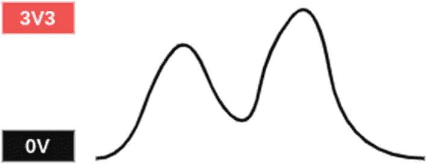

图 3-12 模拟信号

要启用 SPI 通信，请从主菜单打开树莓派配置，并在“接口”选项卡上启用 SPI。`MCP3008` 是一款 10 位 ADC，具有八个输入通道（0-7）。让我们将一个模拟输入连接到 `MCP3008` 的第一个通道 (0) 和 `MCP3008` 的其他引脚，如图 3-13 所示。

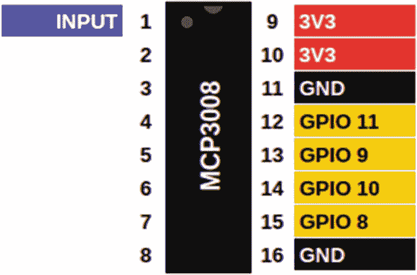

图 3-13 10 位 ADC MCP3008

清单 3-3 中的代码每秒打印连接到 `MCP3008` 第一个通道 (0) 的传感器的模拟值。由于 `MCP3008` 是 10 位 ADC，输出值范围从 0 到 1023。

```python
from gpiozero import MCP3008
from time import sleep

sensor = MCP3008(0)

while True:
    print(sensor.value)
    sleep(1)
```

清单 3-3 实现 MCP3008

#### 将超声波传感器与树莓派连接

超声波传感器通过测量声波传播的时间来测算物体距离。`HC-SR04` 超声波传感器可用于测量 2cm 至 400cm 的距离，精度可达 3mm。超声波传感器的工作原理是发射频率为 40kHz 的声波，该频率超出人类听觉范围，并在空气中传播。若前方存在障碍物或物体，声波将反弹回传感器。物体的距离可通过将传播时间的一半乘以声速来计算。图 3-14 展示了超声波传感器及其引脚，其中 `VCC` 引脚需连接树莓派正极，`GND` 引脚可连接树莓派的 `GND` 引脚，`Trig` 引脚用于触发超声波脉冲，`Echo` 引脚在接收到反射声波时产生脉冲。

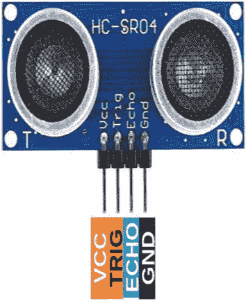

图 3-14 超声波传感器引脚

将超声波距离传感器连接到树莓派，如图 3-15 所示。

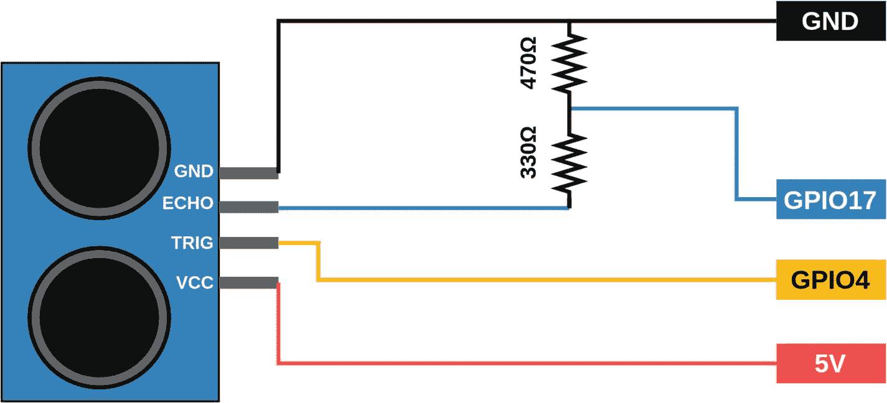

图 3-15 超声波传感器与树莓派 GPIO 引脚连接

`gpiozero` 库中有一个名为 `DistanceSensor` 的对象，可在 Python 中用于通过超声波传感器测量距离。`distance` 函数返回超声波距离传感器测得的距离，单位为米。我们将该值乘以 100 以转换为厘米。清单 3-4 中的代码每秒连续打印超声波距离传感器测得的距离（以厘米为单位）。

```python
from gpiozero import DistanceSensor
from time import sleep

sensor = DistanceSensor(echo=17, trigger=4)

while True:
    print(sensor.distance * 100)
    sleep(1)
```

清单 3-4 计算超声波传感器测量距离的代码

代码运行时，移动放置在超声波传感器前方物体的位置，即可获取不同的数值。

## 将温湿度传感器与树莓派连接

顾名思义，这类传感器可用于测量温度和湿度。它们由一个电容式湿度传感元件和一个用于感测温度的热敏电阻组成。温湿度传感器包含一个专用的电阻式湿度测量组件，即*负温度系数*（`NTC`）测温组件，以及一个用于将温度和湿度数值以串行数据形式输出的 8 位微控制器。树莓派与 `DHT11` 传感器之间使用单总线数据格式进行通信与同步。

`DHT 11` 和 `DHT 22` 是常用的温湿度传感器。图 3-16 展示了温湿度传感器（`THD`），图 3-17 说明了 `THD` 与树莓派的连接方式，其中 `VCC` 引脚需连接树莓派正极，`GND` 引脚可连接树莓派的 `GND` 引脚，`Signal/Data` 引脚用于串行通信，需连接至一个 GPIO 引脚。

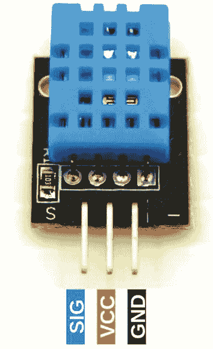

图 3-16 温湿度传感器

将 `DHT 11/22` 传感器模块连接到树莓派，如图 3-17 所示。

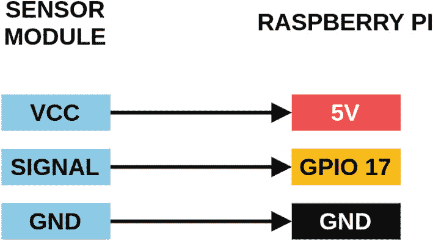

图 3-17 温湿度传感器与树莓派 GPIO 引脚连接

接下来，我们使用 `Adafruit_DHT` 库从传感器获取温度和湿度值。清单 3-5 中的代码每秒连续打印以摄氏度为单位的温度和湿度百分比。

```python
import Adafruit_DHT
import time

DHT_SENSOR = Adafruit_DHT.DHT11
DHT_PIN = 17

while True:
    humidity, temperature = Adafruit_DHT.read(DHT_SENSOR, DHT_PIN)
    if humidity is not None and temperature is not None:
        print("Temperature={0:0.1f}C, humidity={1:0.1f}%".format(temperature, humidity))
    else:
        print("Sensor not connected.")
    time.sleep(3)
```

清单 3-5 温湿度传感器代码

可以使用以下代码在树莓派上安装 `Adafruit` 模块。

对于 Python 2：

```
sudo pip install Adafruit_DHT
```

对于 Python 3：

```
sudo pip3 install Adafruit_DHT
```

## 将土壤湿度传感器与树莓派连接

土壤湿度传感器用于检测土壤中的水分含量。土壤湿度传感器包含两个探针，用于测量土壤中的水分含量。该传感器利用电容测量土壤的介电常数，而介电常数与土壤含水量相关。传感器同时具备模拟和数字输出，因此可在模拟和数字两种模式下使用。但这里，我们将从传感器获取模拟信号，并使用 Python 读取。图 3-18 展示了土壤湿度传感器。其中，`VCC` 引脚需连接树莓派正极，模拟输出（`AO`）产生一个与土壤介电常数（进而与含水量）成正比的电压，数字输出（`DO`）则在土壤湿度高于阈值时产生脉冲。阈值通过传感器模块上的电位器设定，`GND` 引脚可连接树莓派的 `GND` 引脚。

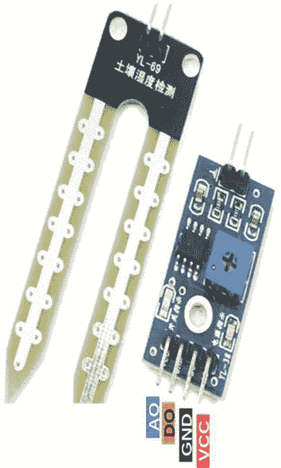

图 3-18 土壤湿度传感器

通过 `MCP3008` ADC 将土壤湿度传感器模块连接到树莓派，如图 3-19 所示。

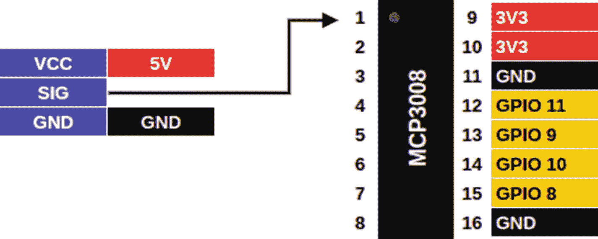

图 3-19 土壤湿度传感器与树莓派 GPIO 引脚连接

接下来，我们使用 `gpiozero` 库中的 `MCP3008` 模块来获取 `MCP3008` 的值。清单 3-6 中的代码每秒连续打印土壤湿度传感器的模拟值。

```python
from gpiozero import MCP3008
from time import sleep

soil_sensor = MCP3008(0)

while True:
    print(soil_sensor.value)
    sleep(1)
```

清单 3-6 连接土壤湿度传感器的代码

## 将摄像头与树莓派连接

摄像头是使用图像传感器记录图像的光学仪器。图像传感器检测并传递用于生成图像的信息。摄像头可以轻松地与树莓派连接，以获取图像或视频数据。将摄像头与树莓派连接有两种可用方案。

**方法 1：** 第一种方法是使用 USB 端口将 USB 网络摄像头连接到树莓派。图 3-20 展示了一个 USB 网络摄像头。正确连接 USB 网络摄像头后，可以在 Python 中使用 `OpenCV` 库来访问它。`OpenCV` 是一个用于图像处理和实时计算机视觉的 Python 库。清单 3-7 中的代码可用于将 USB 网络摄像头连接到树莓派。

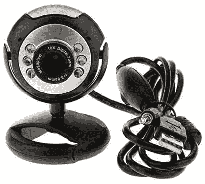

图 3-20 USB 网络摄像头

```python
import cv2

videoCaptureObject = cv2.VideoCapture(0)
result = True

while(result):
    ret, frame = videoCaptureObject.read()
    cv2.imwrite("/home/pi/Desktop/webcam_image.jpg", frame)
    result = False

videoCaptureObject.release()
cv2.destroyAllWindows()
```

清单 3-7 用于将 USB 网络摄像头与树莓派连接的代码

**方法 2：** 另一种方法是，通过摄像头串行接口 (CSI) 端口连接树莓派摄像头模块。图 3-21 展示了树莓派摄像头。有两种树莓派摄像头模块可用：标准模块和在黑暗环境中拍摄照片的 `NoIR` 摄像头模块。要启用树莓派摄像头，请从主菜单打开树莓派配置，然后在“接口”选项卡上启用摄像头。

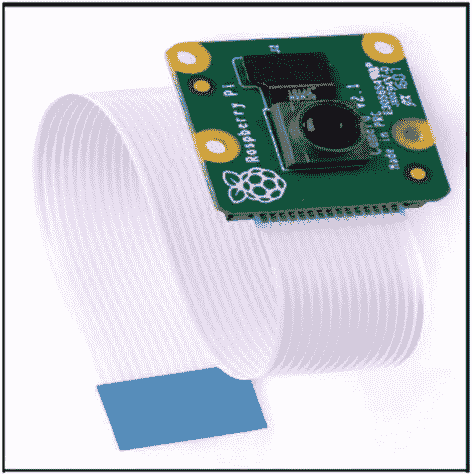

图 3-21 带 CSI 接口的树莓派摄像头

清单 3-8 中的代码用于从树莓派摄像头模块拍摄照片，并将图像存储到指定位置。

```
from picamera import PiCamera
from time import sleep
camera = PiCamera()
camera.start_preview()
sleep(5)
camera.capture('/home/pi/Desktop/cammodule_img.jpg')
camera.stop_preview()
```

清单 3-8 用于将树莓派摄像头与树莓派连接的代码

## 树莓派作为边缘设备

在数据源或其附近进行的计算被称为边缘计算。在需要即时或实时计算的领域，以及在无法连接到中央云或连接性受限的偏远地区，边缘计算比云计算更受青睐。边缘计算最大的优势在于其能降低延迟，因为传感器收集的数据在边缘设备上处理，无需远距离传输到数据中心。见图 3-22。

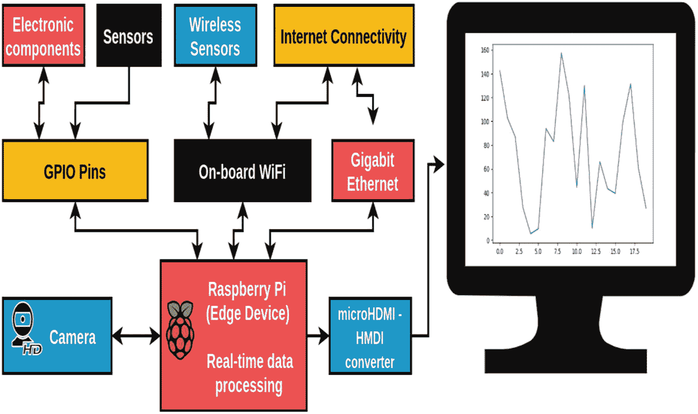

图 3-22 树莓派作为边缘设备

### 自动驾驶汽车中的边缘计算

自动驾驶汽车将依赖边缘计算，因为在路上行驶的每一毫秒都至关重要。从其传感器和摄像头收集的大量数据无法发送到云端进行分析，因为这需要大量时间，并且还需要不间断的网络连接。因此，由于其更快的速度和更高的可靠性，这类应用更倾向于使用边缘计算。

### 什么是边缘设备？

边缘计算在边缘设备中执行。边缘设备能够实时收集、存储和处理数据。因此，边缘设备能提供更快的响应速度和更高的可靠性。传感器和其他设备通过有线线缆或无线连接（如 Wi-Fi 或蓝牙）连接到边缘设备，如图 3-22 所示。有时，边缘设备会连接到中央云以进行大数据处理和数据仓库存储。

### 使用树莓派进行边缘计算

树莓派具有良好的计算能力，并且能够通过有线和无线连接连接到传感器和设备。树莓派还支持多种计算机编程语言，如 Python、C/C++ 和 Java。这使得树莓派成为边缘计算的绝佳选择。

### 树莓派作为本地化云

在本章中，我们将讨论将树莓派用作本地化云。

### 云计算

云计算是使用托管在互联网上的远程服务器网络来存储、管理和处理数据的实践。这些远程服务器被称为云服务器，位于世界各地的数据中心。从这类服务器访问数据需要强大的互联网连接。

### 树莓派作为本地化云

如今，物联网设备以高速生成海量数据。这些数据通常需要实时处理以做出快速决策，而本地化云可以支持这一点。此外，一些物联网传感器网络部署在互联网连接稀疏的偏远地区，这对本地化云的概念构成了挑战。可以将树莓派打造成一个本地化云，以支持更靠近物联网网络的实时数据处理。它需要通过以太网或 Wi-Fi 连接到网络。如图 3-23 所示，树莓派作为本地化云，可用于存储和处理从传感器或其他设备（如计算机和手机）收集的数据。

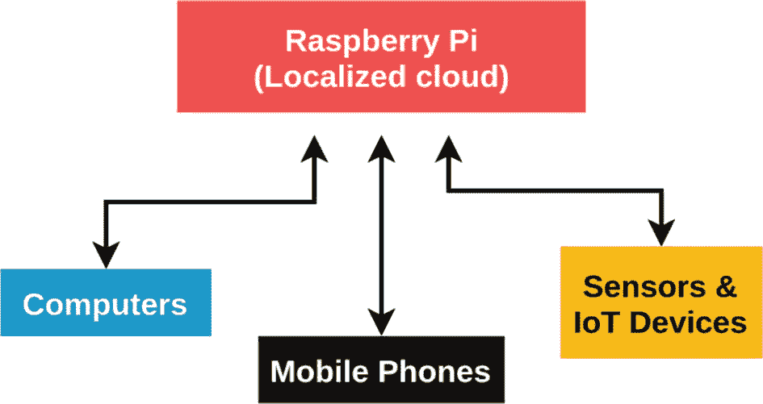

图 3-23 树莓派作为本地化云

### 连接外部硬盘驱动器

可以将外部硬盘驱动器连接到树莓派，以增加其存储容量。这些硬盘驱动器需要使用电源进行外部供电。如果没有电源，可以通过有源 USB 集线器连接它们。增强的存储容量允许树莓派从物联网网络收集和处理大量实时数据。

### 连接 USB 加速器

Coral USB Accelerator 是一个超快的开发板，供深度学习从业者在无需互联网的情况下部署他们的模型，从而实现边缘计算。它为树莓派带来了机器学习接口。它包含一个边缘 TPU 协处理器，每秒能够执行 4 万亿次运算（TOPS）。这使得实时运行机器学习模型成为可能。例如，该设备可以帮助树莓派以 400 FPS 的速度运行 MobileNet v2 模型。


