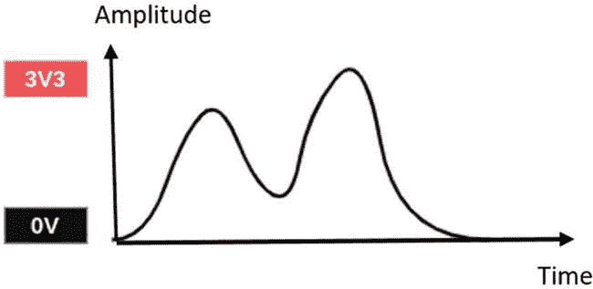
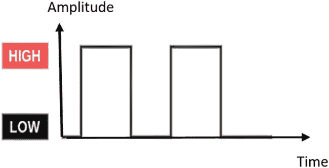
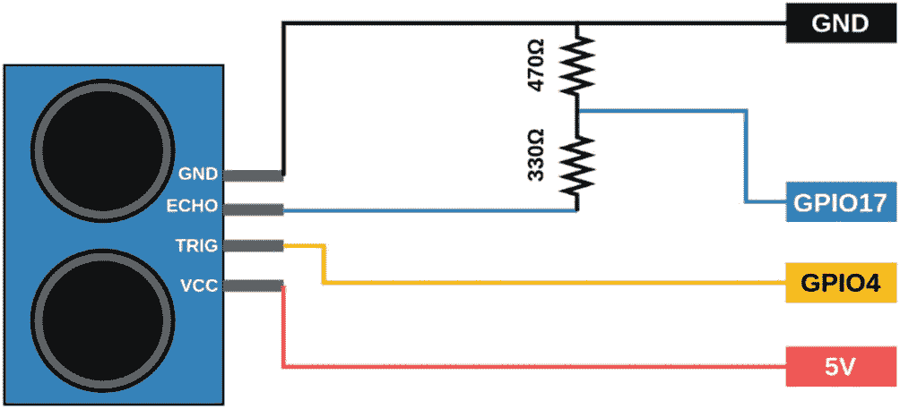
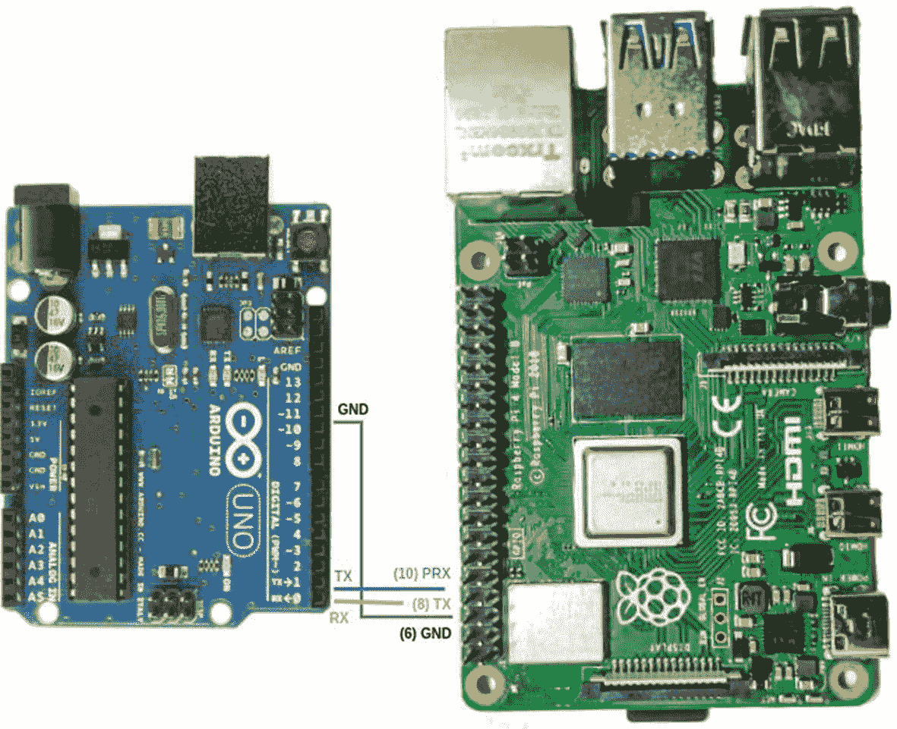

# 4. 传感器与信号

本章介绍传感器与信号。

## 信号

通常，信号表示关于时间或空间的某些信息。例如，汽车速度随时间的变化就是一种信号。信息可以以信号的形式传输。在电气工程中，信号是携带关于时间或空间信息的函数。电气设备以电压、电流或电磁波的形式呈现信号。根据《IEEE 信号处理汇刊》，信号可以是音频、视频、语音、图像、声纳、雷达相关等 [1]。此外，从数学角度来说，信号是一个或多个自变量的函数。自变量是指不会被你试图测量的其他变量所改变的变量。例如，考虑温度随时间的变化。这里，时间是自变量，因为时间不会因温度的变化而改变。

本章讨论如何使用传感器和树莓派从实时环境中获取信息，然后将这些信息转换为结构化数据。传感器的输出以电信号的形式呈现。本章首先介绍信号及其各种类型。信号有许多分类方式，我们重点描述以下电信号：

* 模拟信号和数字信号
* 连续时间信号和离散时间信号
* 确定性信号和非确定性信号
* 一维信号、二维信号、多维信号

### 模拟信号和数字信号

模拟信号表示一个物理量相对于自变量（即时间）连续变化的瞬时值。简单来说，模拟信号在时间和幅度上是连续的。物理量可以是温度、压力、速度等。传感器可以将物理量的变化转换为电压或电流等电信号。这样，就可以使用传感器以电信号的形式收集实时环境数据。

数字信号是一种用于将数据表示为离散值序列的信号。其自变量（即时间）是离散的，并且具有量化幅度。数字信号可以通过对模拟信号进行采样和量化来获得。在任何给定时间，数字信号只能取有限数量的值中的一个。

### 连续时间信号和离散时间信号

连续时间信号或连续信号是在其定义域（通常是时间）的连续体上定义的信号。任何模拟信号本质上都是连续的。

离散时间信号或离散信号是其自变量（时间）只有离散值的信号。它是一个由一系列量组成的时间序列。数字信号处理中使用的离散时间信号可以通过对连续信号进行采样和量化来获得。

### 确定性信号和非确定性信号

确定性信号是在任何时刻其值都没有不确定性的信号。换句话说，能够用数学公式精确定义的信号就是确定性信号。

非确定性信号或随机信号是在某些时刻其值具有不确定性的信号。由于其随机性，这种信号也称为随机信号，并且无法用数学方程来描述。

### 一维、二维和多维信号

一维信号是只有一个自变量的函数。语音信号是一维信号的一个很好的例子，因为语音的幅度仅取决于一个自变量（即时间）。

类似地，如果信号是两个自变量的函数，则称为二维信号。灰度图像是二维信号的一个例子。空间坐标（x，y）是图像中的两个自变量。多维信号是两个以上变量的函数。电影（即视频）是多维信号的最佳例子。

## 收集实时数据

数据收集可以通过两种方式进行：手动和自动化。在手动方法中，可以从现有文件和文档中收集数据。然后，将收集到的手动组织成结构化形式（即表格格式）。在自动化方法中，可以使用称为传感器的设备来收集数据。物理量（如温度、压力、图像等）的实时信息可以使用传感器来收集。本章重点介绍使用传感器进行自动化数据收集。为了实现数据收集自动化，需要数据采集系统。本节解释如何使用传感器（如超声波传感器、湿度传感器、温度传感器）以及摄像头收集图像数据。此外，还讨论了如何将收集到的数据以结构化格式进行存储。

### 数据采集

对测量真实世界物理状态的信号进行采样，并将所得样本转换为可由计算机处理的数字数值的过程称为数据采集。数据采集系统（`DAS` 或 `DAQ`）通常将模拟信号转换为数字值进行处理。数据采集系统包含以下三个组件：

* 传感器
* 信号调理电路
* 模数转换器

#### 传感器

通常，传感器会根据环境的变化产生电信号。传感器是一种将温度、湿度、距离等物理参数转换为电信号的设备。传感器可以是一个设备、模块、机器或子系统，用于检测环境中的事件或变化，并将信息发送到其他电子设备（通常是计算机处理器）。例如，热电偶是一种温度传感器，它根据输入的温度变化产生输出电压。根据输出信号类型，传感器有两种类型：模拟传感器和数字传感器。

#### 模拟传感器

模拟传感器产生连续输出信号或电压，该信号或电压通常与被测量的量成比例。这类传感器通常产生的输出信号随时间平滑且连续地变化。请参见图 4-1。



以下代码每秒连续打印连接到 `MCP3008` 第一个通道（0）的传感器的模拟值。由于 `MCP3008` 是一个 10 位 ADC，其输出值范围为 0 到 1023。

```python
from gpiozero import MCP3008
from time import sleep
sensor = MCP3008(0)
while True:
    print(sensor.value)
```

#### 数字传感器

数字传感器产生数字输出信号或电压，这些信号或电压是被测量量的数字表示。在这类传感器中，数据转换和数据传输以数字方式进行。请参见图 4-2。



以下代码连续打印 GPIO 引脚 17 的数字状态：

```python
from gpiozero import InputDevice
from time import sleep
sensor = InputDevice(17, pull_up=True)
while True:
    print(sensor.value)
```

以下是电子行业中一些常见的传感器：

* 温度传感器
* 红外传感器
* 超声波传感器
* 压力传感器
* 接近传感器
* 触摸传感器
* 液位传感器
* 烟雾和气体传感器

## 什么是实时数据？

实时数据（`RTD`）是在采集后立即传递给最终用户的信息。实时数据可以是静态的，也可以是动态的，通常通过实时计算进行处理。

### 实时数据分析

实时分析是指在数据被收集后立即对其进行分析。实时数据分析使我们能够毫不延迟地做出决策，并在问题发生之前加以预防。

在此，我们将讨论如何获取关于距离、湿度、温度以及来自摄像头的图像数据的实时数据。

### 从超声波传感器获取实时距离数据

超声波传感器的基本原理是发射和接收声波。可以通过测量发射波与接收回波之间的时间差，计算出待测量的物理变量（如距离、液位、高度、流量等）。

#### 将超声波传感器与树莓派连接

将超声波传感器与树莓派连接已在第 3 章中讨论过。我们将从 `HC-SR04` 超声波传感器收集数据，该传感器可用于测量 2 厘米到 400 厘米的距离，精度为 3 毫米。此处我们的目标是，将超声波距离传感器与树莓派连接，并将收集到的数据保存为 CSV 格式。为此，超声波距离传感器可以连接到树莓派的 GPIO 引脚，如图 4-3 所示。



如第 3 章所述，我们将使用 `gpiozero` 库中的 `DistanceSensor` 对象。`distance` 函数返回超声波距离传感器测得的距离（以米为单位）。要显示为厘米，我们需要将该值乘以 100。以下代码每秒钟打印一次超声波距离传感器测得的距离（单位为厘米），并在 100 秒后保存收集到的数据。

```
from gpiozero import DistanceSensor
from time import sleep
sensor = DistanceSensor(echo=17, trigger=4)
n = 100
for i in range(n):
    print(sensor.distance * 100)
    sleep(1)
```

当代码运行时，移动放置在超声波传感器前方物体的位置，可以获得不同的数值。测得的距离（厘米）会持续打印 `n` 秒；在此例中，`n` 为 100。

### 从摄像头获取实时图像数据

本节介绍如何从网络摄像头获取实时视频。

#### 从网络摄像头获取实时视频

通过 USB 端口将 USB 网络摄像头连接到树莓派。使用 `OpenCV` Python 库，我们可以访问网络摄像头并从中捕获图像和视频。以下代码可用于从网络摄像头获取实时视频。可以实时分析所捕获的帧。

```
import cv2
vid = cv2.VideoCapture(0)
while(True):
    ret, frame = vid.read()
    cv2.imshow('frame', frame)
    if cv2.waitKey(1) & 0xFF == ord('q'):
        break
vid.release()
cv2.destroyAllWindows()
```

#### 从树莓派摄像头模块获取实时视频

通过摄像头串行接口（CSI）端口将树莓派摄像头模块连接到树莓派。要启用树莓派摄像头，请从主菜单打开树莓派配置，并在“接口”（Interfaces）选项卡中启用“摄像头”（Camera）。以下代码可用于使用树莓派摄像头模块捕获图像，并将捕获的图像存储到指定位置：`/home/pi/Desktop/cammodule_img.jpg`。

```python
from picamera import PiCamera
from time import sleep
camera = PiCamera()
camera.start_preview()
sleep(5)
camera.capture('/home/pi/Desktop/cammodule_img.jpg')
camera.stop_preview()
```

## 数据传输

数据传输是指两个或多个数字设备之间传输数据的过程。数据以模拟或数字格式传输，数据传输过程使得设备或设备内部的组件能够相互通信。

### 串行通信与并行通信

串行通信是通过通信信道或计算机总线逐位顺序发送数据的过程。并行通信是一种同时传输多个二进制数字（比特）的方法。

### 将 Arduino 与树莓派连接

我们可以将 Arduino 连接到树莓派，并在 Arduino 和树莓派之间双向传输数据。传感器、电机和执行器可以连接到 Arduino，并使 Arduino 与树莓派之间传输数值。通过这种方式，我们可以将 Arduino 用作节点，并通过这些节点获取传感器数据。

Arduino 可以通过两种方式连接到树莓派。

*   通过 USB 进行串行通信

*   通过 GPIO 引脚进行串行通信

#### 通过 USB 进行串行通信

使用 Arduino USB 线缆连接两块板卡，是在 Arduino 和树莓派之间建立通信的最简单方法。

在树莓派上，选择板卡上四个可用 USB 端口中的任意一个，并连接 USB 接口。将 Arduino USB 线缆的另一端连接到 Arduino。对于不同版本的 Arduino，其连接线缆会有所不同。

#### 通过 GPIO 引脚进行串行通信

也可以使用普通导线在树莓派 GPIO 引脚和 Arduino 引脚之间建立串行连接。根据您所使用的 Arduino 板卡，可能需要使用电压电平转换器。

树莓派的工作电压为 3.3V，而 Arduino 板卡（如 Uno、Mega、Leonardo、Nano 等）的工作电压为 5V。因此，在连接 RX 和 TX 引脚时，需要使用 3.3V/5V 的电平转换器来保护树莓派，如图 4-4 所示。



图 4-4：通过 GPIO 引脚连接 Arduino 和树莓派

通常，对于串行通信，建议使用 Arduino USB 线缆而非 GPIO 引脚。

### Arduino 与 Raspberry Pi 之间的数据传输

当通过 USB 线缆连接 Arduino 和 Raspberry Pi 时，在 Raspberry Pi 终端窗口中运行命令 `ls /dev/tty*` 来查找 Arduino 设备的名称。返回结果应为类似 `/dev/ttyACM0` 或 `/dev/ttyUSB0` 的值。

`pySerial` Python 库用于建立 Python 的串行接口，并封装了串口的访问操作。

以下代码可用于实现 Arduino 与 Raspberry Pi 之间的双向通信。

#### Arduino 代码

以下是 Arduino 代码：

```cpp
void setup() {
  Serial.begin(9600);
}

void loop() {
  if (Serial.available() > 0) {
    String data = Serial.readStringUntil('\n');
    Serial.print("Received Data: ");
    Serial.println(data);
  }
}
```

`Serial.available()` 会返回已到达并存储在接收缓冲区中的字节数。这可用于检查 Arduino 是否收到了数据。

如果数据已到达，则使用 `Serial.readStringUntil()` 配合换行符 `\n` 来获取下一行内容。在遇到换行符 `\n` 之前接收到的所有字节会自动转换并添加到一个 Arduino `String` 对象中。

然后，我们只需返回包含接收数据的字符串，并附加一些文本信息。

#### Raspberry Pi Python 代码

以下是用于显示串口数据的 Raspberry Pi Python 代码：

```python
#!/usr/bin/env python3
import serial
import time

if __name__ == '__main__':
    ser = serial.Serial('/dev/ttyACM0', 9600, timeout=1)
    ser.flush()
    while True:
        ser.write(b"Data from Raspberry Pi!\n")
        line = ser.readline().decode('utf-8').rstrip()
        print(line)
        time.sleep(1)
```

`pySerial` 的 `write()` 函数用于向 Arduino 发送数据。在发送字符串之前，它会将字符串编码为字节，因为通过 `Serial` 只能发送字节。任何非字节或字节数组的数据在通过 `Serial` 发送之前都必须进行转换。

此外，我们添加了一个换行符 `\n`，因为 Arduino 在使用 `Serial.readStringUntil('\n')` 读取数据时，期望字符串末尾带有该符号。

然后我们读取 `Serial` 中的一行，将其解码为字符串，最后打印接收到的字符串并等待一秒钟，然后通过 `Serial` 发送下一条字符串。

## 时间序列数据

时间序列是按时间顺序索引的一系列数据点。最常见的情况是，它是在时间上连续等间隔采集的序列。因此，时间序列可以定义为一系列离散时间数据。在时间序列数据中，时间通常是自变量，目标通常是对未来进行预测。

时间序列通常通过折线图绘制。时间序列广泛应用于统计学、信号处理、通信工程、模式识别、天气预报、地震预测、控制工程、天文学等领域。

### 时间序列分析与预测

时间序列分析包含用于分析时间序列数据以提取有意义统计量及其他数据特征的方法。时间序列分析还包括对序列进行未来预测、从噪声数据中提取隐藏信号、发现数据生成机制等。时间序列预测是利用模型基于历史数据预测未来值。

## 内存需求

本节讨论内存需求。

### 更多存储空间

有时 microSD 卡的内存可能不足，需要更多内存。更多存储空间对于存储收集到的数据和大型模型非常有益。为了增加存储容量，可以将外部硬盘驱动器连接到 Raspberry Pi。

### 更多 RAM

RAM 是数据科学项目的另一个重要因素。RAM 越大，能处理的数据量就越大，从而提高处理速度。虽然基础版的 1GB RAM 可以完成工作，但对于大多数深度学习任务，建议使用 4GB RAM 版本的 Raspberry Pi。

## 案例研究：采集实时工业数据

让我们看一个案例研究。

### 使用 Pandas 存储收集到的数据

收集到的数据也可以保存起来供以后使用。Pandas 是一个基于 Python 构建的开源数据分析和操作工具。我们将使用 Pandas 将收集到的数据转换为结构化数据格式。Pandas 库可以通过 `pip` 使用以下命令安装：

```
pip install pandas
```

### 数据框

数据框是一种二维数据结构。数据以行和列的表格形式排列，它通常是 Pandas 最常用的对象。一旦我们将数据转换为数据框，就可以轻松地操作数据并将其导出为其他格式，例如 CSV 和 Microsoft Excel。

### 将数据保存为 CSV 文件

逗号分隔值文件是一种使用逗号分隔值的分隔文本文件。文件的每一行都是一个数据记录。每条记录由一个或多个字段组成，字段之间用逗号分隔。Pandas 数据框的 `to_csv()` 函数可将数据框导出为 CSV 格式。

```python
df.to_csv('file path\File Name.csv')
```

### 保存为 Excel 文件

要将单个对象写入 Excel `.xlsx` 文件，只需指定目标文件名即可。要写入多个工作表，则需要创建一个带有目标文件名的 `ExcelWriter` 对象，并指定要写入的文件中的工作表。Pandas 数据框的 `to_excel()` 函数可将数据框导出为 `.xlsx` 格式。

```python
df.to_excel("output.xlsx")
```

### 读取已保存的数据文件

## 数据读取与存储

数据保存后，可以使用`read_csv()`或`read_excel()`函数进行读取。`read_excel()`函数将Excel文件读入Pandas数据框，并支持从本地文件系统或URL读取`.xls`、`.xlsx`、`.xlsm`、`.xlsb`和`.odf`文件扩展名。它可以选择读取单个工作表或工作表列表。`read_csv()`函数将CSV文件读入数据框，并支持可选的迭代或分块读取文件。

### 为实时数据添加日期和时间

在采集数据时，我们也可以为数据添加日期和时间。我们将使用`datetime` Python库。`datetime.datetime.now()`可用于获取当前的日期和时间。

```python
from datetime import datetime
now = datetime.now()
print("now =", now)
# dd/mm/YY H:M:S
dt_string = now.strftime("%d/%m/%Y %H:%M:%S")
print("date and time =", dt_string)
```

### 来自温湿度传感器的行业数据

我们将使用温湿度传感器来测量温度和湿度。如第3章所示，将DHT 11/22传感器模块连接到Raspberry Pi。

以下代码在100秒内采集温度和湿度值，并将收集到的数据存储为CSV文件：

```python
import Adafruit_DHT
import time
from datetime import datetime

DHT_SENSOR = Adafruit_DHT.DHT11
DHT_PIN = 17

data = []
while _ in range(100):
    humidity, temperature = Adafruit_DHT.read(DHT_SENSOR, DHT_PIN)
    if humidity is not None and temperature is not None:
        now = datetime.now()
        dt_string = now.strftime("%d/%m/%Y %H:%M:%S")
        data.append(dt_string, humidity, temperature)
    time.sleep(60*5)

df = pd.DataFrame(data)
df.to_csv('data.csv',index=None,header=None)
```

CSV文件将如下所示：

| 17/05/2020 01:05:14 | 26.24 | 69.91 |
|----------------------|-------|-------|
| 17/05/2020 01:10:14 | 26.24 | 70.65 |
| 17/05/2020 01:15:14 | 26.22 | 68.87 |
| 17/05/2020 01:20:14 | 26.15 | 70.11 |
| 17/05/2020 01:25:14 | 26.11 | 69.02 |


