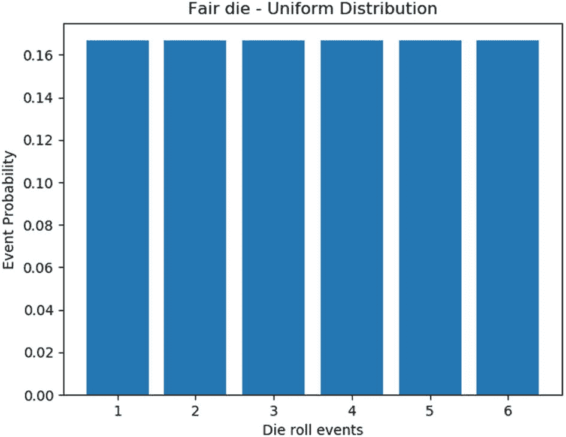
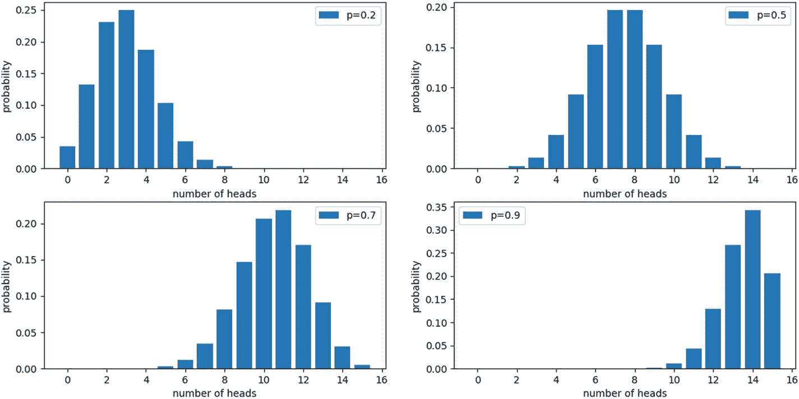
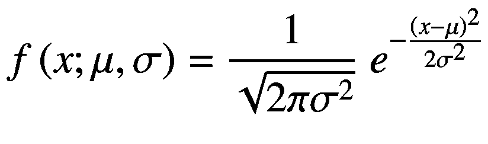
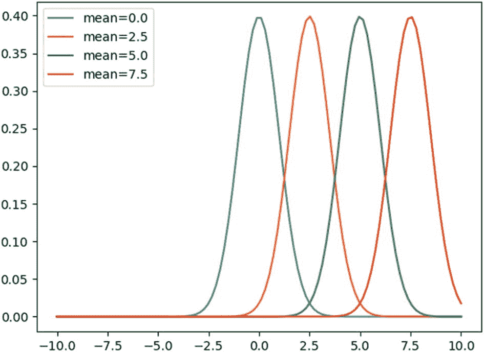
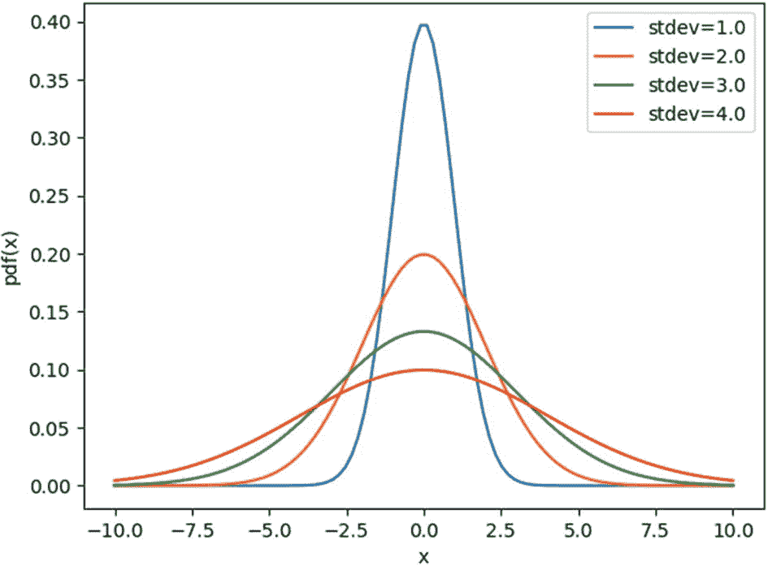
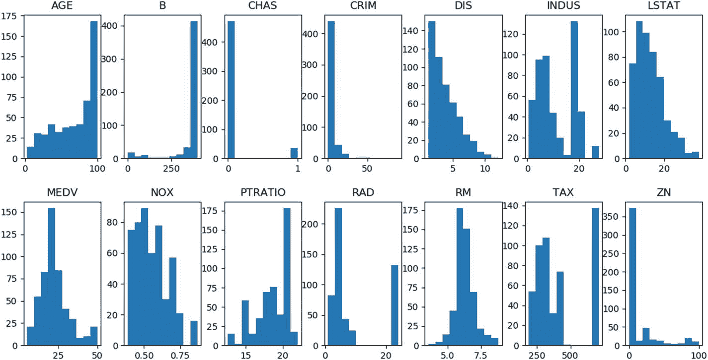

# 7. 数据分析

## 探索性数据分析

`探索性数据分析`（EDA）是通过总结数据特征来理解数据的过程。在机器学习中对数据进行建模之前，这一步非常重要。通过此分析，用户可以提取信息，识别数据中任何问题的根本原因，并确定启动任何开发策略的步骤。简而言之，这种类型的分析旨在探索数据，以理解和识别其中的模式和趋势。进行 EDA 没有通用方法；它取决于我们正在处理的数据。为了简化本章内容，我们将使用常见的方法和图表来进行 EDA。

### 选择数据集

为了进行探索性数据分析（EDA），我们将使用可从 `Scikit-Learn` 库中导入的波士顿房价数据集。该数据集已在第 6 章中描述过。该数据集包含 506 个样本，涵盖 13 个不同的特征属性，例如城镇人均犯罪率（`CRIM`）、每栋住宅的平均房间数（`RM`）、径向公路可达性指数（`RAD`）等，以及一个目标属性 `MEDV`，表示自有住房的中位数价值（单位：千美元）。

### 导入所需的库

第一步是加载进行探索性数据分析所需的库。在本章中，我们将使用 `Pandas`、`NumPy` 和 `Matplotlib` 等包进行绘图：

```
import matplotlib.pyplot as plt
import numpy as np
from sklearn.datasets import load_boston
```

### 导入数据集

波士顿房价数据集可以从 `Scikit-Learn` 库中导入，并保存为 `boston_data` 变量，如下代码所示：

```
dataset = load_boston()
```

更重要的是，大多数开源数据都是以逗号分隔的格式存储的。这种逗号分隔的格式在获取和分析数据时会遇到困难。因此，可以使用 Python 中的 `Pandas` 包将逗号分隔的数据转换为数据框。

```
import pandas as pd
boston_data=pd.DataFrame(dataset.data,columns=dataset.feature_names)
```

如果数据集非常大，可以使用以下代码显示带标题的首尾五行数据：

### 检查数据集中数据的信息

```
# 显示数据的前五行
print(boston_data.head(5))
CRIM  ZN  INDUS  CHAS  NOX  ...  RAD  TAX  PTRATIO  B  LSTAT
0  0.00632 18.0 2.31 0.0 0.538   ...   1.0 296.0 15.3 396.90 4.98
1  0.02731 0.0 7.07 0.0 0.469  ...  2.0 242.0 17.8  396.90 9.14
2  0.02729 0.0 7.07 0.0 0.469  ...  2.0 242.0 17.8  392.83 4.03
3  0.03237 0.0 2.18 0.0 0.458  ...  3.0 222.0 18.7 394.63 2.94
4  0.06905 0.0 2.18 0.0 0.458  ...  3.0 222.0 18.7  396.90 5.33
# 显示数据的后五行
print(boston_data.tail(5))
CRIM  ZN  INDUS  CHAS  NOX  ...  RAD  TAX  PTRATIO  B  LSTAT
501  0.06263  0.0  11.93  0.0  0.573   ...  1.0  273.0  21.0  391.99  9.67
502  0.04527  0.0  11.93 0.0  0.573   ...  1.0  273.0  21.0  396.90  9.08
503  0.06076  0.0  11.93  0.0  0.573  ...  1.0  273.0  21.0  396.90 5.64
504  0.10959  0.0  11.93  0.0  0.573  ...  1.0  273.0  21.0  393.45  6.48
505  0.04741  0.0  11.93  0.0  0.573  ...  1.0  273.0  21.0  396.90  7.88
```

在进行数据分析之前，检查诸如数据类型和数据大小之类的信息、描述数据以及了解数据集中可用的数据量是重要的步骤，因为有时数据集中的数值可能以字符串数据类型存储。以字符串数据类型存储的数值很难进行绘图和分析，因此，应将数值型的字符串数据类型转换为整数以便更好地进行分析。可以使用以下代码查看数据集的大小：

```
boston_data.shape
输出：
(506, 13)
```

此输出显示该数据集有 506 行和 13 列。换句话说，我们可以说该数据集包含 506 个样本，具有 13 个特征。

然后，可以使用以下代码查看数据集的信息：

```
boston_data.info()
输出：

RangeIndex: 506 entries, 0 to 505
Data columns (total 13 columns):
#   Column    Count    Non-Null     Dtype
---  ------           -------------- -----
0   CRIM        506    non-null    float64
1   ZN          506    non-null    float64
2   INDUS       506    non-null    float64
3   CHAS        506    non-null    float64
4   NOX         506    non-null    float64
5   RM          506    non-null    float64
6   AGE         506    non-null    float64
7   DIS         506    non-null    float64
8   RAD         506    non-null    float64
9   TAX         506    non-null    float64
10  PTRATIO     506    non-null    float64
11  B           506    non-null    float64
12  LSTAT       506    non-null    float64
dtypes: float64(13)
memory usage: 51.5 KB
boston_data.dtypes
输出：
CRIM       float64
ZN         float64
INDUS      float64
CHAS       float64
NOX        float64
RM         float64
AGE        float64
DIS        float64
RAD        float64
TAX        float64
PTRATIO    float64
B          float64
LSTAT      float64
dtype:     object
```

此外，借助 `describe()` 函数，我们可以查看数据的分布情况，例如最小值、最大值、均值等。可以使用以下代码查看波士顿数据的描述信息：

### 修改数据集中的列

如果数据集需要进行预处理，则需要对数据进行修改，例如删除不必要的列、添加虚拟列、删除重复列、对列进行编码以及数据归一化。当许多列不用于分析时，删除不必要的列更为重要。删除这些列是使数据更轻量、更可靠的更好解决方案。可以使用以下代码删除波士顿数据集中的不必要列：

```
boston_data =boston_data.drop(['CRIM','ZN','LSTAT'])
print(boston_data.head(5))
```
输出：
INDUS CHAS NOX    RM     AGE   DIS     RAD  TAX    PTRATIO  B
0  2.31  0.0  0.538  6.575  65.2  4.0900  1.0  296.0  15.3  396.90
1  7.07  0.0  0.469  6.421  78.9  4.9671  2.0  242.0  17.8  396.90
2  7.07  0.0  0.469  7.185  61.1  4.9671  2.0  242.0  17.8  392.83
3  2.18  0.0  0.458  6.998  45.8  6.0622  3.0  222.0  18.7  394.63
4  2.18  0.0  0.458  7.147  54.2  6.0622  3.0  222.0  18.7  396.90

在上面的代码中，删除了`CRIM`、`ZN`和`LSTAT`列，仅展示了 10 列数据。

重命名列名有助于用户提高数据的可读性。在以下代码中，列名`DIS`被重命名为`Distance`：

```
boston_data= boston_data.rename(columns={"DIS":"Distance"})
boston_data.head(5)
```
INDUS CHAS NOX     RM    AGE  Distance RAD  TAX    PTRATIO  B
0  2.31  0.0  0.538  6.575  65.2  4.0900  1.0  296.0  15.3  396.90
1  7.07  0.0  0.469  6.421  78.9  4.9671  2.0  242.0  17.8  396.90
2  7.07  0.0  0.469  7.185  61.1  4.9671  2.0  242.0  17.8  392.83
3  2.18  0.0  0.458  6.998  45.8  6.0622  3.0  222.0  18.7  394.63
4  2.18  0.0  0.458  7.147  54.2  6.0622  3.0  222.0  18.7  396.90

识别重复项、删除重复项以及检测异常值的方法已在之前的章节中讨论过。

### 统计分析

更好地理解手头的数据，可以极大地简化数据科学家的工作，而统计学在这方面能派上用场。统计学能够提供必要的工具来识别数据中的结构，这些见解对于构建最佳拟合数据模型非常有价值。统计学在数据方面的作用，从简单的分析到创建自学习模型，各不相同。在本节中，我们将介绍各种类型的分布、数据的统计度量以及将数据拟合到分布的方法。

在讨论分布之前，让我们先理解数据是如何与概率关联的。当我们考虑一个数据集时，它通常代表总体中的一个样本。例如，如果我们有一个包含某所学校所有学生身高和体重数据的数据集，那么通过一些统计分析，基于这些数据开发的模型可以用来预测另一所学校学生的身高和体重。我们手中的数据集只是一个样本，而总体可能包含很多所学校。

我们遇到的数值数据，本质上可以是连续的或离散的。两者的区别在于，连续数据可以取任何值，而离散数据只能取特定值。例如，每天生产的汽车数量、收到的客户反馈数量等数据本质上是离散的；而身高、体重、湿度、温度等数据则代表连续数据。

概率分布是统计学中的一个基本概念，它提供了一种表示随机变量可能取值及其各自概率的方法。`概率质量函数`（PMF）表示离散概率分布，`概率密度函数`（PDF）表示连续概率分布。以下部分将讨论数据科学家需要了解的一些常见分布。

#### 均匀分布

均匀分布，也称为`矩形分布`，具有恒定的概率。换句话说，所有结果发生的概率相同。在均匀分布中，结果的数量可以是无限的。均匀分布最常见的例子是掷一颗公平的骰子，所有六个结果出现的概率相等，均为 1/6。让我们通过绘制公平掷骰子实验中结果的概率来说明均匀分布。也就是说，骰子每个面出现的概率是均等的。图 7-1 展示了这个分布图。



图 7-1 公平掷骰子实验的均匀分布

```python
import numpy as np
import matplotlib.pyplot as plt
probabilities = np.full((6),1/6)
events = [1,2,3,4,5,6]
plt.bar(events,probabilities)
plt.xlabel('骰子点数')
plt.ylabel('事件概率')
plt.title('公平骰子 - 均匀分布')
plt.show()
```

如果对一个数据集绘制直方图，将数值数据划分为若干区间，并且发现所有区间都具有相同的分布，那么可以说该数据集是均匀分布的。

#### 二项分布

顾名思义，这种分布用于只有两种可能结果的情况。遵循二项分布的随机变量`X`依赖于两个参数：
- 在二项分布中，实验次数`n`必须是固定的，并且每次实验被认为是相互独立的。换句话说，某次实验的结果不依赖于之前实验的结果。
- 每个事件只有两种可能的结果：成功或失败。每次实验中成功的概率（记为`p`）保持不变。

因此，Python 中的二项分布函数通常接受两个值作为输入：实验次数`n`和成功概率`p`。为了理解二项分布，让我们看看常见的抛硬币实验：

```python
from scipy.stats import binom
import matplotlib.pyplot as plt
import numpy as np
n=15 # 抛硬币次数
r_values = list(range(n + 1))
x=[0.2,0.5,0.7,0.9]  # 得到正面的概率
k=1
for p in x:
dist = [binom.pmf(r, n, p) for r in r_values ]
plt.subplot(2,2,k)
plt.bar(r_values,dist)
plt.xlabel('正面次数')
plt.ylabel('概率')
plt.title('p= %.1f' % p)
k+=1
plt.show()
```

在前面的代码中，我们抛了 15 次硬币。每次实验得到正面的概率保持不变，并且每次实验的结果独立于之前的结果。二项分布是使用`scipy`包中`stats`模块提供的`binom.pmf`函数计算的。通过`for`循环，对不同的成功概率重复该实验，图 7-2 展示了结果分布图。



图 7-2

抛硬币 15 次的二项分布

图 7-2 展示了我们抛硬币实验在不同成功概率下的二项分布。第一个子图显示的是得到正面概率为 0.2 时的二项分布。这意味着有 20%的机会得到正面。15 次抛掷的 20%是 3，这意味着在 15 次抛掷中得到 3 次正面的概率很高。因此，概率在 3 处达到最大值。可以看出，二项分布具有钟形响应。当成功概率较低时，响应向左偏斜，随着概率增加，又向右移动，其余的子图也说明了这一点。

二项分布可能出现在数据科学的各个领域。例如，当一家制药公司想要测试一种新疫苗时，只有两种可能的结果：疫苗有效或无效。此外，单个患者的结果是一个独立事件，不依赖于其他患者实验的结果。二项分布也可以应用于各种商业问题。例如，考虑销售部门的人整天打电话推销其公司产品。电话的结果是是否成功销售，并且每个员工的结果是独立的。类似地，在企业中还有许多其他具有二元结果（是/否）的领域可以应用二项分布，因此它在商业决策中扮演着重要的角色。

## 正态分布

正态分布，也称为高斯分布，通常呈钟形曲线，以均值为中心，此处概率最大，且随着我们远离均值，概率会逐渐减小。这意味着接近均值的值出现频率更高，而远离均值的值出现频率更低。该分布依赖于两个参数：数据的均值（μ）和标准差（σ）。正态分布的概率密度函数（`pdf`）可以表示如下：



为了说明`pdf`函数，请考虑以下代码。创建了一个包含 100 个值、范围在-10 到 10 之间的数组`x`，并使用`scipy`包的`stats`模块中的`norm.pdf`函数计算了`x`的`pdf`函数。通过`for`循环，针对四个不同的均值（0、2.5、5 和 7.5）计算了`pdf`函数。如果未提供均值，`norm.pdf`函数会取默认值零。

```
from scipy.stats import norm
import matplotlib.pyplot as plt
import numpy as np
mean=[0.0,2.5,5,7.5] # 正态分布的均值
x=np.linspace(-10,10,100) # 在-10 到 10 范围内包含 100 个数字的数组
for m in mean:
    y=norm.pdf(x,loc=m)
    plt.plot(x,y,label='mean= %.1f' %m)
plt.xlabel('x')
plt.ylabel('pdf(x)')
plt.legend(frameon=True)
plt.show()
```

图 7-3 展示了正态分布会生成一条以均值为中心的钟形曲线。也就是说，曲线在均值点处达到最大值，并且随着我们从均值向两侧移动，曲线开始下降。请注意，我们尚未指定标准差的值。在这种情况下，`norm.pdf`函数会采用默认值 1。



图 7-3

不同均值下的正态分布图

类似地，让我们保持均值不变，使用以下代码绘制不同标准差下的分布图：

```
from scipy.stats import norm
import matplotlib.pyplot as plt
import numpy as np
stdev=[1.0,2.0,3.0,4.0] # 正态分布的标准差值
x=np.linspace(-10,10,100)
for s in stdev:
    y=norm.pdf(x,scale=s)
    plt.plot(x,y,label='stdev= %.1f' %s)
plt.xlabel('x')
plt.ylabel('pdf(x)')
plt.legend(frameon=True)
plt.show()
```

从图 7-4 中，我们可以看到所有四条曲线都以默认均值零为中心。随着标准差σ值的增加，密度分布在一个更广的范围内。换句话说，随着标准差值增加，数据分布更加分散于均值周围，并且有更高的可能性出现更多远离均值的观测值。



图 7-4

不同标准差下的正态分布图

正态分布的一个使其对数据科学家而言成为重要统计分布的重要性质是*经验法则*。根据该法则，如果我们在 x 轴上将观测范围按标准差划分，那么大约 68.3%的值落在距均值一个标准差的范围内，95.5%的值落在两个标准差的范围内，99.7%的值落在三个标准差的范围内。如果数据符合正态分布，这个经验法则可用于识别数据中的异常值。我们在前面第 5 章讨论过的用于异常检测的 Z 分数就应用了这一原理。

# 波士顿房价数据集的统计分析

我们以波士顿房价数据集为例，尝试根据特征的统计属性，识别出可用于建模的最佳特征。正如我们已经讨论过的，波士顿数据集包含 506 个案例（506 × 13）的 13 个不同特征。除了这些特征外，用变量`MEDV`表示的业主自住房中位数价值（以千计）被确定为预测目标。也就是说，给定 13 个不同的特征，需要估算房屋的中位数价值。首先使用`Pandas`包将数据集中的特征转换为一个`DataFrame`。然后将目标变量添加到此`DataFrame`的最后一列，使其维度变为 506 × 14。以下代码对此进行了说明：

```
import matplotlib.pyplot as plt
import numpy as np
import pandas as pd
from sklearn.datasets import load_boston
import matplotlib.pyplot as plt
dataset = load_boston()
boston_data=pd.DataFrame(dataset.data,columns=dataset.feature_names)
boston_data['MEDV'] = dataset['target']
print(boston_data.head())
```

```
CRIM     ZN    INDUS  CHAS  NOX   ...  TAX    PTRATIO  B    LSTAT  MEDV
0  0.00632  18.0  2.31   0.0  0.538  ...  296.0  15.3  396.90  4.98   24.0
1  0.02731  0.0   7.07   0.0  0.469  ...  242.0  17.8  396.90  9.14   21.6
2  0.02729  0.0   7.07   0.0  0.469  ...  242.0  17.8  392.83  4.03   34.7
3  0.03237  0.0   2.18   0.0  0.458  ...  222.0  18.7  394.63  2.94   33.4
4  0.06905  0.0   2.18   0.0  0.458  ...  222.0  18.7  396.90  5.33   36.2
[5 rows x 14 columns]
```

一旦我们掌握了数据，最佳做法是绘制所有特征的直方图，以便我们能够了解其分布的性质。与其单独绘制每个特征的直方图，不如使用`Pandas`包中的`hist`函数一次性绘制所有特征，如下所示：

```
fig, axis = plt.subplots(2,7,figsize=(16, 16))
boston_data.hist(ax=axis,grid=False)
plt.show()
```

从图 7-5 中，我们可以看到目标变量`MEDV`的分布类似于正态分布。



图 7-5

波士顿数据集特征的直方图

此外，如果我们观察所有其他参数，参数`RM`（表示每套住宅的平均房间数）的分布也与目标变量`MEDV`相似。因此，`RM`肯定可以用于对数据集进行建模。此外，参数`DIS`（到五个波士顿就业中心的加权平均距离）和`LSTAT`（人口中低地位阶层的百分比）具有相似的分布。参数`AGE`（1940 年之前建造的业主自用单元的比例）的分布则正好与这两个参数相反。与目标参数相比，其余参数的分布显著性较低。由于这三个参数看起来要么正相关要么负相关，因此同时使用这三个参数来构建模型是无意义的。所以，我们必须看看这三个参数中哪些与我们的目标变量`MEDV`相关。最佳方法是使用 Pandas 包中的`corr`函数来度量这些参数之间的相关性，如下所示：

```
cols=['RM','AGE','DIS','LSTAT','MEDV']
print(boston_data[cols].corr())
RM           AGE          DIS           LSTAT        MEDV
RM     1.000000    -0.240265     0.205246     -0.613808     0.695360
AGE   -0.240265     1.000000    -0.747881      0.602339     -0.376955
DIS    0.205246    -0.747881     1.000000     -0.496996     0.249929
LSTAT -0.613808     0.602339    -0.496996      1.000000     -0.737663
MEDV   0.695360    -0.376955     0.249929     -0.737663     1.000000
```

从这些结果可以看出，对角线元素均为 1，这表示最大相关性，且它们代表自相关值。如果我们查看目标参数`MEDV`对应的行，会发现`RM`与`MEDV`的正相关性更强，正如我们之前通过观察直方图分布所判断的那样。同时，参数`LSTAT`与`MEDV`的负相关性更强，这意味着这两个参数之间存在反比关系。分别绘制`RM`和`LSTAT`相对于`MEDV`的散点图，将有助于我们更好地理解这种关系，如下图所示：

```
plt.subplot(1,2,1)
plt.scatter(list(boston_data['RM']),list(boston_data['MEDV']))
plt.xlabel('RM')
plt.ylabel('MEDV')
plt.subplot(1,2,2)
plt.scatter(list(boston_data['LSTAT']),list(boston_data['MEDV']))
plt.xlabel('LSTAT')
plt.ylabel('MEDV')
plt.show()
```

图 7-6 证实了我们利用分布图和相关性值得出的结论。可以看出，`RM`与`MEDV`呈正相关；也就是说，自住住房的中位数价格会随着每套房屋平均房间数的增加而上涨。类似地，`LSTAT`与`MEDV`呈负相关；即，自住住房的中位数价格会随着较低社会地位人口百分比的增加而下降。因此，这两个参数是构建波士顿房价数据集的良好选择。从图中还可以看到，`RM`与`MEDV`的散点图中存在一些异常值，可以在进一步处理前运用第 5 章讨论的技术进行处理。


