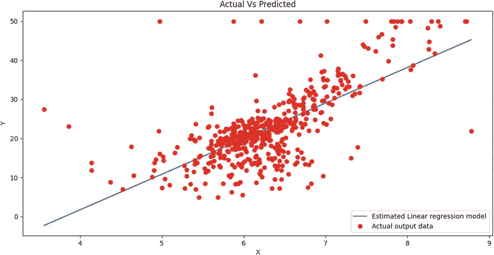
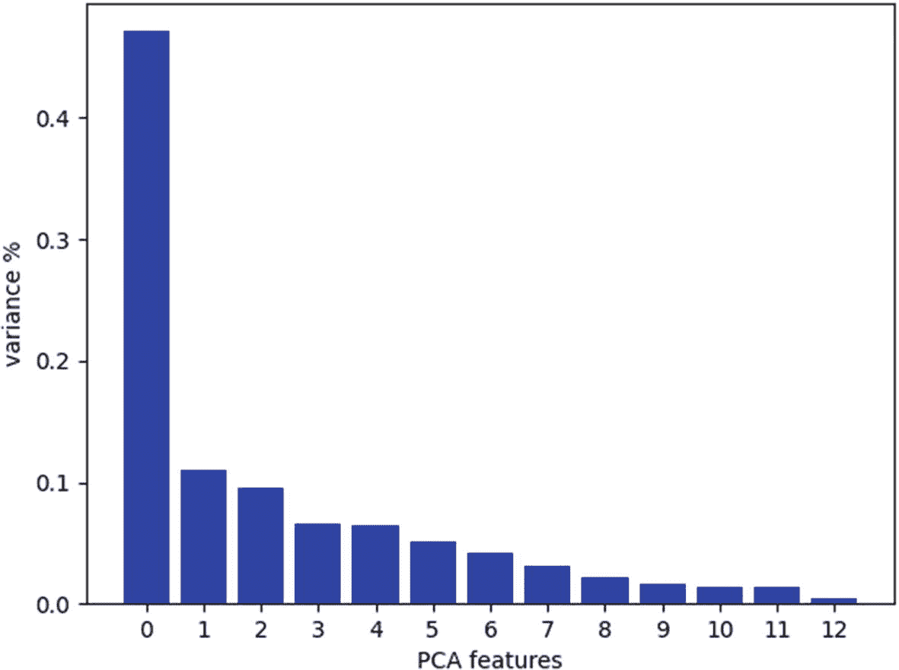
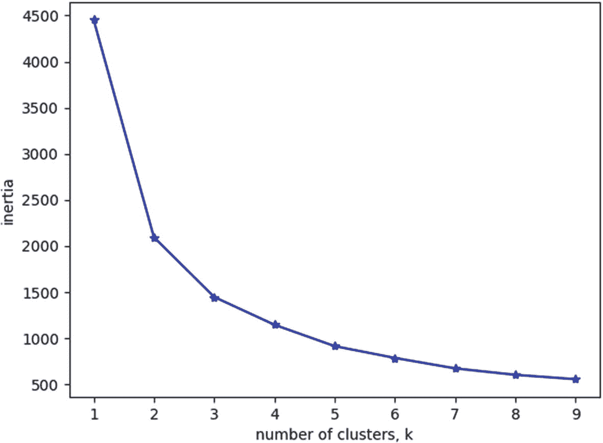
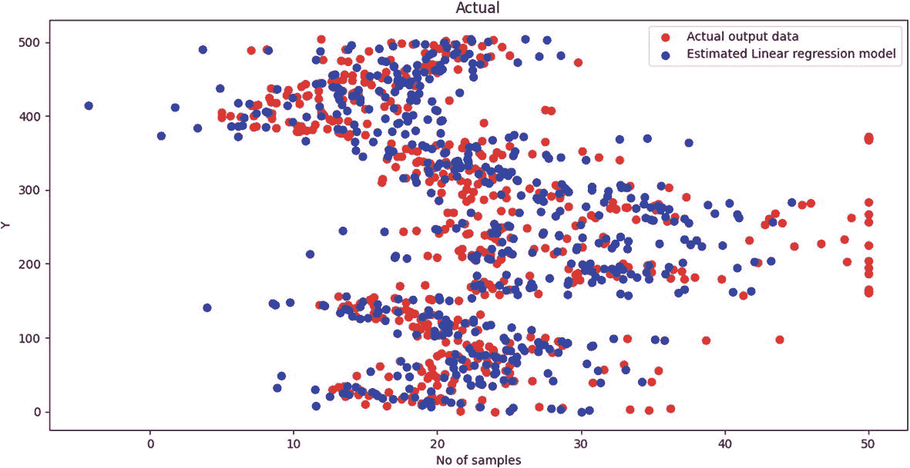

# 8. 从数据中学习

从数据中学习，就是提取数据中的信息并用于预测/预报，从而基于这些信息做出明智的决策。这一领域正变得越来越流行，因为它适用于不同行业的各种应用，例如金融、医疗保健、教育、计算机视觉、政治等。

在不需要解析解、对问题没有明确模型或需要基于先前信息进行预测等各种情况下，都会用到从数据中学习。基本上，有三种可用的学习技术：监督学习、无监督学习和强化学习。监督学习利用过程的观测数据来开发模型。监督学习模型基于过程的输入和输出观测数据（即输入和输出数据）进行训练。在无监督学习中，训练数据不包含任何关于输出的信息。无监督模型根据数据的特征对模型进行分类。此外，无监督模型可用于在数据中寻找模式、通过聚类相似数据检测异常值、发现数据结构等。强化学习模型也不利用关于输出的正确信息。然而，它有一些可能的输出，并附带关于输出质量的信息。

本章重点介绍利用波士顿数据集开发学习模型的技术。然后，我们将在 Raspberry Pi 上实现这些学习模型，并分析从传感器获取的工业数据。此实现将作为案例研究在第 9 章中讨论。

## 使用回归从数据中进行预测

回归用于发现数据集中变量之间的关系。回归用于确定一个变量对另一个变量的影响。此外，它还可以基于变量的历史数据来预测该变量。回归模型可用于许多领域，例如预测经济趋势、预测商业销售额、预测某些政策的影响以及预测医疗保健应用中的血压水平。

在回归分析中，开发模型需要两种变量：输入变量和输出变量。输入变量是数据集中用于预测输出变量的变量。线性回归中的输入变量通常表示为`X`。输出变量是待预测的变量，表示为`Y`。公式 8-1 展示了线性回归的方程。

`Ye = α + βX` … (8-1)

这里，`Ye`是估计的输出变量，`Y`是实际的输出变量，`α`和`β`是线性回归模型的参数。例如，如果我们想购买一台电视并尝试估算其成本（即输出变量），我们会使用诸如电视尺寸之类的输入变量。现在，假设`α`、`β`和`Y`分别（随机地）选定为 2、5 和 170 欧元。电视尺寸（即输入变量）为 32 英寸，则用于估算电视成本的线性回归模型的估计输出如公式 8-2 所示。

```
Ye = 2 + 5 * 32
   = 162 欧元
```

… (8-2)

因此，根据公式 8-2，当电视尺寸为 32 英寸时，其成本为 162 欧元，这接近电视的实际成本 170 欧元。如果我们将参数`α`和`β`分别修改为 0.1 和 0.5，则现在电视的估计成本计算如下：

```
Ye = 0.1 + 0.5 * 32
   = 16.1 欧元
```

电视的成本急剧变化为 16.1 欧元。这表明`α`和`β`的选择对于预测输出变量至关重要。因此，开发线性回归模型的目标是通过最小化实际输出`Y`和估计输出`Ye`之间的差异来找到`α`和`β`。有许多方法可以找到`α`和`β`的最优参数。然而，普通最小二乘法常用于寻找`α`和`β`的最优参数。

OLS 方法使用输入变量的协方差和方差来识别参数`α`和`β`，如公式 8-3 所示。

```
β = Cov(X, Y) / Var(X)
α = Ȳ - βX̄
```

… (8-3)

这里，`Ȳ`和`X̄`分别是实际输出变量和输入变量的均值。

现在让我们考虑波士顿数据集。`RM`变量用于表示每套房屋的平均房间数，目标变量（即输出变量）`MEDV`用于表示自住住房的中位数价格（以千计）。我们将`RM`视为输入变量，`MEDV`视为输出变量，用于线性回归建模。由于`RM`和`MEDV`彼此紧密关联，可以使用以下代码实现这些变量的线性回归模型。为了识别`α`和`β`参数，采用了普通最小二乘法。

```python
from sklearn.linear_model import LinearRegression
import matplotlib.pyplot as plt
import numpy as np
from sklearn.datasets import load_boston
import pandas as pd
dataset = load_boston()
boston_data=pd.DataFrame(dataset.data,columns=dataset.feature_names)
Target=pd.DataFrame(dataset.target,columns=['target'])
# two variable for regression model
X1=boston_data['RM']
X=X1.to_numpy()  # dataframe is converted in to array for arithmetic operations
Y=dataset.target
xmean=np.mean(X)
ymean=np.mean(Y)
xcov=np.multiply((X-xmean),(Y-ymean))
xvar=(X-xmean)**2
# linear regression model
beta=xcov.sum()/xvar.sum()
alpha=ymean-(beta*xmean)
print(beta)
print(alpha)
```

采用普通最小二乘法（`OLS`）得到的 `α` 和 `β` 值如下所示：

```
Beta value is 9.10210898118031
Alpha value is -34.67062077643857
```

利用上述 `α` 和 `β` 值即可构建线性回归模型，如公式 8-4 所示。

`Ye=-34.6706+9.1021*X`    … (8-4)

这里，`X` 是输入变量 `RM`。可以使用以下代码实现该模型：

```
# prediction model
ye=alpha+beta*X
```

让我们绘制实际输出变量 `Y` 与估计模型 `Ye` 的对比图，该图能清晰揭示它们之间的关系，可使用以下代码进行绘制（见图 8-1）：



图 8-1

实际输出变量与估计的线性回归模型对比

```
# plot
plt.figure(figsize=(12,6))
plt.plot(X1,ye)
plt.plot(X,Y,'ro')
plt.title('Actual Vs Predicted')
plt.xlabel('X')
plt.ylabel('Y')
plt.show()
```

### 使用 Scikit-Learn 进行线性回归

在前面的示例中，线性回归预测器仅使用一个输入变量来预测输出。基于给定的线性回归，可以使用多个变量来预测输出（见公式 8-5）。

`Ye=α+β[1]*x[1]+ β[2] *x[2]+ β[3] *x[3]+ ……+ β[n] *x[n]`     ……(8-5)

公式 8-5 使用了 *n* 个输入变量来预测输出变量 `Ye`。如果考虑波士顿数据集的全部输入变量（共 13 个输入变量）和输出变量（`MEDV`），则可以使用 `Scikit-Learn` 实现基于多变量的回归模型，代码如下：

## 主成分分析

主成分分析是一种统计方法，用于提取大规模数据集中的强特征。换句话说，通过从数据集中提取重要特征，可以降低数据集的维度。PCA 使用标准化来识别特征之间的距离，并利用协方差信息来识别特征之间的任何关系。然后，借助特征向量和特征值来计算主成分。主成分用于提取强特征，即降低数据的维度。此外，主成分还用于优化 K-Means 聚类技术的簇数量，此处以波士顿数据集为例。波士顿数据集有 13 个特征。第一步，通过以下代码，借助 PCA 识别波士顿数据集中的强特征：

```python
from sklearn.decomposition import PCA
from sklearn.preprocessing import StandardScaler
#config InlineBackend.figure_format='retina'
# Load in the data
from sklearn.datasets import load_boston
dataset = load_boston()
df=pd.DataFrame(dataset.data,columns=dataset.feature_names)
#df = pd.read_csv('2013_2014_cleaned.csv')
# Standardize the data to have a mean of ~0 and a variance of 1
X_std = StandardScaler().fit_transform(df)
# Create a PCA instance: pca
pca = PCA(n_components=13)
principalComponents = pca.fit_transform(X_std)
# Plot the explained variances
features = range(pca.n_components_)
plt.bar(features, pca.explained_variance_ratio_, color='black')
plt.xlabel('PCA features')
plt.ylabel('variance %')
plt.xticks(features)
plt.show()
# Save components to a DataFrame
PCA_components = pd.DataFrame(principalComponents)
```

从图 8-3 可以看出，前三个特征在数据集中贡献了良好的方差。



图 8-3

数据集中各特征相对于方差的分布

因此，可以选择五个特征进行聚类。对于聚类，可以使用 K-Means 聚类。为了确定最佳簇数量，将 PCA 与 K-Means 聚类算法拟合，并计算所选主成分下聚类模型的惯性。以下代码识别了聚类模型的惯性，并绘制了簇数量（即 `k`）与惯性的关系图（此代码延续了前面的 PCA 代码）。图 8-4 显示了惯性随簇数量（`k`）变化的曲线。从图 8-4 可以得出结论，当簇数量达到 `k = 5` 之后，惯性不再发生显著变化。因此，可以选择 5 作为给定数据集的最佳簇头数量。



图 8-4

簇数量与惯性的关系

```python
ks = range(1, 10)
inertias = []
for k in ks:
    # Create a KMeans instance with k clusters: model
    model = KMeans(n_clusters=k)
    # Fit model to samples
    model.fit(PCA_components.iloc[:,:3])
    # Append the inertia to the list of inertias
    inertias.append(model.inertia_)
plt.plot(ks, inertias, '-*', color='blue')
plt.xlabel('number of clusters, k')
plt.ylabel('inertia')
plt.xticks(ks)
plt.show()
```

## 使用 K-Means 聚类的异常值检测

聚类是一种探索性数据分析技术，常用于无监督学习问题，即在对数据没有先验知识的情况下。聚类的基本思想是将数据集中的数据点分组为多个子组，这些子组被称为*簇*。每个簇中的数据点与该簇内其他数据点的相似度，要高于与其他簇中数据点的相似度。

广泛用于聚类操作的技术是基于质心的方法，称为*k-means 聚类*。这是一种迭代算法，它将数据集划分为 k 个非重叠的簇，每个数据点仅被分配到一个簇中。将数据点分配到一个簇的条件是：所有数据点到其所属簇质心的距离平方和最小。k-means 算法的工作流程如下：

1. 指定簇的数量。

2. 为每个簇随机选择中心点，也称为*质心*。

3. 计算每个数据点到各个簇质心的距离，并将数据点分配给距离最小的簇。

4. 通过计算分配给每个簇的所有数据点的平均值，重新计算该簇的质心。

5. 重复步骤 3 和 4，直到质心不再发生变化。

除了对数据进行聚类，k-means 算法还可用于识别数据中存在的异常值。该方法的基本思想是将每个数据点到簇质心的距离按升序排序，并将距离质心最远的那部分数据点视为异常值。

为了说明这种方法，让我们看一看波士顿房价数据集。正如我们在第 7 章讨论的，每栋房屋的平均房间数 (`RM`) 和自住房屋价值中位数（以千计，`MEDV`）高度相关。因此，这两个参数被作为二维数据用于聚类算法，如下代码所示：

```python
from sklearn.linear_model import LinearRegression
import matplotlib.pyplot as plt
import numpy as np
import seaborn as sns
from sklearn.datasets import load_boston
import pandas as pd
dataset = load_boston()
boston_data=pd.DataFrame(dataset.data,columns=dataset.feature_names)
Target=pd.DataFrame(dataset.target,columns=['target'])
# two variable for regression model
X=boston_data
Y=Target
lm=LinearRegression()
model=lm.fit(X,Y)
print(f'alpha={model.intercept_}')
print(f'beta={model.coef_}')
Ye=model.predict(X)
Y1=Y.to_numpy()
E=np.mean(Y1-Ye)
MSE=E**2
print(MSE)
# plot
plt.figure(figsize=(12,6))
plt.scatter(Y1,np.arange(0,len(Y)),color='red')
plt.title('Actual')
plt.xlabel('No of samples')
plt.ylabel('Y')
#plt.figure(figsize=(12,6))
plt.scatter(Ye,np.arange(0,len(Y)),color='blue')
plt.legend(['Actual output data','Estimated Linear regression model',  ])
plt.show()
```

输出：

对于 `alpha` 和 `beta` 值：

`alpha=[36.45948839]`

`beta=[[-1.08011358e-01  4.64204584e-02  2.05586264e-02     2.68673382e+00
-1.77666112e+01  3.80986521e+00  6.92224640e-04 -    1.47556685e+00
3.06049479e-01 -1.23345939e-02 -9.52747232e-01     9.31168327e-03
-5.24758378e-01]]`

为了评估模型的质量，我们可以使用均方误差指标。均方误差计算实际输出与预测输出之间平方误差的平均值。

`1.8463848451630152e-29`

图 8-2 将实际输出 (`Y`) 与预测输出 (`Ye`) 进行了对比。



图 8-2

使用线性回归将实际输出数据与预测输出数据进行对比

```markdown
首先将数据集的特征加载到一个数据框中。与 `RM` 特征对应的列从数据框移到变量 `x` 中。由于存储在变量 `x` 中的 `RM` 特征是 Pandas 序列格式，因此使用 `to_numpy` 函数将其转换为 NumPy 数组，使其能够应用于 k-means 算法。然后对这个数组进行重塑，因为它需要与目标变量 `MEDV` 一起存储在一个二维数组中。接着，使用 `sklearn` 包中的 `scale` 函数对参数进行额外的缩放。这是为了将数据归一化到特定范围内。以类似的方式，目标 `MEDV` 特征（默认情况下是 NumPy 数组）也被存储在变量 `y` 中，经过重塑和缩放。然后，两个变量 `x` 和 `y` 被合并到变量 `X` 中，使其成为一个二维变量。k-means 算法对此变量的应用如下代码所示：

```python
import matplotlib.pyplot as plt
import numpy as np
import pandas as pd
from sklearn.cluster import KMeans
from sklearn.preprocessing import scale
from numpy import sqrt, random, array, argsort
from sklearn.datasets import load_boston
dataset = load_boston()
boston_data=pd.DataFrame(dataset.data,columns=dataset.feature_names)
x=boston_data['RM']
y=dataset.target
x=x.to_numpy() # convert pandas series data to numpy array
x=x.reshape(x.shape[0],1)
x=scale(x)
y=y.reshape(y.shape[0],1)
y=scale(y)
X=np.zeros((np.shape(x)[0],2))
X[:,0]=x[:,0]
X[:,1]=y[:,0]
```

```python
km=KMeans(n_clusters=1).fit(X)
distance = km.transform(X)
indexes = np.argsort(distance.ravel())[::-1][:20]
```

从 `sklearn` 包导入的 `Kmeans` 函数可用于实现聚类算法。该函数可以接受簇的数量、最大迭代次数等输入。在我们的代码中，我们输入的簇数量为 1。换句话说，我们将把所有数据点分组到单个簇中。由于没有指定最大迭代次数，该函数取默认值 300 次迭代。将 k-means 算法拟合到我们的数据后，下一步是计算每个数据点到簇质心的距离。这是使用 `sklearn` 包中的 `transform` 函数完成的。得到的距离变量也是一个 *n* 维 NumPy 数组。因此，首先使用 `ravel` 函数将其展平，然后将展平的数组按降序排序。这意味着数组以离簇中心最远的数据点开始，以离中心最近的数据点结束。此排序使用 `argsort` 函数完成，该函数提供与排序后数据点对应的索引。

我们知道，异常值是数据集中远离其他数据点的异常数据点。但是，什么被认为是异常，这取决于熟悉分析要求的分析师。对于波士顿房价数据，异常值包括房间数较少但价值中位数较高的房屋（价格过高），房间数较多但价值中位数较低的房屋（数据错误），以及根据要求，超过特定极限的房间数与价值组合。为了检测这些异常值，我们从排序后的索引数组中随机选取前 20 个索引，并在所有数据点的散点图中标记这些索引对应的数据点，如下所示：

```python
f,ax=plt.subplots()
ax.scatter(X[:,0],X[:,1])
ax.scatter(X[indexes][:,0],X[indexes][:,1],edgecolors='r',
facecolors='none', s=100)
plt.xlabel('MEDV')
plt.ylabel('RM')
f.show()
```

图 8-5 显示了每栋房屋的平均房间数相对于自住房屋价值中位数的散点图。数据中的异常值由带有红色圆圈的这些点表示。


**图 8-5** 使用 k-means 聚类算法检测到的异常值
