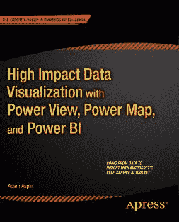
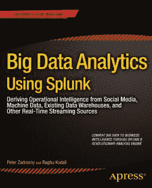
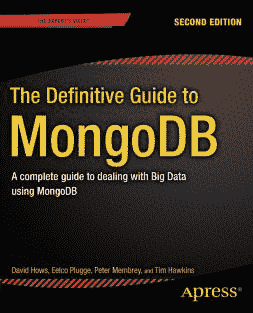
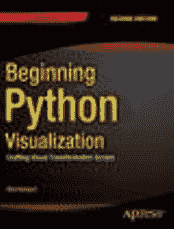
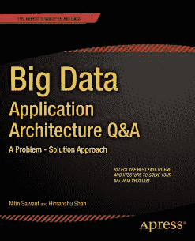
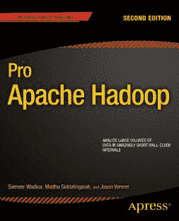
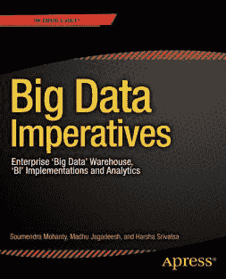
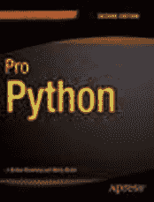

## 第 10 章 | 安娜·史密斯，Rent the Runway

**塞巴斯蒂安·古铁雷斯：** 你是如何成为 Rent the Runway 的分析工程师的？

**安娜·史密斯：** 简而言之，我原本在读物理学博士，期间在 Bitly 实习，因为太喜欢这份工作，就退学了——或者用更友好的说法，我处于无限期休学状态。这次转变中真正让我兴奋的有三点：学习速度飞快、能处理真实数据、以及尝试理解人们如何使用互联网。离开 Bitly 后我加入了 Rent the Runway，我的工作重点是帮助人们找到合适的礼服。

我认为 Rent the Runway 的产品非常出色，身边的同事也极具启发性。对于目前的状况，我不能再满意了。

**古铁雷斯：** 你当时研究的是哪类物理学？

**史密斯：** 我读研时想研究量子计算机，因为我非常喜欢其背后的理论。之前实习时有过相关经验，所以想继续深耕。可惜学校量子计算机理论方面的资源不足，结果我做了大量实验。这并非我的兴趣所在，所以实验时我总选择负责所有计算机相关的工作。毕竟，我可不想被激光灼伤眼睛或发生类似意外。不过，我也确实享受过部分过程，比如搭建干涉仪。

后来，几位教授提供了一个机会，让我从事更多信息学和数据科学类的工作。他们希望将数学、计算机科学和物理学融合在一起，认为每个学科都有各自的优势，结合起来就能创造应用数学的未来。这基本上就是当前工业界计算机科学发展的模式。作为这一目标的一部分，教授们开发了优秀的算法和数据处理方法。我开始与一些公司和其他教授合作，开展几个与整体宏大构想相关但又相对独立的项目。

**古铁雷斯：** 所以你从理论和实验转向了数据领域。你最终做了哪些类型的工作？

**史密斯：** 在物理学领域，我们长期处理海量数据。物理学的一部分工作就是研究如何利用收集到的数据、如何自动化数据处理任务、以及如何从数据中提取信息。光学图像就是这类数据的绝佳例子。其中一项较长期的项目聚焦于分析星系的光学图像，以计算其表面亮度。

我们研究星系从中心向外如何逐渐变暗，以及如何根据光学数据构建星系的轮廓曲线。不同类型的星系有不同的轮廓，因此我们试图从数据中学习这些轮廓特征，并将其用作分类工具。有些出人意料的是，当时大多数天体物理学家并非采用这种方法。他们过去和现在都在使用通用曲线。最初是单参数曲线，五十年后变成“我们加两个参数试试！”，如此类推。我觉得我们的方法非常有趣，因为我们利用数据来补充物理其他领域的工作。

星系项目之后，我去了一趟中国，研究一家类似 eBay 和亚马逊混合体的公司的交易数据。项目重点是研究如何对所有产品和类别进行分组。我们进行了主成分分析（`PCA`），以压缩类别使其更易于管理，并实现交叉分类。那是个有趣的项目，可惜我觉得在那里待的时间不够长。

**古铁雷斯：** 你是如何从学术数据科学转向工业界数据科学的？

**史密斯：** 在完成这两个项目以及其他一些工作后，教授们建议我进入工业界，看看业内人士在做什么。我们联系到了 Bitly——一家为消费者和品牌提供数据洞察的短链接服务公司。我在研究生院的计算机科学课上听过希拉里·梅森（前 Bitly 员工，现就职于 Accel Ventures）关于机器学习的演讲。教授当时说：“你应该看看这个，太棒了！”所以当我开始与 Bitly 沟通时，我非常兴奋。

真正打动我的是他们在博客上展示的内容。他们的博客非常酷，因为大部分内容都是研究导向的，而不是那种“我们如何支持业务”的常规帖子。

从那次演讲、他们的博客以及他们的工作内容来看，Bitly 似乎非常契合。于是我加入他们实习，而且非常喜欢，以至于我放弃了博士项目，成为 Bitly 的全职员工。

**古铁雷斯：** 在哪个“顿悟时刻”，你决定要从事数据工作而不是物理学？

**史密斯：** 这绝对是个渐进的过程，因为我在本科和研究生阶段并不想处理数据。本科时我有机会做数据建模及其相关工作，但我当时认为数据建模很蠢——谁都能做——于是错过了机会。

随着年龄增长，我意识到自己更喜欢计算机科学相关的工作。我喜欢编写代码，这自然而然地会涉及到数据处理。真正让我醒悟的是加入 Bitly 之后，我终于觉得：“哦，这才是我应该做的事。”在研究生阶段的其他项目中也有一点点这种感觉，但没那么清晰。

在研究生院时，我基本上只是黑箱中的一个人。我能讨论问题的对象要么是我的导师，要么是互联网。而在 Bitly，我身边突然围绕着一群对数据及其各种可能性充满热情的人。现在我能够实践学到的机器学习算法，并亲眼看着它们产生实际效果。那感觉太棒了，我终于找到了自己想做的事。

# 对话安娜·史密斯

除了 Bitly 非凡的数据集之外，我还获得了所需的一切资源。这些资源我过去只听说过，从未亲眼见过。我从追问什么是`Hadoop`集群——因为我的学校没有这个——到能够实际运用它。现在我可以用它来探索如何优化我的工作，如何改进算法，使其更简洁，并在`Hadoop`上运行得更快。整个转变令人大开眼界。不仅如此，我还能查看他人的代码，并操作他们的代码和数据集。这太棒了，让我确信与数据打交道就是我的方向。

**古铁雷斯：** 从博士项目到 Bitly，这个转变大吗？

**史密斯：** 转变很大，因为我从俄勒冈州搬到了纽约市。这里总是有各种活动——各种不同的聚会，许多有趣的人在做有趣的项目，而且每个人都很善于社交、外向，非常乐意回答我的问题。向他们学习真的令人兴奋和愉快。工作方面，在 Bitly，我觉得自己是那里最笨的人，所以学习一整套新技能，比如如何做演讲，如何真正把数据科学带给组织内外的每一个人，真的非常棒。我身边都是工程师，所以我学到了很多有用的技巧，真正提升了我的工程能力。我们还有一个出色的数据科学团队，可以互相学习，共同解决问题。这真的很激动人心！

**古铁雷斯：** 你在 Bitly 参与的某个具体项目有没有特别突出的？

**史密斯：** 我在 Bitly 时处理的一个令人兴奋的问题，在我离开时已经发展成了一个产品。这个想法很简单：不仅要收集数据，还要将数据以更丰富的形式反馈给用户。Bitly 的运营前提是，我们告诉用户，他们使用服务缩短的单个链接或链接集合发生了什么。然而，我们拥有人们整体行为的所有数据，所以我们知道谁访问了你的网站，以及他们在互联网上还做了什么。因此，这个项目的重点是尝试展示信息，例如人们还访问了哪些其他网站、这些网站代表什么主题领域、人们在搜索什么关键词、这些网站的实际上下文是什么，并根据这些信息对用户进行分类。不仅如此，我们还要跨地理区域和浏览器来实现这一切。这个项目非常激动人心，我从其中的反复试验中学到了很多。

**古铁雷斯：** 你从这个项目中学到了什么？

**史密斯：** 除了学习如何对数据应用几种不同的技术外，我还学会了如何与不熟悉数据、数学或编程的人合作。起初，项目只包括一位业务拓展人员和我。我们遇到了典型的技术沟通障碍：

*《工作中的数据科学家》* 203

他会提出要求，我按他的要求提供结果，他却说：“不，不，不。这不对。”我就回应：“我不明白，这明明是你要求的东西。”或者我向他征求意见：“我在考虑使用这种归一化技术，你觉得该用什么？”而他无法理解我的专业语言。最终，我们学会了合作，学会了如何沟通，并按时交付了产品的不完美版本。

一旦项目推进起来，理解我们正在做的事情的宏大愿景就更容易了。后来，一位数据可视化专家加入，突然间，我们能够将我生成的数据变得美观且易于理解。通过这个过程，我们得以巩固了我们试图实现的目标，因为在那之前，我制作图表时有些随意，只是为了展示不同的结果。一旦我们有了更完善的项目，并能看到它是如何变化的以及它的独特之处，我们就真正能够集中精力了。然后我就能致力于加快处理速度，我们还请来了一些其他工程师，帮助我把处理时间从一天缩短到几小时，从而服务于我们所有的客户。

**古铁雷斯：** 你是如何思考项目所需的数据类型和建模方式的？

**史密斯：** 听起来很简单，但主要靠大量的反复试验。这个想法是先试图在非常基础的层面上理解人们的行为。所以第一步，我们得把所有能获取的数据集中到一个地方。

有了这些数据后，我们就可以做非常简单的汇总统计，来初步了解数据呈现的内容。

我们从这样的问题开始：我们需要多少数据？我们有多少数据？然后我们回到数学计算上，来理解我们能够产生的统计置信度。一旦我们理解了这些数值，我们就能算出在多少时间内需要看到多少链接，这样对客户才有用。对于某些公司，我们可以按月度统计；对于其他公司，我们可以按周统计。一旦我们对数据有了把握和信心，我们就必须选择那些能够为查看结果的人提供最佳、最直观答案的模型。从来就没有一个唯一正确的答案。更多的时候，是弄清楚我们能传达什么，以及传达时带有什么样的偏重。

**古铁雷斯：** 你说的“能传达什么”是什么意思？

**史密斯：** 我的意思是，在这个项目中，我们要向可能是第一次看到这些数据和/或数据汇总统计信息的人进行大量的沟通。所以我们必须专注于传达那些对普通人来说有意义的内容。你可以向他们解释所有的数学原理，但除非他们能将这些原理转化为图表中呈现的信息，否则他们就无法理解。

*第 10 章 | 安娜·史密斯，Rent the Runway*

**古铁雷斯：** 你用什么工具来处理这些数据？

**史密斯：** 我使用`Hadoop`来存储和计算数据。数据存储在`Amazon S3`上，然后通过我们的`MapReduce`程序运行。

我们还使用了`Elasticsearch`，这样一次就能处理更多数据。这是处理流程的核心。完成所有这些步骤后，再用一个轻量级的`Python`脚本进行最后的数据处理，并以`JSON`格式输出。然后，处理管道将这个`JSON`加载到`D3.js`中，用于图表和展示层。我认为这是一个简洁的处理流程，因为我们为此付出了很大努力。不过，随着你不断学习，这类事情往往会发现还有改进空间。

**古铁雷斯：** 你现在在 Rent the Runway 工作。与 Bitly 相比如何？

**史密斯：** 感觉非常不同，因为它们是两种截然不同的公司。在 Bitly，公司处理的是更潜在的数据源。人们使用它，我们就能看到事件发生。更多的是试图捕捉人们的行为，理解互联网上的动态。而在 Rent the Runway，更多的是努力支持业务，所以涉及大量纯粹的商业智能和业务分析。这里的问题是试图弄清楚如何将数据融入产品，以推动业务目标的实现。

**古铁雷斯：** 你如何向不熟悉计算机科学、物理学或数据科学的人解释你的工作？

**史密斯：** 比如，我该如何告诉我妈妈我在做什么？好吧，选我妈妈是个坏主意，因为她热爱电脑。那换个说法——我该怎么告诉我妹妹呢？我会这样说：我在利用手头的一切手段解决问题。这就像任何一份工作——不像我妹妹那样需要处理诉讼案件，我面对的是需要解决的问题。只不过我恰好是用数据来完成。很多时候，这意味着我要去找工程师，询问他们在网站上获取的用户行为信息，然后我需要访问我们的数据库，查找正在被租借的裙子，最后把我发现的信息整合成更精炼的形式。这样一来，我就能揭示出正在发生的事情，从而解决我们试图理解的问题。

**古铁雷斯：** 你会如何向一位物理学家描述你的工作？

**史密斯：** 我所做的就像求解任何方程。有输入，有输出，中间还有一个黑箱。你得弄清楚这个黑箱里是什么。我想这类似于波函数坍缩。在物理学中，粒子可能出现的位置有一个概率，当你观测它时，它会出现在一个特定的位置。在数据科学中也是如此，你拥有所有这些不同的可能性，或者说所有这些不同的数据阵列，你只想将它们坍缩成一个全世界都能理解的信息片段。

*工作中的数据科学家* 205

**古铁雷斯：** 你每天的工作是什么样的？

**史密斯：** 我的日常工作每天都不一样，因为我参与大量非重复性的会议。有趣的是——在 Rent the Runway，我参加的会议比我预想的多得多，但我实际上很享受这些会议。我喜欢这些会议，因为它们给了我时间去理解别人的出发点以及他们试图解决什么问题。就个性而言，我更像是一个感性的人，所以我喜欢尝试理解他人的观点。

其余时间我专注于解决问题和思考。非会议时间很棒，因为我可以坐下来，做任何我想做的事情。实际上，思考是我一直在努力在日程上安排更多时间去做的事。我的思考时间包括不看东西、不读文章、甚至不与电脑互动。这完全就是坐下来，更深入地思考这些问题的时间，因为如果不这样，就很容易陷入被动反应的状态。如果我没有思考时间，一种类似注意力缺陷障碍的状态就会发作，然后我就停止探索诸如：这到底意味着什么？如果我换个角度看会怎样？

**古铁雷斯：** Rent the Runway 的数据团队是如何组建的？

**史密斯：** 我们有八个人，每个人都是不同领域的专家。

有一个人负责我们网站的推荐系统。

另一个人负责产品方面，确保我们完成了大量的日志记录。我更像他们半组的一员，做些网站相关的事情。我们还有专注于市场营销和财务报告的人，以及为分析团队提供方向、确保公司其他人能了解我们工作的首席分析官。

然后我们有另一个半组专注于运营方面。所以那里有一位数据科学家，他构建了预测裙子是否会延迟到货的模型。还有另一个人负责构建我们的 Tableau 报表，我们正在努力让他从这件事中脱身，因为他整天都会被问题淹没。最后一个人是我们的数据工程师，他非常热衷于为所有这些数据的处理方式构建框架。我很喜欢和他一起工作，只是因为我很享受帮助减轻周围每个人的工作量。通过帮助改进我们的系统和框架，每个人都能做更多有趣的事情，因为他们需要编写的基础设施代码和需要维护的开销都更少了。

**古铁雷斯：** Rent the Runway 的什么让你感到兴奋？

**史密斯：** 数据、公司里的人、我对时尚的兴趣，以及参与一个具有实体业务方面的网络公司。首先，我谈谈非数据部分，然后我们再回到数据。在公司里，除了所有优秀的人，我真的很喜欢所有的女性员工。这与其他地方非常不同，因为大多数科技公司男性占绝大多数，尤其是在

*第 10 章 | 安娜·史密斯，Rent the Runway*

他们的工程部门。在 Rent the Runway，我们的工程团队中约有 25%是女性，而且许多女性担任高级职位。

我们的首席技术官是一位女性，她非常出色，真正鼓舞人心。每个人都钦佩她能够抓住事情的关键并让所有人都投入工作。这真的很酷。

另一个原因是，我一直对时尚感兴趣。实际上，在来这里工作之前，我就已经是 Rent the Runway 的半频繁租用者了，所以从 Bitly 到这里过渡很轻松。我一直对时尚产业感到好奇，尽管对我来说它仍然有些神秘，但至少我能理解其不同部分是如何运作的，以及他们是如何努力从我这里赚钱的。

最后，我认为理解如何同时经营具有数字和实体业务的商业非常有趣。我喜欢学习不同的人如何管理他们的团队。观察所发生的一切非常吸引人，因为我遇到的每一位老板都非常不同，看到他们在推动什么样的事情以及这些事情最终是如何实现的，这很有趣。

**古铁雷斯：** 你的老板是如何理解并支持数据以及你工作的？

**史密斯：** 我认为我的老板做得很好，他确保每个人都想看到数据，并且确实将这一点作为一项议程在推动。这很棒，因为每个人都想看数据。他们都想了解自己特定部门的情况。困难的部分在于确保我们更像数据大使。我们甚至比他们自己更了解数据，并且我们知道数据如何与公司其他部分互动。所以我们不希望他们来找我们说：“我们想要 X、Y、Z 这些数字。”我们希望我们主动去找他们说：“你们实际上想解决什么问题？让我们一起提出这些指标，作为一个团队真正弄明白。”所以，我的老板和我们的团队一直在努力将其变成更多的协作努力，而不是仅仅交接任务。

**古铁雷斯：** 所以，更像是一个咨询型的团队角色。

**史密斯：** 完全正确。这样做的问题是，为了支持业务，你需要输出大量数据，其中很多就是：“这是数字。这是它们每周的变化情况。”因此，我们必须不断找出自动化的方法来提供这些报告，这样我们才能处理那些更有趣、更令人愉快的问题。

**古铁雷斯：** 你在 Rent the Runway 看到哪些类型的数据？

**史密斯：** 如前所述，Rent the Runway 的数据确实让我兴奋。

我们有多个处理数据的领域。我把它们分成几个重要的不同部分。首先，是仓库运营部分。这涉及到裙子在仓库内的实际移动方式以及我们如何捕捉这种移动。我们给每条裙子都贴了条形码，并且有站点

***工作中的数据科学家*** 207

每次移动时都会进行扫描。一年前，仅仅通过在裙子上添加条形码，我们就能够将裙子在仓库中停留的时间缩短到一天以内。

第二，是仓库到消费者再返回的环节。我们有 UPS

```markdown
# 排版后的内容

将连衣裙与包裹关联的数据使我们能够追踪其在出库和入库途中的位置。我们利用这些数据来优化连衣裙的流转。这与我之前处理过的任何问题都截然不同，因为连衣裙是真实的物理物品，它们可能失效或丢失。突然间，数据丢失变成了一个更加引人入胜的问题。在这部分业务中，我们一直致力于预测建模，以判断连衣裙是否能及时送回，以便进行下一次租赁。

第三部分是客户支持。我们专注于向客户支持团队呈现正确的数据，使他们工作更高效、更轻松。当客户因连衣裙问题而焦虑地致电时，我们希望确保支持人员能访问到正确的数据，从而解决客户的问题——无论是关于连衣裙的位置、为何已退回的连衣裙未录入系统，还是其他任何类型的问题。

我们希望最大限度地减轻客户和客服人员的压力。

第四部分是网站运营。这是我主要参与的领域。网站运营团队关注的问题包括：人们如何找到他们想要的连衣裙？他们喜欢什么样的功能？

我们如何让这些功能变得更好？作为分析团队的第一位女性成员，这感觉棒极了，因为我对如何挑选连衣裙以及需要付出哪些努力有一些内在的了解。这有助于我们利用已经收集到并持续从外部资源和社区收集的数据。

关于第五个领域，是几乎所有公司都有的常规数据工程：市场营销、会计、日志记录、网站优化等。这个领域的数据非常重要，也很有趣。只是这些内容超出了我所认为的 Rent the Runway 数据的独特之处。

**Gutierrez：** 你们如何处理身体尺寸这类物理数据？

**Smith：** 身体尺寸和合身度是非常棘手的问题。有很多方法可以尝试处理合身度问题。从数据的角度来思考会很有帮助。最容易处理的数据是人们提供给我们的身体尺寸——他们的身高、体重、胸围和体型。然后，当他们访问网站时，会为连衣裙撰写评价，告诉我们是否合身以及如何合身。

*第 10 章 | Anna Smith，Rent the Runway*

一个更具信息性但也更难处理的身体测量数据集是客户在穿着连衣裙后留下的评价。通常，客户会写一篇关于连衣裙及其合身程度的详细描述。在这些评价中，她们会根据自己穿着尺码和体型，向其他人提供关于该连衣裙是否合身的建议。这类数据更难利用，因为我们必须通过自然语言处理来解析所有信息，以提取相关细节。

**Gutierrez：** 你们如何确保这些非常个人化的数据的准确性？

**Smith：** 我们正在做的一件非常简单的事情是，对比一个人声称的尺码和她实际穿着的连衣裙尺码。此外，我们还有一个问题是：“连衣裙是否合身？”尽管这个问题有些模棱两可，但答案可以提供一阶近似值，表明穿着者认为连衣裙尺码偏大、偏小还是适中。

另一个利用身体尺寸相关数据帮助用户的方法是，我们一个较早期的项目“Our Runway”。在该项目中，我们展示人们穿着连衣裙的照片，然后根据她们的身材与你的身材的相似程度进行排序。目前，这种排序是通过将人分入不同的“桶”来完成的，但我认为我们可以做得更好。例如，我们实际上可以使用某种距离度量，来衡量你声称的身材与实际身材之间的差异。

在合身度方面，当我们首次收到连衣裙时，会请一位 0 号身材的试穿员试穿，但我们无法了解所有尺码的连衣裙是偏大还是偏小。她只是一种体型，因此很难推广到所有其他尺码和款式的连衣裙。

**Gutierrez：** 我想，连衣裙和设计师本身也存在一些难以处理的变量，对吗？

**Smith：** 是的，这也是一个巨大的问题。我们研究过，并且仍在研究时尚设计师的实际尺码表，这处理起来非常混乱，因为他们声称的尺码通常与他们自己的连衣裙并不相符。因此，我们考虑自己测量连衣裙，并尝试看看这些尺码是否能提供关于合身度的更好信息。

接下来是面料及其弹性的问题。如果面料有弹性，那么它们更具包容性，可以适合许多不同的人。如果面料没有弹性，则包容性较差，适合的人就少。不同的面料让尺码问题变得更加复杂。所以这是一个巨大的动态问题，有时会令人沮丧。

**Gutierrez：** 你们使用什么工具来存储数据？

**Smith：** 我们没有使用 Hadoop。我们使用的是数据库，比如 HP 的 Vertica。

我们将刚刚讨论过的数据以及像素日志（pixel logs）存储在数据库中。像素日志告诉我们网站上正在发生的事情——比如人们在点击什么、他们的导航路径以及其他与网站相关的事情。

*Data Scientists at Work* 209

**Gutierrez：** 你们使用什么工具来处理数据？

**Smith：** 当我独自工作时，不需要迁就任何其他人的工具，我会用 `Python` 编写代码。Bitly 是一个完全的 `Python` 技术栈公司，我就是在那里培养了我的 `Python` 能力。能够深入学习 `Python`，理解其特性，并学会如何利用其特殊技巧编写干净、高效的代码，这感觉非常好。

在我们公司，除了数据团队的少数人外，没有其他人使用 `Python`。在我们的团队里，大家各用各的工具，大部分工作是通过 `SQL` 来访问数据。我们团队之外的大多数人则使用 `Excel` 来处理数据。我们的推荐引擎是用 `R` 构建的。整个网站是用 `Java` 编写的，所以自从本科以来，我又重新学了一些 `Java`。对于特殊项目，我们会使用更专业的工具，比如 `D3.js`。在这些项目或想法中，我们会在获取结果和学习新工具之间寻找平衡。我发现，要真正理解某样东西，我需要亲自实践或写下来。仅仅阅读是不够的。我实际上需要“肌肉记忆”来熟悉它。

**Gutierrez：** 你最近做了哪个项目？

**Smith：** 我们最近正在研究的项目之一，是整合我们自行收集的所有不同类型的数据。这不仅涉及整合，还要找出一种简单、快速且稳健的方法，以便我们想要添加更多数据时（例如，将我们的像素日志与 Google Analytics 结合，这毫不意外地令人头疼）能够复制这个过程。验证数据并不总是那么有趣，因为我会想：“什么？这是数据。它是正确的。是准确的，”

无论你用哪种方式解析它。这只是一种不同的视角而已。数据本身是正确的，关键在于找到正确的方式去查看和整合它。

我们有一个流程，可以将我们的像素日志导入 HP 的 `Vertica`，然后我又创建了另一个脚本，将我们所有的 Google Analytics 数据也推入 `Vertica`。现在，我们可以通过 `Tableau` 将它们放在一起查看。这与其说是一个数据科学的数学项目，不如说是一个数据科学的数据清理项目。

# Rent the Runway 访谈：数据科学与用户行为

## 数据工程与分析
这可以说是数据科学中更偏向数据工程的一面。一旦我们整理好所有数据，各方都满意后，我们就会仔细审查并分析这些数字。接着，我们就可以专注于下一步，思考既然拥有了这些资源，还能做些什么。我们还会花时间考虑，还能将哪些其他数据集合并到这个大数据集中，以使其更有价值。

我们启动这个项目的主要原因是我们刚刚发布了一款移动应用，因此我们一直在研究用户如何使用移动设备、他们是谁，以及他们与我们的网页受众相比有何不同。我们希望能更好地理解诸如以下问题：受众如何分布在各设备上？这对他们与网站的互动方式意味着什么？他们在应用上做什么？为什么他们不在应用上购买，却在网站上购买？这仅仅是心理因素还是功能问题？

## 第 10 章 | 安娜·史密斯，Rent the Runway

通过审视数据并试图理解这些问题，我们对不同的用户群体有了更深入的认识。

有些女性经常访问网站却从不租赁，而另一些女性则每个周末都会租赁，还有一些群体的行为介于两者之间。因此，这对于理解每个群体的动态非常有帮助。通过了解他们的行为，我们可以在合适的时机为合适的平台量身定制他们的体验。

**古铁雷斯：** 你发现人们在不同的平台上有什么有趣的行为吗？

**史密斯：** 作为数据科学家，这里有两个层面。一方面，我非常关心数据，所以只想看看他们在做什么，不太在意他们是否购买。显然，在第二个层面上，我确实关心他们是否购买并租到梦想中的裙子，因此我发现数据如何描述这些决策以及这些决策是如何做出的，这一点非常有趣。例如，我认为有趣的是，无论我们向用户展示什么，他们总能找到自己的裙子。他们有自己独特的方式去找到他们想租的东西。

我仍然不太理解这个思维过程。我们可以改变一个页面并进行测试，但这在整体上不会产生什么实质影响。所以我认为这真的很有趣。我的假设是，他们只是做了大量筛选，或者使用了除主页面之外的其他页面来找到他们的裙子。他们是否落在我们认为最重要的特定页面或其他页面上，转化率并没有太大差异。因此，能够以聚合的形式查看来自不同来源的数据并研究其行为，确实非常棒。

**古铁雷斯：** 理解这些行为具体让你兴奋的是什么？

**史密斯：** 我当初来到这里时——（现在也仍然）——感到非常兴奋的事情之一，就是如何代表一个人对裙子的品味。毕竟，裙子的实体涉及如此多的个人品味，比如面料、颜色、版型、合身度、风格以及其他属性。如果我们能够代表一个人的品味，想想那会有多酷。我认为我们正接近能够轻松展示这一点的阶段。

我们还没有到能够按颜色或裙子的任何可辨别的物理属性来细分的地步。然而，我们发现存在某种潜变量或一些变量能够代表一个人对裙子的品味。只是我们还不知道这些变量具体是什么。

目前，我们还不能直接说：“哦，那是因为裙子是粉色的、带有荷叶边，看起来很俏皮。” 这离我们目前的能力还有一段距离，因为“看起来俏皮”或“时尚”到底意味着什么？我们又该如何将它们以随时间稳定的形式进行分类呢？

**古铁雷斯：** 听起来你已经有数学基础了，现在正在弄清楚如何将其映射到现实世界的物理属性上。

**史密斯：** 没错。我们必须能够与他人沟通时表达这些变量所代表的意义。关键就在于我们如何能够传达用户的品味变量，以便公司其他人能理解这确实是对某人品味的良好、准确的呈现。

就个人而言，我非常兴奋能找到更多像我一样的女性——几乎就是我的身体和品味的“分身”。我的新想法是，我们应该能够提供这一点，因为一旦能做到，知道世界上还有其他女性面临寻找合适裙子的同样问题，感觉会很好。

由于这个社区非常友好和支持，我们的一些顾客非常放松，会在评论中透露个人细节。像“这条裙子我穿起来很奇怪，因为我做了隆胸”这样的评论，对面临同样问题的顾客群体非常有帮助。因此，能够向顾客展示基于相似体型的人所写的合适评论，是一件很棒的事情。

我梦想着顾客能够说：“好的，我相信他们的意见。他们说这裙子不太短，所以应该没问题。”这就是整个协作系统能导向正确结果，能够与他人分享，并且不带任何评判地真正开放。

**古铁雷斯：** 考虑到这个协作性的支持社区，产品中是否有一个等待被挖掘出来的社交网络？

**史密斯：** 这是我在做演讲时其他人提到过的事情之一。我们并没有那样设置，但我认为如果我们想让它更具互动性，这可能是下一步。我们刚刚推出了`Shortlist`（心愿单），你可以在里面整理一组你喜欢的、有主题的裙子。然后你可以与他人讨论这个集合，这为人们之间提供了更多互动。

话虽如此，即使现在，仅凭人们在穿完裙子后留下的评论，我们社区的女性就已经在做这件事了。你可以写评论，然后别人可以点赞。然后你可以回去评论说：“哦，看起来太棒了。你美极了。” 他们也可以回复，这很棒，因为它与任何已知的社交网络都脱钩，所以人们实际上不知道这些人是谁。他们对她们的全部了解就只是看到过她们的照片。所以，在匿名的情况下，大家彼此之间如此友好，这真好。

**古铁雷斯：** 与其他网络公司不同，你们有一个非常个人化的反馈机制，这是很多其他数据科学家无法获得的。

**史密斯：** 确实如此。不过，自从在这里工作以来，我变成了一个更频繁的用户，所以有时很难想象我们的产品和我们的演变是如何影响到外面用户的。我们不断问自己这样的问题：他们注意到我们推出新东西了吗？他们注意到我们移除某些功能了吗？幸运的是，我们有朋友和粉丝会和我们交流，并且非常直言不讳地表达他们的想法。虽然有时很痛苦，但听到像“那太烂了。你们得把它放回去”这样的反馈也很棒。但总的来说，当你喜欢一项服务或享受它时，很容易对它感到兴奋。而且我喜欢这种能够赋予女性力量的想法。这一切都是为了将时尚民主化，让它更触手可及。

这并不是要庆祝其物质层面，而是关乎你想要看起来漂亮、度过一个美好的夜晚。每个人都应该能够做到这一点。

**古铁雷斯：** 你是如何选择要做的项目的？

**史密斯：** 兴趣以及说服他人这是一个好项目的能力。我在这里的很多工作都是支持他人的项目。例如，我从事的一项工作是研究推荐系统。他们构建了推荐系统并使其运行。现在我正在研究它的实际运作方式以及是否真的有效。

很多项目最终都是这样形成的。我产生一个想法，或者一个与当前做法不同的假设，然后去测试它。接着我展示数据，我们讨论发现。从那里我们可以决定下一步该怎么做。我一直被告知，请求宽恕比请求许可更好。所以我认为这就是数据科学的意义所在。我们需要有自己探索的自由。我不知道是否有 80%的自由时间，但肯定有 40%。我们需要有“猴子时间”去投入某件事，对它感到兴奋，然后还要确保完成其他工作并按时交付。

**古铁雷斯：** 你如何衡量自己的成功？

**史密斯：** 我倾向于根据项目指标来衡量工作中的成功。虽然这听起来很简单，但我认为这非常困难，因为成功不仅仅是你是否完成了某件事。它还关乎在整个过程中，你是否确保产出能代表投入。这也关乎你是否把项目做得好，以及你是否能够完成一件可以向他人传达的事情。

这里的成功指标更侧重于“收敛”。我们用来衡量自己的问题与业务方向更加一致。这会引出类似的问题：我们是通过购买还是租赁获得了更多用户？是否有更多人通过并使用了它？他们是否真正使用了？他们是否有积极的体验？这里我们关注更多的是这类指标，这与我习惯的思考方式截然不同。我以前会说：“看！它太棒了！”

**古铁雷斯：** 你日常工作中涉及的数学足够吗？如果足够，你仍然享受它吗？

**史密斯：** 所以这是我需要改变利用思考时间的方式的地方，因为我觉得我在编码中做了更多的“潜在”数学。最近我一直在思考这个问题，并得出结论：我实际上没有像以前那样写出那么多公式了。在`Bitly`，我有可以一起处理数学问题的人，我们可以一起解决一个问题。他们会坐下来问：“这个方程是什么样的？”他们可以通过共同寻找数学解来判断我们试图解决的问题是否有意义。因此，在这种情况下，协作需要数学来谈论同一件事。

最近我一直在尝试找到更多可以一起做这件事的人，因为否则，如果你独自一人，你不会坐下来做一整套数学练习。我的意思是，我认识那样做的人，但我不会自己坐下来做。与他人合作很好。所以我仍然享受它，并且认为如果我有更多时间去思考数学，或者与他人一起解决数学问题，我会更加享受。

**古铁雷斯：** 你对招聘优秀的数据科学家有什么看法？

**史密斯：** 我自己招聘不多。话虽如此，我认为这和在互联网上找到优质信息的标准是一样的。这全是关于常识，比如他们如何解决问题？他们用什么方式思考问题？他们是否尝试从多种不同的角度解决问题？他们是否在某个问题上卡壳然后放弃？我认为数据科学是一项可学习的技能，不是你天生就必须具备的东西。它只是你需要发展的东西。

**古铁雷斯：** 你在`Bitly`和这里面试时，被问到了什么问题？

**史密斯：** 对于`Bitly`，因为我是作为实习生进去的，更多是关于你做过什么，我们可以看看你的代码样本吗，只是为了确认你真的知道你在做什么？在`Rent the Runway`，面试困难得多。

我经历了分析团队和工程师团队的面试。

工程师们问的是更传统的技术问题，比如：“这里有一个句子，试着把它反转。”或者“这里有一个二叉树，你如何遍历它，以及你如何确保它是平衡的？”对于数据科学面试，则更多围绕现实世界的案例研究。他们说：“这是我们遇到的一个问题。你会如何解决它？”然后他们会问一些问题，比如：

## 第 10 章 | 安娜·史密斯，`Rent the Runway`

**古铁雷斯：** 你提到数据科学是一项可学习、可发展的技能。你是如何做到的？

**史密斯：** 通过工作实践、参加会议、从`Twitter`和其他社交网络上的人学习，以及阅读在线教程。我想说，我最好的学习方式是实际去做事。我受到启发想做某事，然后就去做了。我观察结果，然后要么迭代改进，要么做别的事情。我认为一切都始于灵感，这些灵感来自会议、旁听会议、倾听人们的问题并去理解：“哦，我能做什么来修复它？我能将哪些数据源结合起来？我们如何解决这个问题？”

关于会议，我在研究生院只参加过一两次物理会议，并且不太喜欢。每个人做的事情都如此不同，以至于几乎无法应用到任何其他项目上。而在数据科学领域，情况恰恰相反。你可以去参加会议，并对每个人的工作感到兴奋，因为你几乎总能将学到的东西应用到自己的工作中。无论是一种你想知道是否可以用在你的数据集上的技术，还是一个让你能够与那个人合作的想法。参加会议的环节几乎总能帮助我改进自己的工作或他人的工作，这很棒，因为它带来了一个令人难以置信的协作环境。这意味着你不会深陷于一个物理问题而无法脱身。现在，这个领域仍处于几乎每个人都是跨学科的阶段。我们仍然全面发展，可以从任何地方获取应用并使它们奏效。所以，会议是一种极好的享受。

会议唯一缺点是，你回来后有一长串想尝试的事情，最终意识到你无法尝试每一件事。你会因为看到那些做出伟大成就且与你的工作相关的人而感到兴奋，所以回来后面临选择优先尝试什么的抉择很艰难。此外，当你在参加会议时，你没有在工作，所以在决定是否要参加所有你想参加的会议之前，你总是需要考虑这一点。

关于`Twitter`，我一直在寻找新的关注对象，以扩充我已有的高质量关注者。我喜欢阅读各种想法，并问自己它们是否有能用于自己工作的见解。之后，就是`Google`和`Stack Overflow`。我这样做是因为这与读书非常不同。我习惯读的大部分书都是教科书，这会导致这样的思维模式：“哦，好吧，是的。我完全懂了。”然后你会想：“等等，我的数据如何与这些抽象概念和这些方程联系起来？”

因此，我认为，当你在互联网上找到一些教程，它们能向你展示：“好的，这是我的数据集。这是我如何将其与这些方程关联起来的方法，以及它在代码中的样子。”，这会非常有帮助。

**古铁雷斯：** 如何培养对优秀工作、优秀人才和优秀教程的鉴赏力？

**史密斯：** 这来自于经验以及拥有一套高分辨率的“鉴谎雷达”。我发现，区分哪些人是真正在做事，哪些人是装腔作势，非常容易。即使是很简单的事情，通常也很容易分辨。

我认为这些都是激励我的最佳范例。你几乎也总是能分清那些只会在推特上刷一堆标签、试图推销自己观点的人。

这需要大量的经验，并且要观察他们正在做什么——理解他们的做法是否可行，或者他们做出了哪些假设，并判断这些假设是否正确。

当我初入数据科学领域时，有一个很大的问题：你需要多少领域经验。我认为你需要一些经验，并且直觉越多越好。通常，常识加上一点思考，就是区分好坏的有效屏障。

**古铁雷斯：** 如果你今天作为一名新手数据科学家起步，你认为真正理解哪些内容会对你有帮助？

**史密斯：** 如果有人刚开始涉足数据科学，最重要的是要明白：向别人提问是完全可以的。我也认为保持谦逊非常重要。你必须确保自己不被手头的工作束缚住。你随时可以做出改变并重新开始。我认为，在刚开始时，能够舍弃代码真的很难，但最重要的是：行动起来。

即使你没有数据科学方面的工作，你也可以在业余时间探索数据集，并提出一些问题来询问数据。在我的个人时间里，我就摆弄过`Reddit`的数据。我问自己：“利用我已有或没有的工具，我能在`Reddit`上探索些什么？”这很棒，因为一旦你开始行动，你就可以看到其他人是如何处理相同问题的。相信你的直觉，开始阅读别人的文章，并试着说：“我可以在我的方法中使用这种技巧。”慢慢开始，稳步推进。我刚开始时尝试了大量阅读，但我认为，除非你真的动手摆弄过代码和数据，去理解它们实际是如何运作和变化的，否则阅读的帮助没那么大。当人们在书本中呈现时，一切都光鲜亮丽。但在现实生活中，完全不是那么回事。

我认为尝试许多不同的事情也非常重要。我从没想过自己会走到今天这一步。我也不知道五年后我会在哪里。

但这也许就是我学习的方式——通过在不同学科中都涉猎一点点，来试图找到最适合自己的东西。

**古铁雷斯：** 你在工作之外做过哪些项目？

**史密斯：** 我做过很多项目，还有更多项目我想去做。

正如我之前所说，我摆弄过`Reddit`不同部分的数据。我做了一个关于`Reddit`标题的项目，想看看我们是否能找到内容被点赞的规律。

其他时候，则是一些小项目，比如一个只是从另一个网站上的图片列表中曝光图片的项目。我也会花时间更新我的个人网站，尝试新的HTML、CSS和其他网络技术。

话虽如此，有时也确实很难找到动力——毕竟，周末通常是用来睡觉、跑步或者和朋友相聚的时间。

我如此热爱我的工作，其中一个有趣的方面是，我最终会在工作时间之外继续进行工作上的项目。不是像加班或者必须在家做的项目，更多是出于我对数据的兴趣，想自己进一步探索它。这是我用来试验一些更疯狂想法的时间。

有时候是搭建一个小型网站，以便更好地理解连衣裙是如何促销的，以及如何在线上最好地展示它们。其他时候，则是更多数据与数学密集型的工作。

**古铁雷斯：** `Rent the Runway`的数据科学未来会是怎样的？

**史密斯：** 嗯，我为这里的数据科学规划了很棒的事情。当然，我们会构建更好的模型，拥有更好的数据，采用更好的流程，并获得更深刻的洞察力。然而，我认为真正能帮助我们取得成功的关键，是解决如何改善团队之间的沟通。与工程团队合作有时是个问题，因为我们双方最终都会维护自己的领地。

要创造一个更容易取得成功的空间，我们必须让环境变得更加协作。目前，我认为他们觉得他们所做的都是为我们提供服务，因为我们自己做不了。作为回报，我认为我们可以更开放地让他们帮助我们做一些我们可以探索的有趣项目。这样就能确保我们双方都能得到帮助，并相互学习。

对我们来说，学习如何真正构建和维护那些健壮、不会每天出错的系统，将会非常棒。

除此之外，我想开始做一个内部的数据科学博客或网站，这样我们就可以发布我们正在做的、觉得酷且有趣的事情。目前，我们产生的知识和见解似乎有点随意地这里丢一点、那里扔一点。相反，如果我们能把它们收集起来就太好了，这样人们就会问：“他们在做什么？哦，太棒了。我很乐意来帮助你们，让我们一起合作吧。”

**古铁雷斯：** 听起来你想让数据科学成为更多人生活的一部分，即使他们不是专门的数据科学家？

**史密斯：** 是的。我认识工程团队中的很多人，他们对整个数据科学新事物很着迷。他们告诉过我，他们对我们正在做的事情感兴趣，而且他们也有一些想法。所以我们需要让他们分享自己的想法，而不是觉得他们只能一直修复漏洞。然后，如果他们看到我们正在做的某个自己感兴趣的项目，他们就可以加入我们。我们可以分配职责，与他们分享工作和乐趣。

**古铁雷斯：** 你如何向别人传授和沟通你以及数据团队正在做的事情？

**史密斯：** 我的策略是和每个人都成为朋友，这样我们就可以讨论各自团队正在解决的问题。这样我就能告诉他们我正在做什么，以及这对他们有何帮助，我的团队在想什么，然后反问他们：“你们在做什么？你们怎么看我们正在做的事情？你们认为我们应该做什么？你们甚至知道我们在做什么吗？”

此外，我们小组每两周或每月举行一次会议，公司里的任何人都可以来参加，看看我们都做了什么。这是一个论坛，我们会在会上展示我们最新的研究发现，以及我们正在探索的领域，他们可以给出反馈和意见，也可以提问。所以我认为，关键在于对我们正在做的事情保持开放和透明。

**古铁雷斯：** 你如何处理数据既高度专有又受严格控制，而数据科学技术在很大程度上又被广泛分享这种矛盾？

**史密斯：** 这是我一直在思考的问题，因为在`Bitly`时，我有很大的自由去进行演讲，但在这里，几乎没人那么做过，至少关于数据方面是这样。所以对数据有很多保护。关于哪些数字能说、哪些不能说，既有成文规则，也有不成文规则。

你可以谈论我们做事的方法，但不能说我们取得了什么样的成功，也不能说这个问题对我们实际上有多严重。我认为这种情况会有所缓解，我认为这只是在获取组织里其他人的信任罢了。

# 数据守护与团队协作

数据守护这件事真的很有趣，不仅在内部如此，在其他公司也一样。我觉得人们很难割舍自己的“心头好”。

我认为很大程度上，只需要让他们能够表达出对此感到不安，然后回应说：“没关系，我们会确保一切顺利。”

对他人保持极大的耐心能带来长远的好处。我们公司的核心价值观之一是，幸福和积极是一种选择，这是一个很好的思考方式。你必须对新想法持开放态度。

我最近一直在读`《团队极客》`，这本书让我很有共鸣，因为它讲的都是工程学以及如何良好地协同工作。1 虽然它主要面向软件开发人员，但我认为它可以适用于所有领域。书中有一个缩写词 HRT——“心”，代表着谦逊、尊重和信任。我认为这些是你真正需要培养的品质，不仅是在你的团队内部，也包括在更大范围业务中的其他所有人。一旦你拥有了这些品质，你就可以走得更远。

---

1. Brian W. Fitzpatrick 与 Ben Collins-Sussman 合著，《团队极客》（O’Reilly 出版社，2013 年）。

# 第 10 章 | Anna Smith，Rent the Runway 公司

**古铁雷斯：** 通过使用数据，你形成了哪些理念？

**史密斯：** 通过数据以及搬到纽约的经历，我学到的是，与人打交道总会遇到问题，因此，对他人保持耐心并真正尊重他人，对于取得成功至关重要。要真正取得成功，你需要少一点自我。你可以对某些事情非常强硬和激进，这样也能走上一段路。

然而，我认为要获得真正的成功，你需要真诚地对待自己的身份，并对自我保持真实，否则，你将不得不维持一场表演。到头来，你并不会喜欢这场表演，它只会让你变得暴躁。

在纽约，似乎每个人都很刻薄和愤怒，但实际上，在内心深处，每个人都只是想帮助你。如果你向他们求助，他们有多么乐于助人是令人惊讶和兴奋的。所以我认为这是你需要理解的。他们可能一开始很生气，但那不是因为你——而是因为他们对别的事情做出的反应。如果确实是因为你，你应该尽量保持友善，并且说声对不起是没关系的。我知道这一点，因为我也有过效率低下的时期。这对任何人来说都不好受，但能够从中恢复过来，并说“很抱歉我经历了这些。我们能继续前进吗？”这非常好。

最后，要努力做到积极和耐心。耐心是我现在正在努力培养的品质。事情不会立刻改变，但即使进展非常缓慢，你也可以努力改进。能够拥有这份耐心，并与人们打交道，应对他们各种不同的情绪和反应，将带来非常稳定的事业和生活。

**古铁雷斯：** 展望未来，你希望看到数据科学领域发生什么？

**史密斯：** 我希望看到数据科学成为一个不那么以自我为中心的领域。我对此感到非常兴奋。我觉得我们已经过了那个炒作的高峰期，我真的很高兴看到它变得更加实用和易用。它不再只是一种热潮。这就像量化分析师最初进入华尔街时一样。所有学物理的人都想成为量化分析师，而现在，在华尔街找到物理学家已是常规操作。我喜欢这样的想法：每家公司都有一个数据团队，他们热衷于为公司、为业务进行研发，而不仅仅是推送关键业务指标报告。

随着这种情况的发生，我认为更多的合作和良好氛围将弥漫整个行业。目前，量化分析师和统计学家感觉有些被边缘化。我曾与一些统计学家交谈过，他们觉得必须把自己重新包装成数据科学家。这种习惯会随着行业的成熟而自然消亡，并最终形成一个更团结、更少小圈子的社区。这很好，因为目标不应该是拥有“分析师”、“数据工程师”、“工程师”、“数据挖掘师”或“数据科学家”等特定的头衔，而是利用数据做出伟大的事情，帮助公司或项目取得成功。专注于不同领域是有益的，但确保每个人都在进步并得到他们所需的帮助则更为重要。

在纽约，我们有一个非常棒的数据社区，我希望看到世界各地都能涌现出类似的社区。两年前，纽约的社区还非常小，但现在它已经发展壮大了很多。伴随着这种发展，各种不同的项目和会议也层出不穷，我认为这很棒，通过分享我们正在做的事情，真正构建了一个更具支持性的社区。归根结底，只要我们都能努力保持快乐，并专注于用数据做出卓越的工作，我们都会更加成功。

# 第 11 章 | André Karpištšenko，Planet OS 公司

André Karpištšenko 是 `Planet OS` 的联合创始人兼研究主管。`Planet OS` 是一个针对传感器和机器数据的数据发现引擎。`Planet OS` 的使命是利用来自海洋、陆地、空中和太空中的机器人设备所产生的数据，为物理世界建立索引。通过公共和私营项目，超过一百万个卫星、雷达以及移动和固定传感器平台正在以各种格式、惯例和时间尺度捕获数据。`Planet OS` 负责寻找数据源、连接它们，并清洗数据，以便通过其基于云的解决方案进行访问和分析，从而在各种场景中提供实时洞察：政府机构、能源公司、离岸和海洋工业、天气预报、遥感以及无人驾驶车辆操作。鉴于所涉及数据的多样性和规模、生成数据的传感器背后的公共/私人所有权，以及需要整合不同的标准、协议和数据模型，构建和维护这个平台以连接、维护并使数据可用于各种行业，面临着巨大的挑战。

Karpištšenko 此前曾在 `Skype` 公司创立并领导了数据分析研究团队。在 `Skype` 工作期间，他还领导了工程基础设施组和客户质量团队。在此之前，他联合创立了 `ASA Quality Services`，一家软件质量保证公司，并将其发展至盈利。Karpištšenko 的职业生涯始于为欧洲环境署等组织开发软件。他在数据处理与分析、软件过程改进与协作领域拥有众多出版物和专利。Karpištšenko 拥有瑞典查尔姆斯理工大学的生产管理硕士学位，以及爱沙尼亚塔林理工大学的计算机科学学士学位（优等）。

## Karpištšenko 的职业生涯

Karpištšenko 作为研究员、创始人和数据团队经理的职业生涯，完美诠释了构建数据驱动型软件、服务和产品的意义。从他早期为公共部门工作，到如今专注于解决物理世界中嵌入的复杂系统问题，Karpištšenko 致力于构建解决方案、培养团队、为全人类改善环境，并将价值观作为决策过程的一部分，这些都在他的访谈中得到了体现。

**塞巴斯蒂安·古铁雷斯：** 请谈谈你在哪里工作。

**安德烈·卡尔皮什琴科：** 我与两位联合创始人共同创立了一家名为 `Planet OS` 的公司。我们整合了所有可用的海洋和大气数据，帮助航运、石油和天然气公司以及联邦机构做出更明智的决策——包括投资决策、日常运营决策等。因此，我们是一家专注于动态环境及其所产生数据的公司。目前重点主要集中在海洋领域，但机遇远不止于此。天气同样影响着许多陆上企业，农业就是一个受天气影响极大的行业。目前公司已进入第三年，形势令人振奋。

**古铁雷斯：** 你是否有海洋学背景？

**卡尔皮什琴科：** 公司成立之初我并没有海洋学背景，但我有数据领域的背景。我之所以走到今天，是因为在 `Skype` 组建了数据研究团队。在 `Skype`，我们研究互联网的运行方式，以及如何从 `Skype` 的角度优化它。我们的总体目标是帮助人们沟通——找出如何以有意义的方式帮助他们找到彼此并进行交流。因此，我们通过分析数据来理解，例如，如何在当时有限的网络条件下容纳更多视频通话。我每天都深度参与数据工作。

有一天，我遇到了公司创始人雷纳·斯特恩菲尔德，我们分享了各自在数据领域的成果。他给我讲了一个关于他们造的浮标的故事。浮标的客户希望能够从这些数据中获取洞察，但不幸的是，客户花了三个月时间才得到可用的数据。对于每天处理互联网实时数据流的我来说，这显然是一个极佳的技术转移机会，可以改变海洋行业的运作方式。在我看来，这只是另一个需要优化的数据流。因此，实际上直到我们构建出服务原型之后，我才第一次见到真实的浮标。那是在我们去伦敦展示产品时，我才看到了相关的设备。在那之前，我一直像处理其他任何数据集一样处理这些数据。

**古铁雷斯：** 公司在第一年重点做了什么？之后又重点关注了什么？

**卡尔皮什琴科：** 我在公司主要负责工程、数据和技术方面。第一年，我们的重点是在构建产品之前确保我们做对了方向。我们首先整合公共数据集，并围绕产品构建社区。如今，我们的社区拥有约 7400 名成员，并且已为包括美国国家海洋和大气管理局 (`NOAA`) 和美国国家航空航天局 (`NASA`) 在内的 33 个组织整合了数据。在建设社区和为组织收集数据的过程中，我们了解到专业人士——海洋学家、海洋专家、地理信息系统 (`GIS`) 专家、分析师等——希望数据如何呈现给他们，他们希望如何连接模型、如何连接设备，哪种方式最适合与之集成，以及如何最好地实现数据可视化。

通过处理公共数据集，我们得以快速迭代我们的平台，添加应用程序编程接口 (`API`)、增加可视化功能，并组合不同的数据分发功能。这些工作正是第一年的重点。

凭借这些知识，我们随后确定了不同的市场，比如石油、天然气、航运、保险、联邦政府、国防和安全领域，我们知道这些领域会对我们的数据感兴趣。从那时起，我们开始专注于将我们的所学和所建商业化。因此，第二年主要是构建一个具有商业可行性的产品，该产品现已推出。这很大程度上意味着我们必须格外关注数据隐私和信任方面的问题。

我们在元数据处理上投入了大量精力——确保我们提供给分析师、数据科学家或数据工程师的数据流拥有足够的信息来建立对数据的信任。为了提供这种信任和数据隐私，我们研究了用于处理传感器数据的不同传感器和标准。我们还聘请了一位美国网络基础设施专家，他此前一直专注于美国海洋基础设施。在他和其他专业人士的帮助下，我们构建了一个模型，现在可以同时支持私有和公共数据流。我们最终将其整合到一个产品中，该产品允许您管理、分析和分发海洋数据。

当然，我们还做了大量工作来添加最重要的数据类型：模型的时间序列数据、卫星数据、高频雷达数据，以及来自国家数据浮标中心剖面仪和声学多普勒流速剖面仪 (`ADCP`) 的数据，`ADCP` 本质上是一种测量洋流的声纳数据。添加这些数据类型使我们能够创建一个对海洋专业人士具有意义和实用性的平台。过去，每个人都是孤立地手动整合这些数据。现在，他们有了一个系统可以自动完成这些工作。我们的目标是继续发展该产品，让硬件供应商和海洋学家能够为平台做出贡献，并且他们自己也能添加更多数据。

**古铁雷斯：** 为什么这个公司让您和您的团队感到兴奋？

**卡尔皮什琴科：** 目前，我们是一个由十二人组成的小而紧密的团队，并正寻求从这里开始大规模扩张。到目前为止，加入团队的人的主要兴趣在于有机会做一些有意义的事情，而不是从事广告或另一个网络或移动应用开发工作。他们可以真正影响人类与环境以及海洋互动的方式。他们可以开始解决那些大家在业余时间思考的问题。因此，这是一个巨大的动力。

当然，对于一些人来说，实现这样一个大数据平台所必需的巨大技术挑战也让他们兴奋不已。我们必须找出如何以可信赖的方式集成不同的传感器和机器生成的数据流。我们还必须确保这些数据流是可交互访问的。而且，当然，如果你在 `Planet OS` 工作一段时间，你会开始比以前更了解我们的星球。这是一个开阔视野的机会，不仅关注人类活动及其影响，还能帮助减少我们因忽视海洋和环境而造成的风险。从根本上说，我们希望建立一个可持续发展的未来。

**古铁雷斯：** 你是什么时候意识到自己想从事数据工作的？

**卡尔皮什琴科：** 和往常一样，这是一个渐进的过程。我在软件行业拥有 14 年的专业经验。在互联网早期，我做了大量的服务开发工作。我曾为一家欧洲环境机构工作，该机构与各种政府组织合作开发信息处理系统。另一个例子是公共交通售票系统。

在构建这些系统的过程中，我开始发现服务和产品创建方式中的一些重复性。这种认识极大地将我的兴趣转向了现实世界与软件世界的交汇处——嵌入设备中的软件。在这个交汇处工作时，我开始意识到环境中的复杂性和动态性如此之高，以至于很难在简单的软件模型中很好地反映现实。由此，我对复杂系统和传感器网络产生了极大的兴趣，甚至在这方面做了一些学术工作。最终，这促成了与 `FuturICT` 的一些有趣项目——这是一个汇集复杂系统分析师、科学家和专业人士，共同构建经济和社会模型的计划。

在处理复杂系统时，无论是在嵌入式领域还是像 `Skype` 这样的系统，你都会开始注意到涌现行为。你会开始意识到，你投入系统的软件设计、架构和初始假设可能会存在很长一段时间，并在系统扩展多年后带来意想不到的后果和行为。为了理解正在发生的事情及其原因，我受到了启发，开始使用模型驱动开发。模型驱动开发允许你在更高的抽象层级上描述系统，然后让编译器生成字节码或汇编代码。然而，要做到这一点，你需要某种反馈回路。这个反馈回路必须依赖数据。

***数据科学家在工作*** 225

我认识到自己真正想与数据打交道的过程是，我在许多不同的软件产品和服务上工作，为了做出更好的决策，我必须查看反馈、日志以及系统行为的度量——基本上就是所有数据。当我查看这些数据时，我发现必须开始以智能的方式进行处理，因为数据量太大了。显然，我最终学习了统计学、机器学习方法和各种数据挖掘方法。我也开始思考如何让服务和产品足够智能，能够自动利用这些信息，以及如何改造组织，使其能够更快地应用从这些系统中产生的知识。

## 第11章 | 安德烈·卡尔皮什琴科,** Planet OS*

在 Skype，我就是这么做的。我改进了工程和校准工具，以便更快地修复错误。我使路线图优先级在整个组织中更加一致，从而确保用于工程和校准的工具与它们在现实环境中的要求相匹配。当我这样做时，从开发到数据就有了一个自然的演进过程，因为如果你利用所有可用的信息，你可以获得如此多的洞察，做出如此多的决策。没有数据，你就只能凭直觉引导，而直觉的效果并不理想。

这实际上是一个有趣的点。有些人认为，在尝试创造全新事物时，直觉实际上是一种更好的工具，用于开发革命性或颠覆性的东西，而不是回顾过去、照镜子或查看数据。通常情况下，当你回顾过去时，你不太可能创造出新东西。你只能进行增量改进、优化，并让某些东西更健壮。所以，这对我来说是一个巨大的挑战和问题：在多大程度上依赖数据和先验知识，而不是仅仅靠自己创造？现在，通过这种演变，我得以身处一个有趣的位置，脚踏两个不同的领域：软件开发社区和数据科学社区。

**古铁雷斯：** 你还记得你处理过的第一个数据集吗？

**卡尔皮什琴科：** 太多了，很难记得。我的意思是，我的电脑里装满了各种各样的数据集。最早的那些是最简单的，当然，我是在 Excel 里分析的，因为它们只有一些定性标签供我使用。与其说第一个，不如说说我认为对我自己来说最有意义的早期工作。

大约在 2008 年，当我审视自己在电子邮件和即时通讯中的所有沟通模式时，我为自己有近 700 个联系人试图与我联系而感到烦恼。有时，我甚至记不清他们都是谁或他们想要什么，这意味着我有一长串未读邮件和未回复的即时消息。我必须决定哪些是相关的，哪些不是。在很多情况下，我只是被抄送，不需要采取任何行动。但在其他情况下，我需要采取行动。

为了控制我的通讯，我开始通过集成、可视化和分析这些数据集来研究它们。一些分析方法包括`text mining`和`network analysis`。然后，通过这个过程，我和一个朋友创建了一个生产力工具，它帮助我理解我当前工作流程中的重要人物，以及我与他们过去对话中的重要上下文，而那些我只是被抄送的对话则不会被强调。这样一来，当我与某人交谈时，就已经有了一些帮助我理解我们之前谈论过什么（与我们现在谈论的内容相关）的信息、这个人认识谁，以及他们参与的项目。这个工具使我能够与人进行更有成效、更高效的对话。

机器中发生的对话与现实世界中的对话不同。在现实世界中，对话会持续很长时间，而且我们除了文本或音频之外，还能利用很多其他线索。在计算机中，互动通常非常短暂，而且很多时候涉及更多的人。我不认为我们的大脑或行为已经适应了这种类型的互动，所以我认为我们需要搭建一座桥梁，以减少上下文切换、减少噪音、增加有效信号。

**古铁雷斯：** 环境数据行业主要处理哪些类型的问题？

**卡尔皮什琴科：** 世界的海洋直接或间接影响着每年约 10 万亿美元的全球经济活动，因此海洋对我们的生活方式有着重大影响。世界约 40% 的人口生活在距离海岸 150 公里以内。大多数人不太直接关注海洋，以及气候变化在很大程度上如何影响我们。看看我们呼吸的空气，其中一半来自海洋中的生物。那里发生的事情每天都在间接地影响着你我。所以，从某种意义上说，正在被解决的问题是那些影响着我们所有人的问题。

研究这些数据的最大的行业是航运、石油和天然气行业。当然，如今像可再生能源、海岸规划、保险和风险管理这样的新兴行业正变得越来越重要和关键。这些行业处理的短期和长期问题类型包括投资决策、运营决策，以及影响像你我这样的个体的决策。

对于航运，利用这些数据解决的问题包括船舶配置、航线规划和船队定位。例如，假设你拥有从一处驶往另一处的船只。你需要知道选择哪条航线才能从洋流中获益。或者你需要知道哪些区域需要避开，因为那里有极端事件或风暴。所有这些决策都基于海洋和大气数据。

对于石油和天然气，你需要弄清楚诸如石油平台的最佳位置之类的事情。或者，如果你的平台已经开始运营，你需要知道未来的天气状况，以便做出如下决策：我是否该停止钻井？如果停止，什么时候停止？什么时候对相关人员来说太危险？或者什么时候对相关基础设施来说太危险，从而确保不会发生人员伤亡，昂贵的硬件设备也能完好无损？

对于保险公司，你需要为保单设定正确的保费，因此你会利用所拥有的环境数据来做出更明智的投资决策和对相关风险的更明智评估。相关的数据可以是任何东西，从`climate studies`（对将要发生的情况进行的长期分析）到过去几周、几个月或几年收集的数据。基于这些数据，公司随后努力做出最佳可能的决策。

# 海洋数据科学访谈

最后，当然还有一些问题，当它们被解决后，会让像我们这样的人受益。例如，假设我们要去某个地方潜水或航行，或者选择一个度假地点。为此，我们想知道何时去、去哪里，并且如果我们靠近海或洋，了解水下能见度如何会非常好。如果我们想航行到某个地方，了解最佳风向以便从一个地方航行到另一个地方也很棒。这个解决问题领域的一个衍生是，这些数据也有助于帆船比赛。

总的来说，这主要是两个最重要的方面：长期投资决策和日常运营决策。在大多数情况下，海洋学家通常有物理学背景，因此他们利用这些数据，通过数值模型创建动态海洋环境的模拟。这涉及对过去事件进行大量统计分析，以预测未来事件。如今他们使用高度先进的技术和方法，因此你可以想到许多许多的应用场景。

## 你参加了哪些书籍、出版物、博客或会议来学习更多关于这个行业的知识？

**古铁雷斯：** 刚开始时，你参加了哪些书籍、出版物、博客或会议来学习更多关于这个行业的知识？

**卡尔皮什琴科：** 我们做的第一件事就是参加顶级会议，并联系顶级组织。我们访问了美国国家海洋和大气管理局（NOAA），与美国国家航空航天局（NASA）进行了互动，并去了不同的大学，比如康奈尔大学和罗格斯大学，它们现在是 Planet OS 的合作伙伴。我们研究了他们正在做的事情，并经常与他们的专家进行对话。我们对客户也做了类似的事情：在两年的时间里，我们与近 100 个不同的组织进行了互动。我们确保与高管和董事会层面的人员，以及那些实际在海上工作的人进行交流。我们非常努力地理解他们的决策如何依赖于他们收集或拥有的数据，他们的决策流程是什么，以及他们的工作流程是什么，以便我们能够确保我们的产品和平台比他们当前的做法高效得多。

第 11 章 | 安德烈·卡尔皮什琴科， Planet OS

至于会议、论文和博客，那可就太多了！如今，如果你在自己周围建立了一个社群，新闻和人们就会开始找到你。2013 年，我们举办了两项挑战——一项是与 Kaggle 合作的，另一项是我们自己主办的挑战。与 Kaggle 合作时，我们创建了一个名为“创建一种算法，从音频记录中检测北大西洋露脊鲸的叫声，以防止与航运交通碰撞。”Kaggle 数据科学社区在仅仅两周内就改进了现有生物声学模型的技术水平，这是一项重大成就。感谢这一点，现在在一个具有经济和环境价值的区域，鲸鱼声音的检测精度大大提高。这启发了海洋学家们实际改变他们用来分析音频的方法。如今，生物声学领域已经有了专门关注机器学习的赛道。对于我们自己主办的挑战，即 Marinexplore [Planet OS 的曾用名] 地球日数据挑战，我们邀请人们使用我们拥有的数据，并分享关于如何分析以及如何在不同的商业中利用这种海洋分析的想法。挑战的获胜者着眼于巴西海岸线附近的海藻生长情况。

我们通过积极与专业人士互动学到了最多东西，无论是在我刚刚描述的那些挑战中，还是在我们的产品成长过程中。在两年的时间里，我们已经完成了超过 30 个不同版本的迭代。从每个版本中，我们都学到了一些新东西。我们撰写博客文章，并在像 Strata、勘探地球物理学家学会或美国地球物理联合会这样的会议上进行展示和互动。

我们也在向我们雇佣的人员学习。我们从社区中雇佣了一些海洋学家来与我们合作，他们教给了我们迄今为止关于海洋物理学和海洋动力学的一切知识。来自巴西空间研究所的罗伯托·德·阿尔梅达与我们进行了大量合作，我们公司从他那里学到了很多关于海洋的知识。他也是 `Pydap`（`OPeNDAP` 数据交换协议的 Python 实现）的作者，所以这也很有帮助。我们还从美国网络基础设施专家约翰·格雷比尔那里学到了不少东西。我们还与克里斯·克拉克合作过，他曾领导一个大型生物声学研究小组。我们还从这些专家的朋友和同事那里学到了很多。

最后，当然，我们也在向我们的客户学习。他们每天都在海上，所以他们最了解正在发生的事情。我们的客户教会我们哪些是相关的，以及应该关注哪些海洋参数，比如风波海流、测深冰层，以及所有影响他们日常活动的其他关键参数。

## 你典型的工作日是什么样的？

**古铁雷斯：** 你典型的工作日是什么样的？

**卡尔皮什琴科：** 我们是一家每周 7 天、每天 24 小时运营的公司。我们在加利福尼亚州桑尼韦尔和爱沙尼亚塔林设有办公室。我主要在爱沙尼亚工作，所以我的一天从打开笔记本电脑，检查夜间和地球另一端发生了什么开始。一天结束时，也会以类似的方式交接白天完成的工作。如今，我为自己制定了一个每周日程表，它给我的工作带来了纪律性，并优化了我的睡眠模式，以适应这种全天候的生活。

早上，我会处理一些自己的个人事务，比如在确认美国那边一切正常后，花一小时处理私事。处理完这些之后，我就可以有不受打扰的工作时间，一直持续到晚上 8 点。通常，我会使用不同的任务列表、路线图和待办事项来规划我的一周。我确保在每一天都重新审视该计划。午餐前，我处理那些不需要中断的事情。午餐后，我的工作涉及与客户、合作伙伴或团队成员的互动。在爱沙尼亚时间下午 6 点左右，也就是桑尼韦尔时间早上 8 点，我们会有一个每日站会，每个人分享他们做了什么以及下一步计划做什么。每周二我们有一个更详细的版本，每个人分享他们一周的计划，以便我们保持同步。

所以午餐前是不间断的工作，然后从午餐到晚餐是涉及与他人沟通的工作。晚餐后，我通常会花时间做一些更具创意的事情，比如研究新技术、研究数据集、思考我们如何能更高效，或者我们应该朝哪个方向演进。我也会利用这段时间来查看新的原型。这段时间我具体看什么，真的取决于我们目前正在做什么。在 Skype 工作时，我和我的数据研究团队的情况非常不同。但当你自己创办一家公司时，你必须在公司成长过程中帮助并处理所有事情。

## 你如何看待成功并衡量成功？

**古铁雷斯：** 你如何看待成功并衡量成功？

**卡尔皮什琴科：** 对我来说，成功就是你做的事情被其他人采纳。如果你创建了一个软件服务，或者创建了一个数据模型或分析数据的方法，只有当有人开始使用它并进一步改进它时，才算是成功。那才是真正的成功。对我来说，成功的第二部分是以某种方式找到自己的一种心流状态，在这种状态下，我不会被各种“如果”所干扰，而是能够专注于我想到的新想法或需要完成的事情。真正交付一些有形的东西的能力——这对我来说是成功的主要指标。

培育某样东西成长并看到它成长，也是长期成功的重要组成部分。我喜欢看着自己建立的东西成长并持续发展。

我创立过两家公司，组建过五个团队。这些团队交付过软件服务、软件产品以及至今仍活跃使用的专业服务。看到自己打造的东西在五年后、甚至十年后仍被使用，这种感觉很棒。这意味着你在那个当下确实做了有意义的事。而身处那个当下时，你永远无法预知。存在太多不确定性。穿越生命中的那些不确定性——某种程度上，当你回首往事，看到事物依然相连、依然存在，那就是成功最大的衡量标准。

第 11 章 | 安德烈·卡尔皮什琴科， 《Planet OS》

随着你成长、开始有孩子，或者身边的人对你越来越重要，看到他们取得成功是一件很棒的事。我个人非常欣慰的是，我在 `Skype` 管理过的一些人如今已成长为管理者，而且正在培养他们自己的管理者。在我离开 `Skype` 时，发生了一个有趣的场景：我的经理、他的经理和我围坐在桌旁。那次会议上，还有一位我曾培养成管理者的人。成为这个完整循环的一部分，就是我眼中的成功。

## 你如何思考自己是否在解决正确的问题？

**古铁雷斯：** 你如何思考自己是否在解决正确的问题？

**卡尔皮什琴科：** 这是我经常思考的大问题。我做过很多不同的事情。随着技术演进，随着我们工作环境如此频繁而迅速地变化，我们需要持续调整做什么以及如何做。如果不这样做，你就很容易停滞不前，或者技能与知识变得过时。因此，在选择最重要的问题时，直觉占了很大一部分。我使用一个简单的模型——你可以称之为决策树，也可以称之为我为不同机会设定的定性标签——来评估我是否想做这件事，这是否是我的热情所在，它将在社会、经济或文化上给我带来哪些不同回报，最后，我是否将学到新东西。我会思考这条路长期会把我带向何方。这是第一套标准。

一旦你做出了重大决策，你就必须思考，在你决定要做的事情上，公司、组织或团队内部会出现哪些问题。现在你必须审视局势，判断什么重要、什么不重要。这会导致长期目标与短期目标之间的大量权衡。当然，我们都知道用于判断重要性的不同矩阵。有 `CRM` 系统用于判断客户重要性。有各种技术组合管理方法和工具，用于决定投资系统的哪一部分。什么是战略性的？什么只需维持？什么应该外包？因此，根据你优化的维度，你会持续使用不同的工具和方法。

如今，我们做的很多事情在某种意义上是在定位自己，让自己变得幸运。我们遵循这句格言：幸运是为机会做好准备，并在机会出现时抓住它。所以，要思考一周、一个月、一年或十年后可能出现哪些机会，然后朝着那个方向推动自己以及自己所做的事情，这样当机会出现时，你就准备好了。你通常不知道机会何时或如何到来，但你希望能识别出它。然后，如果你识别出了它，你要能够抓住时机，付诸行动。所以，既要对一些新机会说“是”，又要足够专注，对许多会将你引向完全错误方向的事情说“不”。这里没有神奇的公式。

*工作中的数据科学家* 231

## 你在 Planet OS 选择了哪些工具？

**古铁雷斯：** 你在 Planet OS 选择了哪些工具？它们与你之前在 `Skype` 使用的工具有何不同？

**卡尔皮什琴科：** 问题和需求的规模非常不同，因为工业互联网和消费互联网是相当不同的东西。关于工业互联网的更多信息，通用电气如今经常提及。在`Skype`，我主要聚焦于消费互联网。我们使用的工具包括`Greenplum`、`R`、`Python`，以及像`Gephi`这样的网络分析工具。我们根据所处理的问题来选择工具。如果是欺诈检测或营销活动优化，我们使用的工具会与网络流量形态检测、社交网络分析或社交网络推荐时不同。

当我转向`Planet OS`时，在我看来，我们成功的关键在于生产力和快速迭代的能力。根据过去的经验，我知道`Python`拥有一个成长非常迅速的社区和大量数据科学家。我之前也大量使用过`Java`，所以我确信`Java`当时不是正确的选择。于是我们决定使用`Python`。随着工作推进，我们不得不寻找不同的存储方案、数据仓库和分析方案。我们根据哪些方案能良好扩展、未来六个月内表现出色，以及两年后仍是一个可行方案来选择。话虽如此，我选择工具的一部分原因也是出于探索，想看看有前景的新方法，并判断是否存在一套问题，可以应用这些方法看看是否适用。我发现这种用方法和工具工作的实践方式是最好的学习途径。我这样做了很久，最终接触并使用了如此多的技术，以至于列出我所见过和用过的所有工具可能需要几页纸。当然，工具来来去去，高度依赖于具体场景和上下文。

**古铁雷斯：** 你在工具和方法的探索过程中学到了哪些经验教训？

**卡尔皮什琴科：** 核心经验是：没有银弹。最初进入数据科学或软件行业时，你会认为一种新语言、新框架或新方法能解决一切。例如，当我研究如何在我和团队不太介入的情况下进行更好的特征选择、特征工程和模型构建时，我寻找过自动化方法。暴力分析看起来是最好的方式。嗯，它确实可行，但需要大量的计算资源才能运作，不幸的是，你并不总是拥有足够的资源。你拥有的资源和时间限制会告诉你该使用哪种工具。

### 第 11 章 | 安德烈·卡尔皮什琴科，《Planet OS》

如果你使用`R`，并且实际希望将代码部署到某个在线网络服务中，那么通常改用其他语言更好，具体取决于负载会有多大。你必须仔细考虑将有多少事务通过你的模型或系统。

在某些情况下，你不得不选择`C++`及其库，因为你必须在非常低的层级进行优化。这就是我们在`Planet OS`多次做过的事情，当涉及大量计算、需要优化机器学习时。在其他情况下，你只是想要一个快速的探索性答案。这时可以使用像`Vowpal Wabbit`、`Weka`或其他库这样的工具。

**古铁雷斯：** 你在构建成功的数据团队方面学到了什么？

**卡尔皮什琴科：** 团队需要扮演不同角色、拥有不同个性的人。你需要统计学家、软件工程师、机器学习专家、系统工程师、可视化专家、交互专家、产品经理以及业务拓展专家。通常，并非所有这些角色都直接属于你的团队，其中一些可能是你的利益相关者。但如果你审视你的扩编团队，就必须让所有这些不同视角的人参与进来。如果做不到，结果往往是你的成果无法投入实际生产环境，或者无法快速获得成功。

我听过的最好的例子，说明了这一点的重要性，都发生在忽视运维环节的情况中。当人们部署一项新服务时，他们发现所用系统的网络配置与现有基础设施不兼容。在调查这个问题时，他们发现“兔子洞”越挖越深，导致他们的成果部署得实在太晚，模型已经过时，不得不从头开始构建新模型。

你不仅需要拥有所有角色，还需要拥有合适的个性。你不能让每个人都处于探索模式。你需要一些人专注于开发，一些人专注于质量测试，还需要一些人成为能带领团队度过高潮和低谷的、充满活力的成员。这种个性组合中的每一种个性都至关重要，因为它能促成频繁、规律的沟通模式，并促进团队建设和反思。

为了打造成功的团队和项目，我坚信**改善（Kaizen）**方法。

`Kaizen`方法因日本汽车制造商在持续改进方面的应用而闻名。我认为你应该始终寻找改进的方法，即使是很小的改进。尽管去尝试。你有时会失败，但随着时间的推移，事情会变得更好。如果这涉及到人员层面和沟通层面，而不是通常的项目层面，那也非常棒。通常情况下，事情失败正是因为没有改善人员层面。

**古铁雷斯：** 你对招聘有什么看法？

《工作中的数据科学家》 233

**卡尔皮什琴科：** 你必须沿着人际脉络去寻找。你通常会有一些认识的联系人，于是你向他们伸出橄榄枝。你了解他们的灵感来源，以及他们认为很优秀的专业人士。这个过程能让你很快接触到一大群人。当然，除了主动寻找人才，你还必须在会议上推广你的公司。我们曾有一位出色的员工，一位研究顶级机器学习库的顶尖数据科学家，就是我们通过一次在`PyData`和随后的`Kaggle`竞赛上所做的演示招聘来的。为了找到他，我与在会议上遇到的人、在`Kaggle`挑战赛中认识的人进行了大量面试，并打了许多`Skype`电话。

当你确定了合适的数据科学家候选人后，应该让他们与你的团队成员见面。如果团队成员都非常兴奋，你就应该录用这个人。你必须设定一个目标：新员工必须能激励现有团队，并且在某些方面比团队中其他所有人都要出色。当你采用这种方法时，回报就会开始显现，因为这些新人也会开始带来更多人才。我发现与那些对自己的工作充满热情，或者工作不仅仅是为了金钱回报的人共事，会令人备受鼓舞。金钱回报是次要的结果：如果你做对了事，其他一切都会随之而来。所以我寻找那些能够自我驱动的人。我寻找那些在自我实现或追求个人目标方面取得进展的人。

**古铁雷斯：** 过去一年里，你和你的团队做过哪个项目？

**卡尔皮什琴科：** 最激动人心的项目是将我们已有的产品进行商业化的最终定型。我们这个非常小的团队付出了巨大的努力，才交付了这个大数据海洋平台。我们不得不做出许多权衡决策。我们工作的领域涉及 PB 级的信息量，所以我们必须寻找巧妙的方法，避免被庞大的数据量压垮。同时，这个领域的数据格式和数据类型也高度多样化。

同样，我们必须驾驭这个领域，避免被其中任何一个方面压垮。虽然从某种意义上说，这是一个产品最终定型项目，但它也是一个永无止境的过程，因为我们希望继续帮助客户。

在一个高度复杂、全新的行业中，面对极其多样化和庞大的数据集，交付一个可用的商业产品，并使其达到企业愿意付费信任的状态，这让我获得了极大的满足感。这意味着你做对了许多决策，你所创造的东西现在能够成长并成熟到足以让海洋产业步入一个新时代——一个易于访问、数据丰富的新环境，使他们能够做出更好的决策。了解到自己对这些企业产生了影响，帮助他们对我们周围的环境更加负责，这感觉非常棒。从现在开始，随着我们以更多不同的方式与更多客户合作，这标志着一个充满新挑战的新时代。因此，挑战也将有所不同。

`第 11 章 | 安德烈·卡尔皮什琴科，Planet OS`

**古铁雷斯：** 未来面临哪些挑战？

**卡尔皮什琴科：** 现在，随着企业依赖我们的服务和软件，我们必须考虑工作中所有服务级别协议方面的问题。

我们还需要解决客户`onboarding`、支持和维护的问题。我们必须确保我们的路线图优先级能反映最重要客户的需求，同时也要确保这些决策不会让我们陷入困境。这样，企业才能具备超乎我们最疯狂想象的增长和扩展能力。接下来的挑战将主要围绕扩展和卓越运营，而非像过去那样侧重于创新和开发。

**古铁雷斯：** 你在他人的工作中看重什么？

**卡尔皮什琴科：** 对于呈现新颖性的工作，我想知道它与我已知的另一个东西相比如何。如果有人提出一项新技术或新方法，我需要知道他们用来比较的一些基准或基线。如果没有这些，我就会直接忽略，因为我没有时间自己去比较。对于有人展示成功案例或用例的情况，我会看他们是如何从整体上处理问题的，以及他们是否突出了我自己也熟悉的类似问题和挑战。

当我审视那些我认为行业未来发展方向相关的工作时——比如迈向亚秒级分析、百亿亿级数据集，以及让更多非技术人员参与分析——在这些情况下，我会努力从中获得启发，并记住他们成功运用的经验教训或模型。这样，当机会出现在我面前时，我的“行囊”里就有东西可以拿出来，并开始迭代。

**古铁雷斯：** 你认为数据科学的未来是什么样的？

**卡尔皮什琴科：** 自动化。对我而言，我看到了许多与 2000 年代软件行业发生的情况相似之处，当时《敏捷宣言》问世，与之前每个人都在谈论的 Rational 统一过程形成了对比。

我看到当前数据科学领域与当年的软件行业有很多相似之处。过去，软件行业曾大量关注于按时交付的困难、存在太多不确定性、以及众多软件项目失败的现状。随后，一种同样受汽车制造业和传统制造公司启发的新方法，为软件开发项目带来了全新的工作方式。《敏捷宣言》实际上使得如今所有人都知道如何交付软件项目。如果有人未能交付，也更容易理解问题出在哪里以及他们为何无法发布产品。当然，如果是高度创新、高风险、高技术的项目，那就是另一回事了。

《数据科学家在工作》 235

如今在数据科学领域，我也看到最佳实践正在被分享。

大学已经设立了相关课程。美国的顶尖大学现在为你提供了获得数据科学学位的机会。当你在数据科学领域学成毕业时，你将进入一个数据集成问题已被`Planet OS`、`Trifacta`、`Tamr`等公司解决，特征工程问题已被`SparkBeyond`等公司解决的环境。

# 第 11 章 | 安德烈·卡尔皮什琴科，Planet OS

此外，詹姆斯·伯克等人讨论过的非参数搜索方法，将使计算机能够为你提供关于哪些特征是最佳选择的建议。其他将得到部分解决的问题包括像`D3.js`和`Tableau`这样的可视化工具，它们使任何人都能轻松做出极具洞察力的精彩可视化图表。同样有帮助的将是用于开发模型的语言的可扩展性。例如，`概率编程`将允许你拥有代表概率分布的变量，因此与当今使用旧语言的方法相比，你可以开始以全新的方式进行开发。

未来，你周围的工具将使你能够更多地思考业务问题，而更少地考虑技术方面。你将不必过多考虑它的扩展方式以及数据如何整合，因为这将变得越来越自动化。作为一名数据科学家，你需要学习更好地理解你所从事的业务，并学会与其他领域以及不同学科的人进行互动。我记得好像是雪佛龙公司，他们将高管与数据科学家配对，这样每当有重大投资决策需要做出时，他们就能共同选择最佳行动方案。

类似地，如今，你开始看到首席分析官与首席数据官并列出现。首席分析官代表着一种变革：整个组织中的任何重大决策现在都由组织中的每个人参与做出，而数据科学家和机器学习方法就是做出这些更优决策的手段和工具。你现在看到数据科学家被嵌入到产品团队中，而不是成为一个孤岛或一群向其他团队抛出高深言论的专家群体。我认为最终我们将拥有类似于《敏捷宣言》和敏捷方法论的数据科学版本——敏捷数据科学或你喜欢的任何称呼——它将为这个领域的协作和工作带来一些传统的方法和方式。然后，焦点将突然从方法、工具转向实际的最终结果以及这些结果的交付。

**古铁雷斯：** 你对刚开始从事数据科学的人有什么建议？

**卡尔皮什琴科：** 虽然这个建议听起来有点泛泛，但我相信你应该相信自己，追随你的热情。我认为人们很容易被媒体的新闻和媒体呈现的期望所干扰，从而选择一个你并不想走的方向。因此，当谈到数据科学时，你应该将其视为你职业生涯的起点。拥有这种背景将对你所做的任何事情都有益。拥有创建软件开发的能力和处理统计学的能力，将使你能够在任何你选择的领域中做出更明智的决策。例如，我们可以读到关于运动员如何通过数据提高成绩的故事，比如某人在跳远中成为金牌得主，因为他们优化并练习了起跳角度。这一切都是由数据驱动的体育方法所引领的。

如果要给出更具体的技术建议，那取决于接受建议的人的目标。如果这个人想要创造新的方法和工具，那么那个建议将非常不同。你需要坚持不懈，沿着你的方向继续前进，你就会成功。但倘若你的意图是在多种情况下都能多才多艺、灵活应变，那么你就需要拥有一个包含多种不同方法的庞大工具箱。我认为我得到过的最好建议来自一位斯坦福大学教授，我前段时间上过他的课。他推荐拥有一个`T型的能力结构`，但在核心能力旁边再有一个小的第二能力，这样你在需要或想要的时候，生活就有了一条备选路线。除了单一领域专长的纵向主干，他建议你还应具备足够宽广的横向背景知识面，以便你能够在许多不同的环境中与许多不同的人合作。因此，当你还在大学里时，构建一个拥有另一个小能力的T型结构可能是最好的选择。

也许最重要的是与比你更优秀的人为伍，并向他们学习。这是最好的建议。如果你在大学里，那是观察人们能力多样性的最佳环境。如果你能与最优秀的人共事，那么你将无往不利。

**古铁雷斯：** 对于刚开始学习的人来说，有什么事情是他们应该尽早、并且深入理解的？

**卡尔皮什琴科：** 你应该明白“一夜成名”大约需要十年时间，所以你应该做好准备，经历很多磨难，成功才会眷顾你。你应该坚持不懈，并准备好付出艰苦的努力。想法或最初的热情只是成就伟大事业的一小部分。

**古铁雷斯：** 你希望看到哪些数据集或问题被解决？

**卡尔皮什琴科：** 这是当今的巨大挑战。我认为`个性化医疗`前景广阔。建立开放的基因库并能够获取人类基因库将非常重要。最重要的是要以一种既能保护隐私，又能帮助我们过渡到这个隐私大幅减少的新时期的方式来开发这些数据集、工具和方法。

在如何收集和处理数据以不侵犯人们隐私方面，还有很多工作要做。该领域正在进行的工作中，一个很好的例子是名为`Sharemind`的产品，它允许我们在不违反相关个人隐私的情况下对数据集进行统计分析。这可以用于医学或公司的整体统计数据。这确保了信息不会出于非预期的目的而被滥用。因此，确保个人和组织的隐私至关重要。

在`Planet OS`的工作中，我看到对环境的关注是多么的少。因此，通过遍布各地的所有传感器以集成形式获取环境数据，对于人类理解我们对地球的影响将意义重大。目前，IPCC [政府间气候变化专门委员会] 的报告发布速度如此之慢，与我们实际看到的变化速度以及我们在环境中观察到的波动相比，简直令人无法接受。拥有洞察这些数据以及现实中正在发生什么的有效手段，将非常有价值。

另一个有趣的领域是能够像看待有机体一样看待城市。特别是，随着世界人口越来越集中于城市，城市资源开采以减少浪费这一方向极具相关性和重要性。我想我们都希望生活在一个值得生活的环境中。为此，追踪垃圾流以及进出城市的物质流，以实现回收和再利用，前景广阔。

总的来说，利用数据审视我们对周围环境的影响，并密切关注这种反馈循环，在许多领域都很有意义。我希望数据科学家能与工程师、商业人士、研究人员和艺术家一起，共同构建更美好的未来。我希望所有这些不同的数据集都能得到开发，使我们能够拥有更美好的未来。

同样有趣的还有音乐生成算法之类的东西。随着这些算法变得越来越先进，我们将惊叹于计算机生成的音乐在我们心中唤起的情感。同样令我着迷的是，人们能够更快地导航知识图谱的方式。无论是更快地阅读书籍的方法，还是引导我们穿越知识财富、让我们既不感到分心和不堪重负，而是享受变化的速度和流动的方式，我认为这都将是一件了不起的事情。为此，知识管理、文本分析以及图像和视频分析管理将对教育意义重大。

**古铁雷斯：** 有哪些事情是您知道但很少有人知道，而您认为在未来 5 到 10 年内每个人都会知道的？

**卡尔皮什琴科：** 为此，我必须回顾我在软件领域早期参与的经历。如今，每个人都在创建和编写软件。我认为十年后，每个人都会创建模型并使用它们。没有唯一的真理。根据情况和背景，每个人都是对的。因此，我希望无论模型告诉我们什么，每个人都能保持开放的心态，并且在我们做决策时，不要与我们的价值观脱节——我们不要只是让整个系统朝着“人性居次”的状态演变。我作为一个超人类主义者要说：我相信有些人会拥有利用不同技术延长寿命的能力。随着财富和技术继续集中在拥有资源的人手中，我希望解决方案能迅速惠及每一个人，使权力和知识用于伟大的社会目的，而非自私的目的。

总的来说，看到不同社区走到一起，我真的很兴奋。我走访过许多与软件和数据相关的不同领域和社区。我很高兴看到来自学术界和工业界、完全不同领域的人携手互助。这不再是学术象牙塔与工业界的对立，这真的激励了我。看到计算机科学和数据科学被真实的人应用于真实世界，解决真实问题，这非常令人振奋。

---

# 第 12 章 | Amy Heineike，Quid

**Amy Heineike** 是 Quid 公司的数学总监，Quid 是一个智能平台，它结合了自然语言处理、机器学习、网络科学和数据可视化，帮助财富 500 强公司、对冲基金和政府机构回答关于世界正在发生什么的重大、高层次问题。

随着公民新闻和数据新闻在规模和范围上的增长，以及社会、科学和技术信息的可获得性，可用于了解世界各地特定领域正在发生的事情的内容比以往任何时候都多。Quid 整合了技术和专利数据，每天消费超过 150 万篇文章，以便以客户理解与其关注点相关的事件、趋势和模式所需的形式，持续向其交付信息。开发这一产品在数据处理、结果沟通以及交付一个对任何用户都足够简单清晰的复杂数据科学智能平台方面，都带来了挑战。

在涉足数据科学之前，Heineike 的职业生涯涵盖了在剑桥大学学习数学，以及在 Volterra Partners 作为经济顾问，为企业和政府建模复杂的人类系统和城市。她对社交网络背后的图论着迷，尤其对建模城市与交通网络交互的经济和社会影响感兴趣，并将其应用到了 Crossrail 项目——一条正在大伦敦地区建设的 73 英里铁路线。Heineike 既体现了跨入数据科学职业生涯所必需的驱动力，也体现了能够带来洞察、产品乃至公司的对数据的好奇心。她那种 hustle 与 flow 的动态结合，生动地描述了她探索新数据集的愿望如何促成了她与 Quid 创始团队的合作，并最终开花结果，成为 Quid 当前产品核心的一部分。Heineike 在以其非技术客户能够理解的方式沟通复杂的人类、商业和政府网络方面的技能，在她的访谈中得到了展现。

**古铁雷斯：** 请谈谈您在哪里工作。

**艾米·海尼克：** 我为一家名为 Quid 的初创公司工作，该公司构建了一个智能平台。我们的理念是，获取大量庞大、复杂、非结构化且有趣的数据集，然后在其基础上构建分析和可视化功能，以便我们能够利用整个平台帮助人们连接想法和事件、讲述故事并发现世界上正在发生的事情。我有点像个数据极客，所以能去探索那些通常无法进行统计分析的大型数据集，我感到非常兴奋。

例如，你通常一次只能阅读一篇新闻文章。现在，我们实际上可以坐下来思考，如果我们能同时阅读海量新闻文章，那将会带来什么可能性。这是数据科学的天堂。

**Gutierrez：** 您的职业发展轨迹是怎样的？您是如何得到目前在`Quid`的职位的？

**Heineike：** 我从数学开始，学习了各种不同的数学主题。通过学习，我对图论、非线性动力学以及这两个学科告诉我们关于人类和社会系统如何运作的问题产生了浓厚的兴趣。因此，当我毕业时，我的第一份工作是在`London`的一家经济咨询公司。在这些职位上，我们的任务是思考诸如：城市是如何演变和成长的？如果你在城市里修建一条铁路线，会发生什么？它会以可察觉的方式影响城市吗？这在金钱上值多少钱？我们得以探索一些非常引人入胜的问题。

我非常幸运，因为我们参与的一个重大项目是`Crossrail`，它现在实际上正在建设中。在英国关于是否值得修建这条新铁路线的30年持续辩论之后，我得以介入，并见证了最终决定要推进的那一天。在这些职位上，我做了大量的数学建模和数据分析工作，同时还为我们认为将会发生的事情进行论证（然后进行解释）。

# 排版后的文本

当时让我印象深刻的是，我们受到手头数据的极大限制。我原本对正在构建的、关于城市可能如何演化以及可能发生何种非线性交互的数学模型着迷不已。但实际上我们无法深入探究，因为当时我们主要使用调查数据。这意味着你得真派一群人站在街角，在特定某天数经过的汽车。或者我们从人口普查中获得调查数据，人们会在其中说明他们通常通勤的地点。

因此，数据的细节和分辨率极其有限，限制了你能做到的程度。然而，同样显而易见的是，在特殊场所大规模生成数据是可能的，这能让我们进行的这类分析变得远比现在更好、更有趣。所以当我离开那里后，我开始思考如何才能更接近更多数据。

工作中的数据科学家 241

当我与我那位英俊潇洒的美国海军军官丈夫结婚，搬到美国，并告别在英国的全部职业人脉后，我突然发现自己身处圣地亚哥，心想：“我到底该做什么呢？”

某种程度上，这结果帮了大忙，因为我花了一段时间才拿到工作许可，所以能有点时间坐下来思考自己真正想做什么。我联系了我们的一位朋友鲍勃·古德森，他住在旧金山，当时刚创立了一家科技公司。那时公司叫 `YouNoodle`，正在为企业家构建一个社交网络。我联系他说：“嘿，鲍勃，我想你肯定生成了一些有趣的数据。我很乐意分析这些数据，而且对于我们能做什么，我有一堆想法。你听说过网络分析吗？如果有必要，我可以免费分析你的数据，只要让我摆弄一下就行。”

我开始与鲍勃合作，这开启了一系列有趣的事件。我与肖恩·古尔利（现在是 `Quid` 的 CTO）紧密合作，结果发现，利用我们已有的——以及能够开始收集的——关于企业家和初创公司的数据，我们构建出了一些真正有趣的东西。

我们构建的成果和得出的结论，与他们最初所做的足够不同，也足够引人注目，以至于 `Quid` 围绕着这整套全新的分析体系诞生了。在 `Quid`，我们完善了那些最初的想法，并组建了一个团队，构建了整个情报平台。我的职业生涯随着初创公司的发展而演变。

在 `Quid` 以及之前的 `YouNoodle`，我担任过许多不同的角色，我认为这在一定程度上反映了数据科学定义的模糊性，也反映了早期阶段公司的生存状态。有时，我负责原型设计并尝试新的分析方法。其他时候，我则管理数据分析师团队。

有时，我对工程团队进行质量保证。其他时候，我负责产品管理。我编写过生产代码，以便将原型版本的功能迁移到主要产品中。这是一段有趣且多样化的旅程，正因如此，我热爱数据科学和在 `Quid` 的工作。

**古铁雷斯：** 你是如何获得“数学总监”这个头衔的？

**海内克：** 六年前我来到硅谷时，我做的事情还没有一个名称。我只是好奇，想深入探索数据，弄清楚我们能在此基础上构建什么产品。当时，让一位数学家来做这些事情的想法非常奇怪。所以我认为没人知道我在那里做什么，或者该叫我什么。但不久之后，事情就变得显而易见：将数学倾向与对数据和产品构建的关注结合起来是非常有用的。如今人们通常称其为‘数据科学家’，但我们想出了‘数学总监’这个头衔——我坚持用这个，因为我喜欢它。

## 第十二章 | Amy Heineike, Quid

**古铁雷斯：** 你在哪个团队工作？团队构成是怎样的？

**海内克：** 我是工程团队的一员。我们正在构建一个软件即服务平台，让我们的客户能够大规模分析基于文本的数据集，以便做出重要决策。这意味着其中有复杂的算法和可视化在运行，但它们被封装在一个客户直接与之交互的软件产品中，因此必须在多种条件下反复正常工作。在工程团队工作的一个酷炫之处在于，周围有技能与我截然不同的人。

这意味着他们看起来都身怀绝技。因此，我们能够共同构建出一些真正有趣的东西。我们有 UI 开发人员构建交互式可视化层，有后端工程师构建数据收集、搜索和分析层，有一个数据科学团队负责研究如何处理数据并找出算法的改进方法，还有 QA 和 DevOps 确保一切正常运行。

`Quid` 的一个迷人之处在于，大多数数据科学家工作的公司，其主要业务与数据科学无关，无论是金融、广告、社交网络还是其他什么。这些公司所用的数据科学或多或少是为了让业务运转更顺畅，并在主营业务之外增加有趣的产品和服务。而在 `Quid`，我们所做的一切都围绕着数据，所以我们团队中的大多数人都可以称自己为某种形式的数据科学家。在这里工作的人通常都对整个概念感到非常兴奋，并且好奇我们还能做些什么。

**古铁雷斯：** 请谈谈 `Quid` 的产品，以及它如何利用网络可视化帮助客户理解世界。

**海内克：** 对于我们的用户来说，该产品首先允许他们搜索优质、大规模的数据流，然后在交互式可视化中呈现结果。我们使用网络可视化作为一种组织数据的方式，以帮助人们探索它。我们研究大型、外部、非结构化的数据集，这些数据集提供关于市场、消费者和创新的信号，包括新闻、专利和初创公司的数据。举例来说，假设你在分析新闻，在可视化中，网络中的一个节点可能是一篇单独的文章。这篇文章随后会与其他非常相似的文章建立链接。当你这样布局后，最终会看到彼此相关的事物聚集成的集群，这让你能够看到数据中的主题。然后，在这些集群之间，你会看到这些长距离的链接，它们之间存在联系，但彼此并不非常接近，因此你可以立即了解这些主题如何相互关联，以及是什么连接了它们。然后，你可以开始操作相关的元数据并将其覆盖在上面，例如查看随时间的变化。从客户的角度来看，该产品在可见和可用的数据方面非常灵活。这使得他们能够以多种方式充分探索该领域。

工作中的数据科学家 243

随着时间的推移，我们开发了这个工具，使其覆盖越来越多的数据集。

最初，我们构建该产品是为了探索风险投资支持的初创公司。用户可以搜索与例如移动支付相关的技术公司，然后开始分析它们以了解该技术领域。

他们可以找到拥有相似技术的公司集群，并了解这些集群的成熟度或活跃度。他们可以看到这些集群如何相互关联，并找到连接不同技术的创新者。他们可以看到不同风险投资公司或其他大公司的投资概况，并比较它们的投资策略以及这些策略如何随时间变化。

他们可以寻找收购目标，或寻找有可能颠覆自己的竞争对手或技术。

`News` 是下一个我们集成的主要数据集。我们意识到，许多我们已经构建的工具都可以用来帮助我们理解新闻界中正在兴起的话题。现在，用户可以探索围绕特定主题的新闻，查看正在发布的故事、推动话题的思想领袖、话题随时间的变化趋势，以及情感如何映射到不同的故事。他们可以找到模因并观察它们是如何出现的。他们可以查看不同出版物如何报道一个主题。

如果你正试图弄清楚如何与公众互动，或者想了解围绕一个重大话题的讨论如何在数十万个不同来源中大规模展开，或者如果你只是想快速了解某个问题，那么这个功能非常强大。

`Quid` 非常擅长的一点是，我们团队中负责业务的人员非常擅长与决策者——那些有完整决策流程的人——坐下来沟通，并询问：“你需要什么帮助？为了做出最佳决策，你需要知道什么？” 然后，一旦他们得到这些答案，他们就会回应：“这是你可以如何使用这个工具来帮助你达成目标的方法。”

因此，与他们沟通，明确说明我们如何提供帮助和变得有用，并将我们需要构建得更好的信息反馈给团队，以便他们能够成功利用它，这非常重要。

能够与那些非常了解用户工作方式及其实际需求的人合作，对我来说至关重要。我们经常与他们一起研究，了解不同客户群体具体如何使用该工具，同时也理解客户从入门时的扶持到很快开始以我们意想不到的方式使用产品的发展过程。我认为，特别是对于我们的用例，我们面对的是正在做出非常重要决策的人们，花时间与他们交流，确保他们对正在做的事情感到满意，并且我们知道他们真正需要回答哪些类型的问题，这对我们来说非常重要。

***第 12 章 | Amy Heineike, Quid***

**Gutierrez:** 你在过去一年里主要在做些什么？

**Heineike:** 这是激动人心的一年，因为我们到了真正扩大我们交付成果的阶段。这意味着我们一直非常专注于提高用户整体体验的质量，以及利用更多的数据集。我花了大量时间与我们的生产软件工程师紧密合作，帮助定义我们如何解读新的数据流——理解其中有什么、什么是有用的、数据问题在哪里，以及我们如何解决它们。我们还致力于提高每个主要算法的质量，并确定它们是否需要针对每个数据集进行调整，以及如何进行调整，同时回应用户的反馈。

数据科学团队今年也成长迅速，我们吸纳了在技术栈不同领域拥有专业知识的人才，他们能够更深入地研究每一个部分。

**Gutierrez:** 为什么扩大规模对 `Quid` 很重要？

**Heineike:** 实现产品规模化意味着业务在增长，这显然很重要。不过，能够把我们内部构建的东西展示给很多人，也真的令人兴奋。我们产品的起源源于我们自身的好奇心——探索新兴技术、重要全球对话中正在发生的事情——并推动这些工具的发展，看看我们能让用户的使用变得多简单。

一方面，现在看到其他人的好奇心也得到满足，看到他们提出并回答各种各样的问题，这真是太棒了。我们的用户通常都是非常有创造力且聪明的人，所以当他们使用产品时，会带来一种真正的能量。

另一方面，作为一名数据科学家，我着迷于我们如何能够普及那种真正深入钻研和探索数据的能力。能够编写一个脚本从特定数据集中提取特定问题的见解是一回事，这需要很多技术知识——而将这种能力的本质产品化，让其他人能够驱动它，则是另一回事。将这种控制权交给那些拥有最佳问题的人，确实令人振奋。

**Gutierrez:** 你们关注哪些具体的新闻来源？

**Heineike:** 我们使用一个非常广泛的新闻语料库。我们每天从全球来源收集并索引大约 150 万篇新闻文章。这些新闻文章代表了所生成内容的广泛选择，因为数据涵盖了从主流新闻到独特的、非常个人化的博客（比如人们的 `WordPress` 账户），以及技术来源和其他所有中间类型的内容。

***工作中的数据科学家*** 245

**Gutierrez:** 你会如何向一位不熟悉数据科学但了解数据科学的人描述你的工作？

**Heineike:** 从数据科学的角度来看，我解释的方式是，我们所做的是自然语言处理（`NLP`）加上机器学习，再加上网络科学，再加上数据可视化——这实际上是一个非常奇怪的组合。我认为没有多少领域会将网络可视化与 `NLP` 结合在一起。所以这里有一种独特的混合技术栈。对于技术人员来说，有很多不同的方面他们可能根据自身经验会感兴趣。

**Gutierrez:** 为什么将这些技术结合在一起会如此强大？

**Heineike:** 信息检索和搜索领域的许多工作都专注于突出显示你应该阅读的那一个文档的问题。

同样，如果你看看 `NLP` 领域，有很多工作是关于如何从一块内容中提取实体或主题。但同样，输出通常只是一个项目列表，希望是按相关性排序的。重点是找到唯一最佳的结果。我们的不同之处在于，`Quid` 正在解决这样一个问题：“我们能否揭示数据中的所有内容，并使其易于理解，以便任何人都可以与之交互？” 因此，我们转而寻找数据中存在的独特信号，然后弄清楚这些指标如何相互作用——从而对市场、消费者、创新等提供完全不同的视角。因此，人们使用 `Quid` 回答的问题实际上与通常的问题略有不同——它不是一个单一信号，而是一种整体且细致入微的理解。这就是为什么我们最终会进行主题的网络可视化，这并不常见。

**Gutierrez:** 你如何向数学知识非常有限的人描述你的工作？

**海内克：** 在研究、投资和战略分析领域，有很多人面临着关于世界正在发生或可能发生的、具有挑战性和复杂性的问题。这些问题包括：人们对我的业务怎么看？下一个技术泡沫是什么？主要市场参与者的长期知识产权策略是什么？当人们说到`幸福`、家庭、爱这些词时，他们指的是什么？历史上，人们尝试回答这些问题的方式是聘请顾问、找一些实习生、自己坐下来谷歌搜索，或者订阅一个超长的 RSS 或 Twitter 动态，不停地读啊读，直到最终能把发现总结到电子表格或演示文稿幻灯片里。这是一个基础但效率低下的过程，却支撑了全球各类组织做出的无数重大决策。这就是这套系统的运作方式。

***第 12 章 | 艾米·海内克，** `Quid`*

所以，对于这些人，我把我的工作描述为：我们在研究什么样的工具能让他们更好、更系统、更高效地完成这件事。我们构建的工具，赋能那些目前只能低效地阅读大量资料的人，让他们能够熟练地消费更多、更好的信息。通常，如果我向任何做过咨询工作的人解释这一点，他们的眼睛会闪闪发亮，而且会非常震惊，因为居然有人在开发工具来真正帮助他们做这些事。他们会立刻想要使用这些工具。

**古铁雷斯：** 你是什么时候意识到自己想以处理数据为职业的？

**海内克：** 我想是在我进入经济咨询工作的时候意识到的，尽管我并不认为当时我主要把它看作是和数据打交道。更确切地说，我认为它主要是通过数学建模来理解系统。但很明显，数据是其中非常基础的组成部分。数据限制了你所能达到的深度，所以我想正是在那时，我清楚地意识到自己需要深入到数据的世界里去。

**古铁雷斯：** 你是如何对数学和编程产生兴趣的？

**海内克：** 在成长过程中，我的家人对我展现出的对数学的任何兴趣和爱好都给予了极大的支持和鼓励。我的大哥其实是一名程序员，他从很小的时候就开始捣鼓电脑，而那时我甚至更小。在我很小时，他就试图教我编码。我断断续续地学了一点，然后在我开始工作后，才真正投入其中。我认为数学是一个很好的基础，因为它教会你非常严谨和逻辑地思考。一旦我有想用编程来构建的东西，编程就变得有趣了。

对我来说，从抽象数学过渡到数据分析，再到编程，是非常自然的过程。随着我学会做更好的数据分析并探索分析的不同领域，我编写的代码也越来越多。在 `Quid` 工作很长一段时间里，如果我们决定尝试一些新的算法或方法，我通常就是那个去学习如何实现并尝试的人，通常会和一两个同事合作。当我们决定应该尝试分析大量文本时，我学习了自然语言处理。当我们想更好地分析我们的网络时，我学习了大规模网络分析。当我需要将代码投入生产环境时，我花时间学习了如何清晰地组织代码结构。

这是一个很有趣的进步过程，根据实际需求来掌握技能——为了实现我们想做的事情，为了能通过数据讲述我们想讲述的故事。

***工作中的数据科学家*** 247

**古铁雷斯：** 你记得你处理的第一个数据集是什么吗？

**海内克：** 可能不是我真正意义上的第一个数据集，但在我的经济学工作中，我最早接触并摆弄的一些数据实际上是政府数据集。你会登录一个门户网站，下载英国的经济指标或人口普查数据，或者类似的数据。这些数据受到非常严格的控制——你实际上需要经过英国某个机构的审查，他们来决定你是否能获取这些经济统计数据。如果你被批准了，那么你就可以根据你的查询条件，以电子表格的形式下载数据。所以，你只能看到零散的数据片段。那些大概是我最早接触的数据集。这些数据集非常“小”，在某种程度上，可以算是我们现在可能认为的“老派数据”。也就是说，这些数据实际上就是为了人们使用它的目的而被收集的，而且可以放在一个电子表格里。不仅如此，在你看到数据之前，会有一堆统计学家争论如何精确地呈现它。这与我每天使用的数据类型，以及我们现在认为是“大数据”的数据类型，是非常非常不同的。

**古铁雷斯：** 你是什么时候认识到数据的力量的？

**海内克：** 我曾为英国一家名为 Volterra Consulting 的小公司工作，他们做了一些非常有趣的分析和一些非常有趣、不同类型的工作。我在那里的时候，这家公司做了几项引人入胜的研究。举个例子，公司的一位董事保罗·奥默罗德发表了一些论文，他的发现是：在英国，如果你看一个人是否有银行账户，实际上很难仅仅根据他们的经济状况、收入或挣钱多少来预测。这其实是一个对我们来说很重要的理解，因为那些没有银行账户的人通常被排除在金融体系之外，并且更难融入我们经济的运作方式。通过研究，保罗发现，如果你能获取他们的朋友是否有银行账户的信息，你就能更有效地预测一个人是否有银行账户。一旦你知道了这一点，你就会意识到这显然是一种网络效应。银行账户是那种人们需要理解“哦，我应该办一个这东西。这就是我使用它的方式，我不应该害怕办银行账户。我可以去银行。”的东西。这让你意识到，他们的社区对于传递这种知识至关重要。然而，这种见解是无法从高层次统计数据中获得的。你需要的是关于人与人之间联系的数据。要理解这个问题，你必须弄清楚要看哪些数据。你可能需要从调查中获得这些数据，或者在寻找信号来源方面非常有创意。人们的互动以深刻的方式驱动着经济活动。

***第 12 章 | 艾米·海内克，** `Quid`*

另一位董事，布里奇特·罗斯韦尔，领导了许多城市分析工作，这真的非常吸引人。她强烈反对使用过于复杂的模型，而是专注于提出正确的问题，并收集数据以便能够讲述需要讲述的故事。你必须提出正确的问题，也必须获得正确的数据，才能讲述这个故事。这让我意识到，与其思考我应该找出一种更复杂的分析相同的宏观经济趋势数据的方法来理解经济，不如思考我们如何能够引入其他类型的数据，从而对经济动态提供更深刻的洞见。我们能否找出人们的社会关系或职业关系，以及它们如何影响社会？你怎样才能看到这些，又需要哪些数据才能看到这些？

# 那么，如果我们能够看清这一点，我们是否会对经济运作方式及其缺陷有截然不同的理解？我们至今仍难以理解经济中真正根本的动态机制，比如商业周期和公司生命周期——什么样的数据能让我们更好地理解这些？

**古铁雷斯：** Quid 在研究和战略分析领域中处于什么位置？

**海因内克：** 商业情报行业中有很多人在从事更高层次的思考研究和战略分析工作，他们试图分析、思考并弄清楚自己的业务和市场到底发生了什么。然而，目前我们有点与众不同，因为我们正在为这些用户开发数据分析产品。通过将我们的行业和技术视为两个独立的部分来思考我们在该领域的定位，是很有帮助的。

在我们的行业中，人们主要致力于理解真正重大且重要的问题，并利用这些答案来指导企业及政府应该做什么。这个行业的人通常在咨询公司工作，或者在组织内部的团队（例如政府部门或战略小组）中工作。他们通常是自己领域的专家，或者与专家合作。然而，我们更多的是技术驱动型的。

从技术角度来看，我认为我们与其他行业中构建软件的人有更多共同点。因此，这些技术与那些提出如下问题的组织相关：如何大规模分析文本？如何从语料库中提取实体或含义？如何同时可视化大量数据点，并使其具有交互性和美观性？例如，我们的搜索技术与消费级搜索产品有重叠之处，而我们的可视化工具则与为生物信息学家构建的工具相似。

## 工作中的数据科学家

**古铁雷斯：** Quid 是否会在内部使用自身产品来了解其应该向哪个方向发展、即将面临的挑战是什么，以及应该开发什么？

**海因内克：** 是的，我们确实审视过自己，并向自己提出了很多问题，因为我们喜欢这种“元认知”。我们曾在内部使用我们的产品来分析大数据领域，看看我们领域内所有初创公司是谁，以及我们与谁最相似。我们还用它来研究我们正在考虑使用的技术，并快速了解新的算法和方法。所以是的，我们绝对使用过它，并且发现它对于分析我们自身和我们的行业非常有用。

过去我还分析过数据科学，想了解数据科学领域的新闻在谈论什么。我发现一个有趣的现象是，推动大量话题讨论的正是那些大型供应商——主要是数据平台供应商。然后你会发现少数几家公司非常成功地定位了自身及其产品。这些公司主要是 LinkedIn、Facebook 和 Twitter。因此，对话是由他们谈论自己构建的产品以及这些产品为何有趣而驱动的。

最后，在其他人中间还有一片喧嚣，他们都在问：“到底什么是数据科学？需要哪些技能？应该组建什么样的团队？”

**古铁雷斯：** 对于那些有兴趣进一步了解你们领域的人，有哪些值得关注的出版物、网站、会议或博客？

**海因内克：** 我们在 `quid.com/insights` 上汇集了关于数据可视化、深度学习、数据科学及其应用方式的信息，你可以去看看。

在 Quid 之外，我发现 Twitter 对于跟进最新动态非常有用。那里有很多来自不同视角的有趣人物，他们会推文分享各种有用的链接和参考资料。其中一些是来自《卫报》等媒体的记者，还有一些是像斯坦福自然语言处理小组这样的组织。例如，曾在《卫报》工作、现已转到 Twitter 的西蒙·罗杰斯，会发布指向不同可视化作品的链接。斯坦福自然语言处理小组则会发布近期文本挖掘研究的链接。

还有一些创意人士以富有想象力的方式使用数据。例如，刚刚发布了一个软件开发工具包的皮特·沃登，该工具包让你可以在智能手机应用中利用深度学习。你基本上可以轻松设置，从而创建一个在后台使用深度学习的移动应用。

他的博客上有一段精彩的视频，展示了他如何让应用检测他的猫“老兄”是否在照片中。

因此，对我来说，将这些来自不同领域的人拼凑起来，从他们那里获得想法和灵感，一直都很重要。

## 第 12 章 | 艾米·海因内克，Quid

至于会议，我认为 Strata 会议是规模最大的之一。

O'Reilly 团队做得非常好，他们将来自不同问题领域、对数据科学和大数据问题持有不同观点的人汇聚在一起。因此，他们组织了一些真正令人着迷的会议。

数据科学非常广泛，所以并没有一两种出版物能全面涵盖它，这就是为什么我们最终会拥有一个极其复杂的 Twitter 信息流，来自世界各地的人们纷纷发表各种不同的观点。如果你能把它们融合在一起，就能得到一些非常有趣的东西。

**古铁雷斯：** 你提到你整理了你的 Twitter 信息流，以涵盖不同的观点。有哪些好的例子？

**海因内克：** 我关注了来自不同学科的人，这意味着他们拥有不同类型的方法论思想。因此，这些观点涵盖了“我该如何着手做这件事？” 对于整个数据行业，我有几个很喜欢的人，他们对数据行业有着不同的看法。

其中一位是凯特·克劳福德，她是微软研究院的研究员。

她在 `Strata` 会议上做了一个精彩的主题演讲，并在《哈佛商业评论》上发表了一篇后续文章，2 她在文章中谈到要确保对自己的数据保持足够怀疑。他们对飓风桑迪进行了分析，发现——通过查看 Twitter 数据——几乎所有事情都发生在曼哈顿。然后他们意识到：“嗯，不，并非所有事情都发生在曼哈顿。实际上，只是住在曼哈顿的人比住在沿海地区的人发推文要多得多。”所以，关键信息是要真正思考你的数据以及它是如何产生的，正如他们根据 Twitter 数据分析发现的关于飓风的情况所证明的那样。

另一个人是肯尼思·库基尔，他是《经济学人》的大数据编辑。他合著了一本书，名为《大数据：一场将改变我们生活、工作和思维的革命》，这本书给了我很多关于行业未来方向的思考。所以，拥有这些能对你提出一点挑战的声音是件好事。

1. 凯特·克劳福德，《大数据的隐性偏见》，《哈佛商业评论》，2013 年 4 月 1 日，[`blogs.hbr.org/cs/2013/04/the_hidden_biases_in_big_data.html`](http://http://blogs.hbr.org/cs/2013/04/the_hidden_biases_in_big_data.html)。

2. 肯尼思·库基尔与维克托·迈尔-舍恩伯格，《大数据：一场将改变我们生活、工作和思维的革命》（霍顿·米夫林·哈考特出版社，2013 年）。

## 工作中的数据科学家

**古铁雷斯：** 到目前为止，在你的职业生涯中，你最引以为豪的是什么？

**海涅克：** 最令我惊叹的是，我和 Quid 团队一路走来所取得的成就。在 Quid 的早期，我们制作了一张可视化海报，用网络图来展示初创公司的全景。

当我第一次打印出这张图，并在全体会议上展示给大家时——在此之前我已与团队其他几位成员合作过——这显然非常酷，但当时并不清楚这类工作会走向何方。令人惊叹的是，一方面我很幸运，另一方面我身处一个了不起的团队，我们得以将这个最初的想法付诸实践，并真正去问：“如果我们围绕它打造一个真正的产品，它会是什么样子？”

快进到现在，我们真的围绕这个想法构建了一整个情报平台，人们可以付费购买权限来分析数据，这实在令人惊叹。我们拥有这种范式，它真正帮助人们大规模探索数据，而这正是源于那些早期的想法和分析。这有些令人震惊，能参与将我们的海报变为现实的工作，我感到无比兴奋和荣幸。

**古铁雷斯：** 你典型的工作日是什么样的？

**海涅克：** 这完全取决于我正在处理的事情类型。我是那种会思考如何将各个部分拼凑起来，打造一个可用产品的数据科学家。这意味着，有时我与公司的业务方合作非常紧密。我会为他们生成分析报告，并与他们讨论如何使用这些分析。我努力理解人们提出的问题，并判断我们是否在帮助他们解答问题方面做得足够好。

而在其他日子里，我更专注于技术层面正在发生的细节问题，以及我们实际如何实现这些功能。

例如，今天，我一直在操心模式和元数据的问题。所以我下载了大量文档，逐一检查，确保所有元数据都符合我预期的格式。我还查看了我们工程团队的任务清单，对部分数据处理流程进行了质量检查，并告知工程师处理是否正确。所以，我的日常工作完全取决于我正在从事的项目类型。

**古铁雷斯：** 你如何看待和衡量工作中的成功？

**海涅克：** 作为一家公司，成功归结于拥有满意的用户——并且用户越来越多。这显然会反馈到我们正在构建的东西上。对于一些数据科学家来说，他们的目标是优化系统内部的某个指标，因此非常明确：如果能让那个数字变得更好，他们就赢了。

而在我们这里，我们构建的工具和产品是为了数据探索，所以这更抽象一些。

## 第 12 章 | 艾米·海涅克，Quid

对我们来说，成功在于打造更好的产品，这意味着我们需要很多小方法来评估是否在朝着这个方向前进。我们会关注一些问题：是否有出错的地方？我们是否不断收到反馈，用户非常想要某些他们目前没有的功能？

是否有反馈显示他们因为能实现某个功能而超级、超级开心、欣喜若狂？所以我们着眼的是更大的图景——我认为这是数据科学中非常重要的一部分。

我认为，过去很多人把数据科学看作是优化的一部分。而我们显然更侧重于探索和大局观。所以我们关注的是：我们讲的故事对吗？我们看的数据对吗？你无法真正为此进行优化，所以我们衡量和看待成功的方式更偏向产品和产品设计，除了看到人们真正想用、并且真正在用的结果之外，很难证明。

**古铁雷斯：** 你如何看待和衡量自己的成功？

# 海尼克谈数据科学工作

**古铁雷斯：** 你从哪里获得研究和分析的想法？

**海涅克：** 来源有几个不同的地方。一部分来自最终用户案例，人们会说：“哦，我真的很想回答这个问题。” 然后我们可能会想：“如果我们增加一个额外的功能，就能让你回答这个问题。” 有时可能是他们说：“哦，这个功能并没有按我想要的方式工作。” 然后我们可能会想：“如果我们改进分词方式，就能让它变得更好。”

还有些时候，是我们自己在看数据时想：“可能没有其他人想到过这个，但只要这样做、那样做，我们就能做出人们想要的东西。” 所以，将这些东西拼凑起来并选择做什么，存在着一种有趣的平衡。我认为，选择做什么部分取决于我们个人，部分则源于与公司其他人的大量交流，了解他们想要什么，以及源于产品管理流程。我们有一个很长的愿望清单，上面列满了我们想做的事情。

**古铁雷斯：** 你如何判断自己是否在解决正确的问题？

**海涅克：** 嗯，这是个棘手的问题。我认为你必须通过迭代才能找到答案。在 Quid，我们有很多用户提出的问题，我们认为这些问题值得很好地解答，所以问题在于，我们是否真的在很好地帮助他们解答这些问题？

在这种情况下，时刻把用户放在心上非常重要。深入了解他们，这样你就能像他们一样定期使用产品，发现产品的不足之处，并确保你正努力去修复它。对我们来说，这也意味着：产品是否能满足我们自己的好奇心？我能否用它快速了解比特币、微生物组或者苹果公司？

可以肯定的是，很容易就会陷入细节的泥沼，因为总有成千上万种不同的算法可以尝试，有数不清的参数调整可以做。你必须努力保持对大局的关注。

此外，也依赖于对什么会带来最大价值的一些直觉。我认为你必须做出决策并付诸行动。我觉得我们这里有一个非常棒的团队，所以当我在处理事情时，有很多人可以和我一起探讨想法，或者他们对正确的方向有非常强烈的见解。所以，这实际上也关乎充分利用你身边的人才。

**古铁雷斯：** 目前谁的工作在激励着你？

**海涅克：** 我精彩纷呈的推特信息流上那些我觉得有趣的人，总是能激励我。在重大的体育赛事或政治活动期间，看到人们构建各种可视化作品来探索它们，这非常有趣。例如，世界杯期间，谷歌有专门的页面。推特上肯定也有好几个相关页面。翻看和浏览这些内容当然很有趣。皮特·沃登和他的深度学习 SDK 目前也激励着我。我认为他非常擅长深入一些真正困难的问题，然后从中做出一些非常有趣且出乎意料的事情。所以，这常常是一种激励人心的挑战——思考我们还能做些什么，或者如何能更有创意地运用我们已经在做的事情。

**古铁雷斯：** 做好数据科学工作需要什么？

**海尼克:** 数据科学已经是一个相当广泛的领域了。有许多方面都可以自称为“数据科学”，或者归于这个标签之下。

对我来说，你首先要做的就是把这样一个想法拼凑起来：“这是一个真正有趣的问题，这里有能够解释这个问题的数据，这里有能够处理这些数据、执行正确操作、并最终得到结果的方法论。” 对我而言，关键在于弄清楚如何让这三样东西——正确的问题、正确的数据和正确的方法论——融合在一起。所以这只是第一个阶段——能够设想它们如何结合起来。

实际上，通常一个不为人知的秘密是，很多时候不仅仅存在一个能解决问题的算法。还涉及到某种形式的人工工作流程。如果你开始仔细研究人们拥有和使用的不同大型算法，你其实就会发现这一点。你会发现，通常存在一个阶段，需要分析师检查某些东西，或者有人把数据集发给“亚马逊土耳其机器人”（`Mechanical Turk`）。这意味着你在如何开展这件事上有很多选择。也许你可以让一些人做一些工作，然后你还有算法和数据，接着你还有问题。所以，把这些部分拼凑起来，并想象它们将如何协同工作——对我来说，这正是魔力产生的地方。

但在此之后，在每一个部分内部，都有大量的艰苦工作，而且你经常会发现一些真正有趣的事情发生。所以，有一些很迷人的算法可以摆弄，还有一些人在拥有敏锐洞察力时做的非常有见地的事情，他们会说：“如果我用这种方法精确地操作，就会产生很酷的结果。”

**古铁雷斯:** 对于刚入门的人，你有什么建议？他们应该努力深入理解什么？

**海尼克:** 我想，他们或许需要从审视自己开始，弄清楚自己真正在意的是什么。他们想做什么？目前，数据科学是一个有点热门的话题，所以我认为有很多人觉得，如果他们能贴上“数据科学”的标签，那么魔力、幸福和金钱就会随之而来。因此，我强烈建议你弄清楚，数据科学的哪些部分是你真正在意的。这是你应该问自己的第一个问题。然后你要想办法如何在这方面变得擅长。

你还需要开始思考，外面有哪些类型的工作真正符合你的兴趣。

一种策略是，在你需要了解的某一领域内深入钻研。我们团队里有获得自然语言处理博士学位的人，也有获得物理学博士学位的人，他们在物理学中运用了许多不同的分析方法。所以你可以深入一个领域，然后找到那些认为这类问题很重要的人，或者找到你可以用同样的思维方式来解决的类似问题。这是一种方法。

另一种方法是直接去尝试。外面有大量的数据集。如果你有一份工作，并且正在尝试换工作，试着想想你当前岗位上是否有你可以获取的数据，并可以用有趣的方式进行处理。找个借口尝试一下，看看这是不是你真正想做的事。或者，仅仅是在家里，也有你可以拉取的开源数据。随便探查一下，看看你能发现什么，然后开始摆弄这些数据。我认为这是一个很好的开始方式。目前，“数据科学”这个名头下有很多不同的角色，也有很多工作很可能就是你认为的数据科学，但还没有贴上标签，因为人们不一定使用这个术语。想想你真正想要的是什么。

**古铁雷斯:** 有什么事情是少数人知道，但你认为未来会变得非常巨大的？

**海尼克:** 我认为，关注点一直放在那些拥有大型网站、有大量用户点击流量的科技公司员工身上，他们利用数据科学方法来优化用户体验，销售大量广告或产品。很多关注点都集中在利用公司自有数据，然后在此基础上进行优化。这种情况会继续下去。

我实际上认为更令人兴奋的是，现在有大量可用的数据，可以告诉我们更广泛的故事，讲述从全球经济或政治体系，到流行病和冲突，再到城市和我们物理环境等一切事物中真正发生了什么。也许你需要稍微不同的工具来分析这些数据，但这种分析真能改变我们做决策或与这些系统互动的方式。我很着迷于这将如何改变那些系统，乃至改变整体的方式。这也可能很危险，对吧？因为你得到的数据可能并不真正具有代表性，然后你可能会得出错误的结论，或者对某些类型的人产生偏见。所以，肯定有一些部分我们必须非常小心。

例如，想想可以从手机传感器数据中收集到的广泛信息。这些信息可以告诉我们人们与城市互动的方式，以及这将如何改变我们城市系统的运作方式。或者，想想关于我们政府立法以及他们如何获得资金的大量数据，这些数据目前很难理解，但可能会改变我们对民主和政府问责制的看法。

我们拥有了所有这些工具，但实际上，我们可以利用的很多信息——当你深挖下去时——目前都未被充分利用。我认为这意味着有很多机会可以用它来做有趣的新事情，并且看到这些事情是什么将会非常迷人。而且，希望更多的是：“我们更好地理解了事物。我们做出了更好的决策。我们建立了一种更好的方式让人们彼此互动。” 而更少的是：“哦，这真让人毛骨悚然。我不确定我对这个感到满意。”

**古铁雷斯:** 你对招聘人员有什么想法？

**海尼克:** 目前发生的一件有趣的事情是，学术界因资金削减而陷入困境。所以实际上，有大量非常非常聪明的人，他们刚从计算领域的博士和博士后岗位走出来，正在想：“我想进入工业界，” 并且实际上在关注其他人用数据科学做的有趣事情，心里想着自己也许可以尝试一下。但他们通常没有任何商业工作经验，也未必了解与工程团队合作是什么样子，或者在他们工作的基础上构建一个产品是什么样的。

另一方面，我认为有很多人已经在工业界工作了很长时间，他们可能在某个领域没有同样深厚的专业技术知识，但更清楚如何在团队和行业中工作，也明白在他们工作的基础上构建产品是什么感觉。我认为，总的来说，很难招聘到那些完美的全面型人才，他们知道做什么以及如何做。这非常具有挑战性，所以对于我们做的招聘，我们有点像是在多方面下注，或者将不同特质的人组合起来，或者寻找那些充满激情和热情，并且愿意学习他们未知领域的人。我想，展望未来，这种职业很大程度上将是一种不畏惧持续学习海量知识的职业。所以，这种天赋和态度非常重要。

**古铁雷斯:** 你使用哪些具体的工具或技术？

**海内克：** 我们大量使用 `Python` 进行计算。`Python` 是一种非常优秀的语言，相对易于学习，使用起来也相当优雅。

在数据科学工作中，涉及大量的自然语言处理，这方面有现成的工具包，但我们也会编写不少自己的代码，以确保它完全按照我们的需求运行。我们会关注实体抽取、分词和规范化。我们会关注不同的降维方法。我们会关注文本处理中出现的各种问题。

至于我们所做的网络方面的工作，我认为网络科学领域很有趣，因为它是一个相对小众的社区。可能了解它的人更少。在过去 20 年里，已经有很多非常酷的研究成果。图论已经发展了很长时间，但直到最近，人们才真正拥有大型网络数据集，能够研究网络的结构及其意义。关于如何识别网络中的有趣节点、如何发现网络中的社区，或者网络的哪些属性具有意义，这些方面的研究都非常活跃。所以，这是一个非常有趣的社区，我们一直与之互动，也是我们新技术的重要来源。

有一点可能有点令人惊讶，那就是我们发现与我们工作最相似的应用领域实际上是在生物信息学。例如，`加州大学旧金山分校`的`佩茜·巴比特`领导的一个实验室正在对蛋白质进行分析，他们观察大量的蛋白质，相互比较，利用网络可视化进行检验，然后通过大规模分析这些蛋白质，找出科学研究的线索。他们的结果让他们能够告诉其他科学家：“这些蛋白质中很可能有一个会做有趣的事情，”或者“也许你应该去研究这个，”或者“这种蛋白质可能告诉我们这些蛋白质的进化历史，因为它起到了桥梁作用，”或者“这个结果实际上非常令人惊讶。”他们能够为关于做什么科学的决策提供背景信息。实际上，有很多相似之处，这有点令人惊讶，因为它们是截然不同的领域，但当你在这样意想不到的地方发现这些相似之处时，也很有趣。在招聘具有相关知识的人才时，这也很有用。

`古铁雷斯`：你和你的数据科学同事们目前正在讨论什么有趣的事情？

`海内克`：有一件事非常有趣，那就是我们的讨论经常回到伦理问题和对数据使用的担忧上。我认为这反映了一个事实，即许多正在进行的数据科学研究实际上是在分析人，也许是在分析那些不想被分析或不知道自己被分析的人。我总体上是一个相当注重隐私的人，想到我的浏览器历史记录被追踪，会让我感到有点不安，而且我认为对很多人来说可能也是如此。我认为现在确实可以做一些令人毛骨悚然的事情。而且我认为，我们和这个社区都有责任认真思考我们的行为，明智地选择我们要解决的问题，以及我们行为的后果。

我确实认为有很多问题需要解决，而这些并不涉及追踪人们并让他们购买可能并不想要的东西。有很多非常重要的问题需要解决，这些问题将帮助人们更好地完成他们想要和需要做的事情。当你这样思考时，就越来越难以理解全球正在发生的事情——具体来说，就是那些可能影响政治家做出重大决策的事情，或者帮助我们理解本应关注和关心的重大社会变革的事情。有一些重大的全球性问题值得我们担忧，而相关的数据可以帮助我们解开谜团，更好地理解正在发生的事情，从而能够更有效地应对这些问题。

有一些很棒的团体正在鼓励人们运用数据科学技能来解决政府或非营利组织的问题。当我们思考这类问题可能和应该产生的影响时，我们会感到更加欣慰。因此，我认为这包含三个方面。第一，不要认为数据科学的一切都是为了追踪你或做一些邪恶的事情。它还有其他用途。第二，如果你正在找工作，要明白外面有很多非常酷的应用案例，不要满足于那些让你对工作内容感到不舒服的职位。最后，不断质疑并考虑你行为的后果。

# 第 13 章 | 维克多·胡，Next Big Sound

**维克多·胡**是 Next Big Sound 的首席数据科学家。Next Big Sound 是一个在线音乐行业平台，根据唱片公司提供的详细报告，追踪艺术家在社交媒体、广播和传统销售渠道中的受欢迎程度、盈利能力以及粉丝行为。Next Big Sound 目前追踪着超过三十个互联网和社交媒体平台上数十万艺术家的当前受欢迎程度和未来发展趋势。同时实现这两项评估并非易事。音乐听众群体的增长和分化、粉丝通过社交媒体与艺术家互动的速度和即时性的提升，以及销售渠道数据的复杂性，都给如何处理缺失数据、如何解决命名实体识别问题以及如何确保预测新兴人才的准确性带来了挑战。

在加入 Next Big Sound 之前，胡的职业生涯包括为美国国防部工作、在 Milliman 公司从事精算咨询，以及为纽约洋基队进行统计分析。还在哈佛大学时，胡就主动将自己的简历和棒球分析报告寄给了洋基队，他们迅速录用了他。他为洋基队所做的工作曾被《体育画报》报道，该刊将他评为“25 位 25 岁以下精英”之一，并被《纽约杂志》报道。胡随后利用社交媒体预测音乐趋势和艺术家销量的工作，也被《福布斯》、西南偏南音乐节等媒体报道。胡拥有哈佛大学统计学硕士学位和应用数学学士学位。

胡展示了数据科学家如何将数学和统计技能应用于体育、精算金融、国防和音乐等截然不同的领域。追求广泛兴趣和梦想的自由，是胡谈论如何通过数据智能应用造福每个行业、如何选择项目，以及与使用其成果的人合作、协作并建立联盟以确保产生持久影响的重要性的背景。胡坚信数据科学能够改变即使是最传统的行业，这一信念贯穿于他的整个访谈。

**塞巴斯蒂安·古铁雷斯：** 为什么数据科学让你感兴趣？

## Victor Hu:

我认为当今世界存在数据爆炸，我们存储和分析数据的能力正在迅速扩展。伴随数据扩展的分析技术发展速度并未完全同步，因此人们可以研究的产品、用数据解答的问题以及受影响的行业，其潜力都在爆发。这非常令人兴奋。数据能在众多行业产生巨大影响。最激励我的莫过于此——那些非常传统的行业——金融、医疗、公共政策、音乐、体育，几乎任何领域——都能从数据的智能应用中受益。

## Gutierrez:

请谈谈从大学到美国职业棒球大联盟的经历。

## Hu:

我在哈佛大学的本硕阶段学习了数学和统计学。很长一段时间里，我不确定自己想用这些技能做什么。

人们总告诉我：“有了数学学位，你什么都能做”——我觉得这很有趣。我不确定这是否一定正确。我认为数学可以应用于许多行业，但方法往往相似。

我最早的灵感之一来自阅读迈克尔·刘易斯的《魔球》¹。他率先提出了数据正在改变棒球行业的概念。那是我最早真正认识到智能数据分析力量的事例之一。我认为，甚至早在“数据科学”术语真正流行之前。然而，所有棒球运营部门的人都在提供非常有价值的见解，这些见解或许违背了常规。显然，每当试图这样做时，总会遇到阻力。最终，由于它如此成功，并且存在一个无可争议的事实——更多数据带来更好洞察，这现在已成为棒球决策的重要组成部分。听到并读到这些，看到你可以在一个从未想象过的行业中产生如此巨大的影响，这非常鼓舞人心。

这就是我最初进入体育领域的原因。我想做大量这类工作，并尽早参与其中。我成为了洋基队的实习生，是他们为进行这类分析而雇用的首批两人之一。这非常激动人心，因为感觉像西部大开发。任何事情都有可能——我想做或他们想做的任何事情都有可能，我们尝试了非常多不同的事情。我认为这也是当今数据科学最令人兴奋的一点。

¹ 迈克尔·刘易斯，《魔球》（W.W. Norton & Co.，2004）。

***数据科学家在工作*** 261

## Gutierrez:

你在洋基队的经历中学到的重要一课是什么？

## Hu:

我认为学到的最重要的教训之一是说服他人有多么关键。作为数据科学家的一大挑战——人们通常可能不会想到——是你得出的结果或见解必须合理且具有说服力。你让它们越容易理解，你的建议就越有可能被付诸实施。这是你必须非常注意的事情。

你不能躲在洞穴里，生成所有没人理解、没人能用的酷东西。

我们遇到过很多情况，我提出的建议或多或少会违背传统智慧。在这些情况下，我不得不在数据和实际应用之间做出妥协。

## Gutierrez:

请详细谈谈其中一种情况。

## Hu:

一个例子是，当我研究击球阵容决策，试图为洋基队找出最高效的阵容时。我的一条建议是，把一个更擅长上垒的重炮手——当时一位大名鼎鼎的重击手——放到更靠前的位置，因为这能产生更多得分。然而，这大大违背了关于谁应该排在击球阵容前列的传统智慧。传统智慧认为，速度快、善于盗垒、不会打出双杀打的球员应该排在前面。一个脚步缓慢的重击手会打出很多双杀打，所以传统智慧认为应该把他放在后面。此外，还有一个很大的顾虑：他不会接受在阵容中前移，因为他将自己视为强力击球手，这意味着应该排在击球阵容后面。因此，在设计模型时，我未能考虑到很多现实生活中的顾虑。

最终，我们达成了一个妥协，涉及使用另一位不同的强击手来代替那位重击手。这位强击手当时在球队名单上，他也有不错的上垒率。我们最终把他移到了阵容的第二棒，因为他更愿意接受这次调整。

我认为这之所以可能，是因为他成长的文化环境——在那里，对你在阵容中击球位置并没有太多的关注或污名。这是一次非常重要的教训，关乎如何平衡数据与人员。始终牢记你正在向其提出建议的人，这一点非常重要。

## Gutierrez:

你在洋基队、美国国防部以及现在的 Next Big Sound 等不同组织工作过，你的关键关注领域是什么？

## Hu:

技能习得一直是我思考的问题——我总是在学习新东西。

这很有趣，因为我觉得作为数据科学家，你需要的技能肯定有不同分支，它们相互交织，但当你学习它们时，它们几乎是独立的领域。例如，有沟通方面：如何有效地传达你的发现，如何说服人们采纳它们？这在很大程度上与有效的写作和有效的数据可视化有关。这是我认为会随着可视化软件的发展而不断改进的一项非常重要的技能。

还有机器学习技术分支，它在不断演变。多年来，很多技术已被更广泛地接受。话虽如此，每天人们都在对这些技术进行令人兴奋的新调整或创新。尤其是在更复杂的问题上，比如文本分析，这些技术也在不断发展——因此，了解可以应用的最先进的机器学习技术以及哪些实现更好，这一点很重要。

还有数据管理分支，它涉及存储和之后检索数据的整个后端。当我处理较小规模的数据集时，比如在棒球或精算领域，我并没有完全理解这个分支。这是因为我们使用的数据量在一台或几台机器上相对可控。但现在我们开始处理越来越大的数据集，必须处理存储海量数据的整个后端、能够之后访问数据，以及在其上运行算法，这绝对是一个巨大的挑战。

我认为传统机器学习算法的并行化仍然是我们正在努力解决的问题，尤其是要找到最高效的方式。我很期待看到它如何继续发展。

## Gutierrez:

你是如何学习各个分支的新技能的？

## 胡：

我认为无论是作为演讲者还是参会者，参加行业会议都是保持信息更新的绝佳方式。我曾主持过 2013 年芝加哥预测分析创新峰会的一日活动，并有机会与每位演讲者进行简短交流。聆听他们学到的新知和前沿探索总是令人振奋，因为你不可能同时掌握所有动态——时间根本不够用。我记录了许多从其他演讲者那里学到的内容，非常希望能将这些方法融入我们的工作流程。

除了会议，线下聚会、书籍和讨论小组也是保持与时俱进的好方法。纽约市有很多线下聚会活动，虽然很难追踪所有活动的动态，但只要听说有趣的演讲或好书，我一定会参加或阅读。

还有许多讨论小组会引发大量自由交流的讨论。我认为纽约市的数据科学社群联系非常紧密。

例如，上周末我参加了 `DataKind` 组织的"数据潜水"活动，遇到了很多过去三年间活跃在这个社群的老朋友。看到这种跨领域的交集非常棒。每次遇到数据科学家，我们都能交流专业话题，了解他们各自领域的动态。这之所以绝佳，是因为我们的工作在很多方面都有交叉，因此也是跟上行业动态的好方法。

## 古铁雷斯：

请谈谈 Next Big Sound 研究的社会与音乐产业数据。

## 胡：

Next Big Sound 通过追踪不同数据信号为音乐产业提供分析与洞察，帮助唱片公司、艺人和乐队经理做出更明智的决策。为此，我们聚焦的数据整合了社交媒体数据、销售数据、电台播放数据、活动数据以及任何可获取的专有数据，为音乐产业提供背景信息和跨领域洞察。我们追踪至少 30 个不同社交媒体平台的动态——`Spotify`、`Facebook`、`YouTube`、`Twitter`，应有尽有——并将这些数据与唱片公司的销售数据相结合。这些数据相当精细化，具体到每位艺人每日的专辑和单曲销量，并经常按不同地理区域和人口统计特征进行细分。

## 古铁雷斯：

你们想通过收集的数据回答什么问题？

## 胡：

Next Big Sound 最初的愿景是：如何发现下一个大热的声音？我们的核心理念是，借助数据（特别是社交数据）可以更好地做到这一点。因此我们利用各种数据集分析几个不同方面：第一，社交媒体对销量的影响；第二，电台对演唱会的影响；第三，活动对流媒体播放的影响；接着是预测专辑销量或未来社交媒体互动的能力。当艺人举办演唱会或电视亮相时，对社交媒体和销量有何影响？我们能多大程度量化这种影响？最后，如何发掘新兴艺人？

## 预测艺人走红与音乐产业需求

有趣的是，你完全可以在早期阶段就发现谁即将走红——比如几百人在 SoundCloud 上收听某位艺人的某首单曲时，就能看出谁将成为下一个贾斯汀·比伯、凯蒂·佩里或坎耶·韦斯特。你可以观察到艺人的成长轨迹。

例如，戈提耶在 2011 年发行了大热单曲《某个我曾经熟悉的人》。在这首歌爆红之前，他在澳大利亚以外相对默默无闻。然而，如果你当时在 SoundCloud 上观察，就能发现这首歌刚发布时，他已是增长最快的艺人。在被主流唱片公司签约、在任何人知道他之前，仅凭这项指标他就连续数月位居榜首。如果你追踪这些数据，就会知道他将大红大紫，尽管他是在几个月后才被签约的。因此我们构建的一个工具本质上就是对这些指标的逆向查询：谁在特定周、月、年获得最多 SoundCloud 播放量？这基于我们拥有的全部数据，实际上我们可以建立一个数据库来实现这种网格化分析。

**古铁雷斯：** 谁觉得这些数据有价值？

**胡：** 整个音乐产业。主流唱片公司是我们的最大客户。向这些公司提供关于该签约谁的洞察显然极具价值。我们最近签署了一份唱片合约，将提供具体的艺人推荐和未来一到两年内谁将走红的预测，如果他们签约该艺人，我们就能从合约中获得一定比例的分成。除了唱片公司，我们还与推广方、乐队经理和艺人本人合作，因此覆盖了整个产业链。我认为关键在于成为音乐产业的思想领袖。

例如，去年我们发表了一篇关于社交媒体如何影响销量的研究报告。我们根据各平台对销量的实际影响力进行排名，并展示如何根据你在不同平台的表现预测未来专辑销量。我们发现了颇为惊人的洞察：维基百科具有惊人的预测效果。我们必须谨慎，不能简单地说“你需要引导人们访问你的维基百科页面”，尽管这在一定程度上成立——维基百科是人们对艺人产生更深兴趣的代理指标。如果有人确实足够关心你、想了解你的背景、过往发行的歌曲以及合作过的对象——如果她想知道的不只是听过的那首热门单曲——那么这个人就更有可能购买你的专辑。我认为这个洞察在音乐产业中非常出人意料。在我们发布之后，这项研究和结论被整个音乐产业广为引用。

最近我们还拓展到娱乐产业的新垂直领域。例如，我们成立了图书部门，正在开展类似的研究：社交活动如何与出版业的销量产生关联。

## 数据清理与项目挑战

**古铁雷斯：** 你加入 Next Big Sound 后参与的第一个项目是什么？

**胡：** 我参与的第一个项目实际上是尝试清理数据。我们的数据来自不同来源、不同社交媒体平台和不同 API，包括客户和数据提供商提供的各种信息。这些来源极其多样，都需要集成到仪表盘中。我们遇到的问题是必须处理缺失或错误的数据。我认为这是每家公司都会面临的问题。

我最初尝试做的一件事是，看能否用机器学习预测哪些数值明显错误。我们发现的一个问题是，系统中存在大量错误关联的用户档案。例如，我们看到贾斯汀·比伯在 Twitter 和其他几个平台上都是最受欢迎的艺人，这符合预期。但因为他太出名，很多其他艺人的档案会被错误地关联到他的 Twitter 账号。如何系统性地捕捉这类重要问题，就是我参与的首批项目之一。

## 数据团队组织

**古铁雷斯：** 你们数据团队是如何组织架构并协同工作的？

# 排版后的文本

## 团队组织与工作周期

**胡：** 我们团队的成员在不同时间处理不同事务。团队中有数据工程师、数据科学家、前端工程师，以及掌握全栈技术的成员。我认为大多数人都会说自己是全栈工程师。这里并没有像大公司那样严格划分角色，这种模式非常好。我们会根据当前周期负责的项目进行自我组织，而不是固守特定职位。虽然我们是一家相对晚期的初创公司，但这里的工作环境很棒，因为每个人都要参与各类事务，几乎没有层级制度带来的限制。

我们的工作以两周为"周期"。每两周所有人会聚在一起，自主选择想要参与的项目。两周后举行演示日，展示已完成的项目和取得的进展。我们会评估下一步方向，然后重新选择项目。就这样在极短的迭代周期中工作。

这种模式源于我们工程副总裁一直倡导的理念——快速失败。

**古铁雷斯：** 其他团队是否也应该采用两周项目周期？

**胡：** 如果具备实施能力，我认为这非常有意义，理由显而易见——能提升士气和投入度。由于项目是自主选择的，人们会更有兴趣参与其中。这或许部分归因于我们行业的特殊性，但自主选择工作内容并感受到对公司的投入，确实能全面激发工作动力。

当然，维护这种周期系统也面临诸多挑战。主要问题在于：如何确保成员责任感？如何让成员充分了解信息，以便他们选择最有利于公司发展的项目？这确实具有挑战性，但如果具备实施这种架构的能力，就能打造更敏捷的工作环境——你可以迅速融汇在会议中学到的新知识，甚至能立即实现洗澡时闪现的灵感。不会陷入缺乏反馈的长周期项目泥潭，而反馈恰恰至关重要。我完全认同快速迭代和快速失败的理念。

***第十三章 | 维克多·胡，Next Big Sound***

## 项目选择方法论

**古铁雷斯：** 你如何选择要提议或参与的项目？

**胡：** 这个问题我思考过很多次，相信每位数据科学家都会面临这个难题。我的理论是：关键在于产出对受众或客户有用、甚至不可或缺的东西。

这意味着，我通常不会过分关注理论性技术。我认为这是在初创公司或快节奏环境中工作的必要特质。因此在这个岗位上，我主要思考的是：我们的客户或潜在客户当下最迫切的需求是什么？

这需要与产品团队和客户团队紧密合作，了解他们真正关心的洞察。我们用`Trello`追踪所有产品，团队会汇总历年来客户提出的所有数据科学相关问题。

我们不断在看板上添加新的问题。提议或选择项目的关键在于确定这些问题的优先级，始终致力于呈现客户当前最关心的项目。

当然，我们始终在权衡理论与实用性之间的矛盾——理论有趣但可能枯燥的实用方案之间。有很多理论课题我特别想深入研究，也觉得非常有价值，但当产品团队或客户团队听到时，反应往往是：

"天哪——你为什么要花时间研究这个？这太愚蠢了。"经过讨论后，我会综合这些反馈，将有趣的理论与客户需求相结合。

**古铁雷斯：** 请谈谈你最近参与的一个项目以及发现的洞察。

## 预测模型项目案例

**胡：** 去年我参与的最有趣且影响力最大的项目，是预测潜力新人的模型。这其实从公司创立之初我们就想实现。真正让项目成为可能的是数据梳理和明确我们实际拥有的资源。当然，在此之前我们已经尝试过各种方案。这个项目的转折点在于那个"顿悟时刻"——我们意识到之前项目失败的关键在于选错了成功指标。

在音乐行业，衡量成功的方式有很多种：艺术家职业生涯的不同阶段、各种里程碑事件都可能被视为重要指标。但要真正构建预测模型，必须明确你想要关注的核心输出指标。经过多次讨论，我们最终确定的成功指标是`Billboard 200`。如果我们将这个问题的关注点定义为"那些创作出位列`Billboard 200`热门专辑的艺术家"，就能获得非常实用的衡量标准。

***《数据科学家在工作》第 267 页***

这个指标有三个优点：第一，随时间保持一致性；第二，与我们关注的艺术家排名相关，能排除误差干扰；第三，历史数据与未来数据均可获取。不过，虽然数据可得，但获取过程需要大量整理工作。当我们掌握数据和成功指标后，就能进行预测。建模过程中的特征选择本身也是独特的挑战，但最关键的是明确预测目标。

**古铁雷斯：** 在创建模型之前需要做哪些准备工作？

**胡：** 在项目启动前，我们做了大量后端工作：将所有时间序列数据加载到可查询的数据库中，能快速获取播放量最高、播放增长率最快、跨平台总量最大等维度的热门艺术家排名——而不是逐一查询每个艺术家的数据。

完成这些基础工作并确定预测框架后，才能真正进入激动人心的建模阶段。

我想强调的是，从准备到真正建模需要投入大量前期工作。你必须思考：想要解答什么问题？现有数据能回答什么问题？

很多人忽略了这种耗时的工作，以及所需行业知识和自有数据认知的重要性。这是很重要的一课。

**古铁雷斯：** 进入建模阶段后，具体流程是怎样的？

**胡：** 建模无疑是迭代过程。起初我们尝试用理论模型直接套用，很快发现很多因素在初始构思时被忽略了。例如，大多数艺术家并未关联所有社交媒体平台。这就产生了特殊的数据特征——关于某位艺术家的每条数据记录可能只包含少数指标，且在整个艺术家数据集中各不相同。

### 背景与问题发现

此外，尚不明确这种现象是系统性的，还是仅仅表明艺术家尚未接入该网络因而暂无数据。这无疑是数据中的一个异常方面。我在运行模型时意识到了这一点，突然间，所有未连接特定网络的艺术家排名都非常靠低——例如，`Kanye West` 没有连接`Facebook`或类似网络，因此他的预测值非常低，而这显然不符合常理。

***第 13 章 | Victor Hu，Next Big Sound***

我们不得不回头想办法处理这个问题，所以这确实是一个反复迭代的过程。这正是大量统计检验发挥作用的地方，你可以看到，某人未连接网络这一事实本身确实提供了大量信息。最终，我不得不将其编码为模型的一部分——网络的存在与否成为了预测变量之一。这就是我们在建模过程中发现的音乐数据中一个有趣且不同寻常的方面。

## 技术栈与工具演变

**Gutierrez：** 你们的数据栈中使用哪些工具？

**Hu：** 在数据分析方面，我们主要是一个`R`语言团队。我们的全栈技术主要是`Java`和`PHP`，不过建模工作是在`R`或`Python`中完成的。我们的数据存储在`HBase`中，然后我们通过`Pig`将其提取出来，并通常存储在用于事件的`Mongo`数据库中。很多时候，我们会使用`SQL`数据库来处理时间序列数据，只是为了让数据科学工作更简单。可视化部分则使用不同的工具完成，有时我们会用`R`，其他时候会用`D3.js`。

实际上，我们目前的一大重点是做更多的`D3.js`可视化。

我们使用的工具更新换代非常快。就在几个月前，我们所有的数据还存储在`Cassandra`中。我们在最近一个月左右才转向了`HBase`。现在，我一直在使用`Pig`和`Hive`配合我们更偏向`Hadoop`的数据后端。我确信明年我们会使用不同的工具，或者现有工具会演变成新的形态。所以，新技术涌现的速度确实令人震惊。

在我最近参加的一次会议上，`PrestoDB`是一项新技术，被广泛宣传为比`Hive`更快的版本。我们一直在努力将`R`或`Python`与后端的`Java`以及前端的`PHP`连接起来。根据涌现的不同技术，有几种不同的方法可以实现这一点。关键在于使用当前有效且符合需求的技术，而不必太过担心两年后的事，因为届时一切可能都已改变。

## 招聘与团队建设

**Gutierrez：** 鉴于变化之快，您如何看待招聘或将新成员融入团队这件事？

**Hu：** 在这个时代招聘数据科学家非常令人兴奋，因为在某些方面，这项工作还没有既定的指导方针。人们在众多不同领域拥有技能。我记得在招聘第二位数据科学家时，我有一些特定的要求。我当时的原则是招聘那些能做到我所不能，或者至少在我知之甚少的领域拥有广博知识的人，这样我和整个团队都能学习并受益。我们将成为互补的拼图。

我认为，无论招聘的是数据科学家还是其他职位，我们始终追求的是：寻找非常聪明、能够快速学习的人。我认为这是当今数据科学中的一个重要组成部分，因为没有人知道所有答案。对于许多事情，并不存在既定的

***《工作中的数据科学家》*** 第 269 页

操作手册，所以你确实必须能够吸收任何在当时看来新颖有趣的东西。这就是我们招聘时看重的几大特质：聪明、掌握数学、统计学和编程基础、能够快速学习并吸收新技术，并且拥有我们尚不具备的知识。

**Gutierrez：** 对于正在招聘第一位数据科学家的人，您有什么建议？

**Hu：** 当我作为第一位数据科学家被`Next Big Sound`聘用时，团队中已经有许多人非常精通数据，只是可能没有足够的带宽或特定的统计学背景来完成某些工作。因此，他们有能力评估数据科学候选人的质量。如果你没有那样的背景，我认为很难真正辨别不同数据科学家水平的优劣，因为目前这行人员水平的差距真的很大。

如果你不具备一些机构内部的知识，就很难判断谁合格谁不合格。这一点尤其正确，因为大多数大学里还没有非常成熟的相关培养项目。话虽如此，现在确实有很多新项目正在兴起，所以未来情况可能会改变。

目前，很多人通过在线课程和自己动手实践来学习，我认为这很棒。我招聘时看重的是那些做过项目的人，特别是那些使用机器学习提供过具体见解，并且懂得如何沟通这些见解的人。

**Gutierrez：** 对您来说，提供具体的见解意味着什么？

**Hu：** 归根结底，如果你没有改变客户或你所处行业的行为，那么你的见解或工作的价值就很难评估。所以，这就是我每天都在思考的问题，在我所做研究中。我问自己：我正在构思的新产品能力，真的会改变音乐行业某人的工作流程吗？这项研究会改变他们发现艺人的方式、营销艺人的方式、决定巡演或发行专辑的方式，或者任何能影响他们决策的事情吗？这一系列问题适用于任何行业和任何数据科学领域。

最近在`DataKind Data Dive`做志愿者工作很好地说明了这一点，因为在那里，我们试图影响的是那些真正触及成千上万（甚至数百万）人的非营利组织。我们与联合国、世界银行和国际特赦组织等机构合作。我负责协助国际特赦组织的项目，我们在短时间内取得了很大成就，因为他们能够即时反馈哪些具体产品或见解会真正影响他们的日常工作。让非政府组织的代表以及拥有行业特定知识的人，在整个周末与数据科学家紧密合作，我认为这正是使项目更具影响力和成功率的关键。拥有这种快速反馈至关重要。

**第 13 章 | Victor Hu，Next Big Sound**

你等待确认所做之事是否正确或有用所花的时间越长，你就有可能花更多的时间在错误的方向上。

**Gutierrez：** 所以，拥有数据、成功指标和模型还不够——你还需要有影响力的反馈。

**Hu：** 确实如此。重申一下，我认为有影响力的反馈是一个非常容易被忽视的东西，也是我随着时间的推移真正学会去寻找的东西。你确实需要从你提供见解或与你互动的人那里获得反馈，因为很容易陷入你自己的象牙塔里。

很容易倾向于提供漂亮的数学见解或应用非常复杂的算法，然后才发现你提供的东西没有任何实际影响。这一点尤其重要，因为很多机器学习技术不易于解释。我认为，在大多数情况下，你更希望拥有一个易于解释的算法和结果，而不是一个稍微精确一点的算法。

**Gutierrez：** 您认为哪些技术或方法是数据科学的未来？

# 采访维克多·胡

**胡：** 所以毫无疑问，首要的就是自然语言处理。每个人都觉得它有趣，每个人都关心它，每个人都认为其中蕴藏着巨大潜力。然而，目前还没有人真正有效地实现它。我相信它及其未来。无论在工作中还是在空闲时间，只要有机会，我就从事自然语言处理项目。当我们——是“当”而不是“如果”——解决了理解情感倾向并从大量文本中提取意义的问题时，我认为这将真正改变数据科学在几乎所有领域的影响力。

**古铁雷斯：** 你最近处理过哪些非工作相关的数据集？

**胡：** 正如我之前提到的，我最近一直在做的一个重要非工作项目是`DataKind`。他们的使命本质上是“数据科学造福社会”，所以他们把数据技术人员与拥有优质或有趣数据的非政府组织联系起来，然后我们共同合作，为他们提供洞察。这是一个伟大的使命。我最近参与的一个项目是与一个非营利组织合作，该组织致力于通过在线留言板的数据来抓捕儿童犯罪者。这是一项崇高的事业，这个项目涉及大量的文本处理。值得注意的是，目前非政府组织对这些数据的利用实在太少了，而`DataKind`确实能够提供帮助。

强大之处在于，我们能够提供一些简单的洞察，比如：“这些是您的数据中人们正在讨论的话题，这是您如何据此识别目标人群的方法。”然后我们可以将这些代码提供给该组织，并为他们提供一种简单的方法，让他们能够持续运行这套程序。因此，这种能够相当快速地应用聚类算法——几小时内就能完成、并且可重复操作——的想法非常强大。经验是，相对快速简单的方法，确实能够为那些数据尚未被充分利用的非营利组织和任何行业提供有价值的洞察。最终令人鼓舞的是，我们共同努力确实能够产生影响。

**古铁雷斯：** 对于后起之秀，有什么是他们应该真正理解的吗？

**胡：** 有几点。首先，你必须要会讲故事。归根结底，你所做的是深入探究一个系统、一个组织或一个行业运作的基本原理。但为了让人们觉得有用且易于理解，你必须讲述一个故事。

能够写出你做了什么，以及能够说出你的工作，这是非常关键的。同样值得理解的是，你可能不必过于担心你正在使用什么算法。更多的数据或更好的数据胜过更好的算法，所以如果你能建立一种方法来分析并获取大量优质、干净、有用的数据——那就太棒了！

**古铁雷斯：** 对于一个刚开始进行数据收集的组织，您会如何向他们传达如何正确捕获这些数据，或者如何正确地进行编码？

**胡：** 这是一个非常棘手的问题。我认为智能地存储数据是人们可能不会考虑的事情，因为在获取这些数据时，他们并没有预见到数据科学组件将如何契合以及他们能用数据做什么。因此，随着数据科学变得越来越流行和重要，建立相应机制以获取所需的数据是至关重要的。不幸的是，我认为只有深入挖掘之后，你才能真正知道自己需要什么。所以我不会因为有人在项目进行到一半才发现没有所需数据而责怪他们。这种情况经常发生，甚至在我们`Next Big Sound`的工作中也是如此。关键在于要尽可能早地意识到这一点，所以也许可以仔细思考一下你想要做什么，弄清楚你是否拥有这些数据，如果没有就去获取它。

在`Next Big Sound`，我们从 2009 年开始追踪社交媒体数据，我们之所以能够进行此类横截面分析，唯一的原因就是我们拥有这些数据。没有其他人拥有每位艺术家多年的每日数据记录，或者他们在特定日期获得了多少 Facebook 粉丝，或者他们的 YouTube 播放量是多少。你真的需要提前仔细思考你想要做什么。

**古铁雷斯：** 仅仅是数据集本身就是一个非常有价值的资产吗？

**胡：** 没错。我们提供的很大一部分价值都基于我们所拥有的数据。此外，我们还有一个仪表盘，可以让你在一个地方看到你所有的数据。这也是我学到的一点——仅仅将你所有的数据放在一个地方，易于访问，便于针对不同问题进行查询——这本身就对绝大多数人来说极其有价值。在很多情况下，你甚至不需要高级的机器学习就能完成很多事情。一个简单的`group by`查询就能让你走得很远。永远不要忘记这一点。

**古铁雷斯：** 你为什么个人如此相信数据和数据科学？

**胡：** 首先，我相信数据有改变行业的力量。

这归根结底是每天驱动我的动力，也是吸引我加入`Next Big Sound`的原因，更是让我对未来充满信心的原因。我们不仅能够改善对音乐的理解以及音乐行业的运作方式，还能在各个领域改善人们的生活——比如保护儿童免受侵害，或是支持人道主义工作，又或是培养出更优秀的棒球运动员。

每个领域都可以，并且我认为，都将在不同程度上被数据所革命。

与人们紧密合作，深入挖掘他们的需求，讲述你所做的事情的故事，以此真正激发人们的兴趣并有效传达你的信息，然后进行宏大思考——这些都是重要的事情。我非常期待看到数据将如何触及不同的领域和行业，也很兴奋能成为这个未来的一部分，为改善人们的生活做出贡献。

# 第 13 章：基拉·拉丁斯基 – SalesPredict

**基拉·拉丁斯基** 是 SalesPredict 的首席技术官兼联合创始人。该公司利用机器学习和预测分析来提供“客户生命周期智能”。

SalesPredict 通过帮助销售人员识别真正的潜在买家，并提供赢得业务的洞察，来提高公司的收入。通过使用销售数据、客户关系管理软件以及来自网络和其他数据源的信号，SalesPredict 为公司特定的高价值客户构建模型，然后利用预测分析来增加潜在客户数量和转化率，同时加速销售周期并减少客户流失。由于成功的客户购买历史数据集通常很稀疏，并且场景高度特定，因此要在噪声中找到正确的信号极具挑战性。

拉丁斯基是构建这项技术和这家公司的合适人选。她的工作横跨多个领域：构建利用网络信息的算法、开发预测性数据挖掘工具，以及利用关于世界动态的数据来预测未来事件。事实上，在以色列理工学院和微软研究院进行博士研究期间，拉丁斯基因开发了能够对重大全球事件（包括骚乱和疾病疫情）发出早期预警信号的预测算法而赢得了国际声誉。2014 年，福布斯将拉丁斯基评为“以色列最具影响力的 50 位女性”之一。2013 年，她被《麻省理工科技评论》评为“35 岁以下 35 位青年创新者”之一。拉丁斯基是 O'Reilly Strata、TED 演讲和 WWW 等会议的常客和思想领袖。

# 第 14 章 | 基拉·拉丁斯基，SalesPredict 公司

拉丁斯基是那种致力于预测未来，并拥有成功预测记录的数据科学家典范。在谈论她对霍乱爆发预测的研究、对发展中国家骚乱原因的分析，以及对鱼类死亡和石油泄漏的研究成果时，她展现了对数据预测力量的理解。这支撑了她对`SalesPredict`重要性的阐述，以及她对该产品最终将帮助塑造公司各级决策的预测。拉丁斯基的访谈充满了她对挖掘人类知识与经验数据以建议、预测和应对未来事件的热情。

## 塞巴斯蒂安·古铁雷斯：请谈谈你的工作。

## 基拉·拉丁斯基：我是 `SalesPredict` 的首席技术官兼联合创始人。在 `SalesPredict`，我们致力于改变企业间的商务方式。

尽管如今几乎每家公司都拥有关于其销售方式及历史销售业绩的大量数据，但他们缺乏从数据中推断出有用信息的科学能力。这正是我们的用武之地。我们的算法分析公司的历史数据，并告知他们：

“这些是您需要销售的对象，这是接近他们的最佳方式，这些是您需要接洽的公司。”这就是我为何对`SalesPredict`的工作如此兴奋，因为我们有能力运用数据科学，通过为其增加一层可预测性，来改变整个经济的运作方式。

我们成立已有三年。最初，我们启动了一个运行时间不到一个月的试点项目，并帮助试点客户取得了巨大成果。通过使用我们的产品，他们的销售管道翻了一番，资格认定时间减少了 90%。自那以后，我们一直在扩展技术和客户群。

## 古铁雷斯：你对 `SalesPredict` 的愿景是什么？

## 拉丁斯基：在我看来，我们的愿景是受希望改变企业商务方式的愿望所驱动。这样我们就能通过帮助企业做出更优决策，让他们以更好的方式相互连接。我希望他们拥有比现在好得多的数据。

我希望看到`SalesPredict`发展壮大以实现这一目标。目前，我们正从为我们合作的每家公司构建公司模型开始。

我们从销售和营销预测入手，引导他们更好地了解应该与哪些人沟通、在哪里停止花钱、在哪里开始花钱，等等。毕竟，销售是企业的命脉。完成这一步后，下一步将是帮助 CEO 做出决策。这只是扩展业务模型以适应并预测另一部分。接下来，我们处理人力资源部门，目标是让企业知道将哪个人匹配到哪个岗位。

这有助于真正改变企业运作的整个方式，因为它再次为决策者提供了更多数据。这就是我们现在和将来要做的事——逐步构建一个更全面的企业模型。

`工作中的数据科学家` 275

五年后，我们将对企业如何运作有足够的了解，从而能在整个垂直领域为他们提供更多洞察。我们希望能够告诉他们：“这是您应操作的最佳范围。这是我们过去看到的其他公司的做法，这是您现在应该做的。”

## 古铁雷斯：`SalesPredict` 团队的构成是怎样的？

## 拉丁斯基：我们是一家工程团队在以色列、销售和营销团队在旧金山的公司。这意味着作为首席技术官，我在以色列，而我们的 CEO 在旧金山。CEO 和我是联合创始人，我们曾在微软共事过。这段共同经历使我们能够紧密合作，尽管身处世界不同地区，因为我们一起工作了这么多年，已经到了彼此知道对方在想什么的地步。

我们的工程团队在以色列，是因为这里的工程人才非常出色。许多人之间有一种纽带，帮助实现更高的目标——我们一起长大，一起参军。军队是对科技人才来说最不可思议的孵化器。因此，我们这里拥有非常丰饶的环境。然而，我相信销售和营销应该始终靠近你的目标市场。目前，我们的目标市场是美国，所以`SalesPredict`的销售团队就在那里。

我们是一家初创公司，所以只有十五个人。在这十五人中，我们有十个人在工程团队。工程团队里的每个人都是数据科学家和工程师。当然，尽管每个人都是数据科学家，但有些人理论背景更强，有些人更以数据科学为中心，有些人则拥有更硬核的工程背景，曾扩展过整个系统。

我两方面都喜欢——工程和数据科学。当然，我的热情确实与数据有关。然而，如果我不真的把它实现出来，这些工作就毫无价值，所以我真的很喜欢实施过程中的工程方面，并看到它发生。这就是为什么我认为一个数据科学家首先应该是一名优秀的工程师。我的职责是思考如何将这项技术不断向前推进。因此，我与算法一起处理应用的业务方面，定义我们如何让它全部运作起来，然后与工程团队合作。我们是一个小团队，所以我尽量少做管理，多做事。

## 古铁雷斯：`SalesPredict` 是如何运作的？

## 拉丁斯基：我们是一个基于云的解决方案，在获得授权后，会连接到我们客户的 `CRM`（例如 `SalesForce`）来访问他们的销售数据。我们的算法会查看该公司过去成功销售给了哪些公司，以及是哪些人促成了这些销售。我们从他们的 `CRM` 中收集关于这些人的所有数据。当我说收集所有数据时，我是说所有信息——他们在电话里说了什么、使用了哪些销售话术（如果有的话）、他们告诉客户什么、客户购买了多少件商品，等等。基本上，任何输入到 `CRM` 中的数据对我们来说都是有用的。

一旦我们获得这些数据，它就会被传递给我们构建的网络爬虫。这些爬虫会爬取网络，尽可能多地获取关于销售对象及其所在公司的信息。对于个人，我们希望更清楚地了解他们是谁，以及他们在网络上的形象。例如，了解他们是技术人员还是非技术人员会很有帮助。

对于公司，我们希望更清楚地了解它们是谁——不仅是它们在网络上的形象，还包括更相关的财务和运营信息。为了进行这项分析，我们会爬取他们的网页，对他们进行税收分析，对他们所专长的领域进行分类，并购买关于公司的流量数据，这样我们就掌握了有多少人访问潜在客户网站的数据。

我们也能访问我们客户的网站数据，以及他们的潜在客户如何与该网站互动的信息。例如，某人是否下载了他们的白皮书、查看了哪些页面，等等。在销售代表与潜在客户开始交谈之前，我们掌握了大量关于潜在销售互动的行为数据。

然后，在聚合了关于潜在客户、其公司以及来自我们客户网站的行为数据之后，我们进入数学、机器学习算法和模型的阶段。我们希望从这些数据中得到两样东西。第一是深入理解过去的销售交易是如何发生的。第二是基于我们过去看到的历史数据，能够计算出新人员成为客户的概率，以及我们应该采取哪些行动使其成为真正的客户。

在我们这边，我们自动构建这些模型。这包括添加数据。从客户的角度来看，整个过程在不到十分钟内完成。其他一切都在我们的服务器上完全自动完成，例如数据的处理、数据的收集、特征工程等等，这带来了诸多挑战。以上就是对 `SalesPredict` 工作原理的简单描述。

**Gutierrez：** 随着客户群、技术和数据的增长，你们面临了哪些挑战？

**Radinsky：** 这类模型的挑战来自于从简单方案向真实世界的迁移。首先，我们的市场需求非常苛刻。

我们客户的历史数据和分布一直在变化——他们今天的完美客户可能已经不是两个月前的样子了。随着一切都在变化，这个模型必须随着数据的变化自动重建——大约每周一次。除此之外，我们必须为做决策的销售人员提供近实时的数据。这是因为如果有人刚刚下载了白皮书，或者某人改变了头衔，或者发生了影响销售流程的事情，或者有新人进入销售漏斗需要跟进，模型都必须考虑到这些新信息。无论人们是通过网站进入，还是来自购买的名单，或是来自某些营销材料，我们都必须立即对他们进行评分。因此，处理所有这些动态变量是一次学习的机会。

**Gutierrez：** 你们遇到过数据方面的挑战吗？

**Radinsky：** 我们遇到的一个特定数据挑战与数据量大小有关。如今大数据炒得很热，但我们实际上是一家小数据公司。诚然，我们从海量的来源收集数据，但客户拥有的与其潜在客户相关的信息量却非常少。例如，他们可能只有两百个潜在客户，但他们见过成千上万的非客户。这些非客户对业务仍然是有意义的，因为他们没有购买，这本身就是一个信号。从这两组数据中构建统计模型非常困难。不仅如此，它还完全不平衡。

**Gutierrez：** 你们遇到过建模方面的挑战吗？

**Radinsky：** 存在一种普遍的范式，即数据科学家获取数据并构建一个分类器，然后就期望它能直接工作。但事实并非如此，让非数据科学家认识到这一点很重要。我将举一个我们观察到的最简单的例子。在这个例子中，我们试图模拟一个销售流程，根据客户的不同，该流程可能包含 6 到 12 个阶段。

当然，销售流程中的每一步都涉及数据。当我们接收到数据时，我们只获得了一个快照。例如，假设你试图向某人销售，而此人在成为客户后已经回答了一个关于他是否满意的问题。你会遇到一些回头客，所以你会看到他们。因此，对于“客户是否满意”这个问题，对于已经是客户的人，它会有“是”或“否”的值，而对于还不是客户的人来说，这个值将是空的。

于是我们得到这些数据，我们根据历史数据构建这个统计模型，然后模型会聚焦于这个简单的单一规则。但是当我们实时应用该算法时，它对所有潜在人员都给出了“否”的判断，因为他们尚未填写这个字段。这是怎么回事？

这涉及到一个流程，而我们是从一个完全不同的流程阶段进行学习的。不仅如此，我们必须考虑到人们填写表格时并不总是正确，甚至不一致。我们最终采取的做法是完全模拟我们客户的流程，并尝试从他们的数据中重建它，然后为每一步构建不同类型的分类器。

*Data Scientists at Work* 277

**Gutierrez：** 你们在向客户提供模型结果方面遇到过挑战吗？

**Radinsky：** 在我们收集数据并构建各种分类器之后，我们提供给客户的是关于他们正在向其销售的人员的评分。

我来自搜索引擎背景，因为我之前为 `Bing` 构建过不同的算法。在那里，这算不上什么大问题。你收到一个查询，然后只需给用户返回一个排序后的结果。我们现在也做同样的事——我们的客户也会得到一个按排名排列的需要致电的人员列表。我们在此面临的挑战是，有时销售人员并不想按我们建议的那样去打电话。他们会反驳并问：“为什么这个人是 A 级而这个人却是 B 级？”你不能仅仅创建这个统计模型，然后把它交给销售人员就期望他们说“哦，是的，有道理”——因为他们想理解为什么某些人会以某种方式被排名。

此外，销售人员会有一些他们希望纳入模型的先验知识。统计上正确的东西和人们感觉正确的东西之间存在巨大差异。我实际上称之为情感人工智能，因为我们是在与人打交道。我们的算法及其产生的结果必须能与人类协作。因此，我们最终实现的聚类不仅在统计上是正确的，而且还充分考虑了与算法协同工作的人员所考虑的所有情感因素。

我们用于解决这个问题的一个算法如下。我们为销售人员对大量潜在人员进行从 A 到 D 的评级，供其致电。然后我们监控是否有人跳过了我们评为 A 级的候选人而去联系了 B 级的。如果他们跳过了，我会说对 A 级评级的解释可能有问题。这个新见解随后会被反馈到我们的分类器中。然后模型会重新训练自身，并生成更好的摘要或更好的解释。

除此之外，我们的大多数客户只是想给系统提供反馈，因此我们一直在使用大量的强化学习算法。

销售人员有时会告诉我：“这个人不是 A 级。我知道他不是 A 级。这个人肯定是 B 级。”即使我们根据历史数据知道这是错的，但销售人员了解一些情况，对吧？所以我们在构建分类器时必须与人合作。我们的挑战是以自动化的方式实现这种交互——这是一个有趣的挑战。

**Gutierrez：** 你觉得这方面最令人兴奋的是什么？

**Radinsky：** 让我感到兴奋的部分是，我们能够帮助公司表现得更好，因为我们从宏观角度观察他们的销售运营。这与他们自己的视角完全不同，因为我们是从数据的角度来看待问题，这有助于我们帮助他们做出更好的决策。在过去的六个月里，我们主要的工作是构建系统并进行规模化，因为我们的客户越来越多，系统必须持续构建并为所有客户工作。

*Data Scientists at Work* 279

随着越来越多的人开始使用该系统并遵循我们的评分，我们不得不思考如何为那些我们客户从未见过的潜在客户进行评分。我们还希望思考如何让销售人员开展探索工作。实际上，我们已开始将这一点纳入考量。不仅如此，随着客户数量的增加，我们开始从多个相互合作的客户那里获取更多信息。例如，我们拥有同一家公司两家分销商的数据，并且发现这两家分销商都在试图向同一个人销售产品。这反过来让我们能够提出诸如“你们为什么要这样做？”之类的重要问题。因此，对我们来说，令人惊叹的是，正因为我们拥有所有这些销售数据，我们才能洞察到商业世界中那些通过其他方式无法获得的见解。

我们实际上正在将所有数据整合在一起并进行挖掘。

**Gutierrez：** 您从这些模型中发现的最令人惊讶的事情是什么？

**Radinsky：** 我们所做工作中最令人惊讶的部分涉及到客户对我们模型结果的感知问题，以及我们如何应对这种感知。每个人都在谈论人机交互。

我认为我们实际上正在这里实现它。所以对我来说，这是下一步。我们必须弄清楚如何基于对客户的理解，以及对客户之客户的理解，来产生出色的结果，以便我们能有效地将这些综合信息利用起来。这真的让我感到兴奋。

例如，我们的系统会发现这样一类情况：一位销售人员正试图向一位高级工程师推销产品。这位高级工程师的特征是职业生涯发展非常迅速，所在公司也在财务上不断增长。这就是销售人员对他们想要推销产品的高级工程师的感知。为了找到这个人，我们必须在幕后弄清楚一些事情，比如我们如何知道一家公司在财务上正在增长。我们希望弄清这一点，以便能够将这些数据作为特征添加到我们的分类器模型中。因此，我们必须摄入大量数据，才能匹配销售人员对他们想要推销产品的高级工程师的思维方式。

另一件让我们觉得相当有趣和惊讶的事情是，我们不同的客户对于进入销售漏斗的新人所需了解的知识水平各不相同。因为我们为每种类型的客户自动安装系统，并且在那时我们并不了解客户的数据，所以我们为每个潜在客户构建了一个所谓的“买家画像”。但我们的不同客户对这个买家画像的精细程度要求不同。

其工作原理是，当潜在客户进入他们的系统时，他们会希望我们告诉他们这个人是谁。他们想知道那人是技术人员、营销人员还是其他角色。

我们的一位客户关心的是区分此人是直接销售人员还是渠道销售人员。然而，另一位客户可能只关心知道这是一个技术营销销售人员，这是完全不同的精细度。我们解决这个问题的方法是，最终构建了一个本体论（ontology），并找到了与该本体论协同工作的算法。通过这种方式，我们可以为每位客户找出网络精细度层的价值。这起初看似一个简单的问题，但随着时间的推移，问题变得愈发复杂，就像一个个谜题，最终让整个系统像一台运转顺畅的机器一样协同工作。

关于这个本体论以及从网络精细度层获取价值的另一个棘手之处在于，我们几乎每周都在自动重建模型。这其中也有很多问题。随着时间的推移，随着人们的行为和被观察到的行为方式发生变化，模型会改变某人被评分时的分布情况。即使关于某个特定潜在客户的信息没有改变，一个 `A` 级排名也可能变成 `B` 级，因为我们是根据全局数据变化来训练模型的。而且由于我们处理的是小数据，这种情况甚至可能经常发生，这意味着销售人员会看着新结果问我们：“你们改了什么东西？”因此，我们必须考虑到一个事实：我们不能快速地改变分布，因为这必须对业务方有意义，而这又把我们带回到了情感 AI 的问题上。

**Gutierrez：** 您是如何涉足计算机科学领域的？

The request was rejected because it was considered high risk

对我来说，系统预测出霍乱爆发和暴乱是令人兴奋的；这是我第一次看到系统能做到这一点。这个系统可以改变我们看待世界的方式，因为它能发现我们从未见过的模式。这是每位科学家的梦想——更好地理解我们生存的世界。对于决策者来说，这是一个非常实用的工具，他们常常在信息不明的情况下做出影响我们所有人的决策。我只想为他们提供科学工具，帮助他们做出更好的决策，因为我们已经有海量的数据。我们可以极大地帮助他们。我们最近已经开始与比尔及梅琳达·盖茨基金会合作，构建一个更精细的霍乱预测器，试图预测全球范围内的霍乱爆发。

## 古铁雷斯：

从学术界到研究领域再到销售领域，你是如何学习不同学科领域的？

## 拉丁斯基：

过去，当我在微软研究院从事搜索引擎工作时，我会参加关于信息检索的会议。在那里，我会了解到人们认为哪些是问题。我们也会在查询日志中看到许多类似的问题，因此我们可以将哪些有效哪些无效的知识整合起来。

我还在推特上关注一些人，以了解该领域的发展动态。我就是喜欢思考不同的想法。我喜欢重新审视不同的研讨会，甚至是小型研讨会，在那里人们可以了解到新兴事物。例如，有很长一段时间，我对生物机器接口非常兴奋。我和丈夫做了一个小项目，利用一个脑电图头盔，根据头盔提供的反馈构建了一个音乐推荐系统。它实际上是通过连接到你头上的电极来识别你的情绪，并据此为你提供更好的音乐选择。它并不是那么精确，而且戴上去很费时间，但这相当令人兴奋。所以对我来说，每当我听到某个扎根于我领域之外的人说“哦，有了这个新东西”，就会让我想去尝试和探索这个新事物。

对于`SalesPredict`，我的联合创始人来自商业和销售背景，所以他一直向我讲述他的问题。我与销售人员合作得越多，就越能识别出他们在销售系统中遇到的问题，以及这些交互环节中的失败点。

对于`SalesPredict`的技术，我也阅读了大量关于人工智能的论文。我在这个领域有很多同事，所以他们会告诉我他们遇到的问题。我们经常讨论是否有人读了关于这个或那个的某篇文章。在以色列，我有几个朋友，我们组织了一个阅读小组。所以，我们会不时地阅读不同话题提出的内容。可能是来自某个会议的内容，也可能来自其他地方。我们确保保持活动的小范围和趣味性，所以通常我们会边吃晚饭边讨论最新的论文。只要有趣，一切就都很轻松。

## 古铁雷斯：

你典型的工作日是什么样的？

## 拉丁斯基：

我的日常工作非常多样化，因为我在一家初创公司。大致可以分为：解决问题、自己编码、或帮助团队完成他们的任务并学习新课题，以及接待公司外部人员。这些事情并非每天都做，但它们是我花费时间的地方。在解决问题方面，我每天都需要解决一系列问题。我经常遇到来自客户的数据问题，他们会说：“我不明白为什么我们把这个人评为`A`级客户，因为销售人员几个月后也没能成交。”我也会关注营销系统。有时这涉及构建不同的工具来尝试找出问题所在。有时候我会说：“哦，我没有这些工具。”那我就得找到这些工具。

# 排版后的文本

要么我自己搭建它们，要么我们就得另寻他法。这意味着我们可以出去找一个，或者把它列入我们工程师的任务池。之后某位工程师可能会接手并把它搭建出来，或者回来告诉我，之前肯定有人已经解决过这个问题，于是我们就深入文献，开始寻找相关论文。

在帮助团队学习方面，我们组织了大量的讲座。我会给团队做讲座，这样大家都能学到更多关于机器学习的内容。有些日子是我在做演示，而其他日子我则坐在观众席里，向别人学习。

有时是理论性主题，有时则是更偏工程方向的人，在谈论他做过的事情或引入的新技术。关键在于——每个人每天都在学习新东西。这些讲座对大家来说都很有趣。当大家尝试解决自己的问题，并使用他们关心的不同工具时，他们开始用新学到的知识来思考。这样很好。

关于与人会面，我也常与风险投资人、客户、我们想招聘的人，以及对数据、数据科学和大数据感兴趣的人会面等等。这取决于每天的具体情况，且内容非常多样化。就在几天前，我受邀参加一个关于大数据主题的晚宴，在那里见到了以色列驻英国大使以及以色列总统。今年早些时候，我还参加了麻省理工学院和 Strata 的会议。所以，我的一部分工作就是围绕这个主题与人会面。有趣的是，我丈夫也从事数据科学工作，因为他创立了一家数据科学初创公司。

到了晚上，当我们放松时，我们像普通夫妻一样聊生活，也会讨论我们的数据科学问题。这是一种相当平常但充满活力的生活，我很喜欢。

## 古铁雷斯：你在工作中使用哪些具体的工具和技术？

## 拉金斯基：这么说可能有点奇怪，但我用的是解决问题所需的工具和技术。我们的生产代码是用`Java`和`Scala`写的。我做的绝大部分工作都是用`Scala`编写的。当代码要投入生产环境时，我们通常会用`Java`来写，因为它更易于维护。我搭建的原型则会用`Scala`来写。至于我们的技术栈，我们完全基于亚马逊云服务。如果有人想尝试新东西，我只需启动一个服务器，它就能找到那些资源并进行扩展。对于数据存储，我们使用`MySQL`，因为我们的规模还比较小，且拥有足够的关联数据。也就是说，对于一些体量最大的数据源，我们会使用`NoSQL`数据库，比如`Couchbase`。

其余的工具体系则包含了我们开发的各种算法。

我们公司的许多机器学习算法都是内部编写的，因为一些已知的算法并不适合我们处理的这类问题。但我们还是会围绕这些算法做一些尝试。我甚至让员工使用`R`语言。不过`R`在这里并不太流行，因为我们所有的代码都是用`Scala`写的，所以有许多`Scala`工具包可以实现`R`或`Weka`的所有功能。我们做了大量的自然语言处理（NLP）工作，因此会使用`Stanford Parser`。

***《工作中的数据科学家》*** 第 287 页

## 古铁雷斯：对于解决正确的问题，你是怎么考虑的？

## 拉金斯基：在动手解决问题之前，我会做大量分析，因为我认为最重要的是解决正确的问题。所以当我面对一个问题时，我需要确保这确实是需要解决的问题。接下来，我会搭建一个尽可能小的原型，以确保我的解决方案确实能解决这个难题。由于我们面临的是时间序列问题，我们会在一个环境中学习，然后在完全不同的环境中进行测试，因此我们会保留大量的历史数据。我做的第一件事就是提取大量历史数据，创建一个预发布环境，这样我们就能在不等待一周的前提下，进行所有相关的实验。我会做很多实验，因为这就是处理数据的方式。

如果遇到感知层面的问题，我会和客户沟通。

我会问他们：“情况怎么样？” 我们在系统里做了大量日志记录，所以我会查看使用数据，并根据他们点击或未点击某些内容的原因来进行推测。因为我们有海量的点击数据，我最终会构建分类器来帮助我确定应该关注哪些方面。我想了解他们点击的地方与不点击的地方之间有什么区别。基于此，我尝试探索如何得出我们的假设。所以，对于大部分想法，我只是提出假设并加以验证。

## 古铁雷斯：你如何评估你和你的团队所做的工作？

## 拉金斯基：嗯，工程方面有非常具体的指导标准，所以如果某人做的是扩展工作，我们只需查看该问题的成功标准。在分配每个工程任务之前，我们都会为其设定成功标准。

这有助于我们理解问题，并确保我们知道这个任务取得成功的定义是什么。这就是我从工程角度衡量成功的方式。在数据科学问题上，比如“目前我们有一个 30% 的决策规则，需要提升这个数值。” 如果达到了，那就达到了。最终，数字不会说谎。所以，在数据科学方面，我们也通过数字来衡量成功。

## 古铁雷斯：你招人时看重什么？

## 拉金斯基：首先，我总是想要优秀的工程师。我会问这类问题：“在这个问题下，针对这个架构，你会使用哪些工具？你打算如何解决它？” 我也会让他们写代码。除此之外，更重要的是，我需要了解他们对自己使用的工具有着深入的认识。所以如果是有工程背景的人，我会问关于`Java`或`JVM`的问题，或者问一些关于内存如何工作的问题——一些很深入的问题，以表明这个人愿意深入钻研事物。这对我来说很重要。

如果是数据科学岗位，我会给他们看我们遇到的问题之一，并询问他们将如何着手解决。对我来说，他们能否问出正确的问题至关重要，看他们是否不会固守某个想法，

***第 14 章 | Kira Radinsky,** SalesPredict*

以及他们是否知道如何生成流程，并能完整地讲解整个数据科学过程。我会问很多关于他们会使用哪些工具和技术，以及为什么要使用它们的问题。我想听到他们在这方面的知识深度，同样重要的是，了解什么方法效果更好、何时效果更好以及为什么效果更好。之后，我通常会选择他们声称非常熟悉的一种算法，让他们深入讲解其中的数学原理。

另外，我特别在意的是，人们是否掌握数据结构这类基础计算机科学知识。所以我开始问一些非常基础的数据结构问题，然后尝试转向他们不熟悉的其他数据结构问题，以此观察他们是如何应对的。

我给的最后一个问题通常是一个“非常规”的问题，几乎是无法解决的。我想看看他们在方法上有多么富有创造力。

这很重要，因为我认为数据科学家在解决问题时必须具有创造性。我只是想听听他们会如何解决一个全新的问题，以及他们会提出什么问题。

## 古铁雷斯：对于那些想招聘数据科学家，但自己还没有组建数据科学团队的公司，你有什么建议？

## Radinsky: 你雇用的人必须懂业务。一开始我不会雇用一个初级人员。这个人不仅要熟悉工具包和技术，还必须知道如何组建团队，并了解问题领域。他们必须非常非常透彻地掌握工具包和技术，并理解背后的数学原理。所以，我的建议（这在很多地方都适用）是，确保第一个招聘的人非常强大，并且要紧紧抓住他们，因为你别无选择，只能去识别这样的人。这个人不一定来自你的领域，但必须能够解释并证明他们理解你的特定业务和你的想法。他们不仅要对新技术感到兴奋，还应该同样对推动业务蓬勃发展感到兴奋。

## Gutierrez: 数据科学技能是否可以在不同行业之间通用？

## Radinsky: 是的。我多次从一个行业转到另一个行业，所以这是可行的。但是，再次强调，每次转换时，你都必须与真正理解问题的人合作。你必须理解问题，才能应用你已经见过的工具，并基于你所研究的数据使用相关技术。

## Gutierrez: 在使用数据方面，你最大的观念转变是什么？

## Radinsky: 我认为，仅仅拥有统计学背景来理解数据以及他人如何看待数据是不够的。大多数人面临的问题主要是认知问题。更多是关于人类如何感知其正确性。我认为这对我来说是最令人惊讶的事情。

***Data Scientists at Work*** 289

过去，让我非常惊讶的是，来自世界不同事件的不同数据点之间居然有如此多的相关性，而且所有这些数据都已经存在。

## Gutierrez: 你是如何形成自己处理数据的个人理念的？

## Radinsky: 基本上，是通过与许多非常有才华的人一起工作。我认为影响我观点的主要是我在以色列理工学院的导师 Shaul Markovitch 教授。他将他大部分处理问题的方法习惯都传授给了我。对他来说，他谈论的大部分事情是：它足够有创意吗？它是不是一个以前没人解决过的有趣问题？他处理这个问题的方式是，首先，“让我们拥有数据。让我们知道如何测试新颖的事物。然后，让我们尝试一个不同的假设。”

下一个真正影响我的人是 Susan Dumais，她是微软的一位杰出科学家。我非常喜欢她思考方式的一点是，她不是“让我们做点有创意的事情”。相反，她是“让我们提出一个有趣的假设”，甚至是一个基于数据的心理学假设，来检验它是否可行——试图发现洞见。我的导师更像一个算法专家：“哦，让我们做一个很酷的算法。”他并非纯粹以问题为导向。Susan Dumais 是我合作过的第一个真正以问题为导向的人。她会说，“我们从周围的世界中发展洞见。我们是科学家。即使我们在计算机科学领域工作，我们仍然是科学家。物理学领域的人会提出假设并检验数据。这和我们在做的是同一回事。我们提出假设并检验数据。”所以她真的推动我转向以问题为导向。

再下一个层次是 Eric Horvitz，他更关注于创造出能够改变大局的有价值的东西，尤其是在医疗领域。利用这些假设去创造出可操作的东西。我深受 Eric Horvitz 的启发。我们合作过很多次，我非常喜欢他在医疗领域的工作。特别是，他如何将微软人们所有的创造性思维利用起来，试图预测药物可能产生的不同副作用，这让我印象非常深刻。这对于研究药物及其不同副作用来说是一项伟大的研究。对我来说，能够利用所有这些事物来真正帮助今天的医疗，这非常奇妙。更重要的是，他在决策方面做了很多工作，这也很激励我，因为我一直对决策者如何做决策很感兴趣。

**Gutierrez:** 数据科学的未来会是什么样子？

**Radinsky:** 我认为数据科学中的很多东西已经被商品化，变成了非常简单的工具，你无需深入理解就能使用它们。这就是我对我们领域发展方式的看法。

一开始，我们有硬件，很多人在硬件领域工作。

## Chapter 14 | Kira Radinsky, SalesPredict

后来，随着人们开始在其上开发软件，从事硬件工作的人就变少了。我们看到同样的转变正在数据领域发生。很多人都在处理数据、处理大数据并解决这类问题。如今，我看到越来越多的人转向在正在构建的整个数据栈之上，与算法打交道。

这就是我看到的未来——更多地不是在数据栈本身，而是在其之上与算法打交道。对我来说，这更像是关于人类和计算机如何合二为一。例如，想想我们开始构建并佩戴的所有传感器。我们必须思考如何利用它们让我们的生活变得更好。这并非遥不可及。想想一个带着传感器智能手机的人。一个人有多少次出门不带智能手机？几乎从不会，对吧？这意味着你随身携带的设备已经非常接近医疗设备了。好吧，我不会说“医疗设备”，但你已经有了一个会一直跟着你的设备，它正在捕捉越来越多关于你和你的生活方式的数据。所以再想想以后，当我们身边有越来越多的设备时，我们如何利用它们来获得计算机系统的辅助？所以我想说的是，有算法，而且我们会有越来越多的传感器加入，为我们提供更多的输入，以便在其之上进行更多的分析。

**Gutierrez:** 你谈到了从硬件到软件，再到数据和算法——算法之后是什么？

**Radinsky:** 我会说是自我构建的算法。如今，在获取数据和构建特定模型方面有很多体力劳动。我相信下一步将会是那些能够根据过去看到的缺失变量，为特定问题选择所需数据的算法。

**Gutierrez:** 你希望看到哪些数据集得到开发？

**Radinsky:** 我很希望看到更好的医疗数据集，以及更好的政府支持的研究数据集。看到在兼顾人们隐私和健康的情况下开发医疗数据集，这非常有趣。对我来说，如果我们能拥有所有人的基因数据，我们自然就能努力寻找所有疾病的解决方案，这是一条很有前景的道路。我认为我们需要治愈疾病。当今计算机科学能够接近治愈疾病，这真是太棒了。为了实现这个目标，我们需要关于这些疾病如何表现的数据。

要实现这一点，我非常希望看到政府能够公开更多他们资助和收集的数据。这些数据属于公众。如果我们能对这些数据进行分析，就能在政治领域做出更明智的决策。我这里想引用我与希蒙·佩雷斯会面时他所说的话。他认为，在下一波全球化浪潮中，国家将会消失，取而代之的是大型企业统治世界。他只是认为政客将没有立足之地。在下一个政治时代，将会有许多企业控制着我们使用的很多东西，尽管我们仍然会有很多政府，它们基本上只做一些像收税这样的事务性工作。这将是一种完全不同的互动方式。

因此，为了就这些互动做出决策，我们必须关注政府如何协同工作，它们之间有哪些类型的关系，它们正在采取哪些不同的步骤，以及存在哪些数据可以展示这些关系。如果我们收集所有这些数据，我们将能够对其进行分析，并将其变成一个更加科学的过程，一种在决策以及决策如何影响公民方面都更具深思熟虑的方式。

**古铁雷斯：** 你认为未来什么会变得非常重要？

**拉丁斯基：** 我认为，最终我们将拥有某种由实验室培育的真实基因制成的基因硬件，它将使我们能够将计算机和基因结合起来。在这个领域，已经有很多人在尝试这样做。但我仍然认为，试图找到结合基因和计算机的方法，将为我们带来新的问题、新的数据类型和新的硬件，这又回到了我之前提到的堆栈——从硬件到软件，从数据到算法。这将是一个全新的堆栈。

**古铁雷斯：** 对于刚刚起步的人，你有什么建议？

**拉丁斯基：** 找到一个让你兴奋的问题。对我来说，每当我开始新事物时，如果没有一个想要解决的问题，仅仅学习就会变得非常无聊。开始阅读材料，并且尽快开始着手处理你和你的问题。随着你的深入，你会发现问题。这会引导你找到其他学习资源，无论是书籍、论文还是人。

所以，花时间与问题和人相处，你就会做得很好。

**古铁雷斯：** 对于刚起步的人来说，应该尽早深入理解什么事情？

**拉丁斯基：** 把基础知识学得非常扎实。理解一些基本的数据结构和计算机科学。理解你所使用工具的基础，以及它们背后的数学原理，而不仅仅是知道如何使用它们。理解输入和输出以及内部实际发生的情况，否则你将不知道何时应用它。同时，这也取决于你正在解决的问题。对于许多不同的问题，有非常多的不同工具。你必须知道每个工具能做什么，并且你必须非常了解你所解决的问题，才能知道应用哪些工具和技术。

**古铁雷斯：** 如何才能做出出色的工作？

**拉丁斯基：** 你必须对你所做的事情充满热情，并且把事情完成。我真心相信`完成宣言`，1 它说，那些做事的人是对的。那些只谈论事情的人需要花更长时间才能完成，因为他们要么不做，要么没有感觉，所以他们错了。你需要亲自动手。所以你必须理解这一点，并做好真正出色的工作。你必须真正深入地理解事物。你必须热爱你所做的事情。最终，你必须让它发生，而不是只停留在口头上。

当你完成任务时，不要害怕失败。失败只是过程的一部分。这没关系。爱迪生有句名言：
> “我没有失败。我只是找到了一万种行不通的方法。”

数据科学也是如此。

首先，你必须理解你要解决的问题。其次，你不仅要对解决方案的技术性感到兴奋，还要对其中涉及的业务、业务面临的问题以及你将用来解决问题的工具感到非常兴奋。实际上，你必须亲自动手，或者至少在指导下解决它的人。换句话说，你必须非常亲力亲为。毕竟，还有什么比这更有趣呢？你正在解决你充满热情的问题。

[1www.brepettis.com/blog/2009/3/3/the-cult-of-done-manifesto.html](http://www.brepettis.com/blog/2009/3/3/the-cult-of-done-manifesto.html)

# 第 章

## 埃里克·乔纳斯

### 神经科学研究

**埃里克·乔纳斯** *是一位计算神经科学和信号处理领域的研究科学家，主要从事两条主要的研究线索。第一条侧重于学习和记忆是如何运作的：大脑如何接收新信息，建立内部模型，并利用这些模型做什么（比如将它们保存到新皮层）。他的第二条研究线索侧重于利用信号处理技术构建新型机器学习模型，以检测这类数据中无法被原生检测到的模式。在这两项工作中，乔纳斯都必须应对两个截然不同的问题集。第一组问题涉及找到正确的模型和技术来解释和处理噪音极大、高通量的神经数据。另一组问题则涉及弥合进行实验的科学家与创建数学模型的人之间的鸿沟。*

*尽管乔纳斯从七岁起就一直对大脑着迷，但他却在脑科学和创业之间交替转换。他共同创立了两家初创公司，这两家公司都得到了* *彼得·蒂尔的风险投资公司 Founders Fund 的支持。第一家* *Navia Systems，开发了一种新型的概率计算机，用于在不确定性下进行推断。他是第二家公司 Prior Knowledge 的首席执行官，该公司创建了一个预测数据库，学习其所包含数据的深层结构，然后利用这些知识基于概率推断生成预测。就在成为 TechCrunch Disrupt 决赛入围者仅仅三个月后，Prior Knowledge 就被 Salesforce.com 收购。乔纳斯随公司过渡，并成为 Salesforce.com 的首席预测科学家。2014 年初，乔纳斯重返纯研究领域，他在麻省理工学院的职业生涯中对此环境非常熟悉，在那里他获得了四个学位：电气工程与计算机科学理学学士学位、脑与认知科学理学学士学位、电气工程与计算机科学工程硕士学位，以及脑与认知科学博士学位。他目前是加州大学伯克利分校电气工程与计算机科学系的博士后研究员。*

**第 15 章 | 埃里克·乔纳斯，** 神经科学研究

*乔纳斯是构建未来工具的数据科学家的典范。这一点在他谈论创建从脑细胞记录信号的仪器、他对过去十年工具开发速度缓慢的挫败感，以及他对于拥有合适工具来分析未来可获取的海量大脑数据的愿景时，表现得淋漓尽致。他渴望构建能够帮助科学家和非科学家通过数据理解世界的工具——再加上他对生命科学未来将变得多么定量化和计算化的看法——使他的访谈充满活力。*

**塞巴斯蒂安·古铁雷斯：** 你最近共同创立了一家初创公司，然后把它卖给了 Salesforce。跟我说说这段经历。

**埃里克·乔纳斯：** 我和研究生院的一些朋友共同创立了 Prior Knowledge

# 排版后的内容

[P(K)] 于 2011 年 8 月成立，目标是将机器学习技术变得对开发者可访问。我们的愿景是构建无处不在的机器学习。我们深受 `Heroku` 和 `Twilio` 等公司的启发，它们将当时相当前沿的技术普及化。我们认为，在将这项技术交到普通人手中时，保留不确定性——即能够说“我不知道答案”——至关重要。在当时，这确实是一个激进的想法。

当然，贝叶斯统计学界早已践行这一点，但当时许多机器学习方法只专注于给人们一个答案。关键是要问自己：你是否能信任这个答案？尤其是因为答案的可信度往往取决于你所提出的问题。机器学习系统会非常可靠地告诉你存在男性和女性两种性别，但在预测你正在与谁交谈时，它们并不总是准确的。这正是我们追求的目标。

我们做了初创公司该做的事——构建产品、演示并进入了 `TechCrunch Disrupt` 决赛，并从风险投资公司那里获得了融资。`Peter Thiel` 的团队 `Founders Fund` 支持了我们。随后，我们在 2012 年 12 月被 `Salesforce` 收购，在那里我们找到了一支非常认同“无处不在的预测平台”愿景的优秀团队——最终，“预测”应该像“选择”一样简单。我在 `Salesforce` 工作了一年多，期间我的团队和我继续研究机器学习技术。我被提升为 `Salesforce` 的首席预测科学家，并负责这一领域。

**Gutierrez：** 你现在已经离开 `Salesforce`，开始从事计算神经科学研究。为什么选择神经科学研究？

**Jonas：** 大脑之所以迷人，是因为它能计算。肝脏也很有趣——它是一锅复杂的代谢汤，一旦出问题你就会死，所以有很多人在研究它。然而，作为一个计算机科学出身的人，令我惊叹的是，我脑袋里这团黏糊糊的东西竟然能完成所有这些复杂的计算。

`Data Scientists at Work` 295

所以如今我花时间做两件事。第一是与神经科学家合作，回答关于学习和记忆如何工作的问题。你的大脑如何接收新信息，在内部构建模型，然后执行诸如将其保存到新皮层等操作？

第二件事是构建新型机器学习模型，以便在这类数据中寻找模式。我认为这正是该领域的发展方向，尤其是在我们看到对神经科学数据产生巨大兴趣的今天。

我一生大部分时间都对大脑感兴趣。甚至在上大学之前，我就已对它着迷。后来进入 `麻省理工学院（MIT）` 时，我本科主修了 `电气工程与计算机科学（EECS）` 以及 `脑与认知科学（BCS）`。之后我攻读了 `EECS` 的硕士学位，最后完成了 `BCS` 的博士学位。所以我的背景是计算机科学和脑与认知科学，并且我已经研究这个领域很多年了。

即使在我从事工业界工作时，也一直在思考这个领域。

从初创公司 CEO 到大型公司工作是一个颠覆性的转变，因为你突然有了下班后的额外时间。在这段额外时间里，我完成了博士学位，并继续从事一些博士期间进行的神经科学研究。我一直对构建机器学习信号处理技术以在神经科学数据中寻找我们原生无法发现的模式这一想法非常感兴趣。作为本科生，我们学过傅里叶变换或主成分分析，但这些都已有五十年历史了。显然，现有的机器学习技术在发现数据中的这类模式方面已经变得好得多。所以最近我一直在与 `UCSF`、`西北大学`、`MIT`、`哈佛大学` 以及其他学术机构的研究人员合作。

`奥巴马政府` 率先提出了新的 `BRAIN` 计划，很快就会有大量高通量的神经数据出现，但坦率地说，目前几乎没有技术来处理这些数据——尤其是对普通科学家可及的技术。我所说的“普通科学家”，部分原因是进行实验和提出问题的研究人员，往往与那些经过十年计算或数学训练、能够构建和理解模型的人截然不同。我正努力在两者之间开辟一个空间，充当阻抗匹配层，扮演缓冲角色，因为我相信在那里你可以非常有成效。

**Gutierrez：** 为什么这项工作在现在以及十年后都很重要？

**Jonas：** 我离开 `Salesforce` 的一个原因，在某种程度上是因为我的团队已经就位，一切尽在掌握，而我正在寻找下一个重大挑战。`Box` 公司的 CEO `Aaron Levie` 曾评论道：

“在做初创公司时，你必须问自己的一个问题：为什么现在是做这家初创公司的正确时机？”我想 `Peter Thiel` 告诉过他这句话。

`Chapter 15 | Eric Jonas, Neuroscience Research`

所以对我来说，问题是：为什么现在正是构建工具来解决这些神经科学问题的正确时机？一个原因是数据很快就要可用了。大约五年前，关于绘制神经系统中所有神经元及其连接方式的问题确实存在，因为当时没人拥有大脑的示意图。

`Connectome projects` 正是致力于创建大脑神经连接的综合图谱的项目。因此，在 `Sebastian Seung` 的 `MIT` 团队等小组的领导下，人们一直在构建这些系统的密集示意图的连接组。

然而，生物电路的问题在于，你得到的示意图上并没有漂亮的小方框标明“这是一个加法器”或“这是一个寄存器”。不，它只是一张密密麻麻的乱七八糟的图。你可以想象一下，如果只通过观察所有晶体管是如何连接的来试图理解处理器的工作原理，那会是怎样的情况。显然，这极大地限制了你的理解。因此，`西北大学` 的科学家 `Konrad Kording`1, 和我开始尝试构建模型，以发现这种连接组状态中的结构和模式。我们有一篇论文刚刚送审，正是关于这个想法：如何从这些高通量、模糊、有噪声、有时充满错误的数据中提取出科学意义。

这里与生物信息学的类比非常贴切。过去，生物学家就是生物学家。然后我们迎来了基因组学作为一个领域的发展，现在又有了计算基因组学作为一门学科。整个生物信息学领域实际上是一个让生物学家坐在电脑前工作的领域。

他们实际上并不涉足湿实验室。它之所以成为一个真正独立的领域，部分原因是因为高质量、高通量数据的可用性转变。我认为神经科学也将经历类似的转变。

我喜欢说神经科学通常比其他生物学领域落后十到十五年，因为从很多方面来看，这是一个更棘手的问题：存在更多的不确定性，而且获取数据要困难得多。所以希望就在于，眼下正是攻克这个难题的最佳时机。

哈佛大学的斯科特·林德曼 2,和我正在组织一场 2014 年计算与系统神经科学（COSYNE）会议的研讨会，主题是在神经数据中发现结构，围绕着这样一些问题：我们如何找到这些条目？我们又该如何构建算法来发现这些数据中的模式？

十年后，数据会准备好，但如果人们只是不断地对数据进行傅里叶变换，或者只是不断地对数据进行`PCA`处理，那我们就真的陷入困境了。你根本不可能通过这些方法来理解这些系统。

- [1http://www.koerding.com/](http://www.koerding.com/)

- [2http://people.seas.harvard.edu/~slinderman/](http://people.seas.harvard.edu/~slinderman/)

***《数据科学家在工作》*** 297

将这些想法传播到科学界有时需要十年时间，因为在科学领域从来就没有透明的投资回报率，所以很难期望人们会非常热心地参与进来。但希望在于，如果我们能开始构建正确的模型，利用正确的数据来找到正确的模式，那么或许我们就能在一些复杂的系统上取得进展。

**古铁雷斯：** 你是什么时候开始想要研究大脑的？是什么在激励你当前的工作？

**乔纳斯：** 当我还是个孩子的时候，我就喜欢搭建电路，并自学了计算机编程。我记得在七年级的一堂课上，我坐在那里想，我的大脑的汇编语言是什么，因为很明显，那里在进行着某种计算活动。当我进入麻省理工学院时，我决定攻读`EECS`和`BCS`科学的双学位，这 partly 是因为我无法放弃工程学的一面，也 partly 是因为一些聪明的教授告诉我，如果你真的想从事这类工作，就必须有扎实的定量背景。

后来，当我在麻省理工学院开始研究生工作，为实际记录细胞信号而搭建仪器时，我在中途意识到，我们真正需要的是能理解所生成数据的工具。在过去的几年里，我慢慢地意识到，我不是那种有耐心坐在那里，用现有工具系统地探索某个给定系统的科学家。通常，在工作几周后，我就会对现有的工具感到沮丧，然后就会想——不，我们还是造一个更好的工具吧。

正是这种沮丧感，在很大程度上激励着我帮助构建更好的工具。

另一个驱动我的因素是能够更快地理解大脑。我们研究的大脑区域叫做海马体：它有点像你大脑的`RAM`。我曾工作过的一个实验室里有一位博士后，他通过用传统方法盯着数据看了五年，发现了一种叫做“反向重放”3 的现象。我记得当时我在想，我本可以在五年前就写一个算法，直接发现这个现象。这让我想到，有多少理解正沉睡在各大实验室研究人员的硬盘里，只等着这些分析技术来发掘。所以，当我看到这些数据集时，这确实持续地激励着我。我会想，“看，答案就在这里面某个地方！”我们面临的挑战，就是实际去构建找到它的工具。

这和试图建造望远镜寻找遥远的东西，或者建造显微镜观察微小的东西，并没有什么不同。

3 大卫·J·福斯特和马修·A·威尔逊，“清醒状态下海马位置细胞中行为序列的反向重放”，[” www.nature.com/nature/journal/](http://www.nature.com/nature/journal/v440/n7084/abs/nature04587.html) [v440/n7084/abs/nature04587.html](http://www.nature.com/nature/journal/v440/n7084/abs/nature04587.html)

***第 15 章 | 埃里克·乔纳斯，** 神经科学研究*

**古铁雷斯：** 你是什么时候意识到自己走在正确的道路上的？

**乔纳斯：** 我真正的恍然大悟时刻，是意识到很多其他人也在做计算神经科学。他们的工作完全被那些在《自然》杂志封面发表论文的实际研究者们忽视了。

这是一个有趣的问题：为什么我们有这样一个由非常聪明的人组成的群体，在那些低级别的期刊上发表所有这些论文，而另一边，我们有实际的实验学家，他们似乎从不交流。是因为每个人都封闭自守且领域意识强吗？还是因为计算神经科学家所产出的东西对实验学家没有用处？为什么，如果我是实验学家，如果这真的不能给我带来任何新的能力，我还要去学习所有这些额外的技术？我在 2004 年就看到了这种情况，然后十年后我回来时仍然看到同样的事情，这非常令人沮丧。这种情况必须改变。总得有人来做这件事。

越来越多的人开始意识到这一点，这也是促使我们举办研讨会的原因之一，因为如果这些数据集出来了，却没人知道怎么处理，那我会非常失望。我认为每个人——包括资助机构——都会非常沮丧。我们不想再次陷入类似基因组学在 90 年代末所处的境地，那时人们问：“好吧，我们有这些数据了。可我们能拿它们做什么？大家承诺的临床奇迹在哪里？”当然，这其中的一部分原因是生物学最终比我们预期的要艰巨得多。但另一部分原因是我们根本不清楚要对这些大型数据集提出什么问题。

**古铁雷斯：** 人们在计算神经科学领域主要研究哪些类型的问题？

**乔纳斯：** 人们主要研究两个问题——一部分是大脑的连线，一部分是大脑的活动。人们关于连线的问题——尤其是在连接组学数据方面——是：这些回路是什么样的？它们是如何组织的？相互连接的模块有哪些类型？关于活动的问题是：重复的活动模式是什么？它们到底意味着什么？弄清这些问题的答案所面临的挑战在于，所有数据都非常嘈杂。

理解我们面临的数据问题的一个方法是，想象你身处一个体育场，可以同时听到 500 个人的声音。你的目标仅仅是通过听这些人的声音来判断比赛的情况。当然，有些事情你能判断出来，比如谁赢了，谁输了，等等。但如果你真想逐回合地理解比赛，那就困难得多了。把这个例子映射回大脑，我们可以把大脑中的细胞想象成个体的人。所以有很多人试图构建算法来分离大脑中的这些信号，找出在特定时间里正在进行的各种“对话”，并理解如何将这些“对话”与整个系统的状态联系起来。

***《数据科学家在工作》*** 299

**古铁雷斯：** 其他人是否也在用类似的数据和算法目标来研究身体的其他生物系统？

**乔纳斯：** 当然。我的很多朋友都在做计算生物学工作，他们试图理解蛋白质如何相互作用并产生信号网络。我们过去认为每个基因只产生一种蛋白质——

# 可变剪接与生物学的复杂性

故事到此结束。现在我们知道了，一个基因会先转变为mRNA，然后mRNA或多或少被切片和切块，最后转变为蛋白质。这种被称为“可变剪接”的切片过程，就是为什么人类基因组看起来只有大约20,000个基因，但我们却拥有数量庞大得多的各种不同蛋白质的原因。

蛋白质具有令人难以置信的多样性。因此，许多人——例如麻省理工学院的Yarden Katz4——正在开发算法，以处理这些高通量数据，理解实际发生的情况以及背后的生成随机过程。如果你以天真的计算机科学视角来看，每个细胞基本上就是一台小型计算机，对吧？它拥有一块内存，而DNA就是运行在这套复杂随机微分方程中的那个经过压缩、混淆、充满bug的二进制代码。如果我们想搞清楚这一切是如何运作的，就必须开始应用更先进的计算技术。所以，确实有很多人正在用类似的数据和算法目标来研究不同的生物系统。

我可能要提出一个略带争议的观点：我认为人类无法完全理解生物学。我认为我们对“理解某事”的定义必须改变。我们将不得不更加适应这样一种情况：计算机内部有一个复杂的模型，而我们只理解其中的一部分。从某种意义上说，物理学让我们无比幸运。麦克斯韦方程组仅仅是四个线性偏微分方程，却能解释所有这些现象，这简直是神奇而不可思议的。

我们没有理由期望这些我们称之为身体的、经过40亿年进化出来的“粗陋的流体袋子”，会展现出那种极端还原论的特性。

当你观看Steven Boyd5的讲座时，他会反复提到我们都熟知的19世纪数学，以及这种19世纪的科学研究方法根本行不通。因此，我们必须开始开发算法，并且必须使用计算工具来重新定义“理解”。事实上，我认为工业界在这方面已经领先一步。来自塔吉特（Target）公司（那个众所周知的，或许是杜撰的塔吉特预测应用案例）的一位高管，并不一定关心导致某人购买尿布而非啤酒的潜在因果过程。这位高管关心的是：“这个模型是否具有预测能力？它能否让我据此采取其他行动？”

我认为，你将在生命科学领域看到更多这样的趋势。

**古铁雷斯:** 对于那些想在这个领域开始工作的人，他们应该阅读哪些材料？

**乔纳斯:** 在计算生物学方面，实际上有很多博客。例如，《自然》和《科学》杂志都运营着博客。然而，我认为最有用的资源之一，是我作为本科生时未能充分重视的——综述文章。一篇综述文章就是对某个特定子领域的最新概览。当你21岁，在某个材料中苦苦挣扎时，没有人会告诉你这个。如果有人对你说，“你知道吗？某个可怜的研究生已经写了一篇15页的文章，讲述了该领域的最新技术水平，内容深入浅出且通俗易懂，因为它就是为更广泛的科学素养读者而设计的。你应该去读一读来理解这个材料。” 那事情就容易多了。《自然综述·神经科学》和《自然综述·遗传学》都是获取这类综述的绝佳来源。这是我最常去查找的两个资源。

另外一件人们没有充分意识到的事情是，研究生们——或许是因为沉没成本谬误——常常在他们博士论文的开头阶段，写出非常出色的领域综述。通常，当我想要进入一个新领域或相邻领域时，我会去找一篇最新的研究生论文，然后阅读第一章。因为在这一章中，他们会以一种面向普通读者的方式来介绍他们领域的综述。因此，它们常常是极好的教学工具。我的客厅里散落着许多不知名研究生的打印版博士论文。

**古铁雷斯:** 让我们回到你之前创立Prior Knowledge的经历。在斯坦福大学，作为彼得·蒂尔的初创公司课程的客座讲师是什么感觉？

**乔纳斯:** 整个经历都很棒，斯坦福的学生们也非常热情。具体到我客座讲授的那堂课，体验非常有趣，因为它非常专注于人工智能，而不是数据分析。这次经历之所以非常有趣，是因为我与其他几位客座讲师同台，包括Vicarious公司的CEO斯科特·布朗，以及Palantir公司的工程总监鲍勃·麦格鲁。这两家公司几乎代表了数据/人工智能公司领域截然相反的两极。

Palantir是一家非常成功的公司，但丝毫与人工智能无关。事实上，他们往往对人工智能持不可知论的态度。他们构建工具，让人类分析师能够进行更好的数据分析。而另一边是Vicarious，他们宣称要在十年内解决通用人工智能问题。

我认为课堂上没有多少人认识到，Vicarious所说的那些话，在过去二十年里人们也一直在说，因为这类技术很容易被过度炒作和过度承诺。然后是我们，Prior Knowledge，恰好处于这个光谱的中间位置。

就我个人而言，课堂上发生的最棒的一件事是，彼得问道：“你们是否担心自己的技术被用于邪恶目的？” Palantir的人回答说：“嗯，是的，事实上，我们有一整支法律团队专门负责确保这种事情不会发生。” 我认为这是我听过的对合规部门最好的美化了。拥有一群律师是因为你喜欢和政府签合同，跟说“不，我们雇了约翰·康纳来阻止这件事”完全是两回事。

让彼得来教授初创公司课程很棒，因为他极其聪明，并且非常愿意进行长期技术押注。他既擅长投资科学和最尖端的工程，也擅长像Facebook那样的纯商业消费者投资。很少有风投机构会进行这类押注，而Founders Fund一直非常愿意为此承担风险，进行更深度的科学投资。当然，我对此显然非常感激。最后，看到这门课因为布莱克·马斯特斯做了详尽的笔记并将其发布到网上而变得声名狼藉（或臭名昭著），也是件很有趣的事。

**古铁雷斯:** 你能把你的神经科学研究转化为一家初创公司吗？

**乔纳斯:** 我希望开发能改善神经科学的技术能赚到10亿美元。我希望为科学构建工具能赚到更多的钱，这样你就能雇佣工程师和支持团队来加速进步。然而，这并不可持续。目前现实的情况是，科学工具公司是一门糟糕的生意。如果一个产品有非常明确和有用的临床应用，那么它通常会更具可行性。以制造分析遗传变异和生物功能系统的Illumina公司，就是这类公司的一个例子。

## 参考文献

[4 http://www.mit.edu/~yarden/.](http://www.mit.edu/~yarden/)
[5 http://stanford.edu/~boyd/](http://stanford.edu/~boyd/)

*第15章 | 埃里克·乔纳斯，神经科学研究*

# 第 15 章 | 埃里克·乔纳斯，神经科学研究

可惜，就目前而言，我认为围绕神经科学工具创办一家初创公司行不通。即使我能完成像记录 10 亿个神经元这样引人注目的壮举——我认为所有人都承认这将是过去 50 年神经科学领域最大的突破之一——这项工具的总潜在市场也仅能覆盖大约 20 个实验室。这些实验室如果运气好的话，每年能从`NIH`获得数百万美元的资助。这不是一个能支撑起大公司的市场。我希望它是——但可惜，并不是。

**古铁雷斯：** 你在 `P(K)` 公司时，典型的一天是怎样的？

**乔纳斯：** 在`P(K)`公司，根本不存在所谓的“典型一天”。作为 CEO，意味着我要与客户打交道、管理团队、掌控产品愿景，并应对投资者。这些职责和日常工作内容随着我们在 18 个月内从创意到执行再到被收购，变化非常迅速。每一天我都要处理所有这些领域的事务，不知不觉中，一整天就过去了。有时候我会觉得自己什么都没做。毕竟，作为麻省理工出身的人，我过去习惯用写了多少方程、提交了多少行代码来衡量一天的工作，所以这非常艰难。有些周末我会去办公室写代码，因为我实在太想念做实际技术工作的感觉了。

我的一位极其聪明的朋友亚历克斯·雅各布森，他曾是 Founders Fund 的驻场企业家，也是最初引荐我们的人。有一次他对我说：“你再也没机会做新的技术工作了，因为现在所有人都知道你能管理技术人员，而从很多方面来看，这是一项更有价值的技能。大多数人不知道如何评估技术人员，或如何说服他们做任何事。所以，你能管理一群 24 岁的年轻人，并让他们做出实事，这就是所有人希望你做的事。” 这让我有点沮丧，因为我不想被定型，从而远离技术工作。

我能在 CEO 这个位置上坚持下来，唯一的原因是团队非常出色。我的联合创始人博·克罗宁负责产品方面。我的联合创始人维马尔·巴洛迪亚处理所有`COO`类型的工作、规划和执行。我的联合创始人马克斯·加斯纳负责所有事务性工作，并和我一起外出路演筹资。联合创始人卡普·佩楚拉特，我在爱达荷州高中时最好的朋友，是我们的首席架构师。所以，这真是一群非常棒的人，帮助我度过了那段时期。我们最初招聘的两个人——伯克利本科毕业生乔纳森·格利登和卡内基梅隆大学博士弗里茨·奥伯迈耶——也非常出色。那是我第一次真正管理那些明显比我聪明得多的人。每天工作结束时，发现他们取得了多少技术进展，总是令人无比欣慰。

**古铁雷斯：** 你在 `Salesforce` 公司时，典型的一天是怎样的？

**乔纳斯：** 在 `Salesforce`，我们的很多挑战围绕整体集成、与现有系统的集成以及与客户沟通展开。这让生活少了许多忙乱。任何大公司内部的挑战都与初创公司截然不同，因为其激励机制大相径庭。在初创公司，你可以行动得非常迅速。`Facebook` 的“快速行动，打破常规”的信条在初创公司行得通，因为你打破常规时没人在乎——因为你通常只有四个客户，而且很可能还是通过朋友的朋友或风险投资家的朋友认识的。所以，如果你搞砸了，可以打电话给 CEO 道歉。在大公司里，你不能这么做，所以这更像是学会如何在复杂环境中周旋，并理解如何参与这场游戏。

尽管结构不同，但这对我个人和团队来说仍然是一个重要的挑战。我认为我们成功完成了任务，证据就是大多数团队成员甚至在一年之后仍然留任。

**古铁雷斯：** 你现在做研究，典型的一天是怎样的？

**乔纳斯：** 大多数早晨醒来后，我会去菲尔兹咖啡店，在那里坐几个小时，写代码或者读论文。这些天，我比以往任何时候都更努力地捍卫大块的完整时间。我发现，如果我想完成任何技术工作，我需要连续四个小时不受打扰。否则，工作就根本完成不了。哪怕只是一个 15 分钟的电话，都能彻底毁掉这四小时。

作为一个没有行政支持或团队协作的独立研究员，这有点艰难。回到家后——哇——账务文书工作并没有神奇地自动为我处理好。所以，我目前面临的最大挑战是，如何在完成行政任务的同时，还能保持技术上的产出。同样，出差也会阻碍技术上的产出。

比如，我下周要回麻省理工学院。再下一周，我们要在 `COSYNE` 会议上举办一个研讨会。之后两周，要去冰岛参加一个机器学习会议，然后还要去哥本哈根参加另一个。这些小事太容易一点一点吞噬掉你试图保持技术产出所需要的时间了。我认为这常常就是为什么在学术界，真正干活的是研究生和博士后。首席研究员身负那么多职责，根本不可能坐下来做真正的技术工作。

**古铁雷斯：** 作为一个博士生，你如何看待和衡量成功？

**乔纳斯：** “很糟糕”是我能给出的最诚实的答案。我还没见过哪个研究生不犯混淆投入和产出的错误，尤其是在实验科学领域。我们认为，因为我们早上九点到实验室，一直待到午夜，整天坐在电脑前，甚至可能真的在写代码而不是在刷新 `Reddit` 或 `Hacker News`，我们就是高效的。我们工作非常努力，并认为这就是成功的。我们会说：“我已经 48 小时没睡了！”然后大家都惊叹：“哦——”。大家很容易认为这就是重要指标，而不是你写了多少篇论文，或者你离真正毕业还有多远。所以，在研究生院，我对于成功的看法和衡量标准并不理想。

**古铁雷斯：** 作为一个初创公司 CEO，你如何看待和衡量成功？

**乔纳斯：** 幸运的是，在业界，尤其是在初创公司世界里，人们不会让你侥幸持有那种看法或衡量标准。如果你拥有一群聪明的同事一起工作，就像我当时那样，所有传统的初创公司虚荣指标都会被忽略，转而关注一个根本问题：“有收入进账吗？”这个成功的衡量标准才是最重要的，尤其是在你拿了风险投资的情况下，因为资金流出的数字通常非常大。所以对我们`P(K)`公司来说，首要关注点是：有多少客户正在用我们的系统做实事，并为此付费？当然，在我们项目非常早期的时候，我们曾采取错误的成功衡量方式，过于关注技术性问题，比如：系统正常运行时间是多少？处理一个任务需要多久？我们的预测准确率是多少？等等。

然而，我们很快意识到，没人在乎这些。真正重要的是谁在实际使用并为之付费。

例如，到处都在谈论预测分析。`Kaggle` 之所以变得如此重要，是因为似乎每个人都认为预测准确率至关重要。

# 排版后的文本

实际上，几乎没有人真正关心预测准确度，因为在几乎所有情况下，他们的起点都是零。如果你能让他们完成 80% 工作，那就是无限改进，他们会非常高兴。行业中，85% 与 90% 准确度之间的差异是限制性因素的情况非常少。

在未来的某个时候，当每个人都采用了这类技术后，预测准确度才会变得重要，但目前它并没有人们想象的那么重要。当然，有些领域如量化对冲基金，为了那最后一点点准确度而激烈厮杀，但大多数人并不处于那种位置。因此，最终还是要回到这个问题：“我们提供了什么价值？”

**Gutierrez：** 当你转回研究领域后，你如何看待和衡量成功？

**Jonas：** 在我转回研究领域时，保持创业经历中对成功的看法和衡量标准对我非常重要。我们从伯克利招聘的第一位员工乔纳森·格利登（`Jonathan Glidden`）想回去读研究生。我为他感到兴奋，因为我认为他经历了这个过程后，在研究生院不会再犯这些认知错误。他确实从某种意义上理解了如何交付（`ship`）。但这很难，因为很多学术界倾向于重视新颖性，而我认为这种做法实际上非常适得其反。

我挣扎的一件事是比较优势其实很复杂，因为它们与你的效用曲线相交。有些问题领域我知道我的模型实际上能带来变革。但我认为那现在不是我该研究的最重要领域，或者会有别人去做，或者我可以以后再来。因此，当你被研究生院训练成认为真正重要的是论文时，这就很难。所以，认识到确实有些论文不值得你花时间写，是一件新鲜事。所以现在很多是关于我们如何能独特地产生影响？我们在哪里可以产生这些杠杆效应？即使对于我关心的一些事情，论文是合适的衡量标准吗？

大约九个月前，我决定我需要为自己找一个委员会。于是我组织了四个朋友，我每周给他们发送状态报告，由他们监督我的进展并帮助我设定目标。这确实有点 A 型人格，但非常有帮助。我们讨论的一件事是，有很多技术在理论上是存在的。你可以读《科学美国人》或《新闻周刊》或其他刊物，以为这些技术已经存在了。可悲的是，你几乎永远无法真正从货架上买到它们。这个问题源于这样一个事实：学术界很大部分的目标是做出一个基本上只能运行一次的原型，然后通过写论文发布成果，之后便转向下一个项目。这与真正影响人们生活之间存在着巨大的鸿沟。

我认为大学新闻办公室的崛起是一把双刃剑，因为我妈妈读到《科技评论》或 MIT 新闻办公室关于研究的文章时，上面总是写着“这可能会带来治疗癌症的方法”或其他重大影响的结果。然后我不得不像这样对她说：“妈妈，当他们说这话时，他们真正的意思是他们必须为基金申请这样说。实际上，这种蛋白质可能治疗癌症，就像你住在这栋房子里可能通过房屋所有权变得非常非常富有一样，但很可能不会发生。”

自从我回到科学领域，我开始真正追踪科学家们使用的那些模糊词汇。当然，没有人想故意不诚实；只是我们的行话中包含像“可能显示出与……的关系”或“可能与……有共同原因”或“强烈表明”这样的短语，这些都不是决定性的。普通公众对这些表述的理解比我们科学家本意要确定得多。我们真的学到东西了吗？没有。我们只是在大量地含糊其辞。真正的衡量标准应该是：“我现在是否知道了昨天不知道的东西？”很多时候，对于很多结果，答案是“略微知道一点”。所以对我个人而言，关于这是否值得我每天早起的问题，目前尚无定论。我们拭目以待。

**Gutierrez：** 你如何选择要学习和分析的内容？

**Jonas：** 我的目标清单是：学习一切、能够构建一切、拯救所有人、并乐在其中。这是一个简洁的清单。有我喜欢钻研的应用领域或我真正好奇的问题，这很好。在神经科学方面，我确实非常关心这个系统是如何运作的。因此——尽管还有其他有趣的应用领域，如流行病学和基因组学——当困难时期来临时，我不会为了那些问题而把自己从床上拖起来。所以很大一部分是内在兴趣，还有一部分是临床影响力。

我开始研究临床精神分裂症数据，部分原因是有人正遭受这种疾病的折磨，从某种意义上说，这很荒谬。疾病是“一种东西”这件事本身就是荒谬的。我们是机械的，我们应该能够修复自己，我希望 20 年后存在的世界将会解决这个问题。所以回到目标上，重要的问题是“我们是否离这个世界更近了？”

创业文化教会你像史蒂夫·乔布斯一样：你是对的，其他人都错了，你的愿景会战胜一切。学术文化则教会你你很笨，你很可能错了，因为大多数事情都行不通，自然界非常艰难，你最好期望的不过是研究有趣的问题并取得一点点进展。仅仅做到这一点就被视为一个了不起的职业生涯。那么问题来了：你如何调和这些事情？我不知道，我在自己身上为调和这两种文化而苦苦挣扎。

一些最优秀的科学家是那些非常机会主义的人——当他们发现新颖的想法以及事物如何突然地契合在一起时，他们会放下所有其他事情，专注于此一段时间。另一些人则被一个单一、包罗万象的愿景所吞噬，并永远积极地追求它。从很多方面看，学术资助体系非常奖励前者，因为如果你有三篇《自然》论文，但没有明确的连贯主题，那也没关系。“你有三篇《自然》论文——恭喜，教授！”而如果你对同一个问题研究了 10 年，但只取得了渐进式进展——“嗯，抱歉，你在 MIT 这样的地方拿不到终身教职。我真的希望你喜欢研究这个问题。”

这也是我不一定热衷于回到学术界的原因之一，因为激励结构在这个问题上如此混乱。

**Gutierrez：** 你过去用过什么工具，现在在用哪些？

**Jonas：** 从技术角度来看，我几乎完全是`Python`和`C++`的人。我使用`C++`进行繁重的数值计算，使用`Python`处理几乎所有其他事情。这是一个非常高效的环境。由于我受过计算机科学训练，我可以在`Python`中做复杂的事情，这很好。不像`MATLAB`那样需要跳过多道坎。而且我可以在需要速度时降级到`C++`。

# 从数学角度看，我所从事的很多工作都是基于马尔可夫链蒙特卡洛方法的贝叶斯模型，以此尝试进行推断。

我非常喜欢这个领域，因为当你用概率思维来思考时，世界变得如此简单。你可以设想一个随机过程，通过基于数据进行条件化处理来完成推断。这太棒了！这意味着我需要掌握的数学知识实际上少得惊人，尤其是因为我处理的问题通常还没有涉及到数十亿神经元的数据——我们只有来自 100 个神经元的数据。因此，我更愿意花时间构建复杂且正确的模型，然后当数据量变大时，再找出简化这些系统的方法；而不是从一开始就用简单的模型，等数据量增长后再返工修改模型。这确实是我迄今为止在学术界和创业世界中的策略。我想 `P(K)` 公司的每个人都认同这种偏好。

## 古铁雷斯： 在你为自己构建这些工具的过程中，你有考虑过再成立一家工具公司吗？

## 乔纳斯： 我考虑过。事实上，我刚刚从 `DARPA` 获得了资金，用于资助部分工具的构建并雇佣一些工程师来专门开发它们，这还挺令人兴奋的。但我不确定。问题在于，创办一家工具公司非常困难，尤其是做开源工具的公司。工具公司已经不再流行了，特别是针对这类事情。当然，整个大数据生态系统都是建立在这些工具之上的。

但是像 `Cloudera` 这样的公司市场空间有多大呢？我实在不太确定。

我认为大多数从 `Cloudera` 购买产品的人，是因为 `迈克·奥尔森` 成功地把东西推销给了他们，而且某地的首席信息官（CIO）已经被其首席营销官（CMO）告知：“我想做塔吉特那样的事。我们需要一个 `Hadoop`。”于是他们联系 `Cloudera` 并说：“我要买两个 `Hadoop`。”然后他们又说：“太好了。我们刚买了两个 `Hadoop`。现在我们有一些 `Hadoop` 了。”你只会觉得：“这里根本没有创造任何价值。”我认为许多最成功的工具公司就是这样起步的。

我在 `P(K)` 学到的另一件事是，正确的做法不是成立一家工具公司，而是基于这些工具建立一家咨询公司。先确定公司，确定市场，然后建立咨询业务。之后，如果咨询业务成功了，你可以再转型为工具公司。如果你要向企业销售（你确实应该这样做，因为他们是唯一有钱的群体），没有强大的服务部门，你是永远无法取得进展的。所以先从服务部门开始，因为它能快速带来收入、无需稀释股权，而且效果很好。如果这能成功并取得进展，那么你就可以走上标准的硅谷风投轨道。

我认为现在很多与数据相关的初创公司，如果当初这样做，处境会好得多。你不希望做的事情是烧着风投的钱，只是为了弄清楚你的客户是谁。这是一个痛苦的事实，而且工作很艰辛，但以这种方式创建公司要好得多。我们在 `P(K)` 开会讨论过这个问题：是在接受风投资金后转向咨询业务，还是继续构建平台。最终我们决定放手一搏，结果对我们来说非常成功。然而，经历过这一切之后，我现在认为正确的做法是从咨询业务开始。

---

## 古铁雷斯： 你如何知道自己在解决正确的问题？

## 乔纳斯： 这确实取决于你如何定义“正确的问题”。对我来说，这个问题有两个部分：“从某种全局意义上讲，这个问题是正确的吗？”以及“这个问题是否是我愿意坚持到底的？”后一个问题与前一个同样具有挑战性。所以很大一部分因素在于：“我是否对答案本身有内在的兴趣，并且我认为其他人也会对此感兴趣吗？”然后我会问：“我是否乐在其中，这是否是对我才能的最佳利用？”我有一个时钟，显示着我预计活到 80 岁的剩余天数，这是一个合理的预期寿命。它提醒我，每一天都确实很重要。

所以在神经科学方面，我会和我的神经科学家朋友们交流，努力确保我不是在“自嗨数学”。有时我仍会偏向那个方向，因为数学很有趣，解决技术问题也很有趣。有时候你朝那个方向偏了，最终又会找到另一条路绕回来。然而，科学是艰难的，大多数尝试都不会成功，你必须愿意盯着那些糟糕且模棱两可的结果，然后说：“无论如何，我今天还要再花 8 个小时继续做下去。”

最近我开始的一些研究项目，做到一半我意识到自己并不那么感兴趣，于是我就停下来了。人们对这种事情非常理解。每个人都喜欢谈论，如果你没有在某个比例的时间里失败，就说明你努力得还不够。所以至少，我会安慰自己说：“好吧，我尝试了这件事，但它没成功，那也没关系。”`梅根·麦卡德尔` 有一本关于失败与成功作用的新书，她也提出了类似的观点：从某种意义上说，学会如何失败并从中恢复，对于我们从事的所有创新工作至关重要。6

具体到“我如何知道我现在正在解决当下正确的问题？”这个问题，对我们研讨会来说，一个很好的回应是：人们对此表示关心。私人和公共资助机构都对资助这类工作感到非常兴奋，这也表明我走在正确的轨道上。另一方面，这个世界非常容易受潮流驱动。在 2008 年，我可能觉得在 `Hadoop` 上做开发会是一件非常重要的事情，而现在我会想：“嗯，老实说，当大多数人都可以在 `PostgreSQL` 上完成数据分析时，那里的真正价值又在哪里呢？”

有时候，你需要经过多年才能知道自己正在处理的是不是正确的问题，但你希望自己走在正确的轨道上。

---

## 古铁雷斯： 当你在思考和解决问题时，你是先做建模，还是先处理数据？

## 乔纳斯： 如果我对数据不熟悉，我通常甚至不会开始。我最近遇到了 `温弗里德·登克`，他发明了双光子显微镜，是一位非常聪明的应用物理学家，获得过很多很多奖项。他在这个领域给我的建议是，你需要做到的头等大事，是真正知道该提出什么问题。所以我尽量不参与那些我不知道正确问题是什么的项目。然后，通常来说，如果我知道问题，我就足够了解数据，可以开始思考建模了。建模的好处是，你可以相当快速地尝试一系列不同的方法。但如果你甚至还没有看过数据并做过最基本的事情，那么就很容易误入歧途。

## 古铁雷斯： 你是如何观察数据的？

# 对话录：数据科学实践与思考

**Jonas:** 我在 Python 中使用 `Matplotlib`。我会先绘制一批初始图表，然后对数据进行各种调整。我处理的数据大多与行业领域常见的数据类型截然不同。科学领域几乎没人使用关系型数据库，因为我们面对的是时间序列、图形、图像或其他各种非标准格式的数据。我们很少获得关系型事实数据。因此，我其实不怎么用 `SQL`。更多的是编写大量自定义脚本来解析 100 GB 的时间序列数据，并查看不同的光谱波段或类似内容。

**Gutierrez:** 你在评估他人工作时会关注什么？

**Jonas:** 在研究方面，我的答案与我共事的许多人以及该领域的其他人不同。一位同事曾告诉我，我读的论文比他们认识的任何人都多。但实际上，我并未真正阅读大多数论文。我只看标题和摘要，查看图表，然后就继续看下一篇。例如，在评估机器学习论文时，我关注的是该方法是否有效。这是世界需要知道的——大多数论文实际上并未告知你该方法是否有效。这非常令人恼火，因为大多数论文只会展示五个数据集示例，然后与 20 年前的某个方法对比，表明它们在两个指标上略优一些。在学术界，这或许没问题。但在工业界，这让人极其不满，因为你需要知道什么实际有效，什么无效。

所以，我主要关注的是：“我认为他们的方法合理吗？我认识他们吗？” 我阅读认识且信任的人所写的论文的可能性，远高于阅读那些我不认识的人所写的论文。人们抱怨新人很难进入某个领域。这在一定程度是因为，在任何特定时间，99% 的新人都是“怪人”。因此，很大程度取决于：“我觉得这个模型的结构有趣吗？我认为他们正确地进行了推理吗？他们问了基本问题吗？我相信那些结果吗？这个答案是我在阅读论文之前就会相信的吗？” 如果答案肯定，那么我更可能相信它。“我是否感到惊讶？结果的信息熵是多少？” 结果越令人惊讶，我在评估时就越要彻底。

在工业界方面，我认为掌握软件工程能力非常重要，但这并非真正被教授。你作为计算机科学本科学不到这些，作为研究生更是如此。所以对我来说，有人以某种方式学会了这项技能——无论是自学还是跟别人学——至关重要。我基本上不能雇用一个不懂 `Git` 的人。

在某些规模的公司，或许还能雇用在工具方面有短板的人。但就我所关联过的几乎所有事情而言，情况并非如此，这很不幸，因为这意味着你会错过一些非常聪明的人。你希望人们在第 10 天就能产出，而不是第 100 天。我也强烈认为，机器学习的贝叶斯方法具有巨大的潜力。我认为它鼓励一种精确的思维。如果你不使用它，很容易迷惑自己并误入歧途。

因此，我通常寻找至少熟悉贝叶斯领域的人。

**Gutierrez:** 在数据使用方面，你有什么改变主意的经历吗？

**Jonas:** 我大约在 2001 年开始和我大学时期最好的朋友约会。我们在一起九年，然后分手了。所以 29 岁时我单身了，意识到我必须学习如何约会。我决定，既然要开始约会，我应该记录数据。于是我创建了一个约会电子表格，然后经历了大约 100 次初次约会，最终得到了这一大块数据。从麻省理工学院毕业后，你会觉得自己很笨，因为其他人都比你聪明，你会对自己产生各种负面想法。然而，在查看数据后，结果发现我其实还挺有魅力的——这是一个让我改变想法的很棒的事情。

我发现，如果我能和某人进行第二次约会，那么我通常能和他们约会到第五次。存在一个初始评估过程，但我通常在这方面做得很好。所以实际上，我在约会方面的处境远比我想象的要好。当你醒来发现 30 岁近在眼前，而你的朋友们都在结婚，只有你单身时，你会想：“天哪，我错过了这班船！” 有了约会电子表格，很容易就能看到，不，实际上数据显示了相反的情况。这太棒了。从心理上讲，你很容易陷入这种锚定效应，你总是记得上一次糟糕的约会，却想不到之前 15 次中有 10 次都进行得很顺利。如果我没有记录这些数据，我想我的自信会受到很大打击，这又会影响到我生活中的其他方方面面。现在我和一个很棒的人约会，如果我没有意识到数据表明确实有人喜欢我，我认为这不可能实现。

这个约会电子表格现在成了一个玩笑，但它确实帮了大忙。每个人都在谈论“量化自我”，每个人都想追踪自己。但没人会记录那些真正重要的人际互动——谁在乎你上周走了多少步，你吻了谁？所以我认为约会电子表格很好地证明了这种数据上的量化自我方法。

**Gutierrez:** 数据科学或计算神经生物学的未来会是什么样子？

**Jonas:** 我知道每个人都想谈论大数据。现在这个词以一种糟糕的方式进入了词典。还有，数据科学家是“21 世纪最性感的工作”——诚然，这是一位数据科学家在他写的一篇文章中说的，所以并不客观。当然，它发表在了《哈佛商业评论》上……但拜托！我实际上认为未来更多在于小数据。或者像我在 `Bitsight` 的朋友们所说的“Grande Data”，就像星巴克的杯子尺寸——既不是 Tall（短杯）也不是 Venti（超大杯）；而是 Grande（中杯）。你能从 1 GB 数据中发现的东西，往往比从 1 TB 数据中发现的东西有趣得多，因为有了 1 GB 的数据，你可以提出更有趣的问题。你可以构建更有趣的模型。你可以更好地理解正在发生的事情。

一方面，有 Peter Norvig 的理念：只要有足够的数据，就可以使用简单的模型。如果你是 `Facebook`、`Google`、`Walmart` 或类似规模的公司，这是正确的。否则，大多数公司只有一千、一万甚至一百万客户，这远未达到 Norvig 理念所需的规模。大多数购买和使用 `Hadoop` 这类技术的人，都是把它当作记录引擎，筛选所有数据，然后将其存入 `RDBMS`，再在 `R` 和 `SQL` 中进行实际数据分析。我认为，随着大数据炒作周期的顶峰过去，我们将看到越来越多的人认识到，他们真正想做的是对小数据集提出有趣的问题。

在计算神经科学方面，数据正在不断涌现，并且在未来十年内数据集会变得越来越大。如果现在我们没有构建正确的模型，我认为十年后我们将会陷入困境。我们该怎么办——做线性回归吗？我曾与谷歌非常聪明、著名的机器学习专家交流过，我问他们：“你们整天都在做什么？”他们回答：“嗯，我们做特征工程，然后在最大的数据集上运行线性回归。”“但你们还写了一本书！”

我想：“这是怎么回事？”

我讨厌“预测分析”这个词。如果你认为整个世界都是关于预测分析的，那么整个宇宙在某种意义上就已经被解决了，也变得无趣了。如果你关心黑箱内部发生了什么，并且希望技术让你看到新事物，那么这目前正是一片蓝海。

## 第 15 章 | Eric Jonas，神经科学研究

DARPA 资助的数据显微镜项目正是为了构建这类工具，让你能够在数据中看到以前看不到的东西。如今很多数据分析初创公司就像是数据可视化技术，当你能够想出要问的问题，然后提问、可视化并绘制条件关系等时，效果很好。

然而，对于大量数据领域而言，我们早已超越了那个阶段。

当你开始面对这些“大数据”问题，数据量大到无法可视化，但又不至于多到能做 `Google` 规模的事情，甚至你连做 `Google` 规模所需的资源都没有——那现在该怎么办？更多的线性回归？我真的认为这最终会成为未来，尤其是在科学领域。这是不可避免的。而且我认为你最终会看到这类数据显微镜技术被教授给本科生。我们将看到真正的转变。

**Gutierrez：** 你希望看到哪些数据集得到开发？

**Jonas：** 有两个数据集。第一个，我希望拥有大脑中每个细胞之间的所有连接。这包括大脑中每个细胞的空间位置和连接。第二个，我想要海马体中每个神经元的时间序列。我们必须开始构建这类高通量的神经数据集。我并不满足于这些数据只来自动物模型，尽管它们暂时会是这样，但最终我们会实现目标，因为系统已经存在。数据就在那里，只是目前无法获取。我们必须改变这一点。幸运的是，人们的兴趣越来越浓厚。在我大脑的某个地方，有一团胶状物知道我的电话号码。我们不知道那是什么，它长什么样，甚至不知道它如何运作，这很荒谬，因为它就在那里。那里存在某个回路。我想理解它，并且我希望有数据存在来帮助我理解它。

**Gutierrez：** 在你博士早期，你曾制造过一个设备来测量这些数据。你或其他人是否考虑过继续研究这个方向？

**Jonas：** 我确实考虑过继续研究。问题部分在于比较优势。我认为这个领域足够大。我真正想达到的是——如果你能记录所有这些神经元，你如何利用这项技术赚取 100 亿美元？因为这样我们就可以让资本创新机器发挥作用了。然而，我们目前的研究对象是老鼠。没有人真的想读懂老鼠的心思。即使是制药公司也对读懂老鼠的心思没兴趣，因为老鼠对于做大规模实验来说体型太大了。他们喜欢老鼠，是因为老鼠体型小，但即便如此，从制药公司的角度来看，老鼠实验也极其昂贵。我们最终会实现的。希望炒作不会先毁了它。但是，我可以想象回到仪器研发方面。我曾花了一点时间在伯克利的 `AMPLab`，与一些从事压缩感知研究的人合作，试图探索这些领域。走着瞧吧。希望未来那里有很多机会。

***Data Scientists at Work*** 313

**Gutierrez：** 如果让你给刚起步的人一些建议，你会说什么？

# 编程、学术与创业：Jonas的建议

**Jonas：** 我认为如果你今天是一名本科生，并且不会编程，那你基本上就完蛋了。如果你做任何与技术相关的事情，尤其是在生物学方面，你必须学会编程。这是不可避免的。对于我那些文科专业的朋友来说，可能这对他们的职业生涯不那么关键。但处理数据的能力变得至关重要，为此，你必须学会与计算机对话。

对于刚开始攻读理科研究生的人，我建议阅读 Derek Lowe 的博客“`In the Pipeline`”。Derek 是一名药物化学家，已经写博客多年，他是一位见解深刻的了不起人物。他谈到在医学、制药和生命科学领域工作了三十年，他研发的药物从未真正进入患者体内。他说这很常见，因为中位数成功率是零。他还谈到，读研的目的是为了毕业，其他都不重要。我认为这非常正确。我也会鼓励人们进入更量化的项目，因为以后变得不那么量化要容易得多。

对于学术界人士，我的建议是：初创公司不是资金来源。

令人惊讶的是，有大量研究生带着一些基本没有市场的东西来找我，说：“嗯，我觉得我可能能让风投给我钱做这个。”我的回答总是：“你不了解这里面的游戏规则。风投会希望你专注于你不想关注的事情，这行不通。”即使你遇到了像我们那样非常支持你的风投，你最终也会意识到，他们给你的不是资助。他们希望你能回报他们十亿美元。如果这不是你拿钱时的初衷，那也没问题，但你需要在开始时就明确告诉他们。

利用风投来资助科研是一件困难且虚伪的事情，研究生很容易自欺欺人。

人们很容易说：“我要成立一家工具公司。”然后你就会想：“不，让我们用对待其他科学研究一样严谨的态度来对待这个过程。有多少这样的公司？它们是怎么成功的？它们真实的轨迹是怎样的？”

这也是我认为追求像 `DARPA` 这样的非稀释性资本，或者为任何这些硬科技问题做早期咨询工作，实际上是正确道路的原因之一。如果你看看很多真正成功的公司...

[7http://www.pipeline.corante.com/](http://www.pipeline.corante.com/)。

# 第 15 章 | 埃里克·乔纳斯，神经科学研究

这类公司都是这样建立起来的——甚至在某种程度上，像 Cloudera 这样的公司也是如此，当雅虎剥离 Hadoop 时，他们已经构建了许多核心技术。必须有人为此买单，而风险投资家没有风险偏好或耐心让你花三年时间去尝试某事。他们可能会让你尝试一年，并且很可能在接下来两年里继续给你资金，但结果将是你的股权结构表不断被稀释，等你某天醒来，也许终于取得了成功，却发现自己已经卖掉了公司 90% 的股份。哎呀。

**古铁雷斯：** 你在招聘时看重什么？

**乔纳斯：** 这很大程度上取决于职位。首先要搞清楚的是他们是不是个混蛋。生命太短暂，不值得和混蛋共事。在麻省理工，我们曾讨论过新生需要一段时间才能摆脱“新生综合征”。他们入学时总认为自己是最聪明的人，因为从小到大他们一直是自己认识的人中最聪明的。然后他们进入现实世界，才意识到自己并非如此。他们必须被磨掉那种傲慢。有些人永远摆脱不了这种心态。有些人非常认为聪明就可以不必具备人际交往技巧。而这个世界已经太需要协作，那种想法行不通了。

我的联合创始人博·克罗宁前几天评论道，当时我正在谈论一位与我合作、有点难相处的学者，博说：“创办初创公司的好处之一就是你可以说，‘不！不行！别说话！’”在学术界，由于激励机制的结构往往不同，情况并非如此，因此你最终可能不得不与难相处的人共事。在 P(K)，我们评估过许多非常聪明但就是不适合的人。

如今，初创公司花了太多时间谈论文化，而文化往往成了“跟我不完全一样”的委婉说法。这是一种看待文化的可怕方式。真正重要的是——我们如何判断是否契合，是通过问自己关于他们的以下几个问题：他们是否和我们一样对相同的技术问题感到兴奋？他们是否热衷于协作？他们是否喜欢分享成功与失败？他们是否具备一定程度的恰当谦逊，并理解其重要性？找到合适的、与之契合的人很难，尤其是在机器学习和数据领域。但这是最重要的事情——确保他们是个合适的人选。

显然，扎实的数学背景是必要的。如果我要向某人解释概率，那对所有参与者来说都将是一场艰苦的战斗。我宁愿选择一个定量技能属于前 20%、同时也是一名优秀软件工程师的人，而不是一个顶尖 5% 但不会写代码的人。量化金融模式极大地普及了一种观念，即原始的认知天赋才是一切。这就是 D. E. Shaw 和 Renaissance Technologies 的模式：“我们要雇佣那些长期从事代数拓扑研究的人，然后教他们量化金融，这将是一个好方案。”从某种意义上看，这对他们来说显然非常成功，但尤其是在数据方面，数据分析比纯粹的数学要混乱得多。我有朋友在研究这些基于拓扑的方法，我会说：“你意识到当你真正把噪声引入系统时，这些流形会完全消失吗？你认为这在实际中会如何发展？”所以我更愿意选择具备计算能力的人。我愿意用他们过去在普特南数学竞赛的分数，去换取他们为多少开源 GitHub 项目提交过代码。

我也非常怀疑那种数据科学家没有领域知识就投入工作并产出成果的做法。我认为你确实需要关心领域。我确实认为，许多有趣的问题，尤其是那些我感兴趣的，要求你已经在该领域工作了一段时间。所以我很少会雇佣只有数据科学经验的人。

我在神经科学界——甚至在工业界——经常看到的现象是，有些人非常喜欢数学，跑过来说：“我们怎么把我掌握的这些技术应用到你的问题上？”他们只想做数学，并不真正关心应用。但如果你不真正关心底层问题，你就不会愿意做出必要的妥协来理解如何指导自己的工作。在学术界或工业界，如果你不用客户能够理解的语言说话，那你可能会聊得挺开心，但没人会真正听你的。

**古铁雷斯：** 有什么事情是你现在知道、并且认为五年后会让人们惊叹的？

**乔纳斯：** 要么是贝叶斯非参数模型能让你在数据中发现你不知道存在的东西，要么是马尔可夫链蒙特卡洛方法能够扩展到你所关心的数据规模。恰当地使用概率方法可以解决我们在机器学习中面临的许多问题，比如过拟合和复杂的变换问题——这些问题我至今仍未完全理解。有一整套机器学习工作，其前提是假设你的数据是一个完全可观测的实值矩阵，矩阵形式为 `R * n * m`。从我的角度看，问题几乎从不长这样。这个前提迫使你对数据做各种处理，试图让它变成那个样子。然后，一旦数据变成那种形式，你再做一堆线性回归。我的观点是，在这里做稍微复杂一点的建模会更好，即通过建模似然函数并采用生成式方法。我认为五年后，这将成为大多数人的做法。我认为这是不可避免的。不过，我认为要达成这个目标还需要大量工作。

另一件我认为人们会非常惊讶的事情是，生命科学将变得多么量化和计算化。从某种意义上说，每个人都在这么说——这现在几乎都快成老生常谈了——但只会越来越真实。每次回顾过去，我们都比五年前进步了很多。尽管如此，我们依然总是对自己感到不满，因为我们从未达到理想中的状态——但我认为我们会达到的。

**古铁雷斯：** 对于刚刚起步的人，有什么事情应该尝试深入理解？

**乔纳斯：** 他们应该彻底地理解概率论。我现在已经到了一个阶段，我学到的其他一切东西，都会映射回概率论。这很棒，因为它提供了一个惊人、深刻、丰富的基础集，我可以据此投射出其他所有知识。有一本 E. T. 杰恩斯写的书叫《概率论沉思录》，那是我们的圣经。从某种意义上说，我们确实深信不疑。我喜欢概率生成式方法的原因在于，你有两个正交的轴——建模轴和推理轴。这基本上转化为：我如何表达我的问题？以及我如何在给定数据的情况下计算我假设的概率？我喜欢贝叶斯视角的一点是，你可以沿着每个轴独立地进行工程优化。当然，它们并非完全独立，但可以接近到足以让你以这种方式对待它们。

# 排版后的文本

当我审视深度学习或当下大多被视为机器学习的各种基于 LASSO 的线性回归系统时，它们要么沿着一个轴心进行工程化，要么沿着另一个轴心。它们在某种程度上把维度简化了。作为一名工程师，使用这些基于 LASSO 的技术，我很难去思考：“如果我稍微改变这个参数，这实际上意味着什么？” 线性回归作为一种模型，其内部固有一套非常清晰的线性加性高斯模型。那么，如果我希望模型看起来与众不同呢？突然之间，所有这些正则化最小二乘法就失效了。

推理技术甚至根本不认为这是你想要做的事情。

我和我的整个团队之所以爱上概率生成方法，是因为我们可以用它进行理性而智能的工程化设计。

我们可以独立地思考如何让模型变得更好，或者如何解决推理问题。很多时候你会发现，通过改进模型——也就是沿着建模轴移动——推理实际上会变得更容易，因为你更能捕捉数据中有趣的结构。

8E. T. Jaynes，《概率论：科学逻辑》（剑桥大学出版社，2003 年）。

***工作中的数据科学家*** 317

这种方法的另一个巨大优势在于，你可以让两组不同的人在同一问题领域工作。使用当前的技术，如果你想沿着这个空间共同推进，那么你需要通晓一切的人才。这在招聘时非常困难。很难找到既精通优化的 C++数值方法，又真正理解所有核技巧或类似技术的人；而使用生成方法，我可以找到非常擅长建模但只处理小规模数据的人，也可以找到建模能力稍弱但精通高效推理的人。然后我可以把他们组合在一起，并取得丰硕的成果。

**古铁雷斯：** 你给朋友们的非技术性建议是什么？

**乔纳斯：** 我认为人们最应该关注的问题是那些他们觉得有趣、激动人心且有意义的问题。今天我在脸书上看到一句话，说数据科学家是为了养家糊口的科学家。这不完全错误。世界上有很多有趣的问题，我相信很多人都会为之兴奋——生命太短暂，不能不尽情享受。所以我希望大多数人都能在那个领域工作。对于刚毕业的朋友，我告诉他们：“不，如果你不是真的对金融充满热情，那就别去。还有那么多其他有趣的事情。”

三十年后，你真的不会在意那点额外的钱。如果你从事的是你认为有趣且有意义的工作，那点钱根本不算什么。

# 第 16 章

## 杰克·波威

杰克·波威是 `DataKind` 的创始人兼执行董事，这是一个致力于利用数据科学解决世界最大问题的非营利组织。`DataKind` 召集数据科学家，帮助诸如世界银行、阳光基金会、格莱珉基金会、美国国际特赦组织和联合国全球脉动等使命驱动型组织应对其最大的数据挑战。凭借无与伦比的团队和顾问委员会，`DataKind` 正在席卷非营利领域。`DataKind` 及其使命的支持者包括骑士基金会、阿尔弗雷德·P·斯隆基金会、蓝岭基金会、天睿公司、`Cloudera`、`Informatica`，以及数千名愿意奉献时间和技能以帮助改善世界的`DataKind`项目数据科学家。随着 2014 年中期最新一波地方分会的启动，`DataKind` 已准备好帮助更多非政府组织和其他使命驱动型组织提升其数据素养和数据能力，并评估数据科学如何能帮助他们更好地服务人类。将数据科学家与事业驱动的工作进行匹配，并将数据科学应用于非传统数据集，催生了有趣且多样的挑战。

波威在`DataKind` 之前的职业生涯包括在贝尔实验室和谷歌的实习，期间他设计并实现了用于事件检测和异常行为识别的统计模型和算法。随后，他在加州大学洛杉矶分校图像与视觉科学中心攻读博士学位，在那里他不仅进行了自己的研究，还协调了一个分布在美国和中国的团队，将其代码和研究整合到一个统一的软件系统中。之后，波威曾在乌托邦压缩公司工作——帮助公司提升机器自主性，并将大量图像数据转化为可用知识——然后加入《纽约时报》，在该报的研发实验室担任数据科学家，为媒体的未来构建原型。

第 16 章 | 杰克·波威，`DataKind`

2011 年，波威创立了 `DataKind`，旨在将数据丰富的使命驱动型组织与愿意贡献时间和知识以解决社会、环境和社区问题的数据科学家团队联系起来。`DataKind` 已被广泛报道于《连线》、《经济学人》、《福布斯》、《华盛顿邮报》和《哈佛商业评论》等出版物。波威拥有哥伦比亚大学计算机科学学士学位，以及加州大学洛杉矶分校的统计学硕士和博士学位。他是国家地理频道电视节目《数字游戏》的主持人，该节目专注于提升数据素养水平。

波威体现了这样一种数据科学家的形象：他相信数据改变世界的力量，并希望确保这种改变造福人类。当他谈到创立 `DataKind` 的动机，将其组织设为非营利的原因，以及他创建一场运动，帮助世界成为一个数据被更好理解和更好利用以获取社会效益的地方——小到改善单个家庭的命运，大到帮助非洲数百万自给自足的农民——这一理想在他身上闪耀。波威利用数据科学帮助他人的热情既执着又富有感染力，迫使任何以数据为驱动的人重新评估应将精力和技能应用于何处。

塞巴斯蒂安·古铁雷斯：请告诉我你在哪里工作。

杰克·波威：我是 `DataKind` 的创始人兼执行董事，这是一个致力于通过数据科学解决世界最大问题的非营利组织。

我们将致力于解决世界上最棘手挑战的高影响力组织与顶尖数据科学家聚集在一起，以提高社会领域数据的质量、可及性和理解。

我们生活在激动人心的时代。一位朋友曾这样对我说：就像 20 世纪 90 年代每个领域都迎来“计算时刻”一样，如今每个人都迎来了“数据时刻”。现在不仅是数据科技公司能从数据中受益，由于手机、笔记本电脑及其他收集和传输数据的数字界面无处不在，每个人都能在某种程度上从中获益。

更不用说新兴的设备传感器和众多其他事物了。即便是传统上不属于数据公司的机构，也突然被海量数据所淹没，这些数据可以帮助他们做出更明智的决策。

我对此感到非常兴奋，因为我们在 `DataKind` 的工作重点是将数据科学应用于改善世界。也就是说，我们运用与帮助 `Netflix` 推荐你想看电影的同类技术，来解决诸如获取清洁水源、打击侵犯人权行为或其他紧迫的社会问题。这确实感觉像是一个崭新的世界，而此时此刻能够运用数据科学技能去做有益之事，回报感是无与伦比的。

古铁雷斯：请谈谈您的团队和组织。

波威：我们目前有八名员工，但计划将人员翻倍。此外，我们在全球六个城市——班加罗尔、都柏林、旧金山、新加坡、英国和华盛顿特区——设有由志愿者领导的分支机构。`DataKind` 的工作方式之一，是将志愿数据科学家与社会组织及其正在处理的问题联系起来。我们精心策划这些合作以产生巨大影响——将贡献时间的专家数据科学家团队与来自使命驱动型组织的社会问题专家汇聚一堂，共同聚焦于一个数据挑战。我们认为我们的团队不仅包括员工和志愿者领导层，还拥有一支强大的专家数据科学家后备队伍，以及众多像国际特赦组织、世界银行和联合国这样的机构。

我非常热爱我的员工——不仅因为他们才华横溢，更因为我每天都对他们充满敬意。他们在社会正义、伦理以及思考我们工作真正影响方面，有着非凡的天赋。

他们是技术天才与深刻思想、出色口才以及真正渴望让世界变得更美好的完美结合。我们很幸运，这些优秀品质也延伸到了志愿者以及那些希望做好事的组织身上。

我们深入思考如何运用数据科学带来改变，同时保持道德伦理。常有一种误解，认为数据科学很可怕。人们之所以恐惧，是因为觉得数据科学的使用者盲目地利用算法之类的东西来操控我们在 `Facebook` 上的情绪，或者根据你女儿在塔吉特超市的购物记录预测她是否怀孕。我们并非如此，我们所有人——员工、志愿者以及我们合作的机构——都极其努力地确保自己是理智、合乎道德的，并且真正思考我们工作的实际影响。

古铁雷斯：`DataKind` 是如何运作的？

波威：`DataKind` 的工作方式之一，是将志愿数据科学家与社会组织和问题联系起来，然后设计这些合作以产生巨大影响。让数据科学家投身社会问题面临的挑战之一，是数据科学家本身并不总是了解问题领域。例如，如果你想用数据科学缓解饥饿问题，数据科学家可能并不清楚饥饿问题的所有方面。因此，我们设计的项目专门围绕与特定专家团队的合作展开，比如与世界银行合作了五十年、却缺乏数据科学专业技能的饥饿缓解专家。我们将这些领域专家与专家数据科学家团结起来，共同应对一系列特定的数据挑战，旨在为受益组织带来巨大影响。

如果我们能简单地牵线搭桥说“你们现在认识了，好好合作吧”，那当然很好。但另一方面的挑战是，社会部门中那些刚接触数据科学的人，并不总是知道数据科学可以如何应用。他们可能不知道应该提出什么问题。反过来，受益组织在其工作领域和区域拥有深厚的专业知识。最后，我们发现，当这两类专家聚在一起时，可能会存在沟通或“翻译”方面的挑战。

因此，`DataKind` 的很多工作不仅是招募——将社区凝聚在一起——也是为了让人们能够尽可能轻松地合作，并规划出一个会产生重大影响的项目。

我们致力于确保志愿数据科学家拥有所需的背景和框架，以合乎道德的方式开展工作。我们还与受益组织密切合作，深入挖掘数据，以规划出既实用又能支持其使命的项目。然后，在整个过程中，`DataKind` 始终与团队保持密切联系，作为支持者，在遇到障碍时提供帮助，营造团队情谊，并最终确保项目对志愿者和受益组织来说都能取得成功。我们还认为，讲述故事是我们角色的重要组成部分。我们希望宣传成果，并传播数据科学用于公益的力量。我们期望项目能为受益组织带来新的工具或方法，同时也希望项目中完成的工作能够推广开来，惠及其他人和组织。

例如，我们最近与一家非营利组织合作，开发了一个工具，通过查看`谷歌地图`，根据建筑物的屋顶类型来识别肯尼亚某个村庄的贫困程度。在这个案例中，我们从该组织的区域专业知识中了解到，铁皮屋顶比茅草屋顶意味着更富有。令人兴奋的是，通过利用计算机辅助流程，结合对区域文化的了解，一家非营利组织可以节省数百小时徒步走访村庄的调查时间，从而将有限的资源投入到解决极端贫困的项目中。这项工作是为一个组织完成的，但该工具和方法有潜力惠及任何数量的组织。

`DataKind` 一直致力于将我们的流程编纂成一本“行动手册”，理想情况下，任何人都可以复制这种协作式工作模式，以利用数据科学的力量。

古铁雷斯：为什么为 `DataKind` 的工作方式开发一本行动手册？

Porway：在 `DataKind` 项目工作的最初阶段，我们就收到了来自世界各地的兴趣。我们一直在解答诸如以下的问题：我所在的城市如何开展 `DataKind` 工作？我如何参与“数据向善”事业？我想在我的特定城镇开展这项工作——你能帮助我吗？我们从这些请求中意识到，`DataKind` 可以通过赋能他人从事数据科学志愿工作，来实现其利用数据科学解决世界上最棘手问题的使命。他们只需要一些工具来铺平道路。

如今，在我们作为一个独立组织运营三年后，我们觉得已经积累了足够的经验，可以分享我们的框架和流程，以支持成功的志愿者数据科学项目工作。

工作中的数据科学家 323

我们通过精心布局的全球分会网络来分享这个框架。我们于 2012 年在英国启动了第一个分会。今年夏天，我们在另外五个城市——班加罗尔、都柏林、旧金山、新加坡和华盛顿特区——迎来了新的分会。每个分会都由志愿者领导，他们将成为我们在各自社区的代言人。选择这些分会地点，是因为它们在当地的`技术数据科学专业知识`以及`与致力于解决世界最大问题的使命驱动型组织合作的机会范围`方面，具有独特的组合优势。这意味着，我们正在建立项目工作的良好记录，我们一直像一个“数据向善”咨询机构那样运作，并迈出了第一步，以建立一个全球性的“数据向善”运动。在这场运动中，世界各地的人们可以在我们和我们的行动手册的帮助下，在自己的社区中独立地做同样的事情。当然，这是一个迭代的过程。他们将学习我们的经验和框架，但也会找到更有效的方法，并帮助我们改进流程。对于理解这个过程、其影响以及帮助将其推广给他人而言，今年对我们来说将是极不平凡的一年。

## Gutierrez：为什么扩大 DataKind 的规模很重要？

**Porway：** 我们真切地感到，如果我们要利用数据科学解决世界上最棘手的问题，那么我们就希望尽可能多地推动一场运动并建立一个社区。退一步说，我真心认为，如果每个人至少能够讨论数据科学，世界将会变得更加高效。我们越能揭开这种新兴“大数据”资源的神秘面纱，将其从那个黑箱化、术语堆砌的领域解放出来，就越好。我认为，它或许应该更像法律领域。我不必成为一名律师，甚至无需获得法律学位就能处理与法律相关的事情，但我清楚何时需要律师，也知道要向他们提问什么。

所以，至少，我们希望扩大 `DataKind` 的规模，以便创造更多类似的环境，让数据科学向善的力量蓬勃发展，并为普通大众所用。这样，我们就能让从事重要工作的非营利组织说：“嘿，我们最好请一位数据科学家来这里。”这将有助于在整个社会领域乃至整个世界提升数据科学的力量。

这又回到了我们运作项目的一些原则。有些人来到 `DataKind` 会说：“哦，我明白了。`DataKind` 是做数据科学项目的。”是的，我们确实做。我们每年大约开展二十个项目，最终，一些社会团体的情况会有所改善。例如，国际特赦组织将其三十年的人权紧急行动警报数据数字化了。这意味着，他们可以根据三十年来收集的数据，更好地预测紧急程度，并对收到的行动警报进行优先级排序。一位 `DataKind` 志愿者 `Victor Hu` [第 13 章] 参与了该项目，并帮助国际特赦组织建立了一个模型，使他们能够根据已数字化的信息，理解如何对涌入的紧急警报进行分级，并提示：“嘿，现在就对这个警报采取行动，否则会发生不好的事情。”这真是太棒了。

### 第 16 章 | Jake Porway，DataKind

但这些项目——实际上是通往这场更宏大运动的“特洛伊木马”。

我们将项目工作与全球分会网络的结合，视为一种帮助使命驱动型组织认识到数据科学在其工作中的力量，并最终提升社会领域数据素养的方式。因此，我们接待了大量组织，他们来时说“我不知道这是什么”，离开时却说“哦，我明白了数据科学如何能帮助我和我的组织”。

一旦他们看到数据科学能够为其实现使命、倡导事业或与社区合作的努力提供助力，他们就拥有了所需的“弹药”，来为组织投资数据科学专业人才构建商业案例。

这也有另一面。我还认为，公益服务应该被纳入数据科学这个正在建立中的职业。人们有时会问我们：“为什么一个年薪六位数的数据科学家会愿意做公益志愿工作？”然而，却没人会对公益法律工作表示惊讶。这只是该职业的一部分。因此，我认为，通过为专业数据科学家创造回馈社会、亲眼目睹他们的技能对解决我们所面临的一些最紧迫问题能产生何种影响的机会，我们可以为公司和其它机构奠定基础，使这成为我们所有人开展业务的一部分。商业领域的数据科学家通常都报酬优厚。让我们回馈社会吧。

## Gutierrez：你曾在《纽约时报》工作，后来决定创办一家非营利组织。为什么关注点会转变？为什么非营利组织是实现你目标的正确载体？

**Porway：** 对我来说，真正归结于一点——这听起来可能有些老套——这始终是我的理想工作。我一直想找到方法，将自己的技能用于行善。我内心有种需要回馈社会的感受。然而，每次我从学校获得学位——我从计算机科学开始，后来是统计学——大多数可用的工作并不能带来特别的社会成就感。我需要支付账单，但又很难找到既能带来成就感又能支付账单的工作。而这份工作两者兼得。我只是没想到会以这种方式实现。我本可以去尝试为国际特赦组织工作，但结果发现，外面还有其他数据科学家也想做这件事，于是我们聚在一起说，让我们现在就把它建立起来。现在是时候了，而且其他人也感兴趣。这不仅仅关乎我个人。这是一场运动。

至于你关于将 `DataKind` 建立为非营利组织的另一个问题，我们这样做是因为我们不希望人们质疑我们解决问题的动机以及我们的目标。我们所做的工作非常敏感，因为我们处理的是人们的数据，并且我们致力于利用这些数据行善。如果我们是一家营利性公司，我会非常担心人们总是怀疑我们做事的动机。我们最终是否会选择报酬更高的项目，而不是那些能产生更大影响的项目？因此，将 `DataKind` 建立为非营利组织，是一个非常响亮且明确的声明：

### 工作中的数据科学家

我们的存在是为了公共利益，我们的数据科学解决方案应该与让世界变得更美好的目标以及能最大程度帮助到最多人的方向保持一致。

## Gutierrez：为什么数据科学家应该与 DataKind 联手？

**Porway：** 我们希望数据科学家自愿与我们合作，以便对世界产生切实可见的影响。这里有一个绝佳的机会，可以直接帮助使命驱动型组织利用新技术和数据科学的力量，来支持他们的工作，让世界变得更美好。简而言之，数据科学家可以运用他们的技能去行善！

### 现在正是参与构建“数据向善”运动的激动人心的时刻。

我确实认为人们正在寻找答案。在社会领域，我经常听到这样的问题：什么是数据科学？我们该如何使用它？谁能为我们指明方向？`DataKind` 和我们的志愿者正是能够开始提供答案的社区的一部分。

我们的项目提供了一个处理现实世界中混乱不堪的数据的机会——这是一个挑战。这项工作让你面对的挑战，与在 `Netflix` 这样的公司处理数据时所面临的截然不同。在 `Netflix`，他们拥有完善的数据架构，并掌控着所有收集到的数据。`Netflix` 的数据质量与一个致力于为非洲农村社区提供清洁水的组织的数据质量相比，简直是天壤之别。非洲的这家非政府组织，充其量是用 `Excel` 记录数据，但更可能是纸质记录，而且大部分数据可能分散在不同人的电脑上，录入方式也各不相同。

参与一个能让你看到人们在数据方面真正面临哪些困境的项目，是一个巨大的挑战。

最后，另一个重要的原因是，你可以在做真正有趣且富有启发性的事情的同时，产生实际的影响。例如，没有什么比通过数据挖掘旧医药数据库，发现某种老药的新用途后，感到自己找到了新方向更酷的事情了。谁不想在一天结束时，因为为世界做了好事而感到快乐呢？

## 古铁雷斯：你是什么时候意识到自己想从事数据相关工作的？

**波威：** 老实说，这完全是个意外。我一直对人工智能非常感兴趣。从小时候起，建造会思考的机器这个想法就深深吸引着我。我也非常喜欢解决问题，同时也热爱创新。我总觉得自己是那种左脑和右脑都发达的人。因此，通过计算机，你可以将这两个部分结合起来——你可以创造任何你能想象到的东西。

我在本科最后一年选修了一门计算机视觉课程。

我的教授，来自 `哥伦比亚大学` 的 `Shree Nayar`，是我遇到过的最好的老师之一。他站在教室前面问道：“‘看见’意味着什么？” 这演变成了一场更具哲学性，甚至宗教意味的对话，而我

### 第 16 章 | Jake Porway, DataKind

完全被吸引了。这是一个多么疯狂的问题啊。你要如何复制我们自己都无法理解的东西？撇开哲学答案不谈，当时的主流观点是，机器学习——编写算法帮助计算机从数据中学习世界模型——是解决这个问题的最前沿方法。

我被 `加州大学洛杉矶分校` 的 `Song-Chun Zhu` 实验室的 `博士` 项目录取，继续研究人类视觉建模问题。因此，他建议我将专业从计算机科学转到统计学，因为后者对我们的工作而言会重要得多。那是我人生的真正转折点。

在 `加州大学洛杉矶分校` 统计系学习期间，加上在 `贝尔实验室` 和 `谷歌` 的实习经历，我看到了我的机器学习工作如何应用于各种有趣的问题。我看到世界正在我们脚下发生变化，统计学将无处不在。正如我的一位导师 `Mark Hansen` 指出的那样，每个领域都将需要统计学和计算。我仍然认为，数据科学家其实就是擅长编程的统计学家。

能够收集数据、建模数据、可视化数据并从数据中提取意义，让你能够以前所未有的方式去“看见”。而现在，由于数据从万事万物中产生，这种思维方式的应用已无界限。

## 古铁雷斯：为了更多地了解非营利和社会组织正在处理的各种问题，人们应该阅读哪些出版物、网站、博客、会议或书籍？

**波威：** 首先，我建议当然要去看看 `DataKind`。我们发布了所有的案例研究。我们还准备发布第一份关于一个失败项目的报告，因为我们希望分享关于所有事情的经验教训——不仅仅是好的，也包括坏的。我们对此并不避讳。所以，一定要来看看我们的案例研究。

# 工作中的数据科学家

如果你想激发想象力，`《大数据的人性面孔》`这本书提供了很好的例子，展示了最新的技术如何应用于有趣的人类和社会问题。¹ 还有一些其他的团体也绝对值得关注。`Markets for Good`组织正在研究如何设计数据市场来解决社会问题。`Data and Society`，`Danah Boyd`的新组织，也值得探究，因为他们正在解决诸如大数据的人类学影响之类的问题。同样值得关注的还有`联合国全球脉动`。他们致力于使用数据科学来推进`联合国`确定的各项倡议，例如利用卫星图像进行海岸保护。

¹ Rick Smolan and Jennifer Erwitt, `《大数据的人性面孔》` (Against All Odds Productions, 2012 年)。

## 第16章 杰克·波威，DataKind

我想说，如果你想了解非营利领域的人在讨论什么，那么`NTEN`，即`非营利技术网络`，是一个了解非营利组织如何使用技术的好地方。总的来说，`《斯坦福社会创新评论》`非常出色，因为他们关注社会创新正在努力应对的方式和问题。

当然，我还建议人们多了解其他与`DataKind`使命相似的团体——来自`芝加哥大学`的`Data Science for Social Good`、`Data Guild`和`Bayes Impact`。他们都在努力通过数据科学让世界变得更美好，并且都有独特的视角。

我喜爱他们所做的工作。

**古铁雷斯：** 你典型的工作日是什么样的？

**波威：** 大多数人认为我整天都在做数据科学，但当我成为创始人/首席执行官后，学到的第一件事就是，我几乎不再碰数据了！我的主要工作是管理公司，确保资金到位，建立战略伙伴关系，以及规划`DataKind`未来一年、五年、十年乃至更长远的发展方向。

当然，这其中很重要的一部分是审视全局，确保我们的工作与之对齐。我花大量时间与非营利组织、基金会和政府会面，了解他们的数据问题，以便我们能够部署项目来解决他们的问题。我也花相当多的时间参加数据科学会议，了解哪些技术可以最好地应用于社会领域的问题。当然，我还在不断寻找其他志同道合的数据科学践行者，邀请他们加入这场运动。

我经常与我们的分会和项目团队沟通，了解我们的流程运行得如何，以及哪些地方需要改进。`DataKind`扮演着连接者和翻译者的角色，服务于其他数据科学家和社会组织，所以我认为我的工作就是确保我们能够交付每个人期望从合作中获得的价值——确保他们的承诺得以实现。

**古铁雷斯：** 你认为你参与过的哪个项目最能展示`DataKind`所做的出色工作？

**波威：** 我们与格莱珉基金会的社区知识计划合作，完成了一个早期的高影响力项目。基本思路是：非洲自给自足的农民工作十分艰辛。你作为一位非洲农民，家境贫寒，因此获取信息的渠道非常有限。你既不知道第二天的天气如何，也不知道暴风雨是否会来临。你甚至不知道邻镇的农作物价格。因此，格莱珉基金会的前提是：如果他们在社区里招募一些拥有手机的志愿者，让他们去询问农民需要什么信息，然后查找并告知他们，农民就能做出更好的决策。DataKind组建了一个由数据科学家志愿者组成的团队，与格莱珉基金会合作，利用他们的数据来分析该项目是否有效。

有趣的是——也是我们合作的目标——我们能够判断出他们推行的某些项目是否真的在发挥作用。

例如，格莱珉为团队配备自行车以扩大活动范围，这是一项成本高昂的项目。他们想知道这项投资是否有效，以及效果如何。我们的志愿者团队通过分析他们服务中的GPS数据发现，拥有自行车的团队，其活动范围在统计学上并没有显著增加。基于这一洞察，格莱珉终止了该项目，并将其视为一次失败的实验从中吸取教训。这使得他们能够将资金投入到其他更有价值的用途上。

**古铁雷斯：** 对于数据科学家来说，这个项目有哪些启示？

**波威：** 我认为，刚接触数据科学时，人们可能不会想到的一件有趣的事情是，你总是需要质疑自己的假设。我知道这听起来很老套，但具体到这件事上，格莱珉和那些数据科学家最初的前提是：搜索次数越多意味着绩效越好。他们绘制了所有志愿者搜索量的直方图，发现“这个月，这个人做了200次搜索，而其他所有人都只做了10次。” 在那个时刻，作为一个数据科学家或统计学家，你可能会说，太好了，他们是我的优秀员工。我会回去告诉格莱珉：“这些是你们表现好的员工。”

但一位优秀乃至更出色的数据科学家，不仅仅是进行计算，还会深入思考人与数据之间所有潜在的相互作用。一位优秀的统计学家会真正地考虑到所有混杂变量，所有那些被提及和未被提及的因素。所以他们并没有说：“这些是最优秀的人。” 而是说：“格莱珉，这是我们得到的结果。有些人做了200次搜索。这听起来合理吗？这是我们观察到的现象。” 格莱珉的人有点挠头，表示：“这些数字看起来很高。” 数据科学家迅速回去查看——这一切几乎发生在同一时间，因为他们都在同一个房间里——简单地按小时进行分析，结果发现有些人每小时竟然做了200次搜索。

我们所有人都说：“等等，这不可能。” 格莱珉随后致力于寻找他们数据中的问题，这可能是有人在钻系统的空子，或者是他们的手机系统存在问题。

这个项目的另一个教训是，我们不应低估像这样的小事能够改变一个组织的能力。发现数据中的问题，其实只是一次简单的分析，就找出了数据质量上的缺陷。

格莱珉可以通过改进数据收集来帮助更多人，但如果当时没有数据科学家，这根本不可能实现。

**古铁雷斯：** 除了那个项目的宝贵经验，你还从其他项目中获得了哪些可以推广的教训？

**波威：** 那就是数据科学是一个透镜，通过它我们可以观察、理解并改变我们的世界。这句话实际上是我从莫里茨·斯特凡纳那里借用的，他是一位数据可视化专家，拥有我听过的最棒的头衔——“真相与美感运营官”。在去年数据可视化大会的最后，他谈到了这个想法。他说：“我读过一本上世纪80年代的书，是乔尔·德·罗斯奈写的《宏观眼》。² 乔尔说：‘在过去，我们发明了望远镜来观察无限大、无限远的物体。太棒了，这是一个伟大的工具。我们现在可以观察宇宙了。接着我们又发明了显微镜。我们可以观察无限小的世界，比如那些微小的虫子之类的东西。但我们现在需要的，是一种能让我们观察极度复杂事物的工具’——他称之为‘宏观眼’——‘它能让我们观察社会与自然界的复杂模式以及它们相互作用的方式。’ 而在当时，并没有很好的方法来实现这一点。”

对我来说，数据科学以及我们世界中海量的数据，就是那个透镜，那个宏观眼。数据科学提供了解读这些数据的能力。它不仅仅是你通常认为的那些很酷的算法或数据，比如服务、电子表格、以及二进制数字通道的销售图景。数据就是新的眼睛。而数据科学是一种通过这个新的宏观眼来观察世界的方式，用以学习社会和自然的模式，从而使我们都能生活得更好。

**古铁雷斯：** 当前谁的工作在启发着你？

**波威：** 伟大的杰尔·索普和金·里斯正在做关于深思熟虑且具有社会意识的数据可视化和交互设计的、绝对了不起的工作。皮特·沃登的工作，其技术精湛又平易近人，总是让我惊叹不已。这家伙有着无与伦比的好奇心。当然，我们顾问委员会的每一位成员也给我启发——仅举几例：希拉里·梅森、迈克·奥尔森、德鲁·康威、谢丽尔·海勒、马克·汉森。

**古铁雷斯：** 你在别人的工作中看重什么？

**波威：** 对我来说，一个人的工作必须经过深思熟虑且富有敏感性。把炫酷的工具随意套用在任何事情上很容易，但要深思熟虑且富有敏感性地去做事，则是一个非常非常不同的挑战。例如，皮尤慈善信托基金刚刚与天空真相组织合作，利用卫星图像打击非法捕鱼。我非常喜欢这些巧妙运用新技术的方式，它们既充满思考又富有助益。

**古铁雷斯：** 你改变最大看法的事情是什么？

**波威：** 这有点专业，但作为人工智能背景出身，我曾经一直认为模型越复杂越好。我曾有个想法，认为使用海量数据在某种程度上是一种粗糙且笨拙的解决问题方式，简直像作弊一样，因为计算的背后常常没有一个美丽的“现实”模型。但现在我转变了看法，认为鉴于现有的大规模数据量，简单的模型其实更有用。我以前常说：“如果模型不能解释过程是如何运作的，那就是你努力得还不够。” 现在我会说：“嗯，它功能挺强的。只要在一些数据上构建一个判别函数就行了。这已经足够好了。”

我还想强调另一件我改变看法的事情。尽管我非常想用自己的技能去行善，但我以前确实认为数据和数据科学主要将适用于技术问题和技术解决方案。而真正让我感到震撼和惊喜的是，数据和数据科学几乎可以应用于任何领域，几乎没有限制。

**古铁雷斯：** 你如何衡量自己和组织的成功？

**波威：** 我一直试图让DataKind与我自己的价值观保持一致。我想创造一些能显著改善这个世界的东西。对我来说，这就是最终的成功。

² Joel de Rosnay, *The Macroscope*.

# DataKind：数据科学的未来与伦理

在 DataKind，我们面临一个非常实际的挑战：如何衡量项目的成功。我们衡量一切，从数据科学和分析带来的组织效率提升，到组织的数据素养提高了多少。最终，我们至少要让我们参与的地方变得比以前更好，而这只有通过帮助与我们合作的每个组织提升其能力才能实现。

**Gutierrez：** 数据科学的未来是什么样子？

**Porway：** 数据时代已经到来，而公众的数据素养将成为未来的必备技能。现在，数据素养就像是旧时代的读写能力，那时只有僧侣才能读写。这很危险，因为这意味着即便是心怀善意的僧侣，也只是从他们自己的世界观出发来决定写什么和读什么。只有当每个人都学会了读写，我们才拥有了丰富多彩的交流方式，人们可以分享思想。

我认为，目前数据科学正相似地被禁锢在学术界、大公司和华尔街的塔楼里。我们需要打破这些壁垒，让所有人都能至少就数据科学进行交流。否则，作为公民，我们可能会丧失批判性评估数据驱动结果的能力，这意味着我们会被操控、被利用，并被排除在对话之外。

随着政府和公司越来越多地使用数据科学，数据素养几乎开始像是一项公民权利。

**Gutierrez：** 与四年前相比，我们现在处于什么位置？你认为四年后我们会在哪里？

**Porway：** 我认为科学将被民主化。我们一直在谈论数据和数据科学，但我认为我们真正在谈论的是一个科学的新时代。不再仅仅是学术界或政府实验室的专家才拥有收集信息、得出结论并在论文、发现和行动中发布的技术或能力。我们所有人都将成为科学家。

我们的孩子将来会嘲笑我们过去的日子。“你是怎么选水管工的？你只是在黄页上看到他就选了他？你就挨个打电话？什么？你为什么不用任何数据或证据来做决定？”或者，“你们是怎么吃饭的？哦，你们就跟着食谱吃？难道你们不知道自己的内分泌水平吗？你们是在自己身上做实验，全凭直觉吗？”我确实认为这一天肯定会到来，而且我认为这非常令人兴奋。这绝对是一些人可能还没有真正意识到的事情。这是一个公民科学的新时代，我们每个人都被赋予数据收集和分析工具，来研究我们的世界并了解我们自己。

**Gutierrez：** 做好数据科学工作需要什么？

**Porway：** 我认为扎实的统计学背景是前提，因为你需要知道自己在做什么，并理解你所构建模型的内部机制。此外，我的统计学课程也教授了很多关于伦理学的知识，这也是我们在 DataKind 经常思考的问题。你总是需要思考你的工作将如何被应用。你可以给任何人一个算法。你可以给某人一个模型来使用“拦截与搜身”数据，警察会据此进行逮捕，但目的和结果是什么？这就像构建任何新技术一样，你必须权衡利弊和风险，因为你要对自己创造的东西负责。

无论你来自哪里，只要你理解你用来得出结论的工具，这就是你能做的最好的事情。我们现在都是科学家，我指的可不仅仅是设计产品。我们都在对我们生活的这个世界得出自己的结论。这就是统计学的意义所在——收集数据来证明一个假设，或者建立一个解释世界运作方式的模型。如果你盲目地相信那个模型的结果，那是危险的，因为那是你对世界的解读，而你的理解有多少缺陷，结果就会有多少缺陷。

简而言之，学习统计学，并保持深思熟虑。

**Gutierrez：** 数据科学家是否应该对他们的工作承担伦理责任？

**Porway：** 数据科学家应该，并且确实对他们所做的工作负有非常重大的伦理责任。作为一名数据科学家，你可能会发现自己本质上是在对用户进行某种心理实验。这是他需要深入思考的问题。最终的决定只能由你自己做出，但我们不能回避这样一个事实：我们作为数据科学家拥有巨大的影响力。

人们总是把数据当作“事实”，但它远非如此，这是一个我们需要不断传达的真相。作为数据科学家和数据素养较高的人，我们有伦理责任让数据和数据科学变得易于理解、可获得，并对我们周围的每个人不那么可怕。如果我们要创造一个每个人都能更好地利用数据和数据科学的世界，我们就必须摒弃专业术语，让我们的领域更容易被理解。普通大众越容易理解我们的工作，我们就越能就我们工作的伦理问题进行更好的对话。

**Gutierrez：** 公司如何在其中发挥作用？

**Porway：** 我认为企业有一个绝佳的机会，成为这场伦理数据科学运动的合作伙伴。试想一下，用企业数据能做多少事情，这简直令人难以置信。仅仅通过应用程序，所有这些公司都已成为人类和自然数据的巨大仓库，我们可以从中学习很多东西，让世界变得更美好。

联合国全球脉动项目的 Robert Kirkpatrick 谈了很多这方面的问题，所以很多功劳都要归功于他。

例如，看看 OkCupid，一个看似不具侵入性的约会应用。然而，他们有关于什么让人们相互感兴趣的数据。考虑到一个明显的限制前提（即用户群是年轻、精通技术的群体），他们可能拥有最大的现代人际关系数据库之一。最近有人提到，他们试图了解美国年轻人如何看待宗教在人际关系中的作用。他们想知道诸如：信教的年轻人主要是被其他信教的年轻人吸引，还是被不信教的年轻人吸引？大多数研究人员可能会为了通过复杂的调查来收集这些数据而苦苦挣扎。然而，OkCupid 实际上可以很容易地用他们的数据回答这个问题。

每家公司都拥有可以帮助让世界变得更美好的数据。LinkedIn 也许能在经济衰退发生之前就做出预测。谷歌发布了流感趋势，但他们有发布它的伦理责任吗？如果他们能预测流感，并且这能挽救生命，他们是否应该必须发布并告知世界？我认为，在我们作为一个专业领域向前发展，以及公司不断完善他们如何使用数据科学的过程中，这确实是一个现在和未来都非常值得讨论的话题。思考如何以符合伦理的方式使用数据来让世界变得更美好，这一点非常重要。

**Gutierrez：** 通过与数据打交道，你形成了哪些个人理念？

### 质疑一切，但保持乐观

我一直对科技持深度批判态度，因为它存在被滥用的可能。乔治·博克斯一个世纪以来都在说：所有模型都是错的，但有些模型是有用的。对我而言，这就是乐观的一面。当然，有些人可能会说，因为数据隐私问题，我们根本不该涉足数据科学。我们应该封锁数据，避免自食其果。我认为这过于极端了。质疑围绕数据、数据科学、数据隐私、数据伦理、数据滥用等问题是正确的。但这不应阻止我们寻找这些问题的解决方案，因为其益处远大于风险。我很乐观。是的，要怀疑，但同时也要确保保持乐观。

## 索引

### A

- 计算神经科学，5, 49, 293–294, 298–299, 311
- 声学多普勒流速剖面仪，223
- 条件随机场，53
- 阿尔弗雷德·P·（斯隆基金会），319

### D

- 亚马逊，26, 34, 152, 195, 201, 286
- `Data Robot`，146
- 国际特赦组织美国分会，226, 319, 321, 323–324
- 决策树模型，91
- 美国计算机协会，151
- DeepFace，57
- DjVu 系统，54
- 人工智能促进协会，162

### E

- 每用户平均收入，121
- 埃伦伯格，罗杰
  - 广告技术，137
  - 天使投资人，131
  - 大数据投资理论，145
- 反向传播算法，48
- Buddy Media，138–139
- 基地重组与关闭委员会，116
  - 创建公司，137
  - 以数据为中心的公司，134
- `Bitly`，131
  - 以数据为中心的 DNA，142
- 蓝岭基金会，319
  - `Data Robot`，146
  - `DB Advisors`，132
- 脑与认知科学，293, 295
  - 德鲁的经验，134
- Buddy Media，131, 138–140
  - 教育背景，131, 149
  - `Facebook` 页面，138

### C

- 支票读取/识别系统，52, 59
  - 首次创业者，137, 143
- `CIKM` 会议，95
  - 创始人兼管理合伙人 (`IA Ventures`)，131
- 计算与系统神经科学会议，296, 303
  - 吉莱斯皮，布兰德 (合伙人)，134
  - 全球联席主管 (德意志银行)，131
  - `GOLF.com`，139
  - 医疗保健与信息技术，147

## 索引（续）

- 埃伦伯格，罗杰 (续)
- 福尔曼，约翰
  - 圣杯，143
  - 抽象代数，115
  - 信息摄入与共享，140
  - `AI` 模型，124
  - 投资生命周期，140
  - 每用户平均收入，121
  - 关键绩效指标，135
  - 基地重组与关闭委员会，116
  - 前沿技术，132
  - *bricolage*，123
  - 有限合伙人基金，144–145
  - “调用此 `AI` 模型”，127
  - 管理团队，133
  - `C` 语言编程经验，116
  - 制造业，147
  - 首席数据科学家（`Rocket Science` 集团），107
  - `Mike`（企业家），139
  - 合规流程，119
  - 新机遇，141–142
  - 面向客户的团队，120
  - 新事物，140
  - 数据与构建原型模型，119
  - `NoSQL` 数据库公司，139
  - *Data Smart*，118, 127–128
  - 个人身份信息，148
  - 主任暑期项目，116
  - 投资组合公司，140

## 索引

### F

- `Elements of Statistical Learning`，118
- 预测分析与语义
- 邮件订阅，108
- 智能，136
- 吸引他人，111
- 投资前关系，135
- `Excel` 电子表格，128
- 人员档案，133
- 打击垃圾邮件，113
- 定量与技术评估，138
- 财富 500 强公司，110
- 量化交易员，132
- 全球级别读者，111
- 招聘人员，125
- 招聘与留住优秀人才，133
- 内部客户，112
- 风险管理，147
- 内部/外部用户，122
- 驻场科学家，146
- 关键绩效指标，121–122
- 种子期投资者，139
- `MailChimp.com`，108
- `Sight Machine`，147
- `MailChimp` 团队，109
- 社会安全号码，148
- `Mandrill`，111
- 初创公司创始人，144
- 邻里概念，112
- 团队建设，136
- 网络运营中心，120
- 技术创始人，145
- 数论，115
- 时代公司，139
- `O'Reilly` 的 `Strata` 会议，118
- 密歇根大学信息学院，148
- “反垃圾邮件计划”，114
- 华尔街，131
- 规划与思考、基础设施，120
- `Wilson`，`Fred`（投资者），141
- `PostgreSQL` 数据库，124
- 价格优化模型，117
- 电气工程与计算机科学（`EECS`），295
- 隐私与用户期望，126
- 定性研究人员组，119
- 嵌入，52
- 定量与定性研究，119
- 转型顾问，107
- 发送者与接收者关系，114
- `Facebook`，26，138，311
- `SQLite` 数据库，124
- 埃伦伯格，罗杰，138

### G

- `SQL` 查询，120
- 机遇，46
- 技术人才，113
- 流式数据集，45
- 三维建模，115
- 用户，45
- 三种角色，112
- `Facebook Messenger`，113
- `福岛`的`新认知机`，61
- `软件开发工具包`，249
- `电子表格/PPT 幻灯片`，245
- `Galene`，87
- `Strata 会议`，250
- `Global Bay 移动技术公司`，131
- 学习与分析，252
- `谷歌`，89, 91, 311
- 工具/技术，256
- `LeCun`，`Yann`，58
- `Twitter 动态/帖子`，249, 253
- `Lenaghan`，`Jonathan`，185, 197
- 典型的一天，251
- `Smallwood`，`Caitlin`，27
- 用户，253
- `Tunkelang`，`Daniel`，89, 91
- `Volterra 咨询公司`，247
- `格莱珉基金会`，319
- `Hu`，`Victor`
- `高级机器学习`，272

### H

- 给新人的建议，269
- `Hadoop 分布式文件系统 (HDFS)`，195
- 艺术家的演变，267
- `Billboard 200`，266
- `Hadoop` 软件，103
- 书籍分类，264
- `Heineike`，`Amy`
- `首席数据科学家`，
- 给新人的建议，254
- `Next Big Sound`，259
- `剑桥大学`，239
- 大学生活，260
- 职业生涯，240
- 横截面分析，271
- `Crawford`，`Kate`（研究员），250
- `D3.js` 可视化，268
- `Cukier`，`Kenneth`（大数据编辑），250
- `DataKind 数据潜水`，269
- 数据探索，251
- 数据管理方向，262
- 数据科学同事，257
- 数据团队结构，265
- 数据可视化，239，245
- 有效的数据可视化，262
- `数学总监`，239，241
- 有效的写作，262
- 经济咨询工作，246
- 第一个项目，264
- 工程团队，242
- 预测专辑销量，263
- 第一个数据集，247
- 招聘数据科学家，268
- 政府机构，239
- 有影响力的反馈，270
- `《卫报》`，249
- `Java` 和 `PHP`，268
- 对冲基金，239
- 机器学习技术，262, 264
- 招聘人员，255
- 建模过程，268
- 机器学习，239，245
- 新技能，262
- 数学与编程兴趣，246
- `NLP` 项目，270
- 自然语言处理，239
- 非工作数据集，270
- `network diagram`（网络图），251
- `personal believe`（个人信念），272
- `network science`（网络科学），239 245
- `PrestoDB`，268
- `new data streams`（新数据流），244
- `product team`（产品团队）和 `customer team`（客户团队），266
- `news sources`（新闻来源），244
- `record label deal`（唱片公司合约），264
- `next challenges`（下一个挑战），249
- `R`/`Python`，268
- `NLP`（自然语言处理），245
- `skill acquisition`（技能习得），261
- `optimize user experience`（优化用户体验），255
- `social`（社交）和 `music industry data`（音乐行业数据），263
- `Ormerod`，`Paul`（董事），247
- `social media`（社交媒体），263
- `own success measurement`（自身成功衡量标准），252
- `SoundCloud`，263
- `Quid’s product`（`Quid` 的产品），242
- `theoretical techniques`（理论技巧），266
- `research and strategy analysis`（研究与策略分析），248
- `traditional industries`（传统行业），260
- `Rosewell`，`Bridget`（董事），248
- `Twitter profile`（`Twitter` 个人资料），265
- `scaling up`（规模化扩展），244
- `two-week project cycles`（两周项目周期），265
- `Software-as-a-Service platform`（软件即服务平台），242
- `Yankees experience`（洋基队体验），261

### I

- `new BRAIN initiative`（新 `BRAIN` 计划），295
- `nontechnical advice`（非技术性建议），317
- `IA Ventures`，131
- `other people’s work expedition`（他人作品探索之旅），309
- `Institute for Data Sciences and Engineering (IDSE)`（数据科学与工程研究所），1
- `International Conference on Learning Representation (ICLR)`（国际学习表征大会），51
- `Invite Media`，131, 137

### J

- `Jonas`，`Eric`
  - 给新人的建议，313
  - `Bayesian models`（贝叶斯模型），306
  - `Bayesian nonparametric models`（贝叶斯非参数模型），315
  - `Bayesian statistical community`（贝叶斯统计社区），294
  - `Berkeley’s AMPLab`（伯克利 `AMPLab`），312
  - `biological systems`（生物系统），299
  - `Brown`，`Scott`（`Vicarious` 首席执行官，以及 `Bob Mcgrew`），300
  - `C++`，306
  - `Chief Predictive Scientist`（首席预测科学家），293
  - `C++ numerical methods`（`C++` 数值方法），317
  - `computational neuroscience`（计算神经科学），298 311
  - `COSYNE conference`（`COSYNE` 会议），296 303
  - `DARPA`（美国国防高级研究计划局），307
  - `Palantir`，300–301
  - `Peter Norvig philosophy`（彼得·诺维格哲学），311
  - `Peter Thiel’s group`（彼得·蒂尔的团队），294
  - `Peter Thiel’s venture capital firm`（彼得·蒂尔的风险投资公司），293
  - 作为博士生，303
  - `PhD theses`（博士论文），300
  - `predictive analytics`（预测分析），311


# 索引

## A
- ADCP，223
- 经验，300
- 给初学者的建议，235

## B
- 暴力分析，231
- 大数据问题，312
- 职业，222
- 挑战，234
- 气候变化，226
- 人员招聘，314
- 联合创始人兼研究主管
- 作为独立研究员，304

## C
- 卡尔皮斯坚科，安德烈
- 电气工程与计算机科学与生物计算科学，297
- 联合创始人（ASA 质量服务），221
- 基于 `LASSO` 的线性回归系统，316
- 通信模式，225
- 康奈尔大学与罗格斯大学（合作伙伴），227
- 创建模型，237
- 机器学习模型，293
- 创建与编写软件，237
- 日常运营决策，222
- 数据挖掘方法，225
- 数据隐私与信任，223
- 数据科学的未来，234
- 工程与校准工具，225
- 工程、数据与技术方面，222
- 内容分析与理解用户，57
- 卷积网络，53
- 招聘，232
- 日常工作，54
- 保险公司，227
- 数据集，50
- 投资决策，222
- 深度学习，45，47，52
- 机器学习方法，225
- 模型驱动开发，224
- 教育课程，64
- 音乐生成算法，237
- 实验工作，60
- 第一个数据集，49
- 数据科学的未来，62
- 研究生院，48
- 海洋基础设施，223
- 海洋学，222
- 图模型，51
- 过去一年的项目，233
- 人们的工作，期望，234
- 个人事务，229
- 物理世界，226
- 问题解决，230
- 公共交通售票系统，224
- 图像识别，57
- 产业影响已部署的内容，55
- 学术影响，54
- 研究项目，55
- 成功与衡量成功，229
- 对数据科学的初步理解，65
- 团队建设，232
- 创新与创造性工作，60
- 团队成员，223
- 激发灵感的工作，59
- 对人工智能的兴趣，48
- 核方法，51
- 语言翻译，64
- 长期目标，理解智能，47
- 机器学习，51 - 52
- 数学精湛技艺，60
- 多层神经网络学习，48
- 自然语言，52，57
- 具有反向传播的人工神经网络反向传播，45
- 支票读取/支票识别系统，52
- 雷达技术，51
- 机器人技术，谷歌，58
- 有监督与无监督学习，46
- 支持向量机，51
- 短期目标，理解内容，47
- 解决正确的问题，58

## D
- 数据集，312
- 数据集，50
- 设计与自动控制，48
- `DjVu` 系统，54

## E
- EMNLP 2014 论文，57
- 欧洲环境署，224

## F
- Facebook，45 - 46
- 创始人基金，294
- FuturICT 项目，224

## G
- Gephi，231
- 地理，185
- 地理空间图层，182
- 地理空间位置分析，181
- 地理空间可视化，191
- 谷歌，185
- Greenplum，231

## H
- Hadoop，307

## I
- ICMP 会议，51
- 图像处理研究部负责人，AT&T 贝尔实验室，45 - 46
- 图像识别，57
- IPCC 报告，237
- 产业影响已部署的内容，55
- 金融服务业，180

## J
- 辛顿，杰夫，48

## K
- `Kaggle` 数据科学社区，228
- Keyhole 标记语言（`KML`），166
- 科丁，康拉德（科学家），296

## L
- 莱维，亚伦（Box 公司 CEO），295
- 基于 `LASSO` 的线性回归系统，316
- 勒昆，扬
- 学术科学学科，63
- 人工智能研究材料，50
- 数据科学的机会，65
- Facebook 的机会，46
- 组织研究实验室，55
- 勒昆，扬（*续*）

## M
- `Matplotlib`，309
- 马尔可夫链蒙特卡洛方法，315
- `记忆网络`，57

## N
- 美国国家航空航天局，227
- 国家数据浮标中心剖面仪，223
- `Navia` 系统公司，293
- 美国国家海洋和大气管理局，227
- 神经科学研究，294
- 神经科学工具，301
- 奈特基金会，319

## O
- OPeNDAP 数据交换协议，228

## P
- `Planet OS`，221
- 给初学者的建议，235
- （*Planet OS*），221
- `Prior Knowledge (PK)`（Prior Knowledge 公司），294，302
- “Probability Theory: The Logic of Science”（《概率论：科学的逻辑》），316
- `problem solving`（问题解决），308
- `Python`，306

## Q
- `quantitative and computational science`（定量与计算科学），316

## R
- `R`，231
- `research scientist`（研究科学家），293

## S
- `Salesforce`，302
- `science tool companies`（科学工具公司），301
- `Sebastian Seung’s group`（塞巴斯蒂安·塞翁的团队），296
- 作为初创公司首席执行官，303
- `study and analyze`（研究与分析），295，297，305
- 西尔弗计算机科学教授，纽约大学，45 - 46
- `Sharemind`，236
- 航运、石油和天然气行业，226
- `西诺夫斯基，特里`，48

## T
- `TechCrunch Disrupt`，294

## V
- `VC money`（风险投资资金），307
- Vowpal Wabbit，232

## W
- `Weka`，232

## 其他
- （*哈佛商业评论*），311
- （*自然综述·遗传学*），300
- （*自然综述·神经科学*），300
- CVPR 2014 会议论文，57
- （*索引*）339
- 与客户经理的讨论经理，187
- 爆炸式增长，186
- 最终输出与功能，187
- 设备 ID，194
- 领域，190


# 工具

*   高 QPS 与低延迟
*   Lush 项目，56
*   环境，196
*   `Torch` 7, 56
*   人类行为，185
*   本科生，电气工程，47
*   `identifier`，194
*   无监督学习，61
*   数据摄取、转换与
*   Lenaghan, Jonathan
*   情境化，182
*   职业生涯，179，182
*   初始原型，188
*   工程实践，198
*   面试流程，195
*   金融 vs. 广告技术行业，184
*   `Julia`，195
*   谷歌，197
*   位置定向，192
*   高频算法交易，183
*   `matplotlib`，191
*   数学一致性，183
*   聚会，180
*   过拟合模型，183
*   移动广告与位置
*   软件包与库，196
*   智能，179
*   布鲁克黑文《*物理评论*》，183
*   数据处理，191
*   `PlaceIQ`
*   本体论/分类法，192
*   学术文献，185
*   潜在 API，190
*   学术研究，185
*   问题解决，187，194
*   广告请求日志，181
*   产品/故障排除
*   广告支持的应用程序，189
*   会议，187
*   航空旅客受众，192
*   原型代码，188
*   算法交易，180
*   原型性能，188
*   亚马逊 S3 服务，194
*   `Python`，190
*   环境背景位置应用，184
*   定性术语，182
*   架构与长期
*   查询语言，192–193
*   规划，186
*   实时处理与
*   增强智能服务，190
*   计算影响，196
*   构建模型，186
*   住宅/非住宅
*   广告活动，186
*   分类器，193
*   `C++` 与 `Perl`，190
*   规模测试，188
*   `Clojure` 项目，195
*   自我批判，195
*   数据科学团队，186
*   智能手机，189
*   数据科学家，180
*   社会人类学，189
*   数据集，180
*   空间维度测试，188
*   数据量，183
*   时间数据，191
*   人口统计结果，193
*   瓦片层级，192

# 索引

*   时间段，180
*   `algorithm sorts list`，167
*   紧迫性，184
*   欣赏，168
*   `artificial neural networks`，152
*   定量领域，197
*   定量金融行业，183
*   贝叶斯理论，172
*   量子色动力学，182
*   职业生涯，151
*   关系查询，196
*   挑战，158
*   软件工程技能，198
*   首席科学家（Dstillery），151
*   星巴克，197
*   沟通，171
*   统计分析，196
*   Dstillery 的历史与重点，153
*   技术广告领域，181
*   工程团队，167
*   测试，198
*   首个数据集，158
*   领英，34，83
*   欺诈问题，160
*   `Hadoop` 集群，165
*   `Lua` 编程语言，56
*   招聘数据科学家，173

## M

*   `IBM` 沃森研究中心，152
*   洞察转化，158
*   Magnetic 公司，131
*   面试，172
*   MailChimp.com，108
*   《广告研究杂志》与《美国营销》，161
*   Mandrill，111–112
*   Media6Degrees，151
*   Kaggle 网站，177
*   《点球成金》，260
*   KML，166
*   经验教训，166–167

## N

*   长尾分布，170
*   机器学习技术，177
*   国家数据浮标中心剖面仪，223
*   管理职责，154
*   国家安全局，107
*   射击技巧，167
*   自然语言，52，57
*   配对，169
*   医学领域，175–176
*   自然语言处理（NLP），245
*   梅琳达方法，172
*   Netflix 文化，20
*   尼尔森报告，172
*   网络运营中心（NOC），120
*   非工作数据谜题，157
*   `NoSQL`，165
*   《纽约时报》（NYT），1
*   纽约大学斯特恩商学院，152
*   神经网络 1.0 版，48
*   博士学位项目，152
*   神经网络寒冬，48
*   照片分享 URL，154
*   Next Big Sound，259
*   数据科学的现在与未来，174
*   原型构建任务，164

## O

*   福斯特·普罗沃斯特（博士导师），153
*   谜题，156
*   O'Reilly Strata 会议，95
*   职责，155
*   常规任务，163

## P、Q

*   单一数值聚合指标，170
*   统计度量，170
*   PANDA，57
*   SVMlight，165
*   克劳迪娅·佩利奇
*   教授数据挖掘，151
*   AAAI，162
*   团队成员，154
*   广告交易平台，154
*   典型工作日，161
*   克劳迪娅·佩利奇（续）

## R

*   典型的智力领导日，162
*   基拉·拉金斯基
*   典型的建模与分析日，162
*   计算机科学
*   个人身份信息（PII），181
*   生物信息学，280
*   波韦，杰克
*   因果图，282
*   学术界/政府实验室，331
*   原因与结果，283
*   国际特赦组织，323–324
*   霍乱疫情，284
*   人工智能，325
*   电脑游戏，280
*   职业生涯，319
*   沟通/翻译
*   谷歌趋势，281
*   挑战，322
*   历史模式，283
*   计算机视觉课程，325
*   iPad，283
*   数据科学的未来，330
*   玛雅历法，281
*   伦理责任，331
*   微软研究院，284–285
*   创始人兼执行董事
*   氧气消耗，281–282
*   （DataKind），319
*   俄语，280
*   全球分会网络，323
*   故事情节，283
*   格莱珉基金会社区知识计划，327
*   知识计划，281
*   《大数据的人性面孔》，326
*   研讨会，285
*   饥饿缓解专家，321
*   数据科学家招聘
*   肯尼亚村庄，322
*   数据科学技能，288
*   柯克帕特里克，罗伯特
*   数据栈，289–290
*   （联合国全球脉搏），332
*   政府支持的研究数据集，290
*   《宏观镜》，329
*   衡量成功，330
*   医疗数据集，290
*   网飞，325
*   个人哲学，289
*   《纽约时报》，324
*   问题领域，288
*   OkCupid，332
*   问题认知，288
*   个人理念，332
*   自构建算法，290
*   博士项目，326
*   智能手机，290
*   行动手册，322
*   团队建设，288
*   问题解决，325
*   工具包与技术，288
*   公益服务，324
*   数据结构，291
*   里斯，金，329
*   遗传硬件，291
*   《斯坦福社会创新评论》，327
*   学习资源，291
*   统计学背景，331
*   问题解决
*   数据科学与大数据，286
*   统计系，326
*   工程师，286
*   团队与组织，320
*   索普，杰尔，329
*   讲座，286
*   典型工作日，327
*   热情，292
*   志愿者，325
*   SalesPredict
*   志愿数据科学家，322
*   人工智能，285

## S

*   `买家画像`，279
*   `预测分析创新峰会`
*   `云端解决方案`，275
*   `芝加哥 2013`会议，262
*   `客户相关挑战`，276
*   `先验知识`，293
*   `客户感知`，279
*   `客户网站数据`，276
*   `演讲技巧`，80
*   `数据分销商`，279
*   `编程与计算机科学`，70
*   `数据特定挑战`，277
*   `定量与计算技能`，71
*   `决策制定`，274
*   `推荐方案`，71
*   `工程任务`，287
*   `推荐策略`，78
*   `工程团队`，275
*   `Recommendo`，71，75
*   `全局数据变更`，280
*   `Recommendo API`，77
*   `人员招聘`，287–288
*   `R` 语言程序员，69
*   `人力资源部门`，应对，274
*   `Segmento`，71
*   `问题`，278
*   `库存周转率`，77
*   `Java` 与 `Scala`，286
*   `STEM` 学科，81
*   `资金支出`，274
*   `本科阶段`，69
*   `MySQL` 与 `NoSQL`，286
*   `Wickham`（`Hadley` 的工作），79
*   `本体论`，280
*   `工作领域`，68
*   `性能`，278
*   `SIGIR`会议，95
*   `试点客户`，274
*   `问题解决`，287
*   `Skype`，221–222，225，230–231
*   `销售员`，278
*   `Smallwood`，Caitlin
*   `销售流程`，277
*   `A/B`测试，37
*   `高级工程师`，279
*   `算法`，23，42
*   `统计模型`，277
*   `亚马逊`，34
*   `网络爬虫`，276
*   `分析会议`，28
*   `互联网前分析`，20

## T

*   `偏好变化`，36
*   `基础数据`，42
*   `Shellman`，Erin
*   `头脑风暴会议`，27
*   `给数据科学家的建议`，81
*   `业务优先级`，32
*   `给本科生的建议`，70
*   `同事情谊`，35
*   `美容补货项目`，77
*   `协作环境`，42
*   `美容造型师`，73
*   `公司战略`，21
*   `全公司开放政策`，72
*   `内容获取模型`，29
*   `Confluence`，79
*   `定制模型实现`，31
*   `成本效益讨论`，78
*   `数据采集`，32
*   `数据实验室结构`，68
*   `以数据为中心的组织`，20
*   `发展想法`，76
*   `数据文化`，21
*   `实验`，73
*   `无我态度`，40

`时尚零售行业`, 74

## 索引

- 经验，39 \*， 42

- 解放数据科学家，80

- 实验，23 \*， 28 \*， 30

- HauteLook 和 Trunk Club，74

- 重实验文化，28

- 内部客户，72

- 卡洛斯·戈麦斯-乌里韦（同事），34

- 看板，75

- 谷歌搜索，27

- 兰蔻和 M•A•C，78

- 医疗保健数据共享，39

- 机器学习课程，81

- HiQ Labs，34

- 衡量成功，75

- 渴求与永不满足的好奇心，36

- 美国国立卫生研究院实习，70

- 尼尔·亨特（经理），20

- 其他公司，73

- 极富创造力和创新精神，43

- 结对编程，68

- 有趣的见解，35

- 人际关系，72

- 互联网数据产品，19

- 预测建模，80

- 互联网娱乐，24

## 索引

### 凯特琳·斯莫尔伍德（续）

- 工作之外，216

- 罗尼·科哈维（演讲者），34

- Reddit 数据，215

- 领英，27 \*， 34

- 推特，214

- 低层次流程，22 \*， 29

- 工作与学习，214

- 营销组织，22

- 博客，201

- 马克斯，40

- 业务拓展人员与

- 元数据，26

- 我自己，202

- 有动力的人，22

- 沟通，203

- 非数据科学家，23

- 计算机科学相关工作，201

- 非数值数据，40

- 数据科学，204

- 按需互联网媒体，19

- eBay 和 Amazon，201

- 一对一谈话，28

- 银河项目，200

- 运筹学，23

- Hadoop 集群，202

- 个性化算法与

- 信息学与数据科学类型，200

- 推荐系统，21

- 信息，204

- 个性化模型，24 \*， 27

- JSON 格式，204

- 泊松分布，41

- 机器学习算法，201

- 预测模型，23 \*， 29 \*–30, 37, 43

- MapReduce 程序，204

- 概率分布，41

- 数学，213

- 产品组织，20

- 归一化技术，203

- 定性研究，26

- 就个性而言，205

- 回归模型，38

- 物理学，204

- 研究路径，31

- 美观且易于理解，203

- 引人入胜且激动人心的体验，20

`problem approach`（问题方法），213

`search autocomplete`（搜索自动补全），21

`problem solving and thinking`（问题解决与思考），205

`self-selection`（自我选择），38

`project-based metrics`（基于项目的度量指标），212

`source data`（源数据），27

`quantum computers`（量子计算机），200

`streaming score`（流式评分），30

`recommendations system`（推荐系统），212

`studying models`（研究模型），27

`Rent the Runway`（Rent the Runway 平台），204

`tackling implications`（应对潜在影响），31

`assumption`（假设），210

`technology selection`（技术选型），34

`body measurements and fit`（身体测量与合身度），207

`Teradata`（Teradata），33

`champion data`（标杆数据），206

`text analytics`（文本分析），40

`cohesive community`（凝聚力的社区），218

`thought process`（思维过程），25

`collaborative effort`（协作努力），206

`time, projects, and priorities`（时间、项目与优先级），31

`collaborative supportive`（协作支持）

`tool-set knowledge`（工具集知识），36

`community`（社区），211

`viewing data`（查看数据），24

`comfortable and expose personal`（舒适与暴露个人）

`VP of Science and Algorithms, Netflix`（Netflix 科学与算法副总裁），19

`details`（细节），211

`consulting-type team role`（咨询型团队角色），206

`Smith, Anna`（史密斯，安娜）

`CTO`（首席技术官），206

`analytics engineer`（分析工程师），199

`customary data engineering`（常规数据工程），207

`big transition`（重大转型），202

`customer support piece`（客户支持部分），207

`Bitly`（Bitly），204 *,* 213

`D3.js tools`（D3.js 工具），209

`conferences`（会议），214

`data guarding`（数据保护），217

`data science interviews`（数据科学面试），213

`data scientist`（数据科学家），210

`data scientist`（数据科学家），199

`display behavior`（展示行为），210

`disciplines`（学科），215

`distance metric`（距离度量），208

`domain experience`（领域经验），215

`dress size`（服装尺码），208

`high bullshit radar`（高敏感胡说雷达），215

`ego-driven field`（自我驱动领域），218

`humility`（谦逊），215

`fabrics`（面料），208

`Index`（索引）345

`fashion industry`（时尚产业），206

`compare and contrast`（比较与对比），85

`feedback and opinions`（反馈与意见），217

`conservative assumptions`（保守假设），99

`fun projects`（有趣的项目），216

`crazy and novel ideas`（疯狂新颖的想法），98

`Google analytics`（Google Analytics），209

`creative problem solvers`（创造性问题解决者），100

`in New York`（在纽约），218, 219

`crowdsourcing`（众包），97

`knowledge and insights`（知识与见解），216

`customers’ data`（客户数据），93

`latent variable`（潜在变量），210

`data science`（数据科学），92 *,* 102 *,* 104

`marketing and the financial`（营销与财务）

`data science trade`（数据科学行业），97

`reports`（报告），205

`data types`（数据类型），95

`mobile devices`（移动设备），209

`decision tree model`（决策树模型），90

`non-data pieces`（非数据部分），205

`digital library`（数字图书馆），93

`operations side`（运营方面），205

`economic graph`（经济图谱），88

`personal feedback mechanism`（个人反馈机制），211

`economic opportunity`（经济机会），88

## 索引

`pixel` 日志，208

`entropy` 计算，93

`positivity` 与 `patience`，218

`Galene`，87

`Python`，209

`Google`，89， 91

`real-world`（真实世界的）`physical`（物理）`attributes`（属性），211

`head` of `Search` `Quality`（搜索质量主管），`LinkedIn`，83–84

`reviews`（评论），211

`health` 与 `well-being`（健康与福祉），104

`right` `dress`（得体着装），211

`hiring` 与 `outreach`（招聘与推广），95

`strategy`（策略），217

`hiring` 与 `training` `people`（招聘与人员培训），102

`systems` 与 `frameworks`（系统与框架），205

`hiring` `process`（招聘流程），101

`Tableau` `reports`（Tableau 报告），205

`human–computer` `interaction`（人机交互），86

`Team` `Geek`，217

`hypothesis` `generation`（假设生成），96

`variations`（变体），208

`IBM` `Thomas` `J.` `Watson` `Research` `Center`（IBM 托马斯·J·沃森研究中心），83

`warehouse` `operations` `piece`（仓储运营部分），206

`warehouse-to-consumer-and-back` `piece`（仓库到消费者再返回部分），207

`implementers`（实施者），100

`web-site` `operations` `piece`（网站运营部分），207

`information` `retrieval`（信息检索），92

`in-house` `reporting` `tools`（内部报告工具），97

`Runway` `product`（Runway 产品），200

`intellectual` `omnivore`（知识杂食者），94

`slow` `transition`（缓慢转型），201

`intuition` 与 `experience`（直觉与经验），98

`social` `commitment`（社会承诺），199

`knowledge` `graph`（知识图谱），88

`statistical` `confidence`（统计置信度），203

`LinkedIn’s` `professional` `content`（LinkedIn 的专业内容），85

`trial` 与 `error`（试错），203

`local` `business` `search`（本地企业搜索），91

`websites`（网站），202

`machine` `learning`（机器学习），90–91

`Statistical` `pattern` `recognition`（统计模式识别），48

`metrics`（指标），91

`morgue`（资料库），98

`Sunlight` `Foundation`（阳光基金会），319

`new` `approach`（新方法），90

`non–cutting-edge` `models`（非前沿模型），90

### T

`Techmeme` 与 `Prismatic`，95

`Teradata`，33, 319

`Tunkelang`，`Daniel`

- `AT&T` `Bell` `Labs`（AT&T 贝尔实验室），83
- `Bill` `Gates`（比尔·盖茨），103
- `challenging` `problems`（挑战性问题），85
- `Chief` `Scientist`（首席科学家），`Endeca`，83
- `cocktail` `party`（鸡尾酒会），94
- `communication`（沟通），97
- `personal` `philosophy`（个人哲学），105
- `portfolio` `management`（投资组合管理），96
- `presearch` `processing`（预搜索处理），87
- `probability` 与 `statistics`（概率与统计），103
- `problem` `solving`（问题解决），101

`offline` `analysis`（离线分析），96

`online` `testing`（在线测试），96

`open-source` `framework`（开源框架），87

`open` `source` `technology`（开源技术），89

`optimistic` `assumptions`（乐观假设），99

`personalization`（个性化），89

`product` `data` `science` `team`（产品数据科学团队），83， 85

`product` `sense`（产品感），100

`professional` `aspirations`（职业抱负），101

`professional` `network`（职业网络），95

### W

`Wiggins`，`Chris`

- `academic` `canon`（学术经典），15
- `Associate` `Professor` of `Applied` `Mathematics`（应用数学副教授），1
- `background`（背景），2

项目生命周期，98

最重要的事，12

量化自我运动，104

布雷曼，利奥，17

查询理解，86

*混沌：开创新科学*，14

实时信息流，95

*理论物理学纲要*，15

推荐系统，94

计算社会科学，9

推荐引擎，92

*库朗研究员*，1

相关性，94

创造力与关怀，12

声誉，94

数据产品，13

资源，95

数据科学，2

路透社新闻语料库，93

*探索性数据分析*，15

更丰富的模型，97

创始成员，IDSE，1

搜索评估，88

hackNY，1， 6， 10

搜索相关性，86， 89

汉森，马克（朋友兼同事），11

简单模型，99

霍夫曼，杰克，10

怀疑精神，100

有趣的项目，8

少量人员，105

初级人员，7

软件技能，103

马迪根，大卫（前

系统性偏差与过拟合，92

统计学系主任），11

技术经验，101

营销机制，7

技术选型，100

马特·琼斯（同事），14

术语提取算法，93

模型测试，8

理论贡献，105

慕课（MOOC），6

事物而非字符串，87

NIPS，5

瞬时状态，104

《纽约时报》，1

双面相关性搜索方法，88

正交价值体系，12

可穿戴设备，95

黎曼几何，6

网络规模数据，103

校园生活，4

网络搜索查询，91

随机梯度，16

已编写的生产代码，96

随机优化，16

订阅者行为，11

TweetDeck，131

工具或技巧，6

**U，V**

*定量信息的可视化展示*

*信息*，15

联合国全球脉动，319

惠勒，约翰·阿奇博尔德

密歇根大学信息学院

（理论物理学家），7

（UMSI），148

维基百科，12, 264， 282–283

无监督学习，61

世界银行，269, 319， 321

**W，X**

**Y，Z**

沃尔玛，192, 194， 311

洋基队，259–261

工作中的数据科学家

***塞巴斯蒂安·古铁雷斯***

***工作中的数据科学家***

版权所有 © 2014 塞巴斯蒂安·古铁雷斯

本作品受版权保护。出版商保留所有权利，涉及全部或部分材料，具体包括翻译权、转载权、插图重用权、朗诵权、广播权、微缩胶片复制权或任何其他物理形式复制权，以及以电子方式改编、计算机软件、或使用目前已知或今后开发的类似或不同方法进行传输、信息存储与检索的权利。与评论、学术分析相关的简短摘录，或专门提供用于输入计算机系统并由作品购买者独家使用的材料，不受此法律限制。仅根据出版商所在地现行版权法的规定，允许复制本出版物或其部分内容，且必须始终获得施普林格（Springer）的许可。可通过版权清算中心的`RightsLink`获取使用许可。违反者将根据相应版权法受到起诉。

`ISBN-13 (平装): 978-1-4302-6598-6`

`ISBN-13 (电子版): 978-1-4302-6599-3`

本书中可能出现商标名称、标识和图像。我们并非在每个商标名称、标识或图像出现时都使用商标符号，而是仅以编辑方式使用这些名称、标识和图像，以维护商标所有者的利益，并无意侵犯商标权。

本出版物中使用的商品名称、商标、服务标志及类似术语，即使未明确标明，也不应视为对其是否受专有权保护的表述。

# 版权声明

尽管本书中的建议和信息在出版时被认为是真实准确的，但作者、编辑和出版商均不对任何可能存在的错误或遗漏承担法律责任。出版商对本书所含内容不作任何明示或暗示的担保。

常务董事：Welmoed Spahr

主编：Robert Hutchinson

编委会：Steve Anglin、Mark Beckner、Gary Cornell、Louise Corrigan、James DeWolf、Jonathan Gennick、Robert Hutchinson、Michelle Lowman、James Markham、Matthew Moodie、Jeff Olson、Jeffrey Pepper、Douglas Pundick、Ben Renow-Clarke、Gwenan Spearing、Matt Wade、Steve Weiss

协调编辑：Rita Fernando

文字编辑：Kim Burton-Weisman

排版：SPi Global

索引编制：SPi Global

封面设计：Anna Ishchenko

全球图书贸易发行：Springer Science+Business Media New York, 233 Spring Street, 6th Floor, New York, NY 10013。电话`1-800-SPRINGER`，传真`(201) 348-4505`，电子邮件`orders-ny@springer-sbm.com`，或访问`www.springeronline.com`。Apress Media, LLC 是一家加利福尼亚有限责任公司，其唯一成员（所有者）是 Springer Science + Business Media Finance Inc (SSBM Finance Inc)。SSBM Finance Inc 是一家特拉华州公司。

有关翻译信息，请发送电子邮件至`rights@apress.com`，或访问`www.apress.com`。

Apress 和 friends of ED 书籍可批量购买用于学术、企业或促销用途。多数图书也提供电子版及许可证。更多信息，请参考我们的特别批量销售–电子书许可网页：`www.apress.com/bulk-sales`。

作者在本书中提及的任何源代码或其他补充材料，读者可在`www.apress.com`获取。有关如何找到本书源代码的详细信息，请访问`www.apress.com/source-code/`。

_ 献给玛德琳和汉娜。_

# 前言

2008 年，谷歌首席经济学家哈尔·瓦里安（Hal Varian）指出：
> 我一直在说，未来十年最性感的职业将是统计学家……
> 
> 理解数据、处理数据、从中提取价值、可视化数据、传达数据的能力——这将在未来几十年成为一项极其重要的技能，不仅在专业层面，甚至在教育层面，从小学到高中再到大学的孩子都需要掌握。

瓦里安明确表示，他实际谈论的是我们现在所称的“数据科学家”，而非传统统计学家。那么，这一技能组合具体是什么？数据科学家与统计学家、数学家或计算机科学家有何不同？瓦里安又为何称之为“性感”？

最近，我与来自不同职业的朋友们讨论了这个话题。我们决定通过共同理解同一个问题来比较各自的领域——一个具有简单规则的理论经济市场。数学家佩尔西·迪亚科尼斯（Persi Diaconis）拿出了他最喜欢的工具：铅笔和纸。他成功地证明了一些关于该游戏的收敛结果。统计学家苏珊·霍姆斯（Susan Holmes）（她曾因想用计算机进行数据分析而被数学系开除）使用她的工具——`R`统计计算包——对 10 个智能体在 100 个时间步长内进行了模拟，并绘制了结果图。由于图表含有大量随机噪声，她不得不运用一些理论知识来理解情况。而我，作为一名计算机/数据科学家，拥有多种工具，但我选择了`iPython Notebook`和`matplotlib`来创建一个与苏珊类似的模拟，但包含了 5000 个智能体在 25000 个时间步长内的数据。由于我的数据量是其 12.5 万倍，我的图表平滑得多——信号主导了噪声，更容易看清发生了什么。最终，我们都达到了类似的理解水平，但通过不同的路径达成。

> 哈尔·瓦里安，詹姆斯·曼尼卡（James Manyika）采访，“哈尔·瓦里安谈网络如何挑战管理者”，麦肯锡公司与出版物，2008 年 10 月（文字记录于 2009 年 1 月发布）。`http://www.mckinsey.com/insights/innovation/hal_varian_on_how_the_web_challenges_managers`

最早探索所有这些路径的先驱之一是统计学家利奥·布雷曼（Leo Breiman），他于 2001 年撰写了影响深远的论文《统计建模：两种文化》。在布雷曼看来，当时的大多数统计学家属于数据建模文化，该文化假设存在某种潜在的随机模型生成数据，分析师的职责是衡量模型对数据的拟合程度。模型的可解释性是最重要的考量。2001 年的少数统计学家和今天的大多数数据科学家则属于算法建模文化——该文化认识到数据可能源于未知因素的复杂组合，因此难以通过简单模型来表征。然而，即使没有完全表征系统的模型，仍然可以利用数据对新出现的、未见过的数据进行预测。其首要关注点是预测的准确性，而非可解释性。

布雷曼在文章结尾警告道：
> 我们正处于一个从未有过如此丰富的统计问题和数据来源的时期。危险在于，如果我们将领域的边界限定在熟悉的工具和熟悉的问题上，我们将无法抓住新的机遇。

另一位渴望抓住新机遇的统计学家是乔治·博克斯（George Box），他曾写道：“所有模型都是错的，但有些是有用的。”3 H 他作为统计学家的职业生涯与工程师紧密相连，这让他明白，“你的模型是错的”并不是一种批评，而是对现实世界固有复杂性的接纳。模型的价值依据其经验效用来判断，而非某种难以捉摸的柏拉图式理性主义理想。

现在，我们来回答最后一个问题：为什么数据科学如此性感？这与“抓住机遇”有很大关系，也与其“催生新事物”有关：如此多的新应用和全新行业，都源于对海量数据的明智运用。例如，语音识别、计算机视觉中的物体识别、机器人和自动驾驶汽车、生物信息学、神经科学、系外行星的发现及对宇宙起源的理解，以及组建低成本但能获胜的棒球队。在这些案例中，数据科学家都是整个事业的核心。

数据科学家必须将应用领域的知识与统计专长相结合，并利用最新的计算机科学理念来实现这一切。

归根结底，“性感”在于能产生实际效果。在一个拥有许多复杂活动部件（与客户、供应商、原材料、制造及其他所有环节互动）的企业中，数据分析师仅通过操控数据（`bits`）而不触及实物（`atoms`），就能将效率提升 10%或更多，这是非常常见的情况。有时，10%的提升是一笔不错的额外收益；有时，这却是成败的分水岭。在本书中，你将看到一些世界顶级数据科学家如何在令人眼花缭乱的各行各业和应用领域中工作——每个人都运用自己独特的领域知识、统计学和计算机科学来创造巨大的价值和影响力。

——彼得·诺维格（Peter Norvig）
谷歌研究总监
于加利福尼亚州山景城


# 关于作者

**塞巴斯蒂安·古铁雷斯（Sebastian Gutierrez）**是一位数据创业者，他创立了三家数据相关公司：`DataYou`（数据科学与数据可视化咨询及教育）、`LetsWombat`（数据驱动的产品样品派发）和`Acheevmo`（运动表现统计）。他曾是`Scotia Capital`的新兴市场风险经理，并在`JP Morgan`和`Standard Chartered Bank`担任外汇期权交易员。

古铁雷斯为包括纽约证券交易所、美国运通公司、通用动力公司等企业在内的多元化客户群，以及大学、媒体机构和初创公司提供数据可视化和`D3.js`方面的培训。他领导着拥有 1600 名成员的纽约市`D3.js`聚会小组，并担任《`Data Science Weekly`》（一份每周提供数据科学最新发展精选文章和视频的新闻通讯）的联合编辑。他经常在`Strata`和`Hadoop World`（纽约和巴塞罗那）等聚会和会议上发言。他还是`General Assembly`的跨学科讲师。古铁雷斯拥有麻省理工学院数学学士学位和旧金山大学经济学硕士学位。

# 致谢

衷心感谢所有受访者，以及那些让我能够采访到他们的朋友们和同事们。言语无法形容你们每个人给予我的灵感，所以我只想说，你们让我的生活变得更美好，为此我永远感激不尽。

万分感谢我的家人：感谢父母传承了对书籍和学习的热爱；感谢劳拉（Laura）给我的启发；感谢玛德琳（Madeleine）给我的生活带来奇妙；感谢丽兹（Liz）和克里斯（Chris）的爱与支持；感谢汉娜（Hannah）成为我更好的另一半和冒险伙伴。

特别感谢`Apress`在整个出版过程中的支持：感谢罗伯特·哈钦森（Robert Hutchinson）的想法、建议和关怀；感谢丽塔·费尔南多（Rita Fernando）的耐心指导；感谢克里斯汀·吴（Kristen Ng）的倾听和鼓励。

最后，感谢本书的读者。我真诚地希望你们能站在这些巨人的肩膀上，看得更远。


















# 您可能感兴趣的其它Apress书籍

## 《High Impact Data》
- 作者：`Zadrozny / Kodali`
- ISBN：[978-1-4302-5761-5](http://www.apress.com/9781430257615)

## 《Big Data Analytics Using Splunk》
- 作者：`Hows / Plugge / Membrey / Hawkins`
- ISBN：[978-1-4302-5821-6](http://www.apress.com/9781430258216)

## 《The Definitive Guide to MongoDB》
- 作者：`Aspin`
- ISBN：[978-1-4302-6616-7](http://www.apress.com/9781430266167)

## 《Visualization with Power View, Power Map, and Power BI》
- ISBN：[978-1-4302-6616-7](http://www.apress.com/9781430266167)

## 《Beginning Python Visualization》
- 作者：`Vaingast`
- ISBN：[978-1-4842-0053-7](http://www.apress.com/9781484200537)

## 《Big Data Application Architecture Q&A》
- 作者：`Sawant / Shah`
- ISBN：[978-1-4302-6292-3](http://www.apress.com/9781430262923)

## 《Pro Apache Hadoop》
- 作者：`Wadkar / Siddalingaiah / Venner`
- ISBN：[978-1-4302-4863-7](http://www.apress.com/9781430248637)

## 《Big Data Imperatives》
- 作者：`Mohanty / Jagadeesh / Srivatsa`
- ISBN：[978-1-4302-4872-9](http://www.apress.com/9781430248729)

## 《Pro Data Visualization with Microsoft Business Intelligence》
- 作者：`Stirrup`
- ISBN：[978-1-4302-3647-4](http://www.apress.com/9781430236474)

## 《Pro Python》
- 作者：`Browning / Alchin`
- ISBN：[978-1-4842-0335-4](http://www.apress.com/9781484203354)

**可在 [www.apress.com](http://www.apress.com/) 购买**


# 文档大纲

*   目录
*   前言
*   关于作者
*   致谢
*   引言
*   第 1 章：克里斯·威金斯
*   第 2 章：凯特琳·斯莫尔伍德
*   第 3 章：扬·勒昆
*   第 4 章：艾琳·谢尔曼
*   第 5 章：丹尼尔·通克兰
*   第 6 章：约翰·福尔曼
*   第 7 章：罗杰·埃伦伯格
*   第 8 章：克劳迪娅·珀利奇
*   第 9 章：安娜·史密斯
*   第 10 章：乔纳森·莱纳汉
*   第 11 章：安德烈·卡尔皮什琴科
*   第 12 章：艾米·海尼克
*   第 13 章：维克托·胡
*   第 14 章：基拉·拉金斯基
*   第 15 章：埃里克·乔纳斯
*   第 16 章：杰克·波威
*   索引
*   您可能感兴趣的其他 Apress 图书
