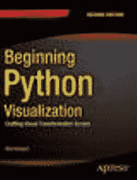
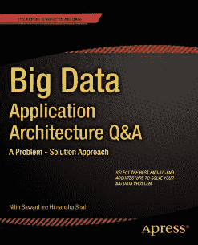
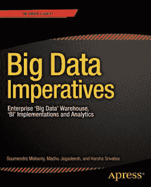

# 致谢

衷心感谢所有受访者，以及那些让我能够采访到他们的朋友们和同事们。言语无法形容你们每个人给予我的灵感，所以我只想说，你们让我的生活变得更美好，为此我永远感激不尽。

万分感谢我的家人：感谢父母传承了对书籍和学习的热爱；感谢劳拉（Laura）给我的启发；感谢玛德琳（Madeleine）给我的生活带来奇妙；感谢丽兹（Liz）和克里斯（Chris）的爱与支持；感谢汉娜（Hannah）成为我更好的另一半和冒险伙伴。

特别感谢`Apress`在整个出版过程中的支持：感谢罗伯特·哈钦森（Robert Hutchinson）的想法、建议和关怀；感谢丽塔·费尔南多（Rita Fernando）的耐心指导；感谢克里斯汀·吴（Kristen Ng）的倾听和鼓励。

最后，感谢本书的读者。我真诚地希望你们能站在这些巨人的肩膀上，看得更远。

