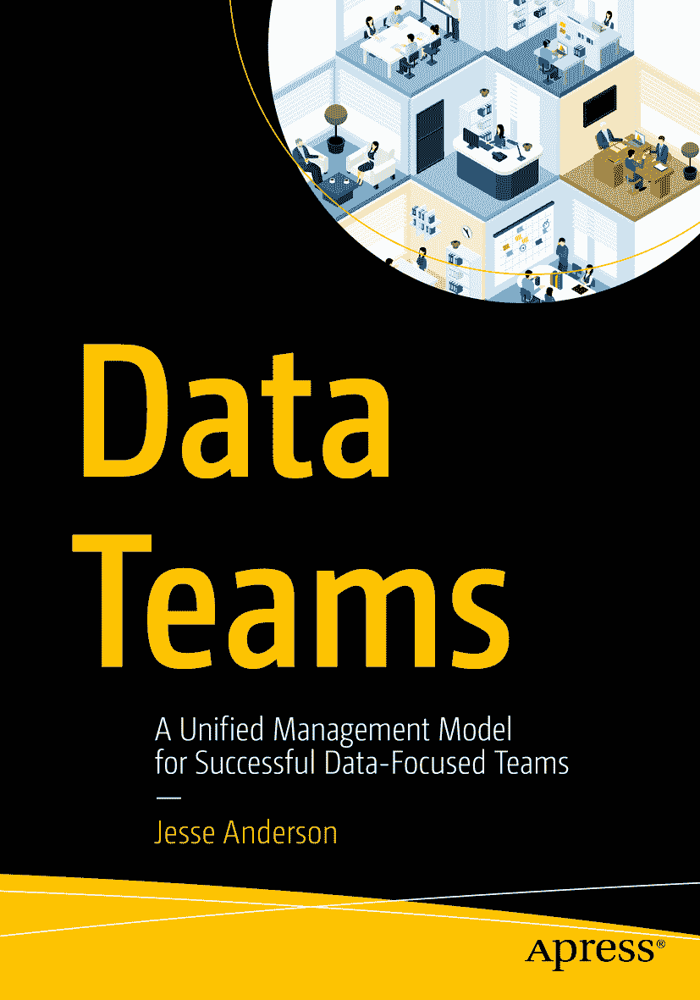

ISBN 978-1-4842-6227-6 e-ISBN 978-1-4842-6228-3 <https://doi.org/10.1007/978-1-4842-6228-3>
© Jesse Anderson 2020

本作品受版权保护。出版者保留所有权利，无论是涉及材料的全部或部分，特别是翻译、重印、重用插图、朗诵、广播、以缩微胶卷或任何其他物理方式复制，以及信息存储与检索、电子改编、计算机软件，或采用目前已知或日后开发的任何类似或不同方法进行传播。在本出版物中使用通用描述性名称、注册商标、商标、服务标志等，即使没有明确声明，也不意味着这些名称不受相关保护法律和法规的约束，因此可供普遍使用。出版者、作者和编辑可合理假设，本书中的建议和信息在出版时是真实准确的。出版者、作者或编辑均不对本书所含材料或可能存在的任何错误或遗漏提供明示或暗示的担保。出版者对已出版地图中的管辖权主张和机构归属保持中立立场。

本书通过纽约施普林格科学与商业媒体在全球图书贸易中发行，地址：1 New York Plaza, New York, NY 10004。电话：1-800-SPRINGER，传真：(201) 348-4505，电子邮件：`orders-ny@springer-sbm.com`，或访问 `www.springeronline.com`。Apress Media, LLC 是一家加利福尼亚有限责任公司，其唯一成员（所有者）是 Springer Science + Business Media Finance Inc (SSBM Finance Inc)。SSBM Finance Inc 是一家特拉华州公司。

*谨以此书献给萨拉、阿什莉和格蕾丝。*

