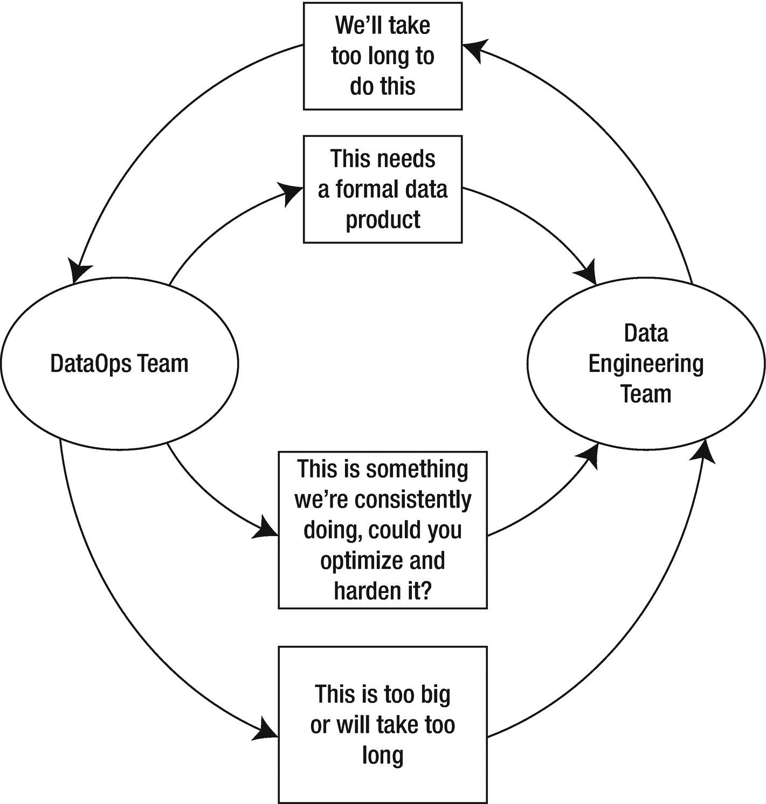
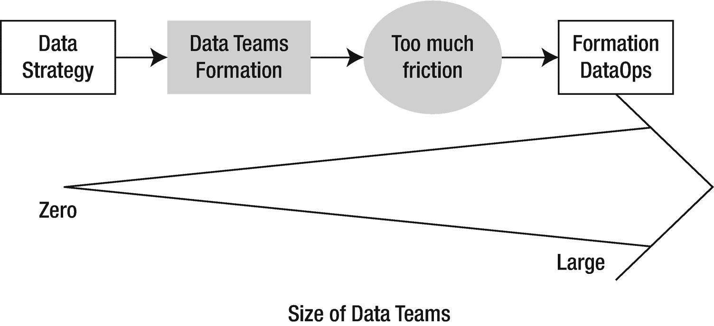
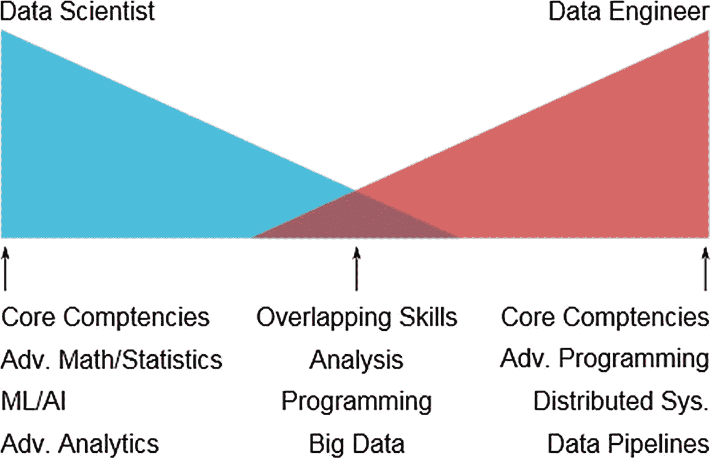
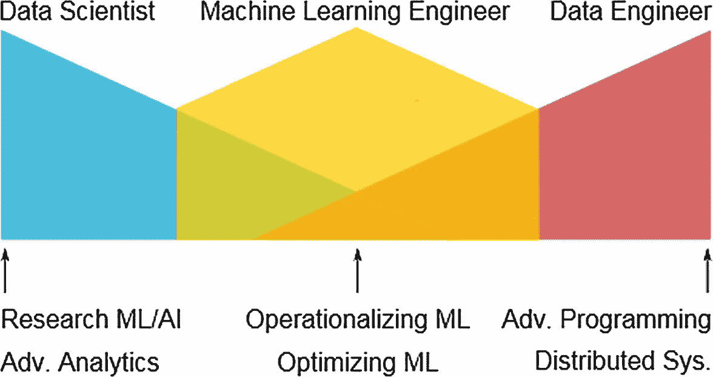

# 6. 专业人才

> *因为时代正在改变*
> ——鲍勃·迪伦《时代正在改变》

随着组织在数据使用方面日趋成熟，他们开始需要更专业的技能。本章我们将探讨两个高级人员配置领域：DataOps（数据运维）和机器学习工程师。这两种技能都融合了软件工程、分析学和数据科学。

## DataOps（数据运维）

DataOps 团队是一个跨职能团队，其主要目标（即使不是全部目标）是通过分析来创造价值。这种跨职能特性使团队能够利用数据创造端到端的价值，因为他们可以从原始数据入手，并将其转化为价值。

一个 DataOps 团队包含数据工程师、数据科学家、数据分析师和运维人员。拥有数据工程师意味着团队能够高效地创建数据产品。拥有数据科学家和数据分析师，团队就能构建完整的分析体系，从简单的分析到全面的模型创建。运维组件则使团队能够将产品投入生产环境，并获得生产支持，或者拥有使用生产数据或集群资源的生产权限。

即使团队能从零开始构建数据管道，也不意味着他们总是应该从零开始。他们应该利用数据工程团队已创建的其他数据管道。

延续这种复用策略，他们可能不会为每条管道编写代码。DataOps 团队可能会使用更多无需编码即可创建管道的工具。这些分布式系统或技术将能够创建分析管道或数据管道，而无需从头编写代码。DataOps 团队会更侧重于行动速度，而非追求最优化的工程方案。

这引出了 DataOps 与数据工程之间的关键区别——周期速度。数据工程（与大多数软件工程一样）工作周期较长。这是分布式系统固有的复杂性和耗时性的外在体现。提升数据工程团队的迭代速度可以改善这些时间周期，但这通常会受到数据工程团队的限制，因为他们要创建越来越复杂的数据管道。DataOps 认识到商业条件变化迅速，每家企业都在竞相发现变化并做出响应；拥有成熟数据团队的组织要求新模型能尽快达到生产就绪状态并部署。为实现这一目标，DataOps 的工作周期要短得多。DataOps 团队可以利用数据工程团队的数据产品，与业务部门合作创建分析方案，并从数据产品中创造具体的商业价值。这个更短的周期正是业务部门利用数据所真正需要的。

### DataOps 中的权衡取舍

有些项目必须在大约一天的时间内完成，甚至可能只有几个小时。高管或首席某某官有时会要求为第二天的会议准备一份分析报告。DevOps 团队可以解决这个临时需求。但要求数据工程或数据科学团队去做，会迫使他们完全停止手头工作、切换上下文，并开始匆忙拼凑代码。这种做法会不断给团队造成延误和问题——而且他们可能缺乏在期限内完成的技能和思维方式，因为他们的整个职业生涯都致力于编写一丝不苟、万无一失的代码。

DataOps 的关键原则是专注于开发和发布的速度，而非追求最优化的工程解决方案。DataOps 人员不会试图用自己的技能替代其他团队，也不会包揽其他团队的所有工作。相反，DataOps 人员可能会让数据工程团队创建新的数据管道，然后运用 DataOps 技能来实现快速更新和发布。对于某些数据源，可能不存在现成的数据管道，DataOps 团队可能需要自己创建。DataOps 可以使用工具来创建管道，而无需编写新代码。

因此，数据工程团队会首先以与其他软件工程团队相当的速度完成其工作。他们需要大量时间，因为分布式系统很复杂且难以正确使用。另一方面，DataOps 的工作周期要短得多。DataOps 可以接手数据工程团队的数据产品，与业务部门合作创建分析报告，并从数据产品中创造具体的商业价值。如果他们需要开拓创新，他们可能会创建一个数据产品，然后由数据工程团队回头将其打磨得更符合生产要求。

### Gartner 对 DataOps 定义的问题

Gartner 在科技领域的商业领袖中经常被引用，它对 DataOps 有自己的定义：

- 数据运维是收集和分发数据的中心，其任务是提供对客户和营销绩效数据记录系统的受控访问，同时保护隐私、使用限制和数据完整性。

在我看来，Gartner 的定义并没有充分区分 DevOps 带来的新技能与数据仓库团队 DBA 的传统角色。这个定义实际上暗示了一种抵抗性的方法：将用户与数据隔离。

我的批评之所以重要，是因为历史上数据团队曾利用他们保护隐私和数据安全的职责来阻碍有价值的数据使用。数据用户和数据仓库团队之间常常因为这种保守主义而爆发地盘之争。我们需要的是一个强调敏捷性和增加数据访问权限的定义。

我在这里提到 Gartner 的定义，仅仅是因为你很可能在其他地方看到它被引用，我想确保你有一个更积极的定义可以参照。

### 还有另外三种 DataOps 的定义

第一种是 DataOps 仅仅是面向分析的 DevOps。在这个定义中，我们借鉴了 DevOps 运动，并认为需要将其稍微扩展以包含数据。这种想法认为，只要我们发布得更快，就可以提高数据管道的质量。DevOps 专注于通过软件工程和改进发布周期来创造价值。DataOps 团队应专注于从数据中创造价值。只有当数据质量足够高，使其可用时，DataOps 团队才能从数据中创造价值。理想情况下，DataOps 团队应尽可能自给自足，以便自助提供数据产品并将任何产出投入生产。

第二种定义是面向数据工程团队的实践。这个定义要求你的数据工程团队应用 DevOps 原则。这意味着你的数据工程团队需要学习或增加具备运维和从数据中创造价值（通常是分析）能力的人员。将这两个新属性结合到数据工程团队中并非易事。在价值创造方面，数据工程团队需要学习如何分析数据并从数据中创建可用的见解。我再次强调，基于我广泛教授数据工程师的经验，这并不是一个普遍特征。如果从数据中创造的价值是简单或直接的计算，数据工程师可以做到。但我认为，如果你的分析产品如此简单，那么你实际上应该设定更高的目标，否则可能是在浪费时间和金钱。

第三种定义是 DevOps、精益、敏捷和数据管理的超集。这个定义允许 DataOps 团队优化从端到端创建数据产品的过程。该团队将能够控制数据产品的供应、质量和运维。

### 为 DataOps 寻找人员

与其他团队和职位名称不同，我认为不会有一个统一的 `DataOps Engineer` 职位名称。因为 DataOps 团队是跨职能的，你需要区分数据工程师、数据科学家、数据分析师和运维人员。因此，你雇佣或从其他团队抽调的人员很可能保留他们原来的职位头衔。

已经拥有前面章节所述的数据科学、数据工程和运维团队的组织，通常通过以下方式之一找到 DataOps 人员：

- 从数据工程团队中，教授他们必要的软件工程技能
- 从运维团队中，教授他们必要的数据和分析技能

真正的问题是：谁有软件工程经验？作为软件工程师拥有成熟的经验很重要，在此之后掌握其他必要技能并不太难。

对于数据科学家和数据分析师来说，所需的变化量可能从微乎其微到非常广泛不等。数据科学家和数据分析师通常习惯于在较短的时间框架内工作。如果不是这样，他们需要接受指导或培训，了解在哪些方面可以走捷径以快速产出成果。如果数据工程师正在使用无代码或低代码产品来快速创建数据管道，那么数据科学家和数据分析师可能需要接受培训，学习如何有效地使用这些产品。

### DataOps 的价值

大多数组织开始涉足数据领域，是因为他们听说了数据科学取得的近乎奇迹的成就，并认为他们只需要数据科学家就够了。管理者们可能对处理数据的需求了解不多，所以他们期望数据科学家包揽一切，从寻找数据到从数据中创造商业价值。正如我们在这本书中已经看到的，有效的数据分析是一个需要多种技能的团队协作。

一些分析和数据工程组织仅靠一两个人的个人努力支撑。这种个人英雄主义给组织带来了各种风险。从技术角度来看，这种英雄主义涉及的权宜之计和不确定的希望可能比你想象的要多。对于短期分析项目，这没问题。但对于长期或企业级的分析来说，这种方法会产生大量的技术债务。这种英雄主义无法规模化，一旦那个人离开，组织就会通过艰难的方式认识到这一点。持续的个人英雄主义通常意味着组织内部存在更深层次的技术和人员问题。

DataOps 应该为组织提供一种方法来处理这些问题——问题总会出现的——同时将不合理的负担从个人肩上卸下。DataOps 团队应专注于渐进和持续改进，直到不再需要熬夜加班为止。

### DataOps 团队与数据工程团队之间的关系

在规模较大的组织中，DataOps 团队与数据工程团队是相互独立的。这种分工要求他们明确各自的任务范畴，以及如何协同工作。

这两个团队往往持有不同的思维方式：数据工程团队出身于软件工程，而 DataOps 团队则聚焦于快速生成分析结果。

由于思维方式的差异，DataOps 团队可能会认为数据工程团队节奏过慢，且存在过度工程化的问题。反之，数据工程团队则认为 DataOps 在工程规范和最佳实践方面过于随意、缺乏严谨性。数据工程师们担心，最终他们可能需要接手一个在生产环境中实现得差、文档缺失、且随时可能出故障的系统。

这是一种你需要设法调和的基本矛盾。工程师，尤其是在大型企业中，其思考周期通常以十年为单位。他们认为自己的工作就是确保所开发的程序或系统能够稳健地运行并维护十年之久。任何新技术的落地都伴随着内在风险，工程师们正在权衡这些风险。他们之所以会考虑这些问题，是因为过去曾在这方面吃过亏。

而 DataOps 团队中的分析师或数据科学家则不会以十年或更久的时间线来思考问题。他们的工作周期很短，只关心分析是否能奏效，或者为某个短期需求实验一个新想法——这可能只需要几分钟或几天。

## DataOps 与机器学习工程师

将所有问题简单地划分为短期问题或长期问题，正是 DataOps 和数据工程团队陷入困境的根源。他们必须学会在速度与企业级考量之间取得平衡。有时，某个短期问题或解决方案会一直停留在短期方案层面。但当一个短期方案逐渐“拥有了自己的生命”，并演变为长期方案时，会发生什么呢？

此外，有时你不得不将某个短期方案替换为更偏长期的不同方案。如果不能及时认识到调整时间框架的必要性，就会导致长期低效地使用短期方案反复解决同一个问题。

因此，DataOps 和数据工程团队应建立清晰的沟通流程，以预测并处理从快速短期方案向更具架构性的长期方案转型的过程。图 6-1 展示了两个团队在认识到转型需求时可以开展的对话。

**图 6-1** — DataOps 与数据工程协同工作的模式

仍然有一些项目需要遵循以月为单位的传统工程周期。随着分析复杂度的增长和数据处理需求的增加，你将同时需要常规的数据工程师和 DataOps 团队。

### 何时开始实施 DataOps

我发现，如果组织在发展的早期阶段就尝试推行 DataOps，往往会面临失败的风险，因为企业同时要应对过多的组织架构变革。团队会因不清楚向谁汇报或该做什么而陷入混乱。再加上向大数据迁移本身的技术难度，团队甚至可能完全失去生产力。

如果你的组织已经拥有跨职能团队，或者你一开始就组建了一个大型数据团队，并且有足够的人员来支撑所有必要的团队，那么你可以考虑在项目早期就开始推行 DataOps。在这种情况下，部分员工可以通过横向调动转入 DataOps 岗位。

对于大多数组织而言，更好的做法是等到数据团队逐渐成熟，并真正遇到 DataOps 旨在解决的问题时再开始推行。届时，团队最初那种“只要让东西能跑起来并交付出去”的压力会逐渐消退，反而会开始听到“工具发布速度太慢”的抱怨。虽然数据产品已经就绪，但团队响应一个请求的速度却遭到诟病，如图 6-2 的时间线所示。这时正是组建 DataOps 团队的绝佳时机。

**图 6-2** — DataOps 是一种更高级的团队结构

## 机器学习工程师

机器学习工程师负责填补数据科学和数据工程之间的技能鸿沟，如图 6-3 所示。数据科学家在统计学和人工智能方面实力雄厚，而数据工程则擅长分布式系统和构建流水线。两者都具备一些用于大数据的编程和工具知识，但如图 6-3 中部所示，他们的技能水平在交叉区域急剧下降，形成了一道难以填补的鸿沟。这道鸿沟的严重程度因组织、任务难度以及数据科学家自身的编程能力而异。

**图 6-3** — 数据工程师与数据科学家之间技能鸿沟的可视化呈现

通常，数据科学家的代码在投入生产之前需要经过他人的重写。这种改动可能小至简单的代码审查，大到完全的重构和重写。但这仅仅是将代码交给一位经验丰富的程序员是不够的，因为其中包含了高级统计学和复杂的机器学习算法。程序员需要具备一定的数据科学技能才能胜任。在重写过程中，有些模型可能只需微调，而另一些则需完全重写。这项工作可能还包括使模型部署更直接、更自动化。有时，还有一些结合了运维和数据科学的考量，比如需要验证新模型的表现是否与旧模型持平或更优。

这正是机器学习工程师所填补的鸿沟。他们处在数据工程和数据科学两个世界之间。他们需要能够判断一个模型对于某个用例来说是否足够好，而不仅仅是能否达到发表博士论文的水平¹⁹。同时，他们还需要知道何时以及如何将工程严谨性应用于模型。图 6-4 展示了机器学习工程师如何融入整个工作流程。

**图 6-4** — 机器学习工程师填补了数据工程师与数据科学家之间的鸿沟

### 寻找机器学习工程师

一名机器学习工程师应同时精通并自如运用软件工程和数据科学。因此，他们可能来自图 6-3 的任意一侧：要么是拥有软件工程经验的数据科学家，要么是具备数据科学经验的软件工程师。

转型为机器学习工程师的数据科学家，通常在本科阶段学习的是计算机科学或相关工程专业。有些还曾担任过软件工程师。无论哪种情况，他们都拥有大多数数据科学家所不具备的软件工程背景。

另一种背景是对数据科学感兴趣的数据工程师。他们通常对数据科学表现出极大兴趣，其在校学习经历可能包括辅修数学或某种数学相关的专业方向。另一些人则完全没有学历背景，但计划通过数据工程岗位逐步晋升到机器学习工程师职位。

### 机器学习工程师的归属

如果你只有少数几位机器学习工程师，可以将他们安排到数据科学团队或数据工程团队中。我见过机器学习工程师大多归属于数据科学团队，因为对模型的重写与改进占据了他们工作中最耗时的部分。

当组织规模较大或机器学习工程师数量较多时，你可能需要组建一个专门的机器学习工程师团队。该团队将维持高带宽连接，并与数据工程团队进行广泛的协作。

