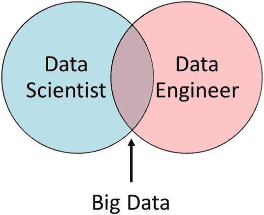
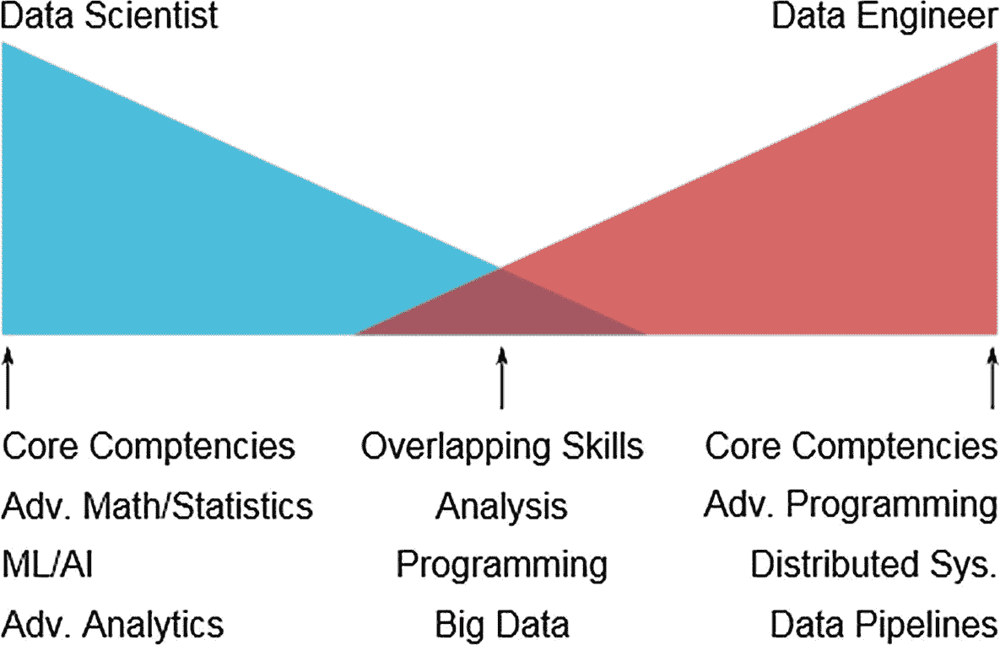

# 4. 数据工程团队

> *寻觅一位专注且刚毅之人，他能展开地图，预见一二之间的路径*
>
> ——音速青年乐队《青春暴动》

数据工程团队负责创建数据产品以及构建数据产品的架构。这些数据产品实际上是整个组织的生命线。组织的其他部门要么消费这些数据产品——从中获取驱动规划的洞察，要么创建衍生的数据产品以供进一步使用。

在架构方面，数据工程团队需要负责构建数据管道。数据管道是一个处理原始数据并将其转化，使其能够被整个组织使用的流程。为了完成这项任务，数据工程团队必须为数据和用例选择合适的技术：例如，在众多可用的数据存储中选择哪一个来存放数据，使用哪个消息队列系统来传递数据，等等。

数据工程师还必须将数据维护成随时可用的格式，同时要考虑到数据形态和企业需求都可能发生变化这一趋势。^(⁹) 数据管道也需要运行在系统上，无论是本地部署还是云端，并且这些系统必须具备大规模扩展的能力。

数据管道是利用其调用的各种工具的 API 进行编码的。因此，编写和测试这些代码也是数据工程团队的职责。这实际上要求数据工程师掌握必要的编程知识，并理解他们所处理的分布式系统。数据工程团队负责验证他们创建的架构，并向用户保证该架构能够适当地扩展。因此，强大的软件工程技术，如持续集成和持续交付（`CI/CD`），也是他们技能组合的一部分。没有强大的架构和数据基础设施，项目将表现不佳或一事无成。

这个团队并非仅由数据工程师组成。与前一章的数据科学团队不同，数据工程团队是一个跨职能团队，团队中会有其他职位头衔的人。数据工程师将占主导地位，但其他人，例如前端工程师或平面设计师，将对他们形成补充。

因此，数据工程师是具备专业技能的软件工程师，专注于围绕大数据构建可扩展、经得起生产环境考验的解决方案。

在本章中，我们将探讨数据工程师的定义以及所需技能。我们还将进一步讨论这个团队的多学科构成，并就如何将现有的非数据工程人员引入数据工程团队给出建议。我们还将澄清关于数据工程与数据仓库、数据工程与数据整理之间关系的误解。

## 需要哪些技能？

强烈建议数据工程师拥有软件工程背景。软件工程是这个岗位的基础学科，没有经过大型软件系统设计训练的人，很可能会创建出脆弱且难以维护的解决方案。

数据工程师进一步将他们的软件工程技能专门化，以应用于大数据和分布式系统。在他们处理小数据和软件工程的早期阶段，可能已经开始涉足大量的多线程或客户端/服务器系统。当数据工程师开始从事分布式系统工作时，这种背景非常有益。两者并非完全相同，但这种经验为学习奠定了基础。

数据工程师也对数据本身感兴趣。有些人甚至会说他们热爱数据——我同意这一点。在过去，这些软件工程师可能会主动创建分析报告，或者投入精力去捕获那些普通软件工程师不会关注的数据。他们意识到了数据的重要性和价值。

数据工程团队往往偏向于资深人员。这并不是说数据工程团队从来没有初级人员。而是说数据工程师通常是从软件工程师的层级晋升上来的，因此团队应该包括那些曾担任中级或高级软件工程师的人员。数据工程团队的初级成员通常拥有硕士或更高学位，或者之前专门研究过某种形式的分布式系统或大数据项目。

与软件工程相比，数据工程师更常遇到伴随规模而来的不可避免的权衡。例如，软件工程的一条硬性规则是使用单一技术将所有数据存储在一个地方（规范化）。最常见的情况是，软件工程师以完全规范化的方式将数据存储在关系数据库中。当构建一个大规模系统时，数据已经预先连接好（反规范化），并存储在针对特定用例设计的几种不同技术中。

一个软件工程师可能会觉得有必要坚持那些在小规模应用中行之有效的最佳实践，但这种方法在大规模环境下效果不佳。数据工程师需要理解何时应该遵循最佳实践，以及何时为了追求速度或实现更高的可扩展性而偏离这些实践是有意义的。

在可预见的未来，关系数据库和数据仓库仍将是组织数据集的一部分。因此，一些传统的 SQL 技能也应成为数据工程师工具箱的一部分。

以下小节将详细讨论数据工程团队所需的以下技能：

*   分布式系统

*   编程

*   分析

*   视觉传达

*   口头沟通

*   SQL

*   数据模式（Schema）

*   领域知识

*   其他重要技能

虽然数据工程团队中的大多数成员需要具备强大的编程和分布式系统技能，但其他技能并不需要团队中的每个人都掌握。根据用例和数据产品的不同，这些额外的技能可以由团队中的一两个人或几个人来承担。

### 分布式系统

分布式系统是困难的。你需要让许多不同的计算机协同工作。这要求系统必须以不同的方式进行设计。你必须规划数据如何在计算机之间移动。

我教授分布式系统多年，我知道这是需要时间才能理解和掌握的东西。

数据工程师需要具备中级到高级的能力来创建和使用分布式系统。其中一些技能包括理解资源分配和网络带宽需求、如何创建虚拟机和容器、复制、如何分区数据集和消息队列，以及如何处理故障和容错。

### 编程

数据工程团队中的数据工程师负责编写在大数据框架上执行用例的代码，因此他们需要成为熟练的程序员。^(¹⁰)

大数据框架的实际代码并不复杂。通常，最大的难点在于理清各种不同的技术。处理小数据时，程序员通常只需要掌握一到三种技术。而数据工程团队的程序员则需要掌握 10 到 30 种不同的分布式系统或数据技术：包括每种技术的 API、架构和应用程序。

我所说的编程，并不仅仅指语法知识。数据工程师还负责持续集成、单元测试和工程流程。这些需求常常被误解，导致团队中缺失这些环节。有时，数据工程团队会忘记他们仍在从事软件工程，表现得仿佛忘记了软件工程基础。这些要求并不会消失——事实上，由于大数据问题本身的复杂性，它们比以往任何时候都更加重要。

在数据工程师修复问题之前，他们应该编写一个能够模拟问题或错误状态的单元测试或集成测试。这个单元测试最初应该失败，以确认问题的存在；然后，当数据工程师修复问题后，测试应该通过。如果没有充分的单元测试或集成测试，数据工程团队将无法知道修复第一个问题可能会引发哪些其他问题。

### 分析

数据工程团队需要将某些数据分析作为数据产品来呈现。分析技能使团队能够创建这些分析型数据产品。这种分析可以是从简单的计数和求和，到从数据中提取新维度的更复杂产品。

数据工程团队的实际技能水平可能有很大差异；这完全取决于用例和组织。判断所需分析技能水平的最快方法是查看数据产品的复杂性。它们是相对简单，还是涉及大多数程序员无法理解的方程式？

有时，分析型数据产品只是一份提供给其他业务部门的简单报告。这可以通过像 SQL 查询这样简单的方式来完成。更高级的分析工作则来自数据科学团队。

### 视觉传达

数据工程团队需要以视觉方式传达其数据产品。这通常是展示数据状况的最佳方式——尤其是在数据量极其庞大时——以便其他人能够轻松使用这些结果。通常，你需要随时间推移并以动画形式展示数据。这项功能结合了编程和可视化。

具备视觉传达技能的团队成员将帮助你用数据讲述一个图形化的故事。他们不仅能用逻辑方式展示数据，还能以恰当的美学形式呈现。

大多数软件工程师和数据工程师并不以他们的图形能力和漂亮的用户界面而闻名。你可以花费大量时间和资源试图提高数据工程师的艺术技能。或者，你也可以在数据工程团队中安排一名前端工程师，以确保面向客户的数据在外观和功能上都正确无误。

那么，如何处理前端工程师在面对数据及其产生方式时可能会遭遇的理解不足问题呢？让前端工程师与数据工程师一起工作，以理解他们所处理的内容。数据工程师可以编写代码，以一种前端工程师可以开始处理的方式来提取数据。另一种可能性是让两人进行一段时间的结对编程。

正如你在第 3 章的“沟通”部分所见，数据科学团队也需要运用视觉传达。根据需要完成的前端工作量，前端工程师的时间可以在数据科学团队和数据工程团队之间分配。或者，所有与数据相关的前端工作都可以完全由数据工程团队负责。在这种情况下，该团队会将预定义的部分前端数据工作分配给前端工程师。

### 口头沟通

数据工程团队是组织中许多部门交汇的中心枢纽。团队中需要有人能够与公司其他部门进行口头沟通。这项技能通常由数据工程师或架构师来承担，因为他们需要对技术问题、数据、用户兴趣以及常用术语有深刻的理解。

负责口头沟通的人需要帮助其他团队成功使用大数据平台或数据产品。他们还需要向这些团队传达哪些数据是可用的。一些数据工程团队的运作方式类似于内部解决方案顾问。

这项技能可能意味着增加集群的内部使用率，还是看着所有工作付诸东流。如果没有内部宣传者或能够清晰阐述数据产品的人，数据可能永远得不到使用。

### SQL

在团队中配备一名数据库管理员（DBA），有助于满足团队对 SQL 技能的需求。SQL 专家还能在数据工程生命周期的后期阶段提供帮助。一旦数据和数据基础设施就位，大多数（如果不是全部）数据都会通过 SQL 接口暴露出来。此时，专注于 SQL 的人员就可以开始提供价值了。这也适用于其他人（通常是业务团队）无法自己编写 SQL 查询的情况。

以下是我归类为 SQL 专精的一些职位：

*   DBA（数据库管理员）

*   数据仓库工程师

*   ETL 开发人员

*   SQL 开发人员

*   （某种 ETL 技术）开发人员

在本书中，你可能会看到我通常使用术语 `DBA` 来指代这一系列职位，而不是逐一列出。

当然，数据工程团队不能只由 DBA 或专注于 SQL 的人员组成。如果一个由这样的 DBA 组成的团队真的把某些东西投入生产，那更像是个特例，而非真正的成功。在与这类团队打交道时，我发现他们的“生产”系统更多是靠胶带和希望勉强维持，而非其他东西。这些系统时常崩溃，并且几乎不可能进行哪怕是最小的升级改进。

相反，一个没有 DBA 的数据工程团队则会导致另一种类型的失败。DBA 在其整个职业生涯中一直在处理数据难题中的一些工作和部分。^(¹¹)

## 模式（Schema）

虽然一些大数据工具和存储系统被宣传为“无模式”（schemaless），但它们通常都内嵌了某种键/值结构或标签。从效果上看，它们确实拥有模式，只不过这些模式可能不像关系型数据模式那样严格和可预测。

尽管如此，与大多数软件工程不同，大数据通常不会通过诸如 REST 调用之类的 API 暴露给整个组织。相反，数据往往作为原始数据提供给数据团队的其他成员或整个组织。模式能确保这些数据被正确地呈现。

因此，具备这项技能的成员可以帮助团队规划数据布局。他们负责创建数据定义，并设计数据在存储、检索、传输或接收时的表示形式。

尽管定义和应用模式的需求一直存在，但这项技能在数据工程团队中却常常缺失。随着数据管道的成熟，这项技能的重要性才真正显现出来。我告诉我的客户，当数据管道变得日益复杂时，这项技能将决定你们是成功还是失败。当你在 `HDFS` 或 Blob 存储上保存了 PB 级的数据时，你不能因为每次新增一个字段就去重写所有数据。掌握模式技能，能帮助你审视现有的数据和所需的数据，然后定义出你的数据应该是什么样子。

在与团队合作时，我反复发现一些需要询问的模式相关问题。总的来说，数据库管理员（DBA）解答这些问题的能力，往往是软件工程师同行的六倍。DBA 通常能将模式技能带入数据工程团队。

团队常常会选择像 `JSON` 或 `XML` 这样简单但低效的数据格式。结果，高达 25% 到 50% 的信息仅仅是标签带来的开销。这也意味着，每次需要使用数据时，都必须进行序列化和反序列化。团队中的模式技能有助于选择并解释展示数据的正确方式。他们也会倡导使用像 `Avro` 或 `Protobuf` 这样的二进制格式。他们知道必须这样做，因为随着公司内其他部门了解到数据的存在和能力，数据的使用量会不断增长。像 `Avro` 这样的格式，可以使数据工程团队免于逐一对每个人的代码进行类型检查以确保正确性。

模式技能不仅仅局限于简单的数据建模。实践者应理解存储选择背后的基础计算机科学原理，例如，将数据保存为字符串和保存为二进制整数之间的区别。

## 领域知识

有些工作和公司并非以技术为核心；它们实际上是以领域专业知识为核心的。这些工作将 80% 的精力放在理解和实现领域上，剩余 20% 的精力用于确保技术正确。以领域为核心的工作在金融、医疗保健、消费品和其他类似公司中尤为普遍。

领域知识需要成为数据工程团队的一部分。团队中应尽可能多的人具备这种背景知识。这些人需要了解整个公司内所有系统的运作方式。他们需要深刻理解你为其创建数据产品的那个领域；这些数据产品需要反映该领域，以便在该领域内使用。

## 其他重要技能

有些技能不太被认可，并且可能在数据工程团队中缺失。从 DBA 晋升上来的人，比那些来自软件工程背景的人更可能理解这些需求的重要性。DBA 的整个职业生涯都在处理这类问题，而大多数软件工程师从未接触过它们。

软件工程师可能无法立即认识到这些技能的价值，因为他们从未被这些问题所困扰，也从未体验过对这些需求的迫切感。这又回到了那个问题：一个没有 DBA 的数据工程团队，将在后期遭遇一个完全盲点式的失败。我期望 DBA 成为数据工程团队中大声疾呼、力陈这些需求的人。

这些需求也往往只有那些在大型组织工作过的人才能认识，因为大型组织在它们的大多数项目中都必须满足这些需求。

以下是那些经常缺失的、较为重要的技能：

### 数据治理（Data Governance）

数据的安全性如何？数据是否需要脱敏？是否包含需要隐藏的个人身份信息（`PII`）？

### 数据血缘（Data Lineage）

数据最初来自哪里？当数据出现问题时，我们去哪里回溯查找源数据？

### 数据元数据（Data Metadata）

当你有成千上万个数据产品时会发生什么？你如何跟踪它们的元数据和模式？

### 发现系统（Discovery Systems）

你如何对你的数据集进行编目，并帮助潜在的用户找到它们？

## 大数据工程师及其他职位描述

一些组织对数据工程师使用不同的职称。最常见的是“大数据工程师”。但我发现“数据工程师”这个头衔是最普遍的，因此我建议你使用这个职位名称进行招聘，以便最大程度地扩大候选人范围。

如果你考虑招聘的人之前的职位头衔不同，请确保此人履行过与数据工程师相同的职能。

更令人困惑的是，在一些组织中，“数据工程师”这个头衔被用于一个非常不同的工作职能，其技能组合侧重于关系型数据和 SQL。这个角色绝不是在为成为本书所定义的数据工程师做准备。

那些不能理解 SQL 专精与软件工程专精之间区别的组织，将无法成功打造他们的数据产品。数据工程团队确实需要编程和分布式系统技能。而专注于 SQL 的数据工程师恰恰缺乏这两项关键技能。

## 专业水平层级

将数据工程的专业水平分为三个层级是很有用的。最低层级是日常支持项目的人员。这些人可能是数据工程领域的新手。一旦有人成功主导完成了一个重大的数据工程项目，他们就可以被视为一名 *合格的数据工程师*，并承担更大的责任。而最高层级在本书中被称为 *资深专家*。以下部分阐述了这两个较高层级职位的职责。

### 新晋数据工程师

一个刚踏入数据工程领域的人本身就是一项巨大的成就。他们投入了时间和精力来进一步深化自己的技能。他们渴望学习并开始积累经验。

组织应该知道，一些最需要批评和帮助的想法往往来自他们最新的员工。新晋数据工程师通常知道“是什么”（what），但不知道“为什么”（why）。缺失的“为什么”可能导致大量代码重写。有时，新晋数据工程师的“是什么”来自供应商的白皮书或营销材料。新晋数据工程师无法区分哪些真正有效，哪些无效。他们可能投入数月的精力去实现一个根本不可行的方案。

### 合格的数据工程师

一个合格的数据工程师是真正将系统投入过生产环境的。我强烈建议一个数据工程团队中至少有一名合格的数据工程师，因为数据工程师掌握的许多知识必须基于经验。他们需要回答诸如此类的问题：是应该用这种技术还是那种技术？是应该用这种架构模式还是那种架构模式？

获得这些知识的唯一途径，就是真正在数据工程中亲自动手，将某些东西投入生产，然后被生产环境中出现的各种问题所困扰和折磨。

### 资深工程师

超越了合格的数据工程师，资深工程师在将分布式系统投入生产方面拥有丰富得多的经验。资深工程师应已将众多项目投入生产，因此处理过各种不同的问题，并拥有相应的实战经验来证明这一点。将单个分布式系统投入生产会带来一些经验，但还不足以成为一名资深工程师。数据工程团队中应同时包含资深工程师和合格的数据工程师。

资深工程师应在分布式系统方面拥有广泛经验，或至少拥有丰富的多线程经验。此人为团队带来了大量经验。

资深工程师对于阻止团队采纳糟糕的想法至关重要。资深工程师有经验去认识到，在现实世界中，那些技术上可行的事情何时会是一个坏主意。他们会为团队提供关于分布式系统的立足点或长期视角。这转化为更优秀的设计，一旦产品投入生产，便能节省金钱和时间。^(¹²)

## 进一步专业化

由于分布式系统技术的极端复杂性和数量不断增长，数据工程师可能需要进一步专业化。通过专业化，数据工程师将享有更高程度的知识，并能优化数据产品的创建。

数据工程师在云中运行基础设施是很常见的。随着云服务提供商日趋成熟，他们正在创建越来越多用于构建数据产品的专业化产品。这些专业化产品可能是云服务提供商创建的托管服务，或者是云服务提供商在幕后管理基础设施的开源工具。某些托管服务会使用开源 API，而另一些则会使用自定义 API。在使用这项技术时，可能存在原始开源产品中不存在的额外注意事项。无论如何，数据工程师可能需要专门研究特定云服务提供商的产品线，以跟上所有的变化和注意事项。

分布式数据库提供了大量的选择。粗略看来，许多数据库似乎提供相同的功能，并适用于相同的用例。然而，核心差异和注意事项可能意味着项目的成败，因为某个特定数据库可能无法正确处理某个用例。重写或重构数据产品或解决方案可能代价极其高昂。这是我们将看到更多数据工程师开始进一步专门研究数据库的一个重要原因。

数据工程师的另一个专业化方向是创建实时或流式系统。从表面上看，实时系统似乎只是简单地添加了一项新的实时或流式技术。但现实是，实时限制增加了更深层次的复杂性。实时限制要求对批处理系统中不存在的一些主题有新的理解层次，例如精确一次执行、幂等系统和错误处理。我预计实时系统将成为数据工程师中更普遍的专业化方向。

## 数据工程团队是否应只专注于大数据？

一个常见的问题涉及数据工程团队处理的数据规模。是否应该只关注大数据？还是也可以包含小数据？

数据工程师应能够同时处理大数据和小数据。这一原则源于数据工程师的职业发展路径。他们在转向大数据之前，应该已经掌握了小数据方面的事务。数据工程师应该对数据有务实的看法，以便为工作选择最佳工具。

鉴于数据工程师能够处理小数据，他们应该去做吗？你会开着你的法拉利去买日用品吗？也许吧。毫无疑问，法拉利能带你到那里。但在此过程中，你会面临一些风险，如果你开另一辆车就不会有。存在法拉利在停车场受损或更糟——被盗的风险。同样，在一个数据工程团队中，你投入了所有时间和金钱来雇佣或培训具有特定专长的人。更好的做法可能是，让他们将专长应用于最需要的地方，而让没有该专长的其他人来做这些小规模的工作。

如果你是一家小企业或初创公司，你可能没有足够的人手来负担真正的大数据专业化。在这些较小的公司，数据工程师可能不得不在不同规模的项目中来回切换。这种不断的来回切换可能导致重大的上下文切换，需要数据工程师花一些时间来适应。对于大型组织来说，在员工之间进行分工，赋予特定的专业化角色，是合理的。这些大型组织使你能够为特定的数据规模指派团队或个人。

另一点要记住的是，规模并不总是大数据。有时它处于中等数据这个中间地带。并非每个人都拥有真正的大数据。我认为中等数据要普遍得多，所以我创造了这个术语。^(13) 只需记住，小数据之外的一切都需要分布式系统——这可能是中等数据或大数据。无论哪种情况，你都需要数据工程师来处理。

## 常见误解

尽管从头开始阅读的读者会理解本书中做出的关键区分，但某些误解在我的工作中经常出现，我想在此明确指出。

### 为什么数据工程不仅仅是数据仓库

一个常见的误解是，数据工程只是数据仓库的新名称。这种误解已导致许多项目失败，因为数据工程和数据仓库团队需要不同的技能和构成。这种差异确保了将大数据项目置于数据仓库团队中成功的几率非常低。

数据仓库团队主要专注于`SQL`。他们缺乏数据工程团队所必需的编程和分布式系统技能。数据仓库团队使用的技术主要是成熟的、预先编写好的技术。该团队不需要编写任何代码，因为数据仓库技术供应商已经编写了他们所需要的所有代码。

数据工程则完全是另一回事。团队必须将许多不同的技术整合在一起，才能构建数据管道。这些技术往往是运行在分布式系统上的开源技术。这些技术本身往往具有尖锐的边角，并且不够成熟。更重要的是，它们需要编写代码，你不能仅对所有事情都使用`SQL`。^(14)

### 为什么数据工程师不是数据科学家

人们对数据工程师与数据科学家之间的区别存在大量混淆。这种混淆源于如图 4-1 所示的示意图，它们过度概括了两种职位之间的关系与重叠之处。

图 4-1

一幅对数据工程师与数据科学家差异示意不佳的示意图

如你所见，实际情况要复杂得多。图 4-2 更好地展示了这些细微差别。

图 4-2

一幅对数据工程师与数据科学家差异及各自优势示意更好的示意图

数据工程师很少被误认为是数据科学家。管理层不会期望数据工程师去创建模型。更常见的情况是，管理层会将数据科学家误认为是数据工程师，并期望数据科学家去完成数据工程师的任务并扮演其角色^(15)。确实存在一些“`全栈`”数据科学家，但凤毛麟角。数据工程师在编程和分布式系统方面远比数据科学家擅长得。

### 为什么数据工程不仅仅是数据整理

另一个常见的误解是，数据工程团队是一群数据整理者（有时被称为数据清洗者）的集合。管理者可能认为数据工程是一项简单的任务，无非是将数据从 A 点复制到 B 点，同时进行一些简单的数据转换来统一字段或剔除异常值。在这种情况下，他们常常会将数据从一种“原始”数据格式转换为另一种格式。

这种理解将数据工程置于数据工程团队本应完成的极低层次。我认为这个标准低到甚至不符合数据工程师的定义。数据整理者缺乏数据工程师所需的编程和分布式系统技能。他们的大部分任务都是手动完成、借助图形化程序或少量脚本完成。

## 数据工程团队与现有数据科学团队之间的关系

不幸的是，很多组织在尚未建立数据工程团队的情况下，就先行组建了数据科学团队。在探索数据科学的初期，该团队处于实验阶段，并不负责需要长期维护的生产系统。但如果不引入数据工程团队的稳健支持，他们就无法取得成功。

对于之前只有数据科学团队的组织而言，新成立的数据工程团队应承担的首要任务是清理数据科学团队留下的技术债务。（关于技术债务产生的原因，请参见第 3 章的“数据科学团队中的技术债务”一节。）之所以存在债务，是因为数据科学家往往是初学者水平的程序员。他们没有编写过大型代码库，不了解维护和处理这些代码库所涉及的问题。而数据工程师了解——或者至少应该了解——如何管理大型代码库以及如何选择恰当的分布式系统来运行它们。

实际的技术债务可能多种多样。整个系统可能靠“胶带和希望”勉强维系，也可能代码本身存在阻碍进一步发展的短期折衷方案。无论哪种情况，管理层都应评估偿还或重写数据科学家团队代码所需的时间和精力。

## 重新培训现有员工

一些公司希望或需要从内部寻找数据工程师。这些人在开始时很可能并不具备成为数据工程师所需的全部技能。组织有责任为这些新晋数据工程师提供成功所需的资源。这些资源包括学习新的编程语言、新的分布式系统以及创建数据管道的新方法。当组织不提供这些资源时，他们就是在为自己、为团队、为团队成员个人的失败埋下伏笔。

在内部晋升时，要寻找具有多线程、多进程或客户端/服务器系统背景的人。这能让他们对分布式系统如何工作以及如何使用有基本的理解。在此基础上，我会考察他们是否有学习和扩展自身技术栈的意愿。即便有软件工程背景，学习分布式系统也需要投入大量时间和精力。通常，这些人已经采取了初步措施开始学习相关系统，或者已表现出愿意开始的意愿。

除此之外，他们还需要展现出对数据的热爱。这表现为对处理数据和利用数据创造价值的兴趣。他们可能已经编写过小规模的分析或数据管道代码。

大多数情况下，当组织从内部寻找人才时，他们假设自己可以弥补个人的技能差距。但你也应该留意是否存在能力差距。技能差距意味着一个人仅仅缺乏知识，但具备在分布式系统方面取得成功的先天能力。而能力差距则意味着一个人既缺乏知识，又缺乏让他们能够习得技能的先天特质。无论投入多少时间、资源或专家帮助，都无法让这些不幸的员工达到更高水平^(16)。

在本章前面的“合格的数据工程师”部分，我建议至少雇用一位具备创建生产系统所需全部经验的合格数据工程师。当你晋升现有员工时，他们很可能无法胜任合格数据工程师的职务。对于某些组织来说，将内部非数据工程师转变为数据工程师变得绝对必要。如果是这样，你有责任为他们提供额外的指导和项目老手资源，使他们最终成为合格的数据工程师，甚至是项目老手。如果公司内部缺乏指导和项目老手的资源，则可能需要借助外部力量来帮助内部人员提升。

### 软件工程师

当组织开始从内部寻找潜在的数据工程师时，我建议从软件工程师入手。这通常是因为，在本章前面“需要哪些技能？”部分列出的技能中，软件开发技能是最难获得的。

请记住，与技术门槛低得多的数据科学团队相比，数据工程师需要达到高得多的技术编程水平才能成功。即使有软件工程背景，要熟悉庞大的分布式系统生态系统仍然需要时间。根据我的经验，一位优秀的软件工程师大约需要三个月的学习才能自如地从事数据工程工作。而普通的软件工程师则需要六到十二个月的时间。管理层在就项目时间安排和人员招聘做出决策时，需要考虑到这一点。

管理层还必须认识到，并非所有软件工程师都能成功转型为数据工程师，尽管他们比其他领域的人员有更高的成功率。管理层在甄选潜在的数据工程师时需要审慎评估。

### 以 SQL 为核心的职位

管理层常常会将`SQL`核心岗位视为数据工程师的来源。他们认为数据工程只是一些基础的`ETL`（提取、转换、加载）工作流程，并不真正需要编程或分布式系统技能。他们的逻辑是：这些人员已经在小规模数据处理方面成为专家，因此他们能够顺利过渡到更大规模的数据处理。这种思维模式是管理者应该避免的。

正如之前所解释的，仅仅由`SQL`核心人员组成的数据工程团队，相对于投入而言，产出的价值将非常低——低到以至于我建议团队甚至不要尝试开展这些项目。

在教过——或者说试图教过——大量`SQL`核心人员分布式系统之后，我可以断言这将是一段非常非常艰难的历程。就数据工程而言，`SQL`核心人员存在两个主要的技能缺口：编程和分布式系统。换句话说，他们在数据工程师所需精通的——而不仅仅是“过得去”就行——两个主要领域上存在欠缺。

我见过一种错误的观念，认为`SQL`核心人员可以使用不需要编程的高级工具来蒙混过关。但这远不能解决理解分布式系统这一重要问题。这些工具并不能消除数据工程师理解他们所应使用、架构和调试的分布式系统的必要性。即使有了这些工具，创造的价值也极其有限或低下，以至于不值得开展项目。

话虽如此，SQL 核心人员的定位在哪里呢？SQL 核心人员有可能成为数据工程师，但可能性不大。随着项目时间的推移，数据工程团队将有足够的时间来完善如何向组织其他成员暴露数据，通常是通过一种带有 SQL 接口的技术来访问数据。这些技术降低了技术门槛，使得 SQL 核心人员能够执行一些任务。这些任务可能包括基于 SQL 查询创建报表，或者帮助组织其他部门编写用于分析的 SQL 查询。这种成熟度在项目较晚的阶段才会出现，而正是在这个时间点，数据才能通过 SQL 接口开放给 SQL 核心人员使用。然而，如果从一开始就用 SQL 核心人员来启动数据工程项目，则注定会失败。

## 架构师的角色

架构师是资深或首席程序员，他们承担了更高层次的任务，即从整体上审视系统，并确保其具有商业价值。架构师是业务与其技术之间的粘合剂。架构师被期望在选用哪些技术方面做出艰难且长远的决策。他们要验证所提议的架构是否满足业务需求。

在数据工程领域，架构师需要绘制出管道中的交互关系，并用图表将这些交互关系呈现出来。这些交互非常复杂，因此需要编程背景，而不仅仅是 SQL 和模式的知识。

老实说，缺乏编程背景的数据架构师通常不同意这种评估。但关键在于：那些从 SQL 背景起步、后来学习了编程的数据架构师是同意我的观点的。

那么，大数据管道的架构师需要具备哪些技能呢？多年来，我与许多不同类型的架构师进行过咨询，在此，我将提供一些一般性的建议。

我认为数据工程团队的架构师需要知道如何编码，并且在职业生涯的某个阶段应该曾是软件工程师。他们现在可能不再大量编码，但他们应该曾有过编码经历。为了拥有分布式系统的经验，他们最好曾亲自编码或架构过分布式系统。在这方面，经验确实是无法替代的。实际上，获得这种经验的唯一途径就是亲力亲为，在充满挑战的一线实践中摸爬滚打。

架构师需要理解他们所提议方案的巨大难度。用分布式系统构建架构，不是随意选择一些技术并画出方框那么简单。架构师必须深刻理解用例以及数据将如何被访问。有了这些知识，他们才能运用自己对技术本身的深入理解，为工作选择正确的工具。那些盲目遵循供应商建议、白皮书或追随最热门技术的架构师，将无法构建出正确的架构。

那些没有编码经历、主要通过 DBA/SQL 核心路线晋升的架构师，往往难以理解他们负责架构的分布式系统。他们可能理解基本概念，但很难达到架构师应有的水平，从而无法为工作选择正确的工具。

选择技术路径的困难之处还在于，有些技术本身不够成熟，无法用于生产。架构模式也不够明确。未来，针对非常具体的用例或垂直行业，架构选择将变得更容易。这与通用用例的情况形成了鲜明对比，在通用用例中，大多数数据工程团队历来都需要编写定制代码。我认为，对于通用计算项目，情况不会变得更容易，也无法作为现成产品的一部分购买。

分布式系统中存在着微妙的细微差别和棘手的权衡取舍。我称这些为“作弊手段”。为了实现所需的规模，分布式系统不得不在某些方面“作弊”。有时人们称这些选择为“权衡”，但这个术语听起来像是小事一桩。实际上，大数据中的权衡选择可能使一个用例变得可行或不可行。^(¹⁷) 架构师必须掌握关于这些“作弊手段”对架构的影响以及它们如何相互作用的知识和理解。这恰恰是区分平庸架构师与伟大架构师的关键。而采取整体性的方法，则能使数据项目取得成功。

由于数据工程团队偏向于由资深人员组成，架构师的设计可能会从团队那里得到更多的质疑。架构师需要赢得团队的信任和尊重。这将使架构师在技术路径上更容易做出一些非传统或长远的决策。如果可能的话，应让数据工程团队的其他成员参与技术选择。当团队成员感到自己是决策过程的一部分，而非被动接受指令时，获得他们的支持要容易得多。

### 在组织中的定位

你应该把架构师放在哪个团队？他们是应该属于数据工程团队，还是隶属于一个更广泛的架构组？

我见过这两种选择都取得了成功。我见过架构师是独立架构团队的成员，也见过他们作为数据工程团队的一员。这个选择实际上取决于组织的规模以及数据工程团队是如何组建的。

如果架构师不属于数据工程团队，那么有几个关键的成功因素。首先，架构师需要与数据工程团队建立非常高带宽的沟通渠道。架构师的决策和技术选择需要传达给数据工程团队，而团队必须可靠地贯彻执行。任何认为架构师与团队脱节、高高在上的看法都会引发摩擦。其次，架构师需要认识到，分布式系统需要深厚的专业知识，仅靠粗略了解或照搬供应商的架构白皮书是无法实现的。架构师需要深入理解数据工程的各种细微差别，并跟上该领域不断变化的节奏。

如果有选择权，我建议让架构师成为数据工程团队的一员。数据工程确实是一项专业工作，让所有人团结在一起会很有帮助。

在一些组织中，并没有一个特定的或单独的架构师角色。相反，数据工程团队作为一个整体来履行架构师的职责。他们既负责软件架构，也负责系统的编码。团队中没有一个人拥有架构师的头衔。相反，整个数据工程团队共同努力来创建软件架构。

脚注 1 2 3 4 5 6 7 8 9