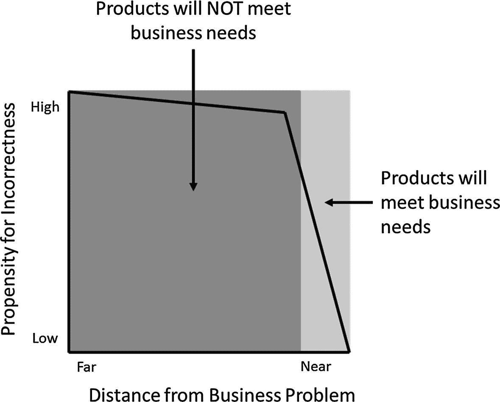

# 业务部门应如何与数据团队互动？

业务部门应当与数据团队保持持续且频繁的互动，正如数据团队成员之间需要高带宽的沟通连接（参见第 7 章的“高带宽连接”部分）。

数据团队的职责是获取原始数据并从中制作出数据产品。而业务部门的职责则是利用这些数据产品创造商业价值——或者至少告诉数据团队如何从数据中创造商业价值。有时，数据科学家也被期望能直接创造这种价值。部分数据科学家具备足够高的领域知识水平来做到这一点，但大多数人不具备。你可能需要一名业务分析师来补充或完全赋能数据科学家的领域知识。不同组织对领域知识的划分界限各不相同——多数情况下由业务分析师承担，有时也会部分落在数据科学家身上。

从数据科学中衍生商业价值的关键步骤有时被称为`BizOps`。一些组织会在本书讨论的其他团队之外，专门设立一个`BizOps`团队。在我最初构思本书大纲时，曾考虑用整整一章来介绍`BizOps`。它属于那些对某些公司有用、但对其他公司未必适用的高级职能之一。是否要建立`BizOps`团队，最终取决于组织或业务单元领域知识的复杂程度。以下问题将帮助你判断所在组织领域知识的复杂层级：
- 新员工需要掌握多少领域知识才能开始产出价值？
- 组织中是否有人（或一些人）的核心价值在于了解系统从头到尾的运作方式？
- 组织中是否有人（或一些人）的核心价值在于了解哪些数据正在被使用，以及每个字段的含义？
- 第三方数据提供商与你们自有系统之间的交互是否复杂？
- 理解数据在系统中从起点到终点的流转过程有多困难？

## 案例分析：医疗保险领域知识

为了说明领域知识的复杂程度及需求，让我描述一下我过去的一位客户。根据我与客户打交道的经验，医疗保险行业对领域知识的要求是最具挑战性的之一。你们组织的需求可能有所不同，但我希望分享我所遇到过的最高难度案例。

医疗保险公司在多个层面都受到领域知识复杂性的冲击：

### 医疗
医疗术语，例如`slot`、`provider`等，外加无穷无尽的缩写列表。

### 保险
各类手术编码以及保险公司通常极其繁琐的计费流程。

### 计费系统
账单输入并发送至保险公司的系统。

### 数据系统
关于患者、手术和账单的数据如何在系统中存储。

在我与那位医疗保险客户合作之前，我并未完全理解领域知识所需的惊人复杂度。我曾与该公司的一位业务分析师讨论过，他们团队在数据团队中的定位及其原因。起初，我给出了我的标准回答：数据工程团队应尽可能简化数据访问。但这位分析师坚持追问：数据工程师或数据科学家是否真的知道该使用哪些正确的字段、应该暴露哪些字段，甚至是否理解列名的含义？

就在那一刻，我豁然开朗。对于拥有复杂领域知识的组织而言，可能确实需要建立一个`BizOps`团队，该团队与其他数据团队之间的连接带宽，应与本书讨论的三个主要数据团队之间的连接带宽一样高。`BizOps`团队的存在是为了提供领域知识，并确保数据产品能够被业务部门实际使用。

## 这是规则，而非例外

致工程领导者的一席话：

在过去大约四十年从事数据和机器学习工作的过程中，我学到了一点：总体而言，当经济危机发生时，技术应用会实现跨越式发展——尤其是在基础设施领域。仿佛优先级突然变得清晰，而冗余障碍则被清除。

`Ben Lorica` 和我在 2018 年至 2019 年间进行了一项关于企业采用`ABC`（`AI`，`Big Data`，`Cloud`）情况的调研。我们设计了对比研究，比较了那些已在此领域投资五年以上并已获得`ROI`的企业，与那些甚至尚未开始的企业。分析结果令人信服，尤其是当我们把企业划分为领先者、追随者和落后者时。当然，少数“独角兽”企业在机器学习应用中占据主导地位，它们雇佣最优秀的人才，利用尖端技术巩固先发优势。另一大群体则在追随这些领先者的脚步，尽管它们在招聘合适岗位人员、应对数据质量问题以及寻找足够多能将现有技术转化为商业用例的人才方面困难重重。其余组织——超过一半的企业——则深陷技术债务，与不认为有投资必要的高管团队争论不休。换句话说，这些落后者距离拥有足够有效的数据基础设施以具备竞争力，尚有数年的差距。与此同时，先发者们正在 aggressively 加大数据投资，从而加剧了企业界“拥有者”与“缺失者”之间的鸿沟。这一分析与 `MIT Sloan`、`McKinsey Global Institute` 等机构的类似研究相吻合。

回顾 2000-2002 年的经济危机（互联网泡沫破裂及随后的 9/11 事件），那些后来成为领导者的公司当时正忙于创新：`Amazon`、`eBay`、`Google` 和 `Yahoo` 早在 1997 年底就开始了横向扩展和利用机器数据的工作。2001 年，`Leo Breiman` 发表了著名的“两种文化”一文，为业界`ML`用例的普及奠定了基础——在此之前这类应用非常罕见。在随后的几年里，建立在大数据实践之上的`ML`逐渐成为规则，而非例外。在互联网泡沫破裂之前，这一切在《财富》500 强公司中都是不可想象的。

回顾 2008-2009 年经济危机，那段时间我正为一个蓬勃发展的二线广告网络组建并领导数据团队。就在几年前，我成了名为`AWS`的新服务的"小白鼠"，并在 2006 年 8 月说服董事会押注 100%云架构。工作几个月后，我们发现了一些机器学习工作流的瓶颈，开始使用名为`Hadoop`的新开源项目来解决。随后在 2008 年中，我们被收购并入该广告网络，面临一个荒唐的截止日期：五周内为分析师和基础设施工程师部门完成人员配置；五周内，基于一个运行失败的`Netezza`实例，对一个关键推荐系统进行故障排查；接着再用五周时间，将公司的主要盈利系统重写为运行在`EC2`上的`Hadoop`应用。

但我们竟然成功了。期间我们雇佣了一位名叫汤姆·怀特的合同工，来解决`Hadoop`的一个 Jira 工单：一个阻碍`EC2`上高效运行的 I/O 问题。最终成果成为运行在`AWS`上最大的`Hadoop`实例，并成了`Elastic MapReduce`服务的案例研究。一年后，当安迪·贾西向`SAP`推销云服务时，他请我担任推荐客户，那是我一生中最难忘的商业电话之一。在 2008 年危机之前，我根本无法想象打这通电话。而在危机过后，商业领袖们开始将这些团队称为"数据科学"团队。

当然，2020 年的全球危机比 2000 年或 2008 年都严重得多。尽管如此，这些事件能帮助我们聚焦当前的优先事项。在 2019 年底，或许还难以想象，半数企业竟深陷技术债务和糟糕决策流程，以至于许多公司会成为收购目标。收购方是那些进行了投资、清理了技术债务、构建了有效数据基础设施、合理配置了数据工程和数据科学团队，并采纳了由"人+机器"团队利用数据实践的公司。这更可能成为常态，而非例外。以往"极端"的策略如今成了我们的前进方向。鉴于疫情期间数据分析需求激增，危机过后，将不再有企业能推迟转型与适应的决策。

所以，现在正是环顾四周的好时机。看看谁在适应，如何适应，以及取得了多大成功。坦率地说，也看看谁懒得适应，并与之保持距离。

2018 年及其关于`GDPR`和大规模安全漏洞的头条新闻，如今几乎像远古历史。过去 30 年左右，数据治理实践一直在波浪式推进，但稳健的`DG`实践往往只是例外。即便如此，一些公司确实从`GDPR`中吸取了教训，尽管他们的故事在 2020 年初之前才刚被分享。我可以描述一组通用要点，指出了一条前进之路：让数据工程成为像会计一样的基础业务。

当许多公司不情愿地推行各自的`GDPR`合规版本时，有一小部分公司发现了其积极面。如果你观察`Uber`、`Lyft`、`Netflix`、`LinkedIn`、`Stitch Fix`以及其他成熟度大致相当的公司，它们各自都有一个关于数据集使用元数据知识图谱的开源项目——`Amundsen`、`Data Hub`、`Marquez`等等。

收集这些元数据是它们为应对`GDPR`合规问题做准备所必需的。组织这些元数据（关于数据如何"链接"在一起）自然适合用知识图谱来实现。一旦组织开始利用这些知识图谱，它们获得的远不止血缘信息。它们开始识别从数据收集、数据管理到创收用例的业务流程路径。它们可以绘制出数据管理实践与客户需求之间的组织依赖关系。当一些人发现数据团队如何浪费时间不停"重新发现"元数据时，另一些人则认识到基于现有数据开辟全新业务线的可能性。

这是 2020 年初刚刚开始传颂的故事。它证明了构建稳健数据基础设施和数据治理实践的必要性。它将合规从风险转化为投资：企业整体如何利用其数据？此外，这种方法专为利用人工智能来建议其他潜在业务领域而设计。

在这场危机过后，稳健的数据基础设施和数据治理实践将成为常态，而非例外。

——**帕科·内森**，作家兼邪恶疯狂科学家，`Derwin`

## 从“软件即产品”转向“数据即产品”

大数据和分析需要一种思维上的转变，这对数据团队，尤其是数据工程团队来说可能很困难。软件工程关注的是发布软件。软件工程团队的核心价值在于发布修复错误或创建新功能的软件。而数据工程则侧重于利用数据创造业务价值。数据工程师仍在发布软件，但他们发布的是能改进数据产品的软件。

这种从"软件即产品"到"数据即产品"的转变，对某些组织以及数据团队中的个人来说可能很困难。数据工程师通常来自软件工程背景，你的项目可能是他们第一次真正创建数据产品。管理层和业务部门需要协同努力，确保数据团队理解他们的工作重点是数据产品，而不仅仅是发布软件。

### 从“软件即产品”转向“数据即产品”

如今部署软件服务涉及一系列相当成熟的概念，例如微服务架构、`DevOps`实践、容器化等。其中许多概念仍然适用于以数据为中心的产品，但也有一些独特之处。其中重要的两点是：(1) 数据科学家与数据工程师处理工作的不同方式，以及 (2) 以数据为中心的应用程序在应用架构、部署工件和监控要求方面的不同。

数据科学家与所有科学家一样，通过探索和实验来发现利用数据的最佳方法，例如构建机器学习模型。他们通常不习惯典型软件部署中的流程化和自动化方面。

这正是数据工程存在的首要原因——弥合这一差距。数据工程师通常创建应用程序基础设施，为数据科学家提供一种便捷的方式来添加和移除数据源与数据接收端，指定新的模型超参数（模型设计），有时还包括模型参数本身。

然而，不建议让数据科学部门将临时模型直接交付到生产环境中。模型即数据，因此它们应受到与其他数据相同的治理，例如数据安全、审计和可追溯性。此外，成熟的生产环境会自动化创建和管理生产中的所有工件，以实现可重复性等目标。因此，组织实际上应该基于数据科学家指定的超参数，使用自动化的、`DevOps`风格的流水线来训练模型。

生产基础设施还需要审计和监控模型性能，记录哪些数据是由哪个模型版本评分的，等等。

监控模型性能的一个挑战在于机器学习模型固有的统计特性。工程师习惯于期望精确的结果（尽管分布式系统在这方面并不配合）。工程师必须习惯于监控一些能反映生产模型服务统计特性的指标。幸运的是，数据科学家理解概率和统计，因此他们可以帮助工程师理解如何解读新型指标。

——Dean Wampler，作者兼 AnyScale 开发者关系主管

### 交互不足或无效的症状

管理层通常对其与数据团队的互动采取“放手”的态度。他们可能只在最初考虑数据战略和创建团队时密切合作。但数据战略只是需要互动以从数据中获取价值的众多不同阶段之一。

当业务部门不参与数据产品创建的整个生命周期时，数据团队最终可能无法真正创造业务价值。实际的数据产品可能毫无用处，或者无法实现业务目标。业务部门和数据团队都应该为这些失败承担责任。如果数据团队采用敏捷方法，他们应该直接与客户（通常是内部业务用户）合作。同样，业务部门也需要腾出时间或积极推动，以便在产品生命周期中表达他们的意见。

**图 8-1** 团队离业务问题越远，数据产品就越可能与客户的需求不符

当数据团队离业务问题太远时，他们很可能创建出不满足业务需求的数据项目。只有当数据团队相对接近业务问题时，他们才更有可能满足业务需求。你会注意到，当数据团队非常接近业务问题时，有效活动会急剧下降。

我曾处理过一些团队，他们正经历着数据团队与业务部门之间缺乏协调所带来的后果。数据团队创建了他们自认为能解决问题的东西。但从业务部门的视角看，数据产品要么没有充分解决问题以至于不值得投入，要么解决了完全错误的问题。

### 与 QA 团队合作

质量保证（`QA`）团队负责验证和检查软件是否正常运行。对于数据产品，这包括检查性能和数据本身。`QA`团队从质量角度确认数据产品满足业务需求。这涉及检查软件本身、软件运行的分布式系统、正在创建的实际数据产品以及软件在系统上的性能。该团队需要回答以下问题：

- 软件是否正常运行且没有抛出异常？

- 模型在给定特定输入时是否产生正确的输出？

- 软件是否在分布式系统上正确运行？

- 创建的数据产品格式是否正确？

- 软件的性能吞吐量是否与先前版本相同？

根据`QA`团队的技术能力水平，这些测试可以是自动化测试、脚本化测试和手动测试的组合。测试越能实现自动化或脚本化，`QA`测试的效果就越好、越一致。`QA`、数据工程和数据科学团队会注意确保充分的单元测试和集成测试覆盖率。

为了正确运行性能测试，`QA`团队需要针对已知的数据输入和硬件建立良好的基准线。否则，任何性能差异都可能轻易地被归因于硬件或数据问题，而非软件缺陷。

`QA`团队的技术能力各不相同。一些`QA`团队手动进行检查，其他团队使用脚本，而一些更高级的`QA`团队实际上会编写代码来自动测试和验证代码。

`QA`团队需要像数据工程师或数据科学家一样理解他们正在验证的系统。他们可能不需要像数据团队那样深入理解，但了解事情应该如何运作或不运作是至关重要的。`QA`团队需要获得与数据团队类似的学习资源。

### 与项目经理协作

组织中的项目经理负责制定时间表，并计算完成项目所需的资源。产品经理则负责确保技术产品能够应用于解决业务问题。通常，产品经理会构思产品的新功能并确定其优先级。

产品经理可能会与数据团队合作，或带着一些“小数据”观念加入团队。这些“小数据”观念会影响产品经理对技术和数据团队能否完成任务的判断。产品经理需要了解分布式系统和数据团队所能实现的可能性，这有助于他们提出改进产品本身的新思路和新方法。

项目经理也需要理解，使用分布式系统会带来更高的难度和复杂性。如果不能理解复杂性的显著增加，项目经理就无法制定出合理且可行的项目计划。难以管理的时间表从一开始就会让团队落后于计划，这反过来又会让团队成员在项目之初就感觉自己没有做好工作。

通常情况下，项目经理都有与不同技术团队协作管理项目的经验。这可能导致项目经理认为，大数据团队的时间表与小数据团队相似。例如，他们可能会困惑，为什么一个 Web 开发团队的效率看起来比数据团队更高。管理和数据团队需要为项目经理提供资源，帮助他们理解在创建数据产品时，复杂性和时间表上的差异。

产品经理会受到供应商的大量营销宣传，这些供应商往往对自己的产品能做什么夸下海口。产品经理很难从这些营销话术中分辨出真伪。同样重要的是，不要完全相信供应商的话。数据团队——尤其是合格的数据工程师——需要帮助产品经理梳理这些信息。

### 资金与资源

一旦企业决定组建数据团队，管理层的首要任务就是为团队提供所需的人力与物力资源。当然，资金问题将涉及更广泛的关于目标与可行性的讨论，但我们先从落实资源开始，因为没有资源，一切都无从谈起。

数据团队——或者当时最接近数据团队的现有组织——需要尽可能准确地估算组建数据团队所需的软件、硬件和人员成本。这需要最高管理层的支持。当人员配备和资源资金遇到阻碍——这种情况经常发生——你需要依靠高层的支持来推动事情进展。

### 人员配置

数据团队的成长需要大量的人员投入，尤其是在初期阶段。数据团队中的合格成员——尤其是数据科学家和数据工程师——薪酬不菲。高管和其他管理层应设定符合市场水平的薪酬等级，否则，他们就得不断为数据团队成员的薪资进行特批或豁免。人力资源部门也必须了解如何提供合理的薪资等级和薪酬标准。

人力资源部门还应参与职位名称和定义的制定。有些组织没有“数据工程师”这个头衔，或者他们现行的人力资源定义中，数据工程师仅局限于 SQL 方面。

人力资源团队可能还需要批准调动管理人员来领导各个团队。他们可能需要协调将人员从其他团队调到新的数据团队。

### 软件与硬件

管理层——尤其是高管层——普遍存在一个误解，认为大数据是廉价的。许多组织使用免费和开源软件，这种低成本认知源于对“开源”含义的误解。

开源软件不是免费的吗？是的，但有一些注意事项你应当了解。让我简单概括一下开源软件的商业模式。

你的组织可以从项目网站下载源代码、编译并部署生成的二进制代码。但这样会耗费大量员工时间，并需要等待所有漏洞被修复。

下一步是获取一个打包好的二进制发行版，有时它已经预先打包在虚拟机中，由开源领域的公司创建。这些二进制发行版通常也是免费的——但在使用方式上可能存在一些附加条件。

虽然这些二进制发行版听起来像是出于利他主义，但它们背后有其目的。开源公司试图让你轻松使用他们的开源发行版，以便你进行试用并基于它开发软件。一旦要部署到生产环境，你就需要考虑该发行版的服务和支持。既然你的代码已经在使用这家开源公司的发行版，那么他们就是你付费获取这些服务的合理选择。虽然他们的专业知识很有价值，但你可能会发现，为他们技术支持人员支付的费用比支付给自己的员工还多。这是本末倒置的计算方式——你应该投资于自己的员工。^(²⁰)

理解了这些开源商业模式后，你就会明白，虽然开源软件是免费的，但相关的培训、服务和支持并不免费。有些组织选择独自尝试，自己支持一切。这种做法成功的程度不一。

即便如此，开源的替代方案通常比闭源的专有方案更便宜。但请注意，这个词是“更便宜”，而不是“免费”。

最后，还有硬件成本。无论你是在本地还是在云端创建分布式系统集群，硬件成本都会上升。这是因为需要启动许多不同的计算机来运行分布式系统，并从硬件故障中恢复。因此，硬件利用率并非 100%。例如，某些分布式文件系统需要 1.5 倍到 3 倍的硬盘来冗余存储数据。换句话说，要存储 10 TB 的数据，你可能需要 30 TB 的原始存储空间。这简单举例说明了分布式系统下硬件成本会增加多少，具体程度会因分布式系统本身而异。

# 获得高层支持

所以现在我们可以开始讨论获得高层支持的问题。核心原因在于成本。组建成功的数据团队的成本，很可能超出高管的预期。管理团队必须认同实际成本；否则，成本问题会使任何数据管道项目都从一开始就难以启动。然而，有了足够的行政支持，项目和团队就能对成本进行准确的大致估算。

## Cloud

有些管理团队和高管认为，使用云服务会让大数据变得廉价。使用云服务确实能让迁移成本更低，但并不意味着便宜。数据团队可以动态优化成本，这是本地集群无法做到的。

如果团队使用云服务商提供的托管服务，就不会有特定的硬件或软件成本。通常也不会有授权费用，或类似开源供应商的附加成本。使用云服务不会对团队规模产生重大影响，运维团队除外。使用云服务商的托管服务能让数据工程和数据科学团队更高效，但通常不会显著改变团队规模。

数据团队可能无法仅依赖云服务商的技术。他们可能需要使用某个供应商的技术。此时，团队又回到了为运行在云上的集群支付授权和支持费用的状态。

同样，云服务商的费用不会成为组织的主要成本。数据团队的组建和合理的人员配置才是主要成本。执行赞助者需要理解这一点。

## 互动话题

几乎所有组织都应该定期安排数据团队与业务部门就本节内容进行讨论。

### 数据策略

数据策略包括从业务角度审视，数据产品如何增强或自动化决策。实际业务价值可以来自多个方面，常见的有：

*   面向内部的产品，通过高级分析改善营销或销售
*   面向内部的产品，用于降低成本
*   面向客户的产品

一个数据产品也可能同时服务于内部和外部客户。

关于数据策略可以写一整本书，因为它依赖于众多不同因素：行业、产品、目标以及组织的风险承受能力。我不建议完全照搬竞争对手的数据策略，因为其中可能存在着你未知的深刻或微妙的差异。

在制定数据策略时，我建议你邀请一位了解公司当前和潜在数据源的人，以及一位（可以是同一个人，也可以是不同的人）理解利用数据的技术可能性的人。这种专业知识让团队可以自由讨论各种想法，而不必因为缺乏信息而不断搁置讨论，或者向组织中的其他人询问数据问题的答案。

将讨论锚定在技术现实上，也能防止团队在统治世界的计划上过于疯狂。通常，刚接触分布式系统的团队在判断可能性时，要么过于乐观，要么过于悲观，或者两者兼有。我以前参与过这样的讨论，帮助非技术人员抑制那种会失控的“`银弹`”观念很有帮助。

管理层一个常见的错误是认为制定数据策略就是他们参与的终点。相反，这仅仅是开始。管理层需要引导数据团队走向有价值的业务目标。虽然数据团队会尽力而为，但这可能还不够。数据团队需要来自组织业务侧管理层的持续参与——但不要干涉他们的技术任务。

### 风险与回报

数据策略的一个关键部分是评估开展项目的风险与回报。创建数据团队和数据产品会带来风险。如果项目失败会怎样？从积极的一面看，如果团队达成了他们承诺的目标，又会怎样？团队能为组织在成本节约或新收入创造方面带来多大的价值？

当我与一个组织合作制定其数据策略时，我会寻找至少是项目成本 5 到 10 倍的价值创造。这种价值创造水平在“`爬行`”阶段可能无法实现，但应在后续的“`行走`”和“`奔跑`”阶段达成。请记住，数据团队项目的价值创造可能不会体现在收入增长上，而在于成本节约。

如果一个项目未能创造可观的价值，下意识的反应就是归咎于技术。相反，管理团队应该真正重新审视他们启动数据项目的动机。可能是管理团队没有穷尽所有可以通过数据创造的价值，也可能意味着该组织没有将其数据视为一种可被利用的资产。问题可能源于数据团队资源配置不当。

在这种情况下，“`做对`”意味着拥有一个具备适当技能和足够资源的数据团队来执行你分配的任务。让你的团队处于无法维持的境地是不公平的，并且会造成士气问题。这些士气问题最终会导致人员离开团队或组织。

因这些原因而失败的项目，通常始于高层信息不足的指令。高层有人听说了分布式系统，并希望其公司引入，但没有考虑本书中描述的前提条件。

具备这些起点的项目代表了最高的失败风险，同时价值创造最低。虽然一本书无法提供避免这种结果的具体建议，但我强烈建议重新评估这些项目的风险/回报。

### 管理并设定现实的目标

高层管理中最具挑战的问题之一可能是为数据团队设定现实的期望和目标。高管们经常受到围绕数据产品可能性及其创造价值的市场宣传的猛烈冲击。这种宣传随后可能被那些对可能性只有二手或三手知识的高管们传达给整个组织。这些活动可能导致整个部门或组织对什么是可能的抱有不切实际的目标和想法。

一个从一开始就面临不切实际目标的数据团队会有一个致命的问题。他们会落后，或者最终无法交付。我强烈建议在流程中尽早管理这些期望。请记住，你不仅要对抗组织内部的声音，还要对抗各种供应商的销售人员和营销机器告诉他们的可能性。所有这些人都省略了需要管理的关键细节和注意事项。

### 用例与技术选型

我在本书中时常提及的用例，对于你在分布式系统上的成功至关重要。

对于小数据和非分布式系统而言，99.9% 的项目都可以使用相同的技术栈。就我个人而言，这意味着我 99.9% 的工作都使用 `Java`、像 `MySQL` 这样的关系型数据库，以及像 `Apache Tomcat` 这样的 Web 应用技术来完成。当我去开会讨论一个新功能时，很少会讨论我们需要哪些技术或可以改进项目。讨论总是围绕如何以不同方式使用现有技术或改进我们的使用方式。

对于分布式系统，在讨论使用哪些技术之前，你必须先深入理解用例。^(²¹) 这是因为分布式系统存在小数据系统所不具备的权衡取舍。这些系统必须扩展的方式，以及系统中可能成为瓶颈的不同部分，决定了特定分布式系统是如何“`取巧`”的。我所说的“`取巧`”并非贬义。这些取巧方法是达到大数据所要求的规模所必需的。没有它们，你就无法扩展。请参阅第 4 章的“`架构师的角色`”一节以及我的博客文章。^(²²)

在完全理解用例之前做出技术选型，会使所选技术很可能无法处理该用例。你可能会为任务选错工具，这可能意味着完成用例期望在一秒钟内完成的事情需要花费一个小时。这可能意味着该技术只能进行批处理，或者处理输入至少需要 1000 毫秒，而用例要求在实时环境下处理时间少于 200 毫秒。

在选择技术之前理解用例，是我试图教给新数据工程团队和新数据工程师的首要事情之一。当我进行架构评审时，我们会花上几个小时在用例上。我们会深入探讨他们想要做的每一点细节以及背后的业务原因。通常，数据工程师们会变得焦急，想要开始在白板上画图、搭建架构图。我会促使他们更深入地挖掘用例及其背后的“`为什么`”。只有在那之后，我们才开始讨论技术。这样，在开始思考技术架构或实现之前，我们才能真正知道自己需要什么。

### 对权贵直言不讳

对于高层管理者来说，一个中后期的问题来自数据本身。有时，你所在组织的数据或分析结果会与高管的决策或战略相悖。数据团队需要能够对权贵直言不讳，而不必担心被解雇。害怕失去项目或被解雇，会导致数据团队向高管隐瞒全部真相。最坏的结果是，团队开始篡改他们的发现，以迎合高管的先入之见。成为一家数据驱动的公司无关政治；它关乎改进业务和决策。

高管可能会基于以往缺乏数据支撑的经验而产生偏见。模型的预测或分析可能与他们以往的经验相悖。数据科学家和高管可能需要共同努力，以消除这些观念，并逐步信任结果。可以通过展示那些被证实或证伪的假设，以及为得出这些结果所做的工作，来建立对结果的信任。

随着组织成熟度的提高，对坏消息的容忍度也会增加。一个数据增强型组织将学会或知道如何处理和利用数据，发挥其最大价值。那些刚刚学习如何在决策中使用数据的组织，需要一个摸索期。

对权贵直言不讳并不意味着数据团队应该采取敌对态度。这种情况确实时有发生，应该被注意并加以制止。

### 高管理层的关注

日常工作的绝大部分是由组织的中层管理人员完成的，但高管对数据团队的成功也是至关重要的贡献者。在本章前面的“`人员配置`”部分，我们看到他们需要尽早发声，为组织的数据团队提供资金支持。这些决策应基于数据策略，以及基于对组织数据所能创造价值的持续精化估算。

数据团队所需的一些变革必须在顶层发生。这可能是因为需要与组织其他部门进行协调合作。我见过中层管理人员努力向上推动变革，这简直是一项艰巨的任务。这些变革如果由顶层发起，会好得多，也高效得多。

另一个后期决策与项目的成功有关。如果进展停滞或项目失败，高管层将决定是否继续推进。

## 应对不确定性

数据科学在很大程度上是一项研究性工作。数据科学项目的实际结果是不确定的。它到底能成功吗？他们是否也能找到一个可以通过算法解决的问题？

这与大多数工程任务形成了鲜明对比。给定一些工程任务，工程师有 99.9% 的几率能找到可以用数据改进或完成的事情。而对于数据科学，获得积极结果的几率并非 99.9%。一个完全可能的结果是，数据科学家花在任务上的时间最终一无所获。这种可能的不确定性结果是管理层常常不了解或不理解的。

这种不确定性不仅关乎结果；它还延伸到验证可行性所需的时间。这就是为什么运行数据科学项目如此困难，因为你不能像管理工程团队那样管理它。你必须更像管理一个研发团队那样来运作。

这种不确定性的一个显著例外是，当用例或数据被明确确定具有数据科学应用时。其中一些清晰的例子包括金融用例中的欺诈检测或各行各业的推荐引擎。我们知道，将数据用于这些用例是可能的。大问题在于结果有多好，以及对业务的影响。

### 数据源在变化

除了这种困难，数据的多变性也增加了复杂性。当数据具有高周期性或历史数据很少时，情况会更糟。这意味着模型所用的数据经常变化，但你却没有足够的历史数据来观察其周期性趋势。

即使在成熟的公司和行业中，数据也会发生变化。我见过出于不同原因发生这种情况，但我会分享一个易于理解的例子。在金融领域，使用机器学习进行欺诈检测非常普遍。在这些模型的另一边，是那些试图持续实施欺诈的人。这些欺诈者不会坐等好运降临。他们不断寻求更新、更高级的欺诈手段。数据科学团队需要随时了解数据源的变化——无论这些变化是有意还是无意的。

其他时候，我们需要能够重现模型的结果。这可能是出于监管环境或实际法律的要求。你可能需要证明或展示模型是如何对一条数据进行评分的。你将需要各种随时间变化的数据片段。你需要知道用于训练和评分的确切代码，以及用于训练模型的正确数据。一些组织认为这可以通过时间戳和回溯来实现，但这并非总是可行，尤其是在数据源发生变化的情况下。一些组织将这种元数据嵌入到每条消息中，以便了解评分期间系统中正在发生什么。

### 模型的输出是一种确定性程度

用于评分或推理的模型输出并非是一个真/假字段。它实际上是一个置信度或置信区间。对于不习惯数据科学的人来说，这可能会让他们感到震惊——尤其是对工程师而言。模型会给出一个它认为正在发生的情况的`正向或负向确定性`（通常是一个浮点数）。这个数据产品的最终消费者必须决定他们认为正常或在其容忍范围内的水平或数值。

### 不要畏惧数据产品的“死神”

具有讽刺意味的是，数据科学家的分析和结果常常未被使用或被忽视。这可能是由于组织不相信这些结果、对其感到恐惧，或不理解其背后的数学原理。当然，最终也可能是因为结果与“薪酬最高者的意见”相悖而无法付诸行动。^(²³) 当一个组织费尽心力与成本建立数据科学团队，却又对其输出视而不见时，这实在令人悲哀。

这是一个关键点，问题的根源不在于技术或数据科学。这个问题纯粹是人为的——缺乏信任是核心问题。这是对创建算法的个人或团队缺乏信任。解决方案是开始让你的组织习惯于信任算法及其创建团队。

这个问题在传统型组织中尤为普遍。在这些组织中，高管的直觉是决策背后的驱动力。对于这类组织，我建议将模型或输出定位为对决策或决策者的`增强`，而非完全取代。尽管这对数据科学团队来说并非最优情况，但这能让他们的数据产品投入使用，并给予人类时间和空间来适应。

### 不要忽视人的因素

业务变革——尤其是数据团队带来的变革——可能会影响到整个组织中的人员。这些人员对项目的成功或失败同样至关重要，因为他们的热情或抵触情绪会积极地或消极地影响数据团队。

当我与一个组织合作时，我不仅会询问有关商业价值或技术问题——我还会了解组织内部的政治动态和认同程度。为了不让数据团队的所有辛勤工作付诸东流，必须在整个公司范围内考虑这一点。

例如，销售团队是否了解你希望数据对他们的工作产生何种影响？你是否就针对销售线索的优化建议咨询过他们的意见？客服代表是否知道你打算如何根据他们的专业领域和培训情况优化呼叫路由？外勤销售团队是否理解你希望为线索路由带来的变化和益处？

如果你不考虑人的因素，你可能会面临内部的“哗变”。这种抵制行为是完全可以预防的，归根结底在于沟通。沟通正在发生的事情及其原因。争取人们站到你这一边，否则他们可能会破坏数据团队的工作。破坏的方式有很多：拒绝提供输入、无视建议，甚至积极采取行动让项目失败。

#### 数据仓库/数据库管理员人员

随着现代数据团队的出现，面临重大变革的团队之一是数据仓库团队和数据库管理员。新的数据团队正在接手并取代这些团队当前处理的用例。

坦率地说，大多数组织一直在滥用数据库来做它们不擅长的事情。例如，需要扫描整个数据集的大规模分析查询就不是关系型数据库的擅长的领域。一旦消除这种滥用并改用其他技术，你的处境会好得多。处境更好意味着那些让数据仓库团队忙得不可开交的修补和持续性问题将不复存在。而这反过来又意味着你的数据库管理员团队规模不必那么大。

管理团队需要审视对非数据团队的直接影响，并对它们进行 6 到 12 个月的评估。他们将面临一些关于人力规划的棘手问题。一旦数据团队处理了这些用例，其他团队需要多少人？有多少人可以升级为数据工程师并接受再培训？有多少人能在公司内部的其他岗位找到位置？他们是否需要到公司外部寻找职位？

别误解我的意思——拥有数据库管理员和数据仓库团队的组织并不会完全消失。然而，他们的人员数量会逐渐减少，并且不会再填补空缺。也就是说，那些从未有过数据仓库团队、并且正在创建新的大数据团队的组织，不会回过头来再组建数据仓库团队。

#### SQL 开发人员/ETL 开发人员

SQL 和 ETL 开发人员也是一个难以处理的群体。很多时候，用例对他们的技术能力来说过于复杂。他们很难成为数据工程师。大多数情况下，他们的编程技能尚未达标，并且需要花费大量时间来准备。从组织的角度来看，你可能总是需要编写一些 SQL 查询，但你的需求水平可能无法保持足够高，以维持 ETL 或 SQL 开发团队现有的人员编制。

有些人争论 SQL 是否是一种编程语言。无论怎样，从 SQL 转到 Java 并不像从 C#转到 Java 那样是水平的转变。在 SQL 和 Java 之间，在语法复杂性和面向对象概念方面存在巨大的跳跃。这相当于从零开始学习，而非对现有知识的简单应用。相比之下，从 C#转到 Java 更像是“我已经知道如何用 C#做这件事，我只需要弄清楚如何在 Java 中实现它”这样的转换。

专注于 SQL 的员工或许能编写查询来支持一份报告。但要知道，他们可能需要依靠他人提供高级编程帮助，并且只能从数据工程团队产出的数据产品中创建这些数据产品。对于一些组织来说，报表的需求量足以让 SQL 和 ETL 人员忙个不停。对于其他组织来说，用户——通常是业务用户——被期望自己编写 SQL，从而实现自助服务。到了这个时候，你甚至需要更少的专注于 SQL 的人。

SQL 在某些事情上很出色，但当某人仅限于使用 SQL 时，它就会被滥用。我见过用 SQL 编写的庞大且低效的查询，它们滥用了这门语言。这些查询虽然能勉强工作，但极其脆弱。只有最初编写该查询的人才能理解它，而更好的做法是将 SQL 与某种传统编程语言（如 C 语言）的代码结合起来使用。

## 运维人员

运维人员编制的变动将取决于集群是部署在本地还是在云端。这也将取决于数据工程团队是否会实践 `DevOps`。

云服务，特别是托管服务，需要的运维人员更少。日常的硬件问题将主要由云提供商处理。对于托管服务，框架运维也将主要由云提供商处理。

并非每个运维人员都能学会分布式系统。运维团队需要熟练掌握每个分布式系统的故障排除和操作技能。这种向分布式系统进一步专业化的转变，可能会催生需要一个专门处理分布式系统的独立运维团队。

如果组织选择实践 `DevOps`，运维团队可能需要整合到数据工程团队内部，或者学会如何在问题出现时对问题进行分级处理。