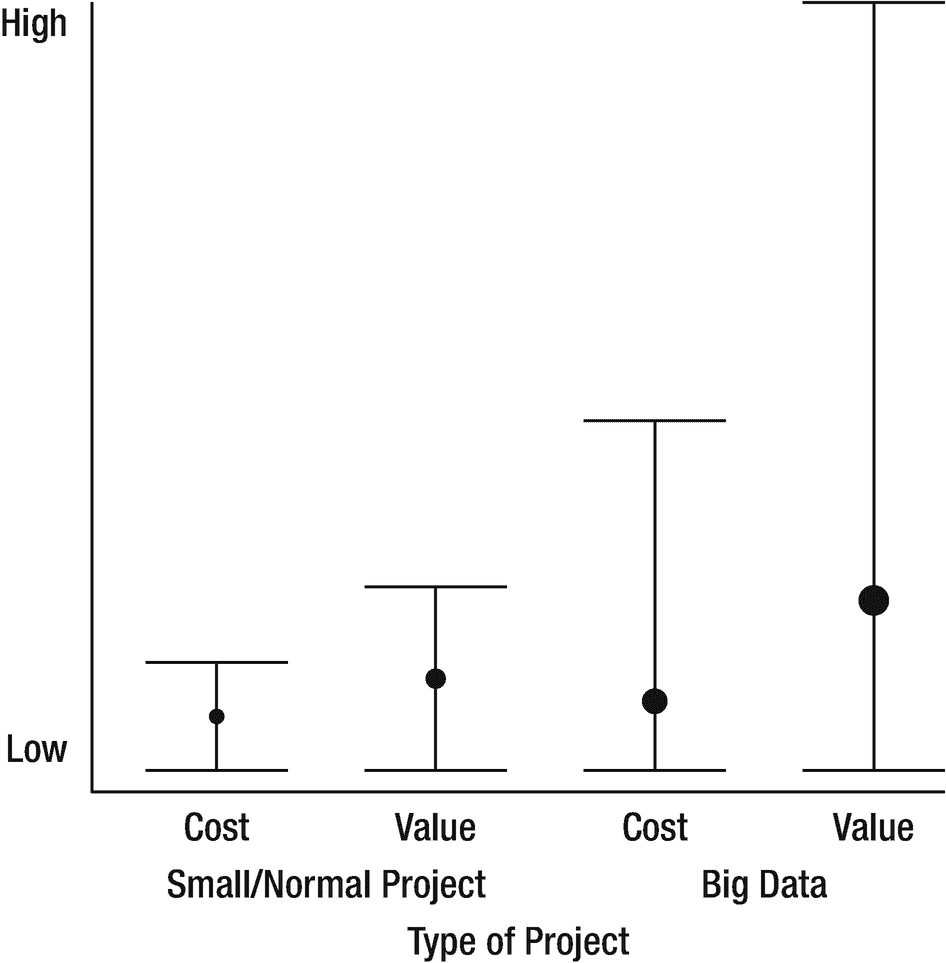

# 9. 管理大数据项目

> *爱你不论，不论时光好坏，悲喜与否*
> ——艾尔·格林，《让我们在一起》

在前面的章节中，我们为你的数据团队配置了人员，并在更大的组织内为他们找到了支持。本章涵盖了随着团队进展，管理者必须面对的许多日常和长期问题：

*   规划数据产品的创建与使用
*   将任务分配给合适的团队
*   数据科学家的特殊需求
*   长期项目管理
*   技术选型
*   当一切出错时
*   意外后果

## 规划数据产品的创建与使用

数据团队交付的价值以其数据产品的形式呈现，这些产品的生命周期各不相同。有些可能是单一的一次性报告，而另一些则通过便捷的渠道对外提供，业务用户在决策过程中会反复调用这些数据产品。

有时，数据工程团队通过创建新的或改进现有的数据产品来启动工作。数据科学团队消费这些数据产品。作为消费过程的一部分，数据科学团队可能会创建衍生的数据产品。最后，运维团队确保一切正确且最优地运行，以便数据产品能够持续自动生成。

### 一次性与临时性洞察

数据工程通常专注于创建持续投产且具有长期视角的数据管道。这是大多数数据工程的工作方式，但并非每个数据产品都需要如此高的严谨性。

一次性或临时性的洞察分析不需要同等水平的工程投入，因为它不需要长期视角。相反，过多的工程投入反而会拖慢它。只要可能，临时性洞察应使用现有的数据产品和已有的基础设施。如果临时性洞察越来越常见，并且需要更快的周转时间，团队应考虑创建一个 DataOps 团队。这可以通过更快的周转时间来让业务方更满意。

在这些场景下，团队的成功或 KPI 应该根据团队快速执行的能力以及尽可能利用现有资源的能力来衡量。当你发现一个资源被持续使用，但并未作为可用的数据产品对外提供时，数据工程团队可能需要投入工程精力，以持续自动地暴露该数据管道。此后，临时性的工作便可以更有效地利用新的数据管道。

在另一个更高级别的使用层面上，当你注意到有大量类似的临时性使用需求时，数据工程团队就应将一个一致的分析管道或报告投入生产。

最后，管理层应该清楚"快速"和"临时"意味着什么。这意味着团队不会将通常的工程严谨性应用于洞察。相反，团队优先考虑速度而非工程严谨性。这种速度上的差异可能会导致其他管理者好奇为什么不是所有事情都这么快。当某些洞察是可投产的还是仅是临时性洞察时，他们也可能产生误解。他们可能认为某个洞察已准备好长期使用，而实际上并非如此。数据团队应注意帮助组织管理层了解一个数据产品何时是可投产的，何时不是。

### 对外提供数据产品

让业务方了解如何使用数据团队的数据产品，是决定其被采纳和使用率的关键。实际的数据产品应通过正确的技术来对外提供。请注意，这里的"技术"是复数。这是因为分布式系统会以各种方式"作弊"（参见第 4 章"架构师的角色"部分）。

用于对外提供数据产品的实际技术完全取决于具体用例。例如，运行快速且返回少量数据的查询可以通过 RESTful 调用对外提供。^(²⁴) 同时，操作并返回大量数据的查询则需要通过分布式系统直接暴露数据。合格的数据工程师和架构师会确保数据产品以正确的方式对外提供。

通常，管理层会希望使用单一技术来对外提供数据产品。但由于特定用例的读写模式，这并非总是可行的。

某个特定分布式系统的"作弊"方式，会使它成为一项技术的绝佳选择，同时成为另一项技术的糟糕选择。这迫使数据工程团队与业务方协同，建立一个新的分布式系统来处理需要通过不同技术进行访问的用例。

## 为团队分配任务

尽管第二部分试图在数据科学、数据工程、运维及其他相关团队之间划出清晰的界限，但现实情况要复杂得多。有时当一个新项目启动时，必须有人决定哪些任务属于哪个团队。

在处理任务、项目或用例时，管理者将是第一级分流人员。管理团队必须决定需要哪个或哪些团队来参与项目。正确做出这个决定至关重要，这样才能从项目一开始就让正确的团队参与进来，而不是等到太晚才发现需要其他团队的帮助。数据团队需要验证自己是否是该任务的合适团队，并且能够满足请求。如果一开始就做出了错误的选择，一个团队可能不得不拼命追赶，或者完全重做另一个团队的工作。

### 数据工程、数据科学，还是运维？

在决定将任务分配给哪个团队时，请思考该问题最根本的用例所在。当然，决策者必须理解每个团队的实际职责及其核心竞争力。

数据工程团队适合处理工程类任务。适合数据工程的典型任务具备以下一个或多个特征：
-   侧重代码开发
-   优化现有算法，而非从零创建算法
-   通过改变底层技术或技术栈来加速报告或分析流程

数据科学团队适合处理高级分析和机器学习任务，其特点包含以下一个或多个方面：
-   以数学或统计学为核心
-   优化业务方法或成果
-   提升分析或报告背后的质量或统计数据

运维团队则适合处理已投入生产或准备上线的事物，具备以下一个或多个特征：
-   可通过脚本完成的简单任务
-   自动化现有流水线或代码示例
-   生产中已存在但出现异常的数据产品

### 协作

有些任务可能需要三个团队同时参与。这时事情会变得特别复杂，因为你必须把一个看似简单的任务拆解成多个独立的任务。接着，你需要在组织中协调不同团队分别负责不同部分。最后，这些独立任务再整合为一组相互依赖、协同运作的任务。

当你收到这类任务时，务必预估用于协调跨三个团队的纯管理开销所花费的时间。这种开销包括必须召开的会议，而会议又涉及会前准备、实际会议时间，以及需要建立的额外沟通节点。数据团队的成员必须保持同步，才能正确完成任务。

### 解决现有团队的问题

有时你的数据团队效率不高。他们之间协作不畅，无法维持高带宽的沟通连接，也无法利用数据创造价值。当问题出现时，相互指责不断，却没有真正的解决方案。业务部门无法使用他们创建的数据产品。在这种情况下，组织的首要任务就是修复数据团队。

在我与组织合作时，我花在与业务方沟通的时间，与花在与技术方沟通的时间一样多。通过与业务方交谈，我能接触到数据的实际最终用户，他们因此也在持续与数据互动。

与数据消费者交谈能揭示数据团队的问题。如果数据科学团队不与数据工程团队协作，你就会从洞察成果价值低下中听到这个问题。如果数据工程团队没有生产出优质的数据产品，你就会看到业务部门不信任这些结果。如果运维团队未能维持生产系统的稳定运行，你就会不断听到生产中断的消息，这使得业务部门无法真正信任数据项目能在需要时正常运行。

一旦你看到了这些反映出来的问题，就可以向团队确认它们的存在。确认问题后，你就可以开始探究其根源并加以解决。

现有团队问题的根源多种多样。即便团队由优秀的个体（无论是管理层还是个人贡献者）组成，仍然可能出现沟通不畅和成果不佳的情况。另一方面，由表现不佳的个体组成的团队可能无法承担起应有的责任。这需要坦诚地审视团队，才能找出真正的根本原因，而不仅仅是表面问题。

### 任务分配不当的影响

为任务选择错误团队的后果，会因分布式系统所需的复杂性和协调性而显著放大。

一个常见的不良选择（特别是在新任管理者中）是将本应由数据工程师完成的任务分配给数据科学团队。做出这种选择可能是因为没有数据工程团队，或者该团队在组织内太新。分配任务的人可能只是未能理解这些团队之间的区别。

为了让你了解将数据工程任务交给数据科学团队会带来什么后果，让我分享一个我在许多不同组织中都见过的场景。问题的症状是数据科学家要么陷入僵局，要么在任务上进展极其缓慢。管理者会让我去与数据科学家聊聊发生了什么。通常，数据科学家已经在这个任务上花了一个月或更长时间，却几乎没有任何进展。

我们发现，该数据科学家正在处理一个 99%属于数据工程的任务。按照数据工程的标准，这个任务相对容易，几天内就能完成。但数据科学家缺乏选择正确工具、方法或算法的技术能力或知识。相反，数据科学家试图使用他们一直以来的方法来解决这个问题。当一个项目受阻时，加倍投入原有的方法很少奏效；团队应该寻找另一种方法。

也存在反例，即数据科学任务被分配给数据工程师。结果通常也不理想。

## 长期项目管理

当数据团队拥有类似于软件工程的长期项目时，组织需要制定一个总体路线图。这是因为数据团队需要与其他团队、部门及业务单元进行协调。路线图可以包括新技术的落地应用、新数据产品的创建，或对现有数据产品的改进。没有良好的计划，数据团队在创建和实施数据产品时将只能被动应对。

有些团队试图规划得过于遥远。近期计划——大约一年内——应该相对具体，明确指出细节；而超过一年的长期计划则应宽松得多，更多是概念性的。

这是因为你的数据团队在一年内应该会发生变化。这些变化既可能是积极的，也可能是消极的。积极变化的例子：数据团队可能提升速度（参见第 7 章“数据项目速度”部分），使得原本计划六个月的项目现在只需三个月。消极变化的例子：失去了一位项目资深成员或其他关键团队成员。原本计划由这位资深成员负责、耗时三个月的项目，现在可能分配给几位初级成员，耗时九个月。

过于长远的计划有可能忽视分布式系统演进的速度。规划三年后的情况，可能对数据团队产生巨大的技术影响。一项较新的技术，或者组织正在使用的技术的新版本，可能让你重新思考如何实现某个功能。而这种改变，反过来又会影响团队实现该功能所需的时间。这迫使团队必须制定新的计划或重新估算实现功能的时间。

## 技术选择

## 新增或选择技术的心智框架

管理者不被期望通晓数据团队所使用的技术，这些技术不仅复杂，而且不断在变化。本节内容面向管理者，旨在帮助他们评估技术，并引导数据团队做出有利于整个组织的选择。在某些部分，我会谈论特定的技术（尤其是编程语言），但我会解释管理者需要理解的关键概念。

管理层可以运用我在本节阐述的心智框架，帮助数据团队选择合适的技术。技术会来去更迭，但这个框架将始终如一。

当组织决定引入新技术时，我建议进行风险/回报评估。这包括明确新增技术的商业价值。该评估将有助于应对管理层对新增技术成本的任何质疑。通过设定商业价值，数据团队应能简洁地回答：引入某项技术后，能在公司内部实现什么。

请记住，并非所有技术都能直接增加商业价值；有些技术更具基础性。这些基础性技术将为未来预期中的用例提供支持，或使新功能的实现更快速、更便捷。

管理层应理解新增技术的长期影响。这项技术或实现方式是否是一种最终会让我们后悔的糟糕变通方案？这可能需要与提出该技术的架构师或工程师进行一些非常尖锐且具有挑战性的对话。请记住，解决一个项目往往有多种不同方法。管理层会想知道还探索了哪些其他可能性，以及选择当前方案的原因。虽然管理层可能没有足够的技术背景来理解或中肯地评判这些选择，但他们可以尝试理解决策背后的动机。

警惕"新技术能让一切变得更简单"的承诺。这种承诺可能来自团队内部，也可能是推动新技术的供应商。新增技术可能会让某些部分变得更容易，却让其他部分更加复杂。对于某些技术，你可能需要数月甚至数年才能看到其收益。在我看来，分布式系统不可能变得简单。某些部分可以简化，但改进是有限的。当我开始听到供应商告诉我他们的分布式系统很简单时，我会立刻警觉起来，并建议检查一下他们还在哪些方面撒谎或过度承诺。

因此，管理者有时可以提前避免错误选择。当组织招聘架构师或首席工程师时，应询问候选人倾向于选择新技术的程度。问问他们，当他们引入一项新技术或设计时发生了什么。它真的达到了他们预期的效果吗？如果没有，他们是如何应对的？他们是试图掩盖问题、推卸责任，还是努力降低自身和组织的风险？组织应尽量避免雇佣那些有意或无意地为系统增加复杂性的人——因为他们增添复杂性的理由可能全都是错的。

## 约束技术选择

管理者在面对采购技术的请求时，往往会提出反对。他们会问，数据团队真的需要 10 到 30 种不同的技术吗？他们理所当然地认为数据工程团队是在过度设计解决方案，或者是在为简历贴金。他们考虑了每种技术投入运营所需的成本，并断定这些技术并非数据产品真正所需。

我遇到的第二种常见反对意见是，分布式系统技术是否真的像我描述的那样复杂。这种感受可能源于将大数据团队与组织内的其他软件工程或数据仓库团队进行比较，后者在处理相同任务时表面上看效率更高。这种看法又回到了之前提到的管理层误解。数据团队需要与 10 到 30 种不同的技术打交道（而且确实需要），才能取得成功，而软件工程和数据仓库团队只使用一到三种技术。管理层通常会接着问，为什么数据团队不能只用一到三种技术，或者把他们要求的 10 到 30 种不同技术合并成少数几种？

答案源于我在第 8 章"用例与技术选择"一节中的观察。当数据团队交付数据产品时，他们是在为特定的用例进行优化。一项尚未成为你技术生态一部分的新技术，可能正是该用例的更好选择。通过专注于赋能该用例，数据团队必须为工作选择正确的工具，而这可能意味着要投入运营一项新技术。

作为管理层，对引入新技术持反对意见是允许的。这是因为数据团队选择新技术的动机并不总是最佳或最无私的。这些利己的技术选择可能源于对当前组织使用的技术感到厌倦。也可能是数据工程师觉得自己的简历停滞不前，没有填满最新最好的技术。他们正准备离开组织，需要确保简历上显示出自己正在做新鲜且令人兴奋的事情。

然而，大多数情况下，他们的理由是为工作选择正确的工具。

无论如何，引入新技术都伴随着固有的成本。在新增技术时，必须有一个清晰且有利的商业案例，证明该新技术能够实现或加速某种价值。

### 爱上讨厌技术

很多人告诉过我，在为未来项目选择技术时他们倍感压力。我认为这项任务的主要问题在于包含太多未知因素。有未来项目的需求和规模的未知因素。还有那些你可能没有一手经验的新技术的未知因素。最重要的是，我们被最新、最酷技术的广告狂轰滥炸，而事实上，当我们选择了那些变得有市场价值的技术时，我们还能获得经济回报。那么，该做什么，从何开始？

以下建议适用于那些希望项目成功，同时也能为未来布局的人。学会只选择你讨厌的技术，并且努力每天讨厌更多的技术。这乍听起来可能是个古怪的建议，但请听我说一分钟。

当你对某项技术了解得更多时，你就会知道它能做什么，不能做什么。我发现，最佳的技术选择发生在你完全清楚一个技术的缺点，但它仍然是完成该任务的最佳技术时。如果你遵循这个范式，你就绝不会陷入以下陷阱：

-   被过度承诺的技术

-   需要超高端人才来管理的技术

-   解决你并不存在的问题的技术

——泰德·马拉斯卡，作家，Capital One 企业架构总监

## 编程语言支持

企业甚至小型组织可能会使用多种不同的编程语言。虽然有些组织试图统一使用单一语言，但由于数据科学团队和数据工程团队的混合需求，这并非总是可行。另一些组织则将编程语言的选择权完全交给数据团队，希望他们能为工作选用合适的工具。这可能导致生产系统中出现多种多样的编程语言。由于数据需要被暴露出来，你将需要处理如何将数据产品暴露到每种语言中的问题。

将数据产品暴露出来——而非仅仅提供一个 API 端点——是数据产品与纯软件产品之间的关键区别之一。管理者和技术决策者在决定是否支持某种语言时，需要将如何向该语言暴露数据产品纳入考量。

不同编程语言对分布式系统的支持程度差异显著。有些语言提供一流的支持，而另一些则仅提供准一流支持。在后者的情况下，该语言只能部分跟上最新特性，但在最新功能方面会有所滞后。

还有一些语言以独立开源项目的形式提供支持。例如，某个分布式系统可能是 Apache 基金会的一个项目，仅支持单一语言。项目外的人若看到需求或有意愿支持自己选择的语言，便会创建自己的实现来支持该分布式系统。

通常，这些其他语言的支持实现会托管在 `GitHub` 上。但这些实现的水平参差不齐。有些源于个人的热情，而另一些则是由公司为满足自身需求而创建的。我通常建议组织选择那些已在企业投入生产、并为成熟公司创造价值的实现。这些项目更有可能获得所需的持续维护和关注。

### 数据科学家使用的语言

数据科学家主要使用 Python，但也有一些使用与 Java 库兼容的 Scala。绝大多数面向数据科学家的产品都会提供 Python API，有时也会提供其他语言的接口。

**JVM 的价值**

这里需要一些技术背景知识。

Java 会被转换（编译）成一种快速运行的格式，并在一个名为 Java 虚拟机（JVM）的框架内运行。许多其他语言被设计为编译到同一个 JVM 上，因此它们可以轻松地与 Java 协同工作，并充分利用 Java 中创建的众多强大库。除 Java 之外，Scala 是最流行的基于 JVM 的语言。Scala 拥有比 Java 更现代的一些编程语言特性，并且占用的空间更少，因此编码速度通常也更快。

数据科学团队是数据工程团队创建的数据产品的消费者。数据工程团队通过使用正确的技术来暴露数据项目，这有助于缓解非 Java 语言支持的限制。由于数据工程师已经正确地暴露了数据产品，因此可能并不需要最新或完整的语言支持特性。

### 数据工程师使用的语言

数据工程师主要使用 Java 进行工作。有些团队会使用 Scala，通常与 Java 结合使用。还有一些团队会使用 Python。

作为数据产品的创建者，数据工程师承担了主要的技术重任。他们面临着数据团队职责中技术挑战性最高的部分：创建和暴露数据产品。这种技术挑战要求数据工程师手头拥有尽可能多的工具来正确暴露数据产品。语言的选择直接影响到他们甚至能否选择某种技术，因为该技术可能没有团队所选语言支持的 API。对你所选语言支持的缺失，可能意味着某个用例无法实现，或者团队必须等到分布式系统开始支持该语言。对于闭源和开源技术而言，这都可能需要数月甚至数年的时间。

大多数分布式系统——尤其是大数据技术——都会优先以 Java 为目标并提供支持。这是因为该技术或分布式系统本身就是在 JVM 上编程运行的（参见本章前面的边栏“JVM 的价值”）。

### 跨语言暴露数据

在跨语言暴露数据产品时，存在几个问题。应该使用哪种格式？如何处理不同语言类型系统间的差异？这个类型是浮点数还是整数？整数的大小是多少：32 位还是 64 位？整数是有符号还是无符号？

这些问题中的每一个听起来可能像是无关紧要的计算机科学主题，但它们确实重要。错误的类型可能意味着报告中计数正确与错误的天壤之别。要找出不准确报告的根源，可能需要花费数天时间，并深入探究编程语言内部的运作机制。这正是“一盎司的预防胜过一磅的治疗”的典型场景。

架构师和数据工程师需要在这些问题出现之前就想好周全的应对方案。像 `Google` 的 `Protobuf` 和 `Apache Avro` 这样的二进制格式通常被用来解决这些问题。请将本节内容视为一个强烈建议：务必把暴露数据产品的这一关键部分做对。

## 项目管理

在项目管理方面，数据团队通常使用看板或某种版本的 Scrum。看板和 Scrum 也可以结合使用。

项目管理框架的选择部分取决于项目预估所需的时长。数据工程团队的需求可能与传统软件工程团队相似或略有不同。对于更传统的软件开发任务，`Scrum`风格的框架效果不错。更传统的任务是指类似于传统软件项目的长期项目。

对于其他需要更快完成的任务和项目，`Scrum`风格的框架可能过于繁琐。这会降低响应速度，并增加在短期任务报告上的时间投入。对于这类运营模式，`看板`可能是合适的项目管理框架。

数据科学团队对项目管理框架有独特而具体的需求。对于数据科学团队而言，阅读学术论文以准备项目并不适合`Scrum`框架。团队专注于实验，并可能面临假设被推翻的情况，这也不适合`Scrum`风格。这使得数据科学团队只能选择`看板`或其他低开销或无开销的项目管理框架。一些数据科学团队会创建适合自己工作风格的自有项目管理框架。

运维团队可能倾向于使用`看板`项目管理框架。这能让运维团队跟踪并优先处理任何非关键性工作。

我发现有些团队仍在沿用瀑布模型或类似衍生方法，我建议转向`敏捷`框架。这是因为数据工程团队——尤其是新成立的数据工程团队——需要在短期内开始展示价值。遵循瀑布时间表会阻碍团队在数年之内展示价值或创建数据产品。

如果数据科学团队不使用`Scrum`，他们应如何与使用`Scrum`的数据工程团队整合或协作呢？例如，数据工程团队可能以两周为周期冲刺，而数据科学团队正在处理开放式或设定了时间限制的项目。

在这种情况下，一些组织会等到数据科学家完成某项工作后，再将其安排到冲刺周期中。另一些组织则会降低数据工程团队的工作饱和度，以便有时间与数据科学团队互动。例如，如果数据工程团队通常负载率是 90%，管理者会将其降低到 70%或其他合适的比例，以便留出额外时间与数据科学家协作。

## 当一切进展不顺时

有时，即使你作为管理者尽了最大努力，项目仍会偏离正轨。这需要额外的主动性来找出并解决问题根源——通常有多个根源。仅仅找出问题所在就可能极其困难。根据我的经验，数据团队中的问题不会自行纠正，需要付出协调一致的努力。

你可能见过图表上的误差线。它们显示了进行测量或数据采集时测量的误差范围。

图 9-1

大数据项目的风险/回报比远高于小数据项目

对于小数据项目，其误差线相对较小。即便如此，当一个小数据项目偏离轨道时，修复它可能需要数周、数月甚至一年。而对于分布式系统，项目的误差线则要大得多。这意味着项目失败的可能性可能比你以往经历的任何情况都要严重。（从积极方面看，它也可能成功，并产生远超你想象的价值。）一个偏离轨道的大数据项目，修复起来可能需要数月或数年。

只有通过适当的规划、合适的团队和正确的资源，团队才有机会成功。管理层需要持续关注项目是否偏离轨道的迹象。根据我的经验，拯救一个项目永远不嫌晚。项目越老，拯救它所需的时间和经济成本就越高。话虽如此，如果一家公司考虑关停其大数据项目，很可能是因为时间流逝太多，而价值产出太少。我建议以本书为指导，找出需要采取哪些措施才能使项目重新取得进展。这将为管理层提供具体的步骤和变革措施，可以与那些支持关停项目的管理团队成员分享。

## 警惕高阶后果

通常，问题的真正原因被隐藏了，你看到的是三阶、四阶或五阶后果。由于时间和篇幅限制，我无法一一列举所有问题的具体表现。只需知道，随着团队的进步和速度的提升，后续还会出现更多问题。在本书中，我主要关注一阶和二阶后果以及最常见的长期后果。一些更成熟或历史更悠久的团队还会面临本书未涉及的额外问题。

仅举几例，让你有所了解：

*   如何应对团队资深成员的离职？他们很可能掌握着系统运作的大部分“传说”。当团队中只剩下大多（如果不是全部）依赖老手解决难题的初学者时，该如何应对？更糟糕的是，如果项目老手是唯一能够高效产出的人，你该怎么办？

*   如果你的团队过于成功，以至于其他组织开始挖角你的员工，你该怎么办？当其他组织提供你的组织无法给予的高额加薪时，你该如何留住员工？

这些仅仅是成功（有时是成功与失败的混合）所导致的三阶、四阶和五阶后果的几个例子。某些问题可能是行业特有的，公司内部的历史原因，或纯粹的政治问题。问题越具体，内部观察者可能越难看清，解决起来也越困难。

脚注 1