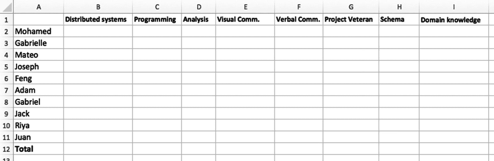
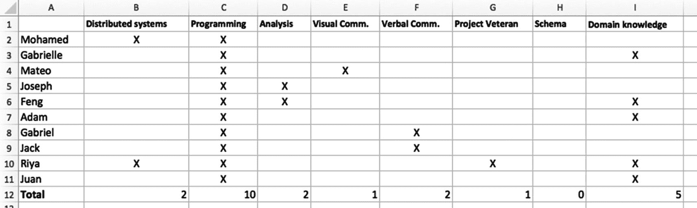

# 数据工程与数据科学的创新与演进

数据工程应通过持续迭代，打造更优质的数据产品。这包括为数据科学家及其他分析目的创建更高质量的数据，也涉及引入新技术以提升数据产品的处理速度和规模。

此外，数据工程需要实现新的应用场景。这是组织内部对数据产品需求增长的一部分。数据团队必须密切关注组织中涌现的、所需的新型数据产品，而数据工程团队将负责构建它们。

数据科学家也应通过升级模型来持续改进。这种改进可能源于更高质量的数据，或是对各种参数的微调。无论在哪种情况下，模型都需要重新训练以获得最大价值。

关于如何改进现有模型，或是创造更新、更精准、更快速的模型，新的研究成果层出不穷。数据科学家需要时间和空间来阅读最新的研究文献，这可能还包括花些时间尝试新方法，看看它是否能比当前方法带来提升。

## 数据团队是常设的吗？

管理层常常会思考：数据团队是组织的常设部门，还是临时性补充？简单的答案是：他们是常设的。那些未能认识到这一点的组织，尚未充分领会数据文化的精髓。这可能是由于对数据团队及其工作缺乏了解，或是存在其他更棘手的问题。

数据产品应被视为组织开发或制造的任何其他产品一样。数据产品不可能是交付后就彻底结束的短期项目。这一概念对许多组织来说可能还很新鲜，因为数据科学家需要持续改进和不断开发新的数据产品。

数据科学家创建精准模型的能力，直接取决于数据的特征质量。数据会随时间推移而变化。保持高数据质量必须是一项持续的投资，因此数据团队必须是组织的常设部门。

管理层——尤其是数据团队的管理层——需要向组织其他部门说明团队的工作内容及其提供的价值。同样，管理层也有责任为组织的其他部门创造实际价值。无法提供价值的数据团队会引发重大问题，必须解决。

数据团队所提供的价值应该持续增长。老实说，如果应用场景、数据产品需求和使用率都没有增长，那一定是你做错了什么。组织之所以会自然壮大其数据团队，是因为其价值极高，且需求总是超过供给。如果供给过剩而需求不足，管理团队就需要弄清楚到底发生了什么。

## 评估技能差距

第 2 部分讨论了数据科学、数据工程和运维团队所需的技能。所需的员工人数及其技能水平，将根据项目的复杂性、当前迭代速度以及人员编制预算而有所不同。然而，团队中至少要有一个人掌握每一项技能。如果团队中完全缺少某一项技能，就应该拉响警报。

寻找缺失技能的工作被称为`技能差距评估`。这项工作应由管理层或团队负责人来完成。

进行技能差距评估，需要对自己和评估对象保持绝对的诚实。我建议留出一些深度思考的时间，真正彻底地完成这份评估。

有时，经理并不完全确定某人是否掌握了某项技能。这可能需要对当事人进行后续沟通，或者经理可以询问技术团队负责人的意见。

### 评估专业水平层次

有些差距并非以技能形式呈现，而是对团队经验水平的评估。有些团队对经验水平有更严格的要求。例如，第 12 章曾提到，数据工程团队的经验层次分为：新手、合格数据工程师和资深专家。

在进行差距分析时，你需要对团队成员的技能水平进行评级。当我们完成差距分析时，需要检查是否拥有合适的经验层次。

### 如何进行差距分析

找一张纸横向摆开，或者打开一个电子表格，为团队应具备的每一项技能创建一个列。然后，为团队中的每个人创建一行。在第一行，列出数据团队需要的所有技能。接着，在最左侧一列列出团队中每个人的名字。如何进行此项操作，请参见图 12-1。

图 12-1

一张电子表格截图，展示了如何罗列技能和人员。

现在，你要开始填写这张纸或电子表格了。逐一检查团队中的每个人，当他们具备某项特定技能时，就在对应的单元格里打上`"X"`，如图 12-2 所示。这需要坦诚地审视。能否尽可能诚实地进行此项分析，可能决定着团队的成败。

图 12-2

一张显示某人已被标记为具备某项技能的截图。

对三个数据团队都重复此项差距分析。

有时，管理者可能想给某人标记为“发展中”状态，或者给某项技能打半分。有时人们在做差距分析时，会用百分比或带小数点的数字来代替`X`。他们可能会打上`0.1`或`0.5`而不是`X`。但这只会让你无法正视真正的技能差距。技能要么具备，要么不具备。根据我的经验，十个打了`"0.1"`的人，并不比给团队记零分好到哪里去。技能差距评估是非常二元的，因为每个个体必须达到某个确定的门槛。

### 解读您的差距分析

现在您已经在每个人的技能上标记了 X，将它们汇总起来。这将告诉您关于团队构成的故事。它会告诉您团队的强项和弱项，甚至可能揭示出您的团队连基本工作都难以完成。如果每个团队都有各自的管理者，那么数据团队的管理者们可能需要聚在一起，对比他们关于差距所在之处的记录。

在查看差距时，请开始问自己一些关键问题。技能评估是否准确？缺失的技能对项目成功有多关键？这项技能是现在就需要，还是短期内需要，或者更远之后才需要？培训某人掌握这项技能有多困难，以及需求的紧迫性是否足以招聘新人？招聘新人来填补这个缺口需要多长时间，这又是否会导致项目延期？

有些团队比其它团队更需要某些技能。例如，在一个数据工程团队中，大多数成员需要掌握分布式系统和编程技能。^(²⁷) 如果他们完全缺乏某项必要技能，或者只有极少数人具备该技能，那么项目可能会耗时过长，甚至根本无法完成。编程技能和分布式系统技能的缺失，通常与那些从数据仓库团队或其它以 SQL 为核心的团队中抽调人员组建数据工程团队的情况有关。

填补某些技能缺口可能很困难，甚至无法通过招聘实现。在领域知识要求较高的组织中，培训拥有领域知识的现有员工掌握新技能，可能是更容易的方法。

您还需要审视团队的经验水平以及一些紧迫的问题。团队里所有人都是新手吗？我至少有一名合格的数据工程师吗？我是否有机会接触或拥有一名经验丰富的资深成员？团队的经验水平是否与用例复杂程度所要求的水平相匹配？更高层级的经验无法通过培训传授，而需要亲身实践。这就是第 4 章描述了一位项目老手关键作用的原因，他必须从基层一步步成长起来。

### 能力差距

在本节的大部分内容中，我们一直假设团队中的每个人都能获得您所需的技能。技能差距意味着一个人目前缺乏知识，但具备学习该技能的天赋。情况并非总是如此。可能存在能力差距，这意味着一个人既缺乏知识，也缺乏成功学习该技能的天赋能力。无论投入多少时间、资源或专家帮助，都无法让他们达到下一个水平。

在数据团队中，可能存在几个能力差距的例子。例如，视觉传达可能需要天生的艺术能力，而这几乎无法教授。期望一个没有创意天赋的人创造出外观和交互都优雅的作品，可能是不切实际的。同样，并非每个人都能达到数据团队所要求的水平来理解分布式系统或编程。期望一个完全是新手或从未编程的人去创建分布式算法，实际上也是不可行的。

在进行技能差距评估时，管理者需要考虑差距是技能方面的还是能力方面的。如果某人最终无法掌握该技能，管理团队就需要做出其他安排。这可能包括招聘另一个人来补充，或者在组织内找到另一个更符合其才能的岗位。

## 硬件变化

一些组织变革围绕着硬件展开。分布式系统带来了新的硬件需求。这些硬件需求在速度、尺寸和价格上，可能与组织之前在处理小数据时使用的硬件有所不同。

### 云服务使用

如果可能的话，我建议使用云服务。这样，在`POC`（概念验证）启动之前，硬件采购就不会成为障碍。一些流行的分布式系统技术已经可以作为托管服务使用。这些托管服务消除了团队学习如何安装和启动分布式系统的需求。相反，他们可以直接开始使用该系统进行编程。

云服务将允许团队根据需要随时启动和释放资源。这使得团队在开发和测试系统时，能够在精细的粒度上控制成本。如果团队不小心完全搞砸或摧毁了系统，他们可以轻松地重新启动集群。团队可以通过在非使用时间（例如过夜或周末）关闭集群来控制费用。

### 采购集群

如果组织选择将其集群部署在本地，那么组织将需要采购硬件。由于更高的冗余需求，这些硬件可能比小数据服务器更昂贵。更高的冗余可以包括冗余电源，但主要区别在于存储和网络。

在分布式系统中，数据会被整体存储多次——范围在 1.5 到 3 倍之间——在不同的计算机上。所有这些冗余数据都会通过网络在计算机之间传输。当读取数据进行处理时，这些数据可能会再次通过网络传输。

一些组织期望或规定所有本地基础设施都必须使用虚拟化技术。虚拟化与裸机之间存在着明显的权衡，^(²⁸) 主要在于运维的便捷性。在我看来，选择本地部署而非云服务的主要理由是，可以决定是使用虚拟化部署还是直接在裸机上部署。一些分布式系统可能会利用裸机部署带来的更高速度和更低延迟。

### 大数据团队的硬件系统

硬件的变更和升级不仅限于集群。组织大数据工作中一个常被遗忘的部分，在于编写代码人员所需的硬件和数据要求。这些硬件需求主要影响数据工程和数据科学团队。

这些变化背后的主要原因是，大数据确实“大”。个人在开发代码时可能需要存储大量数据。他们还需要在自己的硬件上运行分布式系统。很少有分布式系统经过优化，能够在低内存或低 CPU 的计算机上运行。分布式系统开发者的全部努力都集中在如何在集群上高效运行，而不是在开发者的个人电脑上。这些重量级的分布式系统将需要比处理小数据的开发者更多的 CPU 和内存。这意味着，对于开发者来说，标准配置的硬件可能不够用。

