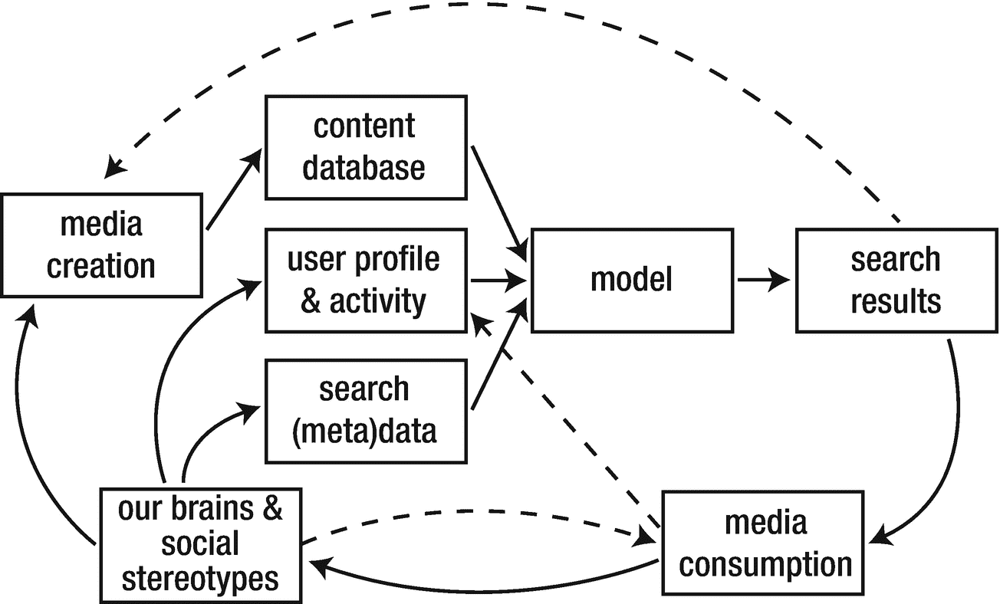

# 3. 逆流而上  

内容推荐引擎如何影响信息并操纵我们的注意力  

在过去二十年中，随着我们从信息经济转向注意力经济，我们几乎同时从大众媒体转向了社交媒体。可用媒体的急剧增加，要求个人拥有一种筛选触手可及信息的方法。内容推荐系统应运而生，成为解决这一社会/信息问题的技术方案。理解推荐系统算法的工作原理，以及它们如何强化（甚至放大）人类无意识的偏见，对于理解数据如何影响观点至关重要。  

## 有哪些新内容？

在线广告有时会令人毛骨悚然。

不久前，我妻子在 Facebook 上注意到一则奇怪的广告。Facebook 提示她可能对一套露台坐垫感兴趣。*真有意思*，她想，*我刚刚跟妈妈通电话，她正说自己在外面找这种坐垫呢！* 几周后，类似的事情又发生了，这次是一盏她从一家多年未光顾的商店买的台灯，但她父母恰好去过那家店。我问她上个月去父母家时，是否在父母的电脑上登录过 Facebook，答案当然是肯定的。她用完时确保退出了登录，但 Facebook 安装在父母浏览器中的 Cookie 仍然存在，继续回传数据，而她的父母正在网上购买坐垫和台灯。经过几次网络搜索（和信用卡付款）后，她父母的购物记录与她在 Facebook 服务器上的个人资料同步了。于是，当她的父母浏览家居用品时，她在信息流中看到了类似商品的广告。

在这种情况下，Facebook 犯了一个错误，将她的在线身份与她父母的混为一谈。但有时，这些平台又*太*准确了。

你可能听说过几年前新闻中的这个故事。一位父亲收到 Target 寄给他的青少年女儿的广告邮件，愤怒不已，邮件鼓励她购买尿布、婴儿床、婴儿服装和其他与怀孕相关的商品。“你们是在鼓励她怀孕吗？”据报道他这样质问商店经理。几天后，经理打电话给这位父亲再次道歉。但父亲告诉他：“结果发现，我家里发生了一些我完全不知道的事情。[我女儿]的预产期在八月。我欠你一个道歉。”^(⁵¹)

原来，像当今许多零售商一样，Target 正在使用顾客的购买历史来预测未来的购买行为，并根据这些预测向他们发送广告和个性化优惠券，所有这些都是为了说服现有顾客将 Target 变成他们的“一站式商店”。

但不仅仅是广告商将用户数据输入预测模型以生成超精准结果。在萨菲亚·乌莫贾·诺布尔的著作《算法的压迫：搜索引擎如何强化种族主义》中，她讲述了一个令人痛心的谷歌搜索故事。诺布尔想寻找关于作为美国农村有色人种年轻女性成长的资源，与女儿及其朋友分享，于是她拿起笔记本电脑，在谷歌上搜索“黑人女孩”。她写道：

* 我几乎无意中让她们看到了广告商对她们最直观、最赤裸裸的描绘之一：黑人女孩仍然是色情网站的素材，被非人化为商品、产品和性满足的对象。我合上笔记本电脑，把注意力转移到我们可以做的有趣事情上，比如去街边看场电影。^(⁵²)

诺布尔的书中充满了其他搜索示例，就像我们在第 1 章中探讨的那样，它们基于社会的偏见和成见返回预测结果——搜索“大猩猩”的图片会返回非裔美国人的图片，搜索“女孩”比搜索“男孩”返回更年长和更性感化的结果，等等。在这些情况下，结果并非“个性化”——诺布尔显然不是在寻找谷歌搜索引擎在搜索结果首页提供给她的色情内容。这些结果反映了创建算法的*程序员*的偏见，以及那些搜索“黑人女孩”并显然更频繁点击色情链接（而非包含旨在赋权有色人种年轻女性资源的网站）的*用户*的偏见。然后，这些偏见会返回预测大多数用户“想要”看到的结果。

谷歌此后已解决了这类问题。现在，在我的电脑上（关闭安全搜索）搜索像“黑人女孩”这样中性的词，会返回像“黑人女孩摇滚！”和“黑人女孩编程”这样的网站，以及穿着整齐的黑人女性图片。（请注意，只有少数图片包含真正的*女孩*，而非成年女性。进步就是进步，但我们仍需努力……）

但搜索本身不中立时会发生什么？如果搜索明确带有种族主义色彩呢？

2015 年，恐怖分子迪伦·鲁夫在南卡罗来纳州查尔斯顿犯下大规模谋杀案之前，留下了一份“宣言”。在这份宣言中，他*声称*（让我明确一下，我对任何恐怖分子宣言中的说法都持极度怀疑态度）是谷歌搜索促使他进行“种族战争”。据鲁夫说，他搜索了“黑人对白人的犯罪”，结果页面为他提供了自我激进化所需的所有信息。^(⁵³) 此后，谷歌也进行了更新以纠正此类搜索，以至于今天在我电脑上该搜索的前十项结果中有三项指向美国政府的官方犯罪统计数据。但在 2015 年，寻找按人口统计分类的政府犯罪统计数据的人很少使用像“黑人对白人的犯罪”或“黑人对黑人的犯罪”这样的术语。这些短语通常被种族主义者使用，无论是在他们的搜索中还是在他们的网站上。这种搜索本身就反映了搜索引擎用户可能的种族主义倾向，即使是“中立”的算法也可能预测种族主义网站是最理想的结果。

现在，让我明确一点。当一个显然有能力在教堂的圣经学习班中杀害九名无辜陌生人的人搜索“黑人对白人的犯罪”时，这个人已经走在激进化道路上了。迪伦·鲁夫并不是*被*谷歌搜索激进化。但鉴于所有搜索引擎都能对像“黑人女孩”这样的“中立”搜索返回有偏见的结果，那么当输入本身带有偏见、甚至充满仇恨时，预测结果可能会多么有偏见，这一点至关重要。

搜索引擎算法的偏见放大效应，或许在几年前《卫报》记者卡罗尔·卡德瓦拉德身上发生的事情中表现得最为明显。她写道：

> 一周前，我在谷歌搜索框中输入了“did the hol”，并点击了其自动补全建议“Did the Holocaust happen?”（大屠杀真的发生过吗？）。在列表顶部，有一个指向 Stormfront（一个新纳粹白人至上主义网站）的链接，以及一篇题为“大屠杀没有发生的十大原因”的文章。^(⁵⁴)

也许比反犹搜索结果更令人愤慨的是谷歌的初步回应。谷歌发表声明称：“我们很伤心地看到仇恨组织仍然存在。仇恨网站出现在搜索结果中并不意味着谷歌赞同这些观点。”但他们当时拒绝从其搜索结果中移除新纳粹网站。

最终，谷歌确实进行了干预，并纠正了该搜索的结果，^(⁵⁵) 以至于今天在谷歌上搜索“大屠杀真的发生过吗？”会返回一整页证实其确实发生过的结果，并解释了大屠杀否认现象。在我刚才的搜索中，在第一页结果中甚至还有一篇来自《卫报》关于这一搜索词丑闻历史的文章。

### 算法偏见与内容推荐

Google 最初的回应——即算法是中性的，手动修改搜索结果是不恰当的，无论这些结果多么令人反感——触及了我们将在本章中探讨的核心问题。这种*算法中立性*的观点是一个数据科学谬误。开发机器学习模型总是意味着在输出不符合模型的期望或需求时对算法进行调整。这是因为错误和偏见总会悄然潜入系统，有时只有在算法大规模运行时才能被检测到。

然而，就搜索结果而言，模型是不断演化的，每天都有数百万次搜索被执行，每一次搜索都会实时改变模型所“训练”的数据集。搜索引擎算法不仅会传播其*程序员*有意或无意的偏见，它也可能被其*用户*有意或无意地操控。

若不加以控制，内容推荐算法就会成为偏见的放大器。这对社交网络信息流和搜索引擎而言同样如此。从宏观层面理解它们的工作原理，有助于我们更好地理解网络自我激进化、党派两极分化，以及行为者如何大规模操纵平台以推进其议程。它还能帮助我们更批判性地思考在个人社交信息流和搜索结果中遇到的信息，并为我们提供在在线信息空间推动积极变革所需的立足点。

那么，让我们深入探讨……

#### 信息流如何运作

社交媒体和搜索算法是重要的商业机密。除了直接参与这些算法开发的开发者之外，没有人能百分之百确定它们在所有细节上是如何运作的。然而，凭借对机器学习算法一般原理的了解，再加上观察模型输入和输出的经验，我们可以逆向推导出相当多的细节。再结合这些模型背后的数据科学家发表的研究论文，我们就能相当清晰地描绘出它们的工作原理及其对社会的影响。

让我们以搜索引擎为例。当某人执行图像搜索时，搜索算法（或称模型）会考虑搜索词之外的许多输入，以决定输出——即结果图像的排序，将最可能被点击的图像置于列表顶部。

除了搜索查询本身，模型还会考虑来自我个人资料和过去活动的信息。^(⁵⁶) 例如，如果我的资料显示我目前居住在美国，我看到的搜索结果可能与资料显示我居住在印度或委内瑞拉时不同。在大多数平台上，我的个人资料还包含关于性别、年龄、教育程度、婚姻状况、种族等信息，这些信息要么是我主动提供的，要么是平台根据我的活动推断出来的。^(⁵⁷) 当然，推断数据并不完美——我的一个 Google 账户认为我是男性，另一个认为我是女性，并且两者对我音乐和体育品味的判断都大错特错——但它与用户提供的数据一起被用于个性化内容。

根据平台的不同，各种类型的过往活动会被加权，以决定算法推荐的内容。对于搜索引擎来说，这可能包括过去的搜索记录和我们点击过的结果。对于广告平台，它可能包括在合作商店的购买记录、在合作电商网站浏览过的产品，或者我们所在区域中许多社交媒体联系人常去的零售商。对于社交网络内容信息流，它可能包括我们发布的内容类型，以及我们“参与度”最高的内容类型，这些参与度通过点赞/收藏、评论、点击来衡量，在某些情况下，还包括我们在滚动浏览之前花在查看内容上的时间。^(⁵⁸)

但还有第三类输入，也许是最重要的一类，帮助模型决定我们看到的内容：*与我们无关的数据*。

这当然包括所考虑内容本身的信息——使该内容独一无二的数据和元数据、关于其流行度的一般信息等。但它也包含*其他用户*的活动信息。^(⁵⁹)

来自其他用户的数据对于任何内容推荐引擎都至关重要。没有这些数据，推荐就只能依据用户过往的活动来决定接下来要展示的最佳内容。由于每个人和每种情况都是独特的，那么少量的数据能提供的决策上下文将非常有限。在许多情况下，算法就像在盲目飞行，没有相关的数据可供参考来做出预测。因此，算法的推荐效果会相当糟糕。

从这样的角度来思考：在很多方面，内容推荐引擎就像一个约会应用，只不过它匹配的是人与内容，而不是人与人。只有在约会应用的情况下，才有可能在开始匹配前要求用户提供最少量的数据，从而确保可以根据完整的个人资料来过滤和排序匹配对象。⁶⁰ 用于为医学院毕业生分配实习医院的算法也是如此。⁶¹ 但在搜索引擎、社交网络、甚至是“个性化”教育应用的情况下，算法需要过滤和排序用户从未接触过的内容。解决方案是通过一个称为*协同过滤*的过程，将用户的数据与其他用户的数据结合起来。

要理解协同过滤，让我们考虑一个简化的音乐品味画像。假设在任何给定的音乐曲目中，存在或不存在一些音乐特征：失真吉他、三角钢琴、女高音演唱、大调、小调、快节奏、慢节奏、即兴器乐独奏等。其中一些特征是二元的（要么有风笛，要么没有），而其他特征则存在于一个量级上（失真吉他的相对音量、实际的节奏测量以*每分钟节拍数*为单位等）。模型包含的特征越多，它就能做出越精细的预测。但模型包含的特征越多，它进行这些预测所需的数据就越多。并且，用户画像中至少缺失部分数据的可能性也就越大。

这导致了一个悖论：为了确保良好的用户体验，尤其是在吸引新用户时，应用需要在选择歌曲前尽可能多地收集相关数据。另一方面，为了确保良好的用户体验，应用需要以尽可能短的延迟提供好歌——没有时间进行用户引导。

为了提供高质量的用户体验，算法需要一种无需完整画像就能做出良好预测的方法。这就是协同过滤的用武之地。

协同过滤提供了一种通过与其他用户比较来填补用户画像空白的方法。⁶² 其背后的理论是：如果用户 A 和用户 B 在他们都有数据的特征上具有相似的品味，那么在他们中一人缺失数据的特征上，他们也很可能具有相似的品味。换句话说，如果一个朋友和我都喜欢失真吉他、快节奏，并且不喜欢爵士乐，那么我对各种古典音乐特征的品味将用于为该朋友提供音乐推荐，而他们对乡村音乐的品味将用于影响我的音乐推荐。我们不完整但重叠的画像将“协同”地“过滤”彼此的音乐推荐——因此得名。

随着数百万（或者，在 Facebook 的例子中，是*数十亿*）用户向同一个模型贡献数据，算法理论上可以将所有这些用户聚类成数万或数十万个“协同”组，这些组的画像将合并成一个超级画像。该超级画像可用于为组内所有数百或数千名用户过滤和排序潜在内容，其中每个人都将体验到一种“个性化”体验——一种与他们认识的任何其他人都不同的体验。

这些聚类可以在不同的细节层面上运作。当我加入 Pandora 并选择预加载的 New Wave 电台作为我的首次收听体验时，它会根据资料库中有 New Wave 电台的其他用户的品味来推送歌曲。但是，当我给 The Cure、Depeche Mode 和 A Flock of Seagulls 点赞，而又给 The Smiths 和大多数 Duran Duran 的歌曲点了踩时，它就开始将我归入一个较小的听众聚类，这类听众更喜欢“Space Age Love Song”而不是“Girls on Film”。

总而言之，当模型能够访问更多数据时——包括更多独特的*观测值*和每个观测值的更多*特征*——它就能做出更好的预测。然而，模型考虑的特征越多，每个用户的画像就越有可能缺失关键特征。因此，一个额外的算法模型会根据用户*已知*特征的相似性将他们聚类，从而创建一个超级画像，该画像将提供数据来填补*未知*特征。然后，预测模型使用这些新近完整的画像来生成内容推荐。这导致了一种“个性化”体验，这种体验在很多方面实际上是一种基于聚类的体验。他们与许多其他用户有相似的体验，只是他们不与那些用户互动，所以他们的体验*感觉*是独特的。

#### 偏见放大器

回想一下我们在第 1 章中进行的图像搜索：*doctor*、*nurse*、*professor*、*teacher* 等。正如该章所讨论的，算法与使用它的人类之间的反馈循环，会将已经存在的人类偏见放大并传播。通过对协同过滤的工作方式有了更多了解，我们现在可以为那个反馈循环增加一些细微差别。

图 3-1 展示了反馈循环，人类偏见正是通过这个循环被放大，并通过未经检查的算法内容推送得以传播。当用户执行搜索时，模型会将搜索词以及搜索相关的元数据（地点、时间等）作为输入，同时还包括来自用户画像和活动历史的数据，以及来自平台数据库的其他信息，如内容特征以及其他相似用户的画像和偏好。基于这些数据，模型会根据关于用户最可能参与的内容的预测，交付经过过滤和排序的结果。⁶³

图 3-1. 人类-算法交互的反馈循环

但这并非整个过程。当我们执行搜索，或者打开 Facebook 或 Twitter 应用时，我们会对这些算法选择的内容进行操作。考虑引言中的图像搜索——*doctor*、*nurse*、*professor*、*teacher* 等——假设我想创建一个健康相关活动的网页。我在搜索医生和护士的库存图片以包含在宣传册中。当我搜索医生的图片时，搜索结果将根据搜索引擎了解（和猜测）的关于我的信息、它了解（和猜测）的与被认为品味相似的用户的信息、其数据库中的内容，以及它知道的内容和一般参与情况的一般信息进行过滤。正如我们从引言中了解到的，存在于世界上的关于医生是什么样子/应该是什么样子的偏见会影响搜索结果，而这些结果反过来又会影响我们对世界的看法和我们的偏见，这将进一步影响后续的搜索结果，以此类推。

但是我们可以为这种理解增加一些细微差别。首先，由于协同过滤的过程，我*已经*经历的偏见*以及已经与我相似的人的偏见*，将是那些最强烈地影响我搜索输出结果的偏见。这在 Dylann Roof 据称搜索“black on white crime”的事件中体现得最为明显。任何可能会对他的仇恨极端主义至少提供一点制约的客观犯罪统计数据，都被这样一个事实所掩盖：来自具有与 Roof 相似互联网使用模式的用户对“black on white crime”这个特定短语的搜索，可能会从他的搜索结果中过滤掉更客观、更温和的内容。

### 社交媒体中的偏见放大

在 Facebook 或 Twitter 等社交媒体平台上，偏见放大效应可能更为显著。用户信息流的内容已经过好友筛选和点赞页面的过滤。由于我们本就倾向于与同类人（而非异己者）建立更多联系，这本身已构成一个巨大的潜在过滤气泡。当过去的互动数据及协同过滤结果也被纳入考量时，我们能看到的内容会变得极为狭窄。即便关注立场更多元的页面或与观点相异者交友来干预，其效果也有限——这只能影响第一层过滤器，却无法改变基于协同互动的过滤器。正因如此，拥有许多共同好友的密友或家人，仍可能在各自的信息流中看到截然不同的内容。由于我们精心维护的好友/页面/群组网络，以及“点赞”和其他互动行为，往往反映着个人偏见与视野局限，我们在平台上接触到的内容自然也会呈现这些偏见与局限。

#### 偏见内容的传播

这就引出了第二点：如果算法推荐给我的内容以反映我既有思维方式的方式呈现偏见，我不仅更可能*与这种偏见互动*，*更有可能传播它*。越来越多的人通过社交媒体平台获取新闻。^(⁶⁴) 但既然在 Facebook 或 Twitter 这类一站式平台*找到*信息如此便捷，不妨想想在平台上*分享*信息有多容易。只需轻点一两次，我就能转发遇到的某篇文章、照片或视频——甚至不必*阅读*全文或看完视频，只要预览内容足够吸引我。这一点在 Twitter 和 Facebook 等算法信息流中尤为突出，但与纸质报纸或大学教材中专家策划的内容截然不同。

#### 偏见放大的反馈循环

这种分享优化进一步加剧了过滤气泡效应。由于更容易找到反映既有偏见的*信息*，也更容易将其分享，我对他人的信息流的贡献将比单纯分享互联网上其他内容时更能体现个人偏见。当然，他人对我信息流的贡献也是如此。这就形成了一个偏见放大的反馈循环：我看到符合偏见的内容，从中筛选部分内容进行分享（筛选依旧基于偏见），这些内容进入我社交网络中他人的偏见内容池，他们再从中筛选符合自身偏见的内容分享回来，如此循环往复。正如引言中的图像搜索结果（可能更极端），若不加以控制，这种反馈循环将持续放大用户已有的偏见，且随着越来越多人通过社交媒体信息流获取新闻、算法越发精准，这一进程会不断加速。考虑到点击诱饵等现象能主导我们的注意力，在算法驱动的内容流中，不仅反映自身偏见的内容会加速传播，那些精心设计以操控注意力的内容同样如此。两者结合，证实我们既有偏见的点击诱饵应以不成比例的高速度传播。事实上，这正是我们在 2016 年美国总统大选前等关键时期所目睹的现象。^(⁶⁵) 但或许最重要的是，由此产生的扭曲媒体消费将强化我们个人和社会的刻板印象，影响线上线下的行为与关系。

#### 单向放大与多向放大

有时偏见放大是单向的。在引言中讨论的性别、种族及其他人口统计特征代表性问题中，主导群体已长期占据优势，算法往往倾向于放大同一方向的普遍偏见。但情况并非总是如此。在政治领域（尤其在美国），群体相对均等地分为两派，偏见的放大就不是单向的，而是双向或多向的。其结果便是*极化*。

#### 极化效应

极化不难理解。它指两个或多个对立群体间意识形态差异和/或敌意的加剧。^(⁶⁶) 数字极化在很大程度上是偏见放大反馈循环作用于已趋同群体后的结果。随着偏见在群体内被放大，它逐渐成为“过滤气泡”或“回音室”，其中内容不加批判地推崇群体内思维，并毫无保留地诋毁对立群体。火上浇油的是，我们还知道（如第 2 章所述），当内容激发情感共鸣——无论是积极还是消极情绪，尤其是愤怒——互动频率会显著提升。这意味着不仅支持你观点、否定其他观点的内容增多，而且引发对群体外成员愤怒的内容被大量分享和转发。这使得即便更多元的内容成功穿透过滤器，倾听对立声音也变得更加困难。

### 放下警惕

还有一个重大问题，如果放任不管，会导致算法筛选的内容加剧偏见、两极分化，甚至助长“假新闻”的传播。社交平台的设计旨在实现最佳参与度，并倾向于追求可信度。或者，用蕾妮·迪雷斯塔的话来说，“我们的政治对话正发生在一个为病毒式广告而搭建的基础设施上，我们才刚刚开始适应。”^(⁶⁷)

这个问题有几个方面。首先，社交媒体鼓励人们以放松的姿态进行信息消费与评估。通过将重要新闻和政策辩论与猫咪动图、婴儿照片、商业广告和聚会邀请放在一起，社交媒体让我们处于一种与阅读书籍、报纸甚至杂志截然不同——且批判性更低——的姿态。许多用户在商店排队、乘坐公交或地铁上班时，甚至躺在床上时刷刷社交媒体。这种放松的姿态对社交互动或许很棒，但这种抑制放松与浏览可爱猫咪和新纳粹反示威内容之间切换时产生的“注意瞬脱”相结合，可能会使我们难以批判性地思考自己相信和分享的内容。

其次，社交平台的设计旨在提升参与度，甚至达到令人上瘾的程度。推特“喜欢”按钮从星星变为爱心，脸书上基于情感的互动增多——所有这些措施都是为了提升用户参与度。它们也确实奏效了。^(⁶⁸) 与此同时，谷歌、推特和脸书的前员工公开了这些平台为促使上瘾行为而进行的设计方式，^(⁶⁹) 而越来越多的硅谷科技员工宣布，他们严格限制——甚至禁止——自己孩子的屏幕使用时间。^(⁷⁰) 当涉及婴儿照片和猫咪视频时，在放松姿态下提升参与度甚至上瘾行为，通常并无大碍，但这绝不是围绕当今重大议题进行审慎、批判性思考的良方。

更火上浇油的是，最近一项研究表明，人们判断社交媒体内容真实性的依据并非内容的*来源*，而是*分享者*的可信度。^(⁷¹) 这意味着，即使我们进行批判性思考，也可能搞错了批判的对象。而平台在这方面也帮不上什么忙。大多数社交平台都采取措施突出分享者（粗体文字、头像、放置在“卡片”左上角），而淡化原始来源（更小、更浅的文字，放置在卡片左下角）——假设托管文章的域名是叙事的主要来源。^(⁷²fn72)) 这只会加剧以分享者而非来源来判断信息的倾向。

心理学家尼古拉斯·迪冯佐和普拉尚特·博迪亚研究网络谣言传播，他们确定了影响人们是否相信遇到的新观点或事实主张的四个主要因素：

- 该主张与当事人已有的态度一致（确认偏误）。
- 该主张来自可信的来源（在社交媒体上，这通常指分享者，而非主张的实际出处）。
- 该主张被反复遇到（这有助于形成*知觉流畅性*）。
- 该主张没有附带反驳。^([⁷³)

从很多方面来看，社交媒体经过精心设计，旨在强化这些因素，即便是虚假叙事。我们已经看到，通过协同过滤提升参与度的设计如何加剧确认偏误的问题，以及在社交媒体上我们如何常常评估错误的来源。我们也详细讨论过重复，尤其是在无意识状态下，如何侵蚀我们批判性评估虚假叙事的能力。推特的转推功能和脸书上每当故事收到新评论就会让其再次出现在我们信息流中的功能都加剧了这一点。毕竟，我们可不想错过朋友间的热烈讨论！而且我们知道，反驳的传播速度远慢于它们试图纠正的病毒式谎言。^(⁷⁴) 现如今的社交平台，其设计确实旨在培养一种可信感，无论真相究竟如何。

综上所述，局面对我们进行批判性的信息消费极为不利。社交平台的设计方式使得批判性消费变得困难，而分享未经证实的“可信”主张却轻而易举。与此同时，越来越多的人正从自己的社交信息流中获取更多新闻，而我们甚至尚未谈及社交媒体在纸媒、电台和电视记者寻找独家新闻和构建故事框架方面所扮演的角色。如果放任不管，假新闻、过滤气泡和两极分化只会愈发严重。鉴于拥有知情选民对一个民主共和国的重要性，算法信息流对民主构成了真正的威胁。

话虽如此，过去两年来，平台在态度和算法上都做出了一些改变。它们仍有很长的路要走，而且针对该系统的新“破解方法”层出不穷，但对于我们这些研究这个问题的人来说，感觉我们终于朝着正确的方向前进了。是时候抓住这一势头，尽最大努力向前推进了，以免新的策略和日益减弱的公众压力让我们再次陷入自满的新时代。

## 总结

到目前为止，我们已经剖析了虚假信息与网络宣传背后的诸多“理论”。人类认知的局限性，加上社交平台的赋能与内容推荐算法，使得半真半假的言论和彻头彻尾的谎言易于传播，偏见不断放大，而受意识形态驱动的群体也渐行渐远——距离有意义的对话与妥协越来越遥远。

这些问题并非自然产生。它们并非仅仅发生意外，像有缺陷但怀有善意的人们在其他同样有缺陷但怀有善意的设计师构建的平台上互动那样简单。极化、偏见和大规模的不信任同样被不良行为者（包括国家行为者）所助长，他们利用了这些有缺陷的系统以及我们对它们日益增长的依赖。

在本书的剩余部分，我们将通过几个案例研究，详细梳理一系列特定的虚假信息宣传运动，或称*影响力行动*。这些案例清晰地描绘出，当我们不加批判地依赖少数由算法驱动的平台来获取信息和进行政治交流时，我们所面临的危险。然而，在这些案例研究中——以及公众、政府和/或平台对它们的回应方式中——也蕴含着希望。那些行之有效的个人习惯、平台改良和政府策略，能够帮助数字媒体，甚至社交媒体，（重新？）成为世界上一股向善的力量。

这正是我们将在本书后半部分共同探讨的内容……

脚注 1 2 3 4 5 6 7 8 9 10 11 12 13 14 15 16 17 18 19 20 21 22 23 24

