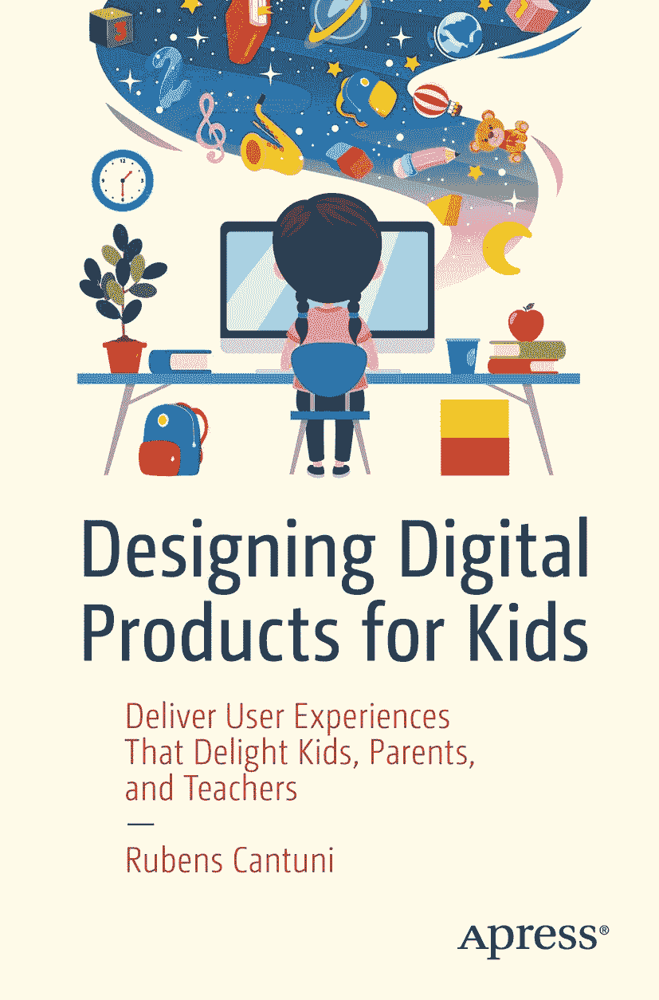

ISBN 978-1-4842-6289-4  
e-ISBN 978-1-4842-6287-0  
[`doi.org/10.1007/978-1-4842-6287-0`](https://doi.org/10.1007/978-1-4842-6287-0)  
© Rubens Cantuni 2020  

本作品受版权保护。出版商保留所有权利，无论是材料的全部还是部分，特别涉及翻译、重印、重用插图、朗诵、广播、以缩微胶卷或任何其他物理方式复制，以及传输或信息存储与检索、电子改编、计算机软件，或目前已知或今后开发的类似或不同方法。在本出版物中使用通用描述性名称、注册商标名称、商标、服务标志等，即使没有明确声明，也不意味着这些名称豁免于相关保护法律和法规，因此可自由使用。出版商、作者和编辑可以假定本书中的建议和信息在出版之日是真实准确的。出版商、作者或编辑均不对本材料中包含的内容或可能出现的任何错误或遗漏提供明示或暗示的保证。出版商在已出版地图和机构隶属关系方面保持中立立场。本书由 Springer Science+Business Media New York 在全球图书贸易中发行，地址：1 New York Plaza, New York, NY 100043。电话：1-800-SPRINGER，传真：(201) 348-4505，电子邮件：`orders-ny@springer-sbm.com`，或访问`www.springeronline.com`。Apress Media, LLC 是加利福尼亚州的一家有限责任公司，其唯一成员（所有者）是 Springer Science + Business Media Finance Inc (SSBM Finance Inc)。SSBM Finance Inc 是一家特拉华州公司。

*献给我的女儿 Yui，她给我的生活带来了欢乐和笑声。*

## 引言

那是 2017 年 4 月洛杉矶一个温暖、阳光明媚的下午。我生平第一次租了一套燕尾服，正准备参加一个需要黑领带着装的活动。我即将离开我在威尼斯区的公寓，前往帕萨迪纳市政礼堂参加日间艾美奖颁奖典礼，我获得了杰出互动奖的提名——而直到那之前的几周，我甚至都不知道有这个奖项存在。

一个意大利数字产品设计师是如何最终与吉尔莫·德尔·托罗这样的同行提名人一起出席活动的呢？这全都归功于我为孩子们设计的一款数字产品。

那天晚上，包括我在内的 StoryBots 数字产品团队，带着一尊沉重的金色奖杯回家了。但我在这类项目上的经验始于几年前，当时我为一家初创公司设计了第一批教育应用，还有为 Swatch 儿童系列设计的网站等等。那么，我为什么要告诉你关于艾美奖的故事呢？是为了炫耀吗？嗯，是的，有一点（这在本书中不会再发生了），但也是为了让你知道，数字儿童产品并非小众或次要类型。你可以从中获得非常有价值的成果；也许不是在马里布买豪宅，但作为设计师，你可以创造出教育和娱乐小人类——我们物种未来的产品，同时或许还能积累一些奖项和认可。这难道不是一件了不起的事吗？

2018 年，我回到意大利，在 Medium 上写了一系列关于本书主题的文章。这些文章引发的关注，以及随之而来的咨询建议请求，让我意识到市场上需要一本关于这个主题的参考书。当我刚开始为儿童设计数字产品时，经历了大量的试错、猜测和无人解答的问题。我写这本书时，真希望当时就能拥有它。

## 本书的组织方式

本书的理念是遵循一个理想化的流程来构思面向儿童的数字产品。从研究开始，了解行业并认识你的目标用户；然后进入概念和设计阶段，从用户体验和交互到用户界面、动画和音效；在发布产品前进行用户测试并验证你的想法；评估可能的商业模式和营销方案。最后，我们还将探讨一些超越屏幕的有趣技术和概念。

每个章节都是独立的，你可以直接跳转到你最感兴趣的那一章。你可以来回翻阅，并轻松地将本书作为参考，当你在产品开发的某个特定阶段需要信息时使用。

## 本书不会涉及的内容

本书的主要读者是数字产品设计师^(¹)，我以此为基础确定了本书的目录。在评估数字产品的合适平台时，我们会在第 6 章讨论一些技术细节，但我们不会讨论编程。原因有二：

-   我认为产品设计师不应该写代码。我认为他们应该了解代码的工作原理，但他们是设计师，应该专注于设计本身。
-   我不是开发者（是的，我做了一些手机游戏，但那是一个需要另一本书讲述的故事），所以我没有资格谈论这个。

这两个都是跳过这个话题并将其留给其他书籍的绝佳理由（市面上有很多这类书，一本比一本名字更神秘）。

我们不会讨论电子游戏（相信我，我很喜欢它们，我可以聊上几个小时——去问我妻子），除非它们明确针对 K-12 儿童。我的意思是：一个 10 岁的孩子可以玩《我的世界》吗？当然可以。一个 6 岁的孩子可以玩《糖果粉碎传奇》吗？是的，当然可以。它们是专门为孩子设计的吗？不是。那么我们就不在本书中讨论它们。

一个大学生会玩《小猪佩奇：假日之旅》吗？除非这位学生是本书的读者并想为孩子设计应用，否则我猜不会。所以我们可能会在本书中讨论那款游戏。

你明白这个意思了。老实说，为了帮助解释某个想法，我偶尔会提到一些非儿童类的电子游戏，但我们绝不会以儿童产品分析的视角来审视它们。

## 这本书在未来一年还有用吗？那后年呢？五年后呢？

我不能保证你的小侄子多年后能靠这本书找到工作。但是，除了一些与当前技术（如设备和开发平台）严格相关的信息外，本书中的大多数概念都有很长的保质期，有些甚至经久不衰——除非未来的孩子生来就拥有超能力，或者技术先进到能读懂我们的思想。

## 为儿童设计与为成人设计真的那么不同吗？

确实不同。框架当然相似，几乎相同，但在如何处理测试、用户体验和用户界面的最佳实践等方面存在特殊性。

为儿童设计取决于许多因素，包括需要考虑儿童身体和心理的快速发育。成人的运动能力和认知能力或多或少会保持稳定多年，而儿童发展迅速，仅仅几个月就足以让他们的能力有显著进步。这对我们如何为儿童设计用户体验有着巨大影响。

在使用应用时，成人的兴趣更倾向于任务导向，这意味着他们知道自己想要完成什么，并且希望快速、轻松地完成。而儿童则更倾向于体验导向；他们享受的是过程，而不是结果。

## 为儿童设计数字产品，需要了解多少儿童发展与教育知识？

了解得越多越好，但没人指望设计师同时成为儿科医生、儿童心理学家或教育学家。你需要掌握每个年龄段对应的认知与身体发育阶段，以及这些阶段涉及的基本内容。如果你正在设计教育体验（但请记住，并非必须严格局限于教育功能），那么在概念阶段和测试阶段都需要该领域专家的支持。

## 为儿童设计产品，必须为人父母吗？

完全不是。事实上，在我女儿出生前，我就已经设计了好几款获奖儿童产品。当然，当她长到足够大，尝试使用这些产品并表现出喜爱时，那种满足感难以言表。

为人父母（除了是人生中最奇妙也最艰难的体验之一）之所以有帮助，是因为它让你更能与孩子共情，能日常感受到他们的思维方式、需求，以及他们稚嫩的心灵如何看待世界。这些内容在测试中也能在一定程度上观察到，但作为父母的"第一手"经验确实是个加分项。但再次强调，专家支持、测试环节和与家长的访谈也完全足够。千万别把"为孩子设计数字产品"当成生孩子的充分理由！

有时，为人父母甚至可能适得其反。风险在于，我们容易根据对一两个孩子（在某些地区可能是十个）的观察就做出假设和决策，并认为这些适用于所有孩子。儿童是人，每个孩子都不同，观察自家孩子并不能验证任何普遍规律。

## 致谢

本书的完成离不开许多人的帮助。

感谢那些愿意被我打扰、回答我"行业洞察"访谈问题的人们。他们中有些是我的朋友和前同事，有些则是因这本书才第一次与我交流。尽管他们都是极其忙碌的专业人士，却依然慷慨地回答了我所有问题，为这个项目提供了巨大价值。

感谢我的女儿 Yui 和妻子 Kanako，她们包容了我在本书漫长创作过程中的忙碌——我为了写作而跳过早餐的清晨、周末的写作时间，以及"抱歉，今晚不看 Netflix 了，我得写完这一章"。

我要感谢所有设计领域的非虚构类作家，他们激励并鼓舞我启动这个项目，让我相信这是可能实现的。

最后，特别感谢 Shivangi Ramachandran、Rita Fernando、Nancy Chen 和 Apress 出版社，他们相信一位首次出书的作者及其项目，并给予了他这个绝佳且富有教育意义的机会。

关于作者注释¹

